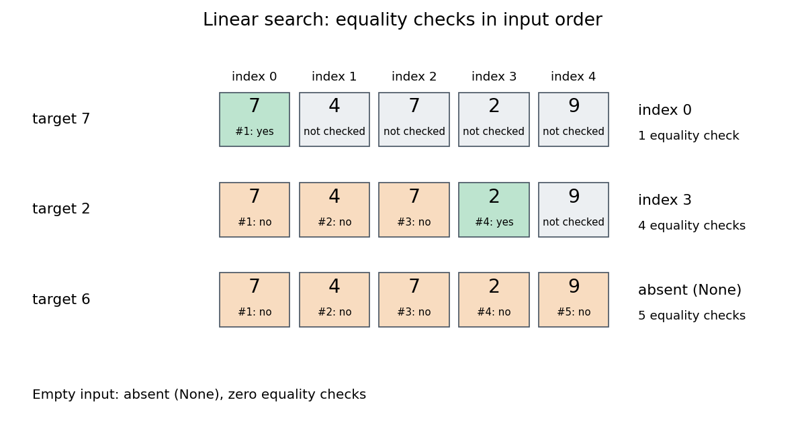

# Linear search

↑ **Parent:** [Algorithm](algorithm-split.md)  
ⓦ [Wiki](https://en.wikipedia.org/wiki/Linear_search)

[Linear search](linear-search.md), also called [sequential search](linear-search.md), examines a finite [sequence](sequence.md) from its beginning, performing an [equality test](equality-test.md) on each entry until one matches the target or the entries run out. It needs no [sorted array](sorted-array.md) or [total order](total-order.md) on the values. This makes it useful for a small collection, a one-off lookup, or data available only in succession: the next entry is enough to make progress.

Specify the answer precisely. For an [array](array-data-structure.md) $A$ of length $n\geq0$ with indices $0,\ldots,n-1$ and target $x$, return the smallest index $j$ satisfying $A_j=x$, or a distinct absent result if no such index exists. Repeated values are allowed. In this contract, finding a later duplicate is insufficient when an earlier match exists. Assume the [input](input-computer-science.md) remains unchanged during the search and each [equality test](equality-test.md) terminates with a stable truth value expressing the intended matching relation.

Here is an implementation in [Python](python-programming-language.md); `None` represents absence and is distinct from the valid index zero:
```
def linear_search(entries, target):
    for index, entry in enumerate(entries):
        if entry == target:
            return index
    return None
```
The official [Python](python-programming-language.md) [sequence](sequence.md) method `s.index(x)` likewise specifies the first occurrence, but signals absence by raising `ValueError`. An API's absent-result convention belongs to its contract.[Python 3.14 documentation, Common Sequence Operations: s.index(x), first occurrence and ValueError](python-3-14-documentation/built-in-types-python-3-14-documentation.md)

Take the original unsorted [array](array-data-structure.md) $A=[7,4,7,2,9]$. For $x=7$, the first [equality test](equality-test.md) succeeds and returns index $0$; the other $7$ at index $2$ is never inspected. For $x=2$, the checks against $7,4,7$ fail, the check against $2$ succeeds, and the answer is index $3$ after four [equality tests](equality-test.md). For absent target $x=6$, all five [equality tests](equality-test.md) fail and the answer is `None`. On the empty [sequence](sequence.md), there is no entry to inspect: return `None` with zero [equality tests](equality-test.md).

<a id="image-linear-search-on-an-unsorted-array-first-duplicate-later-match-and-absent-target"></a>


**[Figure 9](#image-linear-search-on-an-unsorted-array-first-duplicate-later-match-and-absent-target). Linear search on an unsorted array: first duplicate, later match, and absent target**. Indices start at zero. Each numbered cell is one [equality test](equality-test.md); green cells match, orange cells fail, and grey cells are never inspected. The empty [sequence](sequence.md) requires zero [equality tests](equality-test.md).

Value order never justifies skipping an entry in this [algorithm](algorithm-split.md). For $x=2$, stopping because the first value $7$ is larger would give a wrong absent result. Any [permutation](permutation.md) of the [input](input-computer-science.md) remains searchable by [linear search](linear-search.md), although the first matching index and number of [equality tests](equality-test.md) can change. By contrast, [binary search](binary-search.md) uses a [total order](total-order.md) and the [sorted array](sorted-array.md) property to discard whole candidate ranges. Its logarithmic [time complexity](time-complexity.md) additionally assumes cheap access to middle entries; a sorted [linked list](linked-list.md) does not acquire constant-cost indexed access merely by being sorted. Sorting for a single query also has a cost, and changes positions relative to the original [sequence](sequence.md).

**Table of contents**

- [Linear search comparison count](linear-search-comparison-count.md)
- [Linear search correctness](linear-search-correctness.md)

## ↑ Ancestors (3)

1. [Algorithm](algorithm-split.md)
2. [Computer science](computer-science-split.md)
3. [Codex Wiki](split.md)

## ← Incoming links (5)

- [Adjacency list storage and query costs](adjacency-list-storage-and-query-costs.md)
- [Equality test](equality-test.md)
- [Linear search](linear-search.md)
- [Linear search comparison count](linear-search-comparison-count.md)
- [Time complexity](time-complexity.md)
