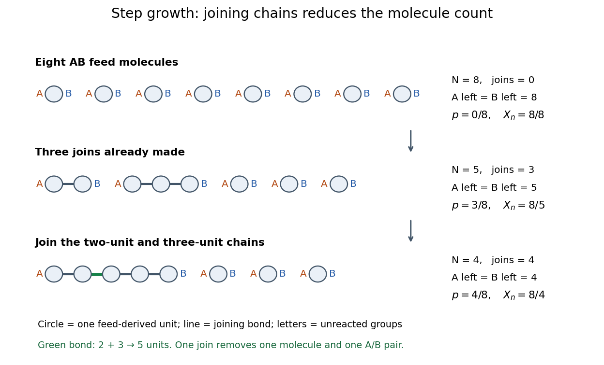

# Linear step-growth molecule count

↑ **Parent:** [Step-growth polymerization](step-growth-polymerization.md)

Use an ideal feed in which every starting [molecule](molecule-split.md) has exactly two suitable [functional groups](functional-group.md): either one $A$ and one $B$, or two $A$ groups mixed with two $B$ groups. Only an $A$–$B$ pairing can form a joining [chemical bond](chemical-bond-split.md). Assume no loss of feed-derived material, no splitting of chains, no competing consumption of the counted [functional groups](functional-group.md), no branching, and no [cyclization in step-growth polymerization](cyclization-in-step-growth-polymerization.md). Linear here describes connectivity; a chain can bend in space. Small byproducts of [polycondensation](polycondensation.md) do not enter the chain-bearing [molecule](molecule-split.md) count.

Let $N_0$ count all initial feed [molecules](molecule-split.md), $J$ the number of intermolecular joins, and $N$ all remaining chain-bearing [molecules](molecule-split.md), including unreacted [monomers](monomer.md). Each join turns two [molecules](molecule-split.md) into one, so $N=N_0-J$ exactly. If chain $i$ contains $j_i$ feed-derived [monomeric units](monomeric-unit.md), conservation gives $\sum_{i=1}^{N}j_i=N_0$. Consequently the number-average [degree of polymerization](degree-of-polymerization.md) is

$$
X_n=\frac{\sum_{i=1}^{N}j_i}{N}=\frac{N_0}{N_0-J}.
$$

This is a count of both feed species' [monomeric units](monomeric-unit.md), rather than a count of interior [constitutional repeating units](repeat-unit.md). For $AA+BB$ chemistry an interior repeat often contains two feed-derived units, as explained in [monomer](monomer.md). Equal [functional group](functional-group.md) reactivities are not needed for this bookkeeping at a specified $J$; predicting a time course or a chain-length [probability distribution](probability-distribution-split.md) requires additional assumptions.

**[Figure 5](#image-step-growth-molecular-joining-count). Exact step-growth polymerization count: joining a two-unit chain to a three-unit chain consumes one pair of functional groups**. Original stipulated eight-$AB$-molecule example. Circles are feed-derived [monomeric units](monomeric-unit.md), lines joining [chemical bonds](chemical-bond-split.md), and letters the surviving [functional groups](functional-group.md). Internal $A$ and $B$ groups have already reacted and are not drawn. The depicted layouts are schematic connectivity, not molecular geometry or sampled experimental chains.

For the figure's eight $AB$ feed [molecules](molecule-split.md), three joins can give lengths $(2,3,1,1,1)$, so $N=5$ and $X_n=8/5$. Joining the first two chains gives $(5,1,1,1)$: the incorporated total stays eight, $N$ becomes four, and $X_n=2$. A [graph](graph-split.md) makes the bookkeeping visible: each starting [monomer molecule](monomer-molecule.md) is a [vertex of a graph](vertex-graph-theory.md), and each intermolecular joining [chemical bond](chemical-bond-split.md) connects two previously distinct [connected components of a graph](component-graph-theory.md). The connected pieces are the counted [molecules](molecule-split.md).

**Table of contents**

- [Functional-group conversion in step growth](functional-group-conversion-in-step-growth.md)

## ↑ Ancestors (5)

1. [Step-growth polymerization](step-growth-polymerization.md)
2. [Polymerization](polymerization.md)
3. [Polymer](polymer-split.md)
4. [Chemistry](chemistry-split.md)
5. [Codex Wiki](split.md)

## ← Incoming links (3)

- [Carothers equation](carothers-equation.md)
- [Functionality in polymerization](functionality-in-polymerization.md)
- [Gelation](gelation.md)
