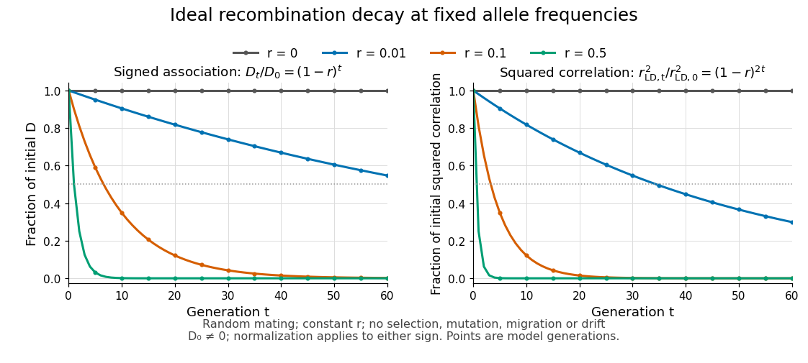

# Linkage-disequilibrium decay under recombination

↑ **Parent:** [Linkage disequilibrium](linkage-disequilibrium.md)

[Genetic recombination](genetic-recombination.md) erodes [linkage disequilibrium](linkage-disequilibrium.md) by reshuffling [alleles](allele.md) between [haplotypes](haplotype.md), while preserving marginal [allele frequencies](allele-frequency.md) in the idealized model. Let $f_{AB,t}$ denote the [haplotype frequency](haplotype-frequency.md) in the [gamete](gamete.md) pool of generation $t$, let $p,q$ denote its marginal [allele frequencies](allele-frequency.md), and let $r\in[0,1/2]$ be the constant [recombination fraction](recombination-fraction.md) between two autosomal [genetic loci](genetic-locus.md). Assume [random mating](panmixia.md) within one population, nonoverlapping generations, fair [Mendelian segregation](mendelian-segregation.md), equal reciprocal [gamete](gamete.md) production, the same $r$ in both sexes, and a deterministic population large enough to neglect [genetic drift](genetic-drift.md). Exclude [natural selection](natural-selection.md), [mutation](mutation.md) and [gene flow](gene-flow.md). Then

$$
f_{AB,t+1}=(1-r)f_{AB,t}+rpq=f_{AB,t}-rD_t,
\qquad D_{t+1}=(1-r)D_t,
\qquad D_t=(1-r)^tD_0.
$$

Here $p$ and $q$ remain constant: recombining changes which [alleles](allele.md) occur together, not their total numbers. The other [haplotype frequencies](haplotype-frequency.md) change by $+rD_t$ for $Ab,aB$ and $-rD_t$ for $ab$. Consequently the [joint probability distribution](joint-probability-distribution.md) stays within its allowed bounds and approaches the product of its [marginal distributions](marginal-distribution.md) when $r>0$.

For the original positive example $p=0.60,q=0.40,D_0=0.12$, a [recombination fraction](recombination-fraction.md) $r=0.10$ gives $D_1=0.108$ and $D_{10}\approx0.04184$. The negative example $D_0=-0.12$ has exactly the opposite sequence: [genetic recombination](genetic-recombination.md) reduces the magnitude without reversing the sign. With $r=0$, the initial [linkage disequilibrium](linkage-disequilibrium.md) persists in this model; even [independent assortment](independent-assortment.md) at $r=1/2$ only halves $D$ each generation. A population association does not vanish after one generation merely because the [genetic loci](genetic-locus.md) are unlinked.

**[Figure 87](#image-idealized-linkage-disequilibrium-decay-under-recombination-at-four-recombination-fractions-with-faster-decay-of-squared-allelic-correlation-when-marginal-allele-frequencies-remain-fixed). Idealized linkage-disequilibrium decay under recombination at four recombination fractions, with faster decay of squared allelic correlation when marginal allele frequencies remain fixed**.

The [geometric sequence](geometric-progression.md) gives a generation scale: for $r>0$, the continuous interpolation reaches $|D_0|/2$ at $t_{1/2}=\log(1/2)/\log(1-r)$. Actual generations are integers; the first at or below half is $\lceil t_{1/2}\rceil$. For small $r$, $t_{1/2}\approx(\log 2)/r$. Because the denominator of [allelic correlation](allelic-correlation.md) stays fixed, $r_{\mathrm{LD},t}^2=(1-r)^{2t}r_{\mathrm{LD},0}^2$; its decay is faster than the magnitude of $D_t$.

A short derivation uses [random mating](panmixia.md) to assign frequency $2f_{AB}f_{ab}$ to the double [heterozygote](heterozygote.md) $AB/ab$ and $2f_{Ab}f_{aB}$ to $Ab/aB$. Relative to $r=0$, each loses or gains an $AB$ [gamete](gamete.md) fraction $r/2$, respectively. Their net contribution is $r(f_{Ab}f_{aB}-f_{AB}f_{ab})=-rD$. The other [genotypes](genotype.md) produce no net change in $f_{AB}$, proving the recurrence and, by iteration, its solution.

This temporal model does not identify elapsed generations from physical separation alone. The [recombination fraction](recombination-fraction.md) depends on [genetic recombination](genetic-recombination.md), including [recombination hotspots](recombination-hotspot.md), while [population stratification](population-stratification.md), [natural selection](natural-selection.md), [gene flow](gene-flow.md) or [genetic drift](genetic-drift.md) can create or maintain [linkage disequilibrium](linkage-disequilibrium.md). Repeated sampling across time would also require accounting for [sample size](sample-size.md) and [haplotype estimation](haplotype-estimation.md). A cross-sectional plot of association against distance between [genetic loci](genetic-locus.md) is therefore a different observation from the idealized trajectory plotted here.

## ↑ Ancestors (5)

1. [Linkage disequilibrium](linkage-disequilibrium.md)
2. [Population genetics](population-genetics.md)
3. [Genetics](genetics.md)
4. [Biology](biology-split.md)
5. [Codex Wiki](split.md)

## ← Incoming links (3)

- [Linkage disequilibrium](linkage-disequilibrium.md)
- [Linkage-disequilibrium decay under recombination](linkage-disequilibrium-decay-under-recombination.md)
- [Solution](past-exam-of-the-mathematics-course-of-the-university-of-cambridge/2004/iii/paper-39/2/solution.md)
