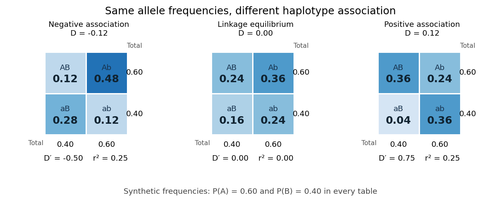

# Linkage disequilibrium

↑ **Parent:** [Population genetics](population-genetics.md)  
ⓦ [Wiki](https://en.wikipedia.org/wiki/Linkage_disequilibrium)

[Linkage disequilibrium](linkage-disequilibrium.md) means that knowing an [allele](allele.md) at one [genetic locus](genetic-locus.md) changes the [probability](probability.md) of an [allele](allele.md) at another [genetic locus](genetic-locus.md) in population [haplotypes](haplotype.md). It compares their [joint probability distribution](joint-probability-distribution.md) with the product of their [marginal distributions](marginal-distribution.md). This is useful because a [genetic marker](genetic-marker.md) can carry information about another [genetic locus](genetic-locus.md): [tag SNPs](tag-snp.md) exploit this redundancy, without establishing a causal [genetic association](genetic-association.md).

Consider two [genetic loci](genetic-locus.md) with [alleles](allele.md) $A,a$ and $B,b$. Sample one [haplotype](haplotype.md), rather than an unphased [diploid](diploid.md) [genotype](genotype.md). Write its four [haplotype frequencies](haplotype-frequency.md) as $f_{AB},f_{Ab},f_{aB},f_{ab}$, summing to one, and set the marginal [allele frequencies](allele-frequency.md) to $p=f_{AB}+f_{Ab}$ and $q=f_{AB}+f_{aB}$. The [linkage disequilibrium](linkage-disequilibrium.md) coefficient is

$$
D=f_{AB}-pq=f_{AB}f_{ab}-f_{Ab}f_{aB}.
$$

The second expression follows by substituting $f_{ab}=1-f_{AB}-f_{Ab}-f_{aB}$. The entire two-locus [joint probability distribution](joint-probability-distribution.md) is then

$$
\begin{array}{c|cc|c}
 &B&b&\text{total}\\\hline
A&pq+D&p(1-q)-D&p\\
a&(1-p)q-D&(1-p)(1-q)+D&1-p\\\hline
\text{total}&q&1-q&1
\end{array}
$$

Every row and column sum is unchanged when $D$ varies. [Linkage equilibrium](linkage-equilibrium.md) means $D=0$: all four [haplotype frequencies](haplotype-frequency.md) equal products of [allele frequencies](allele-frequency.md), so the two [allele](allele.md) indicators are [independent random variables](independent-random-variables.md). For $p>0$, the [conditional probability](conditional-probability.md) $P(B\mid A)=q+D/p$ shows directly how positive $D$ enriches $B$ among copies carrying $A$, while negative $D$ depletes it. Positive $D$ also enriches $ab$; negative $D$ enriches $Ab$ and $aB$. Swapping the labels $A$ and $a$ reverses the sign of $D$, so neither sign is intrinsically favorable.

For example, fix the [allele frequencies](allele-frequency.md) at $p=0.60,q=0.40$. At [linkage equilibrium](linkage-equilibrium.md), the [haplotype frequencies](haplotype-frequency.md) in the order $AB,Ab,aB,ab$ are $(0.24,0.36,0.16,0.24)$. Positive [linkage disequilibrium](linkage-disequilibrium.md) $D=0.12$ instead gives $(0.36,0.24,0.04,0.36)$, with $P(B\mid A)=0.60$; negative [linkage disequilibrium](linkage-disequilibrium.md) $D=-0.12$ gives $(0.12,0.48,0.28,0.12)$, with $P(B\mid A)=0.20$. Counting each [allele](allele.md) separately would miss the difference.

**[Figure 86](#image-three-haplotype-joint-probability-distributions-with-identical-marginal-allele-frequencies-showing-negative-linkage-disequilibrium-linkage-equilibrium-and-positive-linkage-disequilibrium). Three haplotype joint probability distributions with identical marginal allele frequencies, showing negative linkage disequilibrium, linkage equilibrium and positive linkage disequilibrium**.

Nonnegative [haplotype frequencies](haplotype-frequency.md) constrain $D$. Define the nonnegative bounds $L=\min(pq,(1-p)(1-q))$ and $U=\min(p(1-q),(1-p)q)$. The four entries above give

$$
-L\le D\le U,\qquad \max(0,p+q-1)\le f_{AB}\le\min(p,q).
$$

Thus $|D|\le1/4$ globally, but a particular pair of [allele frequencies](allele-frequency.md) usually permits a smaller, asymmetric interval. The [standardized linkage disequilibrium](standardized-linkage-disequilibrium.md) convention used here retains the sign:

$$
D'=\begin{cases}D/U&D>0,\\0&D=0,\\D/L&D<0,\end{cases}
\qquad -1\le D'\le1.
$$

This convention requires $0<p,q<1$; if either [genetic locus](genetic-locus.md) has only one [allele](allele.md) in the population, $D=0$ but normalized measures are undefined. Some presentations report only $|D'|$. At $D'=1$ or $-1$, at least one of the four [haplotypes](haplotype.md) has zero frequency; this alone does not prove that [genetic recombination](genetic-recombination.md) has never occurred.

For the [indicator random variables](indicator-random-variable.md) $X=\mathbf{1}_{A}$ and $Y=\mathbf{1}_{B}$, their [covariance](covariance.md) is $D$, and their [variances](variance-split.md) are $p(1-p)$ and $q(1-q)$. The [allelic correlation](allelic-correlation.md) measure is their squared [correlation coefficient](pearson-correlation-coefficient.md),

$$
r_{\mathrm{LD}}^2=\frac{D^2}{p(1-p)q(1-q)},\qquad
0\le r_{\mathrm{LD}}^2\le\frac{\max(L^2,U^2)}{p(1-p)q(1-q)}\le1.
$$

The subscript distinguishes it from the [recombination fraction](recombination-fraction.md) $r$ in [linkage-disequilibrium decay under recombination](linkage-disequilibrium-decay-under-recombination.md). Squaring loses the association's sign. In the illustrated positive and negative examples, $r_{\mathrm{LD}}^2=0.25$ in both, whereas $D'=0.75$ and $-0.50$, respectively. For another original example, take $p=0.10,q=0.50,f_{AB}=0.10$: then $D=0.05,D'=1$, yet $r_{\mathrm{LD}}^2=1/9$. Every $A$ carries $B$, but most copies carrying $B$ lack $A$. The frequency constraints and the distinction between these normalizations are analyzed in [Mathematical properties of the r² measure of linkage disequilibrium by Jenna M. VanLiere and others](mathematical-properties-of-the-r%C2%B2-measure-of-linkage-disequilibrium-by-jenna-m-vanliere-and-others.md) (sections 2.1 and 2.5, pp. 131–132 and 135–136).

[Genetic linkage](genetic-linkage.md) describes transmission through [meiosis](meiosis.md); [linkage disequilibrium](linkage-disequilibrium.md) describes a population's [haplotype frequencies](haplotype-frequency.md). Nearby [genetic loci](genetic-locus.md) on a [chromosome](chromosome.md) can be in [linkage equilibrium](linkage-equilibrium.md). Conversely, mixing populations can create [linkage disequilibrium](linkage-disequilibrium.md) even between [genetic loci](genetic-locus.md) on different [chromosomes](chromosome.md). For example, mix equal numbers of independently sampled [haplotypes](haplotype.md) from two populations, each internally at [linkage equilibrium](linkage-equilibrium.md), with $p=q=0.80$ in one and $p=q=0.20$ in the other. The pooled [allele frequencies](allele-frequency.md) are $p=q=0.50$, but $f_{AB}=(0.64+0.04)/2=0.34$, giving $D=0.09$. This is a consequence of [population stratification](population-stratification.md), not a measurement of the [recombination fraction](recombination-fraction.md).

Measured [haplotype frequencies](haplotype-frequency.md) also depend on the sample. Finite [sample size](sample-size.md), related individuals, [genetic-study ascertainment](genetic-study-ascertainment.md), [genotyping error](genotyping-error.md) and uncertain [haplotype estimation](haplotype-estimation.md) can change an estimate. A missing rare [haplotype](haplotype.md) can give empirical $|D'|=1$ without demonstrating its absence from the population. Report the sample definition and [allele frequencies](allele-frequency.md) alongside the association measure; a nonzero sample estimate alone does not establish nonzero population [linkage disequilibrium](linkage-disequilibrium.md).

A concrete dataset is the 2005 [A haplotype map of the human genome by The International HapMap Consortium](a-haplotype-map-of-the-human-genome-by-the-international-hapmap-consortium.md). The International HapMap Consortium used [genotyping](genotyping.md) platforms including Illumina BeadArray to obtain [SNP](single-nucleotide-polymorphism.md) [genotype](genotype.md) calls from 269 [DNA](deoxyribonucleic-acid.md) samples across four collections: 30 parent–offspring trios from Ibadan, 30 trios from Utah, 45 unrelated individuals from Beijing and 44 from Tokyo. Parent–offspring trios and the PHASE algorithm supplied [haplotype estimation](haplotype-estimation.md), rather than direct observation of every [chromosome](chromosome.md). In Figure 7, 36 [SNPs](single-nucleotide-polymorphism.md) resolve seven [haplotypes](haplotype.md) in a [chromosome](chromosome.md) 2 region in the Utah panel; seven [tag SNPs](tag-snp.md) capture the 36 [SNPs](single-nucleotide-polymorphism.md) at $r_{\mathrm{LD}}^2\ge0.8$. The readout demonstrates reusable [allelic correlation](allelic-correlation.md), not causal effects.

Controls required over 80% complete calls, at most one discordance among five duplicate [genotypes](genotype.md), at most one [Mendelian segregation](mendelian-segregation.md) error per trio panel, and a [Hardy-Weinberg equilibrium](hardy-weinberg-principle.md) test with $P>0.001$; blind reassessment checked performance. Minor [allele frequencies](allele-frequency.md) of at least 0.05 were targeted, the collections were not population-representative, and inferred [haplotypes](haplotype.md) retain phase uncertainty. These limits restrict extrapolation of [linkage disequilibrium](linkage-disequilibrium.md).[pp. 1300–1302, Table 1; Figure 7, p. 1306; Methods, p. 1316](a-haplotype-map-of-the-human-genome-by-the-international-hapmap-consortium.md)

**Table of contents**

- [Linkage equilibrium](linkage-equilibrium.md)
- [Standardized linkage disequilibrium](standardized-linkage-disequilibrium.md)
- [Linkage-disequilibrium decay under recombination](linkage-disequilibrium-decay-under-recombination.md)
- [Allelic correlation](allelic-correlation.md)

## ↑ Ancestors (4)

1. [Population genetics](population-genetics.md)
2. [Genetics](genetics.md)
3. [Biology](biology-split.md)
4. [Codex Wiki](split.md)

## ← Incoming links (24)

- [Allelic correlation](allelic-correlation.md)
- [Association mapping](association-mapping.md)
- [Genetic association](genetic-association.md)
- [Genetic linkage](genetic-linkage.md)
- [Haplotype block](haplotype-block.md)
- [Haplotype estimation](haplotype-estimation.md)
- [Haplotype frequency](haplotype-frequency.md)
- [Linkage disequilibrium](linkage-disequilibrium.md)
- [Linkage-disequilibrium decay under recombination](linkage-disequilibrium-decay-under-recombination.md)
- [Linkage-disequilibrium marker tagging](linkage-disequilibrium-marker-tagging.md)
- [Solution](past-exam-of-the-mathematics-course-of-the-university-of-cambridge/2003/iii/paper-40/5/i/solution.md)
- [Solution](past-exam-of-the-mathematics-course-of-the-university-of-cambridge/2003/iii/paper-40/5/v/solution.md)
- [Solution](past-exam-of-the-mathematics-course-of-the-university-of-cambridge/2004/iii/paper-39/2/solution.md)
- [Solution](past-exam-of-the-mathematics-course-of-the-university-of-cambridge/2005/iii/paper-45/4/i/solution.md)
- [Solution](past-exam-of-the-mathematics-course-of-the-university-of-cambridge/2005/iii/paper-45/4/ii/solution.md)
- [Solution](past-exam-of-the-mathematics-course-of-the-university-of-cambridge/2005/iii/paper-45/4/iii/solution.md)
- [Solution](past-exam-of-the-mathematics-course-of-the-university-of-cambridge/2005/iii/paper-45/4/v/solution.md)
- [Solution](past-exam-of-the-mathematics-course-of-the-university-of-cambridge/2006/iii/paper-45/1/c/solution.md)
- [Solution](past-exam-of-the-mathematics-course-of-the-university-of-cambridge/2006/iii/paper-45/2/a/solution.md)
- [Phase averaging in a linkage likelihood](phase-averaging-in-a-linkage-likelihood.md)
- [Population bottleneck](population-bottleneck.md)
- [Recombination hotspot](recombination-hotspot.md)
- [Standardized linkage disequilibrium](standardized-linkage-disequilibrium.md)
- [Tag SNP](tag-snp.md)
