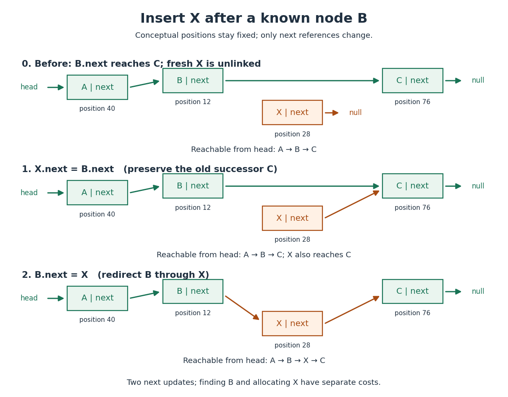

# Linked list

↑ **Parent:** [Data structure](data-structure-split.md)  
ⓦ [Wiki](https://en.wikipedia.org/wiki/Linked_list)

A [data structure](data-structure-split.md) representing a [sequence](sequence.md) through [linked list nodes](linked-list-node.md) and links between them. In the singly linked representation used here, each [linked list node](linked-list-node.md) holds an item and a `next` reference to its successor. `head` identifies the first [linked list node](linked-list-node.md); the final `next` is `null`, meaning no successor. An empty [linked list](linked-list.md) has `head = null`. Sedgewick and Wayne use this representation to implement both a [stack](stack-data-structure.md) and a [FIFO queue](fifo-queue.md). [Sedgewick and Wayne, Algorithms, section 1.3: linked lists](https://algs4.cs.princeton.edu/13stacks/index.php)

For $A\to B\to C$, place the [linked list nodes](linked-list-node.md) at conceptual [computer memory](computer-memory.md) positions $40,12,76$, respectively. These deliberately separated labels describe a toy layout, not actual pointer values. The [sequence](sequence.md) order comes from the links, not increasing positions. To read index $2$, begin at `head` and follow two `next` references. For index $i$, this takes $i$ link-following steps and $O(1+i)$ [time complexity](time-complexity.md), hence $O(n)$ in the worst case for $n$ [linked list nodes](linked-list-node.md), under the constant-cost operations assumed for the [array](array-data-structure.md) example. [Pat Morin, Open Data Structures, chapter 3: links versus indexed access](https://opendatastructures.org/ods-java/3_Linked_Lists.html)

Suppose a reference to the existing [linked list node](linked-list-node.md) $B$ is already known. To insert a fresh [linked list node](linked-list-node.md) $X$ after it, first set `X.next = B.next`, preserving the old successor $C$, and then set `B.next = X`. The result is $A\to B\to X\to C$; none of the old items moves. Reversing these assignments would read the newly changed `B.next` and set `X.next = X`, losing the route to $C$ from `head`. This is a two-update [algorithm correctness](algorithm-correctness.md) argument, rather than a claim that finding the insertion location is free.

**[Figure 18](#image-insert-a-linked-list-node-by-preserving-the-successor-before-redirecting-the-incoming-link). Insert a linked list node by preserving the successor before redirecting the incoming link**.

The two pointer updates take $O(1)$ time in [Big O notation](big-o-notation.md). The complete insertion has $O(1)$ [time complexity](time-complexity.md) if the predecessor is already known, allocating and initializing the fixed-size [linked list node](linked-list-node.md) costs $O(1)$, and copying its item has constant cost. Finding $B$ from `head` can instead cost $O(n)$; a position described only by an index does not confer the constant-cost advantage. This makes a [linked list](linked-list.md) useful when an [algorithm](algorithm-split.md) already holds the needed [linked list node](linked-list-node.md), or repeatedly works at the front as a [stack](stack-data-structure.md) does.

Deletion similarly needs the incoming link: to remove $X$ after known $B$, set `B.next = X.next`. A reference to $X$ alone does not identify its predecessor in this singly linked representation. The head is a special case: after checking for a nonempty [linked list](linked-list.md), remove it with `head = head.next`. If a tail reference is also maintained, deleting the only [linked list node](linked-list-node.md) must clear that reference too; a stored length must also be updated. Removing a [linked list node](linked-list-node.md) from the [sequence](sequence.md) and reclaiming its storage are separate responsibilities. [Pat Morin, Open Data Structures, section 3.1: head removal and empty-list bookkeeping](https://opendatastructures.org/ods-java/3_1_SLList_Singly_Linked_Li.html)

There are practical costs beyond [Big O notation](big-o-notation.md). Each singly linked [linked list node](linked-list-node.md) needs a successor reference in addition to its item; separate allocation may add further overhead, while an [array](array-data-structure.md) can reserve unused capacity. Consecutive [array](array-data-structure.md) slots can make a scan reuse nearby contents already brought into a [memory cache](cache-computing.md); separated [linked list nodes](linked-list-node.md) can make link following wait for successive [computer memory](computer-memory.md) fetches. These are layout-dependent effects, not a guarantee that every [array](array-data-structure.md) operation beats every [linked list](linked-list.md) operation on every machine. An [array](array-data-structure.md) of references can still lead to scattered objects, and [linked list nodes](linked-list-node.md) can be allocated close together. [Ulrich Drepper, What Every Programmer Should Know About Memory, sections 3.3 and 6.2: access patterns and cache use](https://people.freebsd.org/~lstewart/articles/cpumemory.pdf)

**Table of contents**

- [Linked list node](linked-list-node.md)
- [Mutable list](mutable-list.md)
- [Lazy list](lazy-list.md)

## ↑ Ancestors (3)

1. [Data structure](data-structure-split.md)
2. [Computer science](computer-science-split.md)
3. [Codex Wiki](split.md)

## ← Incoming links (24)

- [Abstract data type](abstract-data-type.md)
- [Adjacency list](adjacency-list.md)
- [Adjacency list storage and query costs](adjacency-list-storage-and-query-costs.md)
- [Array (data structure)](array-data-structure.md)
- [FIFO queue](fifo-queue.md)
- [Hash collision](hash-collision.md)
- [Hash function](hash-function.md)
- [Lazy list](lazy-list.md)
- [Linear search](linear-search.md)
- [Linear search comparison count](linear-search-comparison-count.md)
- [Linked list](linked-list.md)
- [Linked list node](linked-list-node.md)
- [List (abstract data type)](list-abstract-data-type.md)
- [Merge algorithm](merge-algorithm.md)
- [Merge sort](merge-sort.md)
- [Mutable list](mutable-list.md)
- [Solution](past-exam-of-the-mathematics-course-of-the-university-of-cambridge/2006/ia/paper-5/6/a/i/solution.md)
- [Solution](past-exam-of-the-mathematics-course-of-the-university-of-cambridge/2006/ia/paper-5/6/a/ii/solution.md)
- [Solution](past-exam-of-the-mathematics-course-of-the-university-of-cambridge/2006/ia/paper-5/9/e/solution.md)
- [Solution](past-exam-of-the-mathematics-course-of-the-university-of-cambridge/2007/ia/paper-5/1/a/solution.md)
- [Separate chaining](separate-chaining.md)
- [Sorted array](sorted-array.md)
- [Stack (data structure)](stack-data-structure.md)
- [Time complexity](time-complexity.md)
