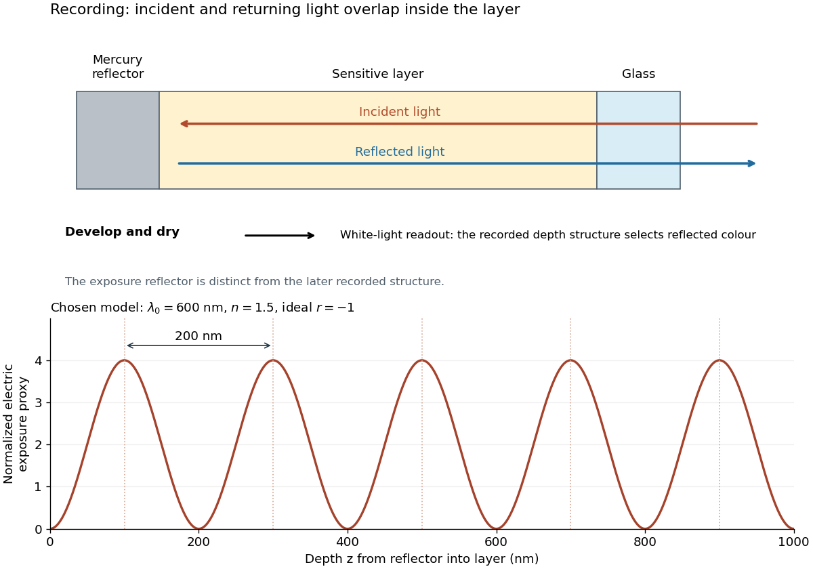

# Lippmann fringe spacing

↑ **Parent:** [Lippmann plate](lippmann-plate.md)

At [normal incidence](normal-incidence.md), let $z$ measure distance from the reflector into a uniform transparent layer with [refractive index](refractive-index.md) $n$. For a [monochromatic wave](monochromatic-wave.md) of [vacuum](vacuum.md) [wavelength](wavelength.md) $\lambda_0$, the layer [wavenumber](wavenumber.md) is $k=2\pi n/\lambda_0$. Represent the incident and returning [electric fields](electric-field-split.md) by complex [wave amplitudes](wave-amplitude.md) with time factor $e^{-i\omega t}$ suppressed:

$$
E_i(z)=E_0e^{-ikz},\qquad E_r(z)=rE_0e^{ikz},\qquad r=|r|e^{i\phi}.
$$

The time-averaged squared [electric field](electric-field-split.md), normalized to the incident contribution, is

$$
\frac{\langle E^2\rangle}{\langle E_i^2\rangle}
=1+|r|^2+2|r|\cos(2kz+\phi).
$$

This electric exposure pattern has maxima separated by

$$
2kd=2\pi,\qquad d=\frac{\pi}{k}=\frac{\lambda_0}{2n}.
$$

The [wave phase](phase-waves.md) of the reflector shifts the maxima's positions but leaves their spacing unchanged in this uniform-layer model. The electric pattern, rather than the zero net [energy flux](energy-flux.md) of an ideal [standing wave](standing-wave.md), is the relevant exposure proxy. An imperfect mirror reduces its contrast: $(I_{\max}-I_{\min})/(I_{\max}+I_{\min})=2|r|/(1+|r|^2)$, where $I$ denotes this exposure proxy.

Choose $\lambda_0=600\,\mathrm{nm}$ and $n=1.5$. Then the medium [wavelength](wavelength.md) is $400\,\mathrm{nm}$ and $d=200\,\mathrm{nm}$. For an ideal phase-reversing reflector, $r=-1$ and the normalized pattern is $4\sin^2(kz)$: its first two maxima are at $z=100$ and $300\,\mathrm{nm}$. These are chosen calculations, not measured properties of a historical [photographic emulsion](photographic-emulsion.md) or the optical response of [Mercury](mercury-planet.md).

**[Figure 21](#image-a-standing-wave-records-depth-fringes-200-mathrm-nm-apart). A standing wave records depth fringes $200\,\mathrm{nm}$ apart**. [Source](lippmann-standing-wave-depth-fringes.py). Original schematic and calculation for chosen $\lambda_0=600\,\mathrm{nm}$, $n=1.5$ and an ideal phase-reversing mirror. The upper diagram distinguishes recording with a reflector from later reflected-colour readout. The lower plot shows the normalized electric exposure pattern, not a measured developed density profile. The first fringe position depends on reflector [wave phase](phase-waves.md); the period does not. Material widths in the apparatus schematic are illustrative.

For multiple mutually incoherent [wavelengths](wavelength.md), time averaging adds exposure contributions rather than their instantaneous [electric fields](electric-field-split.md). In a linearized recording model,

$$
D(z)\propto\int S(\lambda_0)q(\lambda_0)
\left[1+|r(\lambda_0)|^2+2|r(\lambda_0)|\cos\left(\frac{4\pi n(\lambda_0)z}{\lambda_0}+\phi(\lambda_0)\right)\right]d\lambda_0.
$$

Here $S$ is incident spectral exposure density, $q$ a wavelength-dependent recording sensitivity and $D$ a model exposure response. An [optical spectrum](optical-spectrum.md) therefore writes overlapping depth oscillations, not necessarily visibly separated sheets. This is a useful connection to the [Fourier transform](fourier-transform-split.md): approximately, depth is paired with optical spatial [frequency](frequency.md) $2n/\lambda_0$. Finite recording depth, varying sensitivity and nonlinear [photographic processing](photographic-processing.md) prevent treating this expression as an exact inversion rule for an actual plate.

## ↑ Ancestors (5)

1. [Lippmann plate](lippmann-plate.md)
2. [Optics](optics-split.md)
3. [Branches of physics](branches-of-physics.md)
4. [Physics](physics-split.md)
5. [Codex Wiki](split.md)
