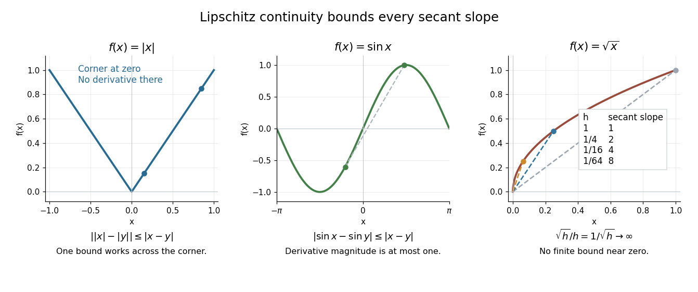

# Lipschitz continuity

↑ **Parent:** [Real analysis](real-analysis-split.md)  
ⓦ [Wiki](https://en.wikipedia.org/wiki/Lipschitz_continuity)

A [function](function-split.md) $f:X\to Y$ between [metric spaces](metric-space.md) is Lipschitz continuous if one finite number $L\geq0$ controls every change of output by the corresponding change of input:

$$
d_Y(f(x),f(y))\leq Ld_X(x,y)\qquad(x,y\in X).
$$

For real inputs and outputs this is $|f(x)-f(y)|\leq L|x-y|$. The same bound must work for every pair in the specified [domain of a function](domain-of-a-function.md). It gives a quantitative version of [continuity](continuous-function.md): an input error of at most $\varepsilon$ produces an output error of at most $L\varepsilon$. The least possible bound is the [Lipschitz constant](lipschitz-constant.md). Lebl presents the real and metric-space definitions and their connection with [uniform continuity](uniform-continuity.md). [Jiří Lebl, Basic Analysis I, Sections 3.4 and 7.5; accessed 2026-10-12](https://www.jirka.org/ra/realanal.pdf)

Three [functions](function-split.md) show why this condition differs from [differentiability](differentiability.md). The [absolute value](absolute-value.md) $f(x)=|x|$ has a corner at zero, but the [reverse triangle inequality](reverse-triangle-inequality.md) gives $||x|-|y||\leq|x-y|$, so it has [Lipschitz constant](lipschitz-constant.md) one on the [real line](real-line.md). The [sine](sine.md) is smooth and also has [Lipschitz constant](lipschitz-constant.md) one: the [mean value theorem](mean-value-theorem.md) and $|\cos t|\leq1$ bound every secant slope. The [square root](square-root.md) is [continuous](continuous-function.md) on $[0,1]$, but

$$
\frac{|\sqrt h-\sqrt0|}{|h-0|}=\frac1{\sqrt h}\longrightarrow\infty
\qquad(h\downarrow0).
$$

No finite [Lipschitz bound](lipschitz-bound.md) works on that [interval](interval-mathematics.md). At $h=1,1/4,1/16,1/64$, the ratios are $1,2,4,8$. Smaller input changes near zero therefore require larger amplification factors.

**[Figure 12](#image-bounded-secant-slopes-permit-a-corner-while-the-square-root-needs-unbounded-amplification-near-zero). Bounded secant slopes permit a corner, while the square root needs unbounded amplification near zero**.

For a real [function](function-split.md), [Lipschitz continuity](lipschitz-continuity.md) means that the absolute slopes of all [secant lines](secant-line.md) are bounded. If the [derivative](derivative.md) exists at a point, taking a [limit](limit-of-a-function.md) of those slopes gives $|f'(x)|\leq L$. In the other direction, a [function](function-split.md) that is [continuous](continuous-function.md) on a real [interval](interval-mathematics.md), [differentiable](differentiable-function.md) in its interior, and satisfies $|f'|\leq L$ there is [Lipschitz continuous](lipschitz-continuity.md) by the [mean value theorem](mean-value-theorem.md). The [interval](interval-mathematics.md) hypothesis matters: the theorem uses the segment connecting the two inputs.

A [Lipschitz function](lipschitz-continuity.md) is [uniformly continuous](uniform-continuity.md): for $L>0$, choosing input tolerance $\delta=\varepsilon/L$ works at every point. If $L=0$, the function is constant. The converse fails; the [square root](square-root.md) on $[0,1]$ is [uniformly continuous](uniform-continuity.md), and satisfies the weaker [Hölder continuity](holder-condition.md) bound $|\sqrt x-\sqrt y|\leq\sqrt{|x-y|}$, without a finite [Lipschitz constant](lipschitz-constant.md). These distinctions are developed in Lebl's worked examples. [Lebl, Section 3.4, Proposition 3.4.8 and Examples 3.4.9–3.4.10](https://www.jirka.org/ra/realanal.pdf)

The usefulness is controlled sensitivity. Successive [Lipschitz maps](lipschitz-continuity.md) with bounds $L$ and $M$ have a [function composition](function-composition.md) with bound $ML$, because each stage amplifies the previous distance by at most its own bound. For an [ordinary differential equation](ordinary-differential-equation.md), [Lipschitz continuity](lipschitz-continuity.md) in the unknown state is the condition that makes nearby trial solutions controllably close in the [Picard-Lindelöf theorem](picard-lindelof-theorem.md). For incomplete data, the [McShane extension theorem](mcshane-extension-theorem.md) fills in unobserved values while preserving the same bound. This one inequality connects error estimates, uniqueness, and [interpolation](interpolation-split.md).

**Table of contents**

- [Bi-Lipschitz map](bi-lipschitz-map.md)
- [Bounded Lipschitz norm](bounded-lipschitz-norm.md)
  - [Diagonal compactness for bounded Lipschitz functions](diagonal-compactness-for-bounded-lipschitz-functions.md)
  - [Pointwise closure of the bounded Lipschitz unit ball](pointwise-closure-of-the-bounded-lipschitz-unit-ball.md)
- [One-sided Lipschitz condition](one-sided-lipschitz-condition.md)
- [Lipschitz domain](lipschitz-domain.md)
- [McShane extension theorem](mcshane-extension-theorem.md)
- [Lipschitz constant](lipschitz-constant.md)
- [Globally Lipschitz function](globally-lipschitz-function.md)
- [Lipschitz bound](lipschitz-bound.md)
- [Locally Lipschitz function](locally-lipschitz-function.md)

## ↑ Ancestors (5)

1. [Real analysis](real-analysis-split.md)
2. [Analysis](analysis-split.md)
3. [Area of mathematics](area-of-mathematics.md)
4. [Mathematics](mathematics-split.md)
5. [Codex Wiki](split.md)

## ← Incoming links (68)

- [Aubin property](aubin-property.md)
- [Bernoulli power substitution](bernoulli-power-substitution.md)
- [Causal curve](causal-curve.md)
- [Consistency of a numerical method](consistency-of-a-numerical-method.md)
- [Continuity of a characteristic function](continuity-of-a-characteristic-function.md)
- [Continuous supporting functional for a locally bounded convex function](continuous-supporting-functional-for-a-locally-bounded-convex-function.md)
- [Contraction mapping theorem](contraction-mapping-theorem.md)
- [Delayed solutions of a square-root differential equation](delayed-solutions-of-a-square-root-differential-equation.md)
- [Divisibility of Lebesgue measure](divisibility-of-lebesgue-measure.md)
- [Euler method](euler-method.md)
- [Finite-dimensional continuation criterion](finite-dimensional-continuation-criterion.md)
- [Finite-time blowup](finite-time-blowup.md)
- [Haar projection error for a Lipschitz function](haar-projection-error-for-a-lipschitz-function.md)
- [Heun's method](heun-s-method.md)
- [Hölder exponent](holder-exponent.md)
- [Hopf dichotomy with classical regularity away from the zero set](hopf-dichotomy-with-classical-regularity-away-from-the-zero-set.md)
- [Huber score](huber-score.md)
- [Influence function of a Huber location estimator](influence-function-of-a-huber-location-estimator.md)
- [Lipschitz continuity](lipschitz-continuity.md)
- [Lipschitz gradient](lipschitz-gradient.md)
- [Locally Lipschitz function](locally-lipschitz-function.md)
- [Log-Lipschitz modulus](log-lipschitz-modulus.md)
- [Mean value theorem](mean-value-theorem.md)
- [Morrey's inequality](morrey-s-inequality.md)
- [One-sided Lipschitz condition](one-sided-lipschitz-condition.md)
- [Solution](past-exam-of-the-mathematics-course-of-the-university-of-cambridge/2003/iii/paper-79/3/e/solution.md)
- [Solution](past-exam-of-the-mathematics-course-of-the-university-of-cambridge/2005/iii/paper-34/2/c/solution.md)
- [Solution](past-exam-of-the-mathematics-course-of-the-university-of-cambridge/2006/iii/paper-35/4/a/solution.md)
- [Solution](past-exam-of-the-mathematics-course-of-the-university-of-cambridge/2009/iii/paper-10/1/a/solution.md)
- [Solution](past-exam-of-the-mathematics-course-of-the-university-of-cambridge/2009/iii/paper-10/1/b/solution.md)
- [Solution](past-exam-of-the-mathematics-course-of-the-university-of-cambridge/2009/iii/paper-10/1/e/solution.md)
- [Solution](past-exam-of-the-mathematics-course-of-the-university-of-cambridge/2009/iii/paper-33/3/solution.md)
- [Solution](past-exam-of-the-mathematics-course-of-the-university-of-cambridge/2009/iii/paper-72/7/solution.md)
- [Solution](past-exam-of-the-mathematics-course-of-the-university-of-cambridge/2010/iii/paper-8/2/solution.md)
- [Solution](past-exam-of-the-mathematics-course-of-the-university-of-cambridge/2012/iii/paper-31/2/i/solution.md)
- [Solution](past-exam-of-the-mathematics-course-of-the-university-of-cambridge/2012/iii/paper-31/2/ii/solution.md)
- [Solution](past-exam-of-the-mathematics-course-of-the-university-of-cambridge/2013/iii/paper-6/1/a/solution.md)
- [Solution](past-exam-of-the-mathematics-course-of-the-university-of-cambridge/2015/iii/paper-30/2/d/solution.md)
- [Solution](past-exam-of-the-mathematics-course-of-the-university-of-cambridge/2015/iii/paper-68/7/solution.md)
- [Solution](past-exam-of-the-mathematics-course-of-the-university-of-cambridge/2016/ia/paper-1/12f/solution.md)
- [Solution](past-exam-of-the-mathematics-course-of-the-university-of-cambridge/2016/ib/paper-1/18d/a/solution.md)
- [Solution](past-exam-of-the-mathematics-course-of-the-university-of-cambridge/2016/ib/paper-4/8d/b/solution.md)
- [Solution](past-exam-of-the-mathematics-course-of-the-university-of-cambridge/2016/iii/paper-209/4/solution.md)
- [Solution](past-exam-of-the-mathematics-course-of-the-university-of-cambridge/2016/iii/paper-325/3/i/solution.md)
- [Solution](past-exam-of-the-mathematics-course-of-the-university-of-cambridge/2016/iii/paper-325/3/iv/solution.md)
- [Solution](past-exam-of-the-mathematics-course-of-the-university-of-cambridge/2017/ib/paper-1/18c/solution.md)
- [Solution](past-exam-of-the-mathematics-course-of-the-university-of-cambridge/2017/iii/paper-109/1/solution.md)
- [Solution](past-exam-of-the-mathematics-course-of-the-university-of-cambridge/2017/iii/paper-341/1/i/solution.md)
- [Solution](past-exam-of-the-mathematics-course-of-the-university-of-cambridge/2018/iii/paper-202/3/ii/solution.md)
- [Solution](past-exam-of-the-mathematics-course-of-the-university-of-cambridge/2018/iii/paper-210/2/solution.md)
- [Solution](past-exam-of-the-mathematics-course-of-the-university-of-cambridge/2019/ib/paper-3/12e/a/solution.md)
- [Solution](past-exam-of-the-mathematics-course-of-the-university-of-cambridge/2019/ib/paper-3/2e/b/iii/solution.md)
- [Solution](past-exam-of-the-mathematics-course-of-the-university-of-cambridge/2019/iii/paper-341/1/a/solution.md)
- [Solution](past-exam-of-the-mathematics-course-of-the-university-of-cambridge/2021/ib/paper-1/17b/ii/solution.md)
- [Solution](past-exam-of-the-mathematics-course-of-the-university-of-cambridge/2021/iii/paper-202/5/c/solution.md)
- [Solution](past-exam-of-the-mathematics-course-of-the-university-of-cambridge/2024/iii/paper-202/4/e/solution.md)
- [Solution](past-exam-of-the-mathematics-course-of-the-university-of-cambridge/2024/iii/paper-318/1/b/solution.md)
- [Solution](past-exam-of-the-mathematics-course-of-the-university-of-cambridge/2024/iii/paper-339/1/a/solution.md)
- [Solution](past-exam-of-the-mathematics-course-of-the-university-of-cambridge/2024/iii/paper-339/1/d/solution.md)
- [Solution](past-exam-of-the-mathematics-course-of-the-university-of-cambridge/2024/iii/paper-339/2/e/solution.md)
- [Solution](past-exam-of-the-mathematics-course-of-the-university-of-cambridge/2025/iii/paper-105/3/a/solution.md)
- [Solution](past-exam-of-the-mathematics-course-of-the-university-of-cambridge/2026/iii/paper-218/2/e/solution.md)
- [Second-order differential equation](second-order-differential-equation.md)
- [Slowly varying function](slowly-varying-function.md)
- [Sticking solutions of a bounded square-root differential equation](sticking-solutions-of-a-bounded-square-root-differential-equation.md)
- [Third-order conditions for an explicit Runge-Kutta method](third-order-conditions-for-an-explicit-runge-kutta-method.md)
- [Weierstrass function](weierstrass-function.md)
- [Zero extension of a scale diffusion coefficient at finite endpoints](zero-extension-of-a-scale-diffusion-coefficient-at-finite-endpoints.md)
