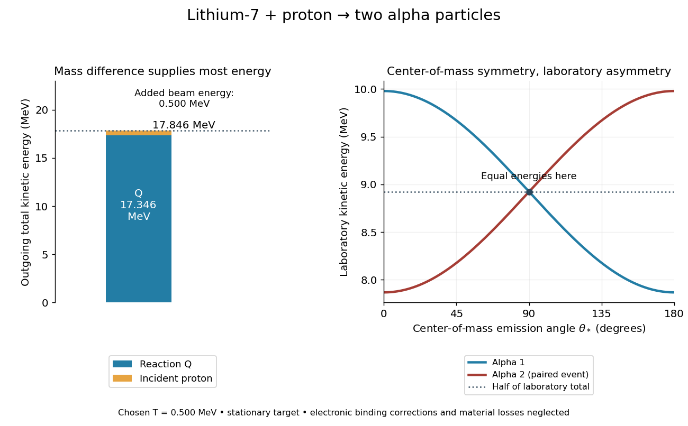

# Lithium proton reaction energy

↑ **Parent:** [Cockcroft-Walton lithium disintegration experiment](cockcroft-walton-lithium-disintegration-experiment.md)

The [nuclear reaction](nuclear-reaction.md)

$$
{}^{7}_{3}\mathrm{Li}+{}^{1}_{1}\mathrm H\longrightarrow
{}^{4}_{2}\mathrm{He}+{}^{4}_{2}\mathrm{He}
$$

conserves [electric charge](electric-charge-split.md) and total [nucleon](nucleon.md) count: $3+1=2+2$ and $7+1=4+4$. Its [nuclear reaction Q-value](nuclear-reaction-q-value.md) is the initial minus final rest [energy](energy-split.md). It is additional to the incoming beam [kinetic energy](kinetic-energy.md); the accelerator triggers a rearrangement whose products can carry much more [kinetic energy](kinetic-energy.md) than the incident [proton](proton.md).

Use one consistent set of neutral-atom isotope [masses](mass.md), in [unified atomic mass units](dalton-unit.md), from the National Institute of Standards and Technology:

$$
M({}^{7}\mathrm{Li})=7.0160034366\,\mathrm u,\quad
M({}^{1}\mathrm H)=1.00782503223\,\mathrm u,\quad
M({}^{4}\mathrm{He})=4.00260325413\,\mathrm u.
$$

These are isotope masses, not element-averaged atomic weights.[Atomic Weights and Isotopic Compositions for All Elements, entries atomic number 1 mass number 1; atomic number 2 mass number 4; atomic number 3 mass number 7](atomic-weights-and-isotopic-compositions-for-all-elements-by-national-institute-of-standards-and-technology.md) With $\mathrm u c^2=931.49410372\,\mathrm{MeV}$,[CODATA recommended values of the fundamental physical constants: 2022, atomic mass constant, energy equivalent in MeV](codata-recommended-values-of-the-fundamental-physical-constants-2022-by-national-institute-of-standards-and-technology.md)

$$
\Delta M=0.01862196057\,\mathrm u,\qquad
Q_{\mathrm{atom}}=[M({}^{7}\mathrm{Li})+M({}^{1}\mathrm H)-2M({}^{4}\mathrm{He})]c^2
=17.34625\,\mathrm{MeV}\simeq17.3\,\mathrm{MeV}.
$$

The four electron rest [masses](mass.md) cancel between sides. Differences of total electronic [binding energies](binding-energy.md) do not cancel exactly: this atomic-mass result approximates the bare-nucleus [nuclear reaction Q-value](nuclear-reaction-q-value.md) at the displayed $0.001\,\mathrm{MeV}$ scale, not at arbitrary precision. No mixture of rounded nuclear [binding energies](binding-energy.md) is needed. At chosen incident [kinetic energy](kinetic-energy.md) $T=0.500\,\mathrm{MeV}$ on a stationary target, the two outgoing [alpha particles](alpha-particle.md) together carry approximately $Q+T=17.846\,\mathrm{MeV}$ before losses in the target and detector window.

**[Figure 4](#image-reaction-energy-and-the-laboratory-recoil-of-two-alpha-particles). Reaction energy and the laboratory recoil of two alpha particles**. Original calculation using the stated neutral-atom isotope masses, electron-mass subtraction and neglected electronic binding corrections. Chosen incident proton energy 0.500 MeV and stationary lithium-7 target; no target or detector losses. Left: energy released by the mass difference plus incident kinetic energy. Right: exact two-body relativistic transformation within these mass assumptions; equal and opposite center-of-mass momenta need not give equal laboratory kinetic energies. Curves parameterize paired events and are not an angular probability distribution or historical data.

**Table of contents**

- [Lithium reaction laboratory recoil](lithium-reaction-laboratory-recoil.md)

## ↑ Ancestors (6)

1. [Cockcroft-Walton lithium disintegration experiment](cockcroft-walton-lithium-disintegration-experiment.md)
2. [Electrostatic accelerator](electrostatic-accelerator.md)
3. [Particle accelerator](particle-accelerator-split.md)
4. [Experimental apparatus](experimental-apparatus.md)
5. [Physics](physics-split.md)
6. [Codex Wiki](split.md)

## ← Incoming links (1)

- [Cockcroft-Walton lithium disintegration experiment](cockcroft-walton-lithium-disintegration-experiment.md)
