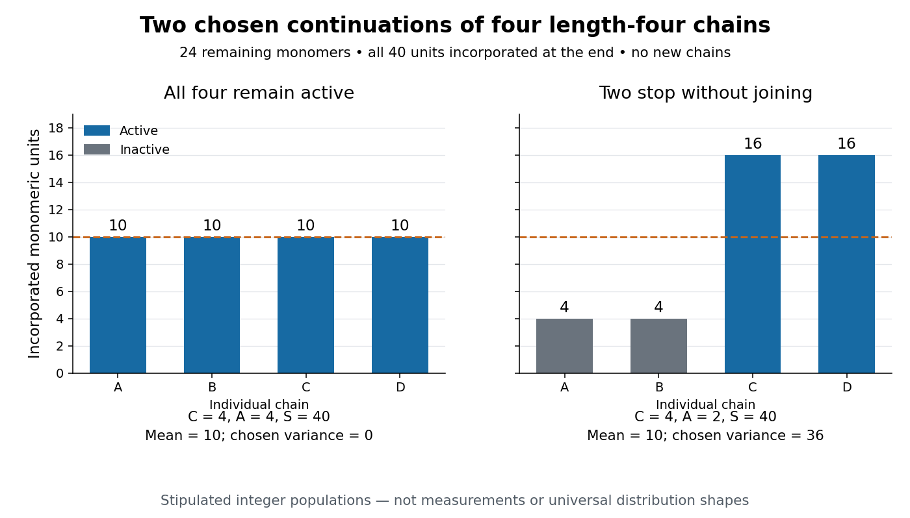

# Living versus terminating chain populations

↑ **Parent:** [Chain-growth polymerization](chain-growth-polymerization.md)

The defining idealization of [living polymerization](living-polymerization.md) excludes [chain-growth termination](chain-growth-termination.md) and irreversible [chain transfer in chain polymerization](chain-transfer-in-chain-polymerization.md). Fast, effective [chain-growth initiation](chain-growth-initiation.md) is an additional condition behind a nearly fixed growing-chain population, not a guarantee contained in the name alone.[living polymerization, L03597, definition and initiation/propagation comparison; living polymer, LT07156, definition specifies irreversible transfer](iupac-compendium-of-chemical-terminology-fifth-edition-gold-book-by-international-union-of-pure-and-applied-chemistry.md) If all four chains in [finite chain-growth bookkeeping](finite-chain-growth-bookkeeping.md) remain active, completing the feed keeps $C=A=4$ and gives $X_n=10$. Stipulate six further additions to each chain, obtaining $(10,10,10,10)$. Other allocations with the same total also satisfy $X_n=10$: living does not mean identical lengths.

Alternatively, stipulate that the first two length-four chains undergo [chain-growth termination](chain-growth-termination.md) without joining, while the other two each receive twelve more [monomer molecules](monomer-molecule.md). The final lengths are $(4,4,16,16)$, with $(C,A,S)=(4,2,40)$. The mean [degree of polymerization](degree-of-polymerization.md) is still $10$, but two chains have stopped and two carry the remaining growth. The population [variance](variance-split.md) of lengths is $36$, compared with zero in the deliberately equal living allocation. These are synthetic populations, not measured molecular distributions and not a claim that all terminating processes are broader than all living processes. Indeed, assigning all twenty-four remaining additions to one still-active chain gives the living allocation $(28,4,4,4)$, with the same mean but [variance](variance-split.md) $108$. Comparable start times and opportunities for [chain-growth propagation](chain-growth-propagation.md) are extra assumptions behind an expectation of more uniform lengths.

**[Figure 39](#image-chain-growth-synthetic-chain-populations). Same incorporated total and mean degree of polymerization, different active-chain populations**. Two explicitly stipulated continuations from four length-four chains and twenty-four remaining [monomer molecules](monomer-molecule.md). Left: all four chains stay active and receive six additions each. Right: two become inactive without joining, and the two survivors receive twelve additions each. Blue identifies active chains and grey inactive chains. Bars are exact chosen integer counts, not sampled data or fits to a molecular distribution. Both final populations contain forty incorporated [monomeric units](monomeric-unit.md) in four chains.

If the two terminated length-four chains instead join, their inactive product has length eight; with the same remaining additions the final lengths are $(8,16,16)$. Now $C=3$, $A=2$, $S=40$ and $X_n=40/3$. Thus [chain-growth termination](chain-growth-termination.md) can change both which chains grow and which chains enter the denominator. Continuing [chain-growth initiation](chain-growth-initiation.md), inefficient initiation, [chain transfer in chain polymerization](chain-transfer-in-chain-polymerization.md), and reactivation require their own counts. Predicting an entire length distribution additionally needs a specified [reaction mechanism](reaction-mechanism.md) and growth statistics. A measured mean alone cannot establish [living polymerization](living-polymerization.md).

## ↑ Ancestors (5)

1. [Chain-growth polymerization](chain-growth-polymerization.md)
2. [Polymerization](polymerization.md)
3. [Polymer](polymer.md)
4. [Chemistry](chemistry-split.md)
5. [Codex Wiki](split.md)
