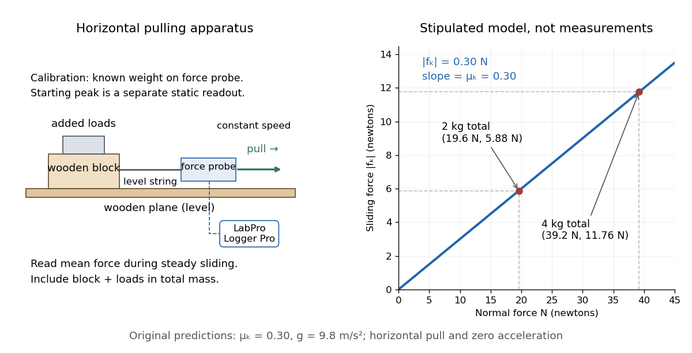

# Load dependence of kinetic friction

↑ **Parent:** [Coefficient of kinetic friction](coefficient-of-kinetic-friction.md)

Changing the added [mass](mass.md) while retaining the same contact pair and sliding [speed](speed.md) tests whether a constant [coefficient of kinetic friction](coefficient-of-kinetic-friction.md) is a useful model. Compute $N=(m_{\mathrm{block}}+m_{\mathrm{added}})g$ for each level horizontal run, and plot the mean sliding [force](force-split.md) vertically against [normal force](normal-force.md) horizontally. The constant-coefficient prediction is a straight line through the origin; its [slope](slope.md) is $\mu_k$. This extracts a ratio from several loads rather than relying on one reading.

**[Figure 3](#image-horizontal-wooden-block-force-probe-apparatus-and-original-load-model-19-6-n-and-39-2-n-normal-loads-predict-5-88-n-and-11-76-n-sliding-forces). Horizontal wooden-block force-probe apparatus and original load model: 19.6 N and 39.2 N normal loads predict 5.88 N and 11.76 N sliding forces**.

The apparatus sketch identifies the contact pair and horizontal pull used by the cited laboratory procedure. The plotted line and points are the original stipulated $\mu_k=0.30$ model from [coefficient of kinetic friction](coefficient-of-kinetic-friction.md), not laboratory data. The two model points give

$$
\frac{\Delta |f_k|}{\Delta N}=\frac{11.76-5.88}{39.2-19.6}=0.30.
$$

In actual measurements, a [linear regression](linear-regression-split.md) $\overline F=b+\mu_kN$ can expose an unexplained [intercept](regression-intercept.md) $b$. A nonzero [intercept](regression-intercept.md) calls for checking the gauge zero, other resisting [forces](force-split.md) and the contact model; forcing the line through zero can hide those problems. Conversely, constant ratios within [measurement error](measurement-error.md) support the approximation only over the loads, [speeds](speed.md) and surface conditions tested. A load sweep alone cannot establish independence from contact [area](surface-area.md) or sliding [speed](speed.md); those require separate controlled variations.

## ↑ Ancestors (8)

1. [Coefficient of kinetic friction](coefficient-of-kinetic-friction.md)
2. [Kinetic friction](kinetic-friction.md)
3. [Friction](friction.md)
4. [Newtonian mechanics](newtonian-mechanics-split.md)
5. [Classical mechanics](classical-mechanics-split.md)
6. [Branches of physics](branches-of-physics.md)
7. [Physics](physics-split.md)
8. [Codex Wiki](split.md)

## ← Incoming links (1)

- [Coefficient of kinetic friction](coefficient-of-kinetic-friction.md)
