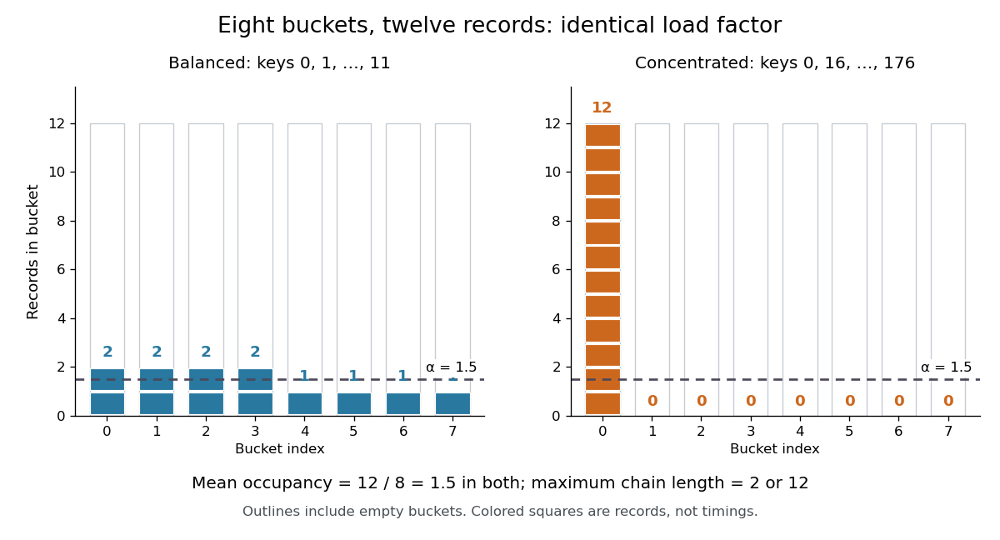

# Load factor of a hash table

↑ **Parent:** [Hash table](hash-table.md)

The number $n$ of stored records divided by the number $m>0$ of [hash buckets](hash-bucket.md). For [separate chaining](separate-chaining.md), this is the mean chain length over all [hash buckets](hash-bucket.md), including empty ones.

Consider two original [separate chaining](separate-chaining.md) placements using the deterministic [hash function](hash-function.md) $h_m(k)=k\bmod m$ on nonnegative [integer](integer-split.md) keys. With $m=8$, keys $0,1,\ldots,11$ give the balanced chain lengths $(2,2,2,2,1,1,1,1)$. Instead, keys $0,16,32,\ldots,176$ all select [hash bucket](hash-bucket.md) $0$, giving $(12,0,0,0,0,0,0,0)$. Both store $n=12$ records, so both have $\alpha=12/8=1.5$. The maximum chain lengths are $2$ and $12$. These are constructed placements, not measured workloads.

**[Figure 9](#image-the-same-hash-table-load-factor-permits-balanced-and-concentrated-hash-bucket-occupancies). The same hash table load factor permits balanced and concentrated hash bucket occupancies**. Both original examples use eight [hash buckets](hash-bucket.md) and twelve distinct [integer](integer-split.md) keys. Every outlined column counts towards $m$, including empty ones; each colored square represents one record. The dashed line marks the [arithmetic mean](arithmetic-mean.md) $\alpha=1.5$, not the maximum chain length.

For an absent query, [separate chaining](separate-chaining.md) inspects every record in the selected [hash bucket](hash-bucket.md). Key $24$ selects [hash bucket](hash-bucket.md) $0$ in both examples but is stored in neither, so it takes two [key equality](key-equality.md) comparisons in the balanced placement and twelve in the concentrated placement. Key $15$ selects [hash bucket](hash-bucket.md) $7$ and instead takes one comparison in the balanced placement and zero in the concentrated placement. If an absent query's bucket index has the [uniform distribution on a finite set](discrete-uniform-distribution.md) of eight indices, its mean comparison count is $1.5$ in either fixed placement. That average does not limit the cost of a particular query.

For successful lookups, suppose each of the twelve stored keys is queried with equal [probability](probability.md), with fixed chain order and no rearrangement on access. A chain of length $\ell$ contributes comparison counts $1,\ldots,\ell$, irrespective of its order. Thus

$$
\overline C_{\mathrm{hit}}=\frac1n\sum_{j=0}^{m-1}\frac{\ell_j(\ell_j+1)}2=\frac{\sum_{j=0}^{m-1}\ell_j^2+n}{2n}.
$$

The balanced placement gives $(4\cdot3+4\cdot1)/12=4/3$ comparisons; the concentrated placement gives $(1+\cdots+12)/12=13/2$. Even this average depends on more than $\alpha$: concentration appears through the squared chain lengths. These exact counts exclude computing the [hash function](hash-function.md), locating the [hash bucket](hash-bucket.md), and allocating records. Elapsed lookup time also depends on the cost of [key equality](key-equality.md), key length, and [memory access latency](memory-access-latency.md); $\alpha$ alone specifies none of them.

The expected $O(1+\alpha)$ [time complexity](time-complexity.md) bound for [separate chaining](separate-chaining.md) needs a probabilistic assumption. Fix distinct stored keys and a query independently of the random choice of [hash function](hash-function.md), and require $\Pr_h[h_m(x)=h_m(y)]\leq c/m$ for every unequal pair, where $c$ is a constant independent of $n,m$. With constant-cost hashing, [array](array-data-structure.md) access and [key equality](key-equality.md), this suffices. The authored chaining analysis cited here uses this pairwise-collision argument; its multiplicative construction has $c=2$, rather than the $c=1$ of [simple uniform hashing](simple-uniform-hashing.md).[Open Data Structures: An Introduction by Pat Morin; section 5.1.1, Lemma 5.1 and the indicator-variable proof of Lemma 5.2](open-data-structures-an-introduction-by-pat-morin/5-1-chainedhashtable-hashing-with-chaining.md)

For the proof outline, let $I_i$ be the [indicator random variable](indicator-random-variable.md) that stored key $k_i$ shares an absent query $q$'s [hash bucket](hash-bucket.md). By [linearity of expectation](linearity-of-expectation.md),

$$
\mathbb E[C_{\mathrm{miss}}]=\sum_{i=1}^n\Pr_h[h_m(k_i)=h_m(q)]\leq c\alpha.
$$

A present query's full chain contains itself plus at most $n-1$ other records, giving $\mathbb E[C_{\mathrm{hit}}]\leq1+c(n-1)/m$. Stopping at the match can only improve this bound. Full independence is unnecessary for this calculation, but fixed known [hash functions](hash-function.md) and keys chosen adaptively to collide are outside the stated assumption. Keeping $\alpha$ bounded then controls expected lookup work, while the concentrated example still explains why it gives no worst-case guarantee.

For the balanced twelve-record map, `put(3,new_value)` replaces a value, so $n=12$ and $\alpha=1.5$ remain unchanged. An absent key such as $19$ instead adds a thirteenth record, giving $\alpha=13/8$ if capacity stays fixed. Under a policy that stores every repeated-key record separately, another record with key $3$ would also increase $n$; all equal-key records necessarily share a [hash bucket](hash-bucket.md) when the [hash function](hash-function.md) respects [key equality](key-equality.md). State the map policy before interpreting the count.

The appeal of the [hash table load factor](load-factor-of-a-hash-table.md) is that one number helps tune a space-versus-search tradeoff: more [hash buckets](hash-bucket.md) require more [array](array-data-structure.md) storage and can reduce expected search work under the stated assumptions. The actual chain lengths and query choices still matter.

In [open addressing](open-addressing.md), $m$ counts record slots and $n$ counts live records, so $\alpha=n/m\leq1$. A policy retaining at least one genuinely empty slot requires $\alpha<1$; being below one is not itself a speed guarantee. For deletion using a [tombstone in open addressing](tombstone-in-open-addressing.md), also track $t$, the number of marked slots: $(n+t)/m$ counts slots that cannot terminate an unsuccessful probe. For example, $m=8,n=3,t=4$ gives live occupancy $3/8$ but nonempty-or-marked occupancy $7/8$. These ratios answer different questions.[Open Data Structures: An Introduction by Pat Morin; section 5.2, three entry types, counters n and q, and find stopping at nil](open-data-structures-an-introduction-by-pat-morin/5-2-linearhashtable-linear-probing.md)

## ↑ Ancestors (4)

1. [Hash table](hash-table.md)
2. [Data structure](data-structure-split.md)
3. [Computer science](computer-science-split.md)
4. [Codex Wiki](split.md)

## ← Incoming links (2)

- [Hash bucket](hash-bucket.md)
- [Hash table resizing](hash-table-resizing.md)
