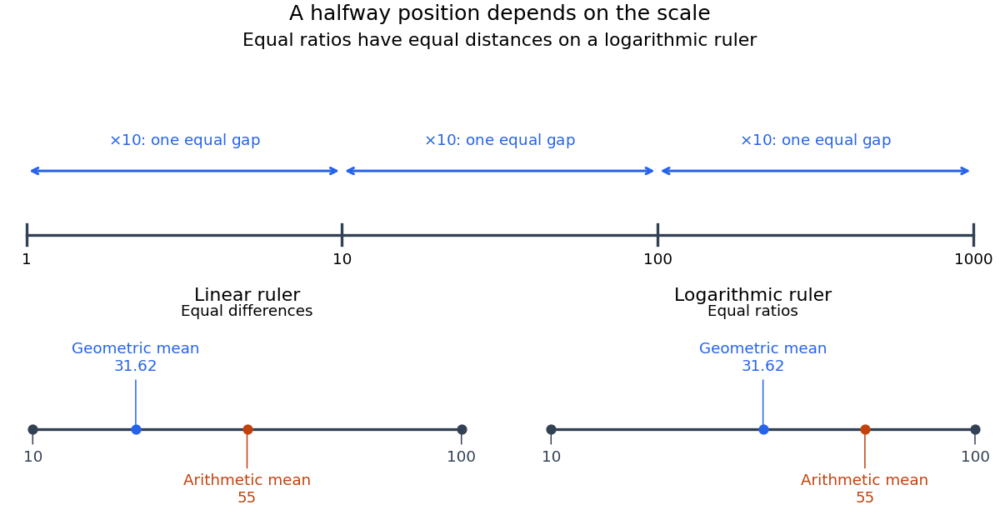

# Logarithmic midpoint

↑ **Parent:** [Logarithmic scale](logarithmic-scale.md)

For positive endpoints $a,b$, halfway along a [logarithmic scale](logarithmic-scale.md) means

$$
\log_{\beta}(m/x_0)=\frac{\log_{\beta}(a/x_0)+\log_{\beta}(b/x_0)}2.
$$

Here $\beta>1$ is the base. Equivalently, using the [natural logarithm](natural-logarithm.md), $2\ln(m/x_0)=\ln(a/x_0)+\ln(b/x_0)$. The [product of numbers](product-of-numbers.md) identity for [logarithms](logarithm.md) gives $m^2=ab$, so **the midpoint is the [geometric mean](geometric-mean.md) $\sqrt{ab}$**. The two endpoints lie at equal multiplicative distances because $m/a=b/m$.

For $a=10$ and $b=100$, this midpoint is $\sqrt{1000}\approx31.6228$, giving a factor of $\sqrt{10}$ on each side. The [arithmetic mean](arithmetic-mean.md) $55$ is halfway on a [linear scale](linear-scale.md), but its two [ratios](ratio.md) are $55/10=5.5$ and $100/55\approx1.81818$. Thus reading halfway between the marks $10$ and $100$ as $55$ on a [logarithmic scale](logarithmic-scale.md) gives the wrong value.

**[Figure 9](#image-equal-ratios-give-equal-logarithmic-gaps-and-the-geometric-mean-is-halfway-between-two-positive-values). Equal ratios give equal logarithmic gaps, and the geometric mean is halfway between two positive values**. Original rulers calculated from [logarithms](logarithm.md). The lower rulers cover the same endpoints $10$ and $100$: the blue [geometric mean](geometric-mean.md) is centered on the [logarithmic scale](logarithmic-scale.md), while the orange [arithmetic mean](arithmetic-mean.md) is centered on the [linear scale](linear-scale.md). Tick labels show original values.

## ↑ Ancestors (9)

1. [Logarithmic scale](logarithmic-scale.md)
2. [Logarithm](logarithm.md)
3. [Exponential function](exponential-function.md)
4. [Calculus](calculus-split.md)
5. [Real analysis](real-analysis-split.md)
6. [Analysis](analysis-split.md)
7. [Area of mathematics](area-of-mathematics.md)
8. [Mathematics](mathematics-split.md)
9. [Codex Wiki](split.md)
