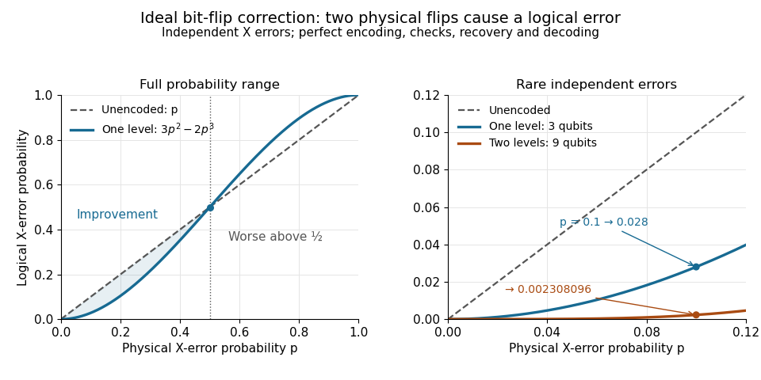

# Logical failure of the three-qubit bit-flip repetition code

↑ **Parent:** [Bit-flip repetition code](bit-flip-repetition-code.md)

Assume that each physical [qubit](qubit.md) undergoes an independent [quantum bit-flip channel](quantum-bit-flip-channel.md) with [probability](probability.md) $p$ during one storage interval, and that encoding, [error syndrome](error-syndrome.md) extraction, recovery and decoding are all ideal. Use the [three-qubit bit-flip syndrome table](three-qubit-bit-flip-syndrome-table.md) to apply the indicated minimum-weight recovery. Zero or one bit flips are corrected. Two bit flips have the same [error syndrome](error-syndrome.md) as the complementary one-site error: for example, $X_1X_2$ gives $01$, so recovery $X_3$ leaves $\overline X=X_1X_2X_3$. Three bit flips give $00$ and also leave $\overline X$. This exchanges $|000\rangle$ and $|111\rangle$, and therefore acts as a logical [Pauli X gate](pauli-x-gate.md) after decoding.

The number of physical bit flips has a [binomial distribution](binomial-distribution.md) with three trials, hence the logical-error [probability](probability.md) is

$$
p_L=\binom32p^2(1-p)+p^3=3p^2-2p^3.
$$

For a logical [density operator](density-matrix-split.md) $\rho$, the decoded [quantum channel](quantum-channel.md) is exactly $\rho\mapsto(1-p_L)\rho+p_LX\rho X$. Here logical failure means a nontrivial logical [Pauli X gate](pauli-x-gate.md) error; a particular input such as $|+\rangle$ can be invariant under that error. At $p=0.1$, exactly two flips have [probability](probability.md) $3(0.1)^2(0.9)=0.027$ and three flips have [probability](probability.md) $(0.1)^3=0.001$, giving $p_L=0.028$. The block succeeds with [probability](probability.md) $0.972$ compared with $0.9$ for an unencoded [qubit](qubit.md). At $p=0.01$, $p_L=0.000298$, illustrating the quadratic suppression of rare independent bit flips.

Factoring the improvement gives

$$
p-p_L=p(1-p)(1-2p).
$$

Thus one level reduces logical-error [probability](probability.md) for $0<p<1/2$, is equal at $p=0,1/2,1$, and makes it worse for $1/2<p<1$ under this same decoder. The suppression arises because a logical error requires at least two physical bit flips. With independent disjoint inner blocks, the same noise model and ideal correction at every level, a [concatenated quantum error-correcting code](concatenated-quantum-error-correcting-code.md) has $p_{\ell+1}=3p_\ell^2-2p_\ell^3$, with $p_0=p$. At $p_0=0.1$, two levels use nine data [qubits](qubit.md) and give $p_2=3(0.028)^2-2(0.028)^3=0.002308096$.

**[Figure 2](#image-ideal-repetition-code-correction-suppresses-independent-bit-flips-below-one-half). Ideal repetition-code correction suppresses independent bit flips below one half**.

This calculation describes ideal correction of stored information with the specified [quantum bit-flip channel](quantum-bit-flip-channel.md). Repeated correction in time additionally requires a fresh specified noise model for each interval; imperfect [quantum gates](quantum-logic-gate.md), faulty measurements and correlated errors change the calculation. The [timed bit flip during repetition-code syndrome extraction](timed-bit-flip-during-repetition-code-syndrome-extraction.md) and [exact encoded-state failure with a faulty parity check](exact-encoded-state-failure-with-a-faulty-parity-check.md) show concretely why this storage calculation alone is not a fault-tolerance result.

## ↑ Ancestors (7)

1. [Bit-flip repetition code](bit-flip-repetition-code.md)
2. [Stabilizer code](stabilizer-code.md)
3. [Quantum error correction](quantum-error-correction-split.md)
4. [Quantum theory](quantum-theory-split.md)
5. [Branches of physics](branches-of-physics.md)
6. [Physics](physics-split.md)
7. [Codex Wiki](split.md)
