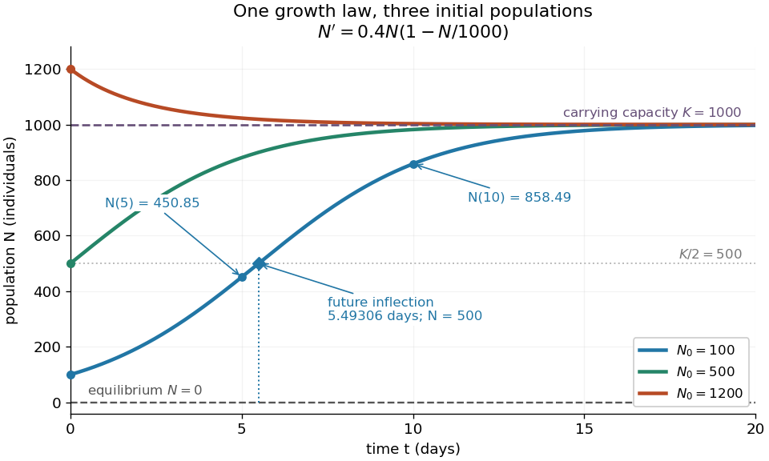
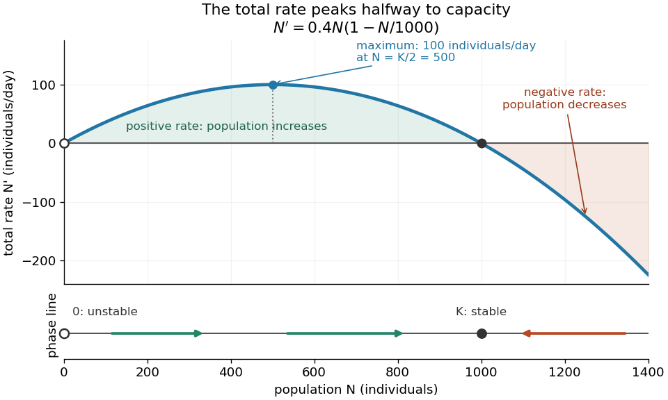

# Logistic differential equation

↑ **Parent:** [Nonlinear ordinary differential equation](nonlinear-ordinary-differential-equation.md)

The [logistic differential equation](logistic-differential-equation.md) is the [nonlinear ordinary differential equation](nonlinear-ordinary-differential-equation.md)

$$
\frac{dN}{dt}=rN\left(1-\frac{N}{K}\right),\qquad r>0,\quad K>0,\quad N(0)=N_0\geq0.
$$

As a [mathematical model](mathematical-model.md) of [population dynamics](population-dynamics.md), it treats abundance $N$ as a continuous nonnegative quantity. The constant $r$ has units of inverse time, while the [carrying capacity](carrying-capacity.md) $K$ has the same units as $N$. The useful idea is to combine growth resembling [exponential growth](exponential-growth.md) at low abundance with a slowing approach to a finite abundance. The three trajectories below already show an important distinction: starting above the [carrying capacity](carrying-capacity.md) gives a decreasing curve, whereas starting below it gives an increasing one.

**[Figure 6](#image-logistic-trajectories-approach-the-carrying-capacity-from-below-or-above). Logistic trajectories approach the carrying capacity from below or above**. Here $K=1000$ and $r=0.4$ per day. The [initial conditions](initial-condition.md) are $N_0=100,500,1200$; dashed horizontal lines show the two [equilibrium points](equilibrium-point-of-a-dynamical-system.md) $N=0$ and $N=K$. Only the $N_0=100$ trajectory has a future [inflection point](inflection-point.md), marked at $N=500$ and $t\approx5.49306$ days. The other marked values are $N(5)\approx450.85306$ and $N(10)\approx858.48645$ for that same trajectory.

For $N>0$, dividing the [derivative](derivative.md) by abundance gives the instantaneous per-capita rate:

$$
\frac{N'}{N}=r\left(1-\frac{N}{K}\right).
$$

It decreases linearly with $N$: it approaches $r$ at low abundance, is $r/2$ at $N=K/2$, vanishes at the [carrying capacity](carrying-capacity.md), and is negative above it. This per-capita rate differs from the total rate $N'$, which also counts how many individuals contribute. It is an instantaneous rate, rather than a fixed percentage increase over a whole day. The linear per-capita assumption and the resulting qualitative picture are developed in [MIT 18.03SC's logistic-model notes](https://ocw.mit.edu/courses/18-03sc-differential-equations-fall-2011/9893a2556a1d21717cd31bbf6b29fe9a_MIT18_03SCF11_s10_1text.pdf).

Writing $f(N)=rN(1-N/K)$, the [equilibrium points](equilibrium-point-of-a-dynamical-system.md) satisfy $f(N)=0$, so the constant [solutions of a differential equation](solution-of-a-differential-equation.md) are $N(t)=0$ and $N(t)=K$. The [phase line](phase-line.md) points upward for $0<N<K$ and downward for $N>K$. Also $f'(0)=r>0$ and $f'(K)=-r<0$: the criterion for [fixed point stability for an autonomous differential equation](fixed-point-stability-for-an-autonomous-differential-equation.md) makes zero an [unstable equilibrium](unstable-equilibrium.md) and $K$ an [asymptotically stable](asymptotic-stability.md) [equilibrium point](equilibrium-point-of-a-dynamical-system.md). Every positive [initial condition](initial-condition.md) approaches $K$ as $t\to\infty$; $N_0=0$ stays exactly zero. Instability of zero means that a small positive population grows away from it, not that a zero population spontaneously appears.

For every $N_0>0$, the unique [solution of a differential equation](solution-of-a-differential-equation.md) for all $t\geq0$ is

$$
N(t)=\frac{K}{1+\left(\frac{K}{N_0}-1\right)e^{-rt}}.
$$

The denominator is positive on this domain, including when $N_0>K$. For $0<N_0<K$, this is a translated and scaled [logistic function](logistic-function.md); its extension to all real times is a [sigmoid function](sigmoid-function.md). For $N_0>K$ the coefficient of the [exponential function](exponential-function.md) is negative, and the future curve instead decreases toward $K$. No nonconstant positive [solution of a differential equation](solution-of-a-differential-equation.md) crosses $K$ or reaches it at finite time. A short derivation uses the [dimensionless variable](dimensionless-variable.md) $z=K/N-1$: the [chain rule](chain-rule.md) gives $z'=-rz$, so [exponential decay](exponential-decay.md) yields $z(t)=(K/N_0-1)e^{-rt}$. The substitution divides by $N$, so the zero [equilibrium point](equilibrium-point-of-a-dynamical-system.md) must be included separately.

The total growth rate is a downward-opening [quadratic function](quadratic-function.md) of abundance. Completing the square gives its maximum without solving the [differential equation](differential-equation-split.md):

$$
f(N)=\frac{rK}{4}-\frac{r}{K}\left(N-\frac{K}{2}\right)^2,
\qquad \max_{N\geq0}f(N)=\frac{rK}{4}\quad\text{at }N=\frac{K}{2}.
$$

The balance is beautiful: more individuals contribute to growth, but each contributes less, and the strongest total increase occurs halfway to the [carrying capacity](carrying-capacity.md). This is a maximum over possible abundances. A trajectory starting above $K/2$ never passes through that abundance in its future.

**[Figure 7](#image-total-logistic-growth-is-greatest-at-half-the-carrying-capacity). Total logistic growth is greatest at half the carrying capacity**. With $K=1000$ and $r=0.4$ per day, the maximum is $100$ individuals per day at $N=500$. The [function graph](graph-of-a-function.md) crosses zero at the [equilibrium points](equilibrium-point-of-a-dynamical-system.md) $N=0$ and $N=1000$; beyond $1000$ the rate is negative. The lower [phase line](phase-line.md) has arrows toward increasing abundance below $K$ and toward decreasing abundance above $K$, with a hollow mark for the [unstable equilibrium](unstable-equilibrium.md) and a filled mark for the [asymptotically stable](asymptotic-stability.md) [equilibrium point](equilibrium-point-of-a-dynamical-system.md).

The [chain rule](chain-rule.md) connects this maximum to the shape of the time trajectory through its [second derivative](second-derivative.md):

$$
N''=f'(N)N'=r\left(1-\frac{2N}{K}\right)N'.
$$

For $0<N_0<K/2$, the trajectory initially has [convexity](convex-function.md) and then [concavity](concave-function.md), with its one future [inflection point](inflection-point.md) at

$$
t_{1/2}=\frac1r\ln\left(\frac{K}{N_0}-1\right),\qquad N(t_{1/2})=\frac{K}{2}.
$$

For $N_0=K/2$, this point lies at the initial time, with [concavity](concave-function.md) for $t>0$. For $K/2<N_0<K$, the [inflection point](inflection-point.md) belongs to the past extension, so the future trajectory has [concavity](concave-function.md) throughout. Above $K$, the decreasing trajectory has [convexity](convex-function.md) and no [inflection point](inflection-point.md). The two constant [solutions of a differential equation](solution-of-a-differential-equation.md) have no change of [concavity](concave-function.md). Thus an entire [logistic function](logistic-function.md) has an S shape, but its observed future segment need not show both bends. See also [OpenStax's logistic-equation solution and inflection calculation](https://openstax.org/books/calculus-volume-2/pages/4-4-the-logistic-equation).

For the plotted example with $K=1000$, $r=0.4\,\mathrm{day}^{-1}$ and $N_0=100$, time $t$ measured in days gives

$$
N(t)=\frac{1000}{1+9e^{-0.4t}},\qquad N(5)\approx450.85306,\qquad N(10)\approx858.48645.
$$

The initial total rate is $N'(0)=0.4\cdot100\cdot0.9=36$ individuals per day, and the initial per-capita rate is $0.36\,\mathrm{day}^{-1}$. The fastest total increase is $rK/4=100$ individuals per day, reached at $t_{1/2}=\ln9/0.4\approx5.49306$ days. At that time the per-capita rate has already fallen to $0.2\,\mathrm{day}^{-1}$.

These parameters are illustrative choices, rather than an empirical fit. The equation specifies [deterministic evolution](deterministic-evolution.md) under a phenomenological assumption: it summarizes how net growth depends on abundance without separately modelling every process that affects it. The [carrying capacity](carrying-capacity.md) is a parameter for a specified setting, not a universal constant for all populations. In his 1838 paper "Notice sur la loi que la population suit dans son accroissement", Correspondance mathématique et physique 10, pp. 113–121, Pierre-François Verhulst proposed $p'=mp-np^2$, equivalent to this equation with $r=m$ and $K=m/n$. He also noted that different assumed growth-retarding terms could describe the observations similarly while giving very different limiting populations. This is an early illustration of why a good-looking curve alone does not establish a unique long-term prediction.[Verhulst's 1838 paper, translated by D. H. Delphenich](https://www.neo-classical-physics.info/uploads/3/4/3/6/34363841/verhulst_-_law_of_population.pdf)

The [logistic differential equation](logistic-differential-equation.md) describes continuous time. The [logistic map](logistic-map.md) instead advances in discrete steps and can exhibit a [period-doubling cascade](period-doubling-cascade.md) and [Devaney chaos](devaney-chaos.md); the monotone positive trajectories here cannot. Their connection through the [Forward Euler method](euler-method.md) is explained under [Euler discretization of logistic growth](euler-discretization-of-logistic-growth.md), where a large step can introduce behaviour absent from the original [differential equation](differential-equation-split.md).

**Table of contents**

- [Euler discretization of logistic growth](euler-discretization-of-logistic-growth.md)

## ↑ Ancestors (7)

1. [Nonlinear ordinary differential equation](nonlinear-ordinary-differential-equation.md)
2. [Ordinary differential equation](ordinary-differential-equation.md)
3. [Differential equation](differential-equation-split.md)
4. [Analysis](analysis-split.md)
5. [Area of mathematics](area-of-mathematics.md)
6. [Mathematics](mathematics-split.md)
7. [Codex Wiki](split.md)

## ← Incoming links (21)

- [Carrying capacity](carrying-capacity.md)
- [Cubic amplitude saturation](cubic-amplitude-saturation.md)
- [Euler discretization of logistic growth](euler-discretization-of-logistic-growth.md)
- [Logistic crossover in a weakly nonlinear Euler equation](logistic-crossover-in-a-weakly-nonlinear-euler-equation.md)
- [Logistic differential equation](logistic-differential-equation.md)
- [Logistic growth equation](logistic-growth-equation.md)
- [Nonlinear ordinary differential equation](nonlinear-ordinary-differential-equation.md)
- [Solution](past-exam-of-the-mathematics-course-of-the-university-of-cambridge/2002/ia/paper-2/6d/solution.md)
- [Solution](past-exam-of-the-mathematics-course-of-the-university-of-cambridge/2002/iii/paper-48/3/a/solution.md)
- [Solution](past-exam-of-the-mathematics-course-of-the-university-of-cambridge/2005/ia/paper-2/7b/solution.md)
- [Solution](past-exam-of-the-mathematics-course-of-the-university-of-cambridge/2005/iii/paper-38/6/solution.md)
- [Solution](past-exam-of-the-mathematics-course-of-the-university-of-cambridge/2005/iii/paper-65/2/a/solution.md)
- [Solution](past-exam-of-the-mathematics-course-of-the-university-of-cambridge/2007/iii/paper-36/6/solution.md)
- [Solution](past-exam-of-the-mathematics-course-of-the-university-of-cambridge/2017/ia/paper-2/6c/a/solution.md)
- [Solution](past-exam-of-the-mathematics-course-of-the-university-of-cambridge/2017/ia/paper-2/6c/b/solution.md)
- [Solution](past-exam-of-the-mathematics-course-of-the-university-of-cambridge/2017/iii/paper-331/3/b/ii/solution.md)
- [Solution](past-exam-of-the-mathematics-course-of-the-university-of-cambridge/2019/ii/paper-4/14c/a/solution.md)
- [Solution](past-exam-of-the-mathematics-course-of-the-university-of-cambridge/2022/iii/paper-207/3/c/solution.md)
- [Solution](past-exam-of-the-mathematics-course-of-the-university-of-cambridge/2022/iii/paper-313/1/solution.md)
- [Solution](past-exam-of-the-mathematics-course-of-the-university-of-cambridge/2023/iii/paper-313/1/c/solution.md)
- [Symmetric competition model](symmetric-competition-model.md)
