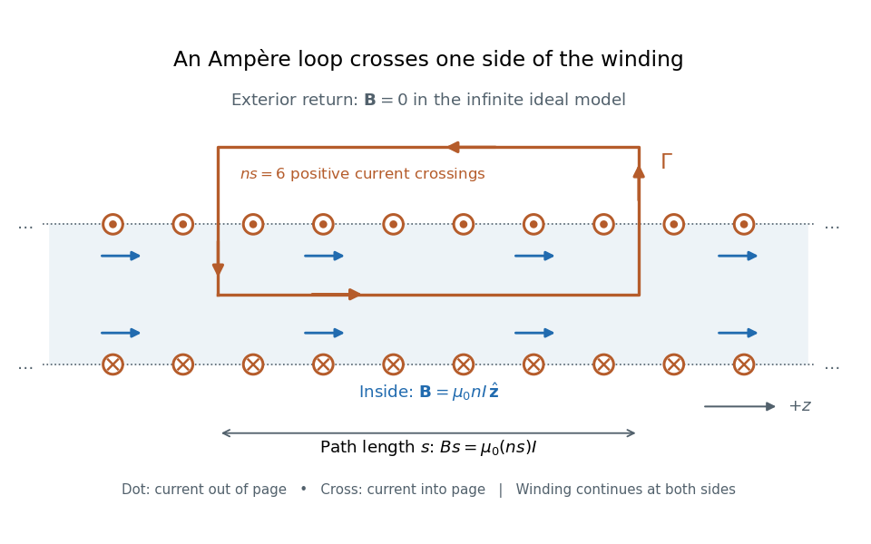

# Long-solenoid approximation

↑ **Parent:** [Solenoid](solenoid.md)

In [magnetostatics](magnetostatics.md), an ideal infinitely long [solenoid](solenoid.md) is a cylindrical sheet of circumferential [surface current density](surface-current-density.md) $K=nI$. It has negligible winding advance, no magnetic core, and no imposed external [magnetic field](magnetic-field-split.md). Choose positive [electric current](electric-current.md) to produce [magnetic field](magnetic-field-split.md) along $+z$. In this ideal model the interior [magnetic field](magnetic-field-split.md) is uniform and axial, $B=\mu_0nI$, and the exterior [magnetic field](magnetic-field-split.md) is zero; $\mu_0$ is the [vacuum permeability](vacuum-permeability.md). For a finite, closely wound air-core coil, the same result is an approximation well inside the coil, several radii from either end. Air is treated as having the [magnetic permeability](permeability-electromagnetism.md) of vacuum. [Feynman lectures, II.13–5: long-solenoid field and the return field near the ends](https://www.feynmanlectures.caltech.edu/II_13.html#Ch13-S5).

For a short proof, the translational and rotational [symmetries](symmetry-physics.md) of the ideal cylindrical [current sheet](current-sheet.md), together with the [Biot-Savart law](biot-savart-law.md), give an axial [magnetic field](magnetic-field-split.md). [Ampère's law](ampere-s-circuital-law.md) on rectangles wholly outside makes that axial exterior value independent of radius; the condition of no imposed [magnetic field](magnetic-field-split.md) makes it zero at infinity and hence everywhere outside. Rectangles wholly inside similarly show that the interior value is independent of radius. Now choose an [Amperian loop](amperian-loop.md) with axial length $s$, one long side inside and the other outside. The transverse sides are perpendicular to the [magnetic field](magnetic-field-split.md), so their contributions to the [line integral](line-integral.md) vanish. The loop crosses $ns$ turns of the winding, giving

$$
\oint_\Gamma\mathbf B\cdot d\mathbf l
=Bs=\mu_0(ns)I,
\qquad B=\mu_0nI.
$$

Here $s$ is the integration-path length, not the whole coil [length](length.md) $\ell$. An [Amperian loop](amperian-loop.md) surrounding both sides of the winding encloses equal and opposite [electric currents](electric-current.md); zero net circulation alone would not prove zero [magnetic field](magnetic-field-split.md) at every exterior point.

**[Figure 1](#image-ampere-s-law-for-the-ideal-long-solenoid-approximation). Ampère's law for the ideal long-solenoid approximation**. Axial cross-section of an infinite ideal winding: paired dots and crosses show [electric current](electric-current.md) out of and into the page. The indicated [right-hand rule](right-hand-rule.md) produces interior [magnetic field](magnetic-field-split.md) along $+z$. The counterclockwise [Amperian loop](amperian-loop.md) crosses only the upper row, with $ns=6$ positive crossings; its interior side runs along $+z$, and its exterior return lies where the ideal [magnetic field](magnetic-field-split.md) is zero.

For the $1000$-turn, $0.50\,\mathrm m$ coil with [electric current](electric-current.md) $I=0.50\,\mathrm A$, the [long-solenoid approximation](long-solenoid-approximation.md) gives

$$
B\approx(1.256637\times10^{-6})(2000)(0.50)\,\mathrm T
=1.256637\times10^{-3}\,\mathrm T
\approx1.257\,\mathrm{mT}.
$$

This illustrative calculation uses [vacuum permeability](vacuum-permeability.md) $\mu_0\approx1.256637\times10^{-6}\,\mathrm{H/m}$, a rounded value, not an exact constant. Since the 2019 redefinition of [SI](international-system-of-units.md), [vacuum permeability](vacuum-permeability.md) is determined experimentally.[§2.3.1: the ampere and vacuum permeability](the-international-system-of-units-si-ninth-edition-si-brochure.md) Doubling $I$ doubles the ideal [magnetic field](magnetic-field-split.md); doubling $N$ at fixed $\ell$ does the same. Increasing $\ell$ while keeping $N$ fixed decreases $n$ and hence the ideal [magnetic field](magnetic-field-split.md).

## ↑ Ancestors (6)

1. [Solenoid](solenoid.md)
2. [Magnetic field](magnetic-field-split.md)
3. [Electromagnetism](electromagnetism-split.md)
4. [Branches of physics](branches-of-physics.md)
5. [Physics](physics-split.md)
6. [Codex Wiki](split.md)

## ← Incoming links (6)

- [Long-solenoid approximation](long-solenoid-approximation.md)
- [On-axis magnetic field of a finite solenoid](on-axis-magnetic-field-of-a-finite-solenoid.md)
- [Solution](past-exam-of-the-optics-and-electrodynamics-course-of-the-university-of-cambridge/2017/4/solution.md)
- [Solenoid](solenoid.md)
- [Stored energy of a solenoid](stored-energy-of-a-solenoid.md)
- [Uniformly magnetized cylinder](uniformly-magnetized-cylinder.md)
