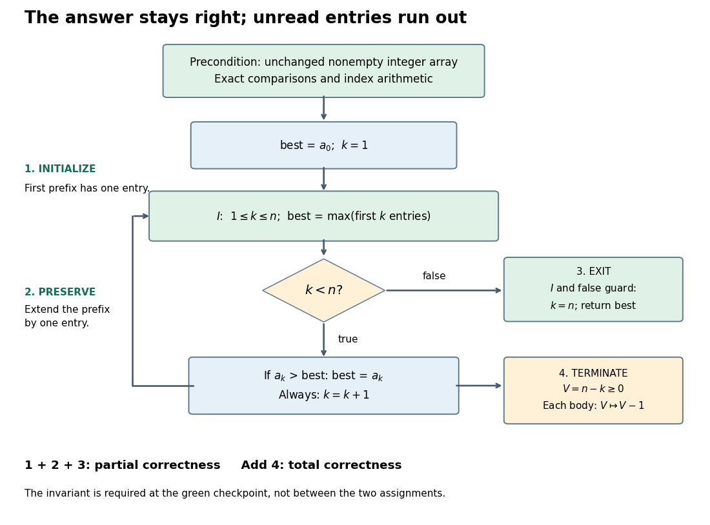

# Loop variant

↑ **Parent:** [Loop invariant](loop-invariant.md)

A decreasing measure used to prove [algorithm termination](algorithm-termination.md). A nonnegative [integer](integer-split.md) [loop variant](loop-variant.md) must strictly decrease after every completed body whose condition was true; the body itself must terminate.[CS 2112 Fall 2019; Loop invariants, Using loop invariants to show code is correct: Termination and the decrementing function](cs-2112-fall-2019/loop-invariants.md)

The [prefix maximum correctness example](prefix-maximum-correctness-example.md) uses $V=n-k$. It counts unread entries and is independent of whether the new entry changes the [maximum](maximum-of-a-subset-of-a-total-order.md). Ties therefore cannot stall progress: $k$ increases even when $\mathrm{best}$ stays the same. An [integer](integer-split.md) bounded below cannot strictly decrease indefinitely, which supplies the missing [algorithm termination](algorithm-termination.md) argument.

**[Figure 8](#image-control-flow-and-four-proof-obligations-for-the-prefix-maximum-correctness-example). Control flow and four proof obligations for the prefix maximum correctness example**. Initialization, preservation, and exit establish [partial correctness](partial-correctness.md); the [loop variant](loop-variant.md) establishes [algorithm termination](algorithm-termination.md) and hence [total correctness](total-correctness.md). The [loop invariant](loop-invariant.md) is restored after both [variable assignments](variable-assignment.md). The [input](input-computer-science.md) [array](array-data-structure.md) stays unchanged throughout.

Strict decrease and a lower bound are insufficient for arbitrary [real numbers](real-number.md). The positive [sequence](sequence.md) $1,1/2,1/4,\ldots$ strictly decreases and is bounded below by zero, but never reaches zero. Choosing an [integer](integer-split.md) measure avoids this failure.

## ↑ Ancestors (5)

1. [Loop invariant](loop-invariant.md)
2. [Algorithm correctness](algorithm-correctness.md)
3. [Algorithm](algorithm-split.md)
4. [Computer science](computer-science-split.md)
5. [Codex Wiki](split.md)

## ← Incoming links (6)

- [Algorithm termination](algorithm-termination.md)
- [Formal verification](formal-verification.md)
- [Loop variant](loop-variant.md)
- [Prefix maximum correctness example](prefix-maximum-correctness-example.md)
- [Summation loop verification](summation-loop-verification.md)
- [Total correctness](total-correctness.md)
