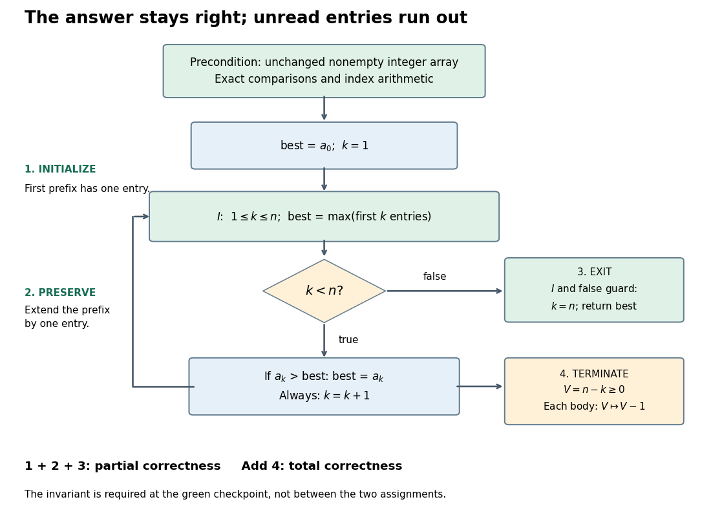

# Loop variant

↑ **Parent:** [Loop invariant](loop-invariant.md)

A decreasing measure used to prove [algorithm termination](algorithm-termination.md). A nonnegative [integer](integer-split.md) [loop variant](loop-variant.md) must strictly decrease after every completed body whose condition was true; the body itself must terminate.[CS 2112 Fall 2019; Loop invariants, Using loop invariants to show code is correct: Termination and the decrementing function](cs-2112-fall-2019/loop-invariants.md)

The [prefix maximum correctness example](prefix-maximum-correctness-example.md) uses $V=n-k$. It counts unread entries and is independent of whether the new entry changes the [maximum](maximum-of-a-subset-of-a-total-order.md). Ties therefore cannot stall progress: $k$ increases even when $\mathrm{best}$ stays the same. An [integer](integer-split.md) bounded below cannot strictly decrease indefinitely, which supplies the missing [algorithm termination](algorithm-termination.md) argument.

**[Figure 8](#image-control-flow-and-four-proof-obligations-for-the-prefix-maximum-correctness-example). Control flow and four proof obligations for the prefix maximum correctness example**. Initialization, preservation, and exit establish [partial correctness](partial-correctness.md); the [loop variant](loop-variant.md) establishes [algorithm termination](algorithm-termination.md) and hence [total correctness](total-correctness.md). The [loop invariant](loop-invariant.md) is restored after both [variable assignments](variable-assignment.md). The [input](input-computer-science.md) [array](array-data-structure.md) stays unchanged throughout.

Strict decrease and a lower bound are insufficient for arbitrary [real numbers](real-number.md). The positive [sequence](sequence.md) $1,1/2,1/4,\ldots$ strictly decreases and is bounded below by zero, but never reaches zero. Choosing an [integer](integer-split.md) measure avoids this failure.

## ↑ Ancestors (5)

1. [Loop invariant](loop-invariant.md)
2. [Algorithm correctness](algorithm-correctness.md)
3. [Algorithm](algorithm-split.md)
4. [Computer science](computer-science-split.md)
5. [Codex Wiki](split.md)

## ← Incoming links (128)

- [Algorithm termination](algorithm-termination.md)
- [Coupled binary exponentiation](coupled-binary-exponentiation.md)
- [Fixed-point pruning of finite constraint domains](fixed-point-pruning-of-finite-constraint-domains.md)
- [Formal verification](formal-verification.md)
- [Greedy Egyptian fraction expansion](greedy-egyptian-fraction-expansion.md)
- [Loop variant](loop-variant.md)
- [Solution](past-exam-of-the-year-1-of-the-computer-science-course-of-the-university-of-oxford/2003/functional-programming-data-structures-and-algorithms-procedural-programming-and-digital-hardware/4/d/solution.md)
- [Solution](past-exam-of-the-year-1-of-the-computer-science-course-of-the-university-of-oxford/2003/functional-programming-data-structures-and-algorithms-procedural-programming-and-digital-hardware/6/a/solution.md)
- [Solution](past-exam-of-the-year-1-of-the-computer-science-course-of-the-university-of-oxford/2003/functional-programming-data-structures-and-algorithms-procedural-programming-and-digital-hardware/6/b/solution.md)
- [Solution](past-exam-of-the-year-1-of-the-computer-science-course-of-the-university-of-oxford/2005/functional-programming-data-structures-and-algorithms-procedural-programming-and-digital-hardware/6/c/solution.md)
- [Solution](past-exam-of-the-year-1-of-the-computer-science-course-of-the-university-of-oxford/2005/functional-programming-data-structures-and-algorithms-procedural-programming-and-digital-hardware/7/a/solution.md)
- [Solution](past-exam-of-the-year-1-of-the-computer-science-course-of-the-university-of-oxford/2005/functional-programming-data-structures-and-algorithms-procedural-programming-and-digital-hardware/8/a/solution.md)
- [Solution](past-exam-of-the-year-1-of-the-computer-science-course-of-the-university-of-oxford/2005/functional-programming-data-structures-and-algorithms-procedural-programming-and-digital-hardware/8/b/solution.md)
- [Solution](past-exam-of-the-year-1-of-the-computer-science-course-of-the-university-of-oxford/2013/imperative-programming/1/a/solution.md)
- [Solution](past-exam-of-the-year-1-of-the-computer-science-course-of-the-university-of-oxford/2013/imperative-programming/1/b/solution.md)
- [Solution](past-exam-of-the-year-1-of-the-computer-science-course-of-the-university-of-oxford/2013/imperative-programming/2/b/ii/solution.md)
- [Solution](past-exam-of-the-year-1-of-the-computer-science-course-of-the-university-of-oxford/2013/imperative-programming/3/b/solution.md)
- [Solution](past-exam-of-the-year-1-of-the-computer-science-course-of-the-university-of-oxford/2013/imperative-programming/3/c/solution.md)
- [Solution](past-exam-of-the-year-1-of-the-computer-science-course-of-the-university-of-oxford/2013/imperative-programming/4/a/solution.md)
- [Solution](past-exam-of-the-year-1-of-the-computer-science-course-of-the-university-of-oxford/2013/imperative-programming/4/b/solution.md)
- [Solution](past-exam-of-the-year-1-of-the-computer-science-course-of-the-university-of-oxford/2013/imperative-programming/6/b/solution.md)
- [Solution](past-exam-of-the-year-1-of-the-computer-science-course-of-the-university-of-oxford/2013/imperative-programming/8/d/solution.md)
- [Solution](past-exam-of-the-year-1-of-the-computer-science-course-of-the-university-of-oxford/2014/digital-systems-linear-algebra-introduction-to-formal-proof/1/c/i/solution.md)
- [Solution](past-exam-of-the-year-1-of-the-computer-science-course-of-the-university-of-oxford/2014/imperative-programming/1/a/solution.md)
- [Solution](past-exam-of-the-year-1-of-the-computer-science-course-of-the-university-of-oxford/2014/imperative-programming/2/b/solution.md)
- [Solution](past-exam-of-the-year-1-of-the-computer-science-course-of-the-university-of-oxford/2015/imperative-programming-resit/1/g/solution.md)
- [Solution](past-exam-of-the-year-1-of-the-computer-science-course-of-the-university-of-oxford/2015/imperative-programming-resit/2/a/solution.md)
- [Solution](past-exam-of-the-year-1-of-the-computer-science-course-of-the-university-of-oxford/2015/imperative-programming-resit/2/b/solution.md)
- [Solution](past-exam-of-the-year-1-of-the-computer-science-course-of-the-university-of-oxford/2015/imperative-programming-resit/3/a/solution.md)
- [Solution](past-exam-of-the-year-1-of-the-computer-science-course-of-the-university-of-oxford/2015/imperative-programming-resit/3/b/solution.md)
- [Solution](past-exam-of-the-year-1-of-the-computer-science-course-of-the-university-of-oxford/2015/imperative-programming-resit/3/d/solution.md)
- [Solution](past-exam-of-the-year-1-of-the-computer-science-course-of-the-university-of-oxford/2015/imperative-programming-resit/3/f/solution.md)
- [Solution](past-exam-of-the-year-1-of-the-computer-science-course-of-the-university-of-oxford/2015/imperative-programming-resit/4/b/solution.md)
- [Solution](past-exam-of-the-year-1-of-the-computer-science-course-of-the-university-of-oxford/2015/imperative-programming-resit/4/c/solution.md)
- [Solution](past-exam-of-the-year-1-of-the-computer-science-course-of-the-university-of-oxford/2015/imperative-programming-resit/4/d/solution.md)
- [Solution](past-exam-of-the-year-1-of-the-computer-science-course-of-the-university-of-oxford/2015/imperative-programming-resit/7/a/solution.md)
- [Solution](past-exam-of-the-year-1-of-the-computer-science-course-of-the-university-of-oxford/2015/imperative-programming-resit/7/b/solution.md)
- [Solution](past-exam-of-the-year-1-of-the-computer-science-course-of-the-university-of-oxford/2015/imperative-programming/2/d/solution.md)
- [Solution](past-exam-of-the-year-1-of-the-computer-science-course-of-the-university-of-oxford/2016/imperative-programming-resit/4/a/solution.md)
- [Solution](past-exam-of-the-year-1-of-the-computer-science-course-of-the-university-of-oxford/2016/imperative-programming-resit/4/b/solution.md)
- [Solution](past-exam-of-the-year-1-of-the-computer-science-course-of-the-university-of-oxford/2016/imperative-programming-resit/4/c/solution.md)
- [Solution](past-exam-of-the-year-1-of-the-computer-science-course-of-the-university-of-oxford/2016/imperative-programming/1/a/solution.md)
- [Solution](past-exam-of-the-year-1-of-the-computer-science-course-of-the-university-of-oxford/2016/imperative-programming/1/b/solution.md)
- [Solution](past-exam-of-the-year-1-of-the-computer-science-course-of-the-university-of-oxford/2016/imperative-programming/1/c/solution.md)
- [Solution](past-exam-of-the-year-1-of-the-computer-science-course-of-the-university-of-oxford/2016/imperative-programming/2/b/solution.md)
- [Solution](past-exam-of-the-year-1-of-the-computer-science-course-of-the-university-of-oxford/2016/imperative-programming/3/c/solution.md)
- [Solution](past-exam-of-the-year-1-of-the-computer-science-course-of-the-university-of-oxford/2016/imperative-programming/4/a/solution.md)
- [Solution](past-exam-of-the-year-1-of-the-computer-science-course-of-the-university-of-oxford/2016/imperative-programming/4/b/solution.md)
- [Solution](past-exam-of-the-year-1-of-the-computer-science-course-of-the-university-of-oxford/2016/imperative-programming/4/c/iv/solution.md)
- [Solution](past-exam-of-the-year-1-of-the-computer-science-course-of-the-university-of-oxford/2017/discrete-mathematics-continuous-mathematics-and-probability/2/b/solution.md)
- [Solution](past-exam-of-the-year-1-of-the-computer-science-course-of-the-university-of-oxford/2017/imperative-programming-resit/2/e/solution.md)
- [Solution](past-exam-of-the-year-1-of-the-computer-science-course-of-the-university-of-oxford/2017/imperative-programming/2/a/solution.md)
- [Solution](past-exam-of-the-year-1-of-the-computer-science-course-of-the-university-of-oxford/2017/imperative-programming/3/c/solution.md)
- [Solution](past-exam-of-the-year-1-of-the-computer-science-course-of-the-university-of-oxford/2017/imperative-programming/4/a/solution.md)
- [Solution](past-exam-of-the-year-1-of-the-computer-science-course-of-the-university-of-oxford/2017/imperative-programming/4/b/solution.md)
- [Solution](past-exam-of-the-year-1-of-the-computer-science-course-of-the-university-of-oxford/2017/imperative-programming/4/c/solution.md)
- [Solution](past-exam-of-the-year-1-of-the-computer-science-course-of-the-university-of-oxford/2017/imperative-programming/4/d/solution.md)
- [Solution](past-exam-of-the-year-1-of-the-computer-science-course-of-the-university-of-oxford/2018/imperative-programming/1/a/i/solution.md)
- [Solution](past-exam-of-the-year-1-of-the-computer-science-course-of-the-university-of-oxford/2018/imperative-programming/1/a/ii/solution.md)
- [Solution](past-exam-of-the-year-1-of-the-computer-science-course-of-the-university-of-oxford/2018/imperative-programming/1/b/solution.md)
- [Solution](past-exam-of-the-year-1-of-the-computer-science-course-of-the-university-of-oxford/2018/imperative-programming/1/c/solution.md)
- [Solution](past-exam-of-the-year-1-of-the-computer-science-course-of-the-university-of-oxford/2018/imperative-programming/2/b/solution.md)
- [Solution](past-exam-of-the-year-1-of-the-computer-science-course-of-the-university-of-oxford/2018/imperative-programming/2/c/solution.md)
- [Solution](past-exam-of-the-year-1-of-the-computer-science-course-of-the-university-of-oxford/2018/imperative-programming/3/d/solution.md)
- [Solution](past-exam-of-the-year-1-of-the-computer-science-course-of-the-university-of-oxford/2018/imperative-programming/3/e/solution.md)
- [Solution](past-exam-of-the-year-1-of-the-computer-science-course-of-the-university-of-oxford/2018/imperative-programming/3/f/solution.md)
- [Solution](past-exam-of-the-year-1-of-the-computer-science-course-of-the-university-of-oxford/2018/imperative-programming/3/g/solution.md)
- [Solution](past-exam-of-the-year-1-of-the-computer-science-course-of-the-university-of-oxford/2018/imperative-programming/4/d/i/solution.md)
- [Solution](past-exam-of-the-year-1-of-the-computer-science-course-of-the-university-of-oxford/2018/imperative-programming/5/d/ii/solution.md)
- [Solution](past-exam-of-the-year-1-of-the-computer-science-course-of-the-university-of-oxford/2018/imperative-programming/5/d/iii/solution.md)
- [Solution](past-exam-of-the-year-1-of-the-computer-science-course-of-the-university-of-oxford/2019/imperative-programming-resit/1/a/solution.md)
- [Solution](past-exam-of-the-year-1-of-the-computer-science-course-of-the-university-of-oxford/2019/imperative-programming-resit/1/b/solution.md)
- [Solution](past-exam-of-the-year-1-of-the-computer-science-course-of-the-university-of-oxford/2019/imperative-programming-resit/1/c/solution.md)
- [Solution](past-exam-of-the-year-1-of-the-computer-science-course-of-the-university-of-oxford/2019/imperative-programming-resit/1/d/solution.md)
- [Solution](past-exam-of-the-year-1-of-the-computer-science-course-of-the-university-of-oxford/2019/imperative-programming-resit/1/e/solution.md)
- [Solution](past-exam-of-the-year-1-of-the-computer-science-course-of-the-university-of-oxford/2019/imperative-programming-resit/2/a/solution.md)
- [Solution](past-exam-of-the-year-1-of-the-computer-science-course-of-the-university-of-oxford/2019/imperative-programming-resit/2/c/solution.md)
- [Solution](past-exam-of-the-year-1-of-the-computer-science-course-of-the-university-of-oxford/2019/imperative-programming-resit/3/e/solution.md)
- [Solution](past-exam-of-the-year-1-of-the-computer-science-course-of-the-university-of-oxford/2019/imperative-programming-resit/3/g/solution.md)
- [Solution](past-exam-of-the-year-1-of-the-computer-science-course-of-the-university-of-oxford/2019/imperative-programming-resit/4/c/solution.md)
- [Solution](past-exam-of-the-year-1-of-the-computer-science-course-of-the-university-of-oxford/2019/imperative-programming-resit/5/b/solution.md)
- [Solution](past-exam-of-the-year-1-of-the-computer-science-course-of-the-university-of-oxford/2019/imperative-programming-resit/5/c/solution.md)
- [Solution](past-exam-of-the-year-1-of-the-computer-science-course-of-the-university-of-oxford/2019/imperative-programming-resit/7/b/ii/solution.md)
- [Solution](past-exam-of-the-year-1-of-the-computer-science-course-of-the-university-of-oxford/2019/imperative-programming/1/a/solution.md)
- [Solution](past-exam-of-the-year-1-of-the-computer-science-course-of-the-university-of-oxford/2019/imperative-programming/1/b/solution.md)
- [Solution](past-exam-of-the-year-1-of-the-computer-science-course-of-the-university-of-oxford/2019/imperative-programming/1/c/solution.md)
- [Solution](past-exam-of-the-year-1-of-the-computer-science-course-of-the-university-of-oxford/2019/imperative-programming/1/d/solution.md)
- [Solution](past-exam-of-the-year-1-of-the-computer-science-course-of-the-university-of-oxford/2019/imperative-programming/1/e/solution.md)
- [Solution](past-exam-of-the-year-1-of-the-computer-science-course-of-the-university-of-oxford/2019/imperative-programming/2/b/solution.md)
- [Solution](past-exam-of-the-year-1-of-the-computer-science-course-of-the-university-of-oxford/2019/imperative-programming/2/d/solution.md)
- [Solution](past-exam-of-the-year-1-of-the-computer-science-course-of-the-university-of-oxford/2019/imperative-programming/3/a/ii/solution.md)
- [Solution](past-exam-of-the-year-1-of-the-computer-science-course-of-the-university-of-oxford/2019/imperative-programming/3/d/i/solution.md)
- [Solution](past-exam-of-the-year-1-of-the-computer-science-course-of-the-university-of-oxford/2019/imperative-programming/4/a/solution.md)
- [Solution](past-exam-of-the-year-1-of-the-computer-science-course-of-the-university-of-oxford/2019/imperative-programming/4/b/solution.md)
- [Solution](past-exam-of-the-year-1-of-the-computer-science-course-of-the-university-of-oxford/2019/imperative-programming/4/d/solution.md)
- [Solution](past-exam-of-the-year-1-of-the-computer-science-course-of-the-university-of-oxford/2019/imperative-programming/5/d/solution.md)
- [Solution](past-exam-of-the-year-1-of-the-computer-science-course-of-the-university-of-oxford/2019/imperative-programming/6/f/solution.md)
- [Solution](past-exam-of-the-year-1-of-the-computer-science-course-of-the-university-of-oxford/2021/imperative-programming-resit/1/a/solution.md)
- [Solution](past-exam-of-the-year-1-of-the-computer-science-course-of-the-university-of-oxford/2021/imperative-programming-resit/1/e/solution.md)
- [Solution](past-exam-of-the-year-1-of-the-computer-science-course-of-the-university-of-oxford/2021/imperative-programming-resit/2/a/solution.md)
- [Solution](past-exam-of-the-year-1-of-the-computer-science-course-of-the-university-of-oxford/2021/imperative-programming/1/a/solution.md)
- [Solution](past-exam-of-the-year-1-of-the-computer-science-course-of-the-university-of-oxford/2021/imperative-programming/1/c/solution.md)
- [Solution](past-exam-of-the-year-1-of-the-computer-science-course-of-the-university-of-oxford/2021/imperative-programming/1/d/solution.md)
- [Solution](past-exam-of-the-year-1-of-the-computer-science-course-of-the-university-of-oxford/2021/imperative-programming/2/a/solution.md)
- [Solution](past-exam-of-the-year-1-of-the-computer-science-course-of-the-university-of-oxford/2021/imperative-programming/4/a/solution.md)
- [Solution](past-exam-of-the-year-1-of-the-computer-science-course-of-the-university-of-oxford/2021/imperative-programming/4/c/solution.md)
- [Solution](past-exam-of-the-year-1-of-the-computer-science-course-of-the-university-of-oxford/2021/imperative-programming/4/e/solution.md)
- [Solution](past-exam-of-the-year-1-of-the-computer-science-course-of-the-university-of-oxford/2021/imperative-programming/5/a/solution.md)
- [Solution](past-exam-of-the-year-1-of-the-computer-science-course-of-the-university-of-oxford/2021/imperative-programming/8/b/solution.md)
- [Solution](past-exam-of-the-year-1-of-the-computer-science-course-of-the-university-of-oxford/2022/imperative-programming-resit/1/a/i/solution.md)
- [Solution](past-exam-of-the-year-1-of-the-computer-science-course-of-the-university-of-oxford/2022/imperative-programming-resit/1/a/ii/solution.md)
- [Solution](past-exam-of-the-year-1-of-the-computer-science-course-of-the-university-of-oxford/2022/imperative-programming-resit/1/b/solution.md)
- [Solution](past-exam-of-the-year-1-of-the-computer-science-course-of-the-university-of-oxford/2022/imperative-programming-resit/1/c/solution.md)
- [Solution](past-exam-of-the-year-1-of-the-computer-science-course-of-the-university-of-oxford/2022/imperative-programming-resit/2/b/solution.md)
- [Solution](past-exam-of-the-year-1-of-the-computer-science-course-of-the-university-of-oxford/2022/imperative-programming-resit/2/e/solution.md)
- [Solution](past-exam-of-the-year-1-of-the-computer-science-course-of-the-university-of-oxford/2023/imperative-programming/1/a/solution.md)
- [Solution](past-exam-of-the-year-1-of-the-computer-science-course-of-the-university-of-oxford/2023/imperative-programming/1/b/solution.md)
- [Solution](past-exam-of-the-year-1-of-the-computer-science-course-of-the-university-of-oxford/2023/imperative-programming/1/c/solution.md)
- [Solution](past-exam-of-the-year-1-of-the-computer-science-course-of-the-university-of-oxford/2023/imperative-programming/2/d/solution.md)
- [Solution](past-exam-of-the-year-1-of-the-computer-science-course-of-the-university-of-oxford/2023/imperative-programming/4/c/solution.md)
- [Prefix maximum correctness example](prefix-maximum-correctness-example.md)
- [Sign-bracketing binary search](sign-bracketing-binary-search.md)
- [Simultaneous exponentiation by squaring](simultaneous-exponentiation-by-squaring.md)
- [Summation loop verification](summation-loop-verification.md)
- [Total correctness](total-correctness.md)
- [Two-way array partition](two-way-array-partition.md)
- [Upper-bound search](upper-bound-search.md)
- [While loop](while-loop.md)
