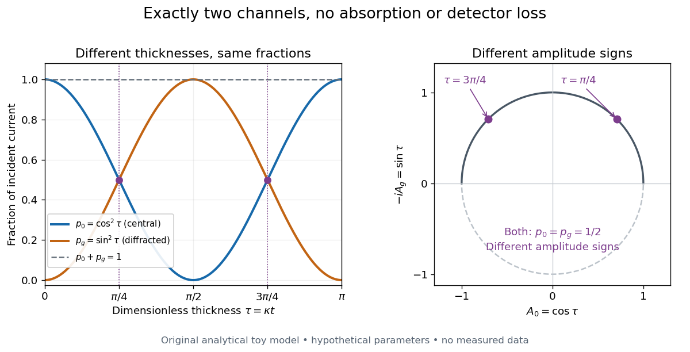

# Lossless two-channel thickness scattering model

↑ **Parent:** [Diffraction contrast](diffraction-contrast.md)

Consider an original illustrative model with exactly two outgoing [scattering channels](scattering-channel.md): a central beam $0$ and one diffracted beam $g$. Let $t\geq0$ be specimen thickness and $\kappa>0$ a constant coupling with units of inverse length. Normalize the [probability amplitudes](probability-amplitude.md) $A_0,A_g$ to incident [probability current](probability-current.md), assume equal longitudinal speeds, and specify

$$
\frac{dA_0}{dt}=i\kappa A_g,\qquad
\frac{dA_g}{dt}=i\kappa A_0,\qquad
A_0(0)=1,\quad A_g(0)=0.
$$

These [ordinary differential equations](ordinary-differential-equation.md) define a lossless toy model, not a fit to the [silicon](silicon.md) example or a complete theory of [crystal scattering](crystal-scattering.md). Differentiating once more gives $A_0''=-\kappa^2 A_0$, so

$$
A_0=\cos(\kappa t),\qquad A_g=i\sin(\kappa t),\qquad
p_0=|A_0|^2=\cos^2(\kappa t),\quad p_g=|A_g|^2=\sin^2(\kappa t).
$$

The identity $p_0+p_g=1$ expresses conservation within these two [scattering channels](scattering-channel.md). Alternatively, substituting the [ordinary differential equations](ordinary-differential-equation.md) into $d(|A_0|^2+|A_g|^2)/dt$ makes the two cross terms cancel. Here ideal [bright-field transmission electron microscopy](bright-field-transmission-electron-microscopy.md) accepts fraction $p_0$ and rejects fraction $p_g$; ideal [dark-field transmission electron microscopy](dark-field-transmission-electron-microscopy.md) accepts precisely the rejected channel. This complementarity requires the declared two-channel completeness and absence of loss.

Even with known $\kappa$, thickness is ambiguous: $\kappa t=\pi/4$ and $3\pi/4$ both give $(p_0,p_g)=(1/2,1/2)$. Near $t=0$, $p_g\simeq(\kappa t)^2$; extending that approximation through a full oscillation would erase the ambiguity incorrectly. The model isolates reversible transfer between [probability amplitudes](probability-amplitude.md); it does not say that every thicker specimen must look darker.

**[Figure 2](#image-complementary-scattering-channel-fractions-and-ambiguous-thickness-in-a-lossless-model). Complementary scattering channel fractions and ambiguous thickness in a lossless model**. [Source](tem-lossless-two-channel-thickness.py). Original calculations from the stated coupled [probability amplitudes](probability-amplitude.md). Left: accepted central and diffracted fractions versus dimensionless thickness $\kappa t$. Right: their [probability amplitudes](probability-amplitude.md) trace a unit circle in the $(A_0,-iA_g)$ plane; the marked distinct thicknesses have identical fractions but different amplitude signs. No measured data or physical thickness calibration is implied.

Real [dark-field transmission electron microscopy](dark-field-transmission-electron-microscopy.md) usually collects only a subset of the directions rejected in [bright-field transmission electron microscopy](bright-field-transmission-electron-microscopy.md). Other [elastic scattering](elastic-scattering.md) directions, [inelastic scattering](inelastic-scattering.md) and detector losses prevent a general two-image conservation rule. To keep loss and background separate, extend the counting model explicitly. Let $\ell$ be the fraction absent from both recorded beam channels, $p_0+p_g=1$ describe the remaining fraction, $N$ be incident count per exposure, $\eta_j$ the detector efficiency and $b_j$ its mean additive background. Then the [expected value](expected-value-split.md) of recorded count $n_j$ is

$$
\mathbb E[n_j]=\eta_j N(1-\ell)p_j+b_j,\qquad j\in\{0,g\}.
$$

For separately acquired equal-illumination exposures with known $b_j,\eta_j$, the two corrected mean counts sum to $N(1-\ell)$, not necessarily $N$. Removal from these channels is not synonymous with physical absorption: an [electron](electron.md) can leave the chosen acceptance or change [kinetic energy](kinetic-energy.md) without being stopped in the specimen. Background subtraction removes a mean offset, but its counting [variance](variance-split.md) remains.

## ↑ Ancestors (10)

1. [Diffraction contrast](diffraction-contrast.md)
2. [Transmission electron microscopy contrast](transmission-electron-microscopy-contrast.md)
3. [Transmission electron microscopy](transmission-electron-microscopy.md)
4. [Electron microscopy](electron-microscopy.md)
5. [Electron microscope](electron-microscope.md)
6. [Electron optics](electron-optics.md)
7. [Optics](optics-split.md)
8. [Branches of physics](branches-of-physics.md)
9. [Physics](physics-split.md)
10. [Codex Wiki](split.md)
