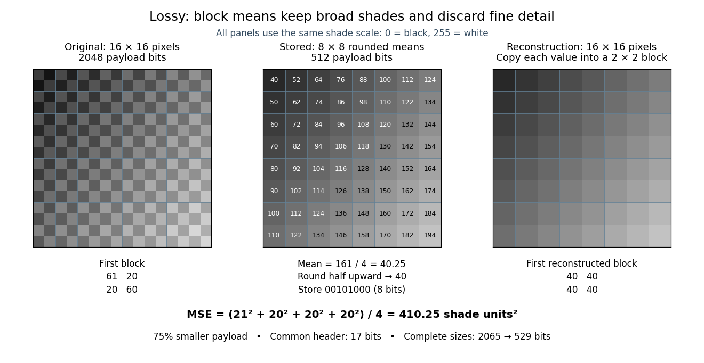

# Lossy block averaging

↑ **Parent:** [Lossy compression](lossy-compression.md)

This toy [image compression](image-compression.md) method stores one rounded [arithmetic mean](arithmetic-mean.md) for each disjoint $2\times2$ block of [grayscale](grayscale.md) [pixels](pixel.md). The [quantization](quantization-signal-processing.md) rule is round to the nearest [integer](integer-split.md), with exact halves rounded upward. Each stored value is an unsigned eight-[bit](bit.md) [integer](integer-split.md). Reconstruction fills the original block with that value, a form of [nearest-neighbor interpolation](nearest-neighbor-interpolation.md). Averaging already discards information; rounding can discard more.

Here is an exact $16\times16$ source [array](array-data-structure.md). Index rows and columns by $r,c\in\{0,\ldots,15\}$ and define

$$
\begin{aligned}
b_{rc}&=40+10\lfloor r/2\rfloor+12\lfloor c/2\rfloor,\\
x_{rc}&=b_{rc}+20(-1)^{r+c}+\mathbf{1}_{\{r\text{ even},\ c\text{ even}\}}.
\end{aligned}
$$

The [floor function](floor-function.md) makes $b$ constant within each block; the [indicator function](indicator-function.md) adds 1 only to its upper-left [pixel](pixel.md). All values are [integers](integer-split.md) from 20 to 215. Each block therefore has the exact form

$$
\begin{pmatrix}b+21&b-20\\b-20&b+20\end{pmatrix},\qquad m=b+\tfrac14,\qquad q=\lfloor m+\tfrac12\rfloor=b.
$$

For example, the upper-left block $\left(\begin{smallmatrix}61&20\\20&60\end{smallmatrix}\right)$ has [arithmetic mean](arithmetic-mean.md) $161/4=40.25$ and is stored as 40. The block immediately to its right $\left(\begin{smallmatrix}73&32\\32&72\end{smallmatrix}\right)$ is stored as 52. The complete stored $8\times8$ [array](array-data-structure.md) is specified by $q_{ij}=40+10i+12j$ for $0\leq i,j\leq7$. Its first row is $40,52,64,76,88,100,112,124$; its last is $110,122,134,146,158,170,182,194$.

This toy [file format](file-format.md) again has eight-[bit](bit.md) width and height fields followed by a one-[bit](bit.md) mode: 0 means raw eight-[bit](bit.md) [grayscale](grayscale.md) [pixels](pixel.md), 1 means the rounded block [arithmetic means](arithmetic-mean.md). This profile accepts only width and height 16. The decoder knows the block size and reconstruction rule from the format, reads the 64 stored values in row order, and repeats each across its corresponding $2\times2$ block. The original 256 [pixels](pixel.md) cost $256\cdot8=2048$ payload [bits](bit.md); the 64 stored values cost $64\cdot8=512$ payload [bits](bit.md). The reduction is $75\%$. These payload counts exclude the common 17-[bit](bit.md) [file header](file-header.md); complete sizes are 2065 and 529 [bits](bit.md), or 2072 and 536 [bits](bit.md) after final zero padding to eight-[bit](bit.md) units. There is no stored codebook or additional prediction rule.

The empirical [mean squared error](mean-squared-error.md) averages squared differences over the 256 original [pixel](pixel.md) positions:

$$
\operatorname{MSE}=\frac1{256}\sum_{r=0}^{15}\sum_{c=0}^{15}(x_{rc}-\widehat x_{rc})^2
=\frac{21^2+20^2+20^2+20^2}{4}=410.25.
$$

Every block has the same four errors, so this value is exact in squared stored shade units. If the unrounded [arithmetic mean](arithmetic-mean.md) $b+1/4$ could be reconstructed, the error would instead be $410.1875$; eight-[bit](bit.md) [quantization](quantization-signal-processing.md) adds $0.0625$. That hypothetical comparison does not count fractional means as free eight-[bit](bit.md) values.

The broad shade pattern survives, while the alternating bright and dark [pixels](pixel.md) vanish. Indeed, a second source with every block constant at $b$ produces the identical stored [array](array-data-structure.md) $q$: exact decoding of both sources is impossible. This makes the storage benefit and the lost detail visible at once. Block averaging is useful for a coarse preview when the individual [pixels](pixel.md) are dispensable; choosing an acceptable [mean squared error](mean-squared-error.md) or visual result is part of the application, not a guarantee supplied by the encoder.

**[Figure 1](#image-rounded-2-by-2-block-means-reduce-the-payload-by-75-percent-while-destroying-fine-detail). Rounded 2 by 2 block means reduce the payload by 75 percent while destroying fine detail**.

## ↑ Ancestors (4)

1. [Lossy compression](lossy-compression.md)
2. [Data compression](data-compression-split.md)
3. [Computer science](computer-science-split.md)
4. [Codex Wiki](split.md)

## ← Incoming links (6)

- [Grayscale](grayscale.md)
- [Image compression](image-compression.md)
- [Lossy compression](lossy-compression.md)
- [Nearest-neighbor interpolation](nearest-neighbor-interpolation.md)
- [Pixel](pixel.md)
- [Quantization (signal processing)](quantization-signal-processing.md)
