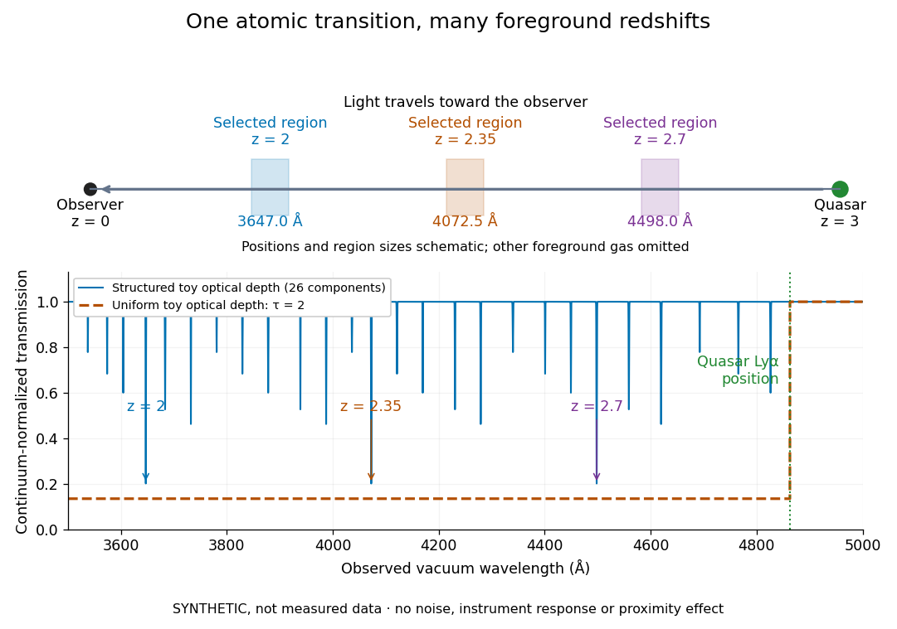
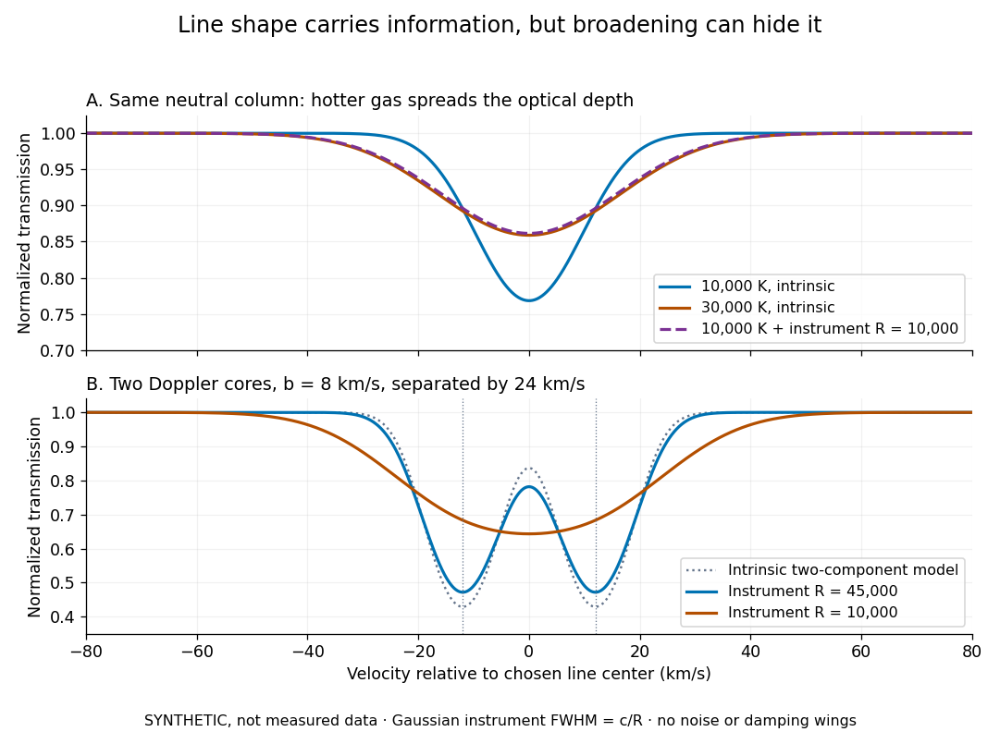

# Lyman-alpha forest

↑ **Parent:** [Intergalactic medium](intergalactic-medium.md)  
ⓦ [Wiki](https://en.wikipedia.org/wiki/Lyman-alpha_forest)

The [Lyman-alpha forest](lyman-alpha-forest.md) is the multitude of foreground [Lyman-alpha absorption](lyman-alpha-absorption.md) features in a distant [quasar](quasar.md)'s spectrum, at [wavelengths](wavelength.md) shorter than its own redshifted [Lyman-alpha emission](lyman-alpha-emission.md). The [quasar](quasar.md) supplies a bright background; intervening neutral [hydrogen atoms](hydrogen-atom.md) remove [photons](photon.md) near their local [Lyman-alpha line](lyman-alpha-line.md) resonance. Many dips can therefore come from one atomic transition encountered at different [redshifts](redshift.md), rather than from many different [chemical elements](chemical-element.md). Some features are instead transitions of other ions, so a dip alone does not identify [Lyman-alpha absorption](lyman-alpha-absorption.md). This makes faint foreground gas detectable through the [light](light.md) it removes, even when its own emission would be difficult to see. [Rauch (1998), The Lyman Alpha Forest in the Spectra of QSOs, section 1](https://ned.ipac.caltech.edu/level5/Sept01/Rauch/Rauch1.html).

Ignoring [peculiar velocity](peculiar-velocity.md) for the moment, an absorber at [cosmological redshift](cosmological-redshift.md) $z_a$ puts its [Lyman-alpha line](lyman-alpha-line.md) at

$$
\lambda_{\mathrm{obs}}=\lambda_\alpha(1+z_a),\qquad z_a=\frac{\lambda_{\mathrm{obs}}}{\lambda_\alpha}-1,\qquad \lambda_\alpha=1215.67\,\text{Å}.
$$

The rest [wavelength](wavelength.md) is in the [ultraviolet](ultraviolet.md); at $z_a=2$ it appears at $3647.01\,\text{Å}$ in the [optical spectrum](optical-spectrum.md). In a toy sightline to a [quasar](quasar.md) at $z_Q=3$, absorbers at $z_a=2,\ 2.35,\ 2.7$ appear at $3647.01,\ 4072.4945,\ 4497.979\,\text{Å}$, all shortward of the [quasar](quasar.md)'s [Lyman-alpha emission](lyman-alpha-emission.md) position $4862.68\,\text{Å}$. The absorbing atoms see the selected [photons](photon.md) at their own resonance; the observed dip's [redshift](redshift.md) belongs to the foreground gas. [Peculiar velocity](peculiar-velocity.md) adds a [Doppler shift](doppler-effect.md), so the inferred $z_a$ is not a pure distance coordinate. The rest [wavelength](wavelength.md) and resonance interpretation are given in [Rauch (1998), section 1](https://ned.ipac.caltech.edu/level5/Sept01/Rauch/Rauch1.html).

**[Figure 2](#lyman-alpha-forest-sightline). Synthetic foreground geometry and spectra: one Lyman-alpha transition at many redshifts**.

The diagram uses invented [optical depths](optical-depth.md) and 26 Doppler cores; three selected foreground regions are marked. Their drawn positions and sizes are schematic. The dashed comparison imposes a uniform [optical depth](optical-depth.md) $\tau=2$, giving transmission $e^{-2}\simeq0.135$ throughout the chosen foreground band. It is an idealized smooth-absorption model, not a measured spectrum or a prediction of the actual [intergalactic medium](intergalactic-medium.md).

The smooth comparison explains the Gunn-Peterson effect: neutral [hydrogen](hydrogen.md) distributed throughout an expanding [intergalactic medium](intergalactic-medium.md) can absorb continuously over a [wavelength](wavelength.md) interval, because different parts of the path resonate with different observed [wavelengths](wavelength.md). The resolved [Lyman-alpha forest](lyman-alpha-forest.md) instead has strong transmission fluctuations and distinguishable [absorption lines](absorption-line.md). These need not represent isolated compact clouds: diffuse sheets and filaments in the [cosmic web](cosmic-web.md) can generate peaks in [optical depth](optical-depth.md) along one [line of sight](line-of-sight.md). A continuously varying gas distribution can look like a collection of lines. [Rauch (1998), section 1: smooth absorption](https://ned.ipac.caltech.edu/level5/Sept01/Rauch/Rauch1.html). [Rauch (1998), section 5.1: synthetic sightlines and extended structures](https://ned.ipac.caltech.edu/level5/Sept01/Rauch/Rauch5_1.html).

An early observation makes the identification concrete. Lynds's 1971 paper analyzed six spectrograms of the [quasar](quasar.md) 4C 05.34, with emission [redshift](redshift.md) $2.877$, taken in spring 1970 using an image-tube [spectrograph](spectrograph.md) on Kitt Peak's 84-inch telescope. Five covered $3200$–$7500\,\text{Å}$ with approximately $10\,\text{Å}$ resolution; the most informative covered about $3500$–$6000\,\text{Å}$ at $5\,\text{Å}$ resolution. Its reproduced spectrogram shows the strong [Lyman-alpha emission](lyman-alpha-emission.md) flanked mostly on the short-[wavelength](wavelength.md) side by numerous [absorption lines](absorption-line.md). Lynds tabulated their [wavelengths](wavelength.md) and estimated strengths, identified five absorption [redshift](redshift.md) systems, and proposed that many remaining unidentified lines were the same [Lyman-alpha line](lyman-alpha-line.md) at additional [redshifts](redshift.md). He explicitly warned about blending, an incomplete census of weak lines, and [wavelength](wavelength.md) errors around $0.5$–$1\,\text{Å}$. The result established a striking spectral pattern; the paper's proposed interpretation did not measure a separate physical cloud for every dip. [Lynds (1971), The Absorption-Line Spectrum of 4C 05.34, Figure 1, Table 1 and discussion](https://adsabs.harvard.edu/pdf/1971ApJ...164L..73L).

A contrasting observation demonstrates smooth, very strong absorption. Becker and collaborators (2001) used the Echelle Spectrograph and Imager on Keck II to observe the [quasar](quasar.md) SDSSp J103027.10+052455.0 at $z_Q=6.28$. Sky lines gave an instrumental full width at half maximum of about $1.8\,\text{Å}$ near $8500\,\text{Å}$, or [spectral resolving power](spectral-resolving-power.md) $R\simeq4700$. After sky subtraction and flux calibration, the mean continuum-normalized transmission over $8450$–$8710\,\text{Å}$ was $0.0038\pm0.0026$, consistent with zero; this corresponds to absorption [redshifts](redshift.md) approximately $5.95$–$6.16$. They identified a Gunn-Peterson trough. Crucially, resonant [Lyman-alpha absorption](lyman-alpha-absorption.md) is so sensitive that even a small neutral fraction can make transmission undetectable: the trough alone does not establish a mostly neutral [intergalactic medium](intergalactic-medium.md) or uniquely date [reionization](reionization.md). [Becker et al. (2001), sections 2–4: instrument response, transmitted flux and interpretation](https://arxiv.org/pdf/astro-ph/0108097).

What a spectrum constrains is a [radiative transfer](radiative-transfer.md) problem. For an ideal foreground screen with negligible emission into the observed beam, the intrinsic continuum-normalized transmission is

$$
\mathcal T(\lambda)=\frac{F(\lambda)}{F_{\mathrm{cont}}(\lambda)}=e^{-\tau(\lambda)},\qquad N_{\mathrm{HI}}=\int n_{\mathrm{HI}}\,d\ell.
$$

Here $F$ is spectral [radiative flux](radiative-flux.md), $F_{\mathrm{cont}}$ is its unabsorbed continuum, $\tau$ is [optical depth](optical-depth.md), $n_{\mathrm{HI}}$ is neutral [hydrogen](hydrogen.md) [number density](number-density.md), and $N_{\mathrm{HI}}$ is neutral [hydrogen](hydrogen.md) [column density](column-density.md) along proper path length $\ell$. A [Voigt profile](voigt-profile.md) model constrains [redshift](redshift.md), [column density](column-density.md) and a velocity width together. A nearly black line has lost much of its sensitivity to further increases in [optical depth](optical-depth.md); blending and an uncertain continuum can also admit different fitted components. Finite [spectral resolving power](spectral-resolving-power.md) and noise limit which widths and weak features can be measured. [Rauch (1998), section 2: resolution, noise and profile analysis](https://ned.ipac.caltech.edu/level5/Sept01/Rauch/Rauch2.html). [Kim, Cristiani and D'Odorico (2001), section 3: fitted parameters and nonunique profile fits](https://arxiv.org/pdf/astro-ph/0101005).

For a purely thermal Doppler core, use the velocity convention $\tau(v)\propto\exp[-(v-v_0)^2/b^2]$. The [Maxwell-Boltzmann velocity distribution](maxwell-boltzmann-velocity-distribution.md) then gives

$$
b_{\mathrm{th}}=\sqrt{\frac{2k_BT}{m_{\mathrm H}}}\simeq12.85\sqrt{\frac{T}{10^4\,\mathrm K}}\,\mathrm{km\,s^{-1}},
$$

where $k_B$ is the [Boltzmann constant](boltzmann-constant.md), $T$ is [temperature](temperature.md) and $m_{\mathrm H}$ is a [hydrogen atom](hydrogen-atom.md)'s mass. This $b$ is $\sqrt2$ times the [Gaussian distribution](normal-distribution.md)'s standard deviation. Higher [temperature](temperature.md) spreads the same [column density](column-density.md) over more velocities. An instrument also broadens a line: locally, for a nearly flat continuum, the recorded transmission is approximately the [convolution](convolution.md) of $\mathcal T$ with the normalized instrumental response, not the exponential of a convolved [optical depth](optical-depth.md). A Gaussian response with full width at half maximum $c/R$ has standard deviation $c/[R\sqrt{8\log2}]$, where $c$ is the [speed of light](speed-of-light.md) and $R$ the [spectral resolving power](spectral-resolving-power.md).

**[Figure 3](#lyman-alpha-forest-broadening). Synthetic absorption profiles: thermal broadening, instrumental smoothing and unresolved blends**.

The upper model fixes the integral $\int\tau(v)\,dv$, hence the neutral [hydrogen](hydrogen.md) [column density](column-density.md) for this transition, while changing [temperature](temperature.md). A cooler line blurred by an instrument resembles a warmer intrinsic line. The lower model has two equal Doppler cores separated by $24\,\mathrm{km\,s^{-1}}$: reducing [spectral resolving power](spectral-resolving-power.md) merges them into one apparent feature. Both panels use invented profiles, Gaussian instrumental responses, and no noise or damping wings. They illustrate an [inverse problem](inverse-problem-split.md), rather than measurements of [temperature](temperature.md) or a universal relation between a dip and a cloud.

Better observations provide the inputs to that [inverse problem](inverse-problem-split.md). Kim, Cristiani and D'Odorico (2001) analyzed three [quasars](quasar.md) with the VLT's UVES [spectrograph](spectrograph.md). For HE2217–2818, Table 1 records $z_Q=2.413$ and $16200\,\mathrm s$ of exposure in the $3050$–$3860\,\text{Å}$ setup in October 1999. Isolated thorium-argon lamp lines measured $R\simeq45000$; the data were resampled into $0.05\,\text{Å}$ bins, with signal-to-noise ratios about $45$–$50$ per pixel over $3550$–$4050\,\text{Å}$. They fitted a local polynomial continuum, fitted [Voigt profiles](voigt-profile.md), and compared statistics of the transmitted flux. Their analysis excluded the region near the [quasar](quasar.md) to avoid the [quasar proximity effect](proximity-effect-astrophysics.md) and used the interval between its Lyman-beta and [Lyman-alpha emission](lyman-alpha-emission.md) to reduce confusion with other Lyman-series absorption. Features below $N_{\mathrm{HI}}=10^{12.5}\,\mathrm{cm^{-2}}$ became confused with noise, setting their adopted lower [column density](column-density.md) limit. Figure 1 shows the measured spectrum, fitted profiles and residuals. This was a calibrated absorption measurement, with explicit selection limits. [Kim, Cristiani and D'Odorico (2001), UVES observations, sections 2–3, Table 1 and Figure 1](https://arxiv.org/pdf/astro-ph/0101005).

Even after instrumental correction, a width need not be purely [thermal Doppler broadening](thermal-doppler-broadening.md). [Hubble flow](hubble-flow.md) across extended gas, [peculiar velocity](peculiar-velocity.md) structure and unresolved blends can contribute. If an isolated line's intrinsic width obeys $b^2=b_{\mathrm{th}}^2+b_{\mathrm{nt}}^2$ with an independent Gaussian nonthermal contribution $b_{\mathrm{nt}}^2\geq0$, then $T\leq m_{\mathrm H}b^2/(2k_B)$; $b=25\,\mathrm{km\,s^{-1}}$ gives a computed upper bound about $3.79\times10^4\,\mathrm K$. A complex blend need not satisfy this single-component model. Noise can also bias the fitted widths of weak lines. This is why the [thermal cutoff of Lyman-alpha line widths](thermal-cutoff-of-lyman-alpha-line-widths.md), calibrated against gas models, is more informative than assigning a [temperature](temperature.md) to every dip. [Rauch (1998), section 3.3: width measurements, noise bias and bulk motions](https://ned.ipac.caltech.edu/level5/Sept01/Rauch/Rauch3_3.html).

Finally, neutral [hydrogen](hydrogen.md) [column density](column-density.md) is not total gas [mass density](density.md). In a pure [hydrogen](hydrogen.md) approximation, with gas optically thin to ionizing radiation and nearly fully ionized in [photoionization equilibrium](photoionization-equilibrium.md), the [Lyman-alpha forest photoionization scaling](lyman-alpha-forest-photoionization-scaling.md) gives

$$
n_{\mathrm{HI}}\simeq\frac{\alpha(T)n_{\mathrm H}^2}{\Gamma},\qquad x_{\mathrm{HI}}\simeq\frac{\alpha(T)n_{\mathrm H}}{\Gamma},
$$

where $n_{\mathrm H}$ counts all [hydrogen](hydrogen.md) nuclei, $\Gamma$ is the [photoionization rate](photoionization-rate.md), $\alpha(T)$ is the radiative recombination coefficient and $x_{\mathrm{HI}}=n_{\mathrm{HI}}/n_{\mathrm H}$ is the neutral fraction. At fixed [temperature](temperature.md) and $\Gamma$, doubling $n_{\mathrm H}$ quadruples $n_{\mathrm{HI}}$; doubling $\Gamma$ halves it. These computed examples explain both the sensitivity to [density contrast](density-contrast.md) and the ambiguity: stronger absorption can mean denser gas, weaker ionizing radiation, a different [temperature](temperature.md), or more path length. The [Jeans-length ionization correction for the Lyman-alpha forest](jeans-length-ionization-correction-for-the-lyman-alpha-forest.md) adds a size model rather than an independently measured depth. Optically thick [Lyman limit systems](lyman-limit-system.md) and [damped Lyman-alpha systems](damped-lyman-alpha-system.md) require different treatment. [Rauch (1998), section 5: neutral fraction and ionization correction](https://ned.ipac.caltech.edu/level5/Sept01/Rauch/Rauch5.html). [Schaye (2001), section 2 and Appendix equations A6–A7: ionization balance and the Jeans-length model](https://arxiv.org/pdf/astro-ph/0104272).

The beauty of the [Lyman-alpha forest](lyman-alpha-forest.md) is that a spectrum converts otherwise faint foreground gas into a sequence of markers through cosmic time. With a model of [radiative transfer](radiative-transfer.md), velocities, ionizing radiation and the [temperature-density relation of photoionized intergalactic gas](temperature-density-relation-of-photoionized-intergalactic-gas.md), its transmission statistics probe the [cosmic web](cosmic-web.md) and gas thermal history. A single [line of sight](line-of-sight.md) remains one narrow sample, not a unique three-dimensional density map. [Rauch (1998), section 5.2: the forest as a record of fluctuations](https://ned.ipac.caltech.edu/level5/Sept01/Rauch/Rauch5_2.html).

**Table of contents**

- [Lyman-alpha forest photoionization scaling](lyman-alpha-forest-photoionization-scaling.md)
  - [Jeans-length ionization correction for the Lyman-alpha forest](jeans-length-ionization-correction-for-the-lyman-alpha-forest.md)
- [Redshift evolution of the Lyman-alpha forest](redshift-evolution-of-the-lyman-alpha-forest.md)
- [Proximity effect (astrophysics)](proximity-effect-astrophysics.md)
  - [Proximity-effect estimator of the ionizing background](proximity-effect-estimator-of-the-ionizing-background.md)

## ↑ Ancestors (5)

1. [Intergalactic medium](intergalactic-medium.md)
2. [Astrophysics](astrophysics-split.md)
3. [Branches of physics](branches-of-physics.md)
4. [Physics](physics-split.md)
5. [Codex Wiki](split.md)

## ← Incoming links (22)

- [Lyman-alpha forest](lyman-alpha-forest.md)
- [Lyman limit system](lyman-limit-system.md)
- [Solution](past-exam-of-the-mathematics-course-of-the-university-of-cambridge/2004/iii/paper-67/4/b/solution.md)
- [Solution](past-exam-of-the-mathematics-course-of-the-university-of-cambridge/2004/iii/paper-67/4/d/solution.md)
- [Solution](past-exam-of-the-mathematics-course-of-the-university-of-cambridge/2005/iii/paper-74/2/a/solution.md)
- [Solution](past-exam-of-the-mathematics-course-of-the-university-of-cambridge/2005/iii/paper-74/2/b/solution.md)
- [Solution](past-exam-of-the-mathematics-course-of-the-university-of-cambridge/2005/iii/paper-74/2/c/solution.md)
- [Solution](past-exam-of-the-mathematics-course-of-the-university-of-cambridge/2005/iii/paper-74/2/e/solution.md)
- [Solution](past-exam-of-the-mathematics-course-of-the-university-of-cambridge/2005/iii/paper-74/2/f/solution.md)
- [Solution](past-exam-of-the-mathematics-course-of-the-university-of-cambridge/2005/iii/paper-74/3/iii/solution.md)
- [Solution](past-exam-of-the-mathematics-course-of-the-university-of-cambridge/2005/iii/paper-74/4/iii/c/solution.md)
- [Solution](past-exam-of-the-mathematics-course-of-the-university-of-cambridge/2006/iii/paper-72/2/iv/solution.md)
- [Solution](past-exam-of-the-mathematics-course-of-the-university-of-cambridge/2007/iii/paper-67/3/iv/solution.md)
- [Solution](past-exam-of-the-mathematics-course-of-the-university-of-cambridge/2008/iii/paper-73/3/i/solution.md)
- [Solution](past-exam-of-the-mathematics-course-of-the-university-of-cambridge/2008/iii/paper-73/3/iii/solution.md)
- [Solution](past-exam-of-the-mathematics-course-of-the-university-of-cambridge/2008/iii/paper-73/3/iv/solution.md)
- [Solution](past-exam-of-the-mathematics-course-of-the-university-of-cambridge/2009/iii/paper-66/3/i/solution.md)
- [Solution](past-exam-of-the-mathematics-course-of-the-university-of-cambridge/2009/iii/paper-66/3/iv/solution.md)
- [Proximity effect (astrophysics)](proximity-effect-astrophysics.md)
- [Redshift evolution of the Lyman-alpha forest](redshift-evolution-of-the-lyman-alpha-forest.md)
- [Sandage-Loeb test](sandage-loeb-test.md)
- [Temperature-density relation of photoionized intergalactic gas](temperature-density-relation-of-photoionized-intergalactic-gas.md)
