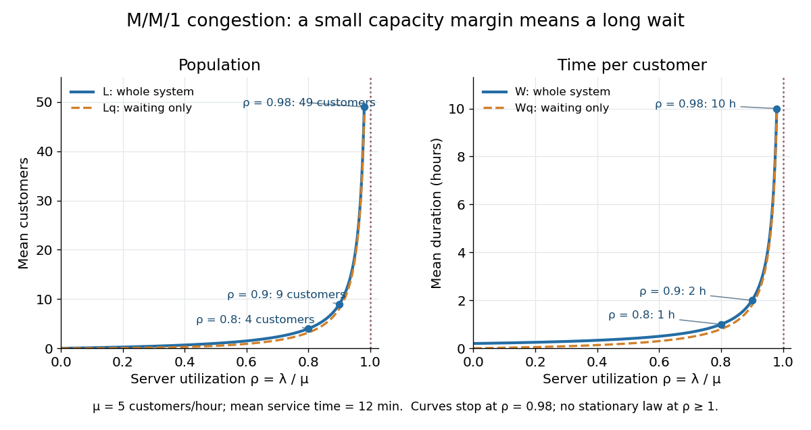

<h1 id="m-m-1-utilization-and-delay">M/M/1 utilization and delay</h1>

↑ **Parent:** [Queueing theory](queueing-theory-split.md)

Consider an [M/M/1 queue](m-m-1-queue.md) with an exogenous [Poisson process](poisson-process-split.md) of arrivals of rate $\lambda$, one server, unlimited waiting space, [first come first served](first-come-first-served.md) service, and [independent and identically distributed](independent-and-identically-distributed-random-variables.md) [service times](service-time.md) with an [exponential distribution](exponential-distribution.md) of rate $\mu$, independent of arrivals. There is no blocking or abandonment, so offered rate and admitted [queue throughput](queue-throughput.md) coincide: $\lambda_{\mathrm{eff}}=\lambda$. The [memoryless property](memorylessness-of-the-exponential-distribution.md) makes the [queue population](queue-population.md) a [birth-death process](birth-death-process.md). For $0<\lambda<\mu$, the [stationary distribution of an M-M-1 queue](stationary-distribution-of-an-m-m-1-queue.md) is

$$
\pi_n=(1-\rho)\rho^n,\qquad \rho=\frac\lambda\mu<1,\qquad n=0,1,2,\ldots.
$$

This is a [geometric distribution](geometric-distribution.md) on the nonnegative integers. Its [mean](expected-value-split.md), together with [Little's law](little-s-law.md), gives

$$
L=\frac\rho{1-\rho},\qquad W=\frac L\lambda=\frac1{\mu-\lambda},\qquad L_q=L-\rho=\frac{\rho^2}{1-\rho},\qquad W_q=W-\frac1\mu=\frac\rho{\mu-\lambda}.
$$

Here $L,W$ count the whole system, and $L_q,W_q$ count only waiting. These distinctions and formulas are derived in [MIT 2.854, M/M/1 Queue notes, pages 1-2](https://ocw.mit.edu/courses/2-854-introduction-to-manufacturing-systems-fall-2016/927056a1af54772a587fd84ad4951e71_MIT2_854F16_Mm1Queue.pdf).

Take $\lambda=4$ customers per hour and $\mu=5$ customers per hour. The mean [service time](service-time.md) is $1/5$ hour, or 12 minutes, and the [server utilization](server-utilization.md) is $\rho=4/5=0.8$. Computing each quantity explicitly,

$$
L=\frac{0.8}{0.2}=4,\qquad W=\frac1{5-4}=1\ \text{hour},\qquad L_q=\frac{0.64}{0.2}=3.2,\qquad W_q=1-0.2=0.8\ \text{hour}=48\ \text{minutes}.
$$

Thus [Little's law](little-s-law.md) checks both boundaries: $4=4\cdot1$ and $3.2=4\cdot0.8$. The mean number in service is $L-L_q=0.8$, rather than one, because the server is idle 20 percent of the time. By [PASTA](poisson-arrivals-see-time-averages.md), an arriving customer sees four customers already in the system on average. Under [first come first served](first-come-first-served.md), the [memoryless property](memorylessness-of-the-exponential-distribution.md) gives mean residual [service time](service-time.md) $1/\mu$ for the customer in service; clearing those four customers takes $4/5=0.8$ hour on average, independently confirming the mean [queueing delay](queueing-delay.md).

Holding $\mu=5$ per hour fixed, increasing arrivals from $4$ to $4.5$ per hour raises [server utilization](server-utilization.md) from $0.8$ to $0.9$, but doubles mean [customer sojourn time](customer-sojourn-time.md) from one to two hours. At $\lambda=4.9$ per hour, [server utilization](server-utilization.md) is $0.98$, $L=49$, $W=10$ hours, $L_q=48.02$, and $W_q=9.8$ hours. Both mean population and mean duration diverge as $\lambda$ approaches $\mu$ from below. The formula describes an explosive congestion penalty near capacity even though all arrivals still eventually receive service at every fixed subcritical rate. At or above capacity there is no [stationary distribution](stationary-distribution.md) for this unlimited [M/M/1 queue](m-m-1-queue.md), so these finite stationary formulas no longer apply.

**[Figure 2](#image-m-m-1-population-and-delay-grow-sharply-as-server-utilization-approaches-one). M/M/1 population and delay grow sharply as server utilization approaches one**.

The inverse dependence of mean [customer sojourn time](customer-sojourn-time.md) on spare capacity, $W=1/(\mu-\lambda)$, makes [server utilization](server-utilization.md) a poor standalone measure of service quality. Adding capacity at a nearly saturated [M/M/1 queue](m-m-1-queue.md) can sharply reduce [queueing delay](queueing-delay.md). Stanley B. Gershwin develops this capacity interpretation in [Markov Processes and Queues, MIT 2.854, 2016, slides 71-72](https://ocw.mit.edu/courses/2-854-introduction-to-manufacturing-systems-fall-2016/5d3e9532c2ff6e156d48e41f9bd9576f_MIT2_854F16_Queueing.pdf).

## ↑ Ancestors (6)

1. [Queueing theory](queueing-theory-split.md)
2. [Probability theory](probability-theory-split.md)
3. [Probability and statistics](probability-and-statistics-split.md)
4. [Area of mathematics](area-of-mathematics.md)
5. [Mathematics](mathematics-split.md)
6. [Codex Wiki](split.md)

## ← Incoming links (2)

- [Poisson arrivals see time averages](poisson-arrivals-see-time-averages.md)
- [Queueing theory](queueing-theory-split.md)
