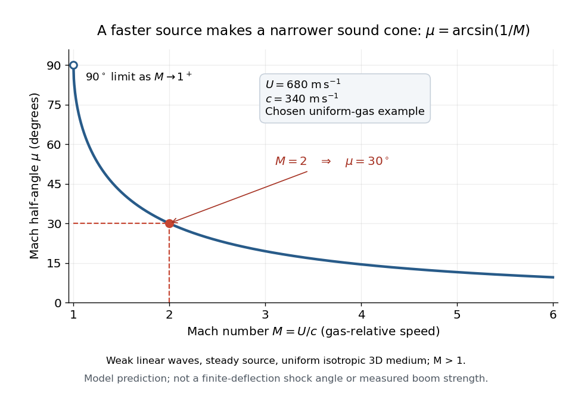

# Mach angle

↑ **Parent:** [Oblique shock](oblique-shock.md)  
ⓦ [Wiki](https://en.wikipedia.org/wiki/Mach_angle)

The [Mach angle](mach-angle.md) of a [supersonic flow](supersonic-flow.md) with [Mach number](mach-number.md) $M>1$ is $\mu=\arcsin(M^{-1})$. Infinitesimal [pressure](pressure-split.md) disturbances lie on the corresponding [Mach cone](mach-cone.md), and a weak [oblique shock](oblique-shock.md) approaches this angle as its strength tends to zero.

The [Mach angle](mach-angle.md) is the half-angle between a [Mach cone](mach-cone.md) generator and its backward motion axis for a steady point source in a uniform three-dimensional medium with [isotropy](isotropy.md) and constant [sound speed](speed-of-sound.md). It obeys

$$
\sin\mu=\frac{c}{U}=\frac{1}{M},\qquad 0<\mu<\frac{\pi}{2},\quad M>1.
$$

The relation concerns weak [acoustic waves](acoustic-wave.md) in [linear acoustics](linear-acoustics-split.md). It is not the angle of a finite [oblique shock](oblique-shock.md) produced by finite turning of the [fluid flow](fluid-flow.md); that angle also depends on the deflection and the [gas](gas.md) properties.[Mach Angle, geometric construction and displayed sin(mu)=1/M and mu=asin(1/M) equations](mach-angle-nasa-glenn-research-center.md)

For a short proof, choose an old emission in the [moving-point acoustic wavefronts](moving-point-acoustic-wavefronts.md) construction and set $s=-\tau>0$. Its [circle](circle.md) has center $(-Us,0)$ and radius $cs$. A [tangent line](tangent-line.md) from the present source at the origin meets the [circle](circle.md) at a [right angle](right-angle.md) to its radius. The resulting [right triangle](right-triangle.md) has hypotenuse $Us$ and opposite side $cs$, giving the displayed [sine](sine.md) ratio. The emission age cancels: every [wavefront](wavefront.md) has the same tangent directions, so a continuum of expanding [spheres](sphere.md) produces one simple [Mach cone](mach-cone.md).

In an original example, stipulate uniform [gas](gas.md) with [sound speed](speed-of-sound.md) $c=340\,\mathrm{m\,s^{-1}}$ and a source moving through it at $U=680\,\mathrm{m\,s^{-1}}$. Then $M=2$ and $\mu=\arcsin(1/2)=30^\circ$. An emission one second earlier is now a [sphere](sphere.md) centered $680\,\mathrm m$ behind the source with radius $340\,\mathrm m$. The selected [sound speed](speed-of-sound.md) defines this example; it is not a constant for air at every [temperature](temperature-split.md). The [Mach angle](mach-angle.md) decreases as $M$ increases: its [derivative](derivative.md) is $-1/(M\sqrt{M^2-1})$ in [radians](radian.md), and its [limits](limit-of-a-function.md) are $90^\circ$ as $M\downarrow1$ and $0$ as $M\to\infty$.

**[Figure 2](#image-mach-half-angle-decreases-as-the-gas-relative-speed-ratio-increases). Mach half-angle decreases as the gas-relative speed ratio increases**. Original plot of the [Mach angle](mach-angle.md) $\mu=\arcsin(1/M)$ for $M>1$, with the constructed $M=2$, $\mu=30^\circ$ example. The open point at $M=1$ marks a [limit](limit-of-a-function.md), not a finite [supersonic](supersonic-flow.md) cone. This weak-wave prediction gives neither a finite-deflection [oblique shock](oblique-shock.md) angle nor measured [sonic boom](sonic-boom.md) strength.

**Table of contents**

- [Mach cone](mach-cone.md)

## ↑ Ancestors (7)

1. [Oblique shock](oblique-shock.md)
2. [Normal shock wave](normal-shock-wave.md)
3. [Compressible flow](compressible-flow-split.md)
4. [Fluid mechanics](fluid-mechanics-split.md)
5. [Branches of physics](branches-of-physics.md)
6. [Physics](physics-split.md)
7. [Codex Wiki](split.md)

## ← Incoming links (7)

- [Mach angle](mach-angle.md)
- [Mach cone](mach-cone.md)
- [Mach number](mach-number.md)
- [Solution](past-exam-of-the-astrophysical-fluid-dynamics-course-of-the-university-of-cambridge/2021/section-b/4/d/solution.md)
- [Solution](past-exam-of-the-mathematics-course-of-the-university-of-cambridge/2021/iii/paper-314/2/d/solution.md)
- [Sonic flow](sonic-flow.md)
- [Strong oblique-shock angle branches](strong-oblique-shock-angle-branches.md)
