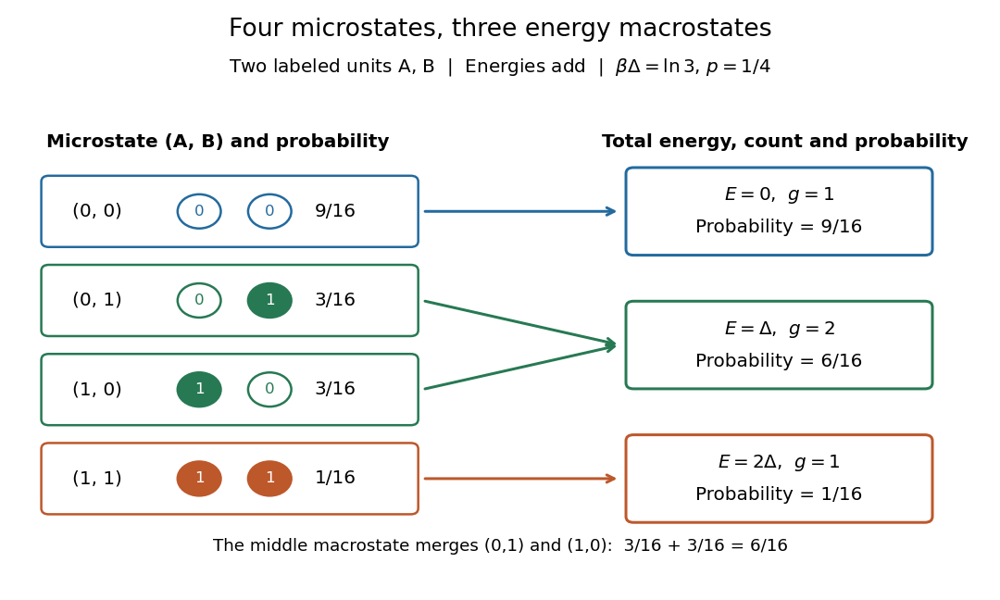

# Macrostate

↑ **Parent:** [State degeneracy](state-degeneracy.md)  
ⓦ [Wiki](https://en.wikipedia.org/wiki/Macrostate)

A [macrostate](macrostate.md) groups [microstates](microstate.md) sharing prescribed coarse data. The grouping depends on what is retained: here retain only total [energy](energy-split.md). For the two distinguishable [two-level systems](two-level-system.md), the [macrostates](macrostate.md) $E=0,\Delta,2\Delta$ have [state degeneracies](state-degeneracy.md) $1,2,1$. Although two units are not macroscopic in size, they make this loss of information visible: knowing $E=\Delta$ does not tell us which unit is excited.

At [inverse temperature](inverse-temperature.md) $\beta\Delta=\ln3$, each unit's excited-state [probability](probability.md) is $p=1/4$. Their [independence](independent-random-variables.md) gives [microstate](microstate.md) [probabilities](probability.md) $9/16,3/16,3/16,1/16$ in the order above. Adding within each [macrostate](macrostate.md) gives

$$
P(E=0)=\frac9{16},\qquad P(E=\Delta)=\frac6{16},\qquad P(E=2\Delta)=\frac1{16}.
$$

The total [expected value](expected-value-split.md) of [energy](energy-split.md) is therefore $\Delta(6/16)+2\Delta(1/16)=\Delta/2$, matching two units each with [expected value](expected-value-split.md) of [energy](energy-split.md) $\Delta/4$. Equal [state degeneracies](state-degeneracy.md) would give the wrong answer: [macrostate](macrostate.md) [probabilities](probability.md) combine counting with the [Boltzmann factor](boltzmann-factor.md). At very high positive [temperature](temperature-split.md), all four [microstates](microstate.md) become equally likely, but these three [macrostate](macrostate.md) [probabilities](probability.md) approach $1/4,1/2,1/4$.

**[Figure 14](#image-four-microstates-grouped-into-three-energy-macrostates-with-their-thermal-probabilities). Four microstates grouped into three energy macrostates, with their thermal probabilities**.

## ↑ Ancestors (5)

1. [State degeneracy](state-degeneracy.md)
2. [Statistical physics](statistical-physics-split.md)
3. [Branches of physics](branches-of-physics.md)
4. [Physics](physics-split.md)
5. [Codex Wiki](split.md)

## ← Incoming links (15)

- [Additivity of Boltzmann entropy](additivity-of-boltzmann-entropy.md)
- [Boltzmann distribution and state degeneracy](boltzmann-distribution-and-state-degeneracy.md)
- [Boltzmann distribution in a four-state system](boltzmann-distribution-in-a-four-state-system.md)
- [Boltzmann distribution ratios and energy reference](boltzmann-distribution-ratios-and-energy-reference.md)
- [Boltzmann distribution temperature limits in a finite system](boltzmann-distribution-temperature-limits-in-a-finite-system.md)
- [Boltzmann entropy of a two-box occupancy](boltzmann-entropy-of-a-two-box-occupancy.md)
- [Boltzmann entropy when a restriction is removed](boltzmann-entropy-when-a-restriction-is-removed.md)
- [Boltzmann's entropy formula](boltzmann-s-entropy-formula.md)
- [Entropy](entropy-split.md)
- [Macrostate](macrostate.md)
- [Solution](past-exam-of-the-mathematics-course-of-the-university-of-cambridge/2023/ii/paper-2/37a/c/solution.md)
- [Solution](past-exam-of-the-physics-b-course-of-the-university-of-cambridge/2011/paper-1/section-c/c13/solution.md)
- [Solution](past-exam-of-the-physics-b-course-of-the-university-of-cambridge/2019/paper-2/section-c/c13/solution.md)
- [State degeneracy](state-degeneracy.md)
- [Statistical mechanics](statistical-mechanics.md)
