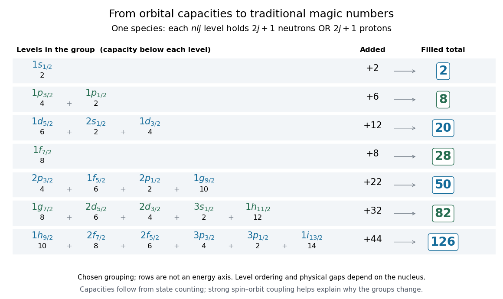

# Magic number

↑ **Parent:** [Nuclear shell model](nuclear-shell-model.md)  
ⓦ [Wiki](https://en.wikipedia.org/wiki/Magic_number_(physics))

A [proton](proton.md) number $Z$ or [neutron](neutron-split.md) number $N$ associated with a pronounced [nuclear shell closure](nuclear-shell-closure.md). The traditional sequence is

$$
2,\quad8,\quad20,\quad28,\quad50,\quad82,\quad126.
$$

These count either species separately, rather than their sum $A=Z+N$. Calling a number magic summarizes a structural pattern; it does not promise that every [isotope](isotope.md) at that number is equally stable.

**[Figure 3](#image-counting-states-between-traditional-nuclear-shell-closures). Counting states between traditional nuclear shell closures**. Original capacity diagram for a chosen spherical level scheme. Each orbital contributes $2j+1$ states for one species. Rows show groups and cumulative totals, not measured energies or a universal ordering within each group.

For example, in the chosen scheme the $20$-particle core plus the eight substates of $1f_{7/2}$ gives $28$. The next group contributes $4+6+2+10=22$, giving $50$. The following two groups contribute $8+6+4+2+12=32$ and $10+8+6+4+2+14=44$, giving $82$ and $126$. Counting verifies the capacities once the grouping has been chosen; it does not establish the physical [energy](energy-split.md) gaps that justify that grouping.

**Table of contents**

- [Nuclear shell closure](nuclear-shell-closure.md)

## ↑ Ancestors (5)

1. [Nuclear shell model](nuclear-shell-model.md)
2. [Atomic nucleus](atomic-nucleus-split.md)
3. [Nuclear physics](nuclear-physics.md)
4. [Physics](physics-split.md)
5. [Codex Wiki](split.md)

## ← Incoming links (3)

- [Goeppert Mayer and Jensen nuclear shell model history](goeppert-mayer-and-jensen-nuclear-shell-model-history.md)
- [Neutron-rich magnesium shell-closure test](neutron-rich-magnesium-shell-closure-test.md)
- [Nuclear shell closure](nuclear-shell-closure.md)
