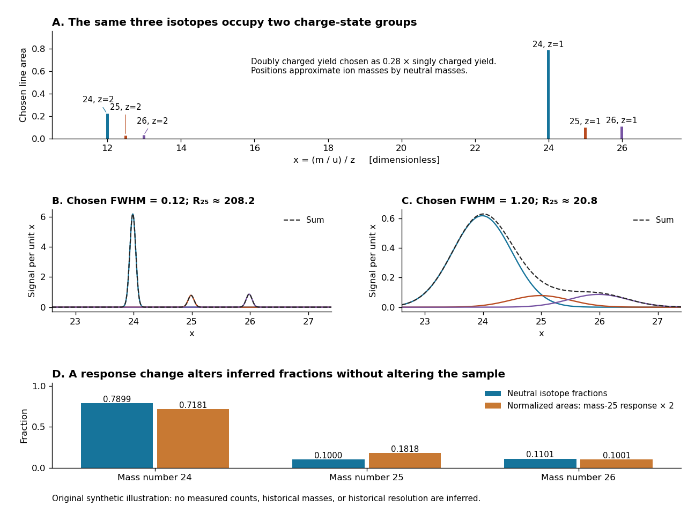

# Magnesium isotope mass spectrum

↑ **Parent:** [Mass spectrometry](mass-spectrometry.md)

For a modern chosen example, the [National Institute of Standards and Technology](national-institute-of-standards-and-technology.md) lists neutral [magnesium](magnesium.md) [atomic masses](atomic-mass.md) $23.985041697\,\mathrm u$, $24.985836976\,\mathrm u$, and $25.982592968\,\mathrm u$, with reference [isotopic abundances](isotopic-abundance.md) $0.7899$, $0.1000$, and $0.1101$. They describe the [isotopes](isotope.md) with [mass numbers](mass-number.md) 24, 25, and 26, respectively.[NIST, Atomic Weights and Isotopic Compositions for Magnesium: rows 24–26, neutral relative atomic masses and reference compositions](atomic-weights-and-isotopic-compositions-for-magnesium-by-national-institute-of-standards-and-technology.md) These modern inputs are not a reconstruction of historical observations.

Use the [dimensionless](dimensionless-quantity.md) [mass-to-charge ratio](mass-to-charge-ratio.md) coordinate $x=(m/\mathrm u)/z$. For the illustration only, approximate [ion](ion.md) [masses](mass.md) by the neutral [atomic masses](atomic-mass.md). The singly charged positions are then near $23.98504$, $24.98584$, and $25.98259$; the doubly charged companions are near $11.99252$, $12.49292$, and $12.99130$. The neutral-to-ion correction already given above is essential at higher accuracy. A peak near $x=12$ alone need not identify a [chemical element](chemical-element.md): another [ion](ion.md) with a different [electric charge](electric-charge-split.md) can occupy the same [mass-to-charge ratio](mass-to-charge-ratio.md) interval.

**[Figure 11](#image-magnesium-charge-states-and-resolution). An original synthetic magnesium mass spectrum: charge states, finite mass resolution, and response bias**. All curves are stipulated sums of unit-area [Gaussian functions](gaussian-function.md), not measured data. The first two panels use equal isotope responses and selected [full width at half maximum](full-width-at-half-maximum.md) values $0.12$ and $1.20$ in $x$. The last panel keeps the reference [isotopic abundances](isotopic-abundance.md) fixed but multiplies the mass-25 response by two, then normalizes the areas. Neutral [atomic masses](atomic-mass.md) approximate [ion](ion.md) [masses](mass.md); charge-state yields are chosen independently, and no historical intensity or resolving-power claim is made.

For the narrow singly charged peak at $x\approx24.98584$, the chosen [full width at half maximum](full-width-at-half-maximum.md) $\Delta x=0.12$ gives [mass resolving power](mass-resolution.md) $R\approx208.2$; widening to $\Delta x=1.20$ gives $R\approx20.82$. Adjacent isotope spacings here are approximately one unit in $x$. Peaks are visibly separated in the first chosen profile and overlap strongly in the second. A small uncertainty in a fitted peak centre would not by itself make the overlapping components resolved.

Even integrated peak areas need a response model. For isotope fraction $f_i$, let $\eta_{i,z}$ collect the probability of [ionization](ionization.md) into [electric charge](electric-charge-split.md) state $z$, transmission through the analyzer, and the detection response. In a linear instrument with overall exposure factor $C$, the component area is

$$
A_{i,z}=C f_i\eta_{i,z}.
$$

Equal $\eta_{i,z}$ at a fixed $z$ makes normalized areas equal the fractions; otherwise it does not. In the chosen example, doubling only the mass-25 response changes the normalized areas to $0.71809$, $0.18182$, and $0.10009$, although the neutral sample is unchanged. Photographic darkening introduces another possible nonlinearity: neither line darkness nor peak height is a universal measure of neutral [isotopic abundance](isotopic-abundance.md). Calibration of position and calibration of intensity answer different questions. Matched standards, a known [electric charge](electric-charge-split.md) assignment, and a response correction make isotope analysis useful; a visually impressive set of peaks alone does not supply those controls.

## ↑ Ancestors (3)

1. [Mass spectrometry](mass-spectrometry.md)
2. [Chemistry](chemistry-split.md)
3. [Codex Wiki](split.md)

## ← Incoming links (1)

- [Mass spectrometry](mass-spectrometry.md)
