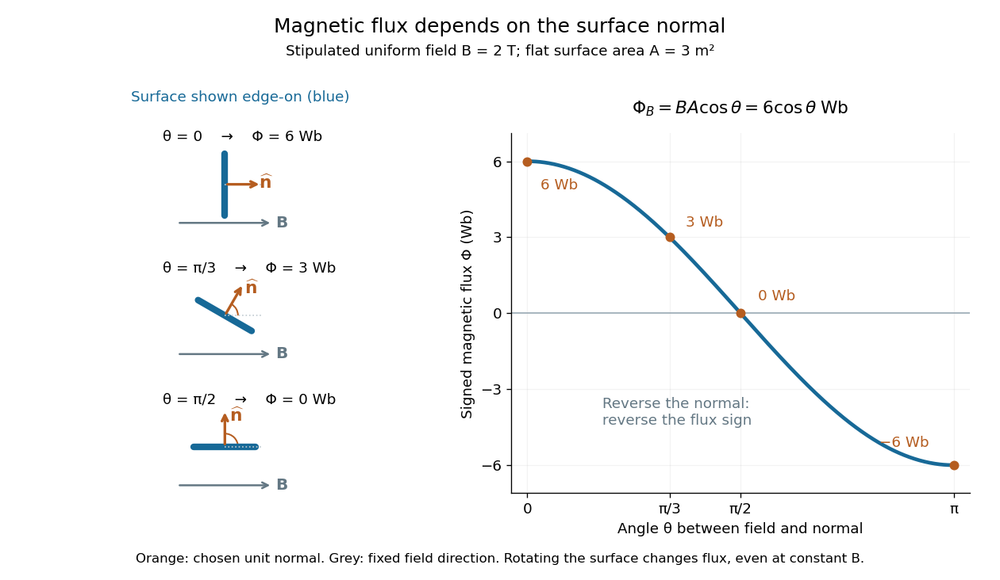

# Magnetic flux

↑ **Parent:** [Magnetic field](magnetic-field.md)  
ⓦ [Wiki](https://en.wikipedia.org/wiki/Magnetic_flux)

[Magnetic flux](magnetic-flux.md) measures the signed amount of [magnetic field](magnetic-field.md) crossing an [oriented surface](oriented-surface.md) $S$. Choose a [unit normal](unit-normal.md) $\widehat{\mathbf n}$ and use the [oriented surface element](oriented-surface-element.md) $d\mathbf S=\widehat{\mathbf n}\,dA$. The defining [surface integral](surface-integral.md) is

$$
\Phi_B=\int_S\mathbf B\cdot d\mathbf S
=\int_S\mathbf B\cdot\widehat{\mathbf n}\,dA.
$$

For a uniform [magnetic field](magnetic-field.md) across a flat [surface](topological-surface.md) of [area](surface-area.md) $A$, the [dot product](dot-product.md) reduces this to

$$
\Phi_B=BA\cos\theta,
$$

where $\theta$ is the [angle](angle.md) between the [magnetic field](magnetic-field.md) and the chosen [unit normal](unit-normal.md), rather than the [plane](plane.md) of the [surface](topological-surface.md). The [SI](international-system-of-units.md) unit is the [weber](weber-unit.md), $1\,\mathrm{Wb}=1\,\mathrm{T\,m^2}$. [OpenStax, magnetic flux and its orientation](https://openstax.org/books/university-physics-volume-2/pages/13-1-faradays-law).

For a stipulated [magnetic field](magnetic-field.md) $B=2\,\mathrm T$ and [area](surface-area.md) $A=3\,\mathrm{m^2}$, the [magnetic flux](magnetic-flux.md) is $6\,\mathrm{Wb}$ at $\theta=0$, $3\,\mathrm{Wb}$ at $\theta=\pi/3$, and zero at $\theta=\pi/2$. In the last case the [magnetic field](magnetic-field.md) lies in the [plane](plane.md) of the [surface](topological-surface.md), so it does not cross it. Reversing the chosen [unit normal](unit-normal.md) reverses the sign of [magnetic flux](magnetic-flux.md) without changing the physical [magnetic field](magnetic-field.md); at $\theta=\pi$ the same example gives $-6\,\mathrm{Wb}$.

**[Figure 36](#image-magnetic-flux-as-a-flat-surface-rotates-in-a-fixed-magnetic-field). Magnetic flux as a flat surface rotates in a fixed magnetic field**. Left: an edge-on [surface](topological-surface.md) and its [unit normal](unit-normal.md) at three [angles](angle.md) to the fixed [magnetic field](magnetic-field.md). Right: the signed [magnetic flux](magnetic-flux.md) $\Phi_B=6\cos\theta\,\mathrm{Wb}$, including reversal of the [unit normal](unit-normal.md). The stipulated [magnetic field](magnetic-field.md) is $2\,\mathrm T$ and the [area](surface-area.md) is $3\,\mathrm{m^2}$.

The geometric idea is projected [area](surface-area.md): tilting a flat [surface](topological-surface.md) reduces the [area](surface-area.md) seen perpendicular to the [magnetic field](magnetic-field.md) by the factor $\cos\theta$. This explains how rotation alone can change [magnetic flux](magnetic-flux.md) even when the [magnetic field](magnetic-field.md) is constant; [Faraday's law of induction](faraday-s-law-of-induction.md) turns such changes into an [electromotive force](electromotive-force.md). [OpenStax, induction from changing magnetic flux](https://openstax.org/books/university-physics-volume-2/pages/13-1-faradays-law).

**Table of contents**

- [Weber (unit)](weber-unit.md)

## ↑ Ancestors (5)

1. [Magnetic field](magnetic-field.md)
2. [Electromagnetism](electromagnetism-split.md)
3. [Branches of physics](branches-of-physics.md)
4. [Physics](physics-split.md)
5. [Codex Wiki](split.md)

## ← Incoming links (81)

- [Bogomolny square completion for an Abelian Higgs vortex](bogomolny-square-completion-for-an-abelian-higgs-vortex.md)
- [Conformal-surface vortex square completion](conformal-surface-vortex-square-completion.md)
- [Convective collapse](convective-collapse.md)
- [Dipolar flux-tube area](dipolar-flux-tube-area.md)
- [Electric potential](electric-potential.md)
- [Exact quadratic-shear magnetic flux solution](exact-quadratic-shear-magnetic-flux-solution.md)
- [Faraday's law of induction](faraday-s-law-of-induction.md)
- [Field-cooled Meissner experiment](field-cooled-meissner-experiment.md)
- [Flux expulsion](flux-expulsion.md)
- [Flux tube](flux-tube.md)
- [Flux-tube area](flux-tube-area.md)
- [Gauge dependence of helicity in an open magnetic flux tube](gauge-dependence-of-helicity-in-an-open-magnetic-flux-tube.md)
- [Hall magnetohydrodynamics](hall-magnetohydrodynamics.md)
- [Henry (unit)](henry-unit.md)
- [Hyperbolic one-vortex at curvature minus one half](hyperbolic-one-vortex-at-curvature-minus-one-half.md)
- [Inductance](inductance.md)
- [Intergranular lane](intergranular-lane.md)
- [Lenz's law](lenz-s-law.md)
- [Limits of Meissner screening](limits-of-meissner-screening.md)
- [Long-wavelength undular magnetic buoyancy criterion](long-wavelength-undular-magnetic-buoyancy-criterion.md)
- [Magnetic concentration by an incompressible stagnation flow](magnetic-concentration-by-an-incompressible-stagnation-flow.md)
- [Magnetic dipole moment](magnetic-dipole-moment.md)
- [Magnetic field](magnetic-field.md)
- [Magnetic flux](magnetic-flux.md)
- [Magnetic flux concentration](magnetic-flux-concentration.md)
- [Magnetic flux linkage](magnetic-flux-linkage.md)
- [Magnetic flux quantization of an Abelian Higgs vortex](magnetic-flux-quantization-of-an-abelian-higgs-vortex.md)
- [Magnetic flux separation](magnetic-flux-separation.md)
- [Magnetic flux transport for a moving circuit](magnetic-flux-transport-for-a-moving-circuit.md)
- [Magnetoconvection](magnetoconvection.md)
- [Material advection of an axisymmetric magnetic flux function](material-advection-of-an-axisymmetric-magnetic-flux-function.md)
- [Maxwell equations](maxwell-equations.md)
- [Maxwell torque conservation in an axisymmetric wind](maxwell-torque-conservation-in-an-axisymmetric-wind.md)
- [Meissner effect](meissner-effect.md)
- [Meissner effect and flux history](meissner-effect-and-flux-history.md)
- [Meissner effect discovery](meissner-effect-discovery.md)
- [Motional electromotive force](motional-electromotive-force.md)
- [On-axis magnetic field of a finite solenoid](on-axis-magnetic-field-of-a-finite-solenoid.md)
- [Solution](past-exam-of-the-mathematics-course-of-the-university-of-cambridge/2001/iii/paper-38/1/solution.md)
- [Solution](past-exam-of-the-mathematics-course-of-the-university-of-cambridge/2001/iii/paper-38/2/solution.md)
- [Solution](past-exam-of-the-mathematics-course-of-the-university-of-cambridge/2001/iii/paper-38/3/solution.md)
- [Solution](past-exam-of-the-mathematics-course-of-the-university-of-cambridge/2001/iii/paper-42/2/solution.md)
- [Solution](past-exam-of-the-mathematics-course-of-the-university-of-cambridge/2002/iii/paper-43/1/solution.md)
- [Solution](past-exam-of-the-mathematics-course-of-the-university-of-cambridge/2002/iii/paper-43/3/solution.md)
- [Solution](past-exam-of-the-mathematics-course-of-the-university-of-cambridge/2002/iii/paper-70/3/solution.md)
- [Solution](past-exam-of-the-mathematics-course-of-the-university-of-cambridge/2004/iii/paper-64/1/solution.md)
- [Solution](past-exam-of-the-mathematics-course-of-the-university-of-cambridge/2005/ib/paper-2/17h/solution.md)
- [Solution](past-exam-of-the-mathematics-course-of-the-university-of-cambridge/2005/iii/paper-75/1/1/solution.md)
- [Solution](past-exam-of-the-mathematics-course-of-the-university-of-cambridge/2006/iii/paper-70/2/a/solution.md)
- [Solution](past-exam-of-the-mathematics-course-of-the-university-of-cambridge/2006/iii/paper-74/1/iii/solution.md)
- [Solution](past-exam-of-the-mathematics-course-of-the-university-of-cambridge/2007/ib/paper-4/7e/solution.md)
- [Solution](past-exam-of-the-mathematics-course-of-the-university-of-cambridge/2007/iii/paper-65/3/a/solution.md)
- [Solution](past-exam-of-the-mathematics-course-of-the-university-of-cambridge/2007/iii/paper-68/4/solution.md)
- [Solution](past-exam-of-the-mathematics-course-of-the-university-of-cambridge/2008/ib/paper-2/17b/i/solution.md)
- [Solution](past-exam-of-the-mathematics-course-of-the-university-of-cambridge/2008/iii/paper-55/2/solution.md)
- [Solution](past-exam-of-the-mathematics-course-of-the-university-of-cambridge/2008/iii/paper-69/1/a/solution.md)
- [Solution](past-exam-of-the-mathematics-course-of-the-university-of-cambridge/2008/iii/paper-74/4/solution.md)
- [Solution](past-exam-of-the-mathematics-course-of-the-university-of-cambridge/2009/ib/paper-4/7a/solution.md)
- [Solution](past-exam-of-the-mathematics-course-of-the-university-of-cambridge/2009/iii/paper-64/1/a/solution.md)
- [Solution](past-exam-of-the-mathematics-course-of-the-university-of-cambridge/2009/iii/paper-64/1/c/solution.md)
- [Solution](past-exam-of-the-mathematics-course-of-the-university-of-cambridge/2010/iii/paper-74/2/solution.md)
- [Solution](past-exam-of-the-mathematics-course-of-the-university-of-cambridge/2010/iii/paper-74/4/solution.md)
- [Solution](past-exam-of-the-mathematics-course-of-the-university-of-cambridge/2013/iii/paper-52/3/solution.md)
- [Solution](past-exam-of-the-mathematics-course-of-the-university-of-cambridge/2014/ib/paper-4/7a/solution.md)
- [Solution](past-exam-of-the-mathematics-course-of-the-university-of-cambridge/2016/ib/paper-3/17d/b/i/solution.md)
- [Solution](past-exam-of-the-mathematics-course-of-the-university-of-cambridge/2016/iii/paper-314/3/solution.md)
- [Solution](past-exam-of-the-mathematics-course-of-the-university-of-cambridge/2017/iii/paper-308/2/solution.md)
- [Solution](past-exam-of-the-mathematics-course-of-the-university-of-cambridge/2018/iii/paper-308/1/solution.md)
- [Solution](past-exam-of-the-mathematics-course-of-the-university-of-cambridge/2019/ib/paper-2/18a/solution.md)
- [Solution](past-exam-of-the-mathematics-course-of-the-university-of-cambridge/2019/iii/paper-314/4/a/solution.md)
- [Solution](past-exam-of-the-mathematics-course-of-the-university-of-cambridge/2020/ii/paper-4/34c/b/iii/solution.md)
- [Solution](past-exam-of-the-mathematics-course-of-the-university-of-cambridge/2022/ib/paper-2/16d/a/solution.md)
- [Solution](past-exam-of-the-mathematics-course-of-the-university-of-cambridge/2022/ib/paper-2/16d/b/ii/solution.md)
- [Solution](past-exam-of-the-mathematics-course-of-the-university-of-cambridge/2022/ib/paper-2/16d/b/iii/solution.md)
- [Solution](past-exam-of-the-mathematics-course-of-the-university-of-cambridge/2022/iii/paper-313/2/solution.md)
- [Self-inductance](self-inductance.md)
- [Self-similar magnetic mode in a stagnation flow](self-similar-magnetic-mode-in-a-stagnation-flow.md)
- [Solar granule](solar-granule.md)
- [Solenoid](solenoid.md)
- [Solenoid inductance](solenoid-inductance.md)
- [Weber (unit)](weber-unit.md)
