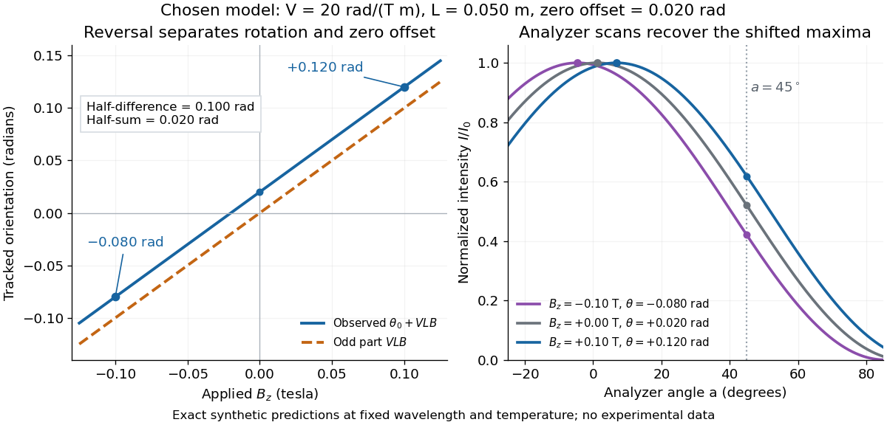

# Magnetic reversal measurement of Faraday rotation

↑ **Parent:** [Faraday effect](faraday-effect.md)

Consider an original model at fixed [vacuum](vacuum.md) [wavelength](wavelength.md) $600\,\mathrm{nm}$ and [temperature](temperature-split.md) $20^\circ\mathrm C$. Stipulate a transparent sample with [Verdet constant](verdet-constant.md) $V=20\,\mathrm{rad\,T^{-1}\,m^{-1}}$, length $L=0.050\,\mathrm m$, uniform adjustable $B_z$, and a field-independent analyzer-zero offset $\theta_0=0.020\,\mathrm{rad}$. These are chosen values, not measured glass properties. On a continuously tracked small-[angle](angle.md) branch,

$$
\theta_{\rm obs}(B)=\theta_0+VLB,\qquad
\theta_{\rm obs}(+0.10\,\mathrm T)=0.120\,\mathrm{rad},\qquad
\theta_{\rm obs}(-0.10\,\mathrm T)=-0.080\,\mathrm{rad}.
$$

Taking half the difference gives $\theta_{\rm odd}=0.100\,\mathrm{rad}$; half the sum recovers $\theta_0=0.020\,\mathrm{rad}$. Hence $V=\theta_{\rm odd}/(LB)=20\,\mathrm{rad\,T^{-1}\,m^{-1}}$. A field-reversal difference of $0.200\,\mathrm{rad}$ is twice the single-field rotation, not that rotation itself. More generally this subtraction removes every contribution that is even under $B\mapsto-B$, provided the sample and apparatus remain otherwise matched.

**[Figure 7](#image-chosen-faraday-rotation-model-reversing-the-magnetic-field-removes-a-constant-angular-offset). Chosen Faraday rotation model: reversing the magnetic field removes a constant angular offset**. Lines and marked values are exact synthetic predictions for $V=20\,\mathrm{rad\,T^{-1}\,m^{-1}}$, $L=0.050\,\mathrm m$ and offset $0.020\,\mathrm{rad}$. Left: observed orientation and its odd part. Right: normalized [Malus's law](malus-s-law.md) curves at $B_z=-0.10,0,+0.10\,\mathrm T$; shifted maxima recover the three orientations. The $45^\circ$ analyzer line illustrates a signed intensity response. No points are experimental observations.

An ideal [polarimeter analyzer](polarimeter-analyzer.md) at laboratory [angle](angle.md) $a$ reads normalized [light intensity](light-intensity.md) $I(a,B)/I_0=\cos^2[a-\theta_{\rm obs}(B)]$. Here $I_0$ is the [light intensity](light-intensity.md) immediately before the analyzer, separately calibrated for each condition. A scan locates the maximum at $a=\theta_{\rm obs}$ modulo $\pi$. At $a=\pi/4$, expansion about zero gives $I/I_0=1/2+\theta_{\rm obs}+O(\theta_{\rm obs}^3)$, with [angles](angle.md) in [radians](radian.md). At crossed extinction, the response instead begins as $\theta_{\rm obs}^2$ and loses the sign near zero. The favorable $45^\circ$ slope follows directly by differentiating [Malus's law](malus-s-law.md); its sign reverses if the angular convention is reversed.

## ↑ Ancestors (8)

1. [Faraday effect](faraday-effect.md)
2. [Polarization of an electromagnetic wave](polarization-of-an-electromagnetic-wave.md)
3. [Plane electromagnetic wave](plane-electromagnetic-wave.md)
4. [Electromagnetic wave](electromagnetic-wave-split.md)
5. [Electromagnetism](electromagnetism-split.md)
6. [Branches of physics](branches-of-physics.md)
7. [Physics](physics-split.md)
8. [Codex Wiki](split.md)

## ← Incoming links (1)

- [Faraday effect](faraday-effect.md)
