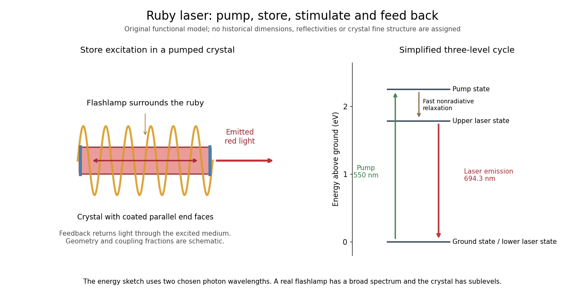

# Maiman ruby laser experiment

↑ **Parent:** [Ruby laser](ruby-laser.md)

[Theodore Harold Maiman](theodore-harold-maiman.md) and [Irnee J. D'Haenens](irnee-j-d-haenens.md) obtained laser action in May 1960. Their arrangement put a ruby rod inside a helical xenon flashlamp. Increasing excitation produced a marked intensity threshold, with subsequent measurements showing narrowing of the ruby emission line.[Participant recollection: apparatus opening; paragraphs beginning In early 1960 and Subsequent measurements](theodore-harold-maiman-by-irnee-j-d-haenens.md) The 1960 letter describes silvered parallel crystal faces and compares low- and high-excitation spectra.[Apparatus paragraph and Fig. 2, low- and high-power spectra](stimulated-optical-radiation-in-ruby-by-theodore-harold-maiman.md)

**[Figure 1](#image-pump-a-crystal-store-excitation-and-return-light-through-the-gain-medium). Pump a crystal, store excitation, and return light through the gain medium**. Original functional [ruby laser](ruby-laser.md) diagram and simplified [three-level laser](three-level-laser.md) cycle, not a construction plan or a copy of a historical drawing. The end faces provide optical feedback; no measured reflectivity, dimensions or output-coupling geometry are assigned. The energy sketch uses a chosen $550\,\mathrm{nm}$ pump photon and $694.3\,\mathrm{nm}$ emitted photon, with a fast nonradiative step. Actual crystal sublevels and the broadband flashlamp are not resolved by this three-state sketch.

The controls answer different questions. Increased brightness establishes neither optical feedback nor narrow-band emission by itself: ordinary [fluorescence](fluorescence-split.md) can also brighten with pumping. Comparing spectra at lower and higher excitation, retaining the same optical collection geometry, tests a change in the emission process. Spectrometer resolution, response saturation and heating can alter an apparent line profile; a bright spot alone cannot distinguish those effects. These are interpretation requirements, rather than additional measurements attributed to the short original letter.

Several experimental models were made. The Smithsonian's surviving head has uncertain priority, and its installed crystal came from a later experiment.[Description: multiple experimental models, uncertain first-unit identification and replacement crystal](head-piece-from-maiman-laser-by-smithsonian-institution.md) The functional diagram therefore describes the optical mechanism rather than claiming to reconstruct the first surviving unit.

## ↑ Ancestors (7)

1. [Ruby laser](ruby-laser.md)
2. [Three-level laser](three-level-laser.md)
3. [Laser](laser-split.md)
4. [Optics](optics-split.md)
5. [Branches of physics](branches-of-physics.md)
6. [Physics](physics-split.md)
7. [Codex Wiki](split.md)
