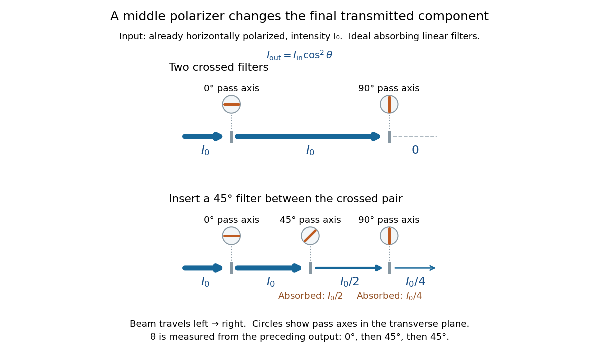

<h1 id="malus-s-law">Malus's law</h1>

↑ **Parent:** [Polarization (waves)](polarization-waves.md)

For incident [light](light.md) with [linear polarization](linear-polarization.md), an ideal linear [polarizer](polarizer.md) transmits

$$
I_{\mathrm{out}}=I_{\mathrm{in}}\cos^2\theta,
$$

where $I$ is [light intensity](light-intensity.md) and $\theta$ is the [angle](angle.md) between the incident [electric field](electric-field.md)'s line of [oscillation](oscillation.md) and the [polarizer](polarizer.md)'s pass axis. The input and output are compared in the same medium. The classical explanation is an [orthogonal projection](orthogonal-projection.md): for a [unit vector](unit-vector.md) $\mathbf u$ along the pass axis,

$$
\mathbf E_{\mathrm{out}}=(\mathbf E_{\mathrm{in}}\mathbin{\cdot}\mathbf u)\mathbf u.
$$

The [dot product](dot-product.md) reduces the transmitted [wave amplitude](wave-amplitude.md) by $\cos\theta$. For a [plane electromagnetic wave](plane-electromagnetic-wave.md) in the same medium, [light intensity](light-intensity.md) is proportional to squared [electric field](electric-field.md) [wave amplitude](wave-amplitude.md), giving [Malus's law](malus-s-law.md). For example, $\theta=60^\circ$ transmits one quarter of the incident [light intensity](light-intensity.md), although the transmitted [wave amplitude](wave-amplitude.md) is one half. [Feynman Lectures, I §33–4: polarizers](https://www.feynmanlectures.caltech.edu/I_33.html#Ch33-S4).

Start with [light](light.md) already in [linear polarization](linear-polarization.md) along the horizontal $0^\circ$ axis and let its [light intensity](light-intensity.md) be $I_0$. Two ideal absorbing linear [polarizers](polarizer.md) with pass axes $0^\circ$ and $90^\circ$ give $I_0\cos^2 0^\circ\cos^2 90^\circ=0$. Insert a $45^\circ$ [polarizer](polarizer.md) between them: the first leaves $I_0$ unchanged, the middle transmits $I_0/2$ with [linear polarization](linear-polarization.md) along $45^\circ$, and the last transmits $I_0/4$ with [linear polarization](linear-polarization.md) along $90^\circ$. Each [angle](angle.md) in [Malus's law](malus-s-law.md) is relative to the preceding output, so the final step uses $90^\circ-45^\circ=45^\circ$:

$$
I_{\mathrm{out}}=I_0\cos^2 0^\circ\cos^2 45^\circ\cos^2(90^\circ-45^\circ)=\frac{I_0}{4}.
$$

**[Figure 5](#image-two-crossed-polarizers-transmit-zero-inserting-a-middle-polarizer-transmits-i-0-4-for-initially-horizontal-linear-polarization). Two crossed polarizers transmit zero; inserting a middle polarizer transmits $I_0/4$ for initially horizontal linear polarization**. Pass axes are measured from horizontal. Each blue segment represents transmitted [light intensity](light-intensity.md), and each inset shows the pass axis in the transverse plane. The two successive $45^\circ$ changes each halve [light intensity](light-intensity.md) by [Malus's law](malus-s-law.md).

For these ideal absorbing [polarizers](polarizer.md), the rejected [electric field](electric-field.md) component transfers [energy](energy.md) to the filter. In the three-filter arrangement the middle absorbs the fraction $I_0/2$, and the last absorbs $I_0/4$, leaving $I_0/4$ transmitted. [Conservation of energy](conservation-of-energy.md) holds at each step. Inserting the middle [polarizer](polarizer.md) changes the [linear polarization](linear-polarization.md) arriving at the last one; it does not create [light](light.md). The effect illustrates why successive [orthogonal projections](orthogonal-projection.md) cannot generally be replaced by a single comparison of the first and last axes.

The initially horizontal assumption matters. For [unpolarized light](unpolarized-light.md) of [light intensity](light-intensity.md) $I_0$, the first ideal linear [polarizer](polarizer.md) transmits $I_0/2$: averaging $\cos^2\theta$ over uniformly distributed incident orientations gives $1/2$. The same $0^\circ,45^\circ,90^\circ$ sequence then transmits $I_0/8$. This extra first-stage factor does not apply to the already horizontally polarized input in the figure.

## ↑ Ancestors (4)

1. [Polarization (waves)](polarization-waves.md)
2. [Wave](wave.md)
3. [Physics](physics-split.md)
4. [Codex Wiki](split.md)

## ← Incoming links (5)

- [Calcite double-image experiment](calcite-double-image-experiment.md)
- [Elliptical polarization](elliptical-polarization.md)
- [Light intensity](light-intensity.md)
- [Malus's law](malus-s-law.md)
- [Polarization (waves)](polarization-waves.md)
