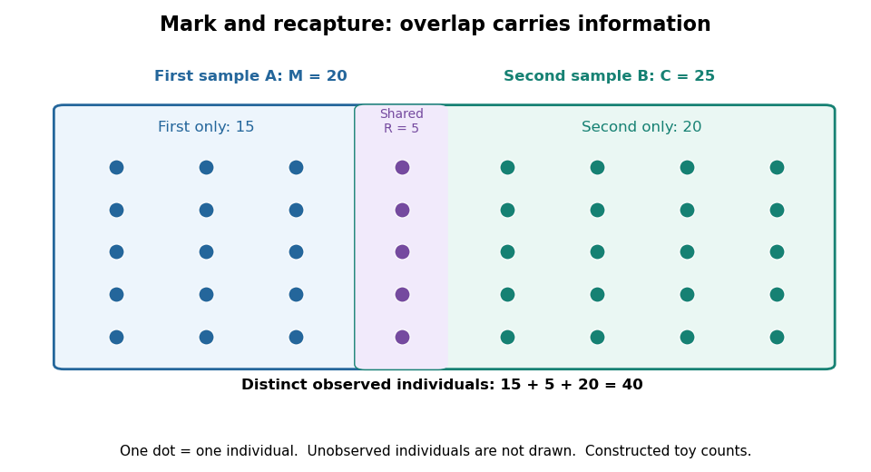

# Mark and recapture

↑ **Parent:** [Statistical modelling](statistical-modelling-split.md)  
ⓦ [Wiki](https://en.wikipedia.org/wiki/Mark_and_recapture)

[Mark and recapture](mark-and-recapture.md) estimates the [cardinality](cardinality.md) of a [finite set](finite-set.md) of individuals when counting everybody is impractical. The useful information is the overlap between observations: with fixed [sample sizes](sample-size.md), finding many of the same individuals again suggests a smaller population, while finding few suggests a larger one. More elaborate [capture-recapture models](capture-recapture-model.md) also estimate survival and changing [probabilities](probability.md) of detection.

In a [closed-population capture-recapture model](closed-population-capture-recapture-model.md), let $N$ be the unknown population [cardinality](cardinality.md). Capture $M$ distinct individuals, mark them, release them all, and allow them to mix with the rest. Next take a second sample of $C$ distinct individuals using [sampling without replacement](sampling-without-replacement.md), and count the $R$ individuals carrying a mark. The observed marked fraction $R/C$ estimates the population's marked fraction $M/N$, giving the [Lincoln-Petersen estimator](lincoln-petersen-estimator.md)

$$
\frac RC\approx\frac MN,
\qquad \widehat N_{\mathrm{LP}}=\frac{MC}{R}\quad(R>0).
$$

Release happens between the two samples; [sampling without replacement](sampling-without-replacement.md) means that an individual is counted at most once within the second sample. See [Richard J. Barker, Open Population Mark-Recapture Models, §1.1.1](https://www.maths.otago.ac.nz/~rbarker/Thesis/thesis.pdf).

For a constructed teaching example, mark $M=20$ individuals and later capture $C=25$, including $R=5$ marked individuals. One fifth of the second sample is marked, suggesting that the twenty marked individuals are one fifth of the population:

$$
\widehat N_{\mathrm{LP}}=\frac{20\cdot25}{5}=100.
$$

Let $A$ and $B$ be the [sets](set-split.md) of individuals in the first and second samples. Their [intersection](set-intersection.md) has [cardinality](cardinality.md) five. By the [inclusion-exclusion principle](inclusion-exclusion-principle.md), the [set union](set-union.md) contains

$$
|A\cup B|=|A|+|B|-|A\cap B|=20+25-5=40.
$$

Thus $N\geq40$ is an observed lower bound, whereas $100$ is the output of an [estimator](estimator.md) based on the [capture-recapture model](capture-recapture-model.md). These are toy counts, not measurements from a medical or ecological study.

**[Figure 1](#image-forty-distinct-observed-individuals-fifteen-in-the-first-sample-only-five-shared-and-twenty-in-the-second-sample-only). Forty distinct observed individuals: fifteen in the first sample only, five shared, and twenty in the second sample only**.

The diagram shows only observed individuals. It does not draw an assumed population of one hundred. The [capture-recapture model](capture-recapture-model.md) uses the overlap to infer how many individuals may have escaped both samples; its [likelihood function](likelihood-function.md) shows why one [estimator](estimator.md) output cannot describe all that uncertainty.

**Table of contents**

- [Capture-recapture model](capture-recapture-model.md)
  - [Closed-population capture-recapture model](closed-population-capture-recapture-model.md)
    - [Lincoln-Petersen estimator](lincoln-petersen-estimator.md)
    - [Chapman estimator](chapman-estimator.md)
  - [Missing-count EM for capture-recapture](missing-count-em-for-capture-recapture.md)

## ↑ Ancestors (6)

1. [Statistical modelling](statistical-modelling-split.md)
2. [Statistical model](statistical-model-split.md)
3. [Probability and statistics](probability-and-statistics-split.md)
4. [Area of mathematics](area-of-mathematics.md)
5. [Mathematics](mathematics-split.md)
6. [Codex Wiki](split.md)

## ← Incoming links (1)

- [Mark and recapture](mark-and-recapture.md)
