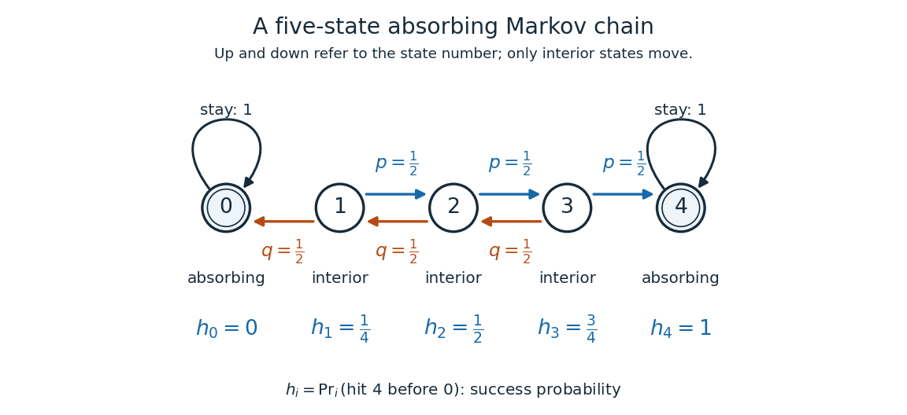
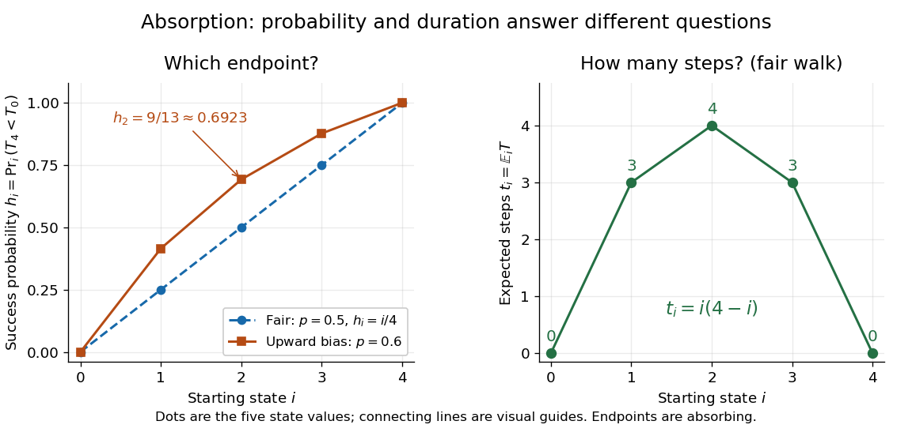
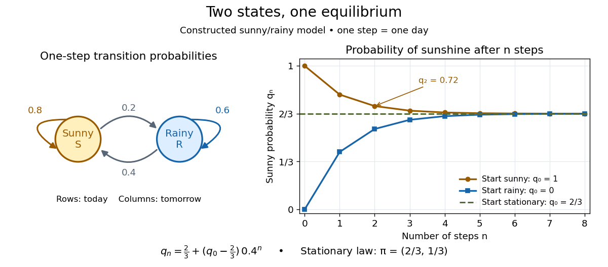
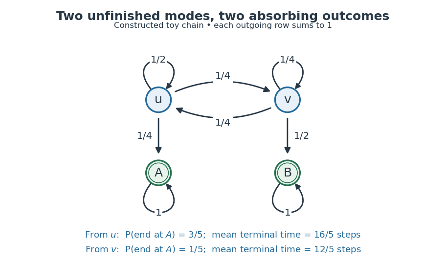

# Markov chain

↑ **Parent:** [Markov process](markov-process.md)  
ⓦ [Wiki](https://en.wikipedia.org/wiki/Markov_chain)

The term Markov chain commonly denotes a [Markov process](markov-process.md) on a finite or [countable](cardinal-number.md#countable-set) [state space](dynamical-systems.md#state-space). Time may be discrete, as for a daily record, or continuous, as for a [continuous-time Markov chain](continuous-time-markov-chain.md). Some authors also use “[Markov chain](markov-chain.md)” for discrete-time processes on more general [state spaces](dynamical-systems.md#state-space); specifying both time and state space avoids this ambiguity.

For a [Discrete-time Markov chain](#discrete-time-markov-chain), its initial [probability distribution](probability-distribution.md) $\mu_0$ and [transition matrix](#stochastic-matrix) $P$ specify the [probability](probability-theory.md#probability) of each finite path:

$$
\mathbb P(X_0=i_0,\ldots,X_n=i_n)=\mu_0(i_0)\prod_{k=0}^{n-1}P_{i_k i_{k+1}}.
$$

This is the [Markov factorization](#markov-factorization), obtained by applying [conditional probability](probability-theory.md#conditional-probability) repeatedly. See [Hao Wu's MIT lecture 1, definition and distribution evolution](https://ocw.mit.edu/courses/18-445-introduction-to-stochastic-processes-spring-2015/365d85ac35a7c006bc33dd03da633997_MIT18_445S15_lecture1.pdf).

For the constructed sunny/rainy [Markov chain](markov-chain.md) below, starting sunny makes the path sunny, rainy, sunny have [probability](probability-theory.md#probability) $1\times0.2\times0.4=0.08$. Starting instead with [stationary distribution](#stationary-distribution) $(2/3,1/3)$ makes that path's [probability](probability-theory.md#probability) $(2/3)\times0.2\times0.4=4/75$. The [transition probabilities](#transition-probability) are identical in both experiments; the initial [probability distribution](probability-distribution.md) distinguishes them.

**Table of contents**

- [Acyclic Markov chain](#acyclic-markov-chain)
- [Absorbing Markov chain](#absorbing-markov-chain)
- [Harmonic function for a Markov chain](#harmonic-function-for-a-markov-chain)
  - [Five-state harmonic absorption example](#five-state-harmonic-absorption-example)
- [Two-lane Markov chain with a deterministic restart](#two-lane-markov-chain-with-a-deterministic-restart)
- [Jump chain of a discrete-time Markov chain](#jump-chain-of-a-discrete-time-markov-chain)
  - [Recurrence survives deletion of self-transitions](#recurrence-survives-deletion-of-self-transitions)
- [Reflected chain with geometric downward jumps](#reflected-chain-with-geometric-downward-jumps)
- [Last-excursion direction law at a transient junction](#last-excursion-direction-law-at-a-transient-junction)
- [Discrete-time Markov chain](#discrete-time-markov-chain)
- [Discrete-time Markov chain martingale characterization](#discrete-time-markov-chain-martingale-characterization)
- [Nonnegative superharmonic function for a Markov chain](#nonnegative-superharmonic-function-for-a-markov-chain)
  - [Recurrence characterized by constant nonnegative superharmonic functions](#recurrence-characterized-by-constant-nonnegative-superharmonic-functions)
- [Markov chain invariant measure](#markov-chain-invariant-measure)
  - [Excursion occupation measure](#excursion-occupation-measure)
- [Geometric-jump countdown Markov chain](#geometric-jump-countdown-markov-chain)
  - [Stationary distribution of a regenerative countdown chain](#stationary-distribution-of-a-regenerative-countdown-chain)
- [Strong lumpability](#strong-lumpability)
- [Harris recurrent Markov chain](#harris-recurrent-markov-chain)
- [Discrete-time multi-state model](#discrete-time-multi-state-model)
  - [Discrete-time multi-state diagnosis model](#discrete-time-multi-state-diagnosis-model)
- [Positive Harris recurrent Markov chain](#positive-harris-recurrent-markov-chain)
  - [Ergodic theorem for a positive Harris recurrent Markov chain](#ergodic-theorem-for-a-positive-harris-recurrent-markov-chain)
- [Ehrenfest urn model](#ehrenfest-urn-model)
- [Random transposition shuffle](#random-transposition-shuffle)
  - [Separation chain for two labels in a circular transposition shuffle](#separation-chain-for-two-labels-in-a-circular-transposition-shuffle)
- [Random adjacent transposition shuffle](#random-adjacent-transposition-shuffle)
  - [Spectral gap of the adjacent transposition shuffle](#spectral-gap-of-the-adjacent-transposition-shuffle)
  - [Tagged-label Rayleigh quotient for adjacent transpositions](#tagged-label-rayleigh-quotient-for-adjacent-transpositions)
- [Absorbing state](#absorbing-state)
  - [Fundamental matrix of a finite absorbing Markov chain](#fundamental-matrix-of-a-finite-absorbing-markov-chain)
- [Markov kernel](#markov-kernel)
- [Birth-death chain](#birth-death-chain)
  - [Scale function of a birth-death chain](#scale-function-of-a-birth-death-chain)
  - [Finite-interval exit times have geometric tails](#finite-interval-exit-times-have-geometric-tails)
  - [Scale increments for a birth-death chain](#scale-increments-for-a-birth-death-chain)
  - [Period-two martingale corrector for a birth-death chain](#period-two-martingale-corrector-for-a-birth-death-chain)
  - [Excursion weights of a reflected birth-death chain](#excursion-weights-of-a-reflected-birth-death-chain)
- [Product Markov chain](#product-markov-chain)
- [Stochastic matrix](#stochastic-matrix)
  - [Transition probability](#transition-probability)
    - [Holding probability of a Markov chain](#holding-probability-of-a-markov-chain)
- [Irreducible Markov chain](#irreducible-markov-chain)
  - [Phi-irreducibility](#phi-irreducibility)
- [Aperiodic Markov chain](#aperiodic-markov-chain)
- [Recurrent state](#recurrent-state)
- [Transient state](#transient-state)
- [First return time](#first-return-time)
  - [Mean recurrence time](#mean-recurrence-time)
- [Preservation under enlargement of transition support](#preservation-under-enlargement-of-transition-support)
- [Running minimum of an independent sequence is Markov](#running-minimum-of-an-independent-sequence-is-markov)
- [Overlapping moving sum need not be Markov](#overlapping-moving-sum-need-not-be-markov)
- [Reversible Markov chain](#reversible-markov-chain)
  - [Weighted matching Markov chain](#weighted-matching-markov-chain)
    - [Canonical paths for the weighted matching chain](#canonical-paths-for-the-weighted-matching-chain)
  - [Ordered-state visit times in a reversible chain](#ordered-state-visit-times-in-a-reversible-chain)
  - [Reversible density-ratio propagation](#reversible-density-ratio-propagation)
  - [Spectral kernel expansion of a reversible chain](#spectral-kernel-expansion-of-a-reversible-chain)
  - [Detailed balance](#detailed-balance)
    - [Detailed balance for a continuous-time Markov chain](#detailed-balance-for-a-continuous-time-markov-chain)
  - [Dirichlet form of a Markov chain](#dirichlet-form-of-a-markov-chain)
    - [Poincare inequality for a reversible Markov chain](#poincare-inequality-for-a-reversible-markov-chain)
    - [Discrete Dirichlet energy](#discrete-dirichlet-energy)
    - [Canonical paths comparison theorem](#canonical-paths-comparison-theorem)
      - [Canonical paths Poincare bound](#canonical-paths-poincare-bound)
        - [Path congestion](#path-congestion)
    - [Dirichlet energy space with zero boundary at infinity](#dirichlet-energy-space-with-zero-boundary-at-infinity)
    - [Relaxation time](#relaxation-time)
      - [Absolute relaxation time](#absolute-relaxation-time)
      - [Spectral profile](#spectral-profile)
        - [Generalized Cheeger inequality](#generalized-cheeger-inequality)
  - [Conductance of a Markov chain](#conductance-of-a-markov-chain)
  - [Cheeger constant](#cheeger-constant)
    - [Cheeger inequality](#cheeger-inequality)
- [Mixing time of a Markov chain](#mixing-time-of-a-markov-chain)
  - [Eigenvalue lower bound for total variation mixing](#eigenvalue-lower-bound-for-total-variation-mixing)
  - [Pairwise mixing diameter](#pairwise-mixing-diameter)
  - [Strong stationary time](#strong-stationary-time)
    - [Separation distance](#separation-distance)
  - [Spectral upper bound for total variation mixing](#spectral-upper-bound-for-total-variation-mixing)
  - [Cutoff for Markov chains](#cutoff-for-markov-chains)
    - [Ratio definition of cutoff](#ratio-definition-of-cutoff)
      - [Peres product condition](#peres-product-condition)
    - [Random-to-top card shuffle](#random-to-top-card-shuffle)
      - [Top-to-random card shuffle](#top-to-random-card-shuffle)
    - [Pre-cutoff for Markov chains](#pre-cutoff-for-markov-chains)
    - [Stationary-reset perturbation of a Markov chain](#stationary-reset-perturbation-of-a-markov-chain)
    - [Shift-refresh chain on a hypercube](#shift-refresh-chain-on-a-hypercube)
  - [Path coupling theorem](#path-coupling-theorem)
- [Noisy voter model](#noisy-voter-model)
- [Lumped Markov chain](#lumped-markov-chain)
  - [Uniform conditional law for a triangular-wedge walk](#uniform-conditional-law-for-a-triangular-wedge-walk)
- [Hitting probability](#hitting-probability)
  - [Maximum occupation is not a hitting probability](#maximum-occupation-is-not-a-hitting-probability)
  - [Tournament won by two consecutive victories](#tournament-won-by-two-consecutive-victories)
  - [Hitting probability is the minimal nonnegative harmonic extension](#hitting-probability-is-the-minimal-nonnegative-harmonic-extension)
  - [Splitting probability](#splitting-probability)
  - [First-passage time](#first-passage-time)
    - [Brownian first-passage time](#brownian-first-passage-time)
      - [Exponential terminal moment below a linear Brownian boundary](#exponential-terminal-moment-below-a-linear-brownian-boundary)
      - [Inverse-square Gaussian law of Brownian first passage](#inverse-square-gaussian-law-of-brownian-first-passage)
      - [Drifted Brownian first-passage density](#drifted-brownian-first-passage-density)
        - [Linear-boundary Brownian first-passage distribution](#linear-boundary-brownian-first-passage-distribution)
        - [Truncated discounted Brownian first passage](#truncated-discounted-brownian-first-passage)
      - [First-passage Laplace transform for Brownian motion with drift](#first-passage-laplace-transform-for-brownian-motion-with-drift)
      - [Fixed-level versus simultaneous Brownian passage-time equality](#fixed-level-versus-simultaneous-brownian-passage-time-equality)
      - [Brownian first-passage Laplace transform](#brownian-first-passage-laplace-transform)
    - [First-passage-time density](#first-passage-time-density)
    - [Mean first-passage time](#mean-first-passage-time)
      - [Transition-completion time in a Markov chain](#transition-completion-time-in-a-markov-chain)
    - [Survival probability](#survival-probability)
      - [Survival under a linear force ramp](#survival-under-a-linear-force-ramp)
        - [Most probable rupture force under a linear ramp](#most-probable-rupture-force-under-a-linear-ramp)
        - [Median rupture force under a linear ramp](#median-rupture-force-under-a-linear-ramp)
  - [Harmonic hitting probability for the balanced-difference urn](#harmonic-hitting-probability-for-the-balanced-difference-urn)
- [Expected hitting time](#expected-hitting-time)
  - [Constant-drift hitting-time identity](#constant-drift-hitting-time-identity)
  - [Hitting a hub from two four-cycles](#hitting-a-hub-from-two-four-cycles)
  - [Hitting time of the bridge vertex between two cliques](#hitting-time-of-the-bridge-vertex-between-two-cliques)
  - [Uniform decreasing Markov chain](#uniform-decreasing-markov-chain)
- [Expected occupation count before absorption](#expected-occupation-count-before-absorption)
  - [Killed-walk occupation voltage](#killed-walk-occupation-voltage)
  - [Four-state reflecting absorbing random walk](#four-state-reflecting-absorbing-random-walk)
- [Conditional hitting time](#conditional-hitting-time)
- [Periodic Markov chain](#periodic-markov-chain)
  - [Parity balance on entry to a period-two Markov class](#parity-balance-on-entry-to-a-period-two-markov-class)
- [Lazy Markov chain](#lazy-markov-chain)
- [Convergence to an invariant distribution](#convergence-to-an-invariant-distribution)
  - [Countable-state Markov chain convergence theorem](#countable-state-markov-chain-convergence-theorem)
- [Recurrent Markov chain](#recurrent-markov-chain)
  - [Positive recurrent Markov chain](#positive-recurrent-markov-chain)
  - [Positive recurrent state](#positive-recurrent-state)
    - [Ergodic state of a Markov chain](#ergodic-state-of-a-markov-chain)
  - [Null recurrent state](#null-recurrent-state)
  - [Recurrence criterion by return probabilities](#recurrence-criterion-by-return-probabilities)
  - [Biased random walk hitting probability](#biased-random-walk-hitting-probability)
- [Random walk](random-walk.md)
  - [Lazy random walk](random-walk.md#lazy-random-walk)
  - [Upward skip-free random walk](random-walk.md#upward-skip-free-random-walk)
    - [Geometric maximum of an upward skip-free random walk](random-walk.md#geometric-maximum-of-an-upward-skip-free-random-walk)
  - [Gaussian random walk spends zero density of time in bounded sets](random-walk.md#gaussian-random-walk-spends-zero-density-of-time-in-bounded-sets)
  - [Mean-square displacement of an isotropic planar random walk](random-walk.md#mean-square-displacement-of-an-isotropic-planar-random-walk)
  - [Exponential martingale of a random walk](random-walk.md#exponential-martingale-of-a-random-walk)
    - [Stopped likelihood ratio under exponential tilting](random-walk.md#stopped-likelihood-ratio-under-exponential-tilting)
    - [Exponential first-passage transform for an upward skip-free random walk](random-walk.md#exponential-first-passage-transform-for-an-upward-skip-free-random-walk)
    - [Exponential moment bound for a Gaussian random-walk maximum](random-walk.md#exponential-moment-bound-for-a-gaussian-random-walk-maximum)
  - [Random walk on a graph](random-walk.md#random-walk-on-a-graph)
    - [Radial random walk on a regular tree](random-walk.md#radial-random-walk-on-a-regular-tree)
    - [Non-backtracking random walk](random-walk.md#non-backtracking-random-walk)
    - [Random walk on a multigraph](random-walk.md#random-walk-on-a-multigraph)
    - [Recurrent graph](random-walk.md#recurrent-graph)
      - [Edge deletion preserves recurrence](random-walk.md#edge-deletion-preserves-recurrence)
    - [Weighted graph](random-walk.md#weighted-graph)
      - [Killing measure of a weighted graph](random-walk.md#killing-measure-of-a-weighted-graph)
      - [Electrical network](random-walk.md#electrical-network)
        - [Electrical current from stopped random-walk traversals](random-walk.md#electrical-current-from-stopped-random-walk-traversals)
        - [Voltage](random-walk.md#voltage)
        - [Current flow](random-walk.md#current-flow)
          - [Kirchhoff cycle law](random-walk.md#kirchhoff-cycle-law)
          - [Kirchhoff node law](random-walk.md#kirchhoff-node-law)
        - [Effective resistance](random-walk.md#effective-resistance)
          - [Return probability from effective resistance](random-walk.md#return-probability-from-effective-resistance)
          - [Foster's theorem](random-walk.md#foster-s-theorem)
          - [Effective resistance to infinity](random-walk.md#effective-resistance-to-infinity)
          - [Rayleigh monotonicity principle](random-walk.md#rayleigh-monotonicity-principle)
          - [Effective conductance](random-walk.md#effective-conductance)
          - [Thomson principle](random-walk.md#thomson-principle)
          - [Nash-Williams inequality](random-walk.md#nash-williams-inequality)
          - [Commute time identity](random-walk.md#commute-time-identity)
            - [Directed edge occupation in a random-walk commute](random-walk.md#directed-edge-occupation-in-a-random-walk-commute)
    - [Bishop random walk](random-walk.md#bishop-random-walk)
    - [Transient graph](random-walk.md#transient-graph)
      - [Green function of a transient weighted graph](random-walk.md#green-function-of-a-transient-weighted-graph)
        - [Green-function decay for simple random walk on the integer lattice](random-walk.md#green-function-decay-for-simple-random-walk-on-the-integer-lattice)
      - [Equilibrium potential of a finite set](random-walk.md#equilibrium-potential-of-a-finite-set)
        - [Equilibrium measure of a finite set](random-walk.md#equilibrium-measure-of-a-finite-set)
          - [Capacity of a finite set for a transient random walk](random-walk.md#capacity-of-a-finite-set-for-a-transient-random-walk)
        - [Singleton equilibrium potential from the Green function](random-walk.md#singleton-equilibrium-potential-from-the-green-function)
      - [Last-exit decomposition for a transient random walk](random-walk.md#last-exit-decomposition-for-a-transient-random-walk)
    - [Loop-erased random walk](random-walk.md#loop-erased-random-walk)
      - [Loop-erasure of planar Brownian motion](random-walk.md#loop-erasure-of-planar-brownian-motion)
      - [Uniform-spanning-tree path representation of loop-erased random walk](random-walk.md#uniform-spanning-tree-path-representation-of-loop-erased-random-walk)
      - [Loop erasure](random-walk.md#loop-erasure)
      - [Reversibility of loop-erased random walk](random-walk.md#reversibility-of-loop-erased-random-walk)
    - [Simple random walk](random-walk.md#simple-random-walk)
      - [Simple symmetric random walk](random-walk.md#simple-symmetric-random-walk)
        - [Multinomial collision proof of three-dimensional walk transience](random-walk.md#multinomial-collision-proof-of-three-dimensional-walk-transience)
        - [Infinite mean first passage of a simple symmetric random walk](random-walk.md#infinite-mean-first-passage-of-a-simple-symmetric-random-walk)
        - [Origin capture by a sufficiently sleepy planar random walk](random-walk.md#origin-capture-by-a-sufficiently-sleepy-planar-random-walk)
        - [Exponential maximal bound for a symmetric random walk](random-walk.md#exponential-maximal-bound-for-a-symmetric-random-walk)
        - [First-return generating function of the simple symmetric random walk](random-walk.md#first-return-generating-function-of-the-simple-symmetric-random-walk)
        - [Expected time to expand a random-walk range](random-walk.md#expected-time-to-expand-a-random-walk-range)
        - [Square-minus-time martingale of a simple symmetric random walk](random-walk.md#square-minus-time-martingale-of-a-simple-symmetric-random-walk)
          - [Stopped second-moment identity for a simple symmetric random walk](random-walk.md#stopped-second-moment-identity-for-a-simple-symmetric-random-walk)
      - [Simple random walk on the hypercube](random-walk.md#simple-random-walk-on-the-hypercube)
        - [Spectrum of lazy random walk on the hypercube](random-walk.md#spectrum-of-lazy-random-walk-on-the-hypercube)
      - [Simple random walk in two dimensions is recurrent](random-walk.md#simple-random-walk-in-two-dimensions-is-recurrent)
    - [Simple random walk on the integer line](random-walk.md#simple-random-walk-on-the-integer-line)
      - [Expected visits to the origin by a simple random walk](random-walk.md#expected-visits-to-the-origin-by-a-simple-random-walk)
      - [Simultaneous returns of independent simple random walks](random-walk.md#simultaneous-returns-of-independent-simple-random-walks)
      - [Biased random walk](random-walk.md#biased-random-walk)
        - [Exponential martingale of a biased simple random walk](random-walk.md#exponential-martingale-of-a-biased-simple-random-walk)
        - [Hitting time of a downward-biased walk reflected at an upper barrier](random-walk.md#hitting-time-of-a-downward-biased-walk-reflected-at-an-upper-barrier)
        - [Diffusion limit of a weakly biased random walk](random-walk.md#diffusion-limit-of-a-weakly-biased-random-walk)
        - [Maximum of a downward-biased random walk](random-walk.md#maximum-of-a-downward-biased-random-walk)
        - [Reflected biased random walk on the nonnegative integers](random-walk.md#reflected-biased-random-walk-on-the-nonnegative-integers)
    - [Stationary distribution of a graph random walk](random-walk.md#stationary-distribution-of-a-graph-random-walk)
- [Gambler's ruin](#gambler-s-ruin)
  - [Duration of gambler's ruin conditioned on a chosen boundary](#duration-of-gambler-s-ruin-conditioned-on-a-chosen-boundary)
  - [Discounted gambler's ruin hitting probability](#discounted-gambler-s-ruin-hitting-probability)
  - [Expected duration of biased gambler's ruin](#expected-duration-of-biased-gambler-s-ruin)
  - [Biased gambler's ruin probability](#biased-gambler-s-ruin-probability)
  - [Expected duration of symmetric gambler's ruin](#expected-duration-of-symmetric-gambler-s-ruin)
- [Strong Markov property](#strong-markov-property)
  - [Maximum of a killed telegraph integral](#maximum-of-a-killed-telegraph-integral)
  - [Two-state excursion visit law](#two-state-excursion-visit-law)
- [Stationary cycle occupation formula](#stationary-cycle-occupation-formula)
- [Markov property](#markov-property)
  - [Transition operator](#transition-operator)
  - [Markov factorization](#markov-factorization)
  - [Time-homogeneous Markov property](#time-homogeneous-markov-property)
- [Continuous-time Markov chain](continuous-time-markov-chain.md)
  - [Nonexplosion of a continuous-time Markov chain](continuous-time-markov-chain.md#nonexplosion-of-a-continuous-time-markov-chain)
  - [Markov jump process](continuous-time-markov-chain.md#markov-jump-process)
    - [Symmetric stochastic attrition process](continuous-time-markov-chain.md#symmetric-stochastic-attrition-process)
      - [Squared-population near-invariant for stochastic attrition](continuous-time-markov-chain.md#squared-population-near-invariant-for-stochastic-attrition)
        - [Exponential concentration of terminal stochastic attrition survivors](continuous-time-markov-chain.md#exponential-concentration-of-terminal-stochastic-attrition-survivors)
    - [Single marked exponential jump process](continuous-time-markov-chain.md#single-marked-exponential-jump-process)
    - [Lévy kernel of a Markov jump process](continuous-time-markov-chain.md#levy-kernel-of-a-markov-jump-process)
      - [Centered finite-rate jump kernel gives square martingales](continuous-time-markov-chain.md#centered-finite-rate-jump-kernel-gives-square-martingales)
    - [Jump measure of a Markov jump process](continuous-time-markov-chain.md#jump-measure-of-a-markov-jump-process)
      - [Predictable compensator of a jump measure](continuous-time-markov-chain.md#predictable-compensator-of-a-jump-measure)
      - [Compensated jump-measure local martingale](continuous-time-markov-chain.md#compensated-jump-measure-local-martingale)
    - [Density-dependent Markov jump process](continuous-time-markov-chain.md#density-dependent-markov-jump-process)
      - [Cyclic imitation chain](continuous-time-markov-chain.md#cyclic-imitation-chain)
        - [Product decay in a cyclic imitation chain](continuous-time-markov-chain.md#product-decay-in-a-cyclic-imitation-chain)
      - [Martingale decomposition of a density-dependent jump process](continuous-time-markov-chain.md#martingale-decomposition-of-a-density-dependent-jump-process)
  - [Destination-dependent reset chain](continuous-time-markov-chain.md#destination-dependent-reset-chain)
  - [Hitting probabilities for a velocity-switching Markov ladder](continuous-time-markov-chain.md#hitting-probabilities-for-a-velocity-switching-markov-ladder)
  - [Nonexplosive continuous-time Markov chain](continuous-time-markov-chain.md#nonexplosive-continuous-time-markov-chain)
    - [Absorption-or-escape dichotomy for a chain with killing](continuous-time-markov-chain.md#absorption-or-escape-dichotomy-for-a-chain-with-killing)
  - [Equilibrium distribution of a continuous-time Markov chain](continuous-time-markov-chain.md#equilibrium-distribution-of-a-continuous-time-markov-chain)
  - [Transition intensity matrix](continuous-time-markov-chain.md#transition-intensity-matrix)
  - [Ergodic theorem for a finite continuous-time Markov chain](continuous-time-markov-chain.md#ergodic-theorem-for-a-finite-continuous-time-markov-chain)
  - [Nonexplosive Markov chain](continuous-time-markov-chain.md#nonexplosive-markov-chain)
  - [Global balance for a continuous-time Markov chain](continuous-time-markov-chain.md#global-balance-for-a-continuous-time-markov-chain)
  - [Poisson time-change representation of a Markov chain](continuous-time-markov-chain.md#poisson-time-change-representation-of-a-markov-chain)
  - [Interchange process](continuous-time-markov-chain.md#interchange-process)
    - [Aldous spectral gap theorem](continuous-time-markov-chain.md#aldous-spectral-gap-theorem)
  - [Time reversal of a continuous-time Markov chain](continuous-time-markov-chain.md#time-reversal-of-a-continuous-time-markov-chain)
  - [Kingman's coalescent](continuous-time-markov-chain.md#kingman-s-coalescent)
    - [Mutation count on a neutral coalescent tree](continuous-time-markov-chain.md#mutation-count-on-a-neutral-coalescent-tree)
      - [Moments of the mutation count on a neutral coalescent tree](continuous-time-markov-chain.md#moments-of-the-mutation-count-on-a-neutral-coalescent-tree)
      - [Geometric mutation count in a coalescent epoch](continuous-time-markov-chain.md#geometric-mutation-count-in-a-coalescent-epoch)
      - [Independent mutation counts in coalescent epochs](continuous-time-markov-chain.md#independent-mutation-counts-in-coalescent-epochs)
    - [Total branch length of a neutral coalescent](continuous-time-markov-chain.md#total-branch-length-of-a-neutral-coalescent)
    - [Kingman's infinite coalescent](continuous-time-markov-chain.md#kingman-s-infinite-coalescent)
      - [Coming down from infinity of the Kingman coalescent](continuous-time-markov-chain.md#coming-down-from-infinity-of-the-kingman-coalescent)
  - [Entry count of a continuous-time Markov chain](continuous-time-markov-chain.md#entry-count-of-a-continuous-time-markov-chain)
  - [Occupation time of a continuous-time Markov chain](continuous-time-markov-chain.md#occupation-time-of-a-continuous-time-markov-chain)
    - [Occupation time at an interior state of a variable-rate symmetric walk](continuous-time-markov-chain.md#occupation-time-at-an-interior-state-of-a-variable-rate-symmetric-walk)
    - [Expected finite-horizon occupation time](continuous-time-markov-chain.md#expected-finite-horizon-occupation-time)
  - [Holding time](continuous-time-markov-chain.md#holding-time)
    - [Mean holding time from a transition intensity matrix](continuous-time-markov-chain.md#mean-holding-time-from-a-transition-intensity-matrix)
      - [Confidence interval for an inverse rate](continuous-time-markov-chain.md#confidence-interval-for-an-inverse-rate)
  - [Master equation](continuous-time-markov-chain.md#master-equation)
    - [Entropy production rate of a Markov chain](continuous-time-markov-chain.md#entropy-production-rate-of-a-markov-chain)
  - [Continuous-time random walk](continuous-time-markov-chain.md#continuous-time-random-walk)
    - [Coalescing random walks](continuous-time-markov-chain.md#coalescing-random-walks)
  - [Martingale problem for a continuous-time Markov chain](continuous-time-markov-chain.md#martingale-problem-for-a-continuous-time-markov-chain)
  - [Transition-rate matrix](continuous-time-markov-chain.md#transition-rate-matrix)
  - [Transition semigroup of a continuous-time Markov chain](continuous-time-markov-chain.md#transition-semigroup-of-a-continuous-time-markov-chain)
    - [Poisson-sampled continuous-time Markov chain](continuous-time-markov-chain.md#poisson-sampled-continuous-time-markov-chain)
    - [Kolmogorov equations](continuous-time-markov-chain.md#kolmogorov-equations)
  - [Markov reward model](continuous-time-markov-chain.md#markov-reward-model)
  - [Markov jump-process generator](continuous-time-markov-chain.md#markov-jump-process-generator)
    - [Exponential martingale from a jump generator](continuous-time-markov-chain.md#exponential-martingale-from-a-jump-generator)
    - [Forward operator of a Markov jump process](continuous-time-markov-chain.md#forward-operator-of-a-markov-jump-process)
  - [Holding-time reversal along a fixed CTMC jump path](continuous-time-markov-chain.md#holding-time-reversal-along-a-fixed-ctmc-jump-path)
  - [Recurrence equivalence for a CTMC and its fixed-time skeleton](continuous-time-markov-chain.md#recurrence-equivalence-for-a-ctmc-and-its-fixed-time-skeleton)
  - [Jump chain](continuous-time-markov-chain.md#jump-chain)
    - [Reflected nearest-neighbour random walk](continuous-time-markov-chain.md#reflected-nearest-neighbour-random-walk)
    - [Invariant-measure transfer between a jump chain and a CTMC](continuous-time-markov-chain.md#invariant-measure-transfer-between-a-jump-chain-and-a-ctmc)
      - [Slow holding rates destroy positive recurrence](continuous-time-markov-chain.md#slow-holding-rates-destroy-positive-recurrence)
      - [Fast holding rates create continuous-time positive recurrence](continuous-time-markov-chain.md#fast-holding-rates-create-continuous-time-positive-recurrence)
    - [Nonexplosion from recurrent visits to a slow state](continuous-time-markov-chain.md#nonexplosion-from-recurrent-visits-to-a-slow-state)
    - [Irreducibility and recurrence pass between a CTMC and its jump chain](continuous-time-markov-chain.md#irreducibility-and-recurrence-pass-between-a-ctmc-and-its-jump-chain)
  - [Explosion of a continuous-time Markov chain](continuous-time-markov-chain.md#explosion-of-a-continuous-time-markov-chain)
    - [Nonexplosion under uniformly bounded jump rates](continuous-time-markov-chain.md#nonexplosion-under-uniformly-bounded-jump-rates)
    - [Explosion by summable holding times](continuous-time-markov-chain.md#explosion-by-summable-holding-times)
    - [Explosion of an upward-biased walk with geometrically increasing rates](continuous-time-markov-chain.md#explosion-of-an-upward-biased-walk-with-geometrically-increasing-rates)
  - [Invariant distribution of a continuous-time Markov chain](continuous-time-markov-chain.md#invariant-distribution-of-a-continuous-time-markov-chain)
    - [Nonuniqueness of invariant distributions of a finite Markov chain](continuous-time-markov-chain.md#nonuniqueness-of-invariant-distributions-of-a-finite-markov-chain)
    - [Invariant distribution of an explosive chain](continuous-time-markov-chain.md#invariant-distribution-of-an-explosive-chain)
  - [Batch-birth linear-death process](continuous-time-markov-chain.md#batch-birth-linear-death-process)
    - [Moments of a batch-birth linear-death process](continuous-time-markov-chain.md#moments-of-a-batch-birth-linear-death-process)
  - [Birth-death process](continuous-time-markov-chain.md#birth-death-process)
    - [Birth process](continuous-time-markov-chain.md#birth-process)
      - [Exponential martingale of a pure birth process](continuous-time-markov-chain.md#exponential-martingale-of-a-pure-birth-process)
      - [Logistic cell-division process](continuous-time-markov-chain.md#logistic-cell-division-process)
      - [Nonexplosion criterion for a pure birth process](continuous-time-markov-chain.md#nonexplosion-criterion-for-a-pure-birth-process)
      - [Linear birth process with immigration](continuous-time-markov-chain.md#linear-birth-process-with-immigration)
        - [Linear birth process with catastrophes](continuous-time-markov-chain.md#linear-birth-process-with-catastrophes)
    - [Yule process](continuous-time-markov-chain.md#yule-process)
      - [Mean population of a Yule process](continuous-time-markov-chain.md#mean-population-of-a-yule-process)
      - [Conditional Yule birth times](continuous-time-markov-chain.md#conditional-yule-birth-times)
    - [Extinction probability of a linear birth-death process](continuous-time-markov-chain.md#extinction-probability-of-a-linear-birth-death-process)
    - [Detailed balance for a birth-death process](continuous-time-markov-chain.md#detailed-balance-for-a-birth-death-process)
    - [Birth-death master equation](continuous-time-markov-chain.md#birth-death-master-equation)
      - [First-moment equation of a birth-death process](continuous-time-markov-chain.md#first-moment-equation-of-a-birth-death-process)
      - [Moment equations of a linear birth-death process](continuous-time-markov-chain.md#moment-equations-of-a-linear-birth-death-process)
      - [Factorial moment](continuous-time-markov-chain.md#factorial-moment)
        - [Factorial-moment inversion](continuous-time-markov-chain.md#factorial-moment-inversion)
        - [Poisson factorial moments](continuous-time-markov-chain.md#poisson-factorial-moments)
          - [Factorial-moment criterion for Poisson convergence](continuous-time-markov-chain.md#factorial-moment-criterion-for-poisson-convergence)
    - [Poisson moment closure for a birth-death process](continuous-time-markov-chain.md#poisson-moment-closure-for-a-birth-death-process)
    - [Diffusion approximation of a birth-death process](continuous-time-markov-chain.md#diffusion-approximation-of-a-birth-death-process)
      - [Linear noise approximation](continuous-time-markov-chain.md#linear-noise-approximation)
        - [Chemical diffusion matrix](continuous-time-markov-chain.md#chemical-diffusion-matrix)
        - [Normalized stationary fluctuation-dissipation relation for a reaction network](continuous-time-markov-chain.md#normalized-stationary-fluctuation-dissipation-relation-for-a-reaction-network)
          - [Feedback attenuation of gene-expression noise](continuous-time-markov-chain.md#feedback-attenuation-of-gene-expression-noise)
        - [Ornstein-Uhlenbeck fluctuation limit at a stable population equilibrium](continuous-time-markov-chain.md#ornstein-uhlenbeck-fluctuation-limit-at-a-stable-population-equilibrium)
      - [Mean drift from a Fokker--Planck equation](continuous-time-markov-chain.md#mean-drift-from-a-fokker-planck-equation)
    - [Birth-death recurrence classification](continuous-time-markov-chain.md#birth-death-recurrence-classification)
    - [M/M/1 queue](continuous-time-markov-chain.md#m-m-1-queue)
      - [Stationary workload of an exponential-payload queue](continuous-time-markov-chain.md#stationary-workload-of-an-exponential-payload-queue)
      - [M-M-1 queue with state-dependent admission](continuous-time-markov-chain.md#m-m-1-queue-with-state-dependent-admission)
      - [Positive recurrence of an M-M-1 queue](continuous-time-markov-chain.md#positive-recurrence-of-an-m-m-1-queue)
      - [Stationary distribution of an M-M-1 queue](continuous-time-markov-chain.md#stationary-distribution-of-an-m-m-1-queue)
      - [Burke's theorem](continuous-time-markov-chain.md#burke-s-theorem)
      - [M-M-1 queue with Bernoulli feedback](continuous-time-markov-chain.md#m-m-1-queue-with-bernoulli-feedback)
        - [Poisson output theorem for a feedback queue](continuous-time-markov-chain.md#poisson-output-theorem-for-a-feedback-queue)
      - [Mean busy period of an M-M-1 queue](continuous-time-markov-chain.md#mean-busy-period-of-an-m-m-1-queue)
    - [M/M/∞ queue](continuous-time-markov-chain.md#m-m-∞-queue)
      - [Stationary distribution of an M-M-infinity queue](continuous-time-markov-chain.md#stationary-distribution-of-an-m-m-infinity-queue)
      - [Burke theorem for an M-M-infinity queue](continuous-time-markov-chain.md#burke-theorem-for-an-m-m-infinity-queue)
      - [Transient distribution of an M-M-infinity queue](continuous-time-markov-chain.md#transient-distribution-of-an-m-m-infinity-queue)
      - [Mean busy period of an M-M-infinity queue](continuous-time-markov-chain.md#mean-busy-period-of-an-m-m-infinity-queue)
    - [M-M-s-K queue](continuous-time-markov-chain.md#m-m-s-k-queue)
      - [Stationary distribution of an M-M-s-K queue](continuous-time-markov-chain.md#stationary-distribution-of-an-m-m-s-k-queue)
- [Finite Markov chain](#finite-markov-chain)
  - [Markov chain ergodic theorem](#markov-chain-ergodic-theorem)
  - [Constant nonzero drift is impossible on a finite Markov chain](#constant-nonzero-drift-is-impossible-on-a-finite-markov-chain)
- [Communicating class](#communicating-class)
  - [Accessible state of a Markov chain](#accessible-state-of-a-markov-chain)
  - [Open communicating class](#open-communicating-class)
  - [Communicating states](#communicating-states)
  - [Closed communicating class](#closed-communicating-class)
  - [Transient communicating class](#transient-communicating-class)
  - [Period of a state in a Markov chain](#period-of-a-state-in-a-markov-chain)
    - [Return-free state in a Markov chain](#return-free-state-in-a-markov-chain)
    - [Period is constant on a communicating class](#period-is-constant-on-a-communicating-class)
- [Stationary distribution](#stationary-distribution)
  - [Product stationarity under single-coordinate Markov updates](#product-stationarity-under-single-coordinate-markov-updates)
- [Time-reversed Markov chain](#time-reversed-markov-chain)

## Acyclic Markov chain

↑ **Parent:** [Markov chain](markov-chain.md)

An acyclic Markov chain has no directed cycle among its nonabsorbing states. Its finite transition dependencies can therefore be evaluated in reverse topological order instead of solving a general system of equations.

## Absorbing Markov chain

↑ **Parent:** [Markov chain](markov-chain.md)

A [Markov chain](markov-chain.md) with at least one [absorbing state](#absorbing-state), such that from each state an [absorbing state](#absorbing-state) can be reached. In a finite such chain, absorption occurs with [probability](probability-theory.md#probability) 1. Expected times to absorption satisfy a [linear system](linear-algebra.md#system-of-linear-equations) obtained by conditioning on the first transition.

## Harmonic function for a Markov chain

↑ **Parent:** [Markov chain](markov-chain.md)

A harmonic function assigns a value to each state of a [Markov chain](markov-chain.md) such that one transition leaves its [expected value](expected-value.md) unchanged. This turns a question about many possible future [sample paths](stochastic-process.md#sample-path), such as which endpoint is reached first, into a local averaging rule. For a [transition matrix](#stochastic-matrix) $P$, a real-valued [function](function.md) $h$ is harmonic at state $i$ when

$$
h(i)=(Ph)(i)=\sum_jP_{ij}h(j)=\mathbb E_i[h(X_1)].
$$

Here $\mathbb E_i$ means [expected value](expected-value.md) conditional on starting at $X_0=i$; on a [countable](cardinal-number.md#countable-set) [state space](dynamical-systems.md#state-space) the sum must be absolutely convergent. If this holds at every state, write $Ph=h$. At an [absorbing state](#absorbing-state) the equation is automatic, so prescribed [boundary conditions](differential-equation.md#boundary-condition) supply information that the averaging rule cannot.

For a [finite Markov chain](#finite-markov-chain), choose a boundary set $B$ that can be reached from every state, and assign boundary values $b$. If $T_B$ is its first [hitting time](#first-passage-time), the harmonic extension is

$$
h(i)=\mathbb E_i[b(X_{T_B})],\qquad h|_B=b.
$$

Choosing $b$ to be the [indicator function](measure-theory.md#indicator-function) of one target within $B$ gives a [hitting probability](#hitting-probability). This is a discrete [Dirichlet problem](analysis.md#dirichlet-problem): enforce the averaging rule outside $B$ and fix the values on $B$. See [Hao Wu's MIT lecture 8, harmonic extension, slide 5](https://ocw.mit.edu/courses/18-445-introduction-to-stochastic-processes-spring-2015/bc4e626fedc9aa9bb62c96e80fbd6ac0_MIT18_445S15_lecture8.pdf). The construction extends the mean-value idea of a [harmonic function](partial-differential-equation.md#harmonic-function); for a [random walk on a graph](random-walk.md#random-walk-on-a-graph) it is a [discrete harmonic function](partial-differential-equation.md#discrete-harmonic-function).

### Five-state harmonic absorption example

↑ **Parent:** [Harmonic function for a Markov chain](#harmonic-function-for-a-markov-chain)

Take a [birth-death chain](#birth-death-chain) on $\{0,1,2,3,4\}$. At each interior state, move up one state with [probability](probability-theory.md#probability) $p=1/2$ and down one state with [probability](probability-theory.md#probability) $q=1/2$. The endpoints are [absorbing states](#absorbing-state): $P_{00}=P_{44}=1$. This is a small [gambler's ruin](#gambler-s-ruin) model in which the state can represent capital, and reaching $4$ is success.

**[Figure 1](#image-five-states-with-fair-interior-transitions-and-absorbing-endpoints-each-displayed-value-is-the-probability-of-reaching-4-before-0). Five states with fair interior transitions and absorbing endpoints; each displayed value is the probability of reaching 4 before 0.**

Let $T_a=\inf\{n\geq0:X_n=a\}$ be the [hitting time](#first-passage-time) of endpoint $a$, and let $T=\min(T_0,T_4)$ be the first endpoint [hitting time](#first-passage-time). The desired [hitting probability](#hitting-probability) is $h_i=\mathbb P_i(T_4<T_0)$. [First-step analysis](analysis.md#first-step-analysis) and the [Markov property](#markov-property) give

$$
h_0=0,\qquad h_4=1,\qquad h_i=\tfrac12h_{i-1}+\tfrac12h_{i+1}\quad(i=1,2,3).
$$

The interior equation says adjacent differences are equal. Four equal increments must bridge the boundary values $0$ and $1$, so

$$
h_i=\frac i4,\qquad (h_0,h_1,h_2,h_3,h_4)=(0,\tfrac14,\tfrac12,\tfrac34,1).
$$

For example, from state $2$ the [hitting probability](#hitting-probability) is $1/2$, and its one-step average is $\tfrac12(1/4)+\tfrac12(3/4)=1/2$. Individual [sample paths](stochastic-process.md#sample-path) can wander back and forth, but the same averaging rule already accounts for all of them.

Now ask how long it takes to reach either endpoint. The [expected hitting time](#expected-hitting-time) $t_i=\mathbb E_iT$ counts steps, including the transition that first reaches an endpoint. [First-step analysis](analysis.md#first-step-analysis) gives

$$
t_0=t_4=0,\qquad t_i=1+\tfrac12t_{i-1}+\tfrac12t_{i+1}\quad(i=1,2,3).
$$

This is a discrete [Poisson equation](partial-differential-equation.md#poisson-s-equation), $(I-P)t=1$ in the interior. The extra $1$ counts the step just taken. The quadratic values

$$
t_i=i(4-i),\qquad (t_0,t_1,t_2,t_3,t_4)=(0,3,4,3,0)
$$

satisfy the equations; from state $2$, $t_2=1+\tfrac12(3)+\tfrac12(3)=4$ steps. The [hitting probability](#hitting-probability) is harmonic, whereas the [expected hitting time](#expected-hitting-time) has a nonzero source term. These are special cases of [expected duration of symmetric gambler's ruin](#expected-duration-of-symmetric-gambler-s-ruin); see [Hao Wu's MIT lecture 16, gambler's ruin, slide 9](https://ocw.mit.edu/courses/18-445-introduction-to-stochastic-processes-spring-2015/ddeda684b0dd6a1422418c7eca3ce843_MIT18_445S15_lecture16.pdf).

For a [biased random walk](random-walk.md#biased-random-walk) with $p=0.6$ upward and $q=0.4$ downward, keep the same [absorbing states](#absorbing-state). The interior harmonic equation becomes $h_i=ph_{i+1}+qh_{i-1}$. Using [biased gambler's ruin probability](#biased-gambler-s-ruin-probability) with these boundary values gives

$$
r=\frac qp=\frac23,\qquad h_i=\frac{1-r^i}{1-r^4},\qquad (h_0,h_1,h_2,h_3,h_4)=\left(0,\frac{27}{65},\frac9{13},\frac{57}{65},1\right).
$$

The three interior [hitting probabilities](#hitting-probability) are approximately $0.415385$, $0.692308$, and $0.876923$. Thus starting at $2$ now succeeds about $69.23\%$ of the time. A direct check is $0.6(57/65)+0.4(27/65)=9/13$. The curved profile reflects the unequal transition weights: its successive increments shrink by the factor $q/p=2/3$. The formula, with the endpoint denoted $T$ there, is verified in [Karger and Lynch's MIT lecture 26, sections 2.3-2.4](https://courses.csail.mit.edu/6.042/past-devel/archive/spring00/archive/lectures/L26.pdf); the five-state numbers here are direct substitutions.

**[Figure 2](#image-hitting-4-before-0-for-fair-and-upward-biased-walks-compared-with-the-fair-walk-s-expected-number-of-steps-to-either-endpoint-lines-join-discrete-state-values). Hitting 4 before 0 for fair and upward-biased walks, compared with the fair walk's expected number of steps to either endpoint; lines join discrete state values.**

Why does harmonic averaging produce the correct [hitting probability](#hitting-probability)? With the [natural filtration](stochastic-process.md#natural-filtration) $\mathcal F_n=\sigma(X_0,\ldots,X_n)$, the [Markov property](#markov-property) gives the [conditional expectation](measure-theory.md#conditional-expectation) identity

$$
\mathbb E[h(X_{n+1})\mid\mathcal F_n]=(Ph)(X_n).
$$

For a function harmonic everywhere, this makes $h(X_n)$ a [martingale](martingale.md) whenever it is integrable. For a function harmonic only in the interior, $M_n=h(X_{n\wedge T})$ is a [stopped martingale](martingale.md#stopped-martingale). In either five-state example, $0\leq M_n\leq1$. Also, from any interior state at most three consecutive upward steps reach $4$, with [probability](probability-theory.md#probability) at least $p^3>0$. Repeated three-step blocks give $\mathbb P_i(T>3k)\leq(1-p^3)^k$, so $T$ is [almost surely](convergence-of-random-variables.md#almost-sure-convergence) finite and has finite [expected value](expected-value.md); compare [finite-interval exit times have geometric tails](#finite-interval-exit-times-have-geometric-tails). Applying [optional stopping](martingale.md#optional-sampling-theorem-for-a-supermartingale) at $n\wedge T$ and then the [bounded convergence theorem](measure-theory.md#bounded-convergence-theorem) gives

$$
h_i=\mathbb E_i[h(X_T)]=\mathbb P_i(X_T=4).
$$

The boundedness and finite [hitting time](#first-passage-time) justify this passage to the limit. See [Steven Lalley's notes, harmonic functions and stopped expectations, theorem 1](https://galton.uchicago.edu/~lalley/Courses/312/HarmonicFunctions.pdf), and [stopped martingale in discrete time](martingale.md#stopped-martingale-in-discrete-time) for this bounded version of [optional stopping](martingale.md#optional-sampling-theorem-for-a-supermartingale).

Uniqueness has a short [maximum principle](partial-differential-equation.md#maximum-principle) explanation. On a finite [state space](dynamical-systems.md#state-space), the difference of two harmonic extensions with the same [boundary conditions](differential-equation.md#boundary-condition) is zero on the boundary. If its positive maximum occurs inside, the weighted average forces every successor with positive [transition probability](#transition-probability) to have the same maximum. A path to the boundary propagates that maximum to zero, a contradiction. Applying the argument to the negative of the difference proves uniqueness. Reachability of the boundary is essential: an interior [closed communicating class](#closed-communicating-class) can retain an arbitrary constant.

// Target: markov-process.bigb

## Two-lane Markov chain with a deterministic restart

↑ **Parent:** [Markov chain](markov-chain.md)

Take states $0,n,n'$ for $n\geq1$, with $0\to1'$ deterministic and transitions $n\to n-1$ with probability $q$, $n\to(n+1)'$ with probability $p=1-q$, $n'\to n$ with probability $q$, and $n'\to(n+1)'$ with probability $p$. The [Markov chain](markov-chain.md) is transient for $q<q_c$, null recurrent for $q=q_c$, and positive recurrent for $q>q_c$. To see the [Markov chain](markov-chain.md) recurrence threshold, eliminate the primed-state [hitting probabilities](#hitting-probability) to obtain $p(1+q)a_{n+1}-(1+pq)a_n+qa_{n-1}=0$, with characteristic roots $1$ and $q/(1-q^2)$. Boundedness forces return with probability one when the second root is at least one. When it is below one, the minimal nonnegative solution gives return probability $q^2/p<1$ from $0$. In the positive recurrent case, put $t=(1-q^2)/q$ and $D=q^2+q-1$. The [stationary distribution](#stationary-distribution) is $\pi_0=D/[q(q+2)]$, $\pi_n=(\pi_0/q)t^{n-1}$ and $\pi_{n'}=\pi_0t^{n-1}$. It follows from balance across each level cut and sums to one; at criticality the invariant weights cannot be normalized.

## Jump chain of a discrete-time Markov chain

↑ **Parent:** [Markov chain](markov-chain.md)

For $P_{ii}<1$, observe a discrete-time [Markov chain](markov-chain.md) only when its state changes. The [probability](probability-theory.md#probability) that its next different state is $j$ is $\sum_{r\geq0}P_{ii}^rP_{ij}=P_{ij}/(1-P_{ii})$. Its [holding times](continuous-time-markov-chain.md#holding-time) are finite geometric waiting times. This construction deletes self-transitions and differs from the existing continuous-time jump-chain concept.

### Recurrence survives deletion of self-transitions

↑ **Parent:** [Jump chain of a discrete-time Markov chain](#jump-chain-of-a-discrete-time-markov-chain)

An irreducible recurrent discrete-time [Markov chain](markov-chain.md) with at least two states has $P_{ii}<1$ everywhere. Removing repeated consecutive states from a positive-[probability](probability-theory.md#probability) path proves irreducibility of its [discrete-time jump chain](#jump-chain-of-a-discrete-time-markov-chain). Each sojourn in a state is almost surely finite; infinitely many visits to a [recurrent state](#recurrent-state) therefore correspond to infinitely many distinct returning sojourns. The jump chain remains recurrent, although deleting [holding times](continuous-time-markov-chain.md#holding-time) may change periodicity.

## Reflected chain with geometric downward jumps

↑ **Parent:** [Markov chain](markov-chain.md)

Let independent $D_n$ have $\mathbb P(D_n=k)=pq^k$, $k\geq0$, $q=1-p$. The displayed chain has transition probabilities $P_{ij}=pq^{i-j+1}$ for $1\leq j\leq i+1$ and $P_{i0}=q^{i+1}$. Its [probability](probability-theory.md#probability) of hitting zero from $i\geq1$ is one when $p\leq1/2$ and $(q/p)^{i+1}$ when $p>1/2$. The first-step boundary equation at $i=1$ is essential for the extra exponent. The chain is [positive recurrent](#positive-recurrent-markov-chain) for $p<1/2$, with stationary probabilities $(1-p/q)(p/q)^j$, [null recurrent](#null-recurrent-state) at $p=1/2$, and transient for $p>1/2$.

## Last-excursion direction law at a transient junction

↑ **Parent:** [Markov chain](markov-chain.md)

At a junction, let $a_j$ be the probability that one excursion leaves through branch $j$ and never returns. If $a=\sum a_j>0$, repeated returns restart the same probabilities by the [Strong Markov property](#strong-markov-property). Thus the probability of $m$ returns is $(1-a)^m$, and eventual escape through $j$ is $\sum_{m\geq0}(1-a)^m a_j=a_j/a$. When the branches have outward random-walk drift, the final infinite excursion tends to the corresponding end almost surely.

## Discrete-time Markov chain

↑ **Parent:** [Markov chain](markov-chain.md)

A time-homogeneous [Discrete-time Markov chain](#discrete-time-markov-chain) is a sequence of [random variables](random-variable.md) $Y_0,Y_1,\ldots$ indexed by nonnegative [integers](integer.md), with the displayed [conditional probabilities](probability-theory.md#conditional-probability). Here $\mathcal F_n$ is its [natural filtration](stochastic-process.md#natural-filtration) and $P$ is a row-stochastic [transition matrix](#stochastic-matrix). The [Markov property](#markov-property) removes dependence on earlier observations once $Y_n$ is specified; the [time-homogeneous Markov property](#time-homogeneous-markov-property) makes $P$ independent of $n$.

Consider states $S$ (sunny) and $R$ (rainy), with the constructed [transition matrix](#stochastic-matrix)

$$
P=\begin{pmatrix}0.8&0.2\\0.4&0.6\end{pmatrix}.
$$

Rows give today's state and columns tomorrow's, in order $S,R$. These numbers define an illustrative model, with one step interpreted as one day; they are not estimates of real weather. Let $q_n=\mathbb P(Y_n=S)$. The [law of total probability](probability-space.md#law-of-total-probability) gives the [recurrence relation](sequence-and-series.md#recurrence-relation)

$$
q_{n+1}=0.8q_n+0.4(1-q_n)=0.4+0.4q_n.
$$

Subtracting $2/3$ makes the deviation multiply by $0.4$ at each step. Thus

$$
q_n=\frac23+\left(q_0-\frac23\right)0.4^n.
$$

Starting sunny gives $q_0=1$, $q_1=0.8$, $q_2=0.72$ and $q_3=0.688$; starting rainy gives $q_0=0$ and $q_2=0.56$. The two predictions approach the same [stationary distribution](#stationary-distribution) while retaining a shrinking trace of the initial [probability distribution](probability-distribution.md).

**[Figure 3](#image-constructed-sunny-rainy-transitions-and-the-exact-sunny-probabilities-from-three-initial-distributions). Constructed sunny/rainy transitions and the exact sunny probabilities from three initial distributions.**

An [expected hitting time](#expected-hitting-time) answers a different question. Starting sunny, let $T_R=\inf\{n\geq0:Y_n=R\}$. Every day before the first rain remains sunny, so

$$
\mathbb P_S(T_R=k)=0.8^{k-1}0.2\quad(k\geq1).
$$

This [geometric distribution](discrete-probability-distribution.md#geometric-distribution) has finite [expected value](expected-value.md). A first-step calculation gives $h_S=1+0.8h_S+0.2h_R$, with $h_R=0$, hence $h_S=5$ days. The same result follows from the [geometric series](sequence-and-series.md#geometric-series) $\mathbb E_ST_R=\sum_{n\geq0}0.8^n=5$. This is a mean waiting time, not a prediction that rain first occurs exactly five days later.

A [probability](probability-theory.md#probability) row [vector](vector-space.md#vector) $\pi$ is a [stationary distribution](#stationary-distribution) when $\pi P=\pi$. The [Markov chain](markov-chain.md) is [reversible](#reversible-markov-chain) in that law when [detailed balance](#detailed-balance) holds: $\pi_iP_{ij}=\pi_jP_{ji}$. Multiplying those equations along a finite path gives equal forward and reversed stationary path [probabilities](probability-theory.md#probability).

## Discrete-time Markov chain martingale characterization

↑ **Parent:** [Markov chain](markov-chain.md)

An adapted process on a finite or countable state space has the [Markov chain](markov-chain.md) transition matrix $P$ exactly when the displayed process is a [martingale](martingale.md) for every bounded test function $f$. The forward implication follows by taking the [conditional expectation](measure-theory.md#conditional-expectation) of its increment. Conversely, the martingale property gives $\mathbb E[f(X_{n+1})\mid\mathcal F_n]=(Pf)(X_n)$; testing individual-state indicators recovers the entire conditional transition law. Stopping these martingales turns equations $(P-I)h=0$ and $(P-I)v=-1$ into hitting probabilities and expected hitting times.

## Nonnegative superharmonic function for a Markov chain

↑ **Parent:** [Markov chain](markov-chain.md)

For a [transition matrix](#stochastic-matrix) $P$, a finite-valued function on its state space is nonnegative superharmonic when $g\ge Pg\ge0$. Thus $g\ge0$ and its expected value cannot increase after one step. Replacing transitions on a target set by identity rows preserves $g\ge\widetilde Pg$. Iterating this inequality gives $g\ge\widetilde P^{\,n}g$, a useful bound for [hitting probabilities](#hitting-probability) without a separate optional-stopping theorem.

### Recurrence characterized by constant nonnegative superharmonic functions

↑ **Parent:** [Nonnegative superharmonic function for a Markov chain](#nonnegative-superharmonic-function-for-a-markov-chain)

An irreducible [Markov chain](markov-chain.md) is recurrent exactly when every [nonnegative superharmonic function for a Markov chain](#nonnegative-superharmonic-function-for-a-markov-chain) is constant. In the recurrent case, absorb the chain at $j$. The inequality $g_i\ge(\widetilde P^{\,n}g)_i\ge g_j\mathbb P_i(\tau_j\le n)$ and almost-sure hitting give $g_i\ge g_j$; exchange $i,j$. In the transient case, the [hitting probability](#hitting-probability) of a state $j$ is one there and satisfies the superharmonic inequality, but its one-step average at $j$ is the strictly smaller return probability. It is a nonconstant example.

## Markov chain invariant measure

↑ **Parent:** [Markov chain](markov-chain.md)

A nonnegative row vector $x$, not necessarily of total mass one, is an invariant measure for a [Markov chain](markov-chain.md) if $x_j=\sum_i x_ip_{ij}$. On an [irreducible Markov chain](#irreducible-markov-chain), every nonzero invariant measure has positive coordinates: iterate stationarity and use a positive transition probability along a path.

### Excursion occupation measure

↑ **Parent:** [Markov chain invariant measure](#markov-chain-invariant-measure)

For a [recurrent Markov chain](#recurrent-markov-chain), start at $k$ and stop at its first positive return $T_k$. The expected visits to each state before that return form the excursion occupation measure. Its $k$th coordinate is one. Counting the return endpoint instead of the start gives the same measure. It is invariant by shifting the occupation sum one time step and using the [Markov property](#markov-property). Any [Markov chain invariant measure](#markov-chain-invariant-measure) normalized by $x_k=1$ dominates it: iterate the stationarity equations on the state space with $k$ removed, then retain the nonnegative excursion-path terms.

## Geometric-jump countdown Markov chain

↑ **Parent:** [Markov chain](markov-chain.md)

On the nonnegative integers, every positive state decreases by one, while zero jumps to $j\geq1$ with probability $pq^{j-1}$, $p=1-q\in(0,1)$. Its return time from zero is one plus this geometric jump, so it has mean $(1+p)/p$. Return lengths two and three occur, establishing [aperiodicity](#aperiodic-markov-chain); deterministic downward motion and positive jumps establish irreducibility.

### Stationary distribution of a regenerative countdown chain

↑ **Parent:** [Geometric-jump countdown Markov chain](#geometric-jump-countdown-markov-chain)

For the [geometric-jump countdown Markov chain](#geometric-jump-countdown-markov-chain), regeneration at zero gives

$$
\pi_0=\frac p{1+p},\qquad \pi_j=\frac p{1+p}q^{j-1}\quad(j\geq1).
$$

A cycle visits positive state $j$ precisely when its jump reaches at least $j$, with probability $q^{j-1}$. Dividing this expected occupation by the mean cycle length proves the formula. Mean recurrence times are $1/\pi_j$, and the limiting probability away from zero is $1/(1+p)$.

## Strong lumpability

↑ **Parent:** [Markov chain](markov-chain.md)

A partition of a [Markov chain](markov-chain.md) state space is strongly lumpable when, for every target block $C$, the sum $\sum_{j\in C}p_{ij}$ is identical for all source states $i$ in a given source block. These sums define the [transition matrix](#stochastic-matrix) of the block-valued [Markov chain](markov-chain.md), independently of the initial law. Failure of this condition means the projection is not guaranteed to be a homogeneous Markov chain for every initial law, although special initial laws may still produce a Markov process.

## Harris recurrent Markov chain

↑ **Parent:** [Markov chain](markov-chain.md)

A [phi-irreducible](#phi-irreducibility) [Markov chain](markov-chain.md) is Harris recurrent when every set of positive irreducibility measure is hit almost surely from every state. With an invariant probability, it becomes a [positive Harris recurrent Markov chain](#positive-harris-recurrent-markov-chain).

## Discrete-time multi-state model

↑ **Parent:** [Markov chain](markov-chain.md)

A discrete-time model describes individual transitions between states at successive steps. State occupancy counts, first-entry counts and transition counts are distinct quantities, especially when a state has a self-loop. With independent individuals and fixed transition probabilities, destination counts conditional on the source count have a [multinomial distribution](discrete-probability-distribution.md#multinomial-distribution).

### Discrete-time multi-state diagnosis model

↑ **Parent:** [Discrete-time multi-state model](#discrete-time-multi-state-model)

With a one-step early state, early diagnosis probability $a$, and non-early diagnosis probability $b$ per subsequent step, mean infections $h_i$ yield early diagnoses $e_k=ah_{k-1}$ and late diagnoses $n_k=b(1-a)\sum_{i\leq k-2}h_i(1-b)^{k-i-2}$. The early intensity fraction is $e_k/(e_k+n_k)$ when positive. Initial infections and endpoint conventions determine the index limits.

## Positive Harris recurrent Markov chain

↑ **Parent:** [Markov chain](markov-chain.md)

A Harris recurrent chain visits every measurable set of positive irreducibility measure almost surely. Positive Harris recurrence additionally supplies an invariant probability measure. The [ergodic theorem for a positive Harris recurrent Markov chain](#ergodic-theorem-for-a-positive-harris-recurrent-markov-chain) gives consistency of time averages of integrable functions.

### Ergodic theorem for a positive Harris recurrent Markov chain

↑ **Parent:** [Positive Harris recurrent Markov chain](#positive-harris-recurrent-markov-chain)

For a positive Harris recurrent [Markov chain](markov-chain.md) with invariant probability $\pi$ and $\int|h|\,d\pi<\infty$, its time average converges almost surely to the invariant expectation:

$$
\frac1N\sum_{t=1}^Nh(X_t)\longrightarrow\int h\,d\pi.
$$

This is the consistency result for [Markov chain Monte Carlo](bayesian-statistics.md#markov-chain-monte-carlo) averages. Independent-observation variance formulas do not follow from this theorem.

## Ehrenfest urn model

↑ **Parent:** [Markov chain](markov-chain.md)

The Ehrenfest urn model moves one uniformly chosen ball between two boxes at each step. For $k\geq1$ balls, the count in one box is a [Markov chain](markov-chain.md) on $\{0,\ldots,k\}$. Its [stationary distribution](#stationary-distribution) is $2^{-k}\binom ki$, and [detailed balance](#detailed-balance) makes it a [reversible Markov chain](#reversible-markov-chain). The chain has period two, but its [mean recurrence time](#mean-recurrence-time) to the all-in-one-box state is still $2^k$.

## Random transposition shuffle

↑ **Parent:** [Markov chain](markov-chain.md)

Choose two positions independently and uniformly from $\{1,\ldots,n\}$ and swap them. This [Markov chain](markov-chain.md) on the [symmetric group](finite-group-theory.md#symmetric-group) holds with probability $1/n$ and assigns probability $2/n^2$ to each unordered [transposition](combinatorics.md#transposition-permutation). Its [stationary distribution](#stationary-distribution) is uniform, and its ordinary [spectral gap](linear-operator-theory.md#spectral-gap) is $2/n$ for $n\geq2$. The latter follows from the [Aldous spectral gap theorem](continuous-time-markov-chain.md#aldous-spectral-gap-theorem): the single-label [continuous-time Markov chain](continuous-time-markov-chain.md) has rate $2/n^2$ between every pair of positions, whose mean-zero [eigenvalues](linear-operator-theory.md#eigenvalue) are all $-2/n$.

### Separation chain for two labels in a circular transposition shuffle

↑ **Parent:** [Random transposition shuffle](#random-transposition-shuffle)

In a [random transposition shuffle](#random-transposition-shuffle) on a six-cycle, the shorter circular distance between two distinguished labels takes values $1,2,3$. The symmetry of the cycle and exchangeability of other labels make this a [lumped Markov chain](#lumped-markov-chain). Counting the fifteen possible transpositions gives [transition matrix](#stochastic-matrix) $P=\frac1{15}\begin{pmatrix}9&4&2\\4&9&2\\4&4&7\end{pmatrix}$. Its [stationary distribution](#stationary-distribution) is $(2/5,2/5,1/5)$ and $P=\frac13I+\frac23\Pi$, where each row of $\Pi$ is this [stationary distribution](#stationary-distribution). Consequently the probability of opposite labels after $n$ steps from adjacent labels is $(1-3^{-n})/5$.

## Random adjacent transposition shuffle

↑ **Parent:** [Markov chain](markov-chain.md)

On the [symmetric group](finite-group-theory.md#symmetric-group) $S_n$, this [Markov chain](markov-chain.md) chooses uniformly from the identity and the $n-1$ adjacent [transpositions](combinatorics.md#transposition-permutation), and multiplies on the right. Its [stationary distribution](#stationary-distribution) is the [uniform distribution on a finite set](discrete-probability-distribution.md#discrete-uniform-distribution), because the generators are self-inverse. A fixed label's position is a [lumped Markov chain](#lumped-markov-chain) on a [path graph](graph-theory.md#path-graph) with off-diagonal [transition probabilities](#transition-probability) $1/n$ to existing neighbours.

### Spectral gap of the adjacent transposition shuffle

↑ **Parent:** [Random adjacent transposition shuffle](#random-adjacent-transposition-shuffle)

For the [random adjacent transposition shuffle](#random-adjacent-transposition-shuffle) with $n\geq2$, the generator $P-I$ is the [interchange process](continuous-time-markov-chain.md#interchange-process) on a [path graph](graph-theory.md#path-graph) with each edge rate $1/n$. The [Aldous spectral gap theorem](continuous-time-markov-chain.md#aldous-spectral-gap-theorem) reduces its [spectral gap](linear-operator-theory.md#spectral-gap) to that of the single-label [random walk](random-walk.md). The [eigenfunctions](linear-operator-theory.md#eigenfunction) $k\mapsto\cos(\ell\pi(k-1/2)/n)$, for $0\leq\ell<n$, have generator [eigenvalues](linear-operator-theory.md#eigenvalue) $-2(1-\cos(\ell\pi/n))/n$; direct substitution verifies both the interior and endpoint equations. Consequently $\gamma\sim\pi^2/n^3$.

### Tagged-label Rayleigh quotient for adjacent transpositions

↑ **Parent:** [Random adjacent transposition shuffle](#random-adjacent-transposition-shuffle)

For the [random adjacent transposition shuffle](#random-adjacent-transposition-shuffle) on $S_n$ with $n\geq2$, the position $f(\sigma)=\sigma^{-1}(i)$ of one label is uniform on $\{1,\ldots,n\}$ in equilibrium, so $\operatorname{Var}_\pi(f)=(n^2-1)/12$. Each adjacent [transposition](combinatorics.md#transposition-permutation) moves the label with probability $2/n$, giving $\mathcal E(f,f)=(n-1)/n^2$. The [Poincare inequality for a reversible Markov chain](#poincare-inequality-for-a-reversible-markov-chain) variational formula therefore gives $\gamma\leq12/[n^2(n+1)]$. In particular the continuous [uniform distribution](continuous-probability-distribution.md#continuous-uniform-distribution) on $(0,1)$ has [variance](variance.md) $1/12$, not $1/6$.

## Absorbing state

↑ **Parent:** [Markov chain](markov-chain.md)

For a finite, time-homogeneous [Discrete-time Markov chain](#discrete-time-markov-chain) with row-stochastic [transition matrix](#stochastic-matrix) $P$, a state $a$ is absorbing exactly when $P_{aa}=1$. Nonnegativity and the row sum then force $P_{aj}=0$ for $j\ne a$: once entered, $a$ is never left. Equivalently, $\{a\}$ is a [closed communicating class](#closed-communicating-class). A larger [closed communicating class](#closed-communicating-class) may keep moving internally; closure means confinement to a set, whereas absorption at a state means remaining at one point.

An [absorbing state](#absorbing-state) is useful for recording a terminal outcome: after a toy routine finishes, keep its outcome in the [state space](dynamical-systems.md#state-space) so that the same [transition matrix](#stochastic-matrix) still describes subsequent steps. Calling a finite [Markov chain](markov-chain.md) absorbing usually also requires that some [absorbing state](#absorbing-state) be accessible from every state. Merely containing an [absorbing state](#absorbing-state) is insufficient: another [closed communicating class](#closed-communicating-class) could prevent absorption. See [Grinstead and Snell, Introduction to Probability, section 11.2](https://math.dartmouth.edu/~prob/prob/prob.pdf#page=423) for this convention.

Consider a constructed routine with unfinished modes $u,v$ and terminal outcomes $A,B$. All the following [transition probabilities](#transition-probability) are chosen for illustration, not estimated from observations. In state order $(u,v,A,B)$, take

$$
P=\begin{pmatrix}
1/2&1/4&1/4&0\\
1/4&1/4&0&1/2\\
0&0&1&0\\
0&0&0&1
\end{pmatrix}.
$$

The [communicating class](#communicating-class) $\{u,v\}$ is open, while $\{A\}$ and $\{B\}$ are [closed communicating classes](#closed-communicating-class) consisting of [absorbing states](#absorbing-state). Both terminal outcomes are accessible from both unfinished modes, sometimes by an indirect path.

**[Figure 4](#image-a-constructed-four-state-routine-arrows-give-transition-probabilities-and-the-two-absorbing-outcomes-have-different-eventual-probabilities-and-waiting-times). A constructed four-state routine: arrows give transition probabilities, and the two absorbing outcomes have different eventual probabilities and waiting times.**

Let $T=\inf\{n\geq0:X_n\in\{A,B\}\}$ be the terminal [hitting time](#first-passage-time). Write $h_i=\mathbb P_i(X_T=A)$ for the [absorption probability](#splitting-probability) and $t_i=\mathbb E_iT$ for the [expected hitting time](#expected-hitting-time), with the subscript denoting the starting state. [First-step analysis](analysis.md#first-step-analysis) gives

$$
h_u=\tfrac12h_u+\tfrac14h_v+\tfrac14,\qquad
h_v=\tfrac14h_u+\tfrac14h_v,
$$

$$
t_u=1+\tfrac12t_u+\tfrac14t_v,\qquad
t_v=1+\tfrac14t_u+\tfrac14t_v.
$$

Here $h_A=1$, $h_B=0$, and $t_A=t_B=0$. Solving these two pairs of [linear equations](linear-algebra.md#linear-equation) yields

$$
(h_u,h_v)=\left(\frac35,\frac15\right),\qquad
(t_u,t_v)=\left(\frac{16}5,\frac{12}5\right).
$$

Starting at $u$ therefore ends at $A$ with [probability](probability-theory.md#probability) $0.6$ and takes $3.2$ steps on average to reach either terminal state. The terminal [hitting time](#first-passage-time) counts the transition into the outcome, but no later self-transitions. Outcome and duration answer different questions: from $v$, outcome $A$ is less likely, yet termination is faster on average.

The [matrix power](vector-space.md#matrix-power) $P^2$ gives the [probability distribution](probability-distribution.md) after two steps from $u$ as

$$
(P^2)_{u,\cdot}=\left(\frac5{16},\frac3{16},\frac38,\frac18\right).
$$

Thus $\mathbb P_u(T>2)=1/2$, and the [probability](probability-theory.md#probability) of having already reached $A$ is $3/8$, still below its eventual [absorption probability](#splitting-probability) $3/5$. From either unfinished mode, each next step has terminal [probability](probability-theory.md#probability) at least $1/4$. Consequently $\mathbb P_i(T>n)\leq(3/4)^n$, proving termination [almost surely](convergence-of-random-variables.md#almost-sure-convergence) and finite [expected hitting time](#expected-hitting-time) directly. The [Fundamental matrix of a finite absorbing Markov chain](#fundamental-matrix-of-a-finite-absorbing-markov-chain) packages both calculations and counts visits to unfinished modes.

### Fundamental matrix of a finite absorbing Markov chain

↑ **Parent:** [Absorbing state](#absorbing-state)

For a [finite Markov chain](#finite-markov-chain) in which an [absorbing state](#absorbing-state) is accessible from every state, order the nonabsorbing states first and write

$$
P=\begin{pmatrix}Q&R\\0&I\end{pmatrix},\qquad
N=(I-Q)^{-1}=\sum_{n\geq0}Q^n.
$$

Here $I$ is the [identity matrix](vector-space.md#identity-matrix) and $N$ is the [matrix inverse](matrix-inverse.md) of $I-Q$. With $T$ the first [hitting time](#first-passage-time) of the absorbing set,

$$
N_{ij}=\mathbb E_i\sum_{n=0}^{T-1}\mathbf1_{\{X_n=j\}},\qquad
B=NR,\qquad t=N\mathbf1.
$$

Thus $N$ gives the [expected occupation count before absorption](#expected-occupation-count-before-absorption), including the initial visit; $B_{ia}$ is the [absorption probability](#splitting-probability) of state $a$; and $t_i$ is the [expected hitting time](#expected-hitting-time) of the absorbing set. The [vector](vector-space.md#vector) $\mathbf1$ has every entry one. See [Grinstead and Snell, section 11.2, theorems 11.4-11.6](https://math.dartmouth.edu/~prob/prob/prob.pdf#page=425).

For the toy routine in [absorbing state](#absorbing-state), direct [matrix multiplication](vector-space.md#matrix-multiplication) gives

$$
N=\begin{pmatrix}12/5&4/5\\4/5&8/5\end{pmatrix},\qquad
B=\begin{pmatrix}3/5&2/5\\1/5&4/5\end{pmatrix},\qquad
t=\begin{pmatrix}16/5\\12/5\end{pmatrix}.
$$

The first row of $N$ says that starting at $u$ gives $2.4$ visits to $u$ and $0.8$ to $v$ before termination. Their sum is the mean duration $3.2$. The identities $(I-Q)N=I$, $B=QB+R$, and $t=\mathbf1+Qt$ independently verify the inverse, outcome, and duration calculations. The absorbing set must be reachable from every state for these finite formulas: applying them to all nonabsorbing states in the closed-cycle example would leave a persistent cycle in $Q$ and make $I-Q$ singular.

## Markov kernel

↑ **Parent:** [Markov chain](markov-chain.md)  
ⓦ [Wiki](https://en.wikipedia.org/wiki/Markov_kernel)

A Markov kernel $K(x,\mathord\cdot)$ assigns a [probability distribution](probability-distribution.md) to each current state $x$ and acts on a distribution $P$ by $(PK)(A)=\int K(x,A)P(dx)$.

## Birth-death chain

↑ **Parent:** [Markov chain](markov-chain.md)

A birth-death chain is a discrete-time [Markov chain](markov-chain.md) on nonnegative integers that can move only to the same state or a neighbouring state.

### Scale function of a birth-death chain

↑ **Parent:** [Birth-death chain](#birth-death-chain)

A strictly increasing sequence $s_i$ for which $s(X_t)$ is a [martingale](martingale.md) along the [birth-death chain](#birth-death-chain) before hitting its boundary. With upward and downward probabilities $p_i,q_i$, harmonicity means $p_i(s_{i+1}-s_i)=q_i(s_i-s_{i-1})$. This coordinate is useful for hitting probabilities and [optimal stopping](martingale.md#optimal-stopping).

### Finite-interval exit times have geometric tails

↑ **Parent:** [Birth-death chain](#birth-death-chain)

For a nearest-neighbour [Markov chain](markov-chain.md) on $\{L,\ldots,U\}$ with positive right-step probabilities in its interior, let $m=U-L$ and $p_* >0$ be their minimum. From every interior state, at most $m$ consecutive right steps reach $U$, with probability at least $p_*^m$. The [Markov property](#markov-property) then gives $\mathbb P(T>km)\leq(1-p_*^m)^k$ for the first boundary [hitting time](#first-passage-time). Thus $T$ is almost surely finite and has finite expectation, regardless of the [holding probability of a Markov chain](#holding-probability-of-a-markov-chain) at each interior state.

// Target: probability-theory.bigb

### Scale increments for a birth-death chain

↑ **Parent:** [Birth-death chain](#birth-death-chain)

The interior equation for a [harmonic function for a Markov chain](#harmonic-function-for-a-markov-chain) on the integers gives $p_k(h(k+1)-h(k))=q_k(h(k)-h(k-1))$. Positive scale increments satisfy $w_{k+1}=(q_k/p_k)w_k$. For absorbing boundaries $L<U$, the lower exit probability from $x$ is

$$
\frac{\sum_{j=x+1}^{U}w_j}{\sum_{j=L+1}^{U}w_j}.
$$

This satisfies the harmonic equation and the boundary values and therefore is the [hitting probability](#hitting-probability). For parity-dependent probabilities, $w_{j+2}=\rho w_j$ with $\rho=q_0q_1/(p_0p_1)$; geometric sums distinguish rightward, balanced and leftward escape.

// Target: markov-process.bigb

### Period-two martingale corrector for a birth-death chain

↑ **Parent:** [Birth-death chain](#birth-death-chain)

For a [birth-death chain](#birth-death-chain) on the integers with right/left probabilities $p_i,q_i>0$ depending on parity $i\in\{0,1\}$, define $h_\theta(k)=k-\theta\mathbf1_{\{k\text{ odd}\}}$. It is a [harmonic function for a Markov chain](#harmonic-function-for-a-markov-chain) exactly when

$$
\theta=\frac{p_0-q_0}{p_0+q_0}=-\frac{p_1-q_1}{p_1+q_1},
$$

equivalently $p_0p_1=q_0q_1$. The correction is bounded. Stopping this [martingale](martingale.md) at boundaries $-aN,bN$ gives a lower exit probability tending to $b/(a+b)$ as $N\to\infty$, even though the original position need not be a martingale.

// Target: markov-process.bigb

### Excursion weights of a reflected birth-death chain

↑ **Parent:** [Birth-death chain](#birth-death-chain)

For a nearest-neighbour chain on the nonnegative integers, reflect at zero with holding probability $q_0$ and upward probability $p_0$. In a recurrent excursion from zero until its first return, expected visits $w_i$ satisfy $w_0=1$ and $w_ip_i=w_{i+1}q_{i+1}$, because each upward crossing is paired with a downward crossing. Thus the expected excursion length is $\sum_iw_i$ by [Tonelli's theorem](measure-theory.md#tonelli-theorem). Positive recurrence is equivalent to finiteness of that sum. The hitting-probability scale weights are $\rho_n=\prod_{r=1}^nq_r/p_r$, and $w_n\rho_n=p_0/p_n$ helps show that summable excursion weights imply recurrence.

## Product Markov chain

↑ **Parent:** [Markov chain](markov-chain.md)

Independent Markov chains with transition matrices $P$ and $Q$ form a product chain with transition matrix $P\otimes Q$. If their stationary distributions are $\pi$ and $\rho$, the product distribution $\pi\otimes\rho$ is stationary.

## Stochastic matrix

↑ **Parent:** [Markov chain](markov-chain.md)  
ⓦ [Wiki](https://en.wikipedia.org/wiki/Stochastic_matrix)

A row-stochastic [matrix](vector-space.md#matrix) has nonnegative entries and each row sums to one. For a time-homogeneous [Discrete-time Markov chain](#discrete-time-markov-chain), its [transition matrix](#stochastic-matrix) has entries

$$
P_{ij}=\mathbb P(X_{n+1}=j\mid X_n=i).
$$

If a state has zero [probability](probability-theory.md#probability) at time $n$, this row is specified by the model's [Markov kernel](#markov-kernel), rather than recovered by conditioning on that zero-[probability](probability-theory.md#probability) event. Rows index departure states and columns arrival states. Writing the current [probability distribution](probability-distribution.md) as a row [vector](vector-space.md#vector) $\mu_n$ gives

$$
\mu_{n+1}=\mu_nP,\qquad\mu_n=\mu_0P^n.
$$

The row-sum condition ensures that [matrix multiplication](vector-space.md#matrix-multiplication) preserves total [probability](probability-theory.md#probability). Under a column convention the evolution uses the transpose; the convention must accompany the formula.

For the sunny/rainy [transition matrix](#stochastic-matrix), direct [matrix multiplication](vector-space.md#matrix-multiplication) gives

$$
P^2=\begin{pmatrix}0.72&0.28\\0.56&0.44\end{pmatrix}.
$$

In particular, $(P^2)_{SS}=0.8\times0.8+0.2\times0.4=0.72$. The two terms sum the disjoint paths $S\to S\to S$ and $S\to R\to S$. Requiring both subsequent days to be sunny has [probability](probability-theory.md#probability) $0.64$; requiring only the second day to be sunny permits the extra path through rain.

Generally $(P^n)_{ij}$ is the $n$-step [transition probability](#transition-probability). The identity $P^{m+n}=P^mP^n$ is the discrete-time [Chapman-Kolmogorov equation](markov-process.md#chapman-kolmogorov-equation): sum over the intermediate state. This makes [matrix powers](vector-space.md#matrix-power) useful for forecasting many steps without enumerating every path individually.

### Transition probability

↑ **Parent:** [Stochastic matrix](#stochastic-matrix)

The transition probability $P_{ij}$ is the conditional probability that a [Markov chain](markov-chain.md) moves to state $j$ on its next step given that its current state is $i$.

#### Holding probability of a Markov chain

↑ **Parent:** [Transition probability](#transition-probability)

At state $x$, the holding probability of a discrete-time [Markov chain](markov-chain.md) is the self-transition probability $P(x,x)$. It is the conditional probability that the next state remains $x$. In a nearest-neighbour [birth-death chain](#birth-death-chain), it is $1-p_x-q_x$, where $p_x$ and $q_x$ are the probabilities of stepping right and left. Holding changes the elapsed time but not the embedded chain of actual moves or its boundary exit probabilities.

## Irreducible Markov chain

↑ **Parent:** [Markov chain](markov-chain.md)  
ⓦ [Wiki](https://en.wikipedia.org/wiki/Irreducible_Markov_chain)

For a finite, time-homogeneous [Discrete-time Markov chain](#discrete-time-markov-chain) with row-stochastic [transition matrix](#stochastic-matrix) $P$, irreducibility means

$$
\forall i,j\in S\quad\exists n\geq0:\quad(P^n)_{ij}>0.
$$

Equivalently, all states form one [communicating class](#communicating-class). The step count may depend on $i,j$; irreducibility does not require every one-step [transition probability](#transition-probability) to be positive. Drawing an arrow $i\to j$ whenever $P_{ij}>0$ makes the condition exactly that of a [strongly connected directed graph](graph-theory.md#strong-connectivity). It is a property of the entire chosen [state space](dynamical-systems.md#state-space), independent of the initial [probability distribution](probability-distribution.md).

Irreducibility describes where the [Markov chain](markov-chain.md) can travel; [aperiodicity](#aperiodic-markov-chain) describes the possible lengths of return paths. For example, restricting the second diagram in [communicating class](#communicating-class) to its closed pair $\{c_1,c_2\}$ gives

$$
C=\begin{pmatrix}0&1\\1&0\end{pmatrix},\qquad
C^{2k}=I,\qquad C^{2k+1}=C\quad(k\geq0),
$$

where $I$ is the [identity matrix](vector-space.md#identity-matrix). This [Markov chain](markov-chain.md) is irreducible, but each state's [period of a state in a Markov chain](#period-of-a-state-in-a-markov-chain) is two. Every destination is reachable, yet a given destination cannot be reached at every sufficiently large step count. Starting at $c_1$ produces alternating one-time [probability distributions](probability-distribution.md). See [Hao Wu's MIT lecture 2, irreducibility and periods](https://ocw.mit.edu/courses/18-445-introduction-to-stochastic-processes-spring-2015/2edaa8542469ce692226813a8bd1ec88_MIT18_445S15_lecture2.pdf) for the definitions.

Adding a [holding probability of a Markov chain](#holding-probability-of-a-markov-chain) $\varepsilon$ at each state, with $0<\varepsilon<1$, gives

$$
C_\varepsilon=\varepsilon I+(1-\varepsilon)C.
$$

The arrows between the two states remain, so the [Markov chain](markov-chain.md) remains irreducible. A positive one-step return makes it an [aperiodic Markov chain](#aperiodic-markov-chain). At $\varepsilon=1/2$, both rows are $(1/2,1/2)$ and $C_{1/2}^n=C_{1/2}$ for every $n\geq1$: the initial state is forgotten after one step. At $\varepsilon=1$, however, both states become [absorbing states](#absorbing-state), giving two separate [communicating classes](#communicating-class) and losing irreducibility.

For a [finite Markov chain](#finite-markov-chain), irreducibility guarantees a unique [stationary distribution](#stationary-distribution) with positive weight at every state. Adding [aperiodicity](#aperiodic-markov-chain) guarantees convergence $\mu_0P^n\to\pi$ for every initial [probability distribution](probability-distribution.md); see [Hao Wu's MIT lecture 4, convergence theorem](https://ocw.mit.edu/courses/18-445-introduction-to-stochastic-processes-spring-2015/5bd4774f613aa28bd111c36f3a3beeed_MIT18_445S15_lecture4.pdf). The [Markov chain ergodic theorem](#markov-chain-ergodic-theorem) gives convergence of empirical visit frequencies even for an irreducible periodic [Markov chain](markov-chain.md). These results explain why checking connectivity is a useful first step before studying equilibrium. Conversely, any [absorbing state](#absorbing-state) prevents irreducibility if there is another state: it cannot reach that state. The one-state [Markov chain](markov-chain.md) is the exception.

### Phi-irreducibility

↑ **Parent:** [Irreducible Markov chain](#irreducible-markov-chain)

A [Markov chain](markov-chain.md) with transition kernel $P$ is $\varphi$-irreducible if $\varphi$ is a nonzero [sigma-finite measure](measure.md#sigma-finite-measure) and every measurable set $A$ with $\varphi(A)>0$ satisfies $\sum_{n\geq1}P^n(x,A)>0$ from every starting state $x$. This is positive reachability, not certain eventual hitting.

## Aperiodic Markov chain

↑ **Parent:** [Markov chain](markov-chain.md)

A state is aperiodic when the greatest common divisor of its positive-probability return times is one. A [Markov chain](markov-chain.md) is aperiodic when all its states are aperiodic.

## Recurrent state

↑ **Parent:** [Markov chain](markov-chain.md)

A state is recurrent when a [Markov chain](markov-chain.md) started there returns to it with probability one.

## Transient state

↑ **Parent:** [Markov chain](markov-chain.md)

A state is transient when its probability of ever returning is less than one.

This is the alternative to a [recurrent state](#recurrent-state) for the return behavior of a [Markov chain](markov-chain.md).

## First return time

↑ **Parent:** [Markov chain](markov-chain.md)

The first return time to a state $i$ is

$$
T_i^+=\inf\{n\geq1:X_n=i\}.
$$

### Mean recurrence time

↑ **Parent:** [First return time](#first-return-time)

The mean recurrence time of $i$ is $\mathbb E_iT_i^+$. In a finite irreducible [Markov chain](markov-chain.md) with [stationary distribution](#stationary-distribution) $\pi$, it equals $1/\pi_i$.

## Preservation under enlargement of transition support

↑ **Parent:** [Markov chain](markov-chain.md)

If two finite [Markov chains](markov-chain.md) satisfy

$$
P_{ij}>0\Longrightarrow Q_{ij}>0,
$$

then every positive-probability path and return cycle for $P$ also exists for $Q$. Consequently irreducibility and aperiodicity pass from $P$ to $Q$. Recurrence and mean return time need not do so, because the added transitions and changed probabilities can create escape routes or make returns less frequent.

## Running minimum of an independent sequence is Markov

↑ **Parent:** [Markov chain](markov-chain.md)

For [independent random variables](random-variable.md#independent-random-variables) with a common law, $L_n=\min_{j\leq n}X_j$ satisfies $L_{n+1}=\min(L_n,X_{n+1})$. The next-state law therefore depends on the past only through $L_n$.

## Overlapping moving sum need not be Markov

↑ **Parent:** [Markov chain](markov-chain.md)

For i.i.d. Bernoulli variables, $K_n=X_{n-1}+X_n$ hides which summand is the newest one. Given $K_n=1$, the previous value can reveal $X_n$ and thereby change the conditional law of $K_{n+1}$, so $(K_n)$ need not be a Markov chain.

## Reversible Markov chain

↑ **Parent:** [Markov chain](markov-chain.md)  
ⓦ [Wiki](https://en.wikipedia.org/wiki/Reversible_Markov_chain)

A stationary Markov chain $(X_t:0\leq t\leq T)$ is reversible in equilibrium when it has the same finite-dimensional distributions as its time reversal $(X_{T-t}:0\leq t\leq T)$. Equivalently, its stationary flow satisfies detailed balance.

### Weighted matching Markov chain

↑ **Parent:** [Reversible Markov chain](#reversible-markov-chain)

On the [matchings in a graph](matching-graph-theory.md), a [lazy Markov chain](#lazy-markov-chain) proposes adding an [edge](graph-theory.md#edge-of-a-graph), deleting an [edge](graph-theory.md#edge-of-a-graph), or exchanging an [edge](graph-theory.md#edge-of-a-graph) for the unique matching [edge](graph-theory.md#edge-of-a-graph) incident with it. A proposal incident with two matching [edges](graph-theory.md#edge-of-a-graph) is rejected. Select the proposed [edge](graph-theory.md#edge-of-a-graph) uniformly and use the [Metropolis–Hastings acceptance probability](bayesian-statistics.md#metropolis-hastings-acceptance-probability) for the displayed weights. Symmetric proposals give [detailed balance](#detailed-balance); deletions connect every state to the empty [matching in a graph](matching-graph-theory.md). The normalizing constant is the [matching generating function](matching-graph-theory.md#matching-generating-function).

#### Canonical paths for the weighted matching chain

↑ **Parent:** [Weighted matching Markov chain](#weighted-matching-markov-chain)

Here the [graph](graph.md) has $2n$ [vertices](graph.md#vertex-graph-theory) and $m\geq1$ [edges](graph-theory.md#edge-of-a-graph). The bound is a deliberately loose [canonical paths Poincare bound](#canonical-paths-poincare-bound), sufficient for polynomial [mixing time](#mixing-time-of-a-markov-chain) when both activity and reciprocal activity are polynomially bounded. Order the alternating [graph paths](graph-theory.md#path-in-a-graph) and cycles of $I\triangle F$ canonically. Convert each component from initial [matching in a graph](matching-graph-theory.md) $I$ to final [matching in a graph](matching-graph-theory.md) $F$ by moving an unmatched endpoint using exchanges; open a cycle with one deletion and finish it with one addition.

At an intermediate [matching in a graph](matching-graph-theory.md) $M$, the complementary encoding $K=I\triangle F\triangle M$ is a [matching in a graph](matching-graph-theory.md) away from the active component and has at most two degree-two [vertices](graph.md#vertex-graph-theory). Remove at most two [edges](graph-theory.md#edge-of-a-graph) to obtain a [matching in a graph](matching-graph-theory.md) $K'$. Record those [edges](graph-theory.md#edge-of-a-graph) and one bit selecting the initial alternating colour on the active component. For a fixed directed transition this data reconstructs $K$, $I\triangle F$, the active component and its ordering, and then $I,F$; common [edges](graph-theory.md#edge-of-a-graph) are $M\cap K$. There are at most $2(m+1)^2$ auxiliary records per $K'$.

If $d=|K|-|K'|\leq2$, then $\pi_\lambda(I)\pi_\lambda(F)=\lambda^d\pi_\lambda(M)\pi_\lambda(K')$. The transition capacity is at least $\pi_\lambda(M)/(2m\max(\lambda,\lambda^{-1}))$, and the [path](geometry-and-topology.md#continuous-path) length is at most $4n$. Summing over the injective encodings proves the displayed [path congestion](#path-congestion) bound.

### Ordered-state visit times in a reversible chain

↑ **Parent:** [Reversible Markov chain](#reversible-markov-chain)

Under a stationary initial law, reversal leaves the law of a finite reversible-chain path unchanged. The first time an ordered occurrence of state $a$ then state $b$ appears therefore has the same distribution as the reverse ordered occurrence. Decomposition at the first entrance relates this symmetry to differences of mean hitting times. If positive diagonal return times are used instead of zero diagonal entrance times, their stationary-weighted terms cancel by [Kac's lemma](probability-and-statistics.md#kac-s-lemma).

### Reversible density-ratio propagation

↑ **Parent:** [Reversible Markov chain](#reversible-markov-chain)

For a [reversible Markov chain](#reversible-markov-chain) with [stationary distribution](#stationary-distribution) $\pi$ and $\nu\ll\pi$, [detailed balance](#detailed-balance) gives

$$
\frac{d(K^t\nu)}{d\pi}(x)=\int K^t(x,dy)\frac{d\nu}{d\pi}(y).
$$

To prove this, integrate either side against a bounded test [function](function.md) and exchange the two endpoints using [detailed balance](#detailed-balance). If $\pi=h/Z$, the output [probability density function](continuous-probability-distribution.md#probability-density-function) is $q_t(x)=h(x)\mathbb E_{B\sim K^t(x,\cdot)}[\nu(B)/h(B)]$. A reverse simulation can therefore estimate this [density ratio](continuous-probability-distribution.md#density-ratio) without evaluating a transition [probability density function](continuous-probability-distribution.md#probability-density-function).

### Spectral kernel expansion of a reversible chain

↑ **Parent:** [Reversible Markov chain](#reversible-markov-chain)

For a finite [irreducible Markov chain](#irreducible-markov-chain) satisfying [detailed balance](#detailed-balance) with $\pi$, its [transition matrix](#stochastic-matrix) is a [self-adjoint operator](linear-operator-theory.md#self-adjoint-operator) for $\langle f,g\rangle_\pi=\sum_x\pi(x)f(x)g(x)$. For a real [orthonormal eigenbasis](linear-operator-theory.md#orthonormal-eigenbasis) $(f_j)$ with [eigenvalues](linear-operator-theory.md#eigenvalue) $(\lambda_j)$,

$$
\frac{P^t(x,y)}{\pi(y)}=\sum_j\lambda_j^t f_j(x)f_j(y).
$$

Indeed, apply the [spectral decomposition](linear-operator-theory.md#spectral-decomposition) of $P^t$ to the function $\mathbf1_{\{y\}}/\pi(y)$, whose coefficient against $f_j$ is $f_j(y)$. For $t=0$, every [eigenvalue](linear-operator-theory.md#eigenvalue) multiplier is interpreted as one.

### Detailed balance

↑ **Parent:** [Reversible Markov chain](#reversible-markov-chain)  
ⓦ [Wiki](https://en.wikipedia.org/wiki/Detailed_balance)

Detailed balance is the identity pi\_i P\_ij = pi\_j P\_ji for every pair of states.

#### Detailed balance for a continuous-time Markov chain

↑ **Parent:** [Detailed balance](#detailed-balance)

For a [continuous-time Markov chain](continuous-time-markov-chain.md) with transition rates $q_{ij}$, detailed balance is

$$
\pi_iq_{ij}=\pi_jq_{ji}
$$

for every pair of distinct states. A probability distribution satisfying these equations is an [invariant distribution of a continuous-time Markov chain](continuous-time-markov-chain.md#invariant-distribution-of-a-continuous-time-markov-chain), because summing over incoming rates gives $\pi Q=0$. Under the standard nonexplosion assumptions, the equilibrium chain is reversible.

### Dirichlet form of a Markov chain

↑ **Parent:** [Reversible Markov chain](#reversible-markov-chain)

For a reversible transition matrix $P$ with invariant distribution $\pi$,

$$
\mathcal E(f,g)=\frac12\sum_{x,y}\pi(x)P(x,y)
(f(x)-f(y))(g(x)-g(y)).
$$

This chain energy is a discrete example of a [Dirichlet form](analysis.md#dirichlet-form).

#### Poincare inequality for a reversible Markov chain

↑ **Parent:** [Dirichlet form of a Markov chain](#dirichlet-form-of-a-markov-chain)

For a finite [irreducible Markov chain](#irreducible-markov-chain) with at least two states satisfying [detailed balance](#detailed-balance), its [Dirichlet form of a Markov chain](#dirichlet-form-of-a-markov-chain) obeys

$$
\gamma=1-\lambda_2=\inf_{\operatorname{Var}_\pi(f)>0}\frac{\mathcal E(f,f)}{\operatorname{Var}_\pi(f)}.
$$

Expand $f-\pi(f)$ in an [orthonormal eigenbasis](linear-operator-theory.md#orthonormal-eigenbasis). The denominator is $\sum_{j\geq2}a_j^2$, and the numerator is $\sum_{j\geq2}(1-\lambda_j)a_j^2$. Their ratio is at least $1-\lambda_2$ and equality holds for the second [eigenfunction](linear-operator-theory.md#eigenfunction). Thus the optimal [Poincare inequality for a reversible Markov chain](#poincare-inequality-for-a-reversible-markov-chain) constant is $1/\gamma$, for the ordinary rather than absolute [spectral gap](linear-operator-theory.md#spectral-gap).

#### Discrete Dirichlet energy

↑ **Parent:** [Dirichlet form of a Markov chain](#dirichlet-form-of-a-markov-chain)

On an unweighted graph, the discrete Dirichlet energy is proportional to $\sum_{xy\in E}(f(x)-f(y))^2$. It measures the squared variation of a function across edges.

#### Canonical paths comparison theorem

↑ **Parent:** [Dirichlet form of a Markov chain](#dirichlet-form-of-a-markov-chain)

The canonical paths comparison theorem compares two reversible chains by routing every transition of one chain along a path of transitions of the other. The maximum capacity-normalized path congestion bounds the ratio of their Dirichlet forms and hence their spectral gaps.

##### Canonical paths Poincare bound

↑ **Parent:** [Canonical paths comparison theorem](#canonical-paths-comparison-theorem)

Choose a directed [path](geometry-and-topology.md#continuous-path) $\eta_{xy}$ of positive-probability transitions for each ordered pair of states in a finite [reversible Markov chain](#reversible-markov-chain). Write $Q(e)=\pi(u)P(u,v)$ for a directed [edge](graph-theory.md#edge-of-a-graph) $e=(u,v)$, and let $N_e(\eta)$ count its occurrences. Define

$$
\rho=\max_{e:Q(e)>0}\frac1{Q(e)}\sum_{x,y}\pi(x)\pi(y)|\eta_{xy}|N_e(\eta_{xy}).
$$

The [Cauchy-Schwarz inequality](probability-and-statistics.md#cauchy-schwarz-inequality) bounds $(f(x)-f(y))^2$ by $|\eta_{xy}|$ times the sum of squared differences along the [path](geometry-and-topology.md#continuous-path). Multiply by $\pi(x)\pi(y)/2$, sum and interchange finite sums. The identity $\operatorname{Var}_\pi(f)=\frac12\sum_{x,y}\pi(x)\pi(y)(f(x)-f(y))^2$ proves the bound. This convention counts directed [edges](graph-theory.md#edge-of-a-graph) and retains the factor $1/2$ in the [Dirichlet form of a Markov chain](#dirichlet-form-of-a-markov-chain).

###### Path congestion

↑ **Parent:** [Canonical paths Poincare bound](#canonical-paths-poincare-bound)

For a family of transition [graph paths](graph-theory.md#path-in-a-graph), path congestion is the largest, over transitions, ratio of routed pair weight times [path](geometry-and-topology.md#continuous-path) length to stationary transition capacity. The [canonical paths Poincare bound](#canonical-paths-poincare-bound) makes this an upper bound on the [relaxation time](#relaxation-time).

#### Dirichlet energy space with zero boundary at infinity

↑ **Parent:** [Dirichlet form of a Markov chain](#dirichlet-form-of-a-markov-chain)

For a transient weighted graph, $H_0$ is the completion of the finitely supported functions in the norm $\lVert f\rVert_{H_0}=\mathcal E(f,f)^{1/2}$. Its elements have finite [Dirichlet energy](#dirichlet-form-of-a-markov-chain) and vanish at infinity in the energy sense.

#### Relaxation time

↑ **Parent:** [Dirichlet form of a Markov chain](#dirichlet-form-of-a-markov-chain)

The relaxation time of a finite reversible lazy [Markov chain](markov-chain.md) is the reciprocal of its [spectral gap](linear-operator-theory.md#spectral-gap): $t_{\mathrm{rel}}=(1-\lambda_2)^{-1}$.

##### Absolute relaxation time

↑ **Parent:** [Relaxation time](#relaxation-time)

For a finite [irreducible Markov chain](#irreducible-markov-chain) with at least two states that is an [aperiodic Markov chain](#aperiodic-markov-chain) and a [reversible Markov chain](#reversible-markov-chain), put $\gamma_*=1-\max_{j\geq2}|\lambda_j|$ and $t_{\mathrm{rel},*}=1/\gamma_*$. This is the reciprocal of the [absolute L2 spectral gap of a reversible Markov chain](bayesian-statistics.md#absolute-l2-spectral-gap-of-a-reversible-markov-chain). It agrees with the reciprocal of the ordinary [spectral gap](linear-operator-theory.md#spectral-gap) $1-\lambda_2$ for a [lazy Markov chain](#lazy-markov-chain), but need not agree when there are negative [eigenvalues](linear-operator-theory.md#eigenvalue).

##### Spectral profile

↑ **Parent:** [Relaxation time](#relaxation-time)

The spectral profile minimizes a Dirichlet-form Rayleigh quotient over nonnegative functions supported on sets of stationary mass at most $r$.

###### Generalized Cheeger inequality

↑ **Parent:** [Spectral profile](#spectral-profile)

For the isoperimetric profile $\Phi_*(r)$ of a reversible chain and $r\leq1/2$,

$$
\frac{\Phi_*(r)^2}{2}\leq\Lambda(r)\leq\frac{\Phi_*(r)}{1-r}.
$$

### Conductance of a Markov chain

↑ **Parent:** [Reversible Markov chain](#reversible-markov-chain)

For a [reversible Markov chain](#reversible-markov-chain) with stationary flow $Q(x,y)=\pi(x)P(x,y)$, the conductance of a set $A$ is

$$
\Phi(A)=\frac{Q(A,A^c)}{\pi(A)}.
$$

Its [Cheeger constant](#cheeger-constant) minimizes the boundary flow divided by the smaller stationary mass of the two sides of the cut.

### Cheeger constant

↑ **Parent:** [Reversible Markov chain](#reversible-markov-chain)

The Cheeger constant of a finite reversible chain is the least stationary boundary flow divided by the smaller stationary mass of a set and its complement.

#### Cheeger inequality

↑ **Parent:** [Cheeger constant](#cheeger-constant)

For a reversible chain with spectral gap $\gamma$ and Cheeger constant $\Phi$,

$$
\frac{\Phi^2}{2}\leq\gamma\leq2\Phi.
$$

## Mixing time of a Markov chain

↑ **Parent:** [Markov chain](markov-chain.md)

The $\varepsilon$-mixing time is the least $t$ for which every initial state has total variation distance at most $\varepsilon$ from the invariant distribution after $t$ steps.

### Eigenvalue lower bound for total variation mixing

↑ **Parent:** [Mixing time of a Markov chain](#mixing-time-of-a-markov-chain)

If $r=\max_{j\geq2}|\lambda_j|$ for a finite [irreducible Markov chain](#irreducible-markov-chain) with at least two states, then its worst-case [total variation distance](probability-and-statistics.md#total-variation-distance) from its [stationary distribution](#stationary-distribution) satisfies $d(t)\geq r^t/2$. Choose a possibly complex [eigenfunction](linear-operator-theory.md#eigenfunction) $f$ for an [eigenvalue](linear-operator-theory.md#eigenvalue) of modulus $r$, normalize $\max_x|f(x)|=1$, and start where the maximum is attained. Since $\pi(f)=0$, $|P^tf(x)-\pi(f)|=r^t$; the defining sum for [total variation distance](probability-and-statistics.md#total-variation-distance) bounds this difference by $2d(t)$. For $0<r<1$, this yields $t_{\mathrm{mix}}(\varepsilon)\geq(r/(1-r))\log(1/(2\varepsilon))$ for $0<\varepsilon<1/2$, because $-r\log r\leq1-r$.

### Pairwise mixing diameter

↑ **Parent:** [Mixing time of a Markov chain](#mixing-time-of-a-markov-chain)

For a finite [Markov chain](markov-chain.md) with [transition matrix](#stochastic-matrix) $P$, define $\bar d(t)=\max_{x,y}\|P^t(x,\cdot)-P^t(y,\cdot)\|_{\mathrm{TV}}$. If $\pi$ is a [stationary distribution](#stationary-distribution) and $d(t)=\max_x\|P^t(x,\cdot)-\pi\|_{\mathrm{TV}}$, then $d(t)\leq\bar d(t)\leq2d(t)$. The first bound follows by writing $\pi=\sum_y\pi(y)P^t(y,\cdot)$ and using the [triangle inequality](topological-analysis.md#triangle-inequality); the second uses the [triangle inequality](topological-analysis.md#triangle-inequality) through $\pi$.

### Strong stationary time

↑ **Parent:** [Mixing time of a Markov chain](#mixing-time-of-a-markov-chain)

A randomized [stopping time](martingale.md#stopping-time) $\tau$ is a strong stationary time for a [Markov chain](markov-chain.md) with [stationary distribution](#stationary-distribution) $\pi$ when $X_\tau$ has distribution $\pi$ and is [independent](random-variable.md#independent-random-variables) of $\tau$. Equivalently,

$$
\mathbb P_x(X_\tau=y,\tau=t)=\pi(y)\mathbb P_x(\tau=t).
$$

#### Separation distance

↑ **Parent:** [Strong stationary time](#strong-stationary-time)

For a finite [Markov chain](markov-chain.md) with [stationary distribution](#stationary-distribution) $\pi$, the separation distance from an initial state $x$ is

$$
s_x(t)=\max_y\left(1-\frac{P^t(x,y)}{\pi(y)}\right).
$$

If $\tau$ is a [strong stationary time](#strong-stationary-time), then $s_x(t)\leq\mathbb P_x(\tau>t)$, and [total variation distance](probability-and-statistics.md#total-variation-distance) is at most separation distance.

### Spectral upper bound for total variation mixing

↑ **Parent:** [Mixing time of a Markov chain](#mixing-time-of-a-markov-chain)

For a finite transitive reversible chain with nontrivial eigenvalues $\lambda_i$,

$$
4\lVert P^t(x,\cdot)-\pi\rVert_{\mathrm{TV}}^2
\leq\sum_{i\geq2}\lambda_i^{2t}.
$$

### Cutoff for Markov chains

↑ **Parent:** [Mixing time of a Markov chain](#mixing-time-of-a-markov-chain)

A sequence of chains exhibits cutoff when its distance from stationarity drops from near one to near zero in a time window negligible compared with its mixing-time scale.

#### Ratio definition of cutoff

↑ **Parent:** [Cutoff for Markov chains](#cutoff-for-markov-chains)

The ratio convention for [cutoff for Markov chains](#cutoff-for-markov-chains) requires $t_{\mathrm{mix}}^{(n)}(\varepsilon)/t_{\mathrm{mix}}^{(n)}(1-\varepsilon)\to1$ for every fixed $0<\varepsilon<1/2$, with positive denominators eventually. Equivalently, any two fixed levels have asymptotically equal [mixing times](#mixing-time-of-a-markov-chain). This convention permits a bounded-time jump; definitions which additionally require diverging [mixing times](#mixing-time-of-a-markov-chain) exclude such a jump. For nonlazy [simple random walk](random-walk.md#simple-random-walk) on the [complete graph](graph-theory.md#complete-graph) $K_n$, every fixed-level [mixing time](#mixing-time-of-a-markov-chain) is eventually one.

##### Peres product condition

↑ **Parent:** [Ratio definition of cutoff](#ratio-definition-of-cutoff)

For finite [irreducible Markov chains](#irreducible-markov-chain) that are [aperiodic Markov chains](#aperiodic-markov-chain) and [reversible Markov chains](#reversible-markov-chain), the [ratio definition of cutoff](#ratio-definition-of-cutoff) and $T_n=t_{\mathrm{mix}}^{(n)}(1/4)\to\infty$ imply the Peres product condition, with $\gamma_n=1-\lambda_{2,n}$. If $\gamma_nT_n\leq B$ on a subsequence, then $\gamma_{*,n}\leq\gamma_n$ and the [eigenvalue lower bound for total variation mixing](#eigenvalue-lower-bound-for-total-variation-mixing) give

$$
\frac{t_{\mathrm{mix}}^{(n)}(\varepsilon)}{T_n}\geq\left(\frac1B-\frac1{T_n}\right)\log\frac1{2\varepsilon}.
$$

For sufficiently small fixed $\varepsilon$, this contradicts the limit one forced by [cutoff for Markov chains](#cutoff-for-markov-chains). The same argument proves the stronger conclusion $\gamma_{*,n}T_n\to\infty$.

#### Random-to-top card shuffle

↑ **Parent:** [Cutoff for Markov chains](#cutoff-for-markov-chains)

The random-to-top shuffle chooses one uniformly random card and moves it to the top of the deck. The time at which every card has been chosen is a [strong stationary time](#strong-stationary-time), yielding cutoff at $n\log n$ with a window of order $n$.

##### Top-to-random card shuffle

↑ **Parent:** [Random-to-top card shuffle](#random-to-top-card-shuffle)

The top-to-random shuffle removes the top card and inserts it in a uniformly random position. Under the uniform measure on permutations it is the time reversal of the [random-to-top card shuffle](#random-to-top-card-shuffle), so the two shuffles have the same total-variation mixing profile.

#### Pre-cutoff for Markov chains

↑ **Parent:** [Cutoff for Markov chains](#cutoff-for-markov-chains)

A sequence of chains exhibits pre-cutoff if there are constants $0<A<B<\infty$ and times $t_n$ such that the worst-case distance tends to one at $At_n$ and to zero at $Bt_n$. For reversible chains, the product condition $t_{\mathrm{rel}}=o(t_{\mathrm{mix}})$ is necessary for pre-cutoff.

#### Stationary-reset perturbation of a Markov chain

↑ **Parent:** [Cutoff for Markov chains](#cutoff-for-markov-chains)

For $\widetilde P=(1-a)P+a\Pi$, where every row of $\Pi$ equals the stationary distribution $\pi$,

$$
\widetilde P^t-\Pi=(1-a)^t(P^t-\Pi).
$$

The perturbation superposes gradual exponential mixing on the original profile and can destroy pre-cutoff.

#### Shift-refresh chain on a hypercube

↑ **Parent:** [Cutoff for Markov chains](#cutoff-for-markov-chains)

A shift-refresh chain cyclically moves a pointer through the coordinates of a bit vector and replaces the visited bit by an independent fair bit. Once the pointer walk has visited every residue, all coordinates have been refreshed, giving a [strong stationary time](#strong-stationary-time).

### Path coupling theorem

↑ **Parent:** [Mixing time of a Markov chain](#mixing-time-of-a-markov-chain)

If adjacent states admit one-step couplings that contract a path metric by a common factor, then the induced Wasserstein distance contracts by the same factor for arbitrary starting distributions.

## Noisy voter model

↑ **Parent:** [Markov chain](markov-chain.md)

The noisy voter model updates a chosen vertex either by replacing its spin with fresh random noise or by copying a neighboring spin. A positive refresh probability destroys conserved opinions and permits contractive coupling bounds even on nonregular graphs.

## Lumped Markov chain

↑ **Parent:** [Markov chain](markov-chain.md)

A lumped Markov chain records only a partition class of the original state. It is Markov when the transition probability into every class is constant within each source class.

### Uniform conditional law for a triangular-wedge walk

↑ **Parent:** [Lumped Markov chain](#lumped-markov-chain)

For a triangular-lattice walk in a sixty-degree wedge with rate $1/6$ on interior edges and doubled outward boundary rates, the horizontal position is conditionally uniform on $\{0,\ldots,k\}$ given its current vertical level and past levels. Within level $k$, the reflecting horizontal generator is symmetric, while vertical killing has constant rate $2/3$, so the uniform law survives any holding period. Each column of the upward or downward transition-rate block has sum $1/3$ for $k>0$, yielding a uniform conditional law at the next level. The induced [birth-death process](continuous-time-markov-chain.md#birth-death-process) has rates $\lambda_k=(k+2)/(3(k+1))$ and $\mu_k=k/(3(k+1))$. Its probability of ever hitting zero from level $k$ is $1/(k+1)$, so it is transient.

## Hitting probability

↑ **Parent:** [Markov chain](markov-chain.md)  
ⓦ [Wiki](https://en.wikipedia.org/wiki/Hitting_probability)

A hitting probability is the probability of reaching one set before another and solves a discrete harmonic boundary problem.

### Maximum occupation is not a hitting probability

↑ **Parent:** [Hitting probability](#hitting-probability)

For $Y_t=-vt+\sqrt{2D}\,B_t$ with $v,D,\ell>0$ and standard [Brownian motion](brownian-motion.md), the one-time occupation probability is $\tfrac12\operatorname{erfc}[(\ell+vt)/\sqrt{4Dt}]$. It is maximized at $t=\ell/v$, giving $\tfrac12\operatorname{erfc}(\sqrt{v\ell/D})$. The actual [hitting probability](#hitting-probability) is $e^{-v\ell/D}$. To derive it, solve $Dh''-vh'=0$ on $(-A,\ell)$ with $h(-A)=0$, $h(\ell)=1$, obtaining $h(0)=(1-e^{-vA/D})/(e^{v\ell/D}-e^{-vA/D})$, and let $A\to\infty$. A path that reached the level and returned contributes to the latter event but not to a given one-time tail.

### Tournament won by two consecutive victories

↑ **Parent:** [Hitting probability](#hitting-probability)

With three evenly matched players, the previous winner plays the previous spectator. A pair of successive distinct winners $ij$ moves to $jj$ or $jk$ with equal probabilities, where $k$ is the remaining player. The transient states form two directed 3-cycles and each step has absorption probability one half. Starting with a game between two specified players, their overall winning probabilities are each $5/14$, while the original spectator wins with probability $2/7$.

### Hitting probability is the minimal nonnegative harmonic extension

↑ **Parent:** [Hitting probability](#hitting-probability)

The [hitting probability](#hitting-probability) of a set is one on that set and transition-harmonic elsewhere by the [Markov property](#markov-property). Finite-horizon hitting probabilities begin at the boundary indicator and increase through the same positive transition recursion. Any nonnegative solution dominates every iterate; monotone passage to infinite time shows that it dominates the hitting probability. This proves minimality without requiring almost-sure hitting.

### Splitting probability

↑ **Parent:** [Hitting probability](#hitting-probability)

A splitting probability is the probability that a stochastic process reaches one target before competing targets. For a diffusion it is harmonic for the [Kolmogorov backward equation](stochastic-calculus.md#kolmogorov-backward-equation), with boundary values one on the selected target and zero on the others.

### First-passage time

↑ **Parent:** [Hitting probability](#hitting-probability)

The first-passage time to a target set $A$ is $T_A=\inf\{t\geq0:X_t\in A\}$. It is also called a [hitting time](#first-passage-time).

#### Brownian first-passage time

↑ **Parent:** [First-passage time](#first-passage-time)

For standard [Brownian motion](brownian-motion.md) and $a>0$, $T_a=\inf\{t\geq0:B_t\geq a\}$ is finite [almost surely](convergence-of-random-variables.md#almost-sure-convergence) and

$$
\mathbb P(T_a\leq t)=2\left(1-\Phi\left(\frac a{\sqrt t}\right)\right),\qquad t>0.
$$

The [Brownian reflection principle](brownian-motion.md#reflection-principle-wiener-process) gives this [distribution function](probability-distribution.md#cumulative-distribution-function). The [Brownian scaling](brownian-motion.md#brownian-scaling) identity $T_{ca}\overset d=c^2T_a$ and the [Strong Markov property](#strong-markov-property) show its [probability distribution](probability-distribution.md) is a [strictly stable distribution](probability-distribution.md#strictly-stable-distribution) with index $1/2$.

##### Exponential terminal moment below a linear Brownian boundary

↑ **Parent:** [Brownian first-passage time](#brownian-first-passage-time)

For $T_{a,b}=\inf\{s:W_s=a+bs\}$ with $a>0$, exponential tilting of the terminal Brownian value gives $e^{\theta^2t/2}$ times the barrier-survival probability for Brownian drift $\theta-b$. Thus the moment equals $e^{\theta^2t/2}[\Phi((a+(b-\theta)t)/\sqrt t)-e^{2a(\theta-b)}\Phi((-a+(b-\theta)t)/\sqrt t)]$ for every real $\theta$.

##### Inverse-square Gaussian law of Brownian first passage

↑ **Parent:** [Brownian first-passage time](#brownian-first-passage-time)

The [Brownian reflection principle](brownian-motion.md#reflection-principle-wiener-process) gives $\mathbb P(\tau_x\leq t)=\mathbb P(|N|\geq x/\sqrt t)$ for a standard normal random variable $N$. This is the distribution function of $x^2/N^2$. An independent [Brownian motion](brownian-motion.md) observed at this hitting time has the [Cauchy distribution](probability-distribution.md#cauchy-distribution) with scale $x$.

##### Drifted Brownian first-passage density

↑ **Parent:** [Brownian first-passage time](#brownian-first-passage-time)

For a positive level $a$, this density describes the [first-passage time](#first-passage-time) of $B_t+ct$. The [Girsanov theorem](stochastic-calculus.md#girsanov-theorem) multiplies the zero-drift density by the stopped likelihood $e^{ca-c^2t/2}$. Its total mass is one for nonnegative drift and $e^{2ac}$ for negative drift; the latter has remaining mass at infinite hitting time.

###### Linear-boundary Brownian first-passage distribution

↑ **Parent:** [Drifted Brownian first-passage density](#drifted-brownian-first-passage-density)

For $a>0$, real $b$ and standard [Brownian motion](brownian-motion.md), the [first-passage time](#first-passage-time) to a linear boundary has

$$
\mathbb P(T_{a,b}\leq t)=e^{-2ab}\Phi((bt-a)/\sqrt t)+\Phi(-(a+bt)/\sqrt t),\qquad t>0.
$$

Here $\Phi$ is the [standard normal distribution function](probability-distribution.md#standard-normal-distribution-function). Differentiation gives $a\exp(-(a+bt)^2/(2t))/\sqrt{2\pi t^3}$, the [drifted Brownian first-passage density](#drifted-brownian-first-passage-density). Its [Laplace transform](integral-transform.md#laplace-transform) is $\exp[-a(b+\sqrt{b^2+2\theta})]$ for $\theta>0$. There is mass $1-e^{-2ab}$ at infinity when $b>0$; for $b\leq0$ the hitting time is finite [almost surely](convergence-of-random-variables.md#almost-sure-convergence).

###### Truncated discounted Brownian first passage

↑ **Parent:** [Drifted Brownian first-passage density](#drifted-brownian-first-passage-density)

When $d=\sqrt{c^2+2r}$ is real and nonnegative, the discounted [drifted Brownian first-passage density](#drifted-brownian-first-passage-density) is $e^{a(c-d)}h_d(t)$. Integrating yields $e^{a(c-d)}\Phi((dT-a)/\sqrt T)+e^{a(c+d)}\Phi((-a-dT)/\sqrt T)$. In a [Black-Scholes model](mathematical-finance.md#black-scholes-model) with $c=(r-\sigma^2/2)/\sigma$, the identity $c^2+2r=(r+\sigma^2/2)^2/\sigma^2$ ensures this formula covers every real interest rate.

##### First-passage Laplace transform for Brownian motion with drift

↑ **Parent:** [Brownian first-passage time](#brownian-first-passage-time)

For $Y_t=y+B_t+at$, $y>0$, and $S=\inf\{t\ge0:Y_t=0\}$,

$$
\mathbb E e^{-\lambda S}=\exp[-y(a+\sqrt{a^2+2\lambda})],\qquad\lambda>0,
$$

where $e^{-\lambda\infty}=0$. The [diffusion generator](stochastic-process.md#diffusion-generator) is $\frac12\partial_{yy}+a\partial_y$. Its bounded eigenfunction on the positive half-line with boundary value one is $u(y)=\exp[-y(a+\sqrt{a^2+2\lambda})]$, giving the formula through the [discounted boundary-hitting representation](stochastic-calculus.md#discounted-boundary-hitting-representation). The zero-discount limit is the hitting probability $e^{-2y\max(a,0)}$.

##### Fixed-level versus simultaneous Brownian passage-time equality

↑ **Parent:** [Brownian first-passage time](#brownian-first-passage-time)

For standard [Brownian motion](brownian-motion.md), set $H_a=\inf\{t:B_t\geq a\}$ and $T_a=\inf\{t:B_t>a\}$. The [Strong Markov property](#strong-markov-property) and immediate positive excursions give $T_a=H_a$ [almost surely](convergence-of-random-variables.md#almost-sure-convergence) for each fixed $a\geq0$. However, these level-indexed processes are not [indistinguishable stochastic processes](stochastic-process.md#indistinguishability-of-stochastic-processes). [Almost surely](convergence-of-random-variables.md#almost-sure-convergence) the random level $A=\sup_{t\leq1}B_t$ is positive and exceeds $B_1$. It is first attained before time one but is not exceeded until after time one, so $H_A<1<T_A$. The simultaneous-equality [event](probability-space.md#event) therefore has probability zero. The strict passage process $T_a$ is the right-continuous choice needed for a [subordinator](stochastic-process.md#subordinator).

##### Brownian first-passage Laplace transform

↑ **Parent:** [Brownian first-passage time](#brownian-first-passage-time)

For standard [Brownian motion](brownian-motion.md) started at zero, $H_a=\inf\{t\geq0:B_t\geq a\}$ is finite [almost surely](convergence-of-random-variables.md#almost-sure-convergence) for $a\geq0$ and

$$
\mathbb E e^{-\lambda H_a}=e^{-a\sqrt{2\lambda}},\qquad\lambda\geq0.
$$

The [Brownian reflection principle](brownian-motion.md#reflection-principle-wiener-process) proves finiteness. For $u\geq0$, the [Exponential martingale for Brownian motion](brownian-motion.md#exponential-martingale-for-brownian-motion) stopped at $H_a\wedge t$ is bounded by $e^{ua}$. The [dominated convergence theorem](measure-theory.md#dominated-convergence-theorem) gives $\mathbb E e^{ua-u^2H_a/2}=1$, and taking $u=\sqrt{2\lambda}$ gives the transform.

#### First-passage-time density

↑ **Parent:** [First-passage time](#first-passage-time)

When a [first-passage time](#first-passage-time) $\tau$ has an absolutely continuous distribution, its density is $f_\tau(t)=-S'(t)$, where $S(t)=\mathbb P(\tau>t)$ is its [survival function](survival-analysis.md#survival-function). In a [continuous-time Markov chain](continuous-time-markov-chain.md), this density is the total probability flux from surviving states into the absorbing set.

#### Mean first-passage time

↑ **Parent:** [First-passage time](#first-passage-time)

For a diffusion with backward generator $L$, the mean first-passage time satisfies $L\tau=-1$ in the interior, with the backward forms of the process's boundary conditions.

##### Transition-completion time in a Markov chain

↑ **Parent:** [Mean first-passage time](#mean-first-passage-time)

The waiting time for a specified directed edge to be traversed differs from the waiting time to visit its terminal state. First-step equations include no continuation term when the designated transition succeeds, but still count that last step. They can also be derived by augmenting the chain with an absorbing success state.

#### Survival probability

↑ **Parent:** [First-passage time](#first-passage-time)

The survival probability is $Q(x,t)=\mathbb P_x(T_A>t)$. When absorption eventually occurs,

$$
\mathbb E_xT_A=\int_0^\infty Q(x,t)\,dt.
$$

##### Survival under a linear force ramp

↑ **Parent:** [Survival probability](#survival-probability)

For an initially intact link with no rebinding, [survival probability](#survival-probability) obeys $dp/dt=-k(F)p$. A [force-tilted activation barrier](chemical-kinetics.md#force-tilted-activation-barrier) with [force](force.md) $F=ft$, constant $f>0$ and $p(0)=1$ integrates to the displayed law. The rupture-force [probability density](wave-function.md#probability-density) is $k(F)p(F)/f$, not $p(F)$ itself. The no-rebinding approximation requires separated partners to leave the capture region before appreciable reassociation; it is not guaranteed by the rate equation alone.

###### Most probable rupture force under a linear ramp

↑ **Parent:** [Survival under a linear force ramp](#survival-under-a-linear-force-ramp)

Differentiate the logarithm of the rupture-force [probability density](wave-function.md#probability-density) $k(F)p(F)/f$. Its interior stationary point satisfies $e^{F/F_0}=f/(k_0F_0)$. The physical domain is $F\geq0$, giving the displayed [mode](probability-and-statistics.md#mode-statistics). This differs from the [median rupture force under a linear ramp](#median-rupture-force-under-a-linear-ramp); replacing one by the other shifts a fitted intercept and can bias the inferred zero-force rate.

###### Median rupture force under a linear ramp

↑ **Parent:** [Survival under a linear force ramp](#survival-under-a-linear-force-ramp)

Solving $p(F_{1/2})=1/2$ for [survival under a linear force ramp](#survival-under-a-linear-force-ramp) gives the displayed expression. At large $f/(k_0F_0)$, its slope against $\log f$ approaches $F_0$; at low loading rate the [median](probability-distribution.md#median) is approximately $f\log2/k_0$. A full fit can infer activation distance $k_BT/F_0$ and zero-force escape rate $k_0$. An absolute barrier additionally needs an attempt prefactor, and equilibrium binding strength additionally needs reverse-state information.

### Harmonic hitting probability for the balanced-difference urn

↑ **Parent:** [Hitting probability](#hitting-probability)

Suppose an urn starts with $m$ green balls and $m+2$ red balls. Drawing green removes one green ball, while drawing red adds one green and one red ball. The difference remains two, and $h(g)=1/(g+1)$ is harmonic for the green-ball chain. Stopping $h$ on hitting $0$ or $N$ and then letting $N$ tend to infinity gives termination probability

$$
\mathbb P_m(\tau_0<\infty)=\frac1{m+1}.
$$

## Expected hitting time

↑ **Parent:** [Markov chain](markov-chain.md)

For a target set $A$, the expected hitting time $g(i)=\mathbb E_iT_A$ satisfies $g=0$ on $A$ and

$$
g(i)=1+\sum_jP_{ij}g(j)
$$

outside $A$, whenever the expectation is finite.

### Constant-drift hitting-time identity

↑ **Parent:** [Expected hitting time](#expected-hitting-time)

For a finite [Markov chain](markov-chain.md), let $T$ be the first [hitting time](#first-passage-time) of $D$, assume $T<\infty$ [almost surely](convergence-of-random-variables.md#almost-sure-convergence), $f=0$ on $D$ and $Pf=f-\delta$ on its complement, with $\delta>0$. The [stopped martingale](martingale.md#stopped-martingale) $f(X_{n\wedge T})+\delta(n\wedge T)$ has mean $f(x)$. Boundedness of $f$ and [bounded convergence theorem](measure-theory.md#bounded-convergence-theorem) give $\mathbb E f(X_{n\wedge T})\to0$; [monotone convergence](measure-theory.md#monotone-convergence-theorem) then gives the stated finite [expected hitting time](#expected-hitting-time). No drift condition is required after entry into $D$.

### Hitting a hub from two four-cycles

↑ **Parent:** [Expected hitting time](#expected-hitting-time)

Take two four-cycles, connect corresponding vertices, and connect each inner vertex to an absorbing hub. For the ordinary [random walk on a graph](random-walk.md#random-walk-on-a-graph), symmetry reduces mean remaining times to outer and inner types, satisfying $O=1+(2O+I)/3$ and $I=1+(O+2I)/4$. Thus $O=10$, $I=7$. For the [non-backtracking random walk](random-walk.md#non-backtracking-random-walk), directed-edge types outer-outer, outer-inner, inner-outer and inner-inner give remaining means $13/2,9/2,15/2,21/4$. Starting at an outer vertex, the first-step distribution yields total mean $41/6$.

### Hitting time of the bridge vertex between two cliques

↑ **Parent:** [Expected hitting time](#expected-hitting-time)

For [simple random walk](random-walk.md#simple-random-walk) on two disjoint [complete graphs](graph-theory.md#complete-graph) of size $n\geq2$ joined through one new vertex $w$, let $h_1$ be the [expected hitting time](#expected-hitting-time) of $w$ from either vertex attached to $w$, and $h_o$ the [expected hitting time](#expected-hitting-time) from any other clique vertex. [First-step analysis](analysis.md#first-step-analysis) gives $h_1=1+(n-1)h_o/n$ and $h_o=h_1+n-1$, so $h_1=n^2-n+1$ and $h_o=n^2$. The [expected hitting time](#expected-hitting-time) from $w$ is zero. In discrete time the [random walk](random-walk.md) is an [aperiodic Markov chain](#aperiodic-markov-chain) only for $n\geq3$.

### Uniform decreasing Markov chain

↑ **Parent:** [Expected hitting time](#expected-hitting-time)

On $\{1,\ldots,n\}$, make $1$ an [absorbing state](#absorbing-state) and let each state $i>1$ move uniformly to $\{1,\ldots,i-1\}$. Its [expected hitting time](#expected-hitting-time) of $1$, allowing zero time when started at $1$, is $e_i=H_{i-1}$. [First-step analysis](analysis.md#first-step-analysis) gives $e_i=1+(i-1)^{-1}\sum_{j<i}e_j$; subtracting consecutive recurrences yields $e_i-e_{i-1}=1/(i-1)$ and hence the formula.

## Expected occupation count before absorption

↑ **Parent:** [Markov chain](markov-chain.md)

The expected number $u(i)$ of visits to a state $k$ before absorption satisfies the reward equation

$$
u(i)=\mathbf1_{\{i=k\}}+\sum_jP_{ij}u(j),
$$

with zero boundary data at absorbing states where counting stops.

### Killed-walk occupation voltage

↑ **Parent:** [Expected occupation count before absorption](#expected-occupation-count-before-absorption)

For [simple random walk](random-walk.md#simple-random-walk) on a finite connected loopless unweighted [graph](graph.md), start at $a\ne z$ and stop on first hitting $z$. If

$$
g_{az}(u)=\mathbb E_a\sum_{t<T_z}\mathbf1_{\{X_t=u\}},\qquad v_{az}(u)=\frac{g_{az}(u)}{\deg(u)},
$$

then $v_{az}(z)=0$ and $Lv_{az}=\delta_a-\delta_z$ for the [graph Laplacian](graph-theory.md#laplacian-matrix) $L$. The incoming-visit balance equation is $g_{az}(u)=\mathbf1_{\{u=a\}}+\sum_{w\sim u}g_{az}(w)/\deg(w)$ for $u\ne z$; at $z$ the Laplacian value is $-1$ because all its coordinates sum to zero. Thus $v_{az}$ is the [voltage](random-walk.md#voltage) for unit current from $a$ to $z$, and $v_{az}(a)=R_{\mathrm{eff}}(a,z)$. In particular, the expected number of directed transitions $u\to w$ before $T_z$ is $v_{az}(u)$.

### Four-state reflecting absorbing random walk

↑ **Parent:** [Expected occupation count before absorption](#expected-occupation-count-before-absorption)

For the chain with $0$ absorbing, equal-probability nearest-neighbour moves between $1,2,3$, and a probability-$1/2$ self-loop at $3$, starting from $1$ the expected absorption time is $6$, the probability of visiting $3$ before $0$ is $1/3$, and the expected number of visits to $3$ before absorption is $2$.

## Conditional hitting time

↑ **Parent:** [Markov chain](markov-chain.md)  
ⓦ [Wiki](https://en.wikipedia.org/wiki/Conditional_hitting_time)

A conditional hitting time measures time to a target under a specified successful hitting event and can be computed by weighted first-step equations.

## Periodic Markov chain

↑ **Parent:** [Markov chain](markov-chain.md)  
ⓦ [Wiki](https://en.wikipedia.org/wiki/Periodic_Markov_chain)

A periodic chain can return to a state only at times sharing a common divisor greater than one.

### Parity balance on entry to a period-two Markov class

↑ **Parent:** [Periodic Markov chain](#periodic-markov-chain)

Suppose a [Markov chain](markov-chain.md) leaves transient states and enters a closed two-state class which alternates deterministically. If entry is always into the first state, let $a$ and $b$ be the probabilities of entering at even and odd times. After the probability of still being transient tends to zero, the even-time probabilities at the two recurrent states tend to $a,b$, while the odd-time probabilities tend to $b,a$. Individual limits therefore exist exactly when $a=b$. A periodic recurrent class can thus have convergent state probabilities from particular transient starting states even though convergence fails from its own states.

// Target: geometry-and-topology.bigb

## Lazy Markov chain

↑ **Parent:** [Markov chain](markov-chain.md)  
ⓦ [Wiki](https://en.wikipedia.org/wiki/Lazy_Markov_chain)

A lazy chain stays put with positive probability, removing periodicity without changing invariant distributions.

## Convergence to an invariant distribution

↑ **Parent:** [Markov chain](markov-chain.md)  
ⓦ [Wiki](https://en.wikipedia.org/wiki/Convergence_to_an_invariant_distribution)

A finite irreducible aperiodic Markov chain converges to its unique invariant distribution.

### Countable-state Markov chain convergence theorem

↑ **Parent:** [Convergence to an invariant distribution](#convergence-to-an-invariant-distribution)

For an [irreducible Markov chain](#irreducible-markov-chain) on a finite or countable state space, a [positive recurrent state](#positive-recurrent-state) implies a unique [stationary distribution](#stationary-distribution) $\pi$. If the chain is also an [aperiodic Markov chain](#aperiodic-markov-chain), its transition probabilities satisfy the displayed limit for every pair of states. The same limit holds from any initial probability distribution by bounded convergence. Positive recurrence cannot be omitted in the countably infinite case, and aperiodicity is required for ordinary, rather than averaged, convergence. This is the standard discrete-time convergence theorem; the finite-state statement alone does not cover unbounded renewal countdowns.

## Recurrent Markov chain

↑ **Parent:** [Markov chain](markov-chain.md)  
ⓦ [Wiki](https://en.wikipedia.org/wiki/Recurrent_Markov_chain)

A state is recurrent when the chain returns to it almost surely after starting there.

### Positive recurrent Markov chain

↑ **Parent:** [Recurrent Markov chain](#recurrent-markov-chain)

An [irreducible Markov chain](#irreducible-markov-chain) is positive recurrent when its mean return times are finite. For a [nonexplosive Markov chain](continuous-time-markov-chain.md#nonexplosive-markov-chain) on a countable state space, this is equivalent to the existence of a [stationary distribution](#stationary-distribution) on its irreducible class. For continuous time, a return cycle includes departure and return, rather than counting immediate residence as a return.

### Positive recurrent state

↑ **Parent:** [Recurrent Markov chain](#recurrent-markov-chain)

A recurrent state is positive recurrent when its expected return time is finite.

#### Ergodic state of a Markov chain

↑ **Parent:** [Positive recurrent state](#positive-recurrent-state)

In the standard discrete-time state terminology, an ergodic state is a [positive recurrent state](#positive-recurrent-state) with [aperiodicity](#aperiodic-markov-chain). Return occurs almost surely, the mean strictly positive return time is finite, and the greatest common divisor of possible return lengths is one. An irreducible chain shares these properties among all its states.

### Null recurrent state

↑ **Parent:** [Recurrent Markov chain](#recurrent-markov-chain)

A recurrent state is null recurrent when its expected return time is infinite.

### Recurrence criterion by return probabilities

↑ **Parent:** [Recurrent Markov chain](#recurrent-markov-chain)  
ⓦ [Wiki](https://en.wikipedia.org/wiki/Recurrence_criterion_by_return_probabilities)

A state is recurrent exactly when the sum over time of its return probabilities diverges.

### Biased random walk hitting probability

↑ **Parent:** [Recurrent Markov chain](#recurrent-markov-chain)

For nearest-neighbour random walk on $\mathbb Z_+$ with upward probability $p>q$, the probability of ever hitting zero from $i$ is $(q/p)^i$.

## Random walk

↑ **Parent:** [Markov chain](markov-chain.md)

[This section is present in another page, follow this link to view it.](random-walk.md)

<h2 id="gambler-s-ruin">Gambler's ruin</h2>

↑ **Parent:** [Markov chain](markov-chain.md)  
ⓦ [Wiki](https://en.wikipedia.org/wiki/Gambler's_ruin)

Gambler's ruin studies a nearest-neighbour random walk stopped on reaching either endpoint of a finite interval.

<h3 id="duration-of-gambler-s-ruin-conditioned-on-a-chosen-boundary">Duration of gambler's ruin conditioned on a chosen boundary</h3>

↑ **Parent:** [Gambler's ruin](#gambler-s-ruin)

For a simple symmetric random walk absorbed at $0,r$, the probability of absorption at $0$ is $h_i=(r-i)/r$. Conditioning on that absorption gives the [Doob h-transform](markov-process.md#doob-h-transform) with transition probabilities $(r-i+1)/[2(r-i)]$ downwards and $(r-i-1)/[2(r-i)]$ upwards. If $g_i=\mathbb E_i[\tau\mathbf1_{\{\tau_0<\tau_r\}}]$, first-step analysis gives $g_i=h_i+(g_{i-1}+g_{i+1})/2$, $g_0=g_r=0$. Its solution is $g_i=i(r-i)(2r-i)/(3r)$, and dividing by $h_i$ gives the conditional duration.

<h3 id="discounted-gambler-s-ruin-hitting-probability">Discounted gambler's ruin hitting probability</h3>

↑ **Parent:** [Gambler's ruin](#gambler-s-ruin)

For a nearest-neighbour [random walk](random-walk.md) on $\{0,\ldots,N\}$ with right-step probability $p$, left-step probability $q=1-p$, and absorption time $\tau$, first-step conditioning gives $u_k=s(pu_{k+1}+qu_{k-1})$, $u_0=1$, $u_N=0$. For $0<s<1$, the two positive distinct characteristic roots are $r_\pm=(1\pm\sqrt{1-4pqs^2})/(2ps)$. Solving the boundary equations gives $u_k=(r_+^Nr_-^k-r_-^Nr_+^k)/(r_+^N-r_-^N)$. The maximum principle $\|u-v\|_\infty\leq s\|u-v\|_\infty$ proves uniqueness for equal boundary data. This is the joint generating function of the absorption time and the lower-end absorption event.

<h3 id="expected-duration-of-biased-gambler-s-ruin">Expected duration of biased gambler's ruin</h3>

↑ **Parent:** [Gambler's ruin](#gambler-s-ruin)

For a nearest-neighbour fortune on $\{0,\ldots,N\}$, with win probability $p$, loss probability $q=1-p$ and $p\ne q$, put $\rho=q/p$. [First-step analysis](analysis.md#first-step-analysis) gives $m_i=1+pm_{i+1}+qm_{i-1}$, with zero endpoint values. Solving the recurrence gives the displayed mean duration. Its symmetric limit is $i(N-i)$.

<h3 id="biased-gambler-s-ruin-probability">Biased gambler's ruin probability</h3>

↑ **Parent:** [Gambler's ruin](#gambler-s-ruin)

For a walk that steps right with probability $p>1/2$, put $\lambda=(1-p)/p$. If $a<0<b$ and $T_x$ is the first hitting time of $x$, then the martingale $\lambda^{S_n}$ and the [optional stopping theorem](martingale.md#optional-sampling-theorem-for-a-supermartingale) give

$$
\mathbb P(T_a<T_b)
=\frac{\lambda^b-1}{\lambda^b-\lambda^a}.
$$

Letting the opposite boundary tend to infinity gives

$$
\mathbb P(T_a<\infty)=\lambda^{-a},
\qquad
\mathbb P(T_b<\infty)=1.
$$

<h3 id="expected-duration-of-symmetric-gambler-s-ruin">Expected duration of symmetric gambler's ruin</h3>

↑ **Parent:** [Gambler's ruin](#gambler-s-ruin)

For a symmetric random walk started at $i\in\{-a,\ldots,b\}$ and stopped on first reaching $-a$ or $b$, the mean duration is

$$
\mathbb E_iT=(i+a)(b-i).
$$

In particular, $\mathbb E_0T=ab$. This follows either from the first-step recurrence or by stopping the martingale $S_n^2-n$.

## Strong Markov property

↑ **Parent:** [Markov chain](markov-chain.md)  
ⓦ [Wiki](https://en.wikipedia.org/wiki/Strong_Markov_property)

At an almost surely finite stopping time, a Markov process restarts from its stopped state with the same transition law and independently of the history conditional on that state.

### Maximum of a killed telegraph integral

↑ **Parent:** [Strong Markov property](#strong-markov-property)

Let $X$ switch between $\pm1$ at rate $q$ and be killed into zero at rate $\lambda$. To exceed a new level it must cross it in state $+1$. Restarting there by the [Strong Markov property](#strong-markov-property) gives the multiplicative identity $\psi_+(c+d)=\psi_+(c)\psi_+(d)$, hence an exponential tail. First-step conditioning gives $\psi_-(c)=\int_0^\infty qe^{-(q+\lambda)u}\psi_+(c+u)du$ and $\psi_+(c)=e^{-(q+\lambda)c}+\int_0^cqe^{-(q+\lambda)u}\psi_-(c-u)du$. Substituting the exponential determines its rate as $\sqrt{\lambda(2q+\lambda)}$.

### Two-state excursion visit law

↑ **Parent:** [Strong Markov property](#strong-markov-property)

Let $a=\mathbb P_i(T_j<T_i)$ and $b=\mathbb P_j(T_i<T_j)$. Before returning to $i$, the chain visits $j$ zero times with probability $1-a$ and, for $k\geq1$, exactly $k$ times with probability

$$
ab(1-b)^{k-1}.
$$

When $b>0$, the expected number of visits is $a/b$.

## Stationary cycle occupation formula

↑ **Parent:** [Markov chain](markov-chain.md)

For an irreducible positive-recurrent Markov chain with invariant distribution $\pi$, the expected number of visits to $j$ during one return cycle from $i$ to $i$ is

$$
\frac{\pi(j)}{\pi(i)}.
$$

Combining this with the two-state excursion visit law gives

$$
\frac{\mathbb P_i(T_j<T_i)}{\mathbb P_j(T_i<T_j)}
=\frac{\pi(j)}{\pi(i)}.
$$

## Markov property

↑ **Parent:** [Markov chain](markov-chain.md)  
ⓦ [Wiki](https://en.wikipedia.org/wiki/Markov_property)

The Markov property says that, conditional on the present state, the future evolution is independent of the past.

### Transition operator

↑ **Parent:** [Markov property](#markov-property)

The operator that averages a function over the next-state conditional law of a time-homogeneous [Markov process](markov-process.md). For a [random walk](random-walk.md) with increments of law $\nu$ independent of the past including the initial state, $(Ph)(s)=\int h(s+y)\nu(dy)$. This additive operator preserves [convexity](real-analysis.md#convex-function) when the integrals exist.

### Markov factorization

↑ **Parent:** [Markov property](#markov-property)

For an ordered Markov sequence, the joint density factors into an initial density and one-step transition densities:

$$
p(x_1,\ldots,x_n)=p(x_1)\prod_{i=2}^np(x_i\mid x_{i-1}).
$$

### Time-homogeneous Markov property

↑ **Parent:** [Markov property](#markov-property)

The time-homogeneous Markov property says that the conditional law of a future state depends only on the current state and the elapsed time, not on the current calendar time or earlier history.

## Continuous-time Markov chain

↑ **Parent:** [Markov chain](markov-chain.md)

[This section is present in another page, follow this link to view it.](continuous-time-markov-chain.md)

## Finite Markov chain

↑ **Parent:** [Markov chain](markov-chain.md)  
ⓦ [Wiki](https://en.wikipedia.org/wiki/Finite_Markov_chain)

### Markov chain ergodic theorem

↑ **Parent:** [Finite Markov chain](#finite-markov-chain)

For an irreducible finite [Markov chain](markov-chain.md) with [stationary distribution](#stationary-distribution) $\pi$, the fraction of visits to any state $j$ converges almost surely to $\pi_j$, for every initial state. More generally, the empirical average of a function of the state converges to its average under $\pi$. Aperiodicity is needed for convergence of the one-time distributions, but not for this empirical-frequency conclusion. Regeneration at returns to a state proves the conclusion by applying the strong law to independent excursion lengths and excursion rewards.

### Constant nonzero drift is impossible on a finite Markov chain

↑ **Parent:** [Finite Markov chain](#finite-markov-chain)

For a real function $f$ on a finite state space, a state minimizing $f$ satisfies $Pf\geq f$, so strictly negative drift cannot hold at every state. Equivalently, telescoping the [expected value](expected-value.md) would give $\mathbb E_x f(X_n)=f(x)-n\delta$, contradicting boundedness of $f$. Constant negative drift is useful before a target is reached; it must be restricted to the states outside that target.

## Communicating class

↑ **Parent:** [Markov chain](markov-chain.md)  
ⓦ [Wiki](https://en.wikipedia.org/wiki/Communicating_class)

In a finite, time-homogeneous [Discrete-time Markov chain](#discrete-time-markov-chain) with row-stochastic [transition matrix](#stochastic-matrix) $P$, write $i\to j$ when $j$ is accessible from $i$, meaning $(P^n)_{ij}>0$ for some $n\geq0$. States communicate, written $i\leftrightarrow j$, when both $i\to j$ and $j\to i$. Communication is an [equivalence relation](set-theory.md#equivalence-relation), and a communicating class is an entire [equivalence class](set-theory.md#equivalence-class)

$$
C(i)=\{j\in S:i\leftrightarrow j\}.
$$

Thus [communicating classes](#communicating-class) form a [partition](set.md#partition-of-a-set) of the [state space](dynamical-systems.md#state-space); a smaller mutually communicating subset is not itself a class. See [Maria Cameron's Markov Chains notes, section 1.2](https://math.umd.edu/~mariakc/REU2023/Tutorials/MarkovChains.pdf).

The allowance of zero steps matters: $P^0=I$, the [identity matrix](vector-space.md#identity-matrix), makes $i\to i$ true even for a state with no possible positive-time return. Symmetry is built into communication. For transitivity, concatenate a positive-[probability](probability-theory.md#probability) path from $i$ to $j$ with one from $j$ to $k$, and do the same in reverse. These observations prove the [equivalence relation](set-theory.md#equivalence-relation) directly. One-way accessibility alone is not symmetric and does not define the classes; see [Accessible state of a Markov chain](#accessible-state-of-a-markov-chain).

A [closed communicating class](#closed-communicating-class) satisfies $P_{ij}=0$ for every $i\in C$ and $j\notin C$. Once entered, it cannot be left. A singleton class is an [absorbing state](#absorbing-state) exactly when it is closed. An [open communicating class](#open-communicating-class) has an outgoing transition; after a path leaves it, it cannot return, since that would make the visited outside states communicate with it. The internal motion of a closed class can nevertheless continue forever.

**[Figure 5](#image-a-constructed-chain-has-three-communicating-classes-an-open-singleton-a-closed-alternating-pair-and-a-closed-absorbing-singleton-dashed-outlines-group-states-into-classes). A constructed chain has three communicating classes: an open singleton, a closed alternating pair, and a closed absorbing singleton; dashed outlines group states into classes.**

For this constructed example, in state order $(s,c_1,c_2,a)$, the [transition matrix](#stochastic-matrix) is

$$
P=\begin{pmatrix}
1/2&1/4&0&1/4\\
0&0&1&0\\
0&1&0&0\\
0&0&0&1
\end{pmatrix}.
$$

There are exactly three [communicating classes](#communicating-class): $\{s\}$, $\{c_1,c_2\}$, and $\{a\}$. Only the first is open. The second is closed but neither of its states is an [absorbing state](#absorbing-state); they alternate deterministically. Although $s\to c_2$ via $c_1$, the reverse accessibility fails. A direct [matrix power](vector-space.md#matrix-power) check gives $(P^2)_{s,c_2}=1/4$ and $(P^2)_{c_2,s}=0$.

Starting at $s$, let $\tau$ be the first [hitting time](#first-passage-time) of either closed class. Staying at $s$ for $n$ steps has [probability](probability-theory.md#probability) $2^{-n}$, so $\mathbb P_s(\tau>n)=2^{-n}$ and $\mathbb E_s\tau=\sum_{n\geq0}2^{-n}=2$. The two eventual destination classes each have [probability](probability-theory.md#probability) $\sum_{k\geq0}(1/2)^k(1/4)=1/2$. Hence the [hitting probability](#hitting-probability) of the [absorbing state](#absorbing-state) $a$ is only $1/2$, and its unconditional [expected hitting time](#expected-hitting-time) from $s$ is infinite: on half the paths it is never hit. In particular, entering a closed class with certainty does not imply entering an [absorbing state](#absorbing-state) with certainty.

Classifying the [state space](dynamical-systems.md#state-space) separates two questions: which closed region will eventually be entered, and how does the [Markov chain](markov-chain.md) move inside that region? In this example the restriction to $\{c_1,c_2\}$ is an [irreducible Markov chain](#irreducible-markov-chain) with period two; the restriction to $\{a\}$ is a one-state [irreducible Markov chain](#irreducible-markov-chain) with period one. The whole [Markov chain](markov-chain.md) is reducible. The [absorbing state](#absorbing-state) example illustrates a different possibility: every closed class is a singleton, so eventual class selection is also terminal outcome selection.

### Accessible state of a Markov chain

↑ **Parent:** [Communicating class](#communicating-class)

For a finite, time-homogeneous [Discrete-time Markov chain](#discrete-time-markov-chain), state $j$ is accessible from $i$ when some finite path of positive [transition probabilities](#transition-probability) leads from $i$ to $j$. Equivalently, $(P^n)_{ij}>0$ for some $n\geq0$, allowing a zero-step path when $i=j$. Accessibility is reflexive and transitive; [communicating states](#communicating-states) require accessibility in both directions. See [Ward Whitt's lecture notes of September 24, 2013, classification of states](https://www.columbia.edu/~ww2040/3106F13/lect0924.pdf). In the closed-cycle example in [communicating class](#communicating-class), $s\to c_2$ despite $P_{s,c_2}=0$, because $P_{s,c_1}P_{c_1,c_2}=1/4>0$; $c_2\to s$ fails at every step count.

### Open communicating class

↑ **Parent:** [Communicating class](#communicating-class)

A [communicating class](#communicating-class) of a [Markov chain](markov-chain.md) is open when a state in the class has positive probability of transitioning to a state outside it. Once a path leaves, it cannot return to the class: a return path would make the outside state communicate with the class. Every open class consists of [transient states](#transient-state). Conversely, a finite transient [communicating class](#communicating-class) is open; an infinite [closed communicating class](#closed-communicating-class) can be transient.

### Communicating states

↑ **Parent:** [Communicating class](#communicating-class)

Two states of a [Markov chain](markov-chain.md) communicate when each can be reached from the other with positive probability in finitely many steps.

### Closed communicating class

↑ **Parent:** [Communicating class](#communicating-class)

A communicating class is closed when no transition from it can reach a state outside it.

### Transient communicating class

↑ **Parent:** [Communicating class](#communicating-class)

In a finite chain, a communicating class that is not closed is transient: after it is left, it need not be visited again and is eventually left almost surely.

### Period of a state in a Markov chain

↑ **Parent:** [Communicating class](#communicating-class)

The period of a state $i$ is the greatest common divisor of its positive-probability return times:

$$
d(i)=\gcd\{n\geq1:P^n(i,i)>0\}.
$$

A state is aperiodic when its period is one.

#### Return-free state in a Markov chain

↑ **Parent:** [Period of a state in a Markov chain](#period-of-a-state-in-a-markov-chain)

A state can have no positive-probability return at any positive time, for example when its transition-matrix column is zero. Its return-time set is empty. The convention $\gcd\varnothing=0$ assigns period zero; conventions defining period only for a nonempty return set instead leave it undefined. Such a state must not be called aperiodic merely because its communicating class is a singleton.

#### Period is constant on a communicating class

↑ **Parent:** [Period of a state in a Markov chain](#period-of-a-state-in-a-markov-chain)

If communicating states $i,j$ can be joined in $r$ and $s$ steps, then $r+s$ is a return time to $i$, and adjoining any return loop of length $n$ at $j$ makes $r+n+s$ another. Their difference shows $d(i)\mid n$, hence $d(i)\mid d(j)$; symmetry gives equality.

## Stationary distribution

↑ **Parent:** [Markov chain](markov-chain.md)  
ⓦ [Wiki](https://en.wikipedia.org/wiki/Stationary_distribution)

A stationary distribution is a [probability distribution](probability-distribution.md) $\pi$ preserved by a [Markov chain](markov-chain.md)'s evolution. For a [Discrete-time Markov chain](#discrete-time-markov-chain) in the row convention,

$$
\pi P=\pi,\qquad \pi_i\geq0,\qquad\sum_i\pi_i=1.
$$

Thus $\pi$ is a normalized nonnegative [left eigenvector](linear-operator-theory.md#left-eigenvector) of the [transition matrix](#stochastic-matrix) for [eigenvalue](linear-operator-theory.md#eigenvalue) one. Starting with $X_0$ distributed as $\pi$ makes every $X_n$ have that same [probability distribution](probability-distribution.md). For a time-homogeneous [Markov chain](markov-chain.md), the path [probabilities](probability-theory.md#probability) are also unchanged by shifting all observation times together: the process has [strict stationarity](time-series.md#strictly-stationary-process). This does not mean its individual paths are constant. See [Hao Wu's MIT lecture 2, stationary distributions](https://ocw.mit.edu/courses/18-445-introduction-to-stochastic-processes-spring-2015/2edaa8542469ce692226813a8bd1ec88_MIT18_445S15_lecture2.pdf).

For the sunny/rainy [transition matrix](#stochastic-matrix), write $\pi=(a,1-a)$. The sunny component of $\pi P=\pi$ gives $a=0.8a+0.4(1-a)$, so $0.6a=0.4$ and

$$
\pi=\left(\frac23,\frac13\right),\qquad
\pi P=\left(\frac{8}{15}+\frac{2}{15},\frac{2}{15}+\frac{3}{15}\right)=\pi.
$$

Moreover,

$$
\pi_SP_{SR}=\frac23\frac15=\frac{2}{15}=\frac13\frac25=\pi_RP_{RS}.
$$

These equal stationary flows verify [detailed balance](#detailed-balance) and show that the [Markov chain](markov-chain.md) is [reversible](#reversible-markov-chain). The diagonal [detailed balance equations](#detailed-balance) hold automatically. Only $1/3$ of the stationary days are rainy, but $0.6$ of the days following a rainy day are rainy: [stationarity](time-series.md#stationary-process) permits dependence.

A [finite Markov chain](#finite-markov-chain) that is an [irreducible Markov chain](#irreducible-markov-chain) has a unique [stationary distribution](#stationary-distribution). If it is also an [aperiodic Markov chain](#aperiodic-markov-chain), $\mu_0P^n\to\pi$ for every initial [probability distribution](probability-distribution.md). The sunny/rainy example satisfies both conditions: both directions are possible and each state has a positive [holding probability of a Markov chain](#holding-probability-of-a-markov-chain). See [Hao Wu's MIT lecture 4, convergence theorem](https://ocw.mit.edu/courses/18-445-introduction-to-stochastic-processes-spring-2015/5bd4774f613aa28bd111c36f3a3beeed_MIT18_445S15_lecture4.pdf). For an infinite [state space](dynamical-systems.md#state-space), the additional [positive recurrence](#positive-recurrent-markov-chain) hypothesis in the [countable-state Markov chain convergence theorem](#countable-state-markov-chain-convergence-theorem) matters.

Existence of a [stationary distribution](#stationary-distribution) alone does not give this convergence. Consider the deterministic two-cycle

$$
C=\begin{pmatrix}0&1\\1&0\end{pmatrix},\qquad\pi=\left(\frac12,\frac12\right).
$$

Here $\pi C=\pi$, but starting in the first state gives alternating [probability distributions](probability-distribution.md) $(1,0),(0,1),(1,0),\ldots$. Its [period of a state in a Markov chain](#period-of-a-state-in-a-markov-chain) is two. The running fraction of visits to either state nevertheless tends to $1/2$, illustrating the [Markov chain ergodic theorem](#markov-chain-ergodic-theorem). Starting with $\pi$ instead keeps the one-time [probability distributions](probability-distribution.md) stationary even though every path alternates.

**[Figure 6](#image-a-deterministic-two-cycle-has-a-stationary-law-but-its-one-time-probabilities-oscillate-while-its-time-averaged-visits-converge). A deterministic two-cycle has a stationary law, but its one-time probabilities oscillate while its time-averaged visits converge.**

### Product stationarity under single-coordinate Markov updates

↑ **Parent:** [Stationary distribution](#stationary-distribution)

Suppose each coordinate has [stationary distribution](#stationary-distribution) $\pi$ for the same [Markov kernel](#markov-kernel). Updating one coordinate using independent new randomness while leaving the others fixed preserves the product distribution $\pi^{\otimes m}$. For a two-state update with $P(1\to1)=a$ and $P(0\to1)=b$, its stationary occupied probability is $p=b/(1-a+b)$. Independent occupied-state indicators then have total mean $mp$ and variance $mp(1-p)$. The conclusion requires the update selection and transition randomness not to introduce dependence on the other coordinates' states.

## Time-reversed Markov chain

↑ **Parent:** [Markov chain](markov-chain.md)

For a stationary [Markov chain](markov-chain.md) with transition matrix $P$ and stationary distribution $\pi$, the reversed transition matrix is

$$
P^*(x,y)=\frac{\pi(y)P(y,x)}{\pi(x)}.
$$

It is stochastic and has the same stationary distribution.

## ↑ Ancestors (6)

1. [Markov process](markov-process.md)
2. [Probability theory](probability-theory.md)
3. [Probability and statistics](probability-and-statistics.md)
4. [Area of mathematics](mathematics.md#area-of-mathematics)
5. [Mathematics](mathematics.md)
6. [Codex Wiki](README.md)

## ← Incoming links (134)

- [Absorbing Markov chain](#absorbing-markov-chain)
- [Absorbing state](#absorbing-state)
- [Alternative routing](queueing-theory.md#alternative-routing)
- [Alternative-routing triangle with three Erlang fixed points](queueing-theory.md#alternative-routing-triangle-with-three-erlang-fixed-points)
- [Aperiodic Markov chain](#aperiodic-markov-chain)
- [Average-reward optimal policy](mathematical-optimization.md#average-reward-optimal-policy)
- [Biased-step entropy production model](stochastic-thermodynamics.md#biased-step-entropy-production-model)
- [Birth-death chain](#birth-death-chain)
- [Boltzmann machine](statistical-learning.md#boltzmann-machine)
- [Central limit theorem for a geometrically ergodic Markov chain](bayesian-statistics.md#central-limit-theorem-for-a-geometrically-ergodic-markov-chain)
- [Coalescing coupling](probability-and-statistics.md#coalescing-coupling)
- [Communicating class](#communicating-class)
- [Communicating states](#communicating-states)
- [Conditional mutual information](information-theory.md#conditional-mutual-information)
- [Constant-drift hitting-time identity](#constant-drift-hitting-time-identity)
- [Coupling from the past](bayesian-statistics.md#coupling-from-the-past)
- [Coupling inequality for total variation](probability-and-statistics.md#coupling-inequality-for-total-variation)
- [Data processing inequality](information-theory.md#data-processing-inequality)
- [Discrete-time Markov chain](#discrete-time-markov-chain)
- [Discrete-time Markov chain martingale characterization](#discrete-time-markov-chain-martingale-characterization)
- [Ehrenfest urn model](#ehrenfest-urn-model)
- [Entropy submodularity for three independent sums](information-theory.md#entropy-submodularity-for-three-independent-sums)
- [Equality in data processing inequality](information-theory.md#equality-in-data-processing-inequality)
- [Ergodic theorem for a positive Harris recurrent Markov chain](#ergodic-theorem-for-a-positive-harris-recurrent-markov-chain)
- [Finite-interval exit times have geometric tails](#finite-interval-exit-times-have-geometric-tails)
- [Fixed-temperature law of simulated annealing](mathematical-optimization.md#fixed-temperature-law-of-simulated-annealing)
- [Geometric-attempt exponential backoff](queueing-theory.md#geometric-attempt-exponential-backoff)
- [Geometric return count before absorption](discrete-probability-distribution.md#geometric-return-count-before-absorption)
- [Harmonic function for a Markov chain](#harmonic-function-for-a-markov-chain)
- [Harris recurrent Markov chain](#harris-recurrent-markov-chain)
- [Holding probability of a Markov chain](#holding-probability-of-a-markov-chain)
- [Integrated autocorrelation time](bayesian-statistics.md#integrated-autocorrelation-time)
- [Irreducible Markov chain](#irreducible-markov-chain)
- [Jump chain of a discrete-time Markov chain](#jump-chain-of-a-discrete-time-markov-chain)
- [Kac's lemma](probability-and-statistics.md#kac-s-lemma)
- [Kingman's coalescent](continuous-time-markov-chain.md#kingman-s-coalescent)
- [Linear recurrence matrix](algebra.md#linear-recurrence-matrix)
- [Markov chain](markov-chain.md)
- [Markov chain ergodic theorem](#markov-chain-ergodic-theorem)
- [Markov chain invariant measure](#markov-chain-invariant-measure)
- [Markov information source](information-theory.md#markov-information-source)
- [Mean recurrence time](#mean-recurrence-time)
- [Mirror coupling under an involution](probability-and-statistics.md#mirror-coupling-under-an-involution)
- [Non-backtracking random walk](random-walk.md#non-backtracking-random-walk)
- [Nonexplosive continuous-time Markov chain](continuous-time-markov-chain.md#nonexplosive-continuous-time-markov-chain)
- [Open communicating class](#open-communicating-class)
- [Pairwise mixing diameter](#pairwise-mixing-diameter)
- [Parity balance on entry to a period-two Markov class](#parity-balance-on-entry-to-a-period-two-markov-class)
- [Solution](past-exam-of-the-mathematical-and-computational-biology-course-of-the-university-of-cambridge/2024/paper-2.md#b4/b/solution)
- [Solution](past-exam-of-the-mathematical-and-computational-biology-course-of-the-university-of-cambridge/2024/paper-2.md#b4/c/solution)
- [Solution](past-exam-of-the-mathematics-course-of-the-university-of-cambridge/2001/iii/paper-24.md#6/solution)
- [Solution](past-exam-of-the-mathematics-course-of-the-university-of-cambridge/2001/iii/paper-52.md#6/a/solution)
- [Solution](past-exam-of-the-mathematics-course-of-the-university-of-cambridge/2002/iii/paper-35.md#4/a/solution)
- [Solution](past-exam-of-the-mathematics-course-of-the-university-of-cambridge/2002/iii/paper-40.md#3/a/i/solution)
- [Solution](past-exam-of-the-mathematics-course-of-the-university-of-cambridge/2004/ib/paper-1.md#11h/solution)
- [Solution](past-exam-of-the-mathematics-course-of-the-university-of-cambridge/2004/ib/paper-2.md#11h/solution)
- [Solution](past-exam-of-the-mathematics-course-of-the-university-of-cambridge/2004/ib/paper-2.md#22h/solution)
- [Solution](past-exam-of-the-mathematics-course-of-the-university-of-cambridge/2005/ib/paper-1.md#19d/solution)
- [Solution](past-exam-of-the-mathematics-course-of-the-university-of-cambridge/2005/ib/paper-2.md#20d/solution)
- [Solution](past-exam-of-the-mathematics-course-of-the-university-of-cambridge/2005/iii/paper-47.md#5/a/solution)
- [Solution](past-exam-of-the-mathematics-course-of-the-university-of-cambridge/2006/ib/paper-1.md#19c/solution)
- [Solution](past-exam-of-the-mathematics-course-of-the-university-of-cambridge/2006/ib/paper-4.md#9c/solution)
- [Solution](past-exam-of-the-mathematics-course-of-the-university-of-cambridge/2006/ii/paper-3.md#26j/a/solution)
- [Solution](past-exam-of-the-mathematics-course-of-the-university-of-cambridge/2007/ib/paper-4.md#9c/i/solution)
- [Solution](past-exam-of-the-mathematics-course-of-the-university-of-cambridge/2007/ib/paper-4.md#9c/ii/solution)
- [Solution](past-exam-of-the-mathematics-course-of-the-university-of-cambridge/2007/ii/paper-3.md#25j/a/solution)
- [Solution](past-exam-of-the-mathematics-course-of-the-university-of-cambridge/2007/ii/paper-3.md#28i/solution)
- [Solution](past-exam-of-the-mathematics-course-of-the-university-of-cambridge/2007/iii/paper-35.md#1/solution)
- [Solution](past-exam-of-the-mathematics-course-of-the-university-of-cambridge/2007/iii/paper-45.md#4/solution)
- [Solution](past-exam-of-the-mathematics-course-of-the-university-of-cambridge/2007/iii/paper-48.md#5/a/solution)
- [Solution](past-exam-of-the-mathematics-course-of-the-university-of-cambridge/2008/ib/paper-3.md#9h/solution)
- [Solution](past-exam-of-the-mathematics-course-of-the-university-of-cambridge/2008/iii/paper-35.md#3/solution)
- [Solution](past-exam-of-the-mathematics-course-of-the-university-of-cambridge/2009/ib/paper-1.md#19h/solution)
- [Solution](past-exam-of-the-mathematics-course-of-the-university-of-cambridge/2009/ib/paper-2.md#20h/solution)
- [Solution](past-exam-of-the-mathematics-course-of-the-university-of-cambridge/2009/iii/paper-31.md#5/solution)
- [Solution](past-exam-of-the-mathematics-course-of-the-university-of-cambridge/2009/iii/paper-40.md#5/a/solution)
- [Solution](past-exam-of-the-mathematics-course-of-the-university-of-cambridge/2010/ii/paper-2.md#27i/b/solution)
- [Solution](past-exam-of-the-mathematics-course-of-the-university-of-cambridge/2010/iii/paper-30.md#2/a/solution)
- [Solution](past-exam-of-the-mathematics-course-of-the-university-of-cambridge/2011/ii/paper-1.md#27j/i/solution)
- [Solution](past-exam-of-the-mathematics-course-of-the-university-of-cambridge/2012/iii/paper-32.md#3/solution)
- [Solution](past-exam-of-the-mathematics-course-of-the-university-of-cambridge/2013/ib/paper-2.md#20h/ii/solution)
- [Solution](past-exam-of-the-mathematics-course-of-the-university-of-cambridge/2013/ib/paper-4.md#9h/solution)
- [Solution](past-exam-of-the-mathematics-course-of-the-university-of-cambridge/2013/iii/paper-37.md#1/i/solution)
- [Solution](past-exam-of-the-mathematics-course-of-the-university-of-cambridge/2013/iii/paper-37.md#3/solution)
- [Solution](past-exam-of-the-mathematics-course-of-the-university-of-cambridge/2014/ib/paper-1.md#20h/i/solution)
- [Solution](past-exam-of-the-mathematics-course-of-the-university-of-cambridge/2014/ib/paper-1.md#20h/ii/solution)
- [Solution](past-exam-of-the-mathematics-course-of-the-university-of-cambridge/2014/ib/paper-4.md#9h/a/solution)
- [Solution](past-exam-of-the-mathematics-course-of-the-university-of-cambridge/2014/ib/paper-4.md#9h/b/ii/solution)
- [Solution](past-exam-of-the-mathematics-course-of-the-university-of-cambridge/2015/ii/paper-2.md#24k/ii/solution)
- [Solution](past-exam-of-the-mathematics-course-of-the-university-of-cambridge/2015/ii/paper-4.md#23k/i/solution)
- [Solution](past-exam-of-the-mathematics-course-of-the-university-of-cambridge/2015/iii/paper-37.md#5/a/solution)
- [Solution](past-exam-of-the-mathematics-course-of-the-university-of-cambridge/2015/iii/paper-37.md#5/d/3/ii/solution)
- [Solution](past-exam-of-the-mathematics-course-of-the-university-of-cambridge/2015/iii/paper-37.md#6/i/d/solution)
- [Solution](past-exam-of-the-mathematics-course-of-the-university-of-cambridge/2016/ib/paper-1.md#20h/a/solution)
- [Solution](past-exam-of-the-mathematics-course-of-the-university-of-cambridge/2016/ib/paper-1.md#20h/b/solution)
- [Solution](past-exam-of-the-mathematics-course-of-the-university-of-cambridge/2017/iii/paper-216.md#3/a/solution)
- [Solution](past-exam-of-the-mathematics-course-of-the-university-of-cambridge/2017/iii/paper-344.md#1/a/solution)
- [Solution](past-exam-of-the-mathematics-course-of-the-university-of-cambridge/2018/ib/paper-1.md#20h/solution)
- [Solution](past-exam-of-the-mathematics-course-of-the-university-of-cambridge/2018/ib/paper-2.md#20h/i/solution)
- [Solution](past-exam-of-the-mathematics-course-of-the-university-of-cambridge/2018/iii/paper-213.md#3/solution)
- [Solution](past-exam-of-the-mathematics-course-of-the-university-of-cambridge/2018/iii/paper-213.md#4/solution)
- [Solution](past-exam-of-the-mathematics-course-of-the-university-of-cambridge/2020/ib/paper-1.md#20h/a/solution)
- [Solution](past-exam-of-the-mathematics-course-of-the-university-of-cambridge/2021/ib/paper-2.md#18h/a/i/solution)
- [Solution](past-exam-of-the-mathematics-course-of-the-university-of-cambridge/2023/ib/paper-2.md#18h/a/solution)
- [Solution](past-exam-of-the-mathematics-course-of-the-university-of-cambridge/2023/iii/paper-216.md#3/a/solution)
- [Solution](past-exam-of-the-mathematics-course-of-the-university-of-cambridge/2024/ib/paper-3.md#8h/i/solution)
- [Solution](past-exam-of-the-mathematics-course-of-the-university-of-cambridge/2024/ib/paper-4.md#7h/a/solution)
- [Solution](past-exam-of-the-mathematics-course-of-the-university-of-cambridge/2024/iii/paper-224.md#1/a/solution)
- [Solution](past-exam-of-the-mathematics-course-of-the-university-of-cambridge/2025/iii/paper-164.md#1/iii/solution)
- [Solution](past-exam-of-the-mathematics-course-of-the-university-of-cambridge/2026/iii/paper-224.md#1/a/solution)
- [Solution](past-exam-of-the-mathematics-course-of-the-university-of-cambridge/2026/iii/paper-224.md#1/b/solution)
- [Persistent claim intensity can destroy the discount Markov property](actuarial-statistics.md#persistent-claim-intensity-can-destroy-the-discount-markov-property)
- [Phi-irreducibility](#phi-irreducibility)
- [Preservation under enlargement of transition support](#preservation-under-enlargement-of-transition-support)
- [Radial random walk on a regular tree](random-walk.md#radial-random-walk-on-a-regular-tree)
- [Random adjacent transposition shuffle](#random-adjacent-transposition-shuffle)
- [Random transposition shuffle](#random-transposition-shuffle)
- [Reactive strategy (game theory)](game-theory.md#reactive-strategy-game-theory)
- [Recurrence characterized by constant nonnegative superharmonic functions](#recurrence-characterized-by-constant-nonnegative-superharmonic-functions)
- [Recurrence survives deletion of self-transitions](#recurrence-survives-deletion-of-self-transitions)
- [Recurrent state](#recurrent-state)
- [Relaxation time](#relaxation-time)
- [Renewal equation](probability-theory.md#renewal-equation)
- [Separation distance](#separation-distance)
- [Simple random walk on the integer line](random-walk.md#simple-random-walk-on-the-integer-line)
- [Stationary distribution](#stationary-distribution)
- [Strong lumpability](#strong-lumpability)
- [Strong stationary time](#strong-stationary-time)
- [Thinning of a Markov chain](bayesian-statistics.md#thinning-of-a-markov-chain)
- [Time-reversed Markov chain](#time-reversed-markov-chain)
- [Transient state](#transient-state)
- [Transition matrix for a subshift](dynamical-systems.md#transition-matrix-for-a-subshift)
- [Transition probability](#transition-probability)
- [Two-lane Markov chain with a deterministic restart](#two-lane-markov-chain-with-a-deterministic-restart)
