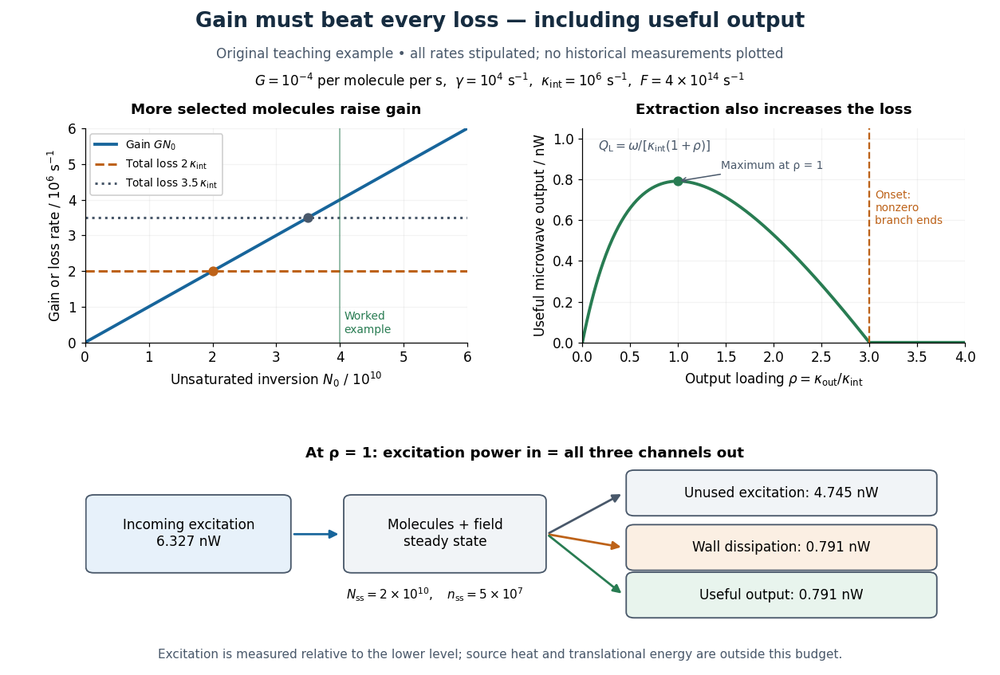

# Maser oscillation threshold

↑ **Parent:** [Maser cavity](maser-cavity.md)

The following original model isolates amplification by inverted [electric dipoles](electric-dipole.md). Let $N=N_u-N_l$ be the excess number in the upper member of one equally degenerate resonant pair. Let $a$ be a slowly varying cavity amplitude with [photon](photon.md) number $n=|a|^2$, and let $p$ describe the collective molecular dipole component in the amplifying phase convention. On exact [resonance](resonance.md), stipulate the linear equations

$$
\dot a=-\frac{\kappa}{2}a+g_0p,
\qquad
\dot p=-\Gamma p+g_0Na,
\qquad \Gamma>0.
$$

The dipole relaxation rate is $\Gamma$, and $g_0=|d_{ul}\mathcal E_{\mathrm{vac}}|/\hbar$ is a single-molecule coupling in the chosen mode normalization. Here $d_{ul}$ is an [electric dipole moment](electric-dipole-moment.md) [matrix element](matrix-element.md), $\mathcal E_{\mathrm{vac}}$ is the field's zero-point amplitude, and $\hbar=h/(2\pi)$. Field overlap and dipole orientation enter this coupling. The [characteristic polynomial](characteristic-polynomial.md) for growth rate $\lambda$ is

$$
(\lambda+\kappa/2)(\lambda+\Gamma)-g_0^2N=0.
$$

For $N>0$, one root becomes positive precisely when $g_0^2N>\kappa\Gamma/2$. If dipole relaxation is fast enough to eliminate $p$, then $p\approx g_0Na/\Gamma$ and

$$
\dot n=(GN-\kappa)n,
\qquad G=\frac{2g_0^2}{\Gamma}.
$$

Thus positive [population inversion](population-inversion.md) alone is insufficient: the gain rate $GN$ must exceed the passive decay rate. This reduction describes the onset near [resonance](resonance.md); it does not predict output [phase](phase-waves.md) noise, actual transit dynamics or an exact historical threshold. [Nikolay Basov](nicolay-gennadiyevich-basov.md) and [Aleksandr Prokhorov](aleksandr-mikhailovich-prokhorov.md)'s molecular-generator theory likewise treats self-excitation as competition between molecular gain and resonator-plus-load losses.[p. 426, Introduction; pp. 427–428, dipole response and self-excitation](theory-of-the-molecular-generator-and-molecular-power-amplifier-by-nicolay-gennadiyevich-basov-and-aleksandr-mikhailovich-prokhorov.md)

To include replenishment, suppose upper-state [molecules](molecule-split.md) enter at rate $F$ and both levels leave with residence rate $\gamma$. A deliberately simple [ordinary differential equation](ordinary-differential-equation.md) model is

$$
\dot N_u=F-\gamma N_u-GNn,
\qquad
\dot N_l=-\gamma N_l+GNn,
\qquad
\dot n=(GN-\kappa)n.
$$

One downward transition removes two units of the difference $N_u-N_l$, so $\dot N=F-\gamma N-2GNn$. Below onset the unsaturated inversion is $N_0=F/\gamma$, giving

$$
GN_0>\kappa,
\qquad
F>F_{\mathrm{th}}=\frac{\gamma\kappa}{G}.
$$

For fixed mode volume $V$, the equivalent [number density](number-density.md) condition is $N_0/V>\kappa/(GV)$. Raising selected beam intensity raises gain; increasing [quality factor](q-factor.md) lowers the loss rate at fixed [frequency](frequency.md). These statements hold with $G$, residence time and mode overlap fixed.

Above onset, the nonzero [steady state](steady-state.md) has

$$
N_{\mathrm{ss}}=\frac{\kappa}{G},
\qquad
n_{\mathrm{ss}}=\frac{F-\gamma\kappa/G}{2\kappa},
\qquad
P_{\mathrm{out}}=\kappa_{\mathrm{out}}h\nu_0n_{\mathrm{ss}}.
$$

The inversion is clamped while excess supply supports output. A finite initial seed is understood: the noiseless equations leave $n=0$ exactly unchanged even above onset. Actual startup has [spontaneous emission](spontaneous-emission.md) and field fluctuations.

**[Figure 2](#image-maser-oscillation-threshold-output-loading-and-the-maser-microwave-energy-budget). Maser oscillation threshold, output loading and the maser microwave energy budget**. Original illustrative model, not historical measurements. Left: gain $GN_0$ rises with selected beam supply, crossing two chosen total loss rates. Right: with fixed supply, output initially grows with output coupling, then falls to zero when that coupling makes the total loss too large. The lower panel accounts for incoming excitation, unused excitation leaving in the beam, wall dissipation and useful output for the worked example.

**Table of contents**

- [Maser microwave energy budget](maser-microwave-energy-budget.md)

## ↑ Ancestors (7)

1. [Maser cavity](maser-cavity.md)
2. [Ammonia maser](ammonia-maser.md)
3. [Maser](maser-split.md)
4. [Optics](optics-split.md)
5. [Branches of physics](branches-of-physics.md)
6. [Physics](physics-split.md)
7. [Codex Wiki](split.md)

## ← Incoming links (2)

- [Maser cavity](maser-cavity.md)
- [Maser oscillation threshold](maser-oscillation-threshold.md)
