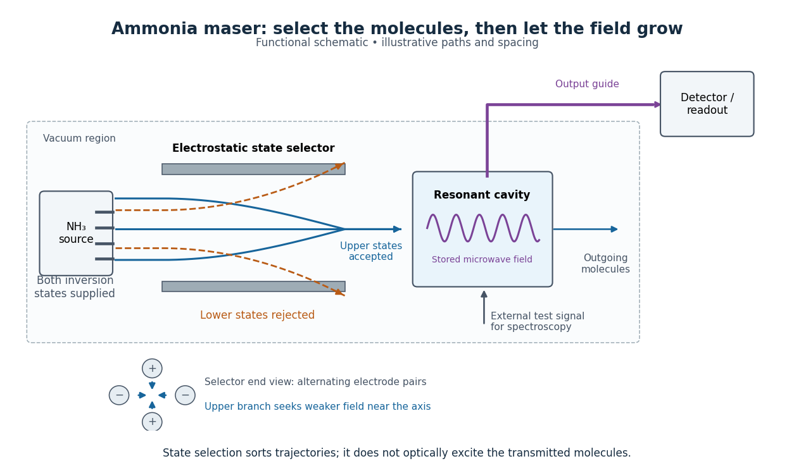

# Maser

↑ **Parent:** [Optics](optics.md)  
ⓦ [Wiki](https://en.wikipedia.org/wiki/Maser)

A maser uses [stimulated emission](laser.md#stimulated-emission) to amplify [microwaves](electromagnetic-radiation.md#microwave). With [population inversion](laser.md#population-inversion) and feedback it can sustain a [coherent wave field](wave.md#coherent-wave-field) as an [oscillator](wave.md#oscillator). The name abbreviates "microwave amplification by stimulated emission of radiation".[pp. 60–62, Basic maser principles](physics-bibliography.md#production-of-coherent-radiation-by-atoms-and-molecules-by-charles-hard-townes)

Why make [molecules](molecule.md) supply an [oscillator](wave.md#oscillator)? Their [energy levels](quantum-mechanics.md#energy-level) offer a reproducible [frequency](wave.md#frequency) reference, while [stimulated emission](laser.md#stimulated-emission) lets successive [molecules](molecule.md) reinforce one [coherent wave field](wave.md#coherent-wave-field). In his 1964 lecture, [Charles Hard Townes](physicist.md#charles-hard-townes) traced his motivation to [microwave spectroscopy](physics.md#microwave-spectroscopy): resolving molecular structure required useful coherent sources.[p. 58, opening discussion of microwave spectroscopy](physics-bibliography.md#production-of-coherent-radiation-by-atoms-and-molecules-by-charles-hard-townes) The interesting balance is between molecular amplification and escaping [energy](energy.md): even a beam with [population inversion](laser.md#population-inversion) fails to oscillate if cavity losses win. This is the microwave counterpart of [laser threshold](laser.md#laser-threshold).

**Table of contents**

- [Hydrogen maser](#hydrogen-maser)
- [Ammonia maser](#ammonia-maser)
  - [Ammonia inversion transition](#ammonia-inversion-transition)
  - [Maser state selection](#maser-state-selection)
  - [Maser cavity](#maser-cavity)
    - [Maser oscillation threshold](#maser-oscillation-threshold)
      - [Maser microwave energy budget](#maser-microwave-energy-budget)
  - [Maser discovery experiment](#maser-discovery-experiment)
- [Maser history](#maser-history)

## Hydrogen maser

↑ **Parent:** [Maser](maser.md)  
ⓦ [Wiki](https://en.wikipedia.org/wiki/Hydrogen_maser)

A [maser](maser.md) using a [hydrogen atom](mathematical-physics.md#hydrogen-atom) transition.

## Ammonia maser

↑ **Parent:** [Maser](maser.md)

An ammonia maser uses an [ammonia](chemical-substance.md#ammonia) [molecular beam](physics.md#molecular-beam), [maser state selection](#maser-state-selection) and a [maser cavity](#maser-cavity) to obtain amplification or sustained [microwave](electromagnetic-radiation.md#microwave) [oscillation](wave.md#oscillation). In the 1954 experiment by [James Power Gordon](physicist.md#james-power-gordon), [Herbert Jack Zeiger](physicist.md#herbert-jack-zeiger) and [Charles Hard Townes](physicist.md#charles-hard-townes), a quadrupolar static [electric field](electric-field.md) focused upper-state [molecules](molecule.md) toward the cavity and deflected lower-state [molecules](molecule.md) away. The reported $J=K=3$ [ammonia inversion transition](#ammonia-inversion-transition) lies near $23.87\,\mathrm{GHz}$.[pp. 282–283, Fig. 1 and Fig. 2 caption; 23 870 Mc/sec](physics-bibliography.md#molecular-microwave-oscillator-and-new-hyperfine-structure-in-the-microwave-spectrum-of-nh3-by-james-power-gordon-and-others)

**[Figure 1](#image-how-maser-state-selection-feeds-a-maser-cavity). How maser state selection feeds a maser cavity**. Upper states enter the [maser cavity](#maser-cavity); lower states are rejected. Paths and spacing are illustrative. The inset shows the selector end view.[§§9–2–9–3, separation and cavity feedback](physics-bibliography.md#chapter-9-the-ammonia-maser)

### Ammonia inversion transition

↑ **Parent:** [Ammonia maser](#ammonia-maser)

In [ammonia](chemical-substance.md#ammonia), the [nitrogen](chemical-substance.md#nitrogen) [chemical atom](physics.md#atom-physics) can lie on either side of the plane of the three [hydrogen](chemical-substance.md#hydrogen) [chemical atoms](physics.md#atom-physics). [Quantum tunnelling](quantum-mechanics.md#quantum-tunnelling) couples these configurations; the resulting pair of [energy levels](quantum-mechanics.md#energy-level) permits an [electric dipole](electrostatics.md#electric-dipole) transition. This geometrical inversion is distinct from [population inversion](laser.md#population-inversion), which concerns how many [molecules](molecule.md) occupy each level.[§9–1, ammonia configurations and inversion doublet](physics-bibliography.md#chapter-9-the-ammonia-maser)

For an idealized pair of [energy levels](quantum-mechanics.md#energy-level) with equal [quantum degeneracy](quantum-mechanics.md#degenerate-energy-levels), the [Boltzmann distribution](thermodynamics.md#boltzmann-distribution) gives $N_u/N_l=\exp[-h\nu_0/(k_{\mathrm B}T)]<1$ at positive [temperature](temperature.md) $T$. A warm source therefore supplies upper-state [molecules](molecule.md) together with an unwanted lower-state population. Selecting the former can produce [population inversion](laser.md#population-inversion) in the transmitted beam without exciting each transmitted [molecule](molecule.md) during selection. The [energy](energy.md) per net downward transition is

$$
\epsilon=h\nu_0.
$$

Here $h$ is the [Planck constant](quantum-mechanics.md#planck-constant). Taking the reported $\nu_0=23.87\,\mathrm{GHz}$ as a rounded input gives $\epsilon\approx1.582\times10^{-23}\,\mathrm J$. This calculation is a conversion of the reported [frequency](wave.md#frequency), not a new measurement of the [ammonia inversion transition](#ammonia-inversion-transition).

### Maser state selection

↑ **Parent:** [Ammonia maser](#ammonia-maser)

Maser state selection separates paths according to the [Stark effect](mathematical-physics.md#stark-effect), the dependence of a [molecule](molecule.md)'s [energy levels](quantum-mechanics.md#energy-level) on an [electric field](electric-field.md). It prepares a transmitted population by sorting. [Optical pumping](atomic-physics.md#optical-pumping), by contrast, changes populations through absorption of [light](optics.md#light) and subsequent transitions. Both can produce a useful population imbalance, but they are different preparation mechanisms.

A simple [two-level system](canonical-ensemble.md#two-level-system) explains the sign of the focusing force. Ignore additional splittings and let the magnitude of the relevant projected [electric dipole moment](electrostatics.md#electric-dipole-moment) be $d$. Model the two local [energy levels](quantum-mechanics.md#energy-level) in an [electric field](electric-field.md) of magnitude $\mathcal E$ by

$$
W_\pm(\mathcal E)=\pm\sqrt{(h\nu_0/2)^2+d^2\mathcal E^2}.
$$

For an ideal quadrupolar [electrostatic potential](electric-field.md#electric-potential) $\Phi=A(x^2-y^2)$, the [electric field](electric-field.md) magnitude is $\mathcal E=2|A|r$, where $r=\sqrt{x^2+y^2}$. Since $W_+$ increases with $r$, the [force](force.md) $\boldsymbol F_+=-\nabla W_+$ points inward. The lower branch has the opposite sign and is defocused. The upper branch is thus low-field seeking. This argument uses the [gradient](multivariable-calculus.md#gradient) of internal [energy](energy.md), rather than a net electric charge on the [molecule](molecule.md). The square-root splitting is the usual two-state description.[§9–2, Eq. (9.30)](physics-bibliography.md#chapter-9-the-ammonia-maser) The idealized [two-level system](canonical-ensemble.md#two-level-system) omits the actual rotational and [hyperfine structure](quantum-mechanics.md#hyperfine-structure) sublevels and their different transmission efficiencies.

### Maser cavity

↑ **Parent:** [Ammonia maser](#ammonia-maser)

The maser cavity stores a resonant [electromagnetic wave](electromagnetic-wave.md) so that an arriving [molecule](molecule.md) encounters a field left by earlier [molecules](molecule.md). An output coupling lets part of that stored [energy](energy.md) reach a detector. The same coupling also removes [energy](energy.md), so increasing extraction can prevent startup. The cavity provides feedback; the selected [molecular beam](physics.md#molecular-beam) supplies the useful internal [energy](energy.md).

Let $U$ be stored field [energy](energy.md), $\omega=2\pi\nu_0$, and $\kappa=\kappa_{\mathrm{int}}+\kappa_{\mathrm{out}}$ the total passive energy decay rate. Internal dissipation and output extraction contribute $\kappa_{\mathrm{int}}U$ and $\kappa_{\mathrm{out}}U$ to lost [power](energy.md#power). With this energy convention, the loaded [quality factor](dynamical-systems.md#q-factor) is

$$
Q_{\mathrm L}=\frac{\omega U}{\kappa U}=\frac{\omega}{\kappa},
\qquad
\frac{1}{Q_{\mathrm L}}=\frac{1}{Q_{\mathrm{int}}}+\frac{1}{Q_{\mathrm{out}}}.
$$

The field amplitude decays at $\kappa/2$; confusing amplitude and [energy](energy.md) decay introduces a factor of two into a [maser oscillation threshold](#maser-oscillation-threshold) calculation.

#### Maser oscillation threshold

↑ **Parent:** [Maser cavity](#maser-cavity)

The following original model isolates amplification by inverted [electric dipoles](electrostatics.md#electric-dipole). Let $N=N_u-N_l$ be the excess number in the upper member of one equally degenerate resonant pair. Let $a$ be a slowly varying cavity amplitude with [photon](quantum-mechanics.md#photon) number $n=|a|^2$, and let $p$ describe the collective molecular dipole component in the amplifying phase convention. On exact [resonance](dynamical-systems.md#resonance), stipulate the linear equations

$$
\dot a=-\frac{\kappa}{2}a+g_0p,
\qquad
\dot p=-\Gamma p+g_0Na,
\qquad \Gamma>0.
$$

The dipole relaxation rate is $\Gamma$, and $g_0=|d_{ul}\mathcal E_{\mathrm{vac}}|/\hbar$ is a single-molecule coupling in the chosen mode normalization. Here $d_{ul}$ is an [electric dipole moment](electrostatics.md#electric-dipole-moment) [matrix element](vector-space.md#matrix-element), $\mathcal E_{\mathrm{vac}}$ is the field's zero-point amplitude, and $\hbar=h/(2\pi)$. Field overlap and dipole orientation enter this coupling. The [characteristic polynomial](linear-operator-theory.md#characteristic-polynomial) for growth rate $\lambda$ is

$$
(\lambda+\kappa/2)(\lambda+\Gamma)-g_0^2N=0.
$$

For $N>0$, one root becomes positive precisely when $g_0^2N>\kappa\Gamma/2$. If dipole relaxation is fast enough to eliminate $p$, then $p\approx g_0Na/\Gamma$ and

$$
\dot n=(GN-\kappa)n,
\qquad G=\frac{2g_0^2}{\Gamma}.
$$

Thus positive [population inversion](laser.md#population-inversion) alone is insufficient: the gain rate $GN$ must exceed the passive decay rate. This reduction describes the onset near [resonance](dynamical-systems.md#resonance); it does not predict output [phase](wave.md#phase-waves) noise, actual transit dynamics or an exact historical threshold. [Nikolay Basov](physicist.md#nicolay-gennadiyevich-basov) and [Aleksandr Prokhorov](physicist.md#aleksandr-mikhailovich-prokhorov)'s molecular-generator theory likewise treats self-excitation as competition between molecular gain and resonator-plus-load losses.[p. 426, Introduction; pp. 427–428, dipole response and self-excitation](physics-bibliography.md#theory-of-the-molecular-generator-and-molecular-power-amplifier-by-nicolay-gennadiyevich-basov-and-aleksandr-mikhailovich-prokhorov)

To include replenishment, suppose upper-state [molecules](molecule.md) enter at rate $F$ and both levels leave with residence rate $\gamma$. A deliberately simple [ordinary differential equation](differential-equation.md#ordinary-differential-equation) model is

$$
\dot N_u=F-\gamma N_u-GNn,
\qquad
\dot N_l=-\gamma N_l+GNn,
\qquad
\dot n=(GN-\kappa)n.
$$

One downward transition removes two units of the difference $N_u-N_l$, so $\dot N=F-\gamma N-2GNn$. Below onset the unsaturated inversion is $N_0=F/\gamma$, giving

$$
GN_0>\kappa,
\qquad
F>F_{\mathrm{th}}=\frac{\gamma\kappa}{G}.
$$

For fixed mode volume $V$, the equivalent [number density](statistical-physics.md#number-density) condition is $N_0/V>\kappa/(GV)$. Raising selected beam intensity raises gain; increasing [quality factor](dynamical-systems.md#q-factor) lowers the loss rate at fixed [frequency](wave.md#frequency). These statements hold with $G$, residence time and mode overlap fixed.

Above onset, the nonzero [steady state](dynamical-systems.md#steady-state) has

$$
N_{\mathrm{ss}}=\frac{\kappa}{G},
\qquad
n_{\mathrm{ss}}=\frac{F-\gamma\kappa/G}{2\kappa},
\qquad
P_{\mathrm{out}}=\kappa_{\mathrm{out}}h\nu_0n_{\mathrm{ss}}.
$$

The inversion is clamped while excess supply supports output. A finite initial seed is understood: the noiseless equations leave $n=0$ exactly unchanged even above onset. Actual startup has [spontaneous emission](atomic-physics.md#spontaneous-emission) and field fluctuations.

**[Figure 2](#image-maser-oscillation-threshold-output-loading-and-the-maser-microwave-energy-budget). Maser oscillation threshold, output loading and the maser microwave energy budget**. Original illustrative model, not historical measurements. Left: gain $GN_0$ rises with selected beam supply, crossing two chosen total loss rates. Right: with fixed supply, output initially grows with output coupling, then falls to zero when that coupling makes the total loss too large. The lower panel accounts for incoming excitation, unused excitation leaving in the beam, wall dissipation and useful output for the worked example.

##### Maser microwave energy budget

↑ **Parent:** [Maser oscillation threshold](#maser-oscillation-threshold)

Multiplying the upper-level and [photon](quantum-mechanics.md#photon) equations by $h\nu_0$ makes the cancellation of internal transfer visible:

$$
\frac{d}{dt}\bigl[h\nu_0(N_u+n)\bigr]
=h\nu_0F-\gamma h\nu_0N_u-\kappa_{\mathrm{int}}h\nu_0n-\kappa_{\mathrm{out}}h\nu_0n.
$$

Incoming excitation becomes unused excitation carried away, internal dissipation, useful output, or a change in stored [energy](energy.md). Translational [kinetic energy](energy.md#kinetic-energy), the source's other internal states and preparation losses lie outside this two-level budget. The output cannot exceed the incoming excitation [power](energy.md#power) $h\nu_0F$.

Choose $G=10^{-4}\,\mathrm{s^{-1}}$ per unit inversion, $\gamma=10^4\,\mathrm{s^{-1}}$, $\kappa_{\mathrm{int}}=\kappa_{\mathrm{out}}=10^6\,\mathrm{s^{-1}}$, and $F=4\times10^{14}\,\mathrm{s^{-1}}$. These are stipulated teaching parameters. Then $N_0=4\times10^{10}$, $F_{\mathrm{th}}=2\times10^{14}\,\mathrm{s^{-1}}$, $N_{\mathrm{ss}}=2\times10^{10}$ and $n_{\mathrm{ss}}=5\times10^7$. Using the rounded [ammonia inversion transition](#ammonia-inversion-transition) [frequency](wave.md#frequency), the loaded [quality factor](dynamical-systems.md#q-factor) is approximately $7.50\times10^4$. The incoming excitation [power](energy.md#power) is $6.327\,\mathrm{nW}$: $4.745\,\mathrm{nW}$ leaves unused, $0.791\,\mathrm{nW}$ becomes internal dissipation and $0.791\,\mathrm{nW}$ is useful output, with rounding in these displayed values.

There is an instructive extraction optimum within this model. With the same $F$, $G$ and $\gamma$, put $\rho=\kappa_{\mathrm{out}}/\kappa_{\mathrm{int}}$ and $p=FG/(\gamma\kappa_{\mathrm{int}})=4$. For $0\leq\rho<p-1$,

$$
P_{\mathrm{out}}=\frac{h\nu_0\gamma\kappa_{\mathrm{int}}}{2G}
\frac{\rho(p-1-\rho)}{1+\rho}.
$$

Differentiation gives $\rho_{\mathrm{opt}}=\sqrt p-1=1$. At zero coupling no [power](energy.md#power) is extracted; at $\rho=3$ the device reaches onset and the nonzero branch disappears. The optimum balances extraction against the inversion required to compensate that extraction. Equal residence rates and loss of molecular phase memory are simplifying assumptions; the calculated efficiency is not a universal bound for beam masers.

### Maser discovery experiment

↑ **Parent:** [Ammonia maser](#ammonia-maser)

Ammonia gas entered a vacuum chamber through fine channels; the selected beam entered a cavity with input and output waveguides.[pp. 1264–1265, Fig. 1, source and vacuum](physics-bibliography.md#the-maser-new-type-of-microwave-amplifier-frequency-standard-and-spectrometer-by-james-power-gordon-and-others) With external [microwaves](electromagnetic-radiation.md#microwave) swept across a molecular [resonance](dynamical-systems.md#resonance), the 1954 experiment read an increase in transmitted [power](energy.md#power); with sufficient beam emission, it sustained [oscillation](wave.md#oscillation).[p. 283, operation as spectrometer, amplifier and oscillator](physics-bibliography.md#molecular-microwave-oscillator-and-new-hyperfine-structure-in-the-microwave-spectrum-of-nh3-by-james-power-gordon-and-others)

The 1955 readout mixed two maser signals with a local [oscillator](wave.md#oscillator) in a crystal detector, amplified them at an intermediate [frequency](wave.md#frequency), and combined them in a diode detector. An [oscilloscope](wave-equation.md#oscilloscope) showed their [beat](physical-optics.md#beat) [frequency](wave.md#frequency). Changing cavity tuning, source pressure or focuser field tested sensitivity; excessive detuning stopped [oscillation](wave.md#oscillation).[pp. 1266–1267, Experimental Results, heterodyne and controls](physics-bibliography.md#the-maser-new-type-of-microwave-amplifier-frequency-standard-and-spectrometer-by-james-power-gordon-and-others) The [beat](physical-optics.md#beat) tests relative [frequency](wave.md#frequency) stability; it does not by itself establish an absolute [frequency](wave.md#frequency) or an intrinsic linewidth independent of detector noise. Detuning also changes the field–molecule interaction, so the threshold model's constant $G$ cannot describe arbitrary tuning scans.

## Maser history

↑ **Parent:** [Maser](maser.md)

The 1955 paper by [James Power Gordon](physicist.md#james-power-gordon), [Herbert Jack Zeiger](physicist.md#herbert-jack-zeiger) and [Charles Hard Townes](physicist.md#charles-hard-townes) acknowledged [Nikolay Basov](physicist.md#nicolay-gennadiyevich-basov) and [Aleksandr Prokhorov](physicist.md#aleksandr-mikhailovich-prokhorov)'s independent proposal.[p. 1264, Introduction and reference 2](physics-bibliography.md#the-maser-new-type-of-microwave-amplifier-frequency-standard-and-spectrometer-by-james-power-gordon-and-others) The latter authors' theory paper states that they presented the molecular-generator possibility in May 1952, cites their 1954 publication, and separately cites the Gordon–Zeiger–Townes experimental realization. These are contributions from independent groups.[p. 426, historical footnote and references 3–4; manuscript submitted December 10, 1954, English publication October 1956](physics-bibliography.md#theory-of-the-molecular-generator-and-molecular-power-amplifier-by-nicolay-gennadiyevich-basov-and-aleksandr-mikhailovich-prokhorov)

## ↑ Ancestors (4)

1. [Optics](optics.md)
2. [Branches of physics](physics.md#branches-of-physics)
3. [Physics](physics.md)
4. [Codex Wiki](README.md)

## ← Incoming links (8)

- [Galactic-centre stellar-orbit experiments](astrophysical-black-hole.md#galactic-centre-stellar-orbit-experiments)
- [Hydrogen maser](#hydrogen-maser)
- [Maser-disk geometric distance](cosmology.md#maser-disk-geometric-distance)
- [Nobel Prize in Physics in 1964](nobel-prize-in-physics.md#nobel-prize-in-physics-in-1964)
- [Solution](past-exam-of-the-frontiers-of-observational-astrophysics-course-of-the-university-of-cambridge/2014/paper-1.md#3/c/solution)
- [Solution](past-exam-of-the-relativity-course-of-the-university-of-cambridge/2014/paper-1.md#2/c/solution)
- [Penzias-Wilson microwave background experiment](cosmic-microwave-background.md#penzias-wilson-microwave-background-experiment)
- [Very-long-baseline interferometry](astrophysics.md#very-long-baseline-interferometry)
