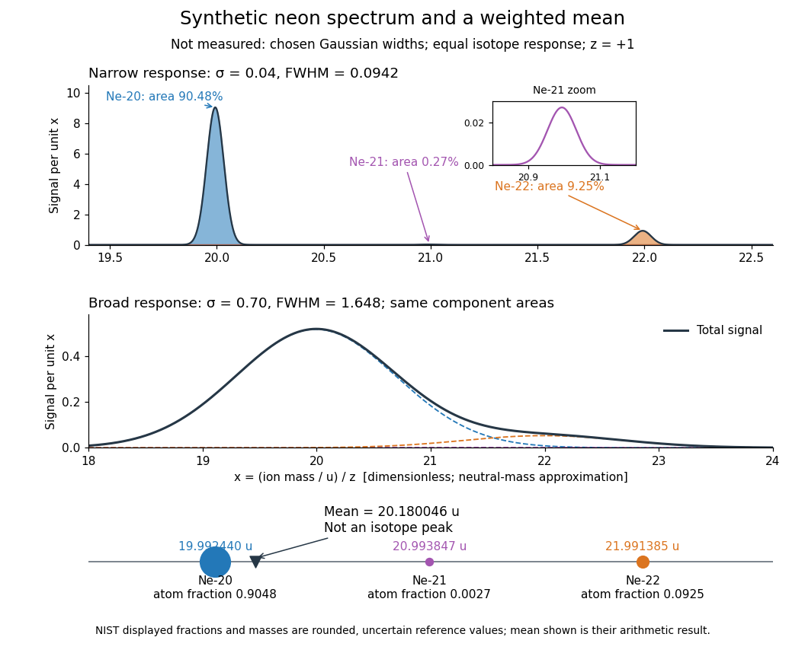

# Mass spectrum

↑ **Parent:** [Mass spectrometry](mass-spectrometry.md)  
ⓦ [Wiki](https://en.wikipedia.org/wiki/Mass_spectrum)

A [mass spectrum](mass-spectrum.md) displays detected signal against [mass-to-charge ratio](mass-to-charge-ratio.md). Peak positions identify candidate [ions](ion.md); peak areas give [isotopic abundances](isotopic-abundance.md) only after the response and overlapping contributions have been accounted for.

**[Figure 12](#image-synthetic-neon-mass-spectra-and-the-weighted-mean-of-neutral-atomic-masses). Synthetic neon mass spectra and the weighted mean of neutral atomic masses**. This is a model, not a measured [mass spectrum](mass-spectrum.md) or a reconstruction of Aston's plate. All [ions](ion.md) have $z=+1$; neutral [atomic masses](atomic-mass.md) approximate [ion](ion.md) [masses](mass.md). Chosen [Gaussian functions](gaussian-function.md) have unit area and widths $\sigma=0.04$ and $0.70$ in the [dimensionless](dimensionless-quantity.md) coordinate $x$. Equal responses make component areas equal the displayed reference [isotopic abundances](isotopic-abundance.md). The inset reveals the small [neon-21](neon-21.md) peak. The bottom diagram places the [weighted mean](weighted-arithmetic-mean.md) between the component [atomic masses](atomic-mass.md); it is not an additional [isotope](isotope.md).

Broadening can hide a weak component without changing its area in this ideal model. An actual [mass spectrum](mass-spectrum.md) can also contain molecular [ions](ion.md), different [electric charge](electric-charge-split.md) states, background, and unequal detection responses. A missing visible peak therefore cannot by itself prove the absence of an [isotope](isotope.md). Conversely, a fractional [atomic weight](relative-atomic-mass.md) is a property of a population: there is no requirement for an [ion](ion.md) peak at the [weighted mean](weighted-arithmetic-mean.md).

## ↑ Ancestors (3)

1. [Mass spectrometry](mass-spectrometry.md)
2. [Chemistry](chemistry-split.md)
3. [Codex Wiki](split.md)

## ← Incoming links (7)

- [Isotope](isotope.md)
- [Magnesium isotope mass spectrum](magnesium-isotope-mass-spectrum.md)
- [Mass resolution](mass-resolution.md)
- [Mass spectrograph](mass-spectrograph.md)
- [Mass spectrum](mass-spectrum.md)
- [Mass-to-charge ratio](mass-to-charge-ratio.md)
- [Paul trap](paul-trap.md)
