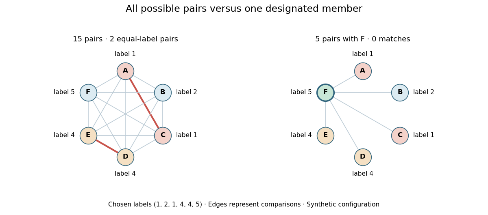

# Matching one specified birthday

↑ **Parent:** [Birthday problem](birthday-problem.md)

In a group of total size $n\geq1$, designate one member and ask whether any of the other $n-1$ labels equals that member's label. Conditional on the designated label, all the other draws avoid it with probability $1-1/m$. [Independence](independent-random-variables.md) gives

$$
\boxed{\mathbb P(\text{a match with the designated member})=1-\left(1-\frac1m\right)^{n-1}.}
$$

For $n=23$, this is approximately $5.86\%$, while the probability of some matching pair is approximately $50.73\%$. The designated-member question examines $22$ pairs; the any-pair question examines all $253$. A repeated label elsewhere in the group does not require a match with its designated member.

**[Figure 4](#image-fifteen-possible-pairs-versus-five-comparisons-with-one-designated-member). Fifteen possible pairs versus five comparisons with one designated member**. Original illustrative labels for six members: $(1,2,1,4,4,5)$. The [complete graph](complete-graph.md) includes every possible pair and marks the two equal-label pairs in red. The right panel uses only pairs containing member F, whose label 5 is unique. This chosen configuration illustrates the two different events; it is not a random sample of measured birthdays.

## ↑ Ancestors (5)

1. [Birthday problem](birthday-problem.md)
2. [Probability and statistics](probability-and-statistics-split.md)
3. [Area of mathematics](area-of-mathematics.md)
4. [Mathematics](mathematics-split.md)
5. [Codex Wiki](split.md)

## ← Incoming links (2)

- [Birthday square-root scale](birthday-square-root-scale.md)
- [Solution](past-exam-of-the-mathematics-course-of-the-year-1-of-the-natural-sciences-course-of-the-university-of-cambridge/2005/paper-1/3/b/ii/solution.md)
