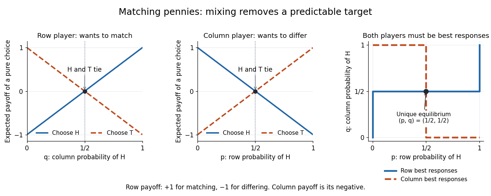

# Matching pennies

↑ **Parent:** [Bimatrix game](bimatrix-game.md)  
ⓦ [Wiki](https://en.wikipedia.org/wiki/Matching_pennies)

Both players choose heads $H$ or tails $T$ without seeing the other's choice. The row player receives $1$ when the choices match and $-1$ when they differ; the column player receives the opposite [payoff](payoff.md). Thus [matching pennies](matching-pennies.md) is a [zero-sum game](zero-sum-game.md), with ordered [payoff](payoff.md) pairs:

| Row choice / column choice | $H$ | $T$ |
| --- | --- | --- |
| $H$ | $(1,-1)$ | $(-1,1)$ |
| $T$ | $(-1,1)$ | $(1,-1)$ |

At $(H,H)$ the column player improves by switching to $T$; at $(H,T)$ the row player improves by switching to $T$; at $(T,H)$ the row player improves by switching to $H$; at $(T,T)$ the column player improves by switching to $H$. Every [pure strategy](pure-strategy.md) [strategy profile](strategy-profile.md) therefore has a profitable [unilateral deviation](unilateral-deviation.md), so none is a [Nash equilibrium](nash-equilibrium.md).

Let $p$ be the row player's [probability](probability.md) of heads and $q$ the column player's [probability](probability.md) of heads. Their random choices are [independent](independent-random-variables.md). Against fixed $q$, the row player's pure-choice [expected payoffs](expected-payoff.md) are

$$
U_1(H,q)=2q-1,\qquad U_1(T,q)=1-2q.
$$

Against fixed $p$, the column player's pure-choice [expected payoffs](expected-payoff.md) are

$$
U_2(p,H)=1-2p,\qquad U_2(p,T)=2p-1.
$$

Consequently the [best responses](best-response.md), expressed as allowed heads [probabilities](probability.md), are

$$
\operatorname{BR}_1(q)=\begin{cases}\{0\}&q<1/2,\\ {[0,1]}&q=1/2,\\\{1\}&q>1/2,\end{cases}
\qquad
\operatorname{BR}_2(p)=\begin{cases}\{1\}&p<1/2,\\ {[0,1]}&p=1/2,\\\{0\}&p>1/2.\end{cases}
$$

Here $[0,1]$ means every mixture is a [best response](best-response.md), including both [pure strategies](pure-strategy.md). If $q>1/2$, the row player must choose $p=1$, which makes the column player's [best response](best-response.md) $q=0$, a contradiction. If $q<1/2$, the row player must choose $p=0$, which forces $q=1$, also a contradiction. Hence $q=1/2$; for the column player to mix at this $q$, the two column [payoffs](payoff.md) must tie, forcing $p=1/2$. The unique [Nash equilibrium](nash-equilibrium.md) is therefore

$$
p^*=q^*=\frac12,\qquad U_1(p^*,q^*)=U_2(p^*,q^*)=0.
$$

Indeed, for any $p,q$, $U_1(p,q)=(2p-1)(2q-1)$ and $U_2(p,q)=-U_1(p,q)$. Holding $q=1/2$ gives the row player zero for every deviation $p'$; holding $p=1/2$ gives the column player zero for every deviation $q'$. A player is indifferent against the equilibrium mixture, but choosing an arbitrary [best response](best-response.md) to it need not preserve the opponent's [best response](best-response.md). This is why that indifference does not produce additional [Nash equilibria](nash-equilibrium.md).

**[Figure 5](#image-matching-pennies-pure-choice-expected-payoffs-and-the-unique-intersection-of-best-responses). Matching pennies: pure-choice expected payoffs and the unique intersection of best responses**.

For a teaching treatment with the same [payoff](payoff.md) convention, see [MIT 17.810, lecture 3, slides 29–38, on mixed strategies and matching pennies](https://ocw.mit.edu/courses/17-810-game-theory-spring-2021/mit17_810s21_lec3.pdf).

## ↑ Ancestors (6)

1. [Bimatrix game](bimatrix-game.md)
2. [Game theory](game-theory-split.md)
3. [Mathematical optimization](mathematical-optimization-split.md)
4. [Area of mathematics](area-of-mathematics.md)
5. [Mathematics](mathematics-split.md)
6. [Codex Wiki](split.md)

## ← Incoming links (9)

- [Best response](best-response.md)
- [Game theory](game-theory-split.md)
- [Matching pennies](matching-pennies.md)
- [Minimax theorem](minimax-theorem.md)
- [Mixed strategy](mixed-strategy.md)
- [Nash equilibrium](nash-equilibrium.md)
- [Solution](past-exam-of-the-mathematics-course-of-the-university-of-cambridge/2004/iii/paper-33/6/solution.md)
- [Pure strategy](pure-strategy.md)
- [Zero-sum game](zero-sum-game.md)
