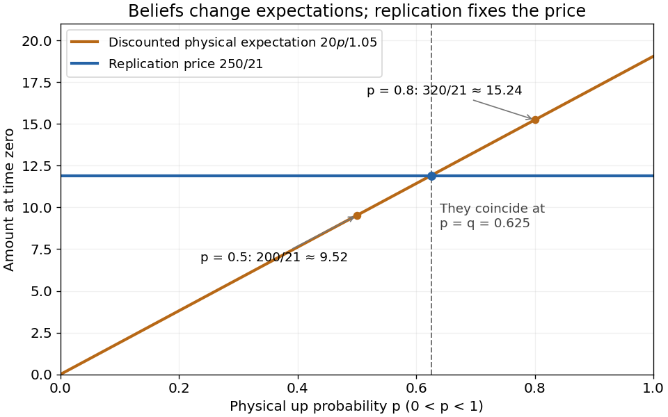
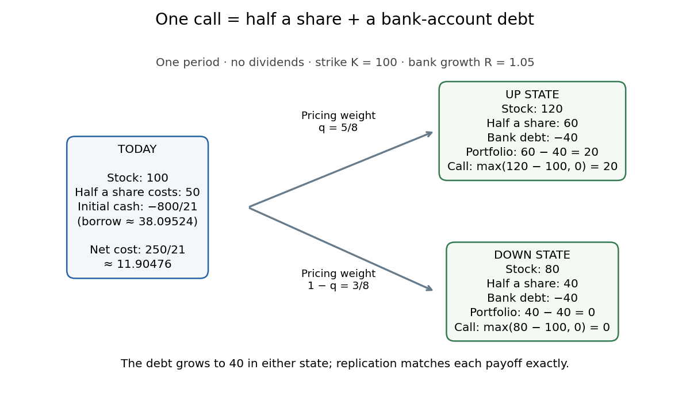

# Mathematical finance

↑ **Parent:** [Mathematical optimization](mathematical-optimization.md)  
ⓦ [Wiki](https://en.wikipedia.org/wiki/Mathematical_finance)

[Mathematical finance](mathematical-finance.md) uses [probability theory](probability-theory.md), [linear algebra](linear-algebra.md) and [mathematical optimization](mathematical-optimization.md) to study [financial markets](#financial-market), [portfolio](#investment-portfolio) decisions and [contingent claim](fundamental-theorem-of-asset-pricing.md#contingent-claim) prices. One question asks which [portfolio](#investment-portfolio) best serves a specified objective; another asks what price a [contingent claim](fundamental-theorem-of-asset-pricing.md#contingent-claim) must have to exclude [arbitrage](#arbitrage). The latter can have an exact answer even when future [stock](#stock) prices are uncertain.

The central idea is [claim replication](fundamental-theorem-of-asset-pricing.md#claim-replication): construct a [self-financing portfolio](#self-financing-portfolio) delivering the same [financial payoff](fundamental-theorem-of-asset-pricing.md#contingent-claim-payoff) as a contract in every possible state. The [law of one price](#law-of-one-price) then identifies the contract's price with the [portfolio](#investment-portfolio)'s initial cost. The [binomial market](#discrete-time-binomial-market) makes this beautiful connection between uncertainty and [linear algebra](linear-algebra.md) visible using just two equations. [Risk-neutral pricing](#risk-neutral-pricing) expresses the same cost as a discounted [expectation](expected-value.md).

The one-step example below fixes today's [stock](#stock) price at 100, terminal prices at 120 or 80, and the [bank account](#bank-account)'s gross growth factor at 1.05. A [European call option](fundamental-theorem-of-asset-pricing.md#european-call-option) with [strike price](#strike-price) 100 pays 20 or zero. Its [replicating portfolio in a binomial market](#replicating-portfolio-in-a-binomial-market) costs $250/21$, independently of the physical up [probability](probability-theory.md#probability), provided both states remain possible. These are conclusions within the specified [financial market](#financial-market) model.

**Table of contents**

- [Financial return](#financial-return)
- [Financial market](#financial-market)
  - [Frictionless market](#frictionless-market)
- [Financial asset](#financial-asset)
  - [Strike price](#strike-price)
  - [Credit derivative](#credit-derivative)
    - [Synthetic CDO](#synthetic-cdo)
      - [Credit tranche loss function](#credit-tranche-loss-function)
    - [Credit-linked note](#credit-linked-note)
    - [Total return swap](#total-return-swap)
    - [Credit default swap](#credit-default-swap)
      - [First-to-default swap](#first-to-default-swap)
      - [Continuous-premium credit-default swap spread](#continuous-premium-credit-default-swap-spread)
  - [Risk-free asset](#risk-free-asset)
- [Value at risk](#value-at-risk)
  - [Compound-Poisson annual loss quantile](#compound-poisson-annual-loss-quantile)
- [Credit risk](#credit-risk)
  - [Merton model](#merton-model)
  - [Counterparty credit risk](#counterparty-credit-risk)
  - [Credit spread](#credit-spread)
    - [Credit spread option](#credit-spread-option)
  - [Credit rating](#credit-rating)
- [Trinomial tree](#trinomial-tree)
- [Competitive equilibrium with one productive asset](#competitive-equilibrium-with-one-productive-asset)
- [Dominated martingale measure](#dominated-martingale-measure)
- [Relative-consumption share equilibrium](#relative-consumption-share-equilibrium)
- [Incomplete market](#incomplete-market)
- [Budget constraint](#budget-constraint)
  - [Discrete dividend budget equation](#discrete-dividend-budget-equation)
- [Arithmetic stock model with constant volatility](#arithmetic-stock-model-with-constant-volatility)
  - [Call price in an arithmetic stock model with interest](#call-price-in-an-arithmetic-stock-model-with-interest)
    - [Delta bound in an arithmetic stock model](#delta-bound-in-an-arithmetic-stock-model)
- [Local volatility](#local-volatility)
  - [Local volatility model](#local-volatility-model)
    - [Exponential claim in a driftless square-root model](#exponential-claim-in-a-driftless-square-root-model)
    - [Pricing equation for a local volatility model](#pricing-equation-for-a-local-volatility-model)
      - [Explicit log-price scheme for local-volatility pricing](#explicit-log-price-scheme-for-local-volatility-pricing)
        - [Finite-difference option Greeks](#finite-difference-option-greeks)
      - [Delta replication from a local-volatility pricing equation](#delta-replication-from-a-local-volatility-pricing-equation)
    - [Dupire equation](#dupire-equation)
      - [Local volatility recovery from call prices](#local-volatility-recovery-from-call-prices)
    - [Brownian representation replication in a local volatility market](#brownian-representation-replication-in-a-local-volatility-market)
- [Credit default](#credit-default)
  - [Loss given default](#loss-given-default)
  - [Default time](#default-time)
    - [Default intensity](#default-intensity)
- [Investment portfolio](#investment-portfolio)
  - [Portfolio diversification](#portfolio-diversification)
  - [Short (finance)](#short-finance)
  - [Expected return](#expected-return)
  - [Portfolio wealth](#portfolio-wealth)
  - [Brownian portfolio exposures](#brownian-portfolio-exposures)
  - [Sharpe ratio](#sharpe-ratio)
  - [Market portfolio](#market-portfolio)
    - [Sign of the normalized tangency portfolio](#sign-of-the-normalized-tangency-portfolio)
    - [Capital market line](#capital-market-line)
    - [Capital asset pricing model](#capital-asset-pricing-model)
    - [Beta of an asset](#beta-of-an-asset)
- [Stock](#stock)
  - [Continuous dividend yield](#continuous-dividend-yield)
  - [Geometric stock index](#geometric-stock-index)
  - [Defaultable stock](#defaultable-stock)
    - [Zero-recovery default model](#zero-recovery-default-model)
- [Numéraire](#numeraire)
  - [Change of numeraire](#change-of-numeraire)
    - [Stock-numeraire measure in the Black-Scholes model](#stock-numeraire-measure-in-the-black-scholes-model)
  - [Numéraire portfolio](#numeraire-portfolio)
    - [Numéraire strategy](#numeraire-strategy)
- [Arbitrage](#arbitrage)
  - [Arbitrage pricing theory](#arbitrage-pricing-theory)
    - [Covariance criterion for diversification of factor residuals](#covariance-criterion-for-diversification-of-factor-residuals)
    - [Exact factor pricing without a traded risk-free asset](#exact-factor-pricing-without-a-traded-risk-free-asset)
    - [Exact factor pricing without idiosyncratic risk](#exact-factor-pricing-without-idiosyncratic-risk)
  - [Singular-volatility drift arbitrage](#singular-volatility-drift-arbitrage)
  - [Law of one price](#law-of-one-price)
    - [Strict local martingale failure of the law of one price](#strict-local-martingale-failure-of-the-law-of-one-price)
  - [Investment-consumption arbitrage](#investment-consumption-arbitrage)
    - [Pure-investment arbitrage](#pure-investment-arbitrage)
    - [Consumption](#consumption)
    - [Terminal-consumption arbitrage](#terminal-consumption-arbitrage)
  - [Arbitrage in a one-period Gaussian market](#arbitrage-in-a-one-period-gaussian-market)
  - [Self-financing portfolio](#self-financing-portfolio)
    - [Portfolio with constant stock value in bond units](#portfolio-with-constant-stock-value-in-bond-units)
    - [Constant-proportion portfolio](#constant-proportion-portfolio)
    - [Self-financing conditions for smooth stock and bond holdings](#self-financing-conditions-for-smooth-stock-and-bond-holdings)
    - [Discounted dividend gains](#discounted-dividend-gains)
      - [Multi-period dividend pricing identity](#multi-period-dividend-pricing-identity)
      - [Dividend-inclusive portfolio return](#dividend-inclusive-portfolio-return)
    - [Admissible trading strategy](#admissible-trading-strategy)
    - [Discounted wealth equation in discrete time](#discounted-wealth-equation-in-discrete-time)
      - [Discounted wealth martingale integrability condition](#discounted-wealth-martingale-integrability-condition)
- [Utility function](utility-function.md)
  - [Risk seeking](utility-function.md#risk-seeking)
  - [Risk aversion](utility-function.md#risk-aversion)
    - [Relative risk aversion coefficient](utility-function.md#relative-risk-aversion-coefficient)
      - [Small multiplicative risk premium](utility-function.md#small-multiplicative-risk-premium)
  - [Marginal utility](utility-function.md#marginal-utility)
  - [Expected utility](utility-function.md#expected-utility)
    - [Risk premium](utility-function.md#risk-premium)
  - [Affine utility on probability measures](utility-function.md#affine-utility-on-probability-measures)
    - [Expected utility representation on a finite measurable space](utility-function.md#expected-utility-representation-on-a-finite-measurable-space)
    - [Positive affine uniqueness of affine preference representations](utility-function.md#positive-affine-uniqueness-of-affine-preference-representations)
    - [Mixture solvability of affine preferences](utility-function.md#mixture-solvability-of-affine-preferences)
    - [Independence axiom for lottery preferences](utility-function.md#independence-axiom-for-lottery-preferences)
  - [Inverse marginal utility](utility-function.md#inverse-marginal-utility)
  - [Multiplicative habit utility](utility-function.md#multiplicative-habit-utility)
    - [Dual equation for multiplicative habit investment](utility-function.md#dual-equation-for-multiplicative-habit-investment)
    - [Effective consumption shadow price with habit](utility-function.md#effective-consumption-shadow-price-with-habit)
    - [Exponentially weighted consumption habit](utility-function.md#exponentially-weighted-consumption-habit)
  - [Inada conditions](utility-function.md#inada-conditions)
    - [Inada utility with vanishing curvature](utility-function.md#inada-utility-with-vanishing-curvature)
  - [Constant relative risk aversion utility](utility-function.md#constant-relative-risk-aversion-utility)
    - [Power-wealth investment with running utility](utility-function.md#power-wealth-investment-with-running-utility)
    - [Benchmark-relative power-utility portfolio](utility-function.md#benchmark-relative-power-utility-portfolio)
    - [Square-root investment-consumption value](utility-function.md#square-root-investment-consumption-value)
    - [Logarithmic utility](utility-function.md#logarithmic-utility)
      - [Two-state logarithmic portfolio with a borrowing constraint](utility-function.md#two-state-logarithmic-portfolio-with-a-borrowing-constraint)
      - [Log-optimal investment with Gaussian drift learning](utility-function.md#log-optimal-investment-with-gaussian-drift-learning)
    - [Volatility-penalized terminal fee](utility-function.md#volatility-penalized-terminal-fee)
    - [Risk aversion recovered from an optimal two-state payoff](utility-function.md#risk-aversion-recovered-from-an-optimal-two-state-payoff)
  - [Quasilinear utility](utility-function.md#quasilinear-utility)
  - [Risk neutrality](utility-function.md#risk-neutrality)
  - [Constant absolute risk aversion utility](utility-function.md#constant-absolute-risk-aversion-utility)
    - [Binomial exponential-utility terminal wealth](utility-function.md#binomial-exponential-utility-terminal-wealth)
    - [Finite-horizon exponential-utility portfolio](utility-function.md#finite-horizon-exponential-utility-portfolio)
    - [Exponential-utility risk sharing](utility-function.md#exponential-utility-risk-sharing)
    - [Exponential-utility portfolio with nonnegative cash](utility-function.md#exponential-utility-portfolio-with-nonnegative-cash)
  - [Expected utility hypothesis](utility-function.md#expected-utility-hypothesis)
    - [Expected utility maximization](utility-function.md#expected-utility-maximization)
      - [Unbounded linear terminal-wealth utility](utility-function.md#unbounded-linear-terminal-wealth-utility)
      - [Complete-market terminal utility optimizer](utility-function.md#complete-market-terminal-utility-optimizer)
        - [Binomial power-utility terminal wealth](utility-function.md#binomial-power-utility-terminal-wealth)
      - [Proportional transaction cost](utility-function.md#proportional-transaction-cost)
      - [Secant domination for expected utility derivatives](utility-function.md#secant-domination-for-expected-utility-derivatives)
      - [Terminal wealth floor](utility-function.md#terminal-wealth-floor)
        - [Floored marginal utility optimizer](utility-function.md#floored-marginal-utility-optimizer)
      - [Discounted infinite-horizon utility integrability](utility-function.md#discounted-infinite-horizon-utility-integrability)
      - [Hedge fund incentive utility](utility-function.md#hedge-fund-incentive-utility)
        - [Concavification of incentive utility](utility-function.md#concavification-of-incentive-utility)
          - [Fair-game gambling induced by an incentive fee](utility-function.md#fair-game-gambling-induced-by-an-incentive-fee)
          - [Common tangent for exponential incentive utility](utility-function.md#common-tangent-for-exponential-incentive-utility)
      - [Investment-consumption problem](utility-function.md#investment-consumption-problem)
        - [Finite-horizon power-utility investment and consumption](utility-function.md#finite-horizon-power-utility-investment-and-consumption)
        - [Finite-horizon logarithmic investment and consumption](utility-function.md#finite-horizon-logarithmic-investment-and-consumption)
        - [Investment with fixed debt service](utility-function.md#investment-with-fixed-debt-service)
          - [Dual ruin boundary with debt service](utility-function.md#dual-ruin-boundary-with-debt-service)
        - [Constant market price of risk investment](utility-function.md#constant-market-price-of-risk-investment)
        - [Consumption satisfaction stock](utility-function.md#consumption-satisfaction-stock)
          - [Singular consumption control](utility-function.md#singular-consumption-control)
          - [Gradient constraint for unbounded consumption](utility-function.md#gradient-constraint-for-unbounded-consumption)
          - [Wealth-to-satisfaction reduction](utility-function.md#wealth-to-satisfaction-reduction)
        - [Investment value transversality condition](utility-function.md#investment-value-transversality-condition)
        - [State-dependent correlation investment problem](utility-function.md#state-dependent-correlation-investment-problem)
          - [Power transformation of a complete-market investment equation](utility-function.md#power-transformation-of-a-complete-market-investment-equation)
        - [Intertemporal hedging demand](utility-function.md#intertemporal-hedging-demand)
          - [Learning hedge in a binary-drift investment model](utility-function.md#learning-hedge-in-a-binary-drift-investment-model)
        - [High-water mark investment taxation](utility-function.md#high-water-mark-investment-taxation)
          - [Wealth-cap investment boundary](utility-function.md#wealth-cap-investment-boundary)
          - [High-water mark tax boundary condition](utility-function.md#high-water-mark-tax-boundary-condition)
        - [Merton consumption-investment problem](utility-function.md#merton-consumption-investment-problem)
          - [Regime-switching Merton equations](utility-function.md#regime-switching-merton-equations)
          - [Retirement boundary with an income option](utility-function.md#retirement-boundary-with-an-income-option)
          - [Merton consumption constant](utility-function.md#merton-consumption-constant)
          - [Maximal squared Sharpe ratio value bound](utility-function.md#maximal-squared-sharpe-ratio-value-bound)
          - [Exponential interest-rate switch](utility-function.md#exponential-interest-rate-switch)
      - [Certainty equivalent](utility-function.md#certainty-equivalent)
      - [Expected utility of a Gaussian location-scale family](utility-function.md#expected-utility-of-a-gaussian-location-scale-family)
      - [Indifference price](utility-function.md#indifference-price)
        - [Periodic utility indifference payment for Gaussian income](utility-function.md#periodic-utility-indifference-payment-for-gaussian-income)
      - [Optimized affine shift of concave utility](utility-function.md#optimized-affine-shift-of-concave-utility)
      - [Scaled centered risk under concave utility](utility-function.md#scaled-centered-risk-under-concave-utility)
      - [Utility duality with martingale deflators](utility-function.md#utility-duality-with-martingale-deflators)
        - [Logarithmic terminal wealth in a complete market](utility-function.md#logarithmic-terminal-wealth-in-a-complete-market)
        - [Optimal marginal utility as a one-period pricing density](utility-function.md#optimal-marginal-utility-as-a-one-period-pricing-density)
          - [Marginal utility price](utility-function.md#marginal-utility-price)
          - [Marginal utility pricing with proportional transaction costs](utility-function.md#marginal-utility-pricing-with-proportional-transaction-costs)
        - [One-period marginal-utility certificate of optimality](utility-function.md#one-period-marginal-utility-certificate-of-optimality)
        - [Marginal-utility verification of optimal consumption](utility-function.md#marginal-utility-verification-of-optimal-consumption)
        - [Wealth-variable Legendre dual](utility-function.md#wealth-variable-legendre-dual)
- [Discrete-time expected-utility portfolio problem](#discrete-time-expected-utility-portfolio-problem)
  - [Exponential-utility trading with Gaussian increments](#exponential-utility-trading-with-gaussian-increments)
    - [Hedging a Gaussian income stream with exponential utility](#hedging-a-gaussian-income-stream-with-exponential-utility)
  - [Bellman equation for terminal-wealth utility](#bellman-equation-for-terminal-wealth-utility)
    - [Monotonicity and concavity of a portfolio value function](#monotonicity-and-concavity-of-a-portfolio-value-function)
- [Risk-neutral measure](#risk-neutral-measure)
  - [Risk-neutral probability](#risk-neutral-probability)
  - [Martingale characterization by bounded self-financing strategies](#martingale-characterization-by-bounded-self-financing-strategies)
  - [Risk-neutral pricing](#risk-neutral-pricing)
  - [Martingale deflator](#martingale-deflator)
    - [Bounded-coefficient asset deflator](#bounded-coefficient-asset-deflator)
    - [Positive regression deflator in a complete finite market](#positive-regression-deflator-in-a-complete-finite-market)
    - [Local martingale deflator](#local-martingale-deflator)
      - [Zero-capital nonnegative wealth under a local deflator](#zero-capital-nonnegative-wealth-under-a-local-deflator)
      - [Deflator-based claim replication](#deflator-based-claim-replication)
        - [Dollar portfolio from a deflated wealth martingale](#dollar-portfolio-from-a-deflated-wealth-martingale)
      - [Market price of risk](#market-price-of-risk)
        - [Short-rate market price of risk](#short-rate-market-price-of-risk)
        - [Singular initial market-price-of-risk obstruction](#singular-initial-market-price-of-risk-obstruction)
    - [State-price density](#state-price-density)
      - [Marginal utility pricing in a dividend economy](#marginal-utility-pricing-in-a-dividend-economy)
        - [Dividend-price transversality condition](#dividend-price-transversality-condition)
          - [Transversality and fundamental dividend prices](#transversality-and-fundamental-dividend-prices)
      - [Quadratic Ornstein-Uhlenbeck state-price density](#quadratic-ornstein-uhlenbeck-state-price-density)
      - [Arrow–Debreu state price](#arrow-debreu-state-price)
        - [Nonnegative state prices need not exclude arbitrage](#nonnegative-state-prices-need-not-exclude-arbitrage)
      - [State-price density and local deflator distinction](#state-price-density-and-local-deflator-distinction)
      - [Deflated wealth equation with consumption](#deflated-wealth-equation-with-consumption)
        - [Supermartingale control of deflated consumption gains](#supermartingale-control-of-deflated-consumption-gains)
      - [State-price budget constraint](#state-price-budget-constraint)
        - [Hölder bound for discounted CRRA consumption](#holder-bound-for-discounted-crra-consumption)
      - [Exponential minimization construction of a bounded pricing kernel](#exponential-minimization-construction-of-a-bounded-pricing-kernel)
    - [One-period martingale deflator](#one-period-martingale-deflator)
  - [Forward measure](#forward-measure)
    - [T-forward measure](#t-forward-measure)
  - [Equivalent local martingale measure](#equivalent-local-martingale-measure)
    - [Equivalent local martingale measures exclude admissible arbitrage](#equivalent-local-martingale-measures-exclude-admissible-arbitrage)
- [Binomial options pricing model](#binomial-options-pricing-model)
  - [Discrete-time binomial market](#discrete-time-binomial-market)
    - [Binomial-market probability density](#binomial-market-probability-density)
    - [Risk-neutral probability in a binomial market](#risk-neutral-probability-in-a-binomial-market)
    - [Replicating portfolio in a binomial market](#replicating-portfolio-in-a-binomial-market)
      - [Convex-payoff delta monotonicity in a binomial market](#convex-payoff-delta-monotonicity-in-a-binomial-market)
      - [Backward option pricing](#backward-option-pricing)
    - [Stock-numeraire measure in a binomial market](#stock-numeraire-measure-in-a-binomial-market)
- [Fixed-income security](#fixed-income-security)
  - [Zero-coupon bond](#zero-coupon-bond)
    - [Zero-coupon yield to maturity](#zero-coupon-yield-to-maturity)
    - [Floating-rate payment bond replication](#floating-rate-payment-bond-replication)
    - [Linear bond pricing in a bounded short-rate diffusion](#linear-bond-pricing-in-a-bounded-short-rate-diffusion)
      - [Forward-measure terminal rate in a linear bond model](#forward-measure-terminal-rate-in-a-linear-bond-model)
    - [Exponential-affine bond pricing](#exponential-affine-bond-pricing)
      - [Deterministic calibration of an autoregressive short rate](#deterministic-calibration-of-an-autoregressive-short-rate)
  - [Interest rate](#interest-rate)
    - [Interest-rate cap](#interest-rate-cap)
      - [Caplet](#caplet)
        - [Gaussian caplet bond-put formula](#gaussian-caplet-bond-put-formula)
    - [Yield curve](#yield-curve)
    - [Interest rate swap](#interest-rate-swap)
      - [Par swap rate](#par-swap-rate)
    - [Heath-Jarrow-Morton model](#heath-jarrow-morton-model)
      - [Diagonal short-rate dynamics in the Heath-Jarrow-Morton model](#diagonal-short-rate-dynamics-in-the-heath-jarrow-morton-model)
      - [One Brownian factor does not imply a Markov short rate](#one-brownian-factor-does-not-imply-a-markov-short-rate)
      - [Gaussian forward-rate field](#gaussian-forward-rate-field)
        - [Integrated Gaussian forward-rate process](#integrated-gaussian-forward-rate-process)
          - [Gaussian forward-rate covariance drift restriction](#gaussian-forward-rate-covariance-drift-restriction)
        - [Musiela forward-curve equation](#musiela-forward-curve-equation)
          - [Stationary Gaussian forward curve](#stationary-gaussian-forward-curve)
        - [Gaussian bond-option formula](#gaussian-bond-option-formula)
      - [Forward-rate equation for a Markov short-rate diffusion](#forward-rate-equation-for-a-markov-short-rate-diffusion)
      - [Discounted bond price martingale](#discounted-bond-price-martingale)
    - [Discount factor](#discount-factor)
    - [Instantaneous forward rate](#instantaneous-forward-rate)
    - [Short rate](#short-rate)
      - [Hull-White model](#hull-white-model)
        - [Exact forward-curve fit in the Hull-White model](#exact-forward-curve-fit-in-the-hull-white-model)
      - [One-factor short-rate model](#one-factor-short-rate-model)
        - [Cox-Ross short-rate pricing equation](#cox-ross-short-rate-pricing-equation)
        - [Instantaneous covariance rank in a one-factor rate model](#instantaneous-covariance-rank-in-a-one-factor-rate-model)
        - [Short-rate bond pricing equation](#short-rate-bond-pricing-equation)
          - [Short-rate diffusion hedging](#short-rate-diffusion-hedging)
          - [Affine diffusion bond pricing](#affine-diffusion-bond-pricing)
      - [Vasicek model](#vasicek-model)
      - [Gaussian short-rate model with a deterministic shift](#gaussian-short-rate-model-with-a-deterministic-shift)
        - [Forward-curve calibration of a shifted Brownian short rate](#forward-curve-calibration-of-a-shifted-brownian-short-rate)
      - [Gaussian short-rate model with constant coefficients](#gaussian-short-rate-model-with-constant-coefficients)
      - [Cox–Ingersoll–Ross model](#cox-ingersoll-ross-model)
        - [Square root of a CIR diffusion](#square-root-of-a-cir-diffusion)
        - [CIR bond pricing](#cir-bond-pricing)
        - [Feller positivity condition for the CIR model](#feller-positivity-condition-for-the-cir-model)
    - [Spot interest rate](#spot-interest-rate)
    - [Bank account](#bank-account)
      - [Rolling one-period bond account](#rolling-one-period-bond-account)
      - [Continuous-time bank account](#continuous-time-bank-account)
- [Fundamental theorem of asset pricing](fundamental-theorem-of-asset-pricing.md)
  - [Positive-density separation proof of the one-period asset-pricing theorem](fundamental-theorem-of-asset-pricing.md#positive-density-separation-proof-of-the-one-period-asset-pricing-theorem)
  - [Gaussian-damped martingale density construction](fundamental-theorem-of-asset-pricing.md#gaussian-damped-martingale-density-construction)
  - [Positive state-price density alternative](fundamental-theorem-of-asset-pricing.md#positive-state-price-density-alternative)
  - [Complete market](fundamental-theorem-of-asset-pricing.md#complete-market)
    - [Completeness and uniqueness of dominated martingale measures](fundamental-theorem-of-asset-pricing.md#completeness-and-uniqueness-of-dominated-martingale-measures)
    - [Complete markets have unique state-price densities](fundamental-theorem-of-asset-pricing.md#complete-markets-have-unique-state-price-densities)
    - [Complete two-state market](fundamental-theorem-of-asset-pricing.md#complete-two-state-market)
    - [Uniqueness of a one-period pricing density](fundamental-theorem-of-asset-pricing.md#uniqueness-of-a-one-period-pricing-density)
    - [Finite branching bound in a complete market](fundamental-theorem-of-asset-pricing.md#finite-branching-bound-in-a-complete-market)
  - [Finite-state superhedging alternative](fundamental-theorem-of-asset-pricing.md#finite-state-superhedging-alternative)
  - [European call option](fundamental-theorem-of-asset-pricing.md#european-call-option)
    - [Down-and-out European call](fundamental-theorem-of-asset-pricing.md#down-and-out-european-call)
      - [Zero-rate barrier-strike call hedge](fundamental-theorem-of-asset-pricing.md#zero-rate-barrier-strike-call-hedge)
    - [Convexity of a European call price in strike](fundamental-theorem-of-asset-pricing.md#convexity-of-a-european-call-price-in-strike)
    - [Maturity monotonicity of calls with nonnegative strikes](fundamental-theorem-of-asset-pricing.md#maturity-monotonicity-of-calls-with-nonnegative-strikes)
    - [Power payoff static call representation](fundamental-theorem-of-asset-pricing.md#power-payoff-static-call-representation)
      - [Sharp power-call inequality](fundamental-theorem-of-asset-pricing.md#sharp-power-call-inequality)
      - [Call-price decay and moment threshold](fundamental-theorem-of-asset-pricing.md#call-price-decay-and-moment-threshold)
    - [Call-price density recovery](fundamental-theorem-of-asset-pricing.md#call-price-density-recovery)
      - [Finite-strike nonidentification of a pricing density](fundamental-theorem-of-asset-pricing.md#finite-strike-nonidentification-of-a-pricing-density)
      - [Power call-curve pricing density](fundamental-theorem-of-asset-pricing.md#power-call-curve-pricing-density)
    - [Butterfly-spread arbitrage for nonconvex call prices](fundamental-theorem-of-asset-pricing.md#butterfly-spread-arbitrage-for-nonconvex-call-prices)
    - [Vertical-spread arbitrage for increasing call prices](fundamental-theorem-of-asset-pricing.md#vertical-spread-arbitrage-for-increasing-call-prices)
    - [One-period call price bounds](fundamental-theorem-of-asset-pricing.md#one-period-call-price-bounds)
    - [Contour inversion for call prices](fundamental-theorem-of-asset-pricing.md#contour-inversion-for-call-prices)
    - [Discrete Dupire equation](fundamental-theorem-of-asset-pricing.md#discrete-dupire-equation)
    - [Discrete call-price curvature](fundamental-theorem-of-asset-pricing.md#discrete-call-price-curvature)
    - [Monotonicity of a European call price in strike](fundamental-theorem-of-asset-pricing.md#monotonicity-of-a-european-call-price-in-strike)
    - [Static replication on a finite terminal support](fundamental-theorem-of-asset-pricing.md#static-replication-on-a-finite-terminal-support)
      - [Discrete realized-variance replication identity](fundamental-theorem-of-asset-pricing.md#discrete-realized-variance-replication-identity)
    - [Put-call parity](fundamental-theorem-of-asset-pricing.md#put-call-parity)
      - [Power put-call parity](fundamental-theorem-of-asset-pricing.md#power-put-call-parity)
      - [Put-call symmetry in the Black-Scholes model](fundamental-theorem-of-asset-pricing.md#put-call-symmetry-in-the-black-scholes-model)
    - [Binomial call-price recursion](fundamental-theorem-of-asset-pricing.md#binomial-call-price-recursion)
    - [Forward-start call option](fundamental-theorem-of-asset-pricing.md#forward-start-call-option)
  - [Contingent claim](fundamental-theorem-of-asset-pricing.md#contingent-claim)
    - [Contingent claim payoff](fundamental-theorem-of-asset-pricing.md#contingent-claim-payoff)
    - [Path-dependent contingent claim](fundamental-theorem-of-asset-pricing.md#path-dependent-contingent-claim)
      - [Lookback option](fundamental-theorem-of-asset-pricing.md#lookback-option)
        - [Running-maximum boundary for a lookback option](fundamental-theorem-of-asset-pricing.md#running-maximum-boundary-for-a-lookback-option)
    - [Put option](fundamental-theorem-of-asset-pricing.md#put-option)
      - [European put option](fundamental-theorem-of-asset-pricing.md#european-put-option)
      - [American put option](fundamental-theorem-of-asset-pricing.md#american-put-option)
        - [Perpetual put option](fundamental-theorem-of-asset-pricing.md#perpetual-put-option)
          - [Dividend-yield sensitivity of the perpetual put trigger](fundamental-theorem-of-asset-pricing.md#dividend-yield-sensitivity-of-the-perpetual-put-trigger)
    - [Barrier option](fundamental-theorem-of-asset-pricing.md#barrier-option)
      - [Up-and-in claim](fundamental-theorem-of-asset-pricing.md#up-and-in-claim)
        - [Reflected European payoff for an up-and-in option](fundamental-theorem-of-asset-pricing.md#reflected-european-payoff-for-an-up-and-in-option)
      - [Up-and-out power claim](fundamental-theorem-of-asset-pricing.md#up-and-out-power-claim)
      - [Down-and-out claim](fundamental-theorem-of-asset-pricing.md#down-and-out-claim)
      - [Down-and-in claim](fundamental-theorem-of-asset-pricing.md#down-and-in-claim)
        - [Delta jump at activation of a down-and-in call](fundamental-theorem-of-asset-pricing.md#delta-jump-at-activation-of-a-down-and-in-call)
        - [Static terminal-payoff representation of a down-and-in claim](fundamental-theorem-of-asset-pricing.md#static-terminal-payoff-representation-of-a-down-and-in-claim)
    - [One-touch option](fundamental-theorem-of-asset-pricing.md#one-touch-option)
    - [Forward contract](fundamental-theorem-of-asset-pricing.md#forward-contract)
    - [Futures contract](fundamental-theorem-of-asset-pricing.md#futures-contract)
      - [Futures pricing](fundamental-theorem-of-asset-pricing.md#futures-pricing)
        - [Backwardation](fundamental-theorem-of-asset-pricing.md#backwardation)
        - [Contango](fundamental-theorem-of-asset-pricing.md#contango)
    - [Square-root stock claim](fundamental-theorem-of-asset-pricing.md#square-root-stock-claim)
      - [Square-root stock implied volatility](fundamental-theorem-of-asset-pricing.md#square-root-stock-implied-volatility)
        - [Half-volatility measure for a square-root stock claim](fundamental-theorem-of-asset-pricing.md#half-volatility-measure-for-a-square-root-stock-claim)
      - [Forward drift restriction for square-root stock claims](fundamental-theorem-of-asset-pricing.md#forward-drift-restriction-for-square-root-stock-claims)
      - [Conditional square-root price under independent volatility](fundamental-theorem-of-asset-pricing.md#conditional-square-root-price-under-independent-volatility)
    - [Claim replication](fundamental-theorem-of-asset-pricing.md#claim-replication)
      - [One-period quadratic hedge](fundamental-theorem-of-asset-pricing.md#one-period-quadratic-hedge)
        - [Fixed-capital quadratic hedge in a one-period market](fundamental-theorem-of-asset-pricing.md#fixed-capital-quadratic-hedge-in-a-one-period-market)
        - [Minimal martingale measure in a one-period market](fundamental-theorem-of-asset-pricing.md#minimal-martingale-measure-in-a-one-period-market)
          - [Negative minimal density in an arbitrage-free one-period market](fundamental-theorem-of-asset-pricing.md#negative-minimal-density-in-an-arbitrage-free-one-period-market)
        - [Signed martingale measure](fundamental-theorem-of-asset-pricing.md#signed-martingale-measure)
        - [Gaussian quadratic hedge](fundamental-theorem-of-asset-pricing.md#gaussian-quadratic-hedge)
        - [Minimum-norm one-period pricing weight](fundamental-theorem-of-asset-pricing.md#minimum-norm-one-period-pricing-weight)
      - [One-period Gram-matrix replication formula](fundamental-theorem-of-asset-pricing.md#one-period-gram-matrix-replication-formula)
      - [Telescoping replication of a stock-price sum](fundamental-theorem-of-asset-pricing.md#telescoping-replication-of-a-stock-price-sum)
      - [Superhedging](fundamental-theorem-of-asset-pricing.md#superhedging)
        - [Superhedging price](fundamental-theorem-of-asset-pricing.md#superhedging-price)
    - [Replicating strategy](fundamental-theorem-of-asset-pricing.md#replicating-strategy)
    - [European contingent claim](fundamental-theorem-of-asset-pricing.md#european-contingent-claim)
      - [Attainable European contingent claim](fundamental-theorem-of-asset-pricing.md#attainable-european-contingent-claim)
      - [Asian option](fundamental-theorem-of-asset-pricing.md#asian-option)
        - [Geometric Asian option](fundamental-theorem-of-asset-pricing.md#geometric-asian-option)
          - [Conditional geometric-average Asian option formula](fundamental-theorem-of-asset-pricing.md#conditional-geometric-average-asian-option-formula)
          - [Discrete geometric average under the stock-numeraire measure](fundamental-theorem-of-asset-pricing.md#discrete-geometric-average-under-the-stock-numeraire-measure)
            - [Stock-delivery option with a geometric average](fundamental-theorem-of-asset-pricing.md#stock-delivery-option-with-a-geometric-average)
      - [Chooser option](fundamental-theorem-of-asset-pricing.md#chooser-option)
      - [Power option](fundamental-theorem-of-asset-pricing.md#power-option)
      - [Binary option](fundamental-theorem-of-asset-pricing.md#binary-option)
        - [Barrier digital call](fundamental-theorem-of-asset-pricing.md#barrier-digital-call)
        - [Barrier digital put](fundamental-theorem-of-asset-pricing.md#barrier-digital-put)
        - [Digital call option](fundamental-theorem-of-asset-pricing.md#digital-call-option)
          - [Cash-at-hit digital call](fundamental-theorem-of-asset-pricing.md#cash-at-hit-digital-call)
        - [Digital put option](fundamental-theorem-of-asset-pricing.md#digital-put-option)
- [Stochastic volatility model](#stochastic-volatility-model)
  - [Exponential payoff transform PDE](#exponential-payoff-transform-pde)
    - [Gaussian volatility exponential-quadratic transform](#gaussian-volatility-exponential-quadratic-transform)
      - [Riccati moment-explosion horizon](#riccati-moment-explosion-horizon)
  - [Spot volatility](#spot-volatility)
  - [Heston model](#heston-model)
- [Black-Scholes model](#black-scholes-model)
  - [Black-Scholes parameter sensitivities](#black-scholes-parameter-sensitivities)
    - [Convexity preservation in Black-Scholes pricing](#convexity-preservation-in-black-scholes-pricing)
    - [Option rho](#option-rho)
    - [Option gamma](#option-gamma)
  - [Random constant Gaussian interest-rate mixture](#random-constant-gaussian-interest-rate-mixture)
  - [Logarithmic stock payoff](#logarithmic-stock-payoff)
  - [Guaranteed terminal stock floor in the Black-Scholes model](#guaranteed-terminal-stock-floor-in-the-black-scholes-model)
  - [Option vega](#option-vega)
  - [Risk-neutral measure for the Black-Scholes model](#risk-neutral-measure-for-the-black-scholes-model)
    - [Power payoff in the Black-Scholes model](#power-payoff-in-the-black-scholes-model)
    - [Brownian time reversal for fixed-strike lookback extrema](#brownian-time-reversal-for-fixed-strike-lookback-extrema)
  - [Black-Scholes formula](#black-scholes-formula)
    - [Normalized Black-Scholes call function](#normalized-black-scholes-call-function)
  - [Black-Scholes digital option formula](#black-scholes-digital-option-formula)
    - [Digital put-call parity](#digital-put-call-parity)
  - [Black-Scholes equation](#black-scholes-equation)
    - [Separated solutions of the Black-Scholes equation](#separated-solutions-of-the-black-scholes-equation)
    - [Black-Scholes equation with continuous stock dividends](#black-scholes-equation-with-continuous-stock-dividends)
      - [Dividend-yield discount shift](#dividend-yield-discount-shift)
    - [Black-Scholes equation with claim dividends](#black-scholes-equation-with-claim-dividends)
    - [Black-Scholes value equation needs delta-compatible holdings](#black-scholes-value-equation-needs-delta-compatible-holdings)
- [Greeks (finance)](#greeks-finance)
  - [Option theta](#option-theta)
  - [Option delta](#option-delta)
    - [Delta hedge](#delta-hedge)
    - [Call delta equation for a driftless local volatility diffusion](#call-delta-equation-for-a-driftless-local-volatility-diffusion)
      - [Derivative-weighted call delta martingale](#derivative-weighted-call-delta-martingale)
- [Implied volatility](#implied-volatility)
  - [Black-Scholes implied volatility](#black-scholes-implied-volatility)
- [American option](#american-option)
  - [American call option](#american-call-option)
    - [Dividend-date call-exercise criterion](#dividend-date-call-exercise-criterion)
    - [No early exercise of a call without dividends](#no-early-exercise-of-a-call-without-dividends)
  - [American quadratic-payoff option in a binomial market](#american-quadratic-payoff-option-in-a-binomial-market)
  - [Perpetual reciprocal-payoff American option](#perpetual-reciprocal-payoff-american-option)
  - [American-option superhedge with a funded reserve](#american-option-superhedge-with-a-funded-reserve)
- [Modern portfolio theory](#modern-portfolio-theory)
  - [Portfolio opportunity set](#portfolio-opportunity-set)
  - [Gaussian two-fund theorem](#gaussian-two-fund-theorem)
  - [Efficient frontier](#efficient-frontier)
  - [Mean-variance efficient ray](#mean-variance-efficient-ray)
    - [One-period Gaussian minimum-variance portfolio](#one-period-gaussian-minimum-variance-portfolio)
  - [Gaussian one-fund theorem](#gaussian-one-fund-theorem)
  - [Pareto dominance in mean-variance space](#pareto-dominance-in-mean-variance-space)
  - [Mean-variance portfolio regression](#mean-variance-portfolio-regression)

## Financial return

↑ **Parent:** [Mathematical finance](mathematical-finance.md)

For initial asset value $V_0>0$, final value $V_1$, and intervening cash distribution $D$, the net [financial return](#financial-return) is $(V_1-V_0+D)/V_0$. Its gross return is $1+R=(V_1+D)/V_0$. In a one-period [portfolio](#investment-portfolio) with initial-value weights $w_i$ summing to one, the net return is $\sum_iw_iR_i$. The [expected return](#expected-return) is its [expected value](expected-value.md); a realized return need not equal it.

## Financial market

↑ **Parent:** [Mathematical finance](mathematical-finance.md)

A model specifying traded [financial assets](#financial-asset), their price and payment processes, available information, and allowed [admissible trading strategies](#admissible-trading-strategy). A [self-financing portfolio](#self-financing-portfolio) generates wealth using gains on these assets. Absence of [arbitrage](#arbitrage) and [market completeness](fundamental-theorem-of-asset-pricing.md#complete-market) respectively concern whether trading can create a riskless profit from zero capital and whether every specified [contingent claim](fundamental-theorem-of-asset-pricing.md#contingent-claim) can be replicated.

### Frictionless market

↑ **Parent:** [Financial market](#financial-market)

A [financial market](#financial-market) model that omits trading frictions such as transaction costs and a difference between buying and selling prices. The exact idealization must still specify permitted holdings, [short selling](#short-finance), and borrowing and lending terms; the worked [binomial market](#discrete-time-binomial-market) allows divisible holdings and unrestricted borrowing at the bank growth factor.

## Financial asset

↑ **Parent:** [Mathematical finance](mathematical-finance.md)

A traded claim or instrument carrying a current price and future payments or resale value. In a one-period [financial market](#financial-market), its terminal payoff is a [random variable](random-variable.md) and a [portfolio](#investment-portfolio) combines payoffs linearly through its asset holdings. A [stock](#stock), a [zero-coupon bond](#zero-coupon-bond) and a [bank account](#bank-account) are basic examples. Dividends require treating the full gain process rather than only resale prices.

### Strike price

↑ **Parent:** [Financial asset](#financial-asset)  
ⓦ [Wiki](https://en.wikipedia.org/wiki/Strike_price)

The fixed price parameter at which an option permits an underlying trade. A [European call option](fundamental-theorem-of-asset-pricing.md#european-call-option) pays $(S_T-K)^+$ at maturity; a [European put option](fundamental-theorem-of-asset-pricing.md#european-put-option) pays $(K-S_T)^+$. Specifying $K$ therefore determines how terminal prices translate into the [financial payoff](fundamental-theorem-of-asset-pricing.md#contingent-claim-payoff).

### Credit derivative

↑ **Parent:** [Financial asset](#financial-asset)  
ⓦ [Wiki](https://en.wikipedia.org/wiki/Credit_derivative)

A [credit derivative](#credit-derivative) transfers exposure to deterioration of credit quality or a specified credit event of a reference borrower without necessarily transferring the underlying loan or bond. [Credit default swaps](#credit-default-swap) transfer a defined loss exposure; [total return swaps](#total-return-swap) transfer a wider asset return. Funded structures such as [credit-linked notes](#credit-linked-note) combine the exposure with an investor's initial principal. Documentation specifies the reference entity, obligations, credit events and settlement; a hedge can leave [counterparty credit risk](#counterparty-credit-risk) and mismatch with the original exposure.

#### Synthetic CDO

↑ **Parent:** [Credit derivative](#credit-derivative)  
ⓦ [Wiki](https://en.wikipedia.org/wiki/Synthetic_CDO)

A [synthetic collateralized debt obligation](#synthetic-cdo) creates [portfolio](#investment-portfolio) credit exposure using [credit default swaps](#credit-default-swap) rather than necessarily owning a pool of cash loans or bonds. Losses are allocated to tranches with different attachment and exhaustion levels. A tranche can be funded, unfunded or partly funded depending on structure. Individual [default](#credit-default) probabilities alone do not price it: dependence among defaults and recovery outcomes changes the [portfolio](#investment-portfolio) loss distribution.

##### Credit tranche loss function

↑ **Parent:** [Synthetic CDO](#synthetic-cdo)

For aggregate monetary loss $L$ and monetary attachment/exhaustion levels $A<D$, this is the loss allocated to the tranche. It is zero until attachment, rises with losses between $A$ and $D$, and is capped at $D-A$. Expected tranche losses and surviving tranche notional determine protection and premium legs. For basket products whose payoff occurs at a first [default](#credit-default), the joint default-time distribution matters as well as the final loss distribution.

#### Credit-linked note

↑ **Parent:** [Credit derivative](#credit-derivative)  
ⓦ [Wiki](https://en.wikipedia.org/wiki/Credit-linked_note)

A funded note whose coupons or principal depend on specified credit events of a reference entity or [portfolio](#investment-portfolio). In a simple structure, the investor supplies principal and receives enhanced coupon for economically selling credit protection; a reference [default](#credit-default) reduces principal repayment. The investor may also face the note issuer's own [credit risk](#credit-risk). This is not automatically the same exposure as directly holding the reference borrower's bond.

#### Total return swap

↑ **Parent:** [Credit derivative](#credit-derivative)  
ⓦ [Wiki](https://en.wikipedia.org/wiki/Total_return_swap)

The total-return receiver obtains a reference asset's income and price gains, pays its price losses, and pays an agreed funding leg to the total-return payer. This supplies economic exposure without buying the reference asset outright. The transfer includes ordinary market-price risk as well as [credit risk](#credit-risk), distinguishing it from a [credit default swap](#credit-default-swap). Both parties can have [counterparty credit risk](#counterparty-credit-risk) as the swap's replacement value changes.

#### Credit default swap

↑ **Parent:** [Credit derivative](#credit-derivative)  
ⓦ [Wiki](https://en.wikipedia.org/wiki/Credit_default_swap)

The protection buyer pays a contractual premium in exchange for compensation upon a defined credit event of the reference entity. In a simple cash-settled contract of notional $N$, a [default](#credit-default) loss with fractional recovery $\mathcal R$ gives payment $N(1-\mathcal R)$. Physical settlement instead exchanges an eligible defaulted obligation for par. Payments, accrued premium, maturity and eligible obligations depend on the contract. The protection buyer need not own the reference debt; the seller earns premium while taking the specified [credit risk](#credit-risk).

##### First-to-default swap

↑ **Parent:** [Credit default swap](#credit-default-swap)

A basket credit contract whose protection payment is triggered by the first specified [default](#credit-default) among its reference entities. The loss and settlement terms refer to the defaulting name according to the contract. Premium generally stops at that first [default](#credit-default) or maturity. Pricing requires the joint default-time distribution; separate marginal [default](#credit-default) probabilities alone do not determine the first-default law.

##### Continuous-premium credit-default swap spread

↑ **Parent:** [Credit default swap](#credit-default-swap)

Assume deterministic [discount factors](#discount-factor), deterministic risk-neutral [default intensity](#default-intensity) $\lambda$, fixed fractional recovery $\mathcal R$, and continuous premium until [default](#credit-default) or maturity. Survival is $G(t)=\exp(-\int_0^t\lambda(u)du)$. Expected discounted protection is $N(1-\mathcal R)\int B\lambda G$, while premium is $Ns\int BG$. Equating them gives the par spread. Constant intensity gives $s=(1-\mathcal R)\lambda$. Discrete premiums, [default](#credit-default) accrual, stochastic recovery and counterparty losses require changing the corresponding cash-flow [expectations](expected-value.md).

### Risk-free asset

↑ **Parent:** [Financial asset](#financial-asset)

For a fixed horizon, a [risk-free asset](#risk-free-asset) has a deterministic terminal payoff. If the price of a unit terminal payoff is $B>0$, its gross return is $R=1/B$. In a finite state market, the sum of the [Arrow state prices](#arrow-debreu-state-price) is $B$. Risk-free does not mean that a longer-maturity bond has a deterministic resale price before its maturity.

## Value at risk

↑ **Parent:** [Mathematical finance](mathematical-finance.md)

Value at risk is the displayed upper loss quantile for a specified horizon and confidence level. It is distinct from a two-sided confidence interval for a model parameter and does not by itself describe the severity of losses exceeding that quantile.

### Compound-Poisson annual loss quantile

↑ **Parent:** [Value at risk](#value-at-risk)

Let annual losses be $L=\sum_{i=1}^NX_i$ with $N\sim\operatorname{Poisson}(\lambda)$ independent of identically distributed nonnegative [loss given default](#loss-given-default) amounts of mean $\mu$ and variance $\sigma^2$. Conditional expectation and variance give $\mathbb EL=\lambda\mu$ and $\operatorname{Var}L=\lambda(\sigma^2+\mu^2)$. A many-event normal approximation yields the displayed quantile; the actual loss distribution has a zero atom and depends on the entire severity law. For rare events or extreme tails, the moment-based normal approximation need not be accurate.

## Credit risk

↑ **Parent:** [Mathematical finance](mathematical-finance.md)

Credit risk is the risk of loss through a counterparty's inability or failure to meet a financial obligation, or deterioration in its credit quality. A loss model distinguishes [credit default](#credit-default) frequency from [loss given default](#loss-given-default); shared exposures or systematic factors may produce dependence beyond an independent Poisson model.

### Merton model

↑ **Parent:** [Credit risk](#credit-risk)  
ⓦ [Wiki](https://en.wikipedia.org/wiki/Merton_model)

In the basic structural model, the firm's asset value $V$ follows [geometric Brownian motion](stochastic-calculus.md#geometric-brownian-motion) with constant volatility and a single debt obligation of face value $F$ matures at $T$. [Default](#credit-default) at maturity occurs when $V_T<F$. Equity is a call on firm assets; debt is the risk-free face claim minus a put on those assets, since $\min(V_T,F)=F-(F-V_T)^+$. This links debt valuation to asset value, volatility and capital structure. The basic model does not permit [default](#credit-default) before maturity; richer structural models add a [default](#credit-default) barrier or more detailed obligations.

### Counterparty credit risk

↑ **Parent:** [Credit risk](#credit-risk)

The risk that a trading counterparty defaults while owing a positive replacement value or settlement amount. It differs from the reference borrower's [default](#credit-default) exposure in a [credit default swap](#credit-default-swap). A credit hedge may fail precisely when its protection seller is distressed. Collateral, netting and margining change exposures and loss amounts; they do not turn every mismatched hedge into a risk-free claim.

### Credit spread

↑ **Parent:** [Credit risk](#credit-risk)

A yield difference between a credit-risky instrument and a chosen benchmark, with maturity and other terms matched as appropriate. The benchmark and quotation convention must be specified. The spread may compensate for [default](#credit-default) losses, default-risk premiums, liquidity and other effects; it is not generally identical to a physical [default](#credit-default) [probability](probability-theory.md#probability) or loss rate.

#### Credit spread option

↑ **Parent:** [Credit spread](#credit-spread)

An option with payoff linked to widening or narrowing of a specified [credit spread](#credit-spread). A simple spread-widening payoff has the displayed form, where $A_T$ is an annuity or settlement scale. This transfers spread-mark-to-market risk and need not require an actual [default](#credit-default) event. Pricing depends on spread volatility, discounting, [default](#credit-default) treatment and the settlement convention.

### Credit rating

↑ **Parent:** [Credit risk](#credit-risk)

A credit rating is an ordinal assessment of an issuer's or obligation's creditworthiness. Agency scales group credits into broad investment-grade and speculative-grade classes, with default categories and rating transitions. A rating is not itself a calibrated default probability, and identical ratings do not establish independence or constant intensities of defaults.

## Trinomial tree

↑ **Parent:** [Mathematical finance](mathematical-finance.md)

A trinomial tree allows three next-step states. For the [explicit log-price scheme for local-volatility pricing](#explicit-log-price-scheme-for-local-volatility-pricing) these are $x-h,x,x+h$, with the displayed weights. They sum to one; if nonnegative they are transition probabilities and make backward pricing a conditional average. Their first two increment moments are $bk$ and $2ak$, matching the diffusion to first order in the time step. Coefficients can depend on the node, so the tree need not have constant transition probabilities.

## Competitive equilibrium with one productive asset

↑ **Parent:** [Mathematical finance](mathematical-finance.md)

A competitive dividend economy specifies the joint law of total output, an information [filtration](stochastic-process.md#filtration-probability-theory), [utility functions](utility-function.md), discount factors, initial ownership shares and trading restrictions. Its derived objects are a common ex-dividend price, individually optimal [consumption](#consumption) and share holdings satisfying $\sum_jC_t^j=d_t$ and $\sum_j\theta_t^j=1$. Each investor obeys the [discrete dividend budget equation](#discrete-dividend-budget-equation) and, at an unconstrained interior optimum, [marginal utility pricing in a dividend economy](#marginal-utility-pricing-in-a-dividend-economy). A common price is required; a unique common [state-price density](#state-price-density) or arbitrary contingent transfers require extra [market completeness](fundamental-theorem-of-asset-pricing.md#complete-market) or implementability hypotheses.

## Dominated martingale measure

↑ **Parent:** [Mathematical finance](mathematical-finance.md)

For discounted one-period asset gains $Y$, a dominated martingale measure is a [probability measure](probability-space.md#probability-measure) $Q$ [absolutely continuous with respect to](measure-theory.md#absolute-continuity-of-measures) the physical [probability measure](probability-space.md#probability-measure) $P$, under which the gains have zero [expectation](expected-value.md). Its [Radon-Nikodym derivative](measure-theory.md#radon-nikodym-derivative) $Z$ satisfies $Z\geq0$, $\mathbb E_PZ=1$ and $\mathbb E_P[ZY]=0$. An [equivalent martingale measure](#risk-neutral-measure) additionally has $Z>0$ [almost surely](convergence-of-random-variables.md#almost-sure-convergence). Absolute continuity permits some positive-probability physical states to receive zero pricing probability; equivalence does not.

## Relative-consumption share equilibrium

↑ **Parent:** [Mathematical finance](mathematical-finance.md)

Suppose a productive asset pays total consumption $\delta_t$, while price-taking agents value their consumption shares $p_t^i=c_t^i/\delta_t$ through discounted [utility functions](utility-function.md). Marginal pricing by a common [state-price density](#state-price-density) $\xi_t$ gives $e^{-\rho_it}U_i'(p_t^i)/\delta_t=y_i\xi_t$. Writing $b(t)=\xi_t\delta_t$, market clearing reduces to the scalar equation $\sum_iI_i(y_ie^{\rho_it}b(t))=1$, where $I_i$ is the [inverse marginal utility](utility-function.md#inverse-marginal-utility). Its unique positive solution is deterministic. Therefore the consumption shares are deterministic even when dividend levels are random.

With finite fundamental prices, the asset's price is $S_t=\delta_tb(t)^{-1}\int_t^\infty b(s)ds$. Initial budget equations determine the multipliers. Identical preferences and discount rates make the shares constant and equal to initial ownership fractions. The aggregate benchmark is taken as given in the price-taking first-order conditions.

## Incomplete market

↑ **Parent:** [Mathematical finance](mathematical-finance.md)

A market is incomplete if some [contingent claim](fundamental-theorem-of-asset-pricing.md#contingent-claim) cannot be replicated by a [self-financing strategy](#self-financing-portfolio). In a one-period finite-state market, attainable payoff vectors form the span of the traded assets' terminal payoff vectors. If this span is a proper subspace of the full payoff space, the market is incomplete. For example, two linearly independent asset-payoff vectors on three states leave at least one payoff direction unattainable. Absence of [arbitrage](#arbitrage) only requires an appropriate positive [state-price density](#state-price-density); it does not imply that every claim is attainable.

## Budget constraint

↑ **Parent:** [Mathematical finance](mathematical-finance.md)  
ⓦ [Wiki](https://en.wikipedia.org/wiki/Budget_constraint)

A restriction that the initial cost of all allocated resources equals the available budget. In a portfolio with risky holdings $\theta$ and bank holdings $x$, the displayed equation is the budget identity. Barring borrowing makes $x\geq0$, equivalently $S_0^T\theta\leq w_0$; banning the bank account instead imposes equality.

### Discrete dividend budget equation

↑ **Parent:** [Budget constraint](#budget-constraint)

When a productive [stock](#stock) pays $d_t$ before trading at ex-dividend price $S_t$, an investor entering with $\theta_t$ shares receives $d_t\theta_t$ and sells or buys shares to leave with $\theta_{t+1}$. The displayed [budget constraint](#budget-constraint) accounts for the available [consumption](#consumption) and the cost of the new holding. Here $\theta_t$ is known before date $t$, while $C_t$ and $\theta_{t+1}$ may depend on the information revealed at that date.

## Arithmetic stock model with constant volatility

↑ **Parent:** [Mathematical finance](mathematical-finance.md)

This additive price model has constant absolute volatility and can take negative [stock](#stock) values. With constant cash interest rate $r$, its [market price of risk](#market-price-of-risk) is $(\mu-rS_t)/\sigma$. Under an equivalent [risk-neutral measure](#risk-neutral-measure), its drift becomes $rS_t$, so its conditional law is [Gaussian](probability-distribution.md#normal-distribution) with mean $e^{r(T-t)}S_t$ and [variance](variance.md) $\sigma^2(e^{2r(T-t)}-1)/(2r)$. It is distinct from a multiplicative Black–Scholes diffusion.

### Call price in an arithmetic stock model with interest

↑ **Parent:** [Arithmetic stock model with constant volatility](#arithmetic-stock-model-with-constant-volatility)

Let $\nu=\sigma\sqrt{(1-e^{-2r\tau})/(2r)}$ and $d=(s-Ke^{-r\tau})/\nu$, where $\tau=T-t$. The displayed discounted [Gaussian](probability-distribution.md#normal-distribution) positive-part [expectation](expected-value.md) prices a call in the [arithmetic stock model with constant volatility](#arithmetic-stock-model-with-constant-volatility). Its delta is $\Phi(d)$. The [stock](#stock) holding $C_s$ and bank-account holding $(C-sC_s)/B$ replicate the payoff with nonnegative wealth. A nonnegative discounted-wealth [supermartingale](martingale.md#supermartingale) bound proves this is the least replication capital.

#### Delta bound in an arithmetic stock model

↑ **Parent:** [Call price in an arithmetic stock model with interest](#call-price-in-an-arithmetic-stock-model-with-interest)

The delta of the [call price in an arithmetic stock model with interest](#call-price-in-an-arithmetic-stock-model-with-interest) is the [normal distribution](probability-distribution.md#normal-distribution) function at its standardized discounted moneyness. It lies strictly between zero and one before maturity. Its maturity limit is the call payoff derivative away from the strike, an exceptional event of probability zero under the [Gaussian](probability-distribution.md#normal-distribution) pricing law.

## Local volatility

↑ **Parent:** [Mathematical finance](mathematical-finance.md)  
ⓦ [Wiki](https://en.wikipedia.org/wiki/Local_volatility)

A [local volatility model](#local-volatility-model) uses a deterministic function of current time and spot as its diffusion volatility, $\sigma(t,S_t)$. It can reproduce a surface of [European call option](fundamental-theorem-of-asset-pricing.md#european-call-option) prices through the [Dupire equation](#dupire-equation).

### Local volatility model

↑ **Parent:** [Local volatility](#local-volatility)

The stock diffusion $dS_t=S_t(rdt+\sigma(t,S_t)dW_t)$ has spot-dependent [local volatility](#local-volatility). With positive volatility and the Brownian filtration, [Brownian martingale representation theorem](brownian-motion.md#brownian-martingale-representation-theorem) converts discounted payoff martingales into stock gains.

#### Exponential claim in a driftless square-root model

↑ **Parent:** [Local volatility model](#local-volatility-model)

In the zero-interest [local volatility model](#local-volatility-model) $dS_t=\sqrt{S_t}\,dW_t^Q$, the [risk-neutral pricing](#risk-neutral-pricing) value of the [European contingent claim](fundamental-theorem-of-asset-pricing.md#european-contingent-claim) $e^{vS_T}$, for $v>0$ and $v(T-t)<2$, is

$$
V(t,S_t)=\exp\left(\frac{vS_t}{1-v(T-t)/2}\right).
$$

The [compound Poisson transition law of a driftless square-root diffusion](stochastic-calculus.md#compound-poisson-transition-law-of-a-driftless-square-root-diffusion) proves finiteness and this conditional-expectation formula. Alternatively, substituting $V(t,S)=e^{a(t)S+b(t)}$ into the [pricing equation for a local volatility model](#pricing-equation-for-a-local-volatility-model) gives $a'+a^2/2=0$ and $b'=0$, with terminal values $a(T)=v,b(T)=0$. Hence $a(t)=v/[1-v(T-t)/2]$ and $b(t)=0$. The conditional-expectation calculation verifies that this formal solution is the price of the unbounded claim. The [delta hedge](#delta-hedge) holds $a(t)V$ stocks and $(1-a(t)S_t)V/B_t$ bank units.

#### Pricing equation for a local volatility model

↑ **Parent:** [Local volatility model](#local-volatility-model)

For a [local volatility model](#local-volatility-model) $dS_t=S_t(rdt+\sigma(S_t)dW_t^Q)$ with [bank account](#bank-account) $B_t=B_0e^{rt}$, a nonnegative classical solution $V$ of

$$
V_t+rSV_S+\tfrac12\sigma(S)^2S^2V_{SS}=rV,\qquad V(T,S)=g(S),
$$

defines a possible price of a [European contingent claim](fundamental-theorem-of-asset-pricing.md#european-contingent-claim). Indeed, [Itô formula](stochastic-calculus.md#ito-s-lemma) gives $d(V(t,S_t)/B_t)=B_t^{-1}\sigma(S_t)S_tV_S(t,S_t)dW_t^Q$, a [local martingale](martingale.md#local-martingale). Thus the same [equivalent local martingale measure](#equivalent-local-martingale-measure) works for the market augmented by this price. For an [admissible trading strategy](#admissible-trading-strategy) whose discounted wealth is bounded below, the discounted gains are a [local martingale](martingale.md#local-martingale) bounded below, hence a [supermartingale](martingale.md#supermartingale) by localization and the [Fatou lemma](measure-theory.md#fatou-s-lemma). A zero-cost terminal gain that is nonnegative and strictly positive with positive probability would then contradict the [supermartingale](martingale.md#supermartingale) expectation inequality. This proves the absence of [arbitrage](#arbitrage) for such strategies. If $V$ is bounded on the finite time interval, its discounted value is a bounded [martingale](martingale.md) and consequently $V(t,S_t)=B_t\mathbb E_Q[g(S_T)/B_T\mid\mathcal F_t]$. Nonnegativity alone guarantees the [local martingale](martingale.md#local-martingale) calculation, not this latter equality for every possible solution.

##### Explicit log-price scheme for local-volatility pricing

↑ **Parent:** [Pricing equation for a local volatility model](#pricing-equation-for-a-local-volatility-model)

With $x=\log S$ and $u=e^{r(T-t)}V(e^x,t)$, a [local volatility](#local-volatility) pricing equation becomes the displayed backward equation. [Central finite differences](finite-difference.md#central-finite-difference) and the [explicit Euler method](numerical-analysis.md#euler-method) give $u_i^{j-1}=u_i^j+k[a_i^jD_{xx}u_i^j+b_i^jD_xu_i^j]$. Nonnegative weights require $k\sigma_i^2/h^2\leq1$ and $|b_i|h\leq\sigma_i^2$. Under these conditions the update is a convex combination, yielding maximum-norm stability. With smooth coefficients, positive diffusion, fixed positive remaining maturity and suitable consistent boundary treatment, its ordinary error is $O(k+h^2)$. Volatility bounds alone do not imply all this regularity or a Greek error expansion.

###### Finite-difference option Greeks

↑ **Parent:** [Explicit log-price scheme for local-volatility pricing](#explicit-log-price-scheme-for-local-volatility-pricing)

The logarithmic coordinate requires the displayed chain-rule factors for [option delta](#option-delta) and [option gamma](#option-gamma). If only a value error bound $\|e_h\|_\infty=O(h^2)$ is known, central differentiation gives $D_xe_h=O(h)$ and $D_{xx}e_h=O(1)$. Thus first and second Greek convergence do not follow with the same order from a value bound alone. With a smooth spatial error expansion $e_h=h^2E+o(h^2)$ and corresponding derivative control, both Greeks can instead retain second-order convergence away from a nonsmooth payoff or boundary. Refinement and Greek-specific regularity are essential to distinguish these situations.

##### Delta replication from a local-volatility pricing equation

↑ **Parent:** [Pricing equation for a local volatility model](#pricing-equation-for-a-local-volatility-model)

If $V$ satisfies the [pricing equation for a local volatility model](#pricing-equation-for-a-local-volatility-model), hold $h^S_t=V_S(t,S_t)$ stocks and $h^B_t=[V(t,S_t)-S_tV_S(t,S_t)]/B_t$ units of the [bank account](#bank-account). Their value is $V(t,S_t)$. The [pricing equation for a local volatility model](#pricing-equation-for-a-local-volatility-model) and [Itô formula](stochastic-calculus.md#ito-s-lemma) give

$$
dV(t,S_t)=rV(t,S_t)dt+\sigma(S_t)S_tV_S(t,S_t)dW_t^Q=h^B_t\,dB_t+h^S_t\,dS_t.
$$

Thus this is a [self-financing strategy](#self-financing-portfolio), with terminal value $g(S_T)$. It is a [delta hedge](#delta-hedge), and nonnegative $V$ makes its wealth an [admissible trading strategy](#admissible-trading-strategy). The stock and bank wealth amounts are $S_tV_S$ and $V-S_tV_S$, rather than the asset-unit holdings.

#### Dupire equation

↑ **Parent:** [Local volatility model](#local-volatility-model)

For a non-dividend-paying stock and constant interest rate $r$, discounted call prices satisfy $C_T=\tfrac12K^2\sigma(T,K)^2C_{KK}-rKC_K$. Strike differentiation recovers the discounted terminal density as $C_{KK}$; differentiating the discounted payoff identity supplies the maturity derivative. [Put-call parity](fundamental-theorem-of-asset-pricing.md#put-call-parity) implies the same equation for put prices.

##### Local volatility recovery from call prices

↑ **Parent:** [Dupire equation](#dupire-equation)

Where $C_{KK}>0$, rearranging the [Dupire equation](#dupire-equation) gives $\sigma(T,K)^2=2(C_T+rKC_K)/(K^2C_{KK})$. The strike curvature represents discounted density, while the adjusted maturity derivative gives the local diffusion contribution.

#### Brownian representation replication in a local volatility market

↑ **Parent:** [Local volatility model](#local-volatility-model)

For a square-integrable discounted claim martingale $dM=h\,dW$ and discounted stock $d\widetilde S=\widetilde S\sigma\,dW$, choose stock holdings $h/(\widetilde S\sigma)$. The remaining wealth lies in the bond. A nonnegative claim makes this replication admissible; discounted admissible wealth is a [supermartingale](martingale.md#supermartingale), establishing the minimal initial cost.

## Credit default

↑ **Parent:** [Mathematical finance](mathematical-finance.md)

Failure to meet a financial obligation, modeled by a random [default time](#default-time). A [zero-recovery default model](#zero-recovery-default-model) sets the affected asset value to zero after this time.

### Loss given default

↑ **Parent:** [Credit default](#credit-default)

Loss given default is the loss conditional on a default, measured as an amount or as a fraction of exposure under the chosen convention. In an independent marked default model the loss amounts are independent marks attached to the events of a [Poisson process](poisson-process.md). Their raw second moment, not just their variance, controls the aggregate [compound Poisson distribution](actuarial-statistics.md#compound-poisson-distribution) variance.

### Default time

↑ **Parent:** [Credit default](#credit-default)

The random time at which [credit default](#credit-default) occurs. In an observed default model it is a [stopping time](martingale.md#stopping-time) for the market [filtration](stochastic-process.md#filtration-probability-theory).

#### Default intensity

↑ **Parent:** [Default time](#default-time)

In a deterministic-intensity model, $\lambda(t)$ is the instantaneous conditional [default](#credit-default) rate given survival and $G(t)$ is the survival [probability](probability-theory.md#probability). Risk-neutral intensity is calibrated for pricing and can differ from the physical intensity used for forecasting losses. More general stochastic-intensity models condition on the underlying filtration and require joint [expectations](expected-value.md) with discounting and recovery.

## Investment portfolio

↑ **Parent:** [Mathematical finance](mathematical-finance.md)

A collection of holdings in traded assets. Its value is the [dot product](inner-product.md#dot-product) of the holdings with the asset prices. A [self-financing portfolio](#self-financing-portfolio) is an [investment portfolio](#investment-portfolio) whose trading requires no external funding.

### Portfolio diversification

↑ **Parent:** [Investment portfolio](#investment-portfolio)

Spreading a [portfolio](#investment-portfolio) across assets can reduce risk that is not shared by them. For centered asset risks with [covariance matrix](variance.md#covariance-matrix) $\Gamma$, the [variance](variance.md) of the weighted risk is $w^T\Gamma w$. Equal weights across $n$ independent risks with common [variance](variance.md) $s^2$ give [variance](variance.md) $s^2/n$, whereas equal weights across risks that are all the same [random variable](random-variable.md) leave [variance](variance.md) $s^2$. Thus small individual weights do not by themselves remove common risk; the [covariance criterion for diversification of factor residuals](#covariance-criterion-for-diversification-of-factor-residuals) identifies sufficient dependence and weight conditions.

### Short (finance)

↑ **Parent:** [Investment portfolio](#investment-portfolio)  
ⓦ [Wiki](https://en.wikipedia.org/wiki/Short_(finance))

Selling a borrowed asset and later buying it back to return it. A negative portfolio weight represents a short position. The position benefits from falling prices and loses from rising prices; its sale proceeds may be invested in the [bank account](#bank-account). Unrestricted short positions are a modelling assumption, not a guarantee of unlimited practical borrowing.

### Expected return

↑ **Parent:** [Investment portfolio](#investment-portfolio)

The [expected value](expected-value.md) of a random financial return $R$. For asset return vector $R$ with mean $\mu$, a portfolio of weights $w$ has expected return $w^T\mu$ by linearity of expectation. This measures average payoff growth rather than a guaranteed realized gain.

### Portfolio wealth

↑ **Parent:** [Investment portfolio](#investment-portfolio)

The value of an [investment portfolio](#investment-portfolio), obtained by summing each holding times its current asset price. [Consumption](#consumption) removes money from [portfolio wealth](#portfolio-wealth); a [self-financing portfolio](#self-financing-portfolio) changes its value only through asset gains. Nonnegative [portfolio wealth](#portfolio-wealth) is a common admissibility restriction in an [investment-consumption problem](utility-function.md#investment-consumption-problem).

### Brownian portfolio exposures

↑ **Parent:** [Investment portfolio](#investment-portfolio)

Brownian portfolio exposures are the coefficients $y_j$ of independent [Brownian motions](brownian-motion.md) in the wealth equation. An invertible asset volatility matrix lets one optimize directly over these exposures. The drift risk premium is then the dot product of exposures with the [market price of risk](#market-price-of-risk) vector.

### Sharpe ratio

↑ **Parent:** [Investment portfolio](#investment-portfolio)

The expected excess return of a portfolio divided by its return standard deviation. Under the [capital asset pricing model](#capital-asset-pricing-model), the ratio for one asset equals its correlation with the market times the market's ratio.

### Market portfolio

↑ **Parent:** [Investment portfolio](#investment-portfolio)

In a one-period normal-return model with common beliefs and unrestricted [exponential utility](utility-function.md#constant-absolute-risk-aversion-utility) investors, their risky holdings are proportional to $V^{-1}b$, where $b$ is the expected excess-gain vector and $V$ its positive definite covariance matrix. The aggregate risky holding defines the common market portfolio.

#### Sign of the normalized tangency portfolio

↑ **Parent:** [Market portfolio](#market-portfolio)

Assume a positive definite [covariance matrix](variance.md#covariance-matrix) and nonzero excess-mean vector $d=\mu-r\mathbf1$. The [Cauchy-Schwarz inequality](probability-and-statistics.md#cauchy-schwarz-inequality) gives $|d^Tx|\leq\sqrt{d^T\Sigma^{-1}d}\sqrt{x^T\Sigma x}$, with the positive-premium efficient direction $x=cz$, $c>0$. If $s=\mathbf1^Tz\ne0$, its normalized risky portfolio has [Sharpe ratio](#sharpe-ratio) $\operatorname{sgn}(s)\sqrt{d^T\Sigma^{-1}d}$. Thus negative normalization reverses the efficient orientation. If $s=0$, the efficient risky direction is self-funded and cannot be normalized to a unit risky budget.

#### Capital market line

↑ **Parent:** [Market portfolio](#market-portfolio)  
ⓦ [Wiki](https://en.wikipedia.org/wiki/Capital_market_line)

In [mean-variance optimization](#modern-portfolio-theory) with unrestricted borrowing/lending, the upper efficient ray through the risk-free point has slope $\theta=\sqrt{(\mu-r\mathbf1)^T\Sigma^{-1}(\mu-r\mathbf1)}$. If $\mathbf1^T\Sigma^{-1}(\mu-r\mathbf1)>0$, it touches the risky efficient frontier at the positive-premium normalized [market portfolio](#market-portfolio). The [Sharpe ratio](#sharpe-ratio) there equals the slope. If this normalization is negative, the normalized tangency portfolio instead has negative excess return; the upper ray uses a short position in that portfolio and is not tangent to the upper risky branch.

#### Capital asset pricing model

↑ **Parent:** [Market portfolio](#market-portfolio)

The expected excess return obeys $\mathbb E(R_i-r)=\beta_i\mathbb E(R_M-r)$ in the mean-variance market model. The [beta of an asset](#beta-of-an-asset) is a covariance-to-market-variance ratio.

#### Beta of an asset

↑ **Parent:** [Market portfolio](#market-portfolio)

For a nondegenerate market return $R_M$, $\beta_i=\operatorname{Cov}(R_i,R_M)/\operatorname{Var}(R_M)$. It measures the asset's market-related exposure and enters the [capital asset pricing model](#capital-asset-pricing-model).

## Stock

↑ **Parent:** [Mathematical finance](mathematical-finance.md)  
ⓦ [Wiki](https://en.wikipedia.org/wiki/Stock)

A stock is a traded ownership interest in a company. In a [mathematical finance](mathematical-finance.md) model, its price is a [stochastic process](stochastic-process.md) and a [self-financing portfolio](#self-financing-portfolio) may hold positive or negative numbers of its shares.

### Continuous dividend yield

↑ **Parent:** [Stock](#stock)

A proportional continuous dividend payment at rate $\delta$ per unit time relative to the ex-dividend [stock](#stock) price. The total gain of one share is $dS_t+\delta S_tdt$. Under a [risk-neutral measure](#risk-neutral-measure) with [short rate](#short-rate) $r$, a geometric [stock](#stock) diffusion therefore has ex-dividend drift $(r-\delta)S_t$. A fixed cash dividend at a specified date is a different convention and generally requires an ex-dividend price jump.

### Geometric stock index

↑ **Parent:** [Stock](#stock)

For positive [stocks](#stock) satisfying $dS_t^i/S_t^i=\sum_j\sigma_{ij}dW_t^j+\mu_i dt$, let $q=n^{-1}\mathbf1$ and $V=\sigma\sigma^T$. The [Itô formula](stochastic-calculus.md#ito-s-lemma) gives

$$
\log(J_t/J_0)=q^T\sigma W_t+\left(q^T\mu-\frac1{2n}\operatorname{tr}V\right)t.
$$

Thus its volatility is $\sigma^Tq$. This geometric average is generally not the value of the constant equal-weight [self-financing portfolio](#self-financing-portfolio): its instantaneous drift is $q^T\mu-\operatorname{tr}(V)/(2n)+q^TVq/2$, whereas the fully invested equal-weight portfolio has drift $q^T\mu$.

### Defaultable stock

↑ **Parent:** [Stock](#stock)

A [stock](#stock) model whose price can be killed or reduced at a [default time](#default-time). The [zero-recovery default model](#zero-recovery-default-model) combines continuous price dynamics before [default](#credit-default) with a jump to zero.

#### Zero-recovery default model

↑ **Parent:** [Defaultable stock](#defaultable-stock)

For an independent [exponential distribution](continuous-probability-distribution.md#exponential-distribution) [default time](#default-time) of rate $\lambda$ and a continuous nonnegative [martingale](martingale.md) $S$, this process is a [martingale](martingale.md). The compensating pre-default factor $e^{\lambda t}$ balances the survival probability $e^{-\lambda t}$. The strict survival inequality gives a [càdlàg](calculus.md#cadlag) price process.

<h2 id="numeraire">Numéraire</h2>

↑ **Parent:** [Mathematical finance](mathematical-finance.md)  
ⓦ [Wiki](https://en.wikipedia.org/wiki/Numéraire)

A numéraire is a strictly positive traded asset used as the unit in which all other asset prices are expressed. Changing the numéraire changes the associated martingale measure while preserving no-arbitrage prices.

### Change of numeraire

↑ **Parent:** [Numéraire](#numeraire)

If $M,N$ are strictly positive traded numeraires and $M/N$ is a mean-one martingale after normalizing its initial value under $Q^N$, this ratio defines $Q^M$. Conditional change of measure then makes every $Q^N$-martingale asset price $S/N$ into the corresponding $Q^M$-martingale $S/M$, when the required integrability holds. In particular a martingale exchange rate under one currency's bank-account measure has a reciprocal martingale under the other currency's measure when their interest rates coincide.

#### Stock-numeraire measure in the Black-Scholes model

↑ **Parent:** [Change of numeraire](#change-of-numeraire)

For a non-dividend-paying [stock](#stock) in the [Black-Scholes model](#black-scholes-model), use density $dQ^S/dQ=e^{-\rho T}S_T/S_0$. Under $Q^S$, $W_t^S=W_t^Q-\sigma t$ is [Brownian motion](brownian-motion.md), and $\log S_t=\log S_0+(\rho+\sigma^2/2)t+\sigma W_t^S$. Thus $e^{-\rho T}\mathbb E_Q[S_TH]=S_0\mathbb E_{Q^S}H$. This [change of numeraire](#change-of-numeraire) is particularly useful for payments delivered in [stock](#stock) units.

<h3 id="numeraire-portfolio">Numéraire portfolio</h3>

↑ **Parent:** [Numéraire](#numeraire)

In a one-period market, a numéraire portfolio has strictly positive value at both dates and can therefore be used to convert initial consumption into terminal wealth.

<h4 id="numeraire-strategy">Numéraire strategy</h4>

↑ **Parent:** [Numéraire portfolio](#numeraire-portfolio)

A numéraire strategy is a [self-financing portfolio](#self-financing-portfolio) with zero consumption whose wealth is strictly positive at every date. Its wealth process can carry consumption received at an earlier date forward to a later date.

## Arbitrage

↑ **Parent:** [Mathematical finance](mathematical-finance.md)  
ⓦ [Wiki](https://en.wikipedia.org/wiki/Arbitrage)

An [arbitrage](#arbitrage) is an allowed [self-financing portfolio](#self-financing-portfolio) with zero initial wealth, nonnegative terminal [portfolio wealth](#portfolio-wealth) [almost surely](convergence-of-random-variables.md#almost-sure-convergence) under the physical [probability measure](probability-space.md#probability-measure) $P$, and strictly positive terminal wealth with positive [probability](probability-theory.md#probability). In a finite model where every state has positive [probability](probability-theory.md#probability), nonnegativity means no loss in any state. Positive [expected return](#expected-return) alone does not establish [arbitrage](#arbitrage): losses may still occur.

For the [binomial market](#discrete-time-binomial-market) example, suppose the [European call option](fundamental-theorem-of-asset-pricing.md#european-call-option) sells for 13 while its [replicating portfolio](fundamental-theorem-of-asset-pricing.md#replicating-strategy) costs $250/21$. Sell the call, buy its [replicating portfolio](fundamental-theorem-of-asset-pricing.md#replicating-strategy), and lend the surplus $13-250/21=23/21$ in the [bank account](#bank-account). The initial net cost is zero. At maturity the call obligation and [portfolio](#investment-portfolio) cancel in either state, leaving $(21/20)(23/21)=23/20$. A price below $250/21$ permits the reversed construction, using [short selling](#short-finance) and borrowing. This is the [law of one price](#law-of-one-price) made operational; the assumed trading permissions are essential.

### Arbitrage pricing theory

↑ **Parent:** [Arbitrage](#arbitrage)  
ⓦ [Wiki](https://en.wikipedia.org/wiki/Arbitrage_pricing_theory)

[Arbitrage pricing theory](#arbitrage-pricing-theory) relates [expected returns](#expected-return) to systematic [factor loadings](latent-variable.md#factor-loading) and their [risk premiums](utility-function.md#risk-premium). With idiosyncratic noise, a diversification or asymptotic argument needs additional assumptions. With no idiosyncratic noise and spanned factors, the formula is an exact consequence of [law of one price](#law-of-one-price): [portfolios](#investment-portfolio) matching factor exposures can differ only by a constant payoff, which absence of [arbitrage](#arbitrage) forces to be zero.

#### Covariance criterion for diversification of factor residuals

↑ **Parent:** [Arbitrage pricing theory](#arbitrage-pricing-theory)

For centered residual [random variables](random-variable.md) $\epsilon_i$ with [covariance matrix](variance.md#covariance-matrix) $\Gamma$, the residual of a [portfolio](#investment-portfolio) has [variance](variance.md) $w^T\Gamma w$. Pairwise uncorrelated residuals with uniformly bounded [variances](variance.md) and weights $|w_i|\le W/n$ give $\operatorname{Var}(w^T\epsilon)\le s^2W^2/n$, hence convergence to zero in [mean-square convergence](convergence-of-random-variables.md#convergence-in-l2). For nonnegative weights summing to one, the sharper bound is $s^2W/n$. With correlated residuals, $|w_i|\le W/n$ and $\sum_{i,j}|\Gamma_{ij}|=o(n^2)$ also suffice. Individual bounded [variances](variance.md) alone do not: if every residual equals the same nondegenerate centered $Z$, every fully invested [portfolio](#investment-portfolio) retains residual $Z$. A one-sided upper bound on signed weights is insufficient even for uncorrelated residuals because it allows a fixed large [short selling](#short-finance).

#### Exact factor pricing without a traded risk-free asset

↑ **Parent:** [Arbitrage pricing theory](#arbitrage-pricing-theory)

Suppose [asset returns](#financial-return) have the exact representation $r=a+Bf$, allowing unrestricted long and short [portfolios](#investment-portfolio). A position $v$ with $\mathbf1^Tv=0$ and $B^Tv=0$ costs zero and has constant [financial payoff](fundamental-theorem-of-asset-pricing.md#contingent-claim-payoff) $a^Tv$. Absence of [arbitrage](#arbitrage) therefore forces $a^Tv=0$, since either sign of $v$ is allowed. The [orthogonal complement](hilbert-space.md#orthogonal-complement) identity gives $a\in\operatorname{span}(\mathbf1,\operatorname{col}B)$. Taking [expectations](expected-value.md) proves the displayed pricing relation, with $\lambda$ equal to the coefficients of $B$ in $a$ plus $\mathbb E f$. When $[\mathbf1\ B]$ has full column [rank](quadratic-form.md#rank-one-quadratic-form), $\lambda_0$ is the return of a unit-cost zero-exposure [portfolio](#investment-portfolio) and $\lambda_j$ is the [expected return](#expected-return) of a zero-cost [portfolio](#investment-portfolio) with exposure one to factor $j$ and zero to the others. Without that [rank](quadratic-form.md#rank-one-quadratic-form) condition the coefficients need not be unique, and a traded zero-exposure [portfolio](#investment-portfolio) need not exist.

#### Exact factor pricing without idiosyncratic risk

↑ **Parent:** [Arbitrage pricing theory](#arbitrage-pricing-theory)

For returns $r_i=a_i+\sum_jb_{ji}f_j$, fund a risky position $v$ by a [risk-free asset](#risk-free-asset). Its zero-cost payoff is $(a-R\mathbf1)^Tv+\sum_j(Bv)_jf_j$. If $Bv=0$, a nonzero constant term would create an [arbitrage](#arbitrage) after choosing the sign of $v$. Hence $a-R\mathbf1$ annihilates $\ker B$ and lies in the row span of $B$. Taking [expectations](expected-value.md) gives exact factor-premium pricing. Full row [rank](quadratic-form.md#rank-one-quadratic-form) makes the coefficients unique; if exposures have smaller [rank](quadratic-form.md#rank-one-quadratic-form), only the effective spanned factors are identified.

### Singular-volatility drift arbitrage

↑ **Parent:** [Arbitrage](#arbitrage)

If a constant-coefficient investment model has a vector $v$ with $\sigma^Tv=0$ and $v^T\mu>0$, investment in direction $v$ produces deterministic positive gains without initial capital. For $A=\sigma\sigma^T$, absence of such a direction is equivalent to $\mu\in\operatorname{Range}A$, because $\ker A=\ker\sigma^T$ and $\operatorname{Range}A=(\ker A)^\perp$. Scaling this direction makes any unbounded increasing terminal [utility function](utility-function.md) unbounded on a positive horizon. Thus a finite investment value cannot be inferred from a volatility matrix which is allowed to be singular without this additional condition.

### Law of one price

↑ **Parent:** [Arbitrage](#arbitrage)  
ⓦ [Wiki](https://en.wikipedia.org/wiki/Law_of_one_price)

The [law of one price](#law-of-one-price) requires traded assets or portfolios with the same terminal payoff to have the same earlier price. In a model where every discounted traded price is a true [martingale](martingale.md) under a common equivalent measure, it follows by taking the [conditional expectation](measure-theory.md#conditional-expectation) of that terminal payoff. With only [local martingale](martingale.md#local-martingale) prices and a lower-bound restriction on [admissible trading strategies](#admissible-trading-strategy), it can fail: the seemingly profitable short position may have unbounded possible losses before maturity.

#### Strict local martingale failure of the law of one price

↑ **Parent:** [Law of one price](#law-of-one-price)

Fix $T>0$, let $X$ be [Brownian motion](brownian-motion.md), and let $\tau=\inf\{u:X_u=-1\}$. Set $q(t)=t/(T-t)$ for $t<T$ and

$$
B_t=1,\qquad S_t=2+X_{q(t)\wedge\tau}\quad(t<T),\qquad S_T=1.
$$

The hitting time is finite almost surely, so each price path reaches one before $T$ and stays there. Stopping additionally on hitting $n+2$ makes the [stock](#stock) price a bounded [martingale](martingale.md); these stopping times increase to $T$. Hence $S$ is a positive [local martingale](martingale.md#local-martingale), and the original probability measure is an [equivalent local martingale measure](#equivalent-local-martingale-measure), excluding admissible [arbitrage](#arbitrage). Nevertheless $S_T=B_T$ while $S_0=2\ne1=B_0$. The zero-cost short-stock/long-two-cash [portfolio](#investment-portfolio) has terminal gain one but wealth $2-S_t$, which has no deterministic lower bound. It is not admissible, resolving the apparent contradiction.

### Investment-consumption arbitrage

↑ **Parent:** [Arbitrage](#arbitrage)

An investment-consumption arbitrage starts with zero capital, has nonnegative consumption at every date, and has strictly positive consumption at some date with positive probability.

#### Pure-investment arbitrage

↑ **Parent:** [Investment-consumption arbitrage](#investment-consumption-arbitrage)

A pure-investment [arbitrage](#arbitrage) has zero initial cost, no intervening [consumption](#consumption), and a nonnegative terminal payoff that is strictly positive with positive [probability](probability-theory.md#probability).

#### Consumption

↑ **Parent:** [Investment-consumption arbitrage](#investment-consumption-arbitrage)

Consumption in a [self-financing portfolio](#self-financing-portfolio) model is wealth withdrawn for use outside the portfolio. With no initial capital, a one-period position of nonpositive initial cost and nonnegative terminal payoff permits nonnegative consumption at both dates.

#### Terminal-consumption arbitrage

↑ **Parent:** [Investment-consumption arbitrage](#investment-consumption-arbitrage)

A terminal-consumption arbitrage has zero initial cost and a nonnegative terminal payoff that is strictly positive with positive probability. Allowing negative initial cost gives the broader one-period notion in which some consumption may occur immediately.

### Arbitrage in a one-period Gaussian market

↑ **Parent:** [Arbitrage](#arbitrage)

If the terminal price vector is normal with covariance matrix $V$, every portfolio outside $\ker V$ has a terminal value with full support on the real line. Arbitrage can therefore arise only from portfolios in $\ker V$, whose terminal values are deterministic.

### Self-financing portfolio

↑ **Parent:** [Arbitrage](#arbitrage)  
ⓦ [Wiki](https://en.wikipedia.org/wiki/Self-financing_portfolio)

A portfolio is self-financing when every change in its asset holdings is paid for entirely by selling or buying assets within the portfolio, with no external cash added or removed.

#### Portfolio with constant stock value in bond units

↑ **Parent:** [Self-financing portfolio](#self-financing-portfolio)

In the [Black-Scholes model](#black-scholes-model), take $B_t=e^{-\rho(T-t)}$ as a [zero-coupon bond](#zero-coupon-bond) [numéraire](#numeraire). Holding the fixed stock value $\theta B_t$ requires $g_t=\theta B_t/S_t$ shares. The [self-financing conditions for smooth stock and bond holdings](#self-financing-conditions-for-smooth-stock-and-bond-holdings) give

$$
h_t=\frac{w_0}{B_0}-\theta+\theta\log(S_t/S_0)+\theta(\sigma^2/2-\rho)t
$$

units of the bond. Since $V_t=g_tS_t+h_tB_t$, this yields the displayed wealth. Under the [risk-neutral measure](#risk-neutral-measure), $V_t/B_t=w_0/B_0+\theta\sigma W_t^Q$: the discounted gain is a constant multiple of [Brownian motion](brownian-motion.md).

#### Constant-proportion portfolio

↑ **Parent:** [Self-financing portfolio](#self-financing-portfolio)

A [constant-proportion portfolio](#constant-proportion-portfolio) holds a fixed fraction $\gamma$ of its [portfolio wealth](#portfolio-wealth) in the [stock](#stock). In the [Black-Scholes model](#black-scholes-model) with bank rate $\rho$, initial wealth $V_0$, and no [consumption](#consumption), its value is

$$
V_t=V_0(S_t/S_0)^\gamma\exp\left((1-\gamma)(\rho+\tfrac12\gamma\sigma^2)t\right).
$$

The [stock](#stock) holding is $\gamma V_t/S_t$ and the remaining value $(1-\gamma)V_t$ is invested in the [bank account](#bank-account). The [Itô formula](stochastic-calculus.md#ito-s-lemma) verifies $dV_t/V_t=[\rho+\gamma(\mu-\rho)]dt+\gamma\sigma dW_t$ when the physical stock drift is $\mu$.

#### Self-financing conditions for smooth stock and bond holdings

↑ **Parent:** [Self-financing portfolio](#self-financing-portfolio)

For $p(x,t)=xg(x,t)+B_th(x,t)$ and deterministic $dB_t=\rho B_tdt$, [Itô formula](stochastic-calculus.md#ito-s-lemma) shows that a [self-financing portfolio](#self-financing-portfolio) must have $p_x=g$. This is equivalent to $xg_x+B_th_x=0$. Differentiating it gives $p_{xx}=g_x$, so the remaining gain identity is $xg_t+B_th_t+\sigma^2x^2g_x/2=0$. Conversely these two identities give $dp=g\,dS+h\,dB$. A value PDE alone does not verify arbitrary prescribed holdings.

#### Discounted dividend gains

↑ **Parent:** [Self-financing portfolio](#self-financing-portfolio)

If $B$ is a positive riskless [numéraire](#numeraire) of finite variation, $S$ the ex-dividend price vector and $D$ its cash-dividend rate, a [self-financing portfolio](#self-financing-portfolio) with risky holdings $\pi$ satisfies $d(X/B)=\pi\cdot dY$. This follows by differentiating $X/B$, substituting $dX=\phi\,dB+\pi\cdot(dS+D\,dt)$ and using $X=\phi B+\pi\cdot S$. If $Y$ is a [martingale](martingale.md) under an equivalent measure, discounted wealth is a [local martingale](martingale.md#local-martingale). A deterministic lower bound on discounted wealth makes it a [supermartingale](martingale.md#supermartingale), ruling out [arbitrage](#arbitrage). The cumulative dividends here are discounted at their own payment times.

##### Multi-period dividend pricing identity

↑ **Parent:** [Discounted dividend gains](#discounted-dividend-gains)

For an [integrable](measure-theory.md#integrability) discrete trading strategy under an [equivalent martingale measure](#risk-neutral-measure), discounted [portfolio wealth](#portfolio-wealth) plus accumulated discounted strategy payments is a [martingale](martingale.md). Conditioning its terminal value gives the displayed identity. A formula involving future payments alone requires terminal liquidation, $V_n=0$, or inclusion of that terminal value in the final payment. For an [attainable claim](fundamental-theorem-of-asset-pricing.md#attainable-european-contingent-claim) paid only at maturity, liquidation yields its usual conditional discounted [expected value](expected-value.md).

##### Dividend-inclusive portfolio return

↑ **Parent:** [Discounted dividend gains](#discounted-dividend-gains)

A share paying a continuous dividend rate $\delta_t$ produces dollar gains $dS_t+\delta_tdt$. If its price follows a [geometric Brownian motion](stochastic-calculus.md#geometric-brownian-motion) with drift $\mu_{\mathrm{price}}$ and its dividend yield $\delta_t/S_t$ is constant, its drift in an [investment-consumption problem](utility-function.md#investment-consumption-problem) is their sum. The [self-financing portfolio](#self-financing-portfolio) equation uses this total return, even if the agent consumes the dividends rather than reinvesting them. Omitting the dividend yield changes both the optimal stock fraction and the equilibrium interest rate.

#### Admissible trading strategy

↑ **Parent:** [Self-financing portfolio](#self-financing-portfolio)

A [self-financing portfolio](#self-financing-portfolio) is admissible when its wealth satisfies the prescribed lower-bound restriction, typically a deterministic bound below. Nonnegative wealth is sufficient. This condition permits [supermartingale](martingale.md#supermartingale) bounds on discounted gains and excludes doubling strategies.

#### Discounted wealth equation in discrete time

↑ **Parent:** [Self-financing portfolio](#self-financing-portfolio)

Relative to a positive [numéraire](#numeraire), a predictable self-financing strategy with risky holdings $\theta_t$ and discounted risky prices $X_t$ has discounted value

$$
V_t=V_0+\sum_{s=1}^t\theta_s\mathbin{\cdot}(X_s-X_{s-1}).
$$

Thus its gains are the discrete stochastic integral of its holdings against discounted price increments.

## Utility function

↑ **Parent:** [Mathematical finance](mathematical-finance.md)

[This section is present in another page, follow this link to view it.](utility-function.md)

##### Discounted wealth martingale integrability condition

↑ **Parent:** [Discounted wealth equation in discrete time](#discounted-wealth-equation-in-discrete-time)

An integrable [predictable](martingale.md#predictable-process) strategy whose discounted gains $\phi_n\Delta\widetilde S_n$ are integrable preserves the [martingale](martingale.md) property of discounted prices in finite discrete time. Bounded holdings suffice. Without integrability the claim is false: let $\widetilde S_0=3/2$, $\widetilde S_1=1+U$, $\widetilde S_2=1+U+\varepsilon/2$, where $U$ is uniform on $(0,1)$ and $\varepsilon$ is an independent fair sign. Holding zero stock first and $1/U$ shares in the second period, funded by the bank, gives zero-initial-cost terminal wealth $\varepsilon/(2U)$, which is not integrable. Replication pricing requires the corresponding true-martingale condition, not merely formal self-financing.

## Discrete-time expected-utility portfolio problem

↑ **Parent:** [Mathematical finance](mathematical-finance.md)

For independent return innovations $\xi_n$ and a [predictable process](martingale.md#predictable-process) of holdings $\theta_n$, wealth obeys

$$
X_n=(1+r)X_{n-1}+\theta_n^T\xi_n.
$$

The investor chooses the holdings to maximize expected utility of terminal wealth.

### Exponential-utility trading with Gaussian increments

↑ **Parent:** [Discrete-time expected-utility portfolio problem](#discrete-time-expected-utility-portfolio-problem)

With a unit cash asset, independent [Gaussian](probability-distribution.md#normal-distribution) price increments of mean $\mu$ and positive [variance](variance.md) $\sigma^2$, and exponential terminal utility $-e^{-\gamma x}$, the optimal [predictable](martingale.md#predictable-process) risky holding is the displayed constant number of shares. The one-step exponential-loss exponent is $-\gamma\mu\pi+\gamma^2\sigma^2\pi^2/2$; completing its square gives a minimal multiplier $e^{-\mu^2/(2\sigma^2)}$. [Backward induction](foundations-of-mathematics.md#backward-induction) proves optimality among adapted strategies and gives value $-e^{-\gamma x-T\mu^2/(2\sigma^2)}$.

#### Hedging a Gaussian income stream with exponential utility

↑ **Parent:** [Exponential-utility trading with Gaussian increments](#exponential-utility-trading-with-gaussian-increments)

An income stream with per-period [variance](variance.md) $b^2$ and [correlation](variance.md#pearson-correlation-coefficient) $\rho$ with a [Gaussian](probability-distribution.md#normal-distribution) traded price increment produces a hedge holding $-\rho b/\sigma$ in addition to speculative demand. The residual income [variance](variance.md) is $b^2(1-\rho^2)$. With independent period pairs, the same conditional quadratic minimization applies at each date. A deterministic income fee changes the optimized value but not the hedge holding.

### Bellman equation for terminal-wealth utility

↑ **Parent:** [Discrete-time expected-utility portfolio problem](#discrete-time-expected-utility-portfolio-problem)

For terminal utility $U$ and independent return innovations,

$$
V(N,x)=U(x),\qquad
V(n,x)=\sup_{\theta\in\mathbb R^d}
\mathbb E\left[V\left(n+1,(1+r)x+\theta^T\xi_{n+1}\right)\right].
$$

#### Monotonicity and concavity of a portfolio value function

↑ **Parent:** [Bellman equation for terminal-wealth utility](#bellman-equation-for-terminal-wealth-utility)

If terminal utility is increasing and concave and each Bellman supremum is attained, backward induction shows that every remaining-horizon value function is increasing and concave. Concavity follows by combining optimal portfolios for two initial wealths with the same convex coefficient.

## Risk-neutral measure

↑ **Parent:** [Mathematical finance](mathematical-finance.md)  
ⓦ [Wiki](https://en.wikipedia.org/wiki/Risk-neutral_measure)

A [risk-neutral measure](#risk-neutral-measure) $Q$ is a [probability measure](probability-space.md#probability-measure) equivalent to the physical [probability measure](probability-space.md#probability-measure) $P$, meaning they agree on which events have zero [probability](probability-theory.md#probability). For assets without intermediate payments, prices expressed in the chosen [numéraire](#numeraire) must be [martingales](martingale.md) under $Q$. For a positive [bank account](#bank-account) $B$ and a [stock](#stock) without dividends, this requires $S/B$ to be a [martingale](martingale.md); with dividends, use [discounted dividend gains](#discounted-dividend-gains). In an unrestricted finite-state one-period [financial market](#financial-market), existence of such a measure is equivalent to absence of [arbitrage](#arbitrage), by the [fundamental theorem of asset pricing](fundamental-theorem-of-asset-pricing.md).

Physical [probability](probability-theory.md#probability) $p=P(\text{up})$ describes the modeled frequency or belief about an up move. The [risk-neutral probability](#risk-neutral-probability) $q=Q(\text{up})$ is constrained by traded prices. In the worked [binomial market](#discrete-time-binomial-market), $q=5/8$ even if $p=1/2$ or $p=4/5$. Calling $Q$ risk-neutral does not assume that investors have no [risk aversion](utility-function.md#risk-aversion); it changes the weights used for [risk-neutral pricing](#risk-neutral-pricing).

### Risk-neutral probability

↑ **Parent:** [Risk-neutral measure](#risk-neutral-measure)

The probability of a market event under an [equivalent martingale measure](#risk-neutral-measure) for a specified [numéraire](#numeraire). It can differ from the physical [probability](probability-theory.md#probability). For a random [numéraire](#numeraire), impose the [martingale](martingale.md) condition on asset-price ratios rather than treating the [numéraire](#numeraire) return as deterministic.

### Martingale characterization by bounded self-financing strategies

↑ **Parent:** [Risk-neutral measure](#risk-neutral-measure)

For an integrable adapted discounted price process $X$ in finite discrete time, the following are equivalent under a probability measure $Q$: $X$ is a $Q$-martingale; every bounded predictable self-financing strategy has a martingale discounted value; and every such strategy has expected terminal value equal to its initial value. To recover the martingale property from the expectation identity, trade one asset only during one period on an arbitrary event in the preceding sigma-algebra.

### Risk-neutral pricing

↑ **Parent:** [Risk-neutral measure](#risk-neutral-measure)

In a finite-state discrete-time [financial market](#financial-market), a replicable terminal [financial payoff](fundamental-theorem-of-asset-pricing.md#contingent-claim-payoff) $X$ has the displayed value under any [equivalent martingale measure](#risk-neutral-measure) $Q$ for the [bank account](#bank-account) [numéraire](#numeraire). Here $\mathcal F_t$ represents current information and [conditional expectation](measure-theory.md#conditional-expectation) averages over future states. The [self-financing portfolio](#self-financing-portfolio)'s discounted [portfolio wealth](#portfolio-wealth) is a [martingale](martingale.md), so its current value equals the discounted [expectation](expected-value.md) of its terminal value. In an [incomplete market](#incomplete-market), nonreplicable claims need not have a unique price; continuous-time extensions require further conditions on [admissible trading strategies](#admissible-trading-strategy) and [integrable](measure-theory.md#integrability) discounted wealth.

For the [European call option](fundamental-theorem-of-asset-pricing.md#european-call-option) in the example,

$$
C_0=\frac{(5/8)20+(3/8)0}{21/20}=\frac{250}{21}\approx11.90476.
$$

Discounting the physical [expected value](expected-value.md) instead gives $200/21\approx9.52381$ when $p=1/2$, or $320/21\approx15.23810$ when $p=4/5$. Those amounts describe discounted physical [expectations](expected-value.md), not the [replicating portfolio](fundamental-theorem-of-asset-pricing.md#replicating-strategy)'s cost. Holding $S_0,u,d,R$ fixed is crucial: changing beliefs can influence traded prices in a richer [financial market](#financial-market) model.

**[Figure 1](#image-physical-expectations-vary-with-beliefs-while-the-one-step-replication-price-stays-fixed). Physical expectations vary with beliefs while the one-step replication price stays fixed**.

### Martingale deflator

↑ **Parent:** [Risk-neutral measure](#risk-neutral-measure)

A martingale deflator is a strictly positive adapted process whose product with each cum-dividend asset gain is a [local martingale](martingale.md#local-martingale). After normalization by a [numéraire](#numeraire), a martingale deflator determines an [equivalent martingale measure](#risk-neutral-measure).

#### Bounded-coefficient asset deflator

↑ **Parent:** [Martingale deflator](#martingale-deflator)

For asset dynamics $dS=\operatorname{diag}(S)(\mu\,dt+\sigma\,dW)$, let $\lambda=\sigma^{-1}\mu$ and $Z=\mathcal E(-\int\lambda^T\,dW)$. The [Itô product rule](stochastic-calculus.md#ito-product-rule) cancels the drift of each $ZS^i$, leaving the displayed [stochastic integral](stochastic-calculus.md#stochastic-integral). When $\mu$ is bounded and $\sigma\sigma^T\geq\varepsilon I$, $\lambda$ is bounded and the [Novikov condition](stochastic-calculus.md#novikov-s-condition) makes $Z$ a true [martingale](martingale.md) on every finite horizon. If $\sigma$ is also bounded, each $ZS^i/S_0^i$ satisfies the [Novikov condition](stochastic-calculus.md#novikov-s-condition) as a [stochastic exponential](stochastic-calculus.md#doleans-dade-exponential) with bounded integrand $\sigma_i-\lambda$, so it too is a true [martingale](martingale.md).

#### Positive regression deflator in a complete finite market

↑ **Parent:** [Martingale deflator](#martingale-deflator)

Let $V_t=\mathbb E[P_tP_t^\top\mid\mathcal F_{t-1}]$ be positive definite. [Market completeness](fundamental-theorem-of-asset-pricing.md#complete-market) restricts each parent atom to at most $n$ successors, while positive definiteness forces exactly $n$ independent successor price vectors. The positive [martingale deflator](#martingale-deflator) supplied by the [fundamental theorem of asset pricing](fundamental-theorem-of-asset-pricing.md) then has the unique one-step ratio $Z_t=P_t^\top V_t^{-1}P_{t-1}>0$. Its product deflates the prices into [martingales](martingale.md).

#### Local martingale deflator

↑ **Parent:** [Martingale deflator](#martingale-deflator)

A local martingale deflator is a strictly positive process $Y$ such that multiplying each traded asset price by $Y$ produces a [local martingale](martingale.md#local-martingale). It can support no-arbitrage arguments even when the deflated prices are not true martingales.

##### Zero-capital nonnegative wealth under a local deflator

↑ **Parent:** [Local martingale deflator](#local-martingale-deflator)

For a [self-financing portfolio](#self-financing-portfolio) whose product with a strictly positive local deflator is a [local martingale](martingale.md#local-martingale), nonnegative wealth makes that product a [supermartingale](martingale.md#supermartingale). Starting from zero forces it to vanish almost surely at each time. Continuous paths then give simultaneous vanishing at every time on one probability-one event.

##### Deflator-based claim replication

↑ **Parent:** [Local martingale deflator](#local-martingale-deflator)

In a one-factor market whose filtration is the usual augmentation of the [natural Brownian filtration](brownian-motion.md#natural-brownian-filtration), with nonzero [spot volatility](#spot-volatility) and [local martingale deflator](#local-martingale-deflator) $Y$, the [Brownian martingale representation theorem](brownian-motion.md#brownian-martingale-representation-theorem) constructs a nonnegative [replicating strategy](fundamental-theorem-of-asset-pricing.md#replicating-strategy) for a bounded nonnegative [contingent claim](fundamental-theorem-of-asset-pricing.md#contingent-claim). The minimal initial cost among nonnegative [self-financing portfolios](#self-financing-portfolio) is $\mathbb E[Y_T\xi_T]$.

###### Dollar portfolio from a deflated wealth martingale

↑ **Parent:** [Deflator-based claim replication](#deflator-based-claim-replication)

In the completed [natural Brownian filtration](brownian-motion.md#natural-brownian-filtration), suppose $dS_t/S_t=\mu_tdt+\sigma_tdW_t$ with $\sigma_t\ne0$, and let $d\zeta_t=-\zeta_t(r_tdt+\kappa_tdW_t)$, $\kappa_t=(\mu_t-r_t)/\sigma_t$. For an affordable nonnegative terminal claim $X$, represent the [conditional-expectation martingale](martingale.md#conditional-expectation-martingale) $N_t=\mathbb E[\zeta_TX\mid\mathcal F_t]$ as $dN_t=h_tdW_t$. Then $w_t=N_t/\zeta_t$ and the displayed dollar amount in the [stock](#stock) replicate $X$. The [Itô product rule](stochastic-calculus.md#ito-product-rule) gives $d(\zeta w)=\zeta(\sigma\theta-\kappa w)dW$, proving the formula; share holdings are $\theta_t/S_t$.

##### Market price of risk

↑ **Parent:** [Local martingale deflator](#local-martingale-deflator)

In a one-factor diffusion market, the market price of risk is the excess [drift](stochastic-calculus.md#drift-coefficient) per unit [spot volatility](#spot-volatility). It is the coefficient in the [Brownian motion](brownian-motion.md) part of a [local martingale deflator](#local-martingale-deflator), $dY_t=-Y_t(r_tdt+\lambda_tdW_t)$.

###### Short-rate market price of risk

↑ **Parent:** [Market price of risk](#market-price-of-risk)

In a one-Brownian-factor arbitrage-free market, every traded derivative with nonzero diffusion exposure $s$ has the same excess-drift/exposure ratio. Otherwise holdings $s_2$ in the first and $-s_1$ in the second, financed in the [bank account](#bank-account), cancel all diffusion risk while leaving a nonzero excess drift. At zero exposure, the correct statement is $m-rV=\theta s=0$, not division by zero. The short rate itself need not be a traded asset, so its physical drift does not alone fix this risk price.

###### Singular initial market-price-of-risk obstruction

↑ **Parent:** [Market price of risk](#market-price-of-risk)

A positive normalized continuous [local martingale deflator](#local-martingale-deflator) requires a locally square-integrable Brownian diffusion coefficient. If the forced [market price of risk](#market-price-of-risk) is $-t^{-1/2}$, the coefficient has magnitude $Z_t/\sqrt t$. Since $Z_0>0$, continuity makes its squared integral diverge near zero. The bank account can nevertheless exist because $t^{-1/2}$ itself is integrable; finite integrated interest is weaker than square-integrability of the required risk compensation.

#### State-price density

↑ **Parent:** [Martingale deflator](#martingale-deflator)

A state-price density is a positive random variable or process that converts future payoffs into present values by expectation. In a one-period zero-cost return model $X$, its normalization is commonly $\mathbb E\rho=1$ and $\mathbb E[\rho X]=0$.

##### Marginal utility pricing in a dividend economy

↑ **Parent:** [State-price density](#state-price-density)

At an interior consumption and share-holding optimum, the [Lagrange multiplier](mathematical-optimization.md#lagrange-multiplier) on the [discrete dividend budget equation](#discrete-dividend-budget-equation) is $\Lambda_t=\beta^tU'(C_t)$. Varying the next holding by a variable measurable at date $t$ gives the displayed Euler equation. Thus the positive normalized process $\zeta_t=\Lambda_t/\Lambda_0$ is a [state-price density](#state-price-density) for traded dividend-inclusive gains. In an [incomplete market](#incomplete-market), different investors can have different such densities; equality of their marginal-utility densities is an additional risk-sharing condition, not a consequence of trading one asset alone.

###### Dividend-price transversality condition

↑ **Parent:** [Marginal utility pricing in a dividend economy](#marginal-utility-pricing-in-a-dividend-economy)

A positive [state-price density](#state-price-density) prices a productive [stock](#stock) through a conditional dividend sum plus a future deflated-price term. The displayed condition removes that terminal term, yielding [transversality and fundamental dividend prices](#transversality-and-fundamental-dividend-prices). An individual consumption budget instead has terminal term $\mathbb E[\zeta_NS_N\theta_{N+1}]$, so its vanishing must be imposed or proved for the particular holdings as well.

###### Transversality and fundamental dividend prices

↑ **Parent:** [Dividend-price transversality condition](#dividend-price-transversality-condition)

Iteration of the pricing Euler equation gives

$$
\zeta_tS_t=\mathbb E_t\left[\sum_{s=t+1}^N\zeta_sd_s+\zeta_NS_N\right].
$$

The displayed fundamental price follows when the future dividend series is integrable and $\mathbb E_t[\zeta_NS_N]\to0$. Without this [dividend-price transversality condition](#dividend-price-transversality-condition), a deflated price [martingale](martingale.md) component can survive. For individual holdings, the analogous terminal term is $\mathbb E[\zeta_NS_N\theta_{N+1}]$. Telescoping the [discrete dividend budget equation](#discrete-dividend-budget-equation) gives the initial wealth cost of [consumption](#consumption) minus this terminal term; its vanishing is needed for budget equality.

##### Quadratic Ornstein-Uhlenbeck state-price density

↑ **Parent:** [State-price density](#state-price-density)

For an [Ornstein-Uhlenbeck process](gaussian-process.md#ornstein-uhlenbeck-process) $dX=\sigma dB-\lambda Xdt$ under a reference measure, this is a positive [supermartingale](martingale.md#supermartingale) when $\alpha a\geq\sigma^2/2$. Its [short rate](#short-rate) is $[\alpha a-\sigma^2/2+(\lambda+\alpha/2)X^2]/(a+X^2/2)$. Conditional [zero-coupon bond](#zero-coupon-bond) prices are ratios of the OU second moments of the quadratic factor. The money-market density has diffusion coefficient $\sigma X/(a+X^2/2)$, bounded by $\sigma/\sqrt{2a}$, so the [Novikov condition](stochastic-calculus.md#novikov-s-condition) validates the pricing measure. The reference OU dynamics must not be silently treated as the risk-neutral dynamics.

<h5 id="arrow-debreu-state-price">Arrow–Debreu state price</h5>

↑ **Parent:** [State-price density](#state-price-density)

On a finite state space, the Arrow–Debreu state price is the current price of a payoff equal to one in state $s$ and zero elsewhere. It equals the physical state probability times the [state-price density](#state-price-density) in that state. With a riskless asset of deterministic prices $B_0,B_1$, the [Arrow state prices](#arrow-debreu-state-price) sum to $B_0/B_1$. Normalizing them gives the [risk-neutral probabilities](#risk-neutral-probability), while division by the physical probabilities instead recovers the pricing density.

###### Nonnegative state prices need not exclude arbitrage

↑ **Parent:** [Arrow–Debreu state price](#arrow-debreu-state-price)

If a traded payoff matrix $A$ has initial price vector $q=A^Tp$ with $p\ge0$, there cannot be a negative-cost [portfolio](#investment-portfolio) with nonnegative terminal payoff. Nevertheless a nonzero nonnegative attainable payoff supported only in zero-price states can cost zero and give an [arbitrage](#arbitrage). When every state has positive physical [probability](probability-theory.md#probability), excluding this possibility requires strictly positive [Arrow state prices](#arrow-debreu-state-price), not merely a nonnegative supporting vector.

##### State-price density and local deflator distinction

↑ **Parent:** [State-price density](#state-price-density)

A [local martingale deflator](#local-martingale-deflator) only forces deflated asset prices to be local martingales. True expectation pricing requires additional martingale and integrability properties. In a Brownian one-factor market, continuity of the coefficients ensures a pathwise finite market-price-of-risk square integral, but not expectation-one of its [stochastic exponential](stochastic-calculus.md#doleans-dade-exponential). The [reciprocal three-dimensional Bessel strict local martingale](brownian-motion.md#reciprocal-three-dimensional-bessel-strict-local-martingale) gives a counterexample to promoting this local conclusion automatically.

##### Deflated wealth equation with consumption

↑ **Parent:** [State-price density](#state-price-density)

A [self-financing](#self-financing-portfolio) investor with [consumption](#consumption) satisfies $X=H\cdot P$ and $dX=H\cdot dP-cdt$. The [Itô product rule](stochastic-calculus.md#ito-product-rule) and $d[Y,X]=H\cdot d[Y,P]$ give the displayed equation. For a positive [local martingale deflator](#local-martingale-deflator) $Y$, the first term is a [stochastic integral](stochastic-calculus.md#stochastic-integral) against the vector of deflated asset-price [local martingales](martingale.md#local-martingale), not their current levels.

###### Supermartingale control of deflated consumption gains

↑ **Parent:** [Deflated wealth equation with consumption](#deflated-wealth-equation-with-consumption)

If wealth and [consumption](#consumption) are nonnegative, this [local martingale](martingale.md#local-martingale) is bounded below by minus the finite initial deflated capital. Adding that capital gives a nonnegative [local martingale](martingale.md#local-martingale), hence a [supermartingale](martingale.md#supermartingale) by the [Conditional Fatou lemma](measure-theory.md#conditional-fatou-lemma). Consequently expected discounted [consumption](#consumption) cannot exceed initial deflated wealth. The [consumption](#consumption) sign and [predictable](martingale.md#predictable-process) stochastic [integrability](measure-theory.md#integrability) are part of the hypotheses.

##### State-price budget constraint

↑ **Parent:** [State-price density](#state-price-density)

A [state-price density](#state-price-density) converts terminal wealth and consumption into initial cost. For a nonnegative admissible [self-financing portfolio](#self-financing-portfolio) with consumption, the deflated wealth plus cumulative deflated consumption is a [supermartingale](martingale.md#supermartingale), giving $\mathbb E[\zeta_TX]+\mathbb E\int_0^T\zeta_tc_tdt\leq w$. In a [complete market](fundamental-theorem-of-asset-pricing.md#complete-market), an integrable nonnegative terminal claim with full budget equality is replicable.

<h6 id="holder-bound-for-discounted-crra-consumption">Hölder bound for discounted CRRA consumption</h6>

↑ **Parent:** [State-price budget constraint](#state-price-budget-constraint)

For $0<R<1$, nonnegative [consumption](#consumption) with state-price budget $\mathbb E\int Z_tc_tdt\leq x$ satisfies this bound under [CRRA utility](utility-function.md#constant-relative-risk-aversion-utility). Apply [Holder inequality](functional-analysis.md#holder-inequality) on probability-times-time measure to $(Zc)^{1-R}$ and $e^{-bt}Z^{R-1}$, with conjugate exponents $1/(1-R)$ and $1/R$. If the price integral $D$ is finite, equality forces full budget use and $c_t=(x/D)e^{-bt/R}Z_t^{-1/R}$. Financing this process is a separate feasibility issue, so the equality pattern alone does not assert attainability in an incomplete market.

##### Exponential minimization construction of a bounded pricing kernel

↑ **Parent:** [State-price density](#state-price-density)

For a bounded payoff vector $P$, the condition that $h\cdot p\leq0\leq h\cdot P$ almost surely forces $h=0$ makes $F(h)=\mathbb E e^{-h\cdot P}+h\cdot p$ coercive. At a minimizer $h_*$, differentiation gives $\mathbb E[Pe^{-h_*\cdot P}]=p$. The resulting positive [pricing kernel](#state-price-density) is bounded above and away from zero. A direct coercivity proof uses compactness of the unit sphere and separates directions with negative-payoff probability from directions with nonnegative payoffs.

#### One-period martingale deflator

↑ **Parent:** [Martingale deflator](#martingale-deflator)

For price vectors $P_0,P_1$, a one-period martingale deflator is a pair $Y_0>0$, $Y_1>0$ satisfying $\mathbb E[Y_1P_1]=Y_0P_0$ componentwise.

### Forward measure

↑ **Parent:** [Risk-neutral measure](#risk-neutral-measure)  
ⓦ [Wiki](https://en.wikipedia.org/wiki/Forward_measure)

A forward measure is the martingale measure associated with taking a zero-coupon bond as [numéraire](#numeraire). Prices divided by that bond are martingales under the corresponding measure.

#### T-forward measure

↑ **Parent:** [Forward measure](#forward-measure)

For a maturity $T$, the T-forward measure uses the zero-coupon bond maturing at $T$ as [numéraire](#numeraire). If $B_t^T$ is its time-$t$ price, an attainable payoff $X_T$ has value $B_t^T\mathbb E_{Q^T}[X_T\mid\mathcal F_t]$.

### Equivalent local martingale measure

↑ **Parent:** [Risk-neutral measure](#risk-neutral-measure)

An equivalent local martingale measure makes every discounted asset price a local martingale. In continuous-time markets this is the usual measure appearing in the no-free-lunch-with-vanishing-risk form of the [fundamental theorem of asset pricing](fundamental-theorem-of-asset-pricing.md).

#### Equivalent local martingale measures exclude admissible arbitrage

↑ **Parent:** [Equivalent local martingale measure](#equivalent-local-martingale-measure)

Suppose a finite-horizon market has a strictly positive [numéraire](#numeraire) $B$ and an equivalent measure under which all prices $S^i/B$ are [local martingales](martingale.md#local-martingale). The discounted wealth of a [self-financing strategy](#self-financing-portfolio) is a [stochastic integral](stochastic-calculus.md#stochastic-integral) against those prices. If it is bounded below by a deterministic constant, that wealth is a [supermartingale](martingale.md#supermartingale): add the lower-bound constant to obtain a [nonnegative local martingale](martingale.md#nonnegative-local-martingale), then apply conditional Fatou to a localizing sequence. A zero-cost admissible [portfolio](#investment-portfolio) therefore has expected discounted terminal wealth at most zero. Nonnegative terminal wealth with positive probability of a strict gain would have strictly positive expectation under the equivalent measure, a contradiction. Thus there is no admissible [arbitrage](#arbitrage). True [martingales](martingale.md) are not needed for this implication.

## Binomial options pricing model

↑ **Parent:** [Mathematical finance](mathematical-finance.md)  
ⓦ [Wiki](https://en.wikipedia.org/wiki/Binomial_options_pricing_model)

The binomial options pricing model values a [contingent claim](fundamental-theorem-of-asset-pricing.md#contingent-claim) on a two-outcome asset-price tree using [risk-neutral probability](#risk-neutral-probability) and [backward option pricing](#backward-option-pricing). Its underlying [discrete-time binomial market](#discrete-time-binomial-market) distinguishes the market assumptions from the pricing procedure.

### Discrete-time binomial market

↑ **Parent:** [Binomial options pricing model](#binomial-options-pricing-model)

At each node a positive [stock](#stock) price moves to $uS_t$ or $dS_t$, with $0<d<u$, while a [bank account](#bank-account) grows by a fixed gross factor $R>0$. Assume both successors have positive physical [probability](probability-theory.md#probability), no dividends, a [frictionless market](#frictionless-market) with no trading costs, divisible holdings, unrestricted [short selling](#short-finance), and borrowing and lending at the same fixed $R$. A [self-financing portfolio](#self-financing-portfolio) receives no outside cash after its initial funding; subsequent rebalancing uses its own proceeds.

This [binomial market](#discrete-time-binomial-market) excludes [arbitrage](#arbitrage) exactly when $d<R<u$. If $R\leq d$, borrowing $S_0$ to buy one share gives terminal gains $S_0(u-R)$ or $S_0(d-R)$; these are nonnegative and one is positive. If $R\geq u$, [short selling](#short-finance) one share and lending its proceeds gives the analogous [arbitrage](#arbitrage). Strict inequalities allow a positive [risk-neutral probability](#risk-neutral-probability) for each state. The two traded payoffs also span both successor states, giving [market completeness](fundamental-theorem-of-asset-pricing.md#complete-market) relative to the information generated by this tree.

#### Binomial-market probability density

↑ **Parent:** [Discrete-time binomial market](#discrete-time-binomial-market)

With independent up moves of physical probability $p$ and risk-neutral probability $q$, the [Radon-Nikodym derivative](measure-theory.md#radon-nikodym-derivative) on the first $n$ periods is the displayed likelihood ratio, where $N_n$ counts up moves. Its conditional one-step multiplier has physical expectation one, so $L_k$ is a positive mean-one [martingale](martingale.md). The terminal [state-price density](#state-price-density) is $L_n/B_n$ for deterministic bank-account value $B_n$.

#### Risk-neutral probability in a binomial market

↑ **Parent:** [Discrete-time binomial market](#discrete-time-binomial-market)

The [martingale](martingale.md) condition for the discounted [stock](#stock) is $quS_0+(1-q)dS_0=RS_0$. Therefore the up [risk-neutral probability](#risk-neutral-probability) is

$$
q=\frac{R-d}{u-d},\qquad 1-q=\frac{u-R}{u-d}.
$$

With down factor $d=1+a$, up factor $u=1+b$ and $R=1+r$, this is equivalently $(r-a)/(b-a)$. For $d=0.8$, $u=1.2$, $R=1.05$, it gives $q=0.25/0.4=0.625$. Under the [risk-neutral measure](#risk-neutral-measure), the terminal [stock](#stock) price has [expected value](expected-value.md) $(5/8)120+(3/8)80=105$, whose discounted value is 100. The physical [probability](probability-theory.md#probability) $p$ need only satisfy $0<p<1$; it does not enter this calculation.

#### Replicating portfolio in a binomial market

↑ **Parent:** [Discrete-time binomial market](#discrete-time-binomial-market)

Let $c_0$ be the initial monetary balance in the [bank account](#bank-account), negative for borrowing. Matching successor [financial payoffs](fundamental-theorem-of-asset-pricing.md#contingent-claim-payoff) gives the [linear system](linear-algebra.md#system-of-linear-equations)

$$
\Delta S_u+Rc_0=V_u,\qquad \Delta S_d+Rc_0=V_d.
$$

Subtracting determines the stock holding $\Delta$ in the header; substitution determines $c_0$. The initial cost is $V_0=\Delta S_0+c_0$. For the [European call option](fundamental-theorem-of-asset-pricing.md#european-call-option) with $S_u=120$, $S_d=80$, [strike price](#strike-price) 100 and payoffs 20 and zero,

$$
\Delta=\frac{20-0}{120-80}=\frac12,\qquad c_0=\frac{0-(1/2)80}{21/20}=-\frac{800}{21},\qquad V_0=50-\frac{800}{21}=\frac{250}{21}.
$$

The debt becomes 40 at maturity: half a share minus 40 yields $60-40=20$ in the up state and $40-40=0$ in the down state. Holding these positions until maturity is [self-financing](#self-financing-portfolio). Repeating this two-equation construction at earlier nodes gives [backward option pricing](#backward-option-pricing) and the unique price in the [complete market](fundamental-theorem-of-asset-pricing.md#complete-market).

**[Figure 2](#image-a-half-share-position-and-a-debt-of-800-21-reproduce-the-call-payoff-in-both-states). A half-share position and a debt of 800/21 reproduce the call payoff in both states**.

The discrete replication method was developed in Cox, Ross and Rubinstein's 1979 paper, whose Sections 2–3 explain borrowing, statewise matching and why physical [probability](probability-theory.md#probability) drops out of relative option valuation. Their symbols for physical and pricing [probabilities](probability-theory.md#probability) differ from the $p,q$ convention here. [Cox, Ross and Rubinstein, Option Pricing: A Simplified Approach (1979), Sections 2–3](https://bpb-us-w2.wpmucdn.com/u.osu.edu/dist/7/36891/files/2017/07/CRR79-1yy8av8.pdf)

##### Convex-payoff delta monotonicity in a binomial market

↑ **Parent:** [Replicating portfolio in a binomial market](#replicating-portfolio-in-a-binomial-market)

A [convex](real-analysis.md#convex-function) terminal payoff has a convex pricing extension in the [binomial market](#discrete-time-binomial-market), because [risk-neutral pricing](#risk-neutral-pricing) is a positive weighted sum of rescaled copies of the payoff. Let the stock factors be $u,d$, the riskless gross factor be $R$, and $q=(R-d)/(u-d)$. The [replicating portfolio in a binomial market](#replicating-portfolio-in-a-binomial-market) satisfies

$$
\Delta_r(s)=\frac{qu}{R}\Delta_{r+1}(us)+\frac{(1-q)d}{R}\Delta_{r+1}(ds).
$$

The weights sum to one. Convexity orders the secant slopes on the adjacent intervals $[d^2s,uds]$ and $[uds,u^2s]$, proving the displayed inequalities. The inequalities need not be strict: an affine payoff has constant stock holding.

##### Backward option pricing

↑ **Parent:** [Replicating portfolio in a binomial market](#replicating-portfolio-in-a-binomial-market)

At each node of a binomial tree, a claim with next-period values $V_u,V_d$ has value

$$
V=\frac{qV_u+(1-q)V_d}{1+r},
$$

where $q$ is the local [risk-neutral probability in a binomial market](#risk-neutral-probability-in-a-binomial-market). For an American claim, replace this continuation value by the maximum of continuation and immediate exercise value.

#### Stock-numeraire measure in a binomial market

↑ **Parent:** [Discrete-time binomial market](#discrete-time-binomial-market)

Let $Q$ be the risk-neutral measure in an $N$-period binomial market. The stock-numeraire measure is defined on terminal events by

$$
\widehat Q(A)=\frac{\mathbb E_Q[S_N\mathbf1_A]}{S_0(1+r)^N}.
$$

If the $Q$-probability of an up move is $q$, its up probability under $\widehat Q$ is

$$
\widehat q=\frac{q(1+b)}{1+r}.
$$

This change of measure converts discounted expectations containing a factor $S_N$ into probabilities under $\widehat Q$.

## Fixed-income security

↑ **Parent:** [Mathematical finance](mathematical-finance.md)

A fixed-income security promises cash flows at specified future dates. Its price depends on the term structure of interest rates and the relevant credit and liquidity risks.

### Zero-coupon bond

↑ **Parent:** [Fixed-income security](#fixed-income-security)  
ⓦ [Wiki](https://en.wikipedia.org/wiki/Zero-coupon_bond)

A zero-coupon bond makes one payment at maturity and no earlier coupon payments. A unit-face-value bond maturing at $T$ has terminal value $P_T^T=1$.

#### Zero-coupon yield to maturity

↑ **Parent:** [Zero-coupon bond](#zero-coupon-bond)

The continuously compounded yield of a unit-face [zero-coupon bond](#zero-coupon-bond) is the constant rate producing its current discount factor over the remaining maturity. It equals the maturity average of the [instantaneous forward rate](#instantaneous-forward-rate). Differentiation gives $f(t,T)=R(t,T)+(T-t)R_T(t,T)$, and both rates tend to the [short rate](#short-rate) as $T\downarrow t$. This definition uses continuous compounding; quoted coupon-bond yields require a different cash-flow equation.

#### Floating-rate payment bond replication

↑ **Parent:** [Zero-coupon bond](#zero-coupon-bond)

Buy one maturity-$(T-1)$ bond and short $1+f$ maturity-$T$ bonds. Reinvest the first bond's unit maturity payoff in $1/P_{T-1}(T)$ maturity-$T$ bonds. This [self-financing portfolio](#self-financing-portfolio) pays $r_T-f$ at $T$. The replication uses only the adjacent maturities and does not require completeness of the whole bond market.

#### Linear bond pricing in a bounded short-rate diffusion

↑ **Parent:** [Zero-coupon bond](#zero-coupon-bond)

In the model $dr_t=r_t(r_t-1)(dt+dW_t)$ under the pricing measure, with $0\leq r_t\leq1$, the discounted affine expression $D_t[A(T-t)+B(T-t)r_t]$ has zero drift when $A'=0$ and $B'=-A-B$. Terminal conditions $A(0)=1$, $B(0)=0$ yield the displayed unit bond price. The expression is bounded, so the [bounded local martingale criterion](martingale.md#bounded-local-martingale-criterion) justifies pricing by [conditional expectation](measure-theory.md#conditional-expectation).

##### Forward-measure terminal rate in a linear bond model

↑ **Parent:** [Linear bond pricing in a bounded short-rate diffusion](#linear-bond-pricing-in-a-bounded-short-rate-diffusion)

For the bounded rate diffusion of [linear bond pricing in a bounded short-rate diffusion](#linear-bond-pricing-in-a-bounded-short-rate-diffusion), $D_te^{-(T-t)}r_t$ is a bounded [martingale](martingale.md) with terminal value $D_Tr_T$. Dividing its [conditional expectation](measure-theory.md#conditional-expectation) by $D_tP(t,T)$ through the [Bayes formula for conditional expectation](probability-theory.md#bayes-formula-for-conditional-expectation) gives the displayed forward-measure [expectation](expected-value.md). It lies between zero and one.

#### Exponential-affine bond pricing

↑ **Parent:** [Zero-coupon bond](#zero-coupon-bond)

If a discrete-time [martingale deflator](#martingale-deflator) obeys $Y_t/Y_{t-1}=e^{X_t}$ for an [affine process](markov-process.md#affine-process) $X$, unit [zero-coupon bonds](#zero-coupon-bond) have exponential-affine prices. For one-step coefficients $A,B$, the recursion is $\alpha(0)=\beta(0)=0$, $\alpha(n+1)=A(1+\alpha(n))$, $\beta(n+1)=\beta(n)+B(1+\alpha(n))$.

##### Deterministic calibration of an autoregressive short rate

↑ **Parent:** [Exponential-affine bond pricing](#exponential-affine-bond-pricing)

For an [affine autoregressive process](markov-process.md#affine-autoregressive-process) $r_T=\beta r_{T-1}+\xi_T$, suppose its initial [zero-coupon bond](#zero-coupon-bond) prices $q(T)$ are positive and finite. A deterministic shift $h_T$ of the rate changes the bond price to $q(T)\exp(-\sum_{s=1}^Th_s)$. To fit any positive curve $p(T)$ with $p(0)=1$, put $d_T=\log q(T)-\log p(T)$, $d_0=0$, $h_T=d_T-d_{T-1}$ and $h_0=0$. Adding the deterministic drift $\alpha_T=h_T-\beta h_{T-1}$ to the rate recursion realizes precisely this shift, and telescoping gives the desired curve. No stationary autoregression assumption is needed.

### Interest rate

↑ **Parent:** [Fixed-income security](#fixed-income-security)  
ⓦ [Wiki](https://en.wikipedia.org/wiki/Interest_rate)

An interest rate measures the growth of value across time. In discrete time, a one-period investment at rate $r_t$ grows by the factor $1+r_t$.

#### Interest-rate cap

↑ **Parent:** [Interest rate](#interest-rate)

A cap limits the floating rate on a notional principal by paying the excess over a strike for successive accrual periods. It is a sum of [caplets](#caplet). For accrual fraction $\delta$ and reset at $T$ with payment at $U$, the unit-notional payoff is $\delta(L(T;T,U)-K)^+$ at $U$, where $L(T;T,U)=[P(T,U)^{-1}-1]/\delta$ and $P$ is a [zero-coupon bond](#zero-coupon-bond) price.

##### Caplet

↑ **Parent:** [Interest-rate cap](#interest-rate-cap)

One payment period of an [interest-rate cap](#interest-rate-cap). For $1+\delta K>0$, its value at the reset date is $(1-(1+\delta K)P(T,U))^+$. Thus the caplet is equivalent before reset to $1+\delta K$ units of a put expiring at $T$ on the maturity-$U$ [zero-coupon bond](#zero-coupon-bond), with strike $(1+\delta K)^{-1}$.

###### Gaussian caplet bond-put formula

↑ **Parent:** [Caplet](#caplet)

For a [Gaussian forward-rate field](#gaussian-forward-rate-field) with deterministic volatility, put $F=P(t,U)/P(t,T)$, $K_b=(1+\delta K)^{-1}$, and $v^2=\int_t^T\|\Sigma(s,U)-\Sigma(s,T)\|^2ds$. Under the [T-forward measure](#t-forward-measure), $F$ is lognormal with that integrated variance. With $d_1=\log(F/K_b)/v+v/2$ and $d_2=d_1-v$, the displayed expression is the [caplet](#caplet) price. At $v=0$ use the discounted intrinsic bond-put value. Gaussian instantaneous rates do not make the reset floating rate Gaussian; the exponential bond relation is what yields this bond-option formula.

#### Yield curve

↑ **Parent:** [Interest rate](#interest-rate)  
ⓦ [Wiki](https://en.wikipedia.org/wiki/Yield_curve)

The maturity-indexed curve of [interest rates](#interest-rate) inferred from prices of [zero-coupon bonds](#zero-coupon-bond). Continuously compounded yields $y(t,T)=-\log P(t,T)/(T-t)$ average the [instantaneous forward rate](#instantaneous-forward-rate) over $[t,T]$. Modelling a curve requires both dependence across maturities and consistent evolution through observation time; specifying unrelated one-dimensional rate distributions is insufficient.

#### Interest rate swap

↑ **Parent:** [Interest rate](#interest-rate)  
ⓦ [Wiki](https://en.wikipedia.org/wiki/Interest_rate_swap)

An agreement to exchange interest cash flows according to fixed and floating schedules. For unit accrual periods and unit notional, floating-minus-fixed payments are $r_t-s$ at the specified dates. [Zero-coupon bonds](#zero-coupon-bond) value the fixed leg and a rolling floating leg supplies the telescoping floating-leg value.

##### Par swap rate

↑ **Parent:** [Interest rate swap](#interest-rate-swap)

The fixed rate making an [interest rate swap](#interest-rate-swap) have zero initial value. For unit accrual periods, unit notional and payments $r_t-s$, the floating-leg value is $1-P_0(T)$ and the fixed-leg annuity is $\sum_{t=1}^TP_0(t)$. The formula changes when accrual lengths or payment schedules differ.

#### Heath-Jarrow-Morton model

↑ **Parent:** [Interest rate](#interest-rate)

A model evolving the entire [instantaneous forward rate](#instantaneous-forward-rate) curve. In the displayed one-factor [risk-neutral measure](#risk-neutral-measure) dynamics the [drift](stochastic-calculus.md#drift-coefficient) restriction makes every suitably integrable discounted [zero-coupon bond](#zero-coupon-bond) price a [martingale](martingale.md). The multi-factor form replaces the product of volatilities by their [dot product](inner-product.md#dot-product).

##### Diagonal short-rate dynamics in the Heath-Jarrow-Morton model

↑ **Parent:** [Heath-Jarrow-Morton model](#heath-jarrow-morton-model)

For a maturity-differentiable [Heath-Jarrow-Morton model](#heath-jarrow-morton-model) forward field with the integrability needed for stochastic differentiation, the [short rate](#short-rate) $r_t=f(t,t)$ has the displayed dynamics. Indeed changing observation time uses the forward-rate [stochastic differential equation](stochastic-calculus.md#stochastic-differential-equation), while changing maturity adds $\partial_Tf(t,t)dt$. Under a [risk-neutral measure](#risk-neutral-measure), $\alpha(t,T)=\sigma(t,T)\int_t^T\sigma(t,u)du$, so $\alpha(t,t)=0$. The remaining drift depends on the diagonal slope of the whole forward curve, which need not be determined by $r_t$; a [Markov process](markov-process.md) for the [short rate](#short-rate) is an additional modelling restriction. Without sufficient maturity regularity, the diagonal need not admit this classical [Itô process](stochastic-calculus.md#ito-process) formula.

##### One Brownian factor does not imply a Markov short rate

↑ **Parent:** [Heath-Jarrow-Morton model](#heath-jarrow-morton-model)

For the [Heath-Jarrow-Morton model](#heath-jarrow-morton-model) with $\sigma(t,T)=T-t$, the risk-neutral drift is $\alpha(t,T)=(T-t)^3/2$. Its [short rate](#short-rate) is $r_t=f(0,t)+t^4/8+\int_0^tW_sds$. The centered integrated Brownian component is not [Markov](markov-chain.md#markov-property): its past reveals its derivative $W_t$, which affects the conditional mean of future increments, whereas its current integral does not determine $W_t$. Indeed the conditional variance of $W_t$ given the current integral is $t/4$. A one-dimensional driving noise therefore does not force a one-dimensional Markov state.

##### Gaussian forward-rate field

↑ **Parent:** [Heath-Jarrow-Morton model](#heath-jarrow-morton-model)

With deterministic Hilbert-space-valued volatility, a deterministic initial curve and the [Heath-Jarrow-Morton model](#heath-jarrow-morton-model) drift restriction, the [instantaneous forward rate](#instantaneous-forward-rate) is a [Gaussian random field](gaussian-process.md#gaussian-random-field) indexed by observation time and maturity. Put $\Sigma(t,T)=\int_t^T\sigma(t,u)du$. Absence of [arbitrage](#arbitrage) requires $\alpha(t,T)=\langle\sigma(t,T),\Sigma(t,T)\rangle$. Indeed, [Itô formula](stochastic-calculus.md#ito-s-lemma) gives bond drift $r_t-\int_t^T\alpha(t,u)du+\|\Sigma(t,T)\|^2/2$; equating it to the [short rate](#short-rate) and differentiating in maturity yields this restriction. The field covariance is

$$
\operatorname{Cov}(f(t,T),f(s,U))=\int_0^{\min(t,s)}\langle\sigma(v,T),\sigma(v,U)\rangle dv.
$$

Finite-dimensional volatility spaces give finite-factor models; an infinite-dimensional space permits much richer maturity correlations. Gaussian rates can be negative. Deterministic volatility gives explicit [zero-coupon bond](#zero-coupon-bond) and bond-option formulas.

###### Integrated Gaussian forward-rate process

↑ **Parent:** [Gaussian forward-rate field](#gaussian-forward-rate-field)

For a centered [Gaussian forward-rate field](#gaussian-forward-rate-field) with covariance $\operatorname{Cov}(X(s,u),X(r,w))=c(s\wedge r,u,w)$, integrate the short-rate past and the current forward curve together using the displayed [mean-square integral](measure-theory.md#mean-square-integral). Its [variance](variance.md) is

$$
v(s,T)=\int_0^T\int_0^T c(s\wedge u\wedge w,u,w)\,du\,dw.
$$

For fixed $T$, its increments are independent of the full earlier forward-rate [filtration](stochastic-process.md#filtration-probability-theory): their covariance with $X(z,w)$ at $z\leq r\leq s$ is the integral of $c(s\wedge u\wedge z,u,w)-c(r\wedge u\wedge z,u,w)=0$. Use the [uncorrelated jointly Gaussian variables are independent](probability-and-statistics.md#uncorrelated-jointly-normal-variables-are-independent) principle first for finite collections and then for their generated [sigma-algebra](measure-theory.md#sigma-algebra). With $c(0,u,w)=0$, this centered process starts at zero.

###### Gaussian forward-rate covariance drift restriction

↑ **Parent:** [Integrated Gaussian forward-rate process](#integrated-gaussian-forward-rate-process)

Suppose the [instantaneous forward rate](#instantaneous-forward-rate) field has mean $\mu_{s,T}$ and covariance $c(s\wedge r,T,U)$, with deterministic initial curve and suitable integrability and maturity regularity. Its discounted [zero-coupon bond](#zero-coupon-bond) prices are [martingales](martingale.md) exactly when the displayed mean identity holds. Put

$$
A(s,T)=\int_0^s\mu_{u,u}du+\int_s^T\mu_{s,u}du.
$$

The discounted bond price is $\exp[-A(s,T)-Y(s,T)]$, where $Y$ is the [integrated Gaussian forward-rate process](#integrated-gaussian-forward-rate-process). Its conditional Gaussian exponential expectation gives the equivalent identity $A(s,T)-A(0,T)=v(s,T)/2$. Differentiating this in maturity gives the displayed restriction. Conversely, integrating that restriction on the diagonal and along the current curve recovers the half-variance identity, by symmetry of the covariance over the maturity square. The [Gaussian exponential martingale with deterministic variance](gaussian-process.md#gaussian-exponential-martingale-with-deterministic-variance) then verifies the full conditional [martingale](martingale.md) property. This formulation does not require a time derivative of $c$.

###### Musiela forward-curve equation

↑ **Parent:** [Gaussian forward-rate field](#gaussian-forward-rate-field)

For time-to-maturity coordinates $g_t(x)=f(t,t+x)$ and time-homogeneous deterministic [Heath-Jarrow-Morton model](#heath-jarrow-morton-model) volatility, $A(x)=\langle\sigma(x),\int_0^x\sigma(u)du\rangle$. The displayed evolution contains the maturity shift. Its mild solution is $g_t(x)=g_0(x+t)+\int_0^t A(x+s)ds+\int_0^t\langle\sigma(x+t-s),dW_s\rangle$. The whole curve is a time-homogeneous [Markov process](markov-process.md) under suitable function-space well-posedness conditions; the current [short rate](#short-rate) alone need not be a sufficient state.

###### Stationary Gaussian forward curve

↑ **Parent:** [Musiela forward-curve equation](#musiela-forward-curve-equation)

If the displayed covariance is finite and the mean obeys $m'(x)+A(x)=0$, initialize the [Musiela forward-curve equation](#musiela-forward-curve-equation) with the corresponding [Gaussian random field](gaussian-process.md#gaussian-random-field), independently of future noise. The resulting curve is stationary in time. Indeed shifting the initial covariance contributes the integral over $[t,\infty)$ and fresh noise contributes the integral over $[0,t]$, so their sum is $K$. A deterministic initial curve generally is not stationary, and nondecaying volatility may make $K(x,x)$ infinite. Exponentially decaying finite-factor volatilities give stationary [Ornstein-Uhlenbeck processes](gaussian-process.md#ornstein-uhlenbeck-process).

###### Gaussian bond-option formula

↑ **Parent:** [Gaussian forward-rate field](#gaussian-forward-rate-field)

For a maturity-$T$ call on a unit maturity-$U$ [zero-coupon bond](#zero-coupon-bond), where $t<T<U$, deterministic forward-rate volatilities make the bond-price ratio lognormal under the [T-forward measure](#t-forward-measure). Its integrated variance is $V=\int_t^T\|\Sigma(s,U)-\Sigma(s,T)\|^2ds$. For $V>0$, put $d_1=[\log(P(t,U)/(KP(t,T)))+V/2]/\sqrt V$ and $d_2=d_1-\sqrt V$. Integrating the [lognormal distribution](probability-distribution.md#log-normal-distribution) above the strike gives the displayed price. At $V=0$, the price is $(P(t,U)-KP(t,T))^+$. The [forward measure](#forward-measure) is essential: the raw bond price has a stochastic discount rate under the money-market measure.

##### Forward-rate equation for a Markov short-rate diffusion

↑ **Parent:** [Heath-Jarrow-Morton model](#heath-jarrow-morton-model)

Suppose $dr_t=a(r_t)dt+b(r_t)dW_t$ under a risk-neutral measure and $f_t(T)=F(T-t,r_t)$. By [Itô formula](stochastic-calculus.md#ito-s-lemma), the forward-rate volatility is $\sigma_t(T)=b(r_t)F_r(T-t,r_t)$. The [Heath-Jarrow-Morton model](#heath-jarrow-morton-model) drift restriction is equivalent to

$$
F_\theta=aF_r+\frac12b^2F_{rr}-b^2F_r\int_0^\theta F_r(s,r)ds,\qquad F(0,r)=r.
$$

To verify it directly for bonds, put $G(\theta,r)=\int_0^\theta F(s,r)ds$. Integration gives $F-r=aG_r+\tfrac12b^2G_{rr}-\tfrac12b^2G_r^2$. The [zero-coupon bond](#zero-coupon-bond) price $P(t,T)=e^{-G(T-t,r_t)}$ therefore satisfies

$$
\frac{dP(t,T)}{P(t,T)}=r_tdt-b(r_t)G_r(T-t,r_t)dW_t.
$$

Its bank-account-discounted price is a positive [local martingale](martingale.md#local-martingale). A common equivalent [local martingale](martingale.md#local-martingale) measure excludes admissible [arbitrage](#arbitrage) for any finite collection of these traded maturities.

##### Discounted bond price martingale

↑ **Parent:** [Heath-Jarrow-Morton model](#heath-jarrow-morton-model)

In the one-factor [Heath-Jarrow-Morton model](#heath-jarrow-morton-model), put $b_t^T=\int_t^T\sigma(t,u)du$. The [Itô formula](stochastic-calculus.md#ito-s-lemma) gives $dP/P=r_tdt-b_t^TdW_t$. Thus multiplying by the [discount factor](#discount-factor) yields the displayed [stochastic exponential](stochastic-calculus.md#doleans-dade-exponential). Bounded forward volatility on a finite maturity horizon implies the [Novikov condition](stochastic-calculus.md#novikov-s-condition), so the discounted bond is a true [martingale](martingale.md).

#### Discount factor

↑ **Parent:** [Interest rate](#interest-rate)

A multiplicative factor converting a value into units of a chosen initial account. With the [continuous-time bank account](#continuous-time-bank-account) $B$, $D_t=1/B_t$; discounted traded asset prices are [martingales](martingale.md) under the corresponding [equivalent martingale measure](#risk-neutral-measure).

#### Instantaneous forward rate

↑ **Parent:** [Interest rate](#interest-rate)

The continuously compounded rate inferred for an infinitesimal investment interval at future maturity $T$, as seen at time $t$. For a unit-face-value [zero-coupon bond](#zero-coupon-bond), $P(t,T)=\exp(-\int_t^T f(t,u)du)$ and the [short rate](#short-rate) is $f(t,t)$.

#### Short rate

↑ **Parent:** [Interest rate](#interest-rate)

The instantaneous continuously compounded [interest rate](#interest-rate). The [continuous-time bank account](#continuous-time-bank-account) grows at this rate; it equals the [instantaneous forward rate](#instantaneous-forward-rate) at current maturity.

##### Hull-White model

↑ **Parent:** [Short rate](#short-rate)  
ⓦ [Wiki](https://en.wikipedia.org/wiki/Hull-White_model)

The [Gaussian](probability-distribution.md#normal-distribution) [Hull-White model](#hull-white-model) has pricing dynamics $dr_t=(\beta(t)-ar_t)dt+\eta dW_t^Q$. Its deterministic drift function can fit the initial [yield curve](#yield-curve) exactly, while its [Ornstein-Uhlenbeck process](gaussian-process.md#ornstein-uhlenbeck-process) part controls stochastic variation. Like the [Vasicek model](#vasicek-model), it permits negative rates.

###### Exact forward-curve fit in the Hull-White model

↑ **Parent:** [Hull-White model](#hull-white-model)

Let $f_0(t)$ be the initial [instantaneous forward rate](#instantaneous-forward-rate) curve and choose $r_0=f_0(0)$. In the [Hull-White model](#hull-white-model), take $\beta(t)=f_0'(t)+af_0(t)+\eta^2(1-e^{-2at})/(2a)$. To verify the fit, write $r_t=x_t+\phi(t)$ with $dx_t=-ax_tdt+\eta dW_t^Q$, $x_0=0$, and $\phi(t)=f_0(t)+\eta^2(1-e^{-at})^2/(2a^2)$. The [Gaussian](probability-distribution.md#normal-distribution) exponential formula gives $-\partial_T\log P(0,T)=\phi(T)-\eta^2(1-e^{-aT})^2/(2a^2)=f_0(T)$.

##### One-factor short-rate model

↑ **Parent:** [Short rate](#short-rate)

A [one-factor short-rate model](#one-factor-short-rate-model) specifies $dr_t=\mu(t,r_t)dt+\eta(t,r_t)dW_t$ with deterministic coefficient functions. All [zero-coupon bond](#zero-coupon-bond) prices are functions of time, maturity and this single scalar state. The physical drift and pricing drift differ by $\eta\lambda$, where $\lambda$ is the [market price of risk](#market-price-of-risk).

###### Cox-Ross short-rate pricing equation

↑ **Parent:** [One-factor short-rate model](#one-factor-short-rate-model)

For smooth derivative prices depending on a [Markov](markov-chain.md#markov-property) [short rate](#short-rate), [Itô formula](stochastic-calculus.md#ito-s-lemma) gives physical drift $m=V_t+bV_r+\sigma^2V_{rr}/2$ and exposure $s=\sigma V_r$. The common [short-rate market price of risk](#short-rate-market-price-of-risk) gives $m-rV=\theta s$, yielding this equation. Under the [risk-neutral measure](#risk-neutral-measure), the rate drift is $b-\sigma\theta$ and the bank-discounted price is a [martingale](martingale.md) under suitable integrability. A unit [zero-coupon bond](#zero-coupon-bond) has terminal value one and price $\mathbb E^Q[\exp(-\int_t^T r_sds)\mid r_t=r]$.

###### Instantaneous covariance rank in a one-factor rate model

↑ **Parent:** [One-factor short-rate model](#one-factor-short-rate-model)

If all traded [zero-coupon bonds](#zero-coupon-bond) depend on one scalar rate driven by one [Brownian motion](brownian-motion.md), their diffusion exposures form one vector $v_i=\eta P_{i,r}$. Their instantaneous [covariance matrix](variance.md#covariance-matrix) is $vv^T$, of rank at most one. Nondegenerate maturity changes are therefore instantaneously perfectly correlated, with correlation $+1$ or $-1$, though finite-horizon bond-return correlations need not be one.

###### Short-rate bond pricing equation

↑ **Parent:** [One-factor short-rate model](#one-factor-short-rate-model)

For pricing drift $\mu_Q$, a unit [zero-coupon bond](#zero-coupon-bond) price $P(t,r;T)$ satisfies $P_t+\mu_QP_r+\eta^2P_{rr}/2-rP=0$, with $P(T,r;T)=1$. [Itô formula](stochastic-calculus.md#ito-s-lemma) makes its bank-account-discounted value a local [martingale](martingale.md); suitable integrability gives $P(t,r;T)=\mathbb E^Q[\exp(-\int_t^T r_sds)\mid r_t=r]$. The rate kills the diffusion semigroup, as in the [Feynman-Kac formula](stochastic-calculus.md#feynman-kac-formula).

###### Short-rate diffusion hedging

↑ **Parent:** [Short-rate bond pricing equation](#short-rate-bond-pricing-equation)

In a [one-factor short-rate model](#one-factor-short-rate-model), a derivative $V(t,r)$ can be hedged locally by a nondegenerate traded [zero-coupon bond](#zero-coupon-bond) $P(t,r;T_1)$. Match Brownian exposures by holding $V_r/P_r$ bonds and putting the remaining value into the [bank account](#bank-account). Substitution into the two pricing equations proves the gain identity. This requires $\eta P_r\ne0$; completeness at a degenerate boundary cannot be inferred from the dimension count alone.

###### Affine diffusion bond pricing

↑ **Parent:** [Short-rate bond pricing equation](#short-rate-bond-pricing-equation)

When $\mu_Q=a(b-r)$ and $\eta(r)^2=\eta_0^2+\eta_1^2r$, substituting $P=A(\tau)e^{-B(\tau)r}$ gives $B'=1-aB-\eta_1^2B^2/2$ and $(\log A)'=-abB+\eta_0^2B^2/2$, with $B(0)=0$, $A(0)=1$. The [Vasicek model](#vasicek-model) uses $\eta_1=0$, and the [CIR model](#cox-ingersoll-ross-model) uses $\eta_0=0$.

##### Vasicek model

↑ **Parent:** [Short rate](#short-rate)  
ⓦ [Wiki](https://en.wikipedia.org/wiki/Vasicek_model)

A Gaussian [short rate](#short-rate) model with [Ornstein-Uhlenbeck process](gaussian-process.md#ornstein-uhlenbeck-process) dynamics under the chosen pricing measure. For $a>0$, its unit [zero-coupon bond](#zero-coupon-bond) value is $P(t,T)=A(\tau)e^{-B(\tau)r_t}$, where $\tau=T-t$, $B(\tau)=(1-e^{-a\tau})/a$ and

$$
\log A(\tau)=\left(b-\frac{\eta^2}{2a^2}\right)(B(\tau)-\tau)-\frac{\eta^2}{4a}B(\tau)^2.
$$

Solve the linear [stochastic differential equation](stochastic-calculus.md#stochastic-differential-equation), integrate over future time, and use the [exponential moment](probability-distribution.md#exponential-moment) of the resulting Gaussian integral to obtain this price. Its Gaussian law permits negative [short rates](#short-rate).

##### Gaussian short-rate model with a deterministic shift

↑ **Parent:** [Short rate](#short-rate)

Under a [risk-neutral measure](#risk-neutral-measure) $Q$, let the [short rate](#short-rate) be $r_t=g(t)+\sigma W_t^Q$, with deterministic locally integrable $g$ and constant $\sigma>0$. For a [zero-coupon bond](#zero-coupon-bond) paying one at $T$, the [risk-neutral pricing](#risk-neutral-pricing) value is

$$
P_t(T)=\exp\left[-\int_t^Tg(s)ds-\sigma(T-t)W_t^Q+\frac{\sigma^2(T-t)^3}{6}\right].
$$

Indeed, conditional on $\mathcal F_t$, the random part of the integrated future [short rate](#short-rate) is $\sigma\int_t^T(T-u)dW_u^Q$, which is Gaussian with mean zero and variance $\sigma^2(T-t)^3/3$. Its [exponential moment](probability-distribution.md#exponential-moment) gives the formula. At points where $g$ is continuous, the [instantaneous forward rate](#instantaneous-forward-rate) is

$$
f_t(T)=-\partial_T\log P_t(T)=g(T)+\sigma W_t^Q-\tfrac12\sigma^2(T-t)^2.
$$

For merely locally integrable $g$, the same identity holds almost everywhere. The model allows negative [short rates](#short-rate) and gives explicit bond prices and forward curves.

###### Forward-curve calibration of a shifted Brownian short rate

↑ **Parent:** [Gaussian short-rate model with a deterministic shift](#gaussian-short-rate-model-with-a-deterministic-shift)

To match a prescribed initial [instantaneous forward rate](#instantaneous-forward-rate) curve $F_0(T)$ in the [Gaussian short-rate model with a deterministic shift](#gaussian-short-rate-model-with-a-deterministic-shift), choose

$$
g(T)=F_0(T)+\tfrac12\sigma^2T^2.
$$

Since $W_0^Q=0$, its model forward rate is then $f_0(T)=g(T)-\sigma^2T^2/2=F_0(T)$. Moreover,

$$
P_0(T)=\exp\left[-\int_0^Tg(s)ds+\frac{\sigma^2T^3}{6}\right]=\exp\left[-\int_0^TF_0(s)ds\right],
$$

so the initial [zero-coupon bond](#zero-coupon-bond) curve matches as well. A continuous initial forward curve gives pointwise calibration; a locally integrable curve gives the corresponding almost-everywhere interpretation of the [instantaneous forward rate](#instantaneous-forward-rate).

##### Gaussian short-rate model with constant coefficients

↑ **Parent:** [Short rate](#short-rate)

For $dr_t=a_0dt+b_0dW_t$ under a [risk-neutral measure](#risk-neutral-measure), the [instantaneous forward rate](#instantaneous-forward-rate) and [zero-coupon bond](#zero-coupon-bond) prices are

$$
f_t(T)=r_t+a_0(T-t)-\frac12b_0^2(T-t)^2,\qquad P(t,T)=\exp\left(-(T-t)r_t-\frac{a_0}2(T-t)^2+\frac{b_0^2}6(T-t)^3\right).
$$

Indeed, conditional on current information, $\int_t^T r_sds$ is Gaussian with mean $(T-t)r_t+a_0(T-t)^2/2$ and variance $b_0^2(T-t)^3/3$. Its negative exponential expectation gives the bond formula, and differentiating its logarithm gives the [instantaneous forward rate](#instantaneous-forward-rate). Equivalently the affine forward-rate equation has $A'=0$, $A(0)=1$, and $B'=a_0-b_0^2\theta$, $B(0)=0$. This is the constant-drift instance of the Ho-Lee Gaussian [short rate](#short-rate) model; the model permits negative short rates.

<h5 id="cox-ingersoll-ross-model">Cox–Ingersoll–Ross model</h5>

↑ **Parent:** [Short rate](#short-rate)  
ⓦ [Wiki](https://en.wikipedia.org/wiki/Cox–Ingersoll–Ross_model)

A nonnegative mean-reverting short-rate diffusion with positive parameters. Its mean-reversion level is $a/b$ and its diffusion size is proportional to $\sqrt r$. The [Feller positivity condition for the CIR model](#feller-positivity-condition-for-the-cir-model) controls whether zero is reachable. Its stationary law is a [gamma distribution](continuous-probability-distribution.md#gamma-distribution) and its [zero-coupon bond](#zero-coupon-bond) prices are exponential-affine.

###### Square root of a CIR diffusion

↑ **Parent:** [Cox–Ingersoll–Ross model](#cox-ingersoll-ross-model)

For $dC_t=a(b-C_t)dt+\sigma\sqrt{C_t}\,dW_t$, the [Itô formula](stochastic-calculus.md#ito-s-lemma) applied to $Z=\sqrt C$ gives the displayed dynamics before hitting zero. In particular $2ab=\sigma^2$ does not eliminate the reciprocal drift. The cancellation condition is $4ab=\sigma^2$. Under that condition $C$ can be represented as the square of a signed [Ornstein-Uhlenbeck process](gaussian-process.md#ornstein-uhlenbeck-process) with drift $-aY/2$ and volatility $\sigma/2$; its principal square root is the reflected process $|Y|$, not an unrestricted signed OU process. The mean of $C$ is $b+(C_0-b)e^{-at}$ for all admissible positive parameters.

###### CIR bond pricing

↑ **Parent:** [Cox–Ingersoll–Ross model](#cox-ingersoll-ross-model)

For the [CIR model](#cox-ingersoll-ross-model) under its money-market [risk-neutral measure](#risk-neutral-measure), the [Feynman-Kac formula](stochastic-calculus.md#feynman-kac-formula) gives $B'=1-bB-\sigma^2B^2/2$ and $A'/A=-aB$, with $B(0)=0$, $A(0)=1$. Solving this [Riccati equation](analysis.md#riccati-equation) gives explicit exponential-affine [zero-coupon bond](#zero-coupon-bond) prices. The positive root parameter is $\sqrt{b^2+2\sigma^2}$; the squared diffusion coefficient, not the volatility itself, enters this expression.

###### Feller positivity condition for the CIR model

↑ **Parent:** [Cox–Ingersoll–Ross model](#cox-ingersoll-ross-model)

For a [CIR model](#cox-ingersoll-ross-model) started at a positive rate, this condition makes the zero boundary inaccessible. Below the threshold, zero can be reached, but the usual nonnegative solution does not cross into negative rates. Thus nonnegativity and strict positivity are different properties.

#### Spot interest rate

↑ **Parent:** [Interest rate](#interest-rate)

The time-$t$ one-period spot interest rate is the rate available for investment from $t$ to $t+1$. For a unit-face-value [zero-coupon bond](#zero-coupon-bond),

$$
1+r_t=\frac1{P_t^{t+1}}.
$$

#### Bank account

↑ **Parent:** [Interest rate](#interest-rate)

In a discrete-time market, the bank account reinvests at each successive [spot interest rate](#spot-interest-rate):

$$
B_0=1,
\qquad B_t=\prod_{s=0}^{t-1}(1+r_s).
$$

##### Rolling one-period bond account

↑ **Parent:** [Bank account](#bank-account)

Reinvest each maturity payment in the next unit-principal [zero-coupon bond](#zero-coupon-bond). Positive bond prices make the resulting [self-financing portfolio](#self-financing-portfolio) strictly positive, so it can be used as a [numéraire](#numeraire). Its one-step growth is the reciprocal of the current one-period bond price.

##### Continuous-time bank account

↑ **Parent:** [Bank account](#bank-account)

The value of an account that continuously reinvests at the [short rate](#short-rate) $r$, with $B_0=1$. Its reciprocal is the [discount factor](#discount-factor) $D_t=B_t^{-1}$.

## Fundamental theorem of asset pricing

↑ **Parent:** [Mathematical finance](mathematical-finance.md)

[This section is present in another page, follow this link to view it.](fundamental-theorem-of-asset-pricing.md)

## Stochastic volatility model

↑ **Parent:** [Mathematical finance](mathematical-finance.md)  
ⓦ [Wiki](https://en.wikipedia.org/wiki/Stochastic_volatility_model)

A stochastic volatility model treats an asset's instantaneous variance as a random process rather than a constant parameter.

### Exponential payoff transform PDE

↑ **Parent:** [Stochastic volatility model](#stochastic-volatility-model)

For log-price dynamics $dX=-\sigma^2dt/2+\sigma dW^X$ and volatility dynamics $d\sigma=A(\sigma)dt+B(\sigma)dW^\sigma$, with correlation $\rho$, the exponential payoff ansatz $U=e^{\theta X}V$ reduces the backward [partial differential equation](partial-differential-equation.md) to the displayed one-dimensional equation. The terminal value is $V(T,\sigma)=1$. Correlation changes the volatility drift, while the log-price drift supplies the negative $\theta$ term.

#### Gaussian volatility exponential-quadratic transform

↑ **Parent:** [Exponential payoff transform PDE](#exponential-payoff-transform-pde)

For [Ornstein-Uhlenbeck process](gaussian-process.md#ornstein-uhlenbeck-process) volatility, matching powers of $\sigma$ reduces the transform PDE to a scalar [Riccati equation](analysis.md#riccati-equation) for $R$, a linear equation for $Q$ and an integral for $P$. All coefficients start at zero. The representation exists up to the [Riccati moment-explosion horizon](#riccati-moment-explosion-horizon); it need not remain finite on every horizon for arbitrary exponential powers.

##### Riccati moment-explosion horizon

↑ **Parent:** [Gaussian volatility exponential-quadratic transform](#gaussian-volatility-exponential-quadratic-transform)

The maximal time on which the coefficient solution of the exponential-quadratic transform stays finite. For $R'=2R^2-2R+1$, $R(0)=0$, the solution is $R=(1+\tan(\tau-\pi/4))/2$ and explodes at $3\pi/4$. Thus local solvability of the coefficient [ordinary differential equations](differential-equation.md#ordinary-differential-equation) does not imply an unrestricted global moment formula. For payoff exponent $0\le\theta\le1$, the Riccati forcing is nonpositive and a negative equilibrium bounds the solution.

### Spot volatility

↑ **Parent:** [Stochastic volatility model](#stochastic-volatility-model)

Spot volatility is the instantaneous diffusion coefficient multiplying relative price increments in a [stochastic differential equation](stochastic-calculus.md#stochastic-differential-equation) for an asset. In a [stochastic volatility model](#stochastic-volatility-model) it is itself a [stochastic process](stochastic-process.md).

### Heston model

↑ **Parent:** [Stochastic volatility model](#stochastic-volatility-model)  
ⓦ [Wiki](https://en.wikipedia.org/wiki/Heston_model)

The Heston model couples a geometric asset price to a square-root variance diffusion. Its affine structure gives explicit transforms of the logarithmic asset price, which can be inverted to price European options.

## Black-Scholes model

↑ **Parent:** [Mathematical finance](mathematical-finance.md)  
ⓦ [Wiki](https://en.wikipedia.org/wiki/Black–Scholes_model)

In the Black-Scholes model with constant interest rate $r$ and volatility $\sigma$, a risky asset satisfies

$$
dS_t=rS_t\,dt+\sigma S_t\,dW_t
$$

under the risk-neutral measure.

### Black-Scholes parameter sensitivities

↑ **Parent:** [Black-Scholes model](#black-scholes-model)

For a fixed twice-differentiable terminal payoff with sufficient growth control, differentiate its [lognormal distribution](probability-distribution.md#log-normal-distribution) pricing integral. [Gaussian integration by parts](probability-distribution.md#stein-s-lemma-probability) gives the displayed identities. Convexity implies $p_{xx}\geq0$, so increasing [spot volatility](#spot-volatility) cannot lower the price. The [interest rate](#interest-rate) sensitivity depends on the sign of the cash position $p-xp_x$. Calendar-time sensitivity is $p_t=\rho(p-xp_x)-\tfrac12\sigma^2x^2p_{xx}$. Thus a convex payoff with a negative cash position has a nonincreasing price at fixed spot when $\rho\geq0$. Negative rates invalidate that conclusion: $f(x)=x-K$ gives $p=x-Ke^{-\rho(T-t)}$ and $p_t=-\rho Ke^{-\rho(T-t)}>0$ when $\rho<0$.

#### Convexity preservation in Black-Scholes pricing

↑ **Parent:** [Black-Scholes parameter sensitivities](#black-scholes-parameter-sensitivities)

In the [Black-Scholes model](#black-scholes-model) the terminal [stock](#stock) price conditional on current price $x$ is $xM$ for a positive [lognormal](probability-distribution.md#log-normal-distribution) multiplier $M$. Differentiation under the [risk-neutral pricing](#risk-neutral-pricing) expectation gives the displayed [option gamma](#option-gamma). Its sign follows that of $f''$, so [convexity](real-analysis.md#convex-function) and [concavity](real-analysis.md#concave-function) of the terminal payoff are preserved. An analogous first-derivative identity preserves monotonicity. With appropriate growth conditions, [Gaussian integration by parts](probability-distribution.md#stein-s-lemma-probability) also gives $V_\sigma=\sigma(T-t)x^2V_{xx}$, fixing the sign of [option vega](#option-vega) for these payoff classes.

#### Option rho

↑ **Parent:** [Black-Scholes parameter sensitivities](#black-scholes-parameter-sensitivities)

The derivative of a claim price with respect to the [interest rate](#interest-rate), holding the payoff and other model parameters fixed. For a dividend-free [Black-Scholes model](#black-scholes-model) with remaining time $\tau$, it is $\tau(xp_x-p)$, so its sign is opposite the bank-account value in the [replicating strategy](fundamental-theorem-of-asset-pricing.md#replicating-strategy).

#### Option gamma

↑ **Parent:** [Black-Scholes parameter sensitivities](#black-scholes-parameter-sensitivities)

The second derivative of an option price with respect to its underlying price. It measures the change of [option delta](#option-delta). A [convex](real-analysis.md#convex-function) terminal payoff in the [Black-Scholes model](#black-scholes-model) has nonnegative option gamma before maturity.

### Random constant Gaussian interest-rate mixture

↑ **Parent:** [Black-Scholes model](#black-scholes-model)

Average constant-rate [Black-Scholes model](#black-scholes-model) prices of a fixed terminal payoff over $\rho\sim N(\rho_0,\tau^2)$. Tilting this Gaussian by the discount factor shifts its mean by $-\tau^2T$; combining the resulting log-price variance with stock variance gives the displayed effective parameters. Thus the average equals the Black-Scholes price with those parameters, whenever the expectation is well defined. This is an average of constant-parameter prices, rather than a specification of an adapted stochastic short-rate market.

### Logarithmic stock payoff

↑ **Parent:** [Black-Scholes model](#black-scholes-model)

Under the [Black-Scholes model](#black-scholes-model) with interest rate $\rho$, volatility $\sigma$ and remaining time $\Delta$, [risk-neutral pricing](#risk-neutral-pricing) gives $V(S)=S[\log S+(\rho+\sigma^2/2)\Delta]$. This follows by differentiating the lognormal exponential moment. Its [option delta](#option-delta) is $\log S+1+(\rho+\sigma^2/2)\Delta$ and its second stock derivative is $1/S$.

### Guaranteed terminal stock floor in the Black-Scholes model

↑ **Parent:** [Black-Scholes model](#black-scholes-model)

The claim $\max(K,S_T)$ for $K>0$ combines a guaranteed cash floor with a [European call option](fundamental-theorem-of-asset-pricing.md#european-call-option), equivalently a stock with a put. In the [Black-Scholes model](#black-scholes-model), for $\tau=T-t>0$, its price is $V=S_t\Phi(d_1)+Ke^{-r\tau}\Phi(-d_2)$, where $d_1=[\log(S_t/K)+(r+\sigma^2/2)\tau]/(\sigma\sqrt\tau)$ and $d_2=d_1-\sigma\sqrt\tau$. Under the risk-neutral lognormal law, the truncated stock moment is $S_te^{r\tau}\Phi(d_1)$ and the probability of ending below the floor is $\Phi(-d_2)$, proving the price. Its [option delta](#option-delta) is $\Phi(d_1)$, since $S_t\phi(d_1)=Ke^{-r\tau}\phi(d_2)$ cancels the derivative terms. The [replicating strategy](fundamental-theorem-of-asset-pricing.md#replicating-strategy) holds that many stock units and $Ke^{-r\tau}\Phi(-d_2)/B_t$ bank-account units.

### Option vega

↑ **Parent:** [Black-Scholes model](#black-scholes-model)

The vega of an [European option](fundamental-theorem-of-asset-pricing.md#european-contingent-claim) is the derivative of its price with respect to [spot volatility](#spot-volatility), holding its other parameters fixed. A dividend-free [European call option](fundamental-theorem-of-asset-pricing.md#european-call-option) under the [Black-Scholes formula](#black-scholes-formula) has $\nu=S_0\sqrt T\,\phi(d_1)>0$. Differentiation proves this because $S_0\phi(d_1)=Ke^{-rT}\phi(d_2)$ and $\partial_\sigma(d_1-d_2)=\sqrt T$. Positivity proves uniqueness of [Black-Scholes implied volatility](#black-scholes-implied-volatility) for prices strictly between the limiting call-price bounds.

### Risk-neutral measure for the Black-Scholes model

↑ **Parent:** [Black-Scholes model](#black-scholes-model)

For $S_t=S_0e^{\mu t+\sigma W_t}$, shifting Brownian drift by

$$
\theta=\frac{\mu+\sigma^2/2-r}{\sigma}
$$

makes $S_t=S_0e^{(r-\sigma^2/2)t+\sigma W_t^Q}$ under an [equivalent martingale measure](#risk-neutral-measure) $Q$. The discounted stock is then a [martingale](martingale.md).

#### Power payoff in the Black-Scholes model

↑ **Parent:** [Risk-neutral measure for the Black-Scholes model](#risk-neutral-measure-for-the-black-scholes-model)

For the payoff $S_T^p$, [risk-neutral valuation](#risk-neutral-pricing) gives

$$
V_t=S_t^p\exp\left[\left((p-1)r+\frac12p(p-1)\sigma^2\right)(T-t)\right].
$$

Its [delta hedge](#delta-hedge) holds $pV_t/S_t$ units of the risky asset.

#### Brownian time reversal for fixed-strike lookback extrema

↑ **Parent:** [Risk-neutral measure for the Black-Scholes model](#risk-neutral-measure-for-the-black-scholes-model)

For a [Brownian motion with drift](brownian-motion.md#brownian-motion-with-drift) $X$, the process $X_T-X_{T-t}$ on $[0,T]$ has the same law as $X_t$. Therefore

$$
X_T-\min_{t\leq T}X_t
\quad\text{and}\quad
\max_{t\leq T}X_t
$$

have the same distribution, which equates the corresponding geometric-Brownian lookback payoffs.

### Black-Scholes formula

↑ **Parent:** [Black-Scholes model](#black-scholes-model)

For a non-dividend-paying stock, a European call with strike $K$ and remaining maturity $\tau$ has value

$$
C(t,S)=S\Phi(d_+)-Ke^{-r\tau}\Phi(d_-),
\qquad
d_\pm=\frac{\log(S/K)+(r\pm\sigma^2/2)\tau}{\sigma\sqrt\tau}.
$$

#### Normalized Black-Scholes call function

↑ **Parent:** [Black-Scholes formula](#black-scholes-formula)

For $v,m\geq0$, define $F(v,m)=\mathbb E[(e^{-v/2+\sqrt vY}-m)^+]$, where $Y$ has the [standard normal distribution](probability-distribution.md#standard-normal-distribution). For $v,m>0$, completing the square in the [standard normal density](probability-distribution.md#standard-normal-density) gives

$$
F(v,m)=\Phi(d_1)-m\Phi(d_2),\qquad d_1=\frac{-\log m+v/2}{\sqrt v},\quad d_2=d_1-\sqrt v,
$$

where $\Phi$ is the [standard normal distribution function](probability-distribution.md#standard-normal-distribution-function). The boundary values are $F(0,m)=(1-m)^+$ and $F(v,0)=1$. Multiplying by the current [stock](#stock) price produces a zero-interest [Black-Scholes formula](#black-scholes-formula) with total variance $v$ and relative strike $m$.

### Black-Scholes digital option formula

↑ **Parent:** [Black-Scholes model](#black-scholes-model)

In the [Black-Scholes model](#black-scholes-model), a [digital call option](fundamental-theorem-of-asset-pricing.md#digital-call-option) and [digital put option](fundamental-theorem-of-asset-pricing.md#digital-put-option) with remaining maturity $\tau$ have values

$$
D_{\rm call}(t,S)=e^{-r\tau}\Phi(d_-),
\qquad
D_{\rm put}(t,S)=e^{-r\tau}\Phi(-d_-),
$$

where $d_-$ is defined in the [Black-Scholes formula](#black-scholes-formula). For $t<T$, the digital-call [delta hedge](#delta-hedge) is

$$
\partial_SD_{\rm call}(t,S)
=\frac{e^{-r\tau}\phi(d_-)}{S\sigma\sqrt\tau}.
$$

#### Digital put-call parity

↑ **Parent:** [Black-Scholes digital option formula](#black-scholes-digital-option-formula)

Complementary digital call and put payoffs sum to one, so their time-$t$ values satisfy

$$
D_{\rm call}(t,S)+D_{\rm put}(t,S)=e^{-r(T-t)}.
$$

### Black-Scholes equation

↑ **Parent:** [Black-Scholes model](#black-scholes-model)  
ⓦ [Wiki](https://en.wikipedia.org/wiki/Black–Scholes_equation)

The price $V(t,s)$ of a sufficiently regular European claim satisfies

$$
\partial_tV+rs\partial_sV+\frac12\sigma^2s^2\partial_{ss}V-rV=0.
$$

#### Separated solutions of the Black-Scholes equation

↑ **Parent:** [Black-Scholes equation](#black-scholes-equation)

In the [Black-Scholes equation with continuous stock dividends](#black-scholes-equation-with-continuous-stock-dividends), [separation of variables](partial-differential-equation.md#separation-of-variables) gives $g'=(r-\lambda)g$ and $\sigma^2S^2f''/2+(r-q)Sf'-\lambda f=0$. Substituting $f=S^\alpha$ gives the displayed eigenvalue. A stationary solution uses the two roots of $\sigma^2\alpha(\alpha-1)/2+(r-q)\alpha-r=0$. For positive volatility and $r>0$, their product is negative, so they are distinct real roots.

#### Black-Scholes equation with continuous stock dividends

↑ **Parent:** [Black-Scholes equation](#black-scholes-equation)

When the underlying [stock](#stock) pays dividends at rate $\theta S_t$, its gain is $dS_t+\theta S_tdt$. Under the [risk-neutral measure](#risk-neutral-measure) its ex-dividend drift is $(\rho-\theta)S_t$. A sufficiently smooth terminal-claim value obeys $p_t+(\rho-\theta)xp_x+\sigma^2x^2p_{xx}/2-\rho p=0$. These are dividends on the [stock](#stock), not a source term paid by the claim itself.

##### Dividend-yield discount shift

↑ **Parent:** [Black-Scholes equation with continuous stock dividends](#black-scholes-equation-with-continuous-stock-dividends)

With constant continuous stock-dividend yield $d$, the [risk-neutral measure](#risk-neutral-measure) gives stock drift $r-d$ but cash claims are discounted at $r$. The same terminal payoff in a no-dividend [Black-Scholes model](#black-scholes-model) with interest rate $r-d$ has the identical stock-transition law but a different discount factor. Their prices therefore obey the displayed identity, under the usual payoff [integrability](measure-theory.md#integrability) conditions.

#### Black-Scholes equation with claim dividends

↑ **Parent:** [Black-Scholes equation](#black-scholes-equation)

If the claim holder receives a cash-flow rate $k(S_t,t)$ before maturity, the [self-financing](#self-financing-portfolio) hedge matches the claim's cum-dividend gain $dp+kdt$. Its stock holding is the [option delta](#option-delta) $p_x$ and its bank-account value is $p-xp_x$. Comparing [Itô formula](stochastic-calculus.md#ito-s-lemma) with portfolio gains gives the displayed equation, with terminal value equal to the terminal payoff. The positive source term $k$ represents dividends paid by the claim; dividends on the underlying stock would instead alter the stock's pricing drift. [Risk-neutral pricing](#risk-neutral-pricing) includes both the discounted terminal payoff and the integral of discounted interim payments.

#### Black-Scholes value equation needs delta-compatible holdings

↑ **Parent:** [Black-Scholes equation](#black-scholes-equation)

A smooth value function satisfying the [Black-Scholes equation](#black-scholes-equation) admits a [self-financing portfolio](#self-financing-portfolio) with the displayed [delta hedge](#delta-hedge). An arbitrary decomposition $p=xg+Bh$ need not be self-financing. For example $p=0$, $g=1$, $h=-x/B$ solves the value equation but has portfolio gains $dS-\rho S\,dt$, which are not zero when volatility is positive. For specified holdings, self-financing is equivalent to the value equation together with $g=p_x$.

## Greeks (finance)

↑ **Parent:** [Mathematical finance](mathematical-finance.md)  
ⓦ [Wiki](https://en.wikipedia.org/wiki/Greeks_(finance))

The Greeks are sensitivities of a financial claim value to model inputs, expressed through [partial derivatives](multivariable-calculus.md#partial-derivative). The [option delta](#option-delta) measures sensitivity to the underlying price; a [delta hedge](#delta-hedge) uses that sensitivity to cancel first-order price exposure.

### Option theta

↑ **Parent:** [Greeks (finance)](#greeks-finance)

The derivative of an option's value with respect to calendar time at fixed current underlying price and other parameters. In the dividend-free [Black-Scholes model](#black-scholes-model), the [Black-Scholes equation](#black-scholes-equation) gives

$$
\Theta=\rho(V-xV_x)-\frac12\sigma^2x^2V_{xx}.
$$

The first term is the interest earned on the bond value of the [replicating portfolio](fundamental-theorem-of-asset-pricing.md#replicating-strategy), while the second uses [option gamma](#option-gamma). A [convex](real-analysis.md#convex-function) payoff with a short bond position has $\Theta\leq0$ when $\rho\geq0$; a [concave](real-analysis.md#concave-function) payoff with a long bond position has $\Theta\geq0$. Negative [interest rates](#interest-rate) need not obey these signs: the affine payoff $x-K$ has $\Theta=-\rho Ke^{-\rho(T-t)}$. For a fixed payoff function, remaining-maturity sensitivity is $-\Theta$.

### Option delta

↑ **Parent:** [Greeks (finance)](#greeks-finance)

The option delta is the derivative of an option value with respect to the underlying asset price. In a smooth complete diffusion model, it is also the number of underlying units in the replicating [delta hedge](#delta-hedge).

#### Delta hedge

↑ **Parent:** [Option delta](#option-delta)

A delta hedge holds $\Delta_t=\partial_sV(t,S_t)$ units of the risky asset. In the Black-Scholes model, this choice cancels the claim's Brownian exposure.

The [option delta](#option-delta) is one of the [Greeks (finance)](#greeks-finance); hedging is the trading procedure that uses this sensitivity.

#### Call delta equation for a driftless local volatility diffusion

↑ **Parent:** [Option delta](#option-delta)

In the cash-numéraire market $dS_t=a(S_t)dW_t$, let a smooth call value solve $V_t+\tfrac12a^2V_{SS}=0$. Its [delta hedge](#delta-hedge) is $U=V_S$. Differentiating the pricing equation gives

$$
U_t+aa'U_S+\frac12a^2U_{SS}=0,\qquad U(T,S)=\mathbf1_{\{S\ge K\}},
$$

with the terminal value at the strike understood up to the null probability of the diffusion hitting that exact terminal value. By [Itô formula](stochastic-calculus.md#ito-s-lemma), $dU(t,S_t)=-aa'U_Sdt+aU_SdW_t$, while $dV(t,S_t)=U(t,S_t)dS_t$. Thus holding $U(t,S_t)$ shares and cash $V-SU$ replicates the terminal call. The drift in the [option delta](#option-delta) equation comes from differentiating the spatially varying diffusion coefficient, not from a drift in the original [stock](#stock).

##### Derivative-weighted call delta martingale

↑ **Parent:** [Call delta equation for a driftless local volatility diffusion](#call-delta-equation-for-a-driftless-local-volatility-diffusion)

Suppose $a'$ is bounded and let $dZ_t=Z_ta'(S_t)dW_t$, $Z_0=1$. The [Novikov condition](stochastic-calculus.md#novikov-s-condition) makes $Z$ a strictly positive true [martingale](martingale.md). For $\pi_t=U(t,S_t)$ solving the [call delta equation for a driftless local volatility diffusion](#call-delta-equation-for-a-driftless-local-volatility-diffusion), the product formula gives

$$
d(Z_t\pi_t)=Z_t\bigl(a(S_t)U_S(t,S_t)+a'(S_t)U(t,S_t)\bigr)dW_t.
$$

The two drift terms cancel through [quadratic covariation](stochastic-calculus.md#quadratic-covariation). Thus $Z\pi$ is a [local martingale](martingale.md#local-martingale). If it is a true [martingale](martingale.md) on the closed horizon, its terminal value is $Z_T\mathbf1_{\{S_T\ge K\}}$, so

$$
\pi_t=\frac{\mathbb E[Z_T\mathbf1_{\{S_T\ge K\}}\mid\mathcal F_t]}{Z_t},\qquad0\le\pi_t\le1.
$$

The upper bound uses $\mathbb E[Z_T\mid\mathcal F_t]=Z_t$. Equivalently, the [option delta](#option-delta) is the terminal-exceedance probability under the measure with density $Z_T$.

## Implied volatility

↑ **Parent:** [Mathematical finance](mathematical-finance.md)  
ⓦ [Wiki](https://en.wikipedia.org/wiki/Implied_volatility)

Implied volatility is the volatility input of an option-pricing model that reproduces an observed option price. [Black-Scholes implied volatility](#black-scholes-implied-volatility) specializes this inversion to the [Black-Scholes model](#black-scholes-model).

### Black-Scholes implied volatility

↑ **Parent:** [Implied volatility](#implied-volatility)

The Black-Scholes implied volatility is the volatility parameter that makes the Black-Scholes price equal an observed claim price.

## American option

↑ **Parent:** [Mathematical finance](mathematical-finance.md)  
ⓦ [Wiki](https://en.wikipedia.org/wiki/American_option)

An American option may be exercised at any time up to maturity. Its value is the [Snell envelope](martingale.md#snell-envelope) of its discounted exercise payoff.

### American call option

↑ **Parent:** [American option](#american-option)

An American call permits purchase of the underlying at strike $X$ at a chosen [stopping time](martingale.md#stopping-time) no later than maturity. Under standard pricing and integrability hypotheses its value is the displayed [optimal stopping](martingale.md#optimal-stopping) value. A [European call option](fundamental-theorem-of-asset-pricing.md#european-call-option) restricts exercise to the final time. Dividends and interest on the deferred strike affect the incentive to exercise early.

#### Dividend-date call-exercise criterion

↑ **Parent:** [American call option](#american-call-option)

For a single known cash dividend at $t_1$, nonnegative interest excludes exercise strictly before the last cum-dividend opportunity. Immediately before the dividend, continuation has lower bound $S_{t_1-}-D-XB(t_1,T)$, whereas positive immediate exercise pays $S_{t_1-}-X$. The displayed inequality makes continuation strictly better. With no further dividends, it therefore excludes all early exercise. If the inequality fails, exercise just before the dividend may be worthwhile, but is not automatically optimal because remaining option time value also matters.

#### No early exercise of a call without dividends

↑ **Parent:** [American call option](#american-call-option)

For a non-dividend-paying [stock](#stock) and nonnegative deterministic interest, the European call lower bound is $C_E\ge S-XB$, where $B\le1$ is the [zero-coupon bond](#zero-coupon-bond) price. This is at least the in-the-money exercise payoff $S-X$; the call also preserves the possibility of avoiding payment of the strike. Positive interest makes the comparison strict when exercise would have positive payoff. At zero interest there can be indifference, and with negative interest the statement can fail: a deterministic [stock](#stock) $S_u=S_0e^{ru}$ with $r<0$ can give a larger payoff by immediate exercise.

### American quadratic-payoff option in a binomial market

↑ **Parent:** [American option](#american-option)

In a [discrete-time binomial market](#discrete-time-binomial-market) with $B_t=(1+r)^t$ and one-step [stock](#stock) factors $1\pm\varepsilon$, use the [risk-neutral probability](#risk-neutral-probability) $p=(1+r/\varepsilon)/2$, where $0\le r<\varepsilon<1$. For the exercise payoff $S_t^2$, the discounted one-step reward multiplier has mean

$$
\lambda=\frac{1+2r+\varepsilon^2}{1+r}>1.
$$

The [Snell envelope of a multiplicative process](martingale.md#snell-envelope-of-a-multiplicative-process) gives the value $V_t=S_t^2\lambda^{T-t}$. Continuation strictly exceeds exercise before maturity, so the optimal exercise time is $T$. The [replicating portfolio in a binomial market](#replicating-portfolio-in-a-binomial-market) holds $2S_t\lambda^{T-t-1}$ shares on the next step, found by subtracting the two next-state values and dividing by the stock-price difference. At time zero the price is $S_0^2\lambda^T$.

### Perpetual reciprocal-payoff American option

↑ **Parent:** [American option](#american-option)

For payoff $g(s)=(1+s)^{-1}$ and $\alpha=2r/\sigma^2\in(0,1)$, the exercise boundary is $b=\alpha/(1-\alpha)$. The value equals $g$ below $b$ and $(1+b)^{-1}(s/b)^{-\alpha}$ above it. Value matching, [smooth fit](martingale.md#smooth-pasting), and the [obstacle problem](partial-differential-equation.md#obstacle-problem) verify the first down-crossing policy.

### American-option superhedge with a funded reserve

↑ **Parent:** [American option](#american-option)

If a nonnegative value $V$ dominates the payoff and $a=rV-\mathcal L_rV\geq0$, delta holdings $V\prime(S)$ combined with a reserve satisfying $dD=(rD+a(S))dt$ give a [self-financing portfolio](#self-financing-portfolio) of wealth $V(S)+D$. The reserve retains the surplus instead of consuming it, so the wealth dominates the payoff at every exercise time.

## Modern portfolio theory

↑ **Parent:** [Mathematical finance](mathematical-finance.md)  
ⓦ [Wiki](https://en.wikipedia.org/wiki/Modern_portfolio_theory)

Mean-variance optimization balances expected linear return against a positive-definite quadratic variance penalty.

Modern portfolio theory constructs portfolios by comparing expected return with variance risk and the effects of diversification.

### Portfolio opportunity set

↑ **Parent:** [Modern portfolio theory](#modern-portfolio-theory)

The set of attainable return [standard deviations](variance.md#standard-deviation) and [expected returns](#expected-return) for budget-feasible risky [investment portfolios](#investment-portfolio). Negative weights are allowed when [short selling](#short-finance) is permitted. With positive definite [covariance matrix](variance.md#covariance-matrix) and nonconstant means, the minimum-risk boundary is a hyperbola in standard-deviation/mean coordinates; its upper branch is the [mean-variance efficient frontier](#efficient-frontier). Adding a risk-free asset changes the budget constraint on risky holdings and produces a different attainable set.

### Gaussian two-fund theorem

↑ **Parent:** [Modern portfolio theory](#modern-portfolio-theory)

For nondegenerate Gaussian terminal prices, a finite maximizer of a differentiable increasing concave non-affine utility, subject to a linear budget, lies in the span of $V^{-1}s$ and $V^{-1}\mu$. Gaussian integration by parts gives

$$
\mathbb E[S U'(\pi^TS)]
=\mu\,\mathbb EU'(\pi^TS)+V\pi\,\mathbb EU''(\pi^TS).
$$

The budget first-order condition makes this a multiple of $s$. For a nonzero portfolio, non-affineness and the full Gaussian support imply $\mathbb EU''<0$, so rearrangement gives the span assertion. Affine utility is a genuine exception: when means are proportional to prices, every budget-feasible portfolio is optimal, including portfolios outside that span.

### Efficient frontier

↑ **Parent:** [Modern portfolio theory](#modern-portfolio-theory)  
ⓦ [Wiki](https://en.wikipedia.org/wiki/Efficient_frontier)

With fixed budget $s^T\pi=x$, positive definite covariance $V$, and mean vector $\mu$ independent of $s$, set $A=s^TV^{-1}s$, $B=s^TV^{-1}\mu$, $C=\mu^TV^{-1}\mu$ and $D=AC-B^2>0$. The minimum variance at mean $m$ is the displayed parabola. Its upper-mean branch $m\ge Bx/A$ is efficient: the lower branch has a competitor with equal variance and higher mean. If $\mu$ is proportional to $s$, only one mean is feasible and this two-dimensional parabola degenerates.

The efficient frontier is the set of portfolios for which no other feasible portfolio has at least as much expected return and no greater variance, with at least one strict improvement.

### Mean-variance efficient ray

↑ **Parent:** [Modern portfolio theory](#modern-portfolio-theory)

Without a risk-free intercept or constraints, every undominated linear portfolio lies on the nonnegative ray through $V^{-1}b$.

#### One-period Gaussian minimum-variance portfolio

↑ **Parent:** [Mean-variance efficient ray](#mean-variance-efficient-ray)

Let risky excess payoff have mean $b$ and positive-definite covariance $V$. The minimum-variance portfolio with target excess expected wealth $c$ is

$$
\theta=\lambda V^{-1}b,
\qquad
\lambda=\frac{c}{b^TV^{-1}b}.
$$

For [constant absolute risk aversion utility](utility-function.md#constant-absolute-risk-aversion-utility) with coefficient $\gamma$, the optimal Gaussian portfolio is $\theta=\gamma^{-1}V^{-1}b$. The two choices coincide when $\gamma=1/\lambda$.

### Gaussian one-fund theorem

↑ **Parent:** [Modern portfolio theory](#modern-portfolio-theory)

Let $\xi\sim N(b,\Sigma)$, where $b\ne0$ and $\Sigma$ is positive definite. For any increasing concave objective of $m+\theta^T\xi$, every unique optimal portfolio has the form

$$
\theta^*=\lambda\Sigma^{-1}b,
\qquad \lambda\geq0.
$$

Indeed, the component orthogonal to $\Sigma^{-1}b$ in the $\Sigma$ inner product contributes independent mean-zero Gaussian risk without changing the mean. Removing it cannot reduce expected concave utility. A negative coefficient is dominated by the corresponding positive coefficient, which has the same variance and a larger mean.

### Pareto dominance in mean-variance space

↑ **Parent:** [Modern portfolio theory](#modern-portfolio-theory)

A portfolio dominates another when it has no smaller mean and no larger variance, with at least one strict improvement.

### Mean-variance portfolio regression

↑ **Parent:** [Modern portfolio theory](#modern-portfolio-theory)

Projection onto the mean-variance portfolio $V^{-1}b$ leaves residual covariance $V-bb^T/(b^TV^{-1}b)$.

## ↑ Ancestors (4)

1. [Mathematical optimization](mathematical-optimization.md)
2. [Area of mathematics](mathematics.md#area-of-mathematics)
3. [Mathematics](mathematics.md)
4. [Codex Wiki](README.md)

## ← Incoming links (2)

- [Mathematical finance](mathematical-finance.md)
- [Stock](#stock)
