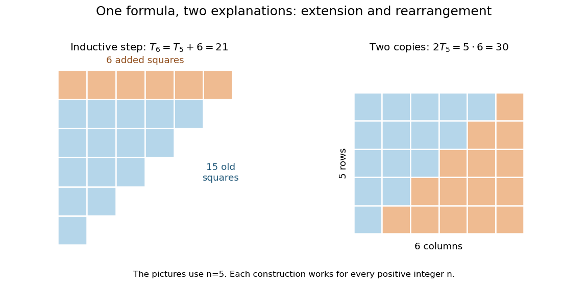

# Mathematical induction

↑ **Parent:** [Mathematical proof](mathematical-proof.md)  
ⓦ [Wiki](https://en.wikipedia.org/wiki/Mathematical_induction)

A [mathematical induction](mathematical-induction.md) proof establishes a property $P(n)$ for every [integer](integer-split.md) $n\ge n_0$ by proving its [induction base case](induction-base-case.md) and its [inductive step](inductive-step.md). If a counterexample existed, the [well-ordering principle](well-ordering-principle-for-the-natural-numbers.md) would give a least one; its predecessor and the inductive implication exclude it. The starting case excludes a counterexample at $n_0$.

The useful idea is to cover infinitely many cases with two finite pieces of reasoning. The [induction base case](induction-base-case.md) starts the chain, and the [inductive step](inductive-step.md) shows that success at an arbitrary stage propagates to the next. It is especially natural when a construction adds one item at a time: another row of a diagram, another input processed by an [algorithm](algorithm-split.md), or another term of a [sequence](sequence.md). The [loop invariant](loop-invariant.md) method is the same propagation idea applied to successive stages of a computation.

For the [triangular number](triangular-number.md) $T_n=1+2+\cdots+n$, the proposed formula is $T_n=n(n+1)/2$. At $n=1$, both sides are one. Assuming the formula for a fixed positive [integer](integer-split.md) $n$, add the next row:

$$
T_{n+1}=T_n+(n+1)=\frac{n(n+1)}2+(n+1)=\frac{(n+1)(n+2)}2.
$$

This is the desired formula at $n+1$, proving the [inductive step](inductive-step.md). For example, $T_5=15$ and $T_6=15+6=21$; these numerical cases illustrate the general step rather than replace it.

**[Figure 4](#image-adding-the-next-row-gives-the-induction-step-rearranging-two-triangular-arrays-gives-the-same-formula-geometrically). Adding the next row gives the induction step; rearranging two triangular arrays gives the same formula geometrically**.

The second picture explains where the formula comes from: two copies of the triangular arrangement tile an $n$ by $n+1$ [rectangle](rectangle.md). Thus $2T_n=n(n+1)$. The [mathematical induction](mathematical-induction.md) argument certifies how the formula continues, while the rearrangement makes its factors visible. Neither picture is restricted to the five rows drawn: both constructions are specified for every positive [integer](integer-split.md) $n$.

**Table of contents**

- [Recursion theorem on the natural numbers](recursion-theorem-on-the-natural-numbers.md)
- [Inductive step](inductive-step.md)
- [Induction base case](induction-base-case.md)
- [Induction hypothesis](induction-hypothesis.md)
- [Strong induction](strong-induction.md)
  - [Strong induction with four starting cases](strong-induction-with-four-starting-cases.md)
  - [Strong induction for factorization existence](strong-induction-for-factorization-existence.md)
  - [Strong induction and accumulated hypotheses](strong-induction-and-accumulated-hypotheses.md)
- [Backward induction](backward-induction.md)

## ↑ Ancestors (5)

1. [Mathematical proof](mathematical-proof.md)
2. [Foundations of mathematics](foundations-of-mathematics-split.md)
3. [Area of mathematics](area-of-mathematics.md)
4. [Mathematics](mathematics-split.md)
5. [Codex Wiki](split.md)

## ← Incoming links (258)

- [Affineness is invariant under nilpotent thickening](affineness-is-invariant-under-nilpotent-thickening.md)
- [Arc-consistency closure](arc-consistency-closure.md)
- [Binary array sum by recursion](binary-array-sum-by-recursion.md)
- [Binary initial segments maximize contained square faces](binary-initial-segments-maximize-contained-square-faces.md)
- [Binary search tree](binary-search-tree.md)
- [Bounded-size transversal kernel](bounded-size-transversal-kernel.md)
- [Brauer progression theorem](brauer-progression-theorem.md)
- [Breadth-first search](breadth-first-search.md)
- [Chromatic polynomial of a cycle](chromatic-polynomial-of-a-cycle.md)
- [Chromatic polynomial product over components](chromatic-polynomial-product-over-components.md)
- [Colour-focusing proof of Van der Waerden theorem](colour-focusing-proof-of-van-der-waerden-theorem.md)
- [Concave Newton iteration from below](concave-newton-iteration-from-below.md)
- [Coordinate-splitting proof of the BK inequality](coordinate-splitting-proof-of-the-bk-inequality.md)
- [Deterministic finite automaton](deterministic-finite-automaton.md)
- [Directed limit of elementary embeddings](directed-limit-of-elementary-embeddings.md)
- [Display for lexical scope](display-for-lexical-scope.md)
- [Dynamical proof of Hindman's theorem](dynamical-proof-of-hindman-s-theorem.md)
- [Exact polynomial steps for a delay equation](exact-polynomial-steps-for-a-delay-equation.md)
- [Factorial estimate for Picard iteration](factorial-estimate-for-picard-iteration.md)
- [Factorial recursion and returning frames](factorial-recursion-and-returning-frames.md)
- [Fibonacci addition formula](fibonacci-addition-formula.md)
- [Fibonacci multiple-index divisibility](fibonacci-multiple-index-divisibility.md)
- [Finite intersection of finite-index subgroups](finite-intersection-of-finite-index-subgroups.md)
- [Finite termination of conjugate directions](finite-termination-of-conjugate-directions.md)
- [Gödel-Gentzen negative translation](godel-gentzen-negative-translation.md)
- [Hall theorem proof outline](hall-theorem-proof-outline.md)
- [Helly property for connected subgraphs of a tree](helly-property-for-connected-subgraphs-of-a-tree.md)
- [Higher product bound for an approximate group](higher-product-bound-for-an-approximate-group.md)
- [Hockey-stick identity](hockey-stick-identity.md)
- [Ideal-sheaf vanishing for a coherent submodule of a trivial bundle](ideal-sheaf-vanishing-for-a-coherent-submodule-of-a-trivial-bundle.md)
- [Induction base case](induction-base-case.md)
- [Inductive reasoning](inductive-reasoning.md)
- [Inductive step](inductive-step.md)
- [Injectivity of inclusion between adjacent set layers](injectivity-of-inclusion-between-adjacent-set-layers.md)
- [Interval scheduling](interval-scheduling.md)
- [Lambda definition of primitive recursion by pair iteration](lambda-definition-of-primitive-recursion-by-pair-iteration.md)
- [Last-achiever algorithm for precondition-free planning](last-achiever-algorithm-for-precondition-free-planning.md)
- [Linear-growth bound for iterated Cesàro means](linear-growth-bound-for-iterated-cesaro-means.md)
- [Lovász shadow bound](lovasz-shadow-bound.md)
- [Mandatory service dependency](mandatory-service-dependency.md)
- [Mathematical induction](mathematical-induction.md)
- [Matrix-chain dynamic programming](matrix-chain-dynamic-programming.md)
- [Max-n search](max-n-search.md)
- [Pareto efficiency of serial dictatorship with consecutive friends](pareto-efficiency-of-serial-dictatorship-with-consecutive-friends.md)
- [Pascal's triangle](pascal-s-triangle.md)
- [Solution](past-exam-of-the-algebra-analysis-and-differential-equations-1-course-of-the-university-of-oxford/2006/7/solution.md)
- [Solution](past-exam-of-the-algebra-analysis-and-differential-equations-1-course-of-the-university-of-oxford/2012/7/solution.md)
- [Solution](past-exam-of-the-algebra-analysis-and-differential-equations-1-course-of-the-university-of-oxford/2012/9/iii/solution.md)
- [Solution](past-exam-of-the-algebraic-number-theory-course-of-the-university-of-oxford/2023/2/b/ii/solution.md)
- [Solution](past-exam-of-the-approximation-of-functions-course-of-the-university-of-oxford/2011/2/a/solution.md)
- [Solution](past-exam-of-the-biological-physics-course-of-the-university-of-oxford/2015/5/d/solution.md)
- [Solution](past-exam-of-the-computer-science-course-of-the-university-of-oxford/2015/compilers/2/d/solution.md)
- [Solution](past-exam-of-the-computer-science-course-of-the-university-of-oxford/2015/computer-aided-formal-verification/3/d/solution.md)
- [Solution](past-exam-of-the-computer-science-course-of-the-university-of-oxford/2015/probability-and-computing/2/c/solution.md)
- [Solution](past-exam-of-the-computer-science-course-of-the-university-of-oxford/2020/artificial-intelligence/1/e/solution.md)
- [Solution](past-exam-of-the-computer-science-course-of-the-university-of-oxford/2020/computational-game-theory/2/a/solution.md)
- [Solution](past-exam-of-the-computer-science-course-of-the-university-of-oxford/2021/artificial-intelligence/3/f/solution.md)
- [Solution](past-exam-of-the-computer-science-course-of-the-university-of-oxford/2022/artificial-intelligence/1/c/solution.md)
- [Solution](past-exam-of-the-computer-science-course-of-the-university-of-oxford/2022/artificial-intelligence/3/a/solution.md)
- [Solution](past-exam-of-the-computer-science-course-of-the-university-of-oxford/2023/artificial-intelligence/2/d/solution.md)
- [Solution](past-exam-of-the-computer-science-course-of-the-university-of-oxford/2023/artificial-intelligence/2/e/solution.md)
- [Solution](past-exam-of-the-computer-science-course-of-the-university-of-oxford/2023/artificial-intelligence/2/f/solution.md)
- [Solution](past-exam-of-the-computer-science-course-of-the-university-of-oxford/2023/artificial-intelligence/2/g/solution.md)
- [Solution](past-exam-of-the-differential-equations-1-course-of-the-university-of-oxford/2023/1/b/i/solution.md)
- [Solution](past-exam-of-the-differential-equations-1-course-of-the-university-of-oxford/2023/1/b/ii/solution.md)
- [Solution](past-exam-of-the-functional-analysis-ii-course-of-the-university-of-oxford/2023/1/a/iii/solution.md)
- [Solution](past-exam-of-the-graph-theory-course-of-the-university-of-oxford/2023/1/b/iii/solution.md)
- [Solution](past-exam-of-the-graph-theory-course-of-the-university-of-oxford/2023/2/a/solution.md)
- [Solution](past-exam-of-the-graph-theory-course-of-the-university-of-oxford/2023/2/b/solution.md)
- [Solution](past-exam-of-the-graph-theory-course-of-the-university-of-oxford/2023/2/d/solution.md)
- [Solution](past-exam-of-the-introduction-to-representation-theory-course-of-the-university-of-oxford/2023/1/a/ii/solution.md)
- [Solution](past-exam-of-the-introduction-to-schemes-course-of-the-university-of-oxford/2023/3/f/iii/solution.md)
- [Solution](past-exam-of-the-linear-algebra-course-of-the-university-of-oxford/2023/1/b/iv/solution.md)
- [Solution](past-exam-of-the-logic-and-set-theory-course-of-the-university-of-oxford/2007/b/5/i/solution.md)
- [Solution](past-exam-of-the-mathematical-methods-i-course-of-the-university-of-oxford/2016/11/b/solution.md)
- [Solution](past-exam-of-the-mathematics-course-of-the-university-of-cambridge/2001/ia/paper-4/2e/solution.md)
- [Solution](past-exam-of-the-mathematics-course-of-the-university-of-cambridge/2001/ia/paper-4/8e/solution.md)
- [Solution](past-exam-of-the-mathematics-course-of-the-university-of-cambridge/2001/iii/paper-10/2/solution.md)
- [Solution](past-exam-of-the-mathematics-course-of-the-university-of-cambridge/2002/iii/paper-10/2/solution.md)
- [Solution](past-exam-of-the-mathematics-course-of-the-university-of-cambridge/2002/iii/paper-10/3/solution.md)
- [Solution](past-exam-of-the-mathematics-course-of-the-university-of-cambridge/2002/iii/paper-23/2/b/solution.md)
- [Solution](past-exam-of-the-mathematics-course-of-the-university-of-cambridge/2003/ia/paper-4/1c/i/solution.md)
- [Solution](past-exam-of-the-mathematics-course-of-the-university-of-cambridge/2004/ia/paper-1/4e/solution.md)
- [Solution](past-exam-of-the-mathematics-course-of-the-university-of-cambridge/2005/ia/paper-4/8e/solution.md)
- [Solution](past-exam-of-the-mathematics-course-of-the-university-of-cambridge/2005/iii/paper-16/1/b/solution.md)
- [Solution](past-exam-of-the-mathematics-course-of-the-university-of-cambridge/2006/ia/paper-1/10e/solution.md)
- [Solution](past-exam-of-the-mathematics-course-of-the-university-of-cambridge/2007/ia/paper-2/8b/ii/solution.md)
- [Solution](past-exam-of-the-mathematics-course-of-the-university-of-cambridge/2007/ia/paper-4/2e/solution.md)
- [Solution](past-exam-of-the-mathematics-course-of-the-university-of-cambridge/2007/ia/paper-5/1/b/solution.md)
- [Solution](past-exam-of-the-mathematics-course-of-the-university-of-cambridge/2007/ia/paper-5/12/i/solution.md)
- [Solution](past-exam-of-the-mathematics-course-of-the-university-of-cambridge/2007/ia/paper-5/4/solution.md)
- [Solution](past-exam-of-the-mathematics-course-of-the-university-of-cambridge/2007/ia/paper-5/9/b/ii/solution.md)
- [Solution](past-exam-of-the-mathematics-course-of-the-university-of-cambridge/2007/ii/paper-1/2f/i/solution.md)
- [Solution](past-exam-of-the-mathematics-course-of-the-university-of-cambridge/2007/ii/paper-1/2f/ii/solution.md)
- [Solution](past-exam-of-the-mathematics-course-of-the-university-of-cambridge/2007/iii/paper-14/2/solution.md)
- [Solution](past-exam-of-the-mathematics-course-of-the-university-of-cambridge/2008/ia/paper-4/5d/b/solution.md)
- [Solution](past-exam-of-the-mathematics-course-of-the-university-of-cambridge/2008/ia/paper-4/8d/solution.md)
- [Solution](past-exam-of-the-mathematics-course-of-the-university-of-cambridge/2009/iii/paper-14/3/solution.md)
- [Solution](past-exam-of-the-mathematics-course-of-the-university-of-cambridge/2010/ia/paper-4/5e/solution.md)
- [Solution](past-exam-of-the-mathematics-course-of-the-university-of-cambridge/2010/iii/paper-10/4/solution.md)
- [Solution](past-exam-of-the-mathematics-course-of-the-university-of-cambridge/2010/iii/paper-20/1/solution.md)
- [Solution](past-exam-of-the-mathematics-course-of-the-university-of-cambridge/2010/iii/paper-39/1/a/solution.md)
- [Solution](past-exam-of-the-mathematics-course-of-the-university-of-cambridge/2010/iii/paper-42/1/solution.md)
- [Solution](past-exam-of-the-mathematics-course-of-the-university-of-cambridge/2012/iii/paper-11/1/solution.md)
- [Solution](past-exam-of-the-mathematics-course-of-the-university-of-cambridge/2012/iii/paper-11/3/solution.md)
- [Solution](past-exam-of-the-mathematics-course-of-the-university-of-cambridge/2012/iii/paper-24/2/solution.md)
- [Solution](past-exam-of-the-mathematics-course-of-the-university-of-cambridge/2013/iii/paper-13/4/solution.md)
- [Solution](past-exam-of-the-mathematics-course-of-the-university-of-cambridge/2013/iii/paper-20/3/solution.md)
- [Solution](past-exam-of-the-mathematics-course-of-the-university-of-cambridge/2014/ia/paper-4/2e/solution.md)
- [Solution](past-exam-of-the-mathematics-course-of-the-university-of-cambridge/2014/iii/paper-21/1/solution.md)
- [Solution](past-exam-of-the-mathematics-course-of-the-university-of-cambridge/2015/ia/paper-4/6e/ii/solution.md)
- [Solution](past-exam-of-the-mathematics-course-of-the-university-of-cambridge/2015/iii/paper-16/2/a/solution.md)
- [Solution](past-exam-of-the-mathematics-course-of-the-university-of-cambridge/2015/iii/paper-23/1/a/solution.md)
- [Solution](past-exam-of-the-mathematics-course-of-the-university-of-cambridge/2016/ia/paper-1/10e/solution.md)
- [Solution](past-exam-of-the-mathematics-course-of-the-university-of-cambridge/2016/iii/paper-109/3/solution.md)
- [Solution](past-exam-of-the-mathematics-course-of-the-university-of-cambridge/2016/iii/paper-109/4/solution.md)
- [Solution](past-exam-of-the-mathematics-course-of-the-university-of-cambridge/2016/iii/paper-112/1/i/solution.md)
- [Solution](past-exam-of-the-mathematics-course-of-the-university-of-cambridge/2016/iii/paper-120/1/e/solution.md)
- [Solution](past-exam-of-the-mathematics-course-of-the-university-of-cambridge/2016/iii/paper-120/4/solution.md)
- [Solution](past-exam-of-the-mathematics-course-of-the-university-of-cambridge/2016/iii/paper-120/5/solution.md)
- [Solution](past-exam-of-the-mathematics-course-of-the-university-of-cambridge/2016/iii/paper-120/6/solution.md)
- [Solution](past-exam-of-the-mathematics-course-of-the-university-of-cambridge/2017/iii/paper-109/2/ii/solution.md)
- [Solution](past-exam-of-the-mathematics-course-of-the-university-of-cambridge/2017/iii/paper-109/3/i/solution.md)
- [Solution](past-exam-of-the-mathematics-course-of-the-university-of-cambridge/2017/iii/paper-130/2/i/solution.md)
- [Solution](past-exam-of-the-mathematics-course-of-the-university-of-cambridge/2017/iii/paper-135/1/2/solution.md)
- [Solution](past-exam-of-the-mathematics-course-of-the-university-of-cambridge/2017/iii/paper-135/6/solution.md)
- [Solution](past-exam-of-the-mathematics-course-of-the-university-of-cambridge/2018/ii/paper-2/4g/b/solution.md)
- [Solution](past-exam-of-the-mathematics-course-of-the-university-of-cambridge/2019/ia/paper-4/5e/b/solution.md)
- [Solution](past-exam-of-the-mathematics-course-of-the-university-of-cambridge/2019/ii/paper-2/11h/a/solution.md)
- [Solution](past-exam-of-the-mathematics-course-of-the-university-of-cambridge/2019/ii/paper-2/12g/solution.md)
- [Solution](past-exam-of-the-mathematics-course-of-the-university-of-cambridge/2019/ii/paper-3/18f/solution.md)
- [Solution](past-exam-of-the-mathematics-course-of-the-university-of-cambridge/2019/ii/paper-3/4h/b/solution.md)
- [Solution](past-exam-of-the-mathematics-course-of-the-university-of-cambridge/2019/iii/paper-109/3/solution.md)
- [Solution](past-exam-of-the-mathematics-course-of-the-university-of-cambridge/2019/iii/paper-147/1/iii/solution.md)
- [Solution](past-exam-of-the-mathematics-course-of-the-university-of-cambridge/2019/iii/paper-324/2/a/solution.md)
- [Solution](past-exam-of-the-mathematics-course-of-the-university-of-cambridge/2019/iii/paper-331/3/a/solution.md)
- [Solution](past-exam-of-the-mathematics-course-of-the-university-of-cambridge/2020/ii/paper-3/16h/solution.md)
- [Solution](past-exam-of-the-mathematics-course-of-the-university-of-cambridge/2020/ii/paper-4/1h/solution.md)
- [Solution](past-exam-of-the-mathematics-course-of-the-university-of-cambridge/2021/ia/paper-4/2e/i/solution.md)
- [Solution](past-exam-of-the-mathematics-course-of-the-university-of-cambridge/2022/ia/paper-4/6d/b/solution.md)
- [Solution](past-exam-of-the-mathematics-course-of-the-university-of-cambridge/2022/ia/paper-4/6d/c/solution.md)
- [Solution](past-exam-of-the-mathematics-course-of-the-university-of-cambridge/2022/ii/paper-2/20h/a/solution.md)
- [Solution](past-exam-of-the-mathematics-course-of-the-university-of-cambridge/2022/iii/paper-319/1/b/solution.md)
- [Solution](past-exam-of-the-mathematics-course-of-the-university-of-cambridge/2023/iii/paper-130/1/i/solution.md)
- [Solution](past-exam-of-the-mathematics-course-of-the-university-of-cambridge/2023/iii/paper-130/1/iii/solution.md)
- [Solution](past-exam-of-the-mathematics-course-of-the-university-of-cambridge/2023/iii/paper-130/3/solution.md)
- [Solution](past-exam-of-the-mathematics-course-of-the-university-of-cambridge/2023/iii/paper-130/4/solution.md)
- [Solution](past-exam-of-the-mathematics-course-of-the-university-of-cambridge/2023/iii/paper-133/3/c/solution.md)
- [Solution](past-exam-of-the-mathematics-course-of-the-university-of-cambridge/2023/iii/paper-160/1/d/iii/solution.md)
- [Solution](past-exam-of-the-mathematics-course-of-the-university-of-cambridge/2023/iii/paper-341/1/b/solution.md)
- [Solution](past-exam-of-the-mathematics-course-of-the-university-of-cambridge/2024/iii/paper-109/1/a/solution.md)
- [Solution](past-exam-of-the-mathematics-course-of-the-university-of-cambridge/2025/iii/paper-109/1/i/solution.md)
- [Solution](past-exam-of-the-mathematics-course-of-the-university-of-cambridge/2025/iii/paper-130/1/a/solution.md)
- [Solution](past-exam-of-the-mathematics-course-of-the-university-of-cambridge/2025/iii/paper-323/4/ii/solution.md)
- [Solution](past-exam-of-the-mathematics-course-of-the-university-of-oxford/2017/prelims/mathematics-ii/2/b/i/solution.md)
- [Solution](past-exam-of-the-mathematics-course-of-the-university-of-oxford/2021/prelims/mathematics-ii/2/b/solution.md)
- [Solution](past-exam-of-the-mathematics-course-of-the-university-of-oxford/2021/prelims/mathematics-ii/5/b/i/solution.md)
- [Solution](past-exam-of-the-mathematics-course-of-the-university-of-oxford/2023/prelims/mathematics-i/1/b/i/solution.md)
- [Solution](past-exam-of-the-mathematics-course-of-the-university-of-oxford/2023/prelims/mathematics-i/4/a/i/solution.md)
- [Solution](past-exam-of-the-mathematics-course-of-the-university-of-oxford/2023/prelims/mathematics-i/6/b/v/solution.md)
- [Solution](past-exam-of-the-mathematics-course-of-the-year-1-of-the-natural-sciences-course-of-the-university-of-cambridge/2001/paper-2/2/solution.md)
- [Solution](past-exam-of-the-mathematics-course-of-the-year-1-of-the-natural-sciences-course-of-the-university-of-cambridge/2008/paper-1/20/a/solution.md)
- [Solution](past-exam-of-the-mathematics-course-of-the-year-1-of-the-natural-sciences-course-of-the-university-of-cambridge/2023/paper-2/17/c/iii/solution.md)
- [Solution](past-exam-of-the-mathematics-course-of-the-year-2-of-the-natural-sciences-course-of-the-university-of-cambridge/2022/paper-2/1/d/solution.md)
- [Solution](past-exam-of-the-numerical-linear-algebra-course-of-the-university-of-oxford/2011/3/c/solution.md)
- [Solution](past-exam-of-the-numerical-solution-of-differential-equations-course-of-the-university-of-oxford/2011/a/3/b/solution.md)
- [Solution](past-exam-of-the-options-i-course-of-the-university-of-oxford/2011/p/2/a/solution.md)
- [Solution](past-exam-of-the-physics-a-course-of-the-university-of-cambridge/2016/paper-1/section-b/b7/solution.md)
- [Solution](past-exam-of-the-probability-course-of-the-university-of-oxford/2017/1/b/i/solution.md)
- [Solution](past-exam-of-the-probability-measure-and-martingales-course-of-the-university-of-oxford/2021/1/b/i/solution.md)
- [Solution](past-exam-of-the-probability-measure-and-martingales-course-of-the-university-of-oxford/2021/3/b/ii/solution.md)
- [Solution](past-exam-of-the-probability-statistics-and-options-i-course-of-the-university-of-oxford/2011/p/2/a/solution.md)
- [Solution](past-exam-of-the-short-options-course-of-the-university-of-oxford/2015/7/a/iii/solution.md)
- [Solution](past-exam-of-the-simulation-and-statistical-programming-course-of-the-university-of-oxford/2023/3/a/solution.md)
- [Solution](past-exam-of-the-simulation-and-statistical-programming-course-of-the-university-of-oxford/2023/3/b/solution.md)
- [Solution](past-exam-of-the-topology-and-groups-course-of-the-university-of-oxford/2023/3/b/i/solution.md)
- [Solution](past-exam-of-the-year-1-of-the-computer-science-course-of-the-university-of-oxford/2003/calculus-probability-linear-algebra-discrete-mathematics-logic-and-proof-and-models-of-computation/10/a/i/solution.md)
- [Solution](past-exam-of-the-year-1-of-the-computer-science-course-of-the-university-of-oxford/2003/calculus-probability-linear-algebra-discrete-mathematics-logic-and-proof-and-models-of-computation/10/b/i/solution.md)
- [Solution](past-exam-of-the-year-1-of-the-computer-science-course-of-the-university-of-oxford/2003/calculus-probability-linear-algebra-discrete-mathematics-logic-and-proof-and-models-of-computation/10/b/ii/solution.md)
- [Solution](past-exam-of-the-year-1-of-the-computer-science-course-of-the-university-of-oxford/2003/calculus-probability-linear-algebra-discrete-mathematics-logic-and-proof-and-models-of-computation/4/b/i/solution.md)
- [Solution](past-exam-of-the-year-1-of-the-computer-science-course-of-the-university-of-oxford/2005/functional-programming-data-structures-and-algorithms-procedural-programming-and-digital-hardware/2/b/solution.md)
- [Solution](past-exam-of-the-year-1-of-the-computer-science-course-of-the-university-of-oxford/2005/functional-programming-data-structures-and-algorithms-procedural-programming-and-digital-hardware/6/b/solution.md)
- [Solution](past-exam-of-the-year-1-of-the-computer-science-course-of-the-university-of-oxford/2013/digital-systems-linear-algebra-introduction-to-formal-proof/4/b/solution.md)
- [Solution](past-exam-of-the-year-1-of-the-computer-science-course-of-the-university-of-oxford/2013/discrete-mathematics-probability-and-continuous-mathematics/2/d/solution.md)
- [Solution](past-exam-of-the-year-1-of-the-computer-science-course-of-the-university-of-oxford/2013/discrete-mathematics-probability-and-continuous-mathematics/3/a/solution.md)
- [Solution](past-exam-of-the-year-1-of-the-computer-science-course-of-the-university-of-oxford/2013/discrete-mathematics-probability-and-continuous-mathematics/3/b/solution.md)
- [Solution](past-exam-of-the-year-1-of-the-computer-science-course-of-the-university-of-oxford/2013/functional-programming-design-and-analysis-of-algorithms/1/c/solution.md)
- [Solution](past-exam-of-the-year-1-of-the-computer-science-course-of-the-university-of-oxford/2013/functional-programming-design-and-analysis-of-algorithms/3/b/solution.md)
- [Solution](past-exam-of-the-year-1-of-the-computer-science-course-of-the-university-of-oxford/2013/functional-programming-design-and-analysis-of-algorithms/3/c/solution.md)
- [Solution](past-exam-of-the-year-1-of-the-computer-science-course-of-the-university-of-oxford/2013/functional-programming-design-and-analysis-of-algorithms/5/c/solution.md)
- [Solution](past-exam-of-the-year-1-of-the-computer-science-course-of-the-university-of-oxford/2013/functional-programming-design-and-analysis-of-algorithms/6/a/solution.md)
- [Solution](past-exam-of-the-year-1-of-the-computer-science-course-of-the-university-of-oxford/2013/functional-programming-design-and-analysis-of-algorithms/7/b/solution.md)
- [Solution](past-exam-of-the-year-1-of-the-computer-science-course-of-the-university-of-oxford/2013/imperative-programming/3/b/solution.md)
- [Solution](past-exam-of-the-year-1-of-the-computer-science-course-of-the-university-of-oxford/2014/discrete-mathematics-continuous-mathematics-and-probability/1/b/solution.md)
- [Solution](past-exam-of-the-year-1-of-the-computer-science-course-of-the-university-of-oxford/2014/discrete-mathematics-continuous-mathematics-and-probability/1/f/i/solution.md)
- [Solution](past-exam-of-the-year-1-of-the-computer-science-course-of-the-university-of-oxford/2014/discrete-mathematics-continuous-mathematics-and-probability/2/d/solution.md)
- [Solution](past-exam-of-the-year-1-of-the-computer-science-course-of-the-university-of-oxford/2014/discrete-mathematics-continuous-mathematics-and-probability/2/e/ii/solution.md)
- [Solution](past-exam-of-the-year-1-of-the-computer-science-course-of-the-university-of-oxford/2014/functional-programming-design-and-analysis-of-algorithms/1/e/solution.md)
- [Solution](past-exam-of-the-year-1-of-the-computer-science-course-of-the-university-of-oxford/2014/functional-programming-design-and-analysis-of-algorithms/2/d/solution.md)
- [Solution](past-exam-of-the-year-1-of-the-computer-science-course-of-the-university-of-oxford/2014/functional-programming-design-and-analysis-of-algorithms/6/d/solution.md)
- [Solution](past-exam-of-the-year-1-of-the-computer-science-course-of-the-university-of-oxford/2015/discrete-mathematics-continuous-mathematics-and-probability-resit/2/b/i/solution.md)
- [Solution](past-exam-of-the-year-1-of-the-computer-science-course-of-the-university-of-oxford/2015/discrete-mathematics-continuous-mathematics-and-probability-resit/2/b/ii/solution.md)
- [Solution](past-exam-of-the-year-1-of-the-computer-science-course-of-the-university-of-oxford/2015/discrete-mathematics-continuous-mathematics-and-probability/2/d/solution.md)
- [Solution](past-exam-of-the-year-1-of-the-computer-science-course-of-the-university-of-oxford/2015/discrete-mathematics-continuous-mathematics-and-probability/2/e/iii/solution.md)
- [Solution](past-exam-of-the-year-1-of-the-computer-science-course-of-the-university-of-oxford/2015/discrete-mathematics-continuous-mathematics-and-probability/3/a/iv/solution.md)
- [Solution](past-exam-of-the-year-1-of-the-computer-science-course-of-the-university-of-oxford/2015/discrete-mathematics-continuous-mathematics-and-probability/3/d/i/solution.md)
- [Solution](past-exam-of-the-year-1-of-the-computer-science-course-of-the-university-of-oxford/2016/digital-systems-linear-algebra-introduction-to-formal-proof/6/d/solution.md)
- [Solution](past-exam-of-the-year-1-of-the-computer-science-course-of-the-university-of-oxford/2016/discrete-mathematics-continuous-mathematics-and-probability-resit/2/c/i/solution.md)
- [Solution](past-exam-of-the-year-1-of-the-computer-science-course-of-the-university-of-oxford/2016/discrete-mathematics-continuous-mathematics-and-probability-resit/2/c/ii/solution.md)
- [Solution](past-exam-of-the-year-1-of-the-computer-science-course-of-the-university-of-oxford/2016/discrete-mathematics-continuous-mathematics-and-probability-resit/2/d/solution.md)
- [Solution](past-exam-of-the-year-1-of-the-computer-science-course-of-the-university-of-oxford/2016/discrete-mathematics-continuous-mathematics-and-probability/3/f/i/solution.md)
- [Solution](past-exam-of-the-year-1-of-the-computer-science-course-of-the-university-of-oxford/2016/discrete-mathematics-continuous-mathematics-and-probability/3/f/ii/solution.md)
- [Solution](past-exam-of-the-year-1-of-the-computer-science-course-of-the-university-of-oxford/2016/functional-programming-design-and-analysis-of-algorithms-resit/1/c/solution.md)
- [Solution](past-exam-of-the-year-1-of-the-computer-science-course-of-the-university-of-oxford/2016/functional-programming-design-and-analysis-of-algorithms/6/b/solution.md)
- [Solution](past-exam-of-the-year-1-of-the-computer-science-course-of-the-university-of-oxford/2016/functional-programming-design-and-analysis-of-algorithms/8/d/solution.md)
- [Solution](past-exam-of-the-year-1-of-the-computer-science-course-of-the-university-of-oxford/2018/discrete-mathematics-continuous-mathematics-and-probability/2/c/solution.md)
- [Solution](past-exam-of-the-year-1-of-the-computer-science-course-of-the-university-of-oxford/2018/discrete-mathematics-continuous-mathematics-and-probability/2/d/solution.md)
- [Solution](past-exam-of-the-year-1-of-the-computer-science-course-of-the-university-of-oxford/2019/discrete-mathematics-continuous-mathematics-and-probability-resit/2/c/i/solution.md)
- [Solution](past-exam-of-the-year-1-of-the-computer-science-course-of-the-university-of-oxford/2019/discrete-mathematics-continuous-mathematics-and-probability-resit/2/c/ii/solution.md)
- [Solution](past-exam-of-the-year-1-of-the-computer-science-course-of-the-university-of-oxford/2019/discrete-mathematics-continuous-mathematics-and-probability/1/d/solution.md)
- [Solution](past-exam-of-the-year-1-of-the-computer-science-course-of-the-university-of-oxford/2019/discrete-mathematics-continuous-mathematics-and-probability/2/d/i/solution.md)
- [Solution](past-exam-of-the-year-1-of-the-computer-science-course-of-the-university-of-oxford/2019/discrete-mathematics-continuous-mathematics-and-probability/5/b/ii/solution.md)
- [Solution](past-exam-of-the-year-1-of-the-computer-science-course-of-the-university-of-oxford/2021/digital-systems-linear-algebra-introduction-to-formal-proof/4/c/solution.md)
- [Solution](past-exam-of-the-year-1-of-the-computer-science-course-of-the-university-of-oxford/2021/discrete-mathematics-continuous-mathematics-and-probability/2/a/i/solution.md)
- [Solution](past-exam-of-the-year-1-of-the-computer-science-course-of-the-university-of-oxford/2021/discrete-mathematics-continuous-mathematics-and-probability/2/a/ii/solution.md)
- [Solution](past-exam-of-the-year-1-of-the-computer-science-course-of-the-university-of-oxford/2022/digital-systems-linear-algebra-introduction-to-formal-proof-resit/4/b/solution.md)
- [Solution](past-exam-of-the-year-1-of-the-computer-science-course-of-the-university-of-oxford/2022/discrete-mathematics-continuous-mathematics-and-probability-resit/5/c/iii/solution.md)
- [Solution](past-exam-of-the-year-1-of-the-computer-science-course-of-the-university-of-oxford/2022/discrete-mathematics-continuous-mathematics-and-probability/discrete-mathematics/2/b/solution.md)
- [Solution](past-exam-of-the-year-1-of-the-computer-science-course-of-the-university-of-oxford/2022/discrete-mathematics-continuous-mathematics-and-probability/discrete-mathematics/2/c/solution.md)
- [Solution](past-exam-of-the-year-1-of-the-computer-science-course-of-the-university-of-oxford/2023/discrete-mathematics-probability-and-continuous-mathematics/2/b/solution.md)
- [Solution](past-exam-of-the-year-1-of-the-computer-science-course-of-the-university-of-oxford/2023/discrete-mathematics-probability-and-continuous-mathematics/2/c/solution.md)
- [Solution](past-exam-of-the-year-1-of-the-computer-science-course-of-the-university-of-oxford/2023/discrete-mathematics-probability-and-continuous-mathematics/6/e/solution.md)
- [Solution](past-exam-of-the-year-1-of-the-computer-science-course-of-the-university-of-oxford/2023/discrete-mathematics-probability-and-continuous-mathematics/7/b/v/solution.md)
- [Picard iteration for a simple-pole linear differential equation](picard-iteration-for-a-simple-pole-linear-differential-equation.md)
- [Planning state invariant](planning-state-invariant.md)
- [Power of a relation](power-of-a-relation.md)
- [Powers of a rank-one operator](powers-of-a-rank-one-operator.md)
- [Prefix maximum correctness example](prefix-maximum-correctness-example.md)
- [Private-witness diagonalization for incomparable enumerable sets](private-witness-diagonalization-for-incomparable-enumerable-sets.md)
- [Quantifier-free formula](quantifier-free-formula.md)
- [Radix sort suffix invariant](radix-sort-suffix-invariant.md)
- [Recursively repetition-free labelled trees preserve Dedekind-finiteness](recursively-repetition-free-labelled-trees-preserve-dedekind-finiteness.md)
- [Red-black tree](red-black-tree.md)
- [Representation invariant](representation-invariant.md)
- [Rule of product](rule-of-product.md)
- [Section compression in binary order](section-compression-in-binary-order.md)
- [Sequential SATPlan correctness](sequential-satplan-correctness.md)
- [Sparse-shift bijection between nonnegative and positive integers](sparse-shift-bijection-between-nonnegative-and-positive-integers.md)
- [Square pyramidal number](square-pyramidal-number.md)
- [Strong induction and accumulated hypotheses](strong-induction-and-accumulated-hypotheses.md)
- [Strong planning winning-set iteration](strong-planning-winning-set-iteration.md)
- [Subset dynamic programming for a Hamiltonian path](subset-dynamic-programming-for-a-hamiltonian-path.md)
- [Substitution method for a recurrence](substitution-method-for-a-recurrence.md)
- [Summation loop verification](summation-loop-verification.md)
- [Telescoping product](telescoping-product.md)
- [Tombstone in open addressing](tombstone-in-open-addressing.md)
- [Tree (graph theory)](tree-graph-theory-split.md)
- [Tree-structured constraint satisfaction](tree-structured-constraint-satisfaction.md)
