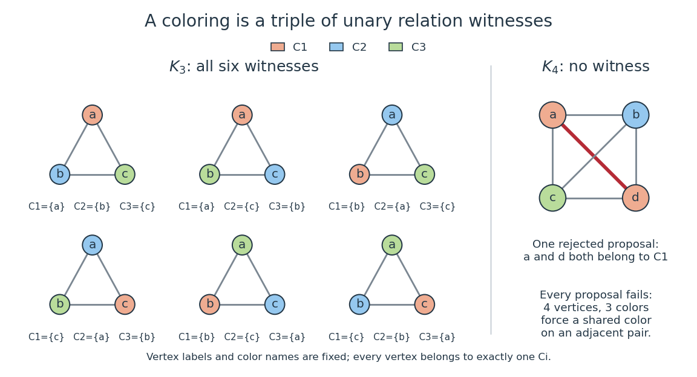
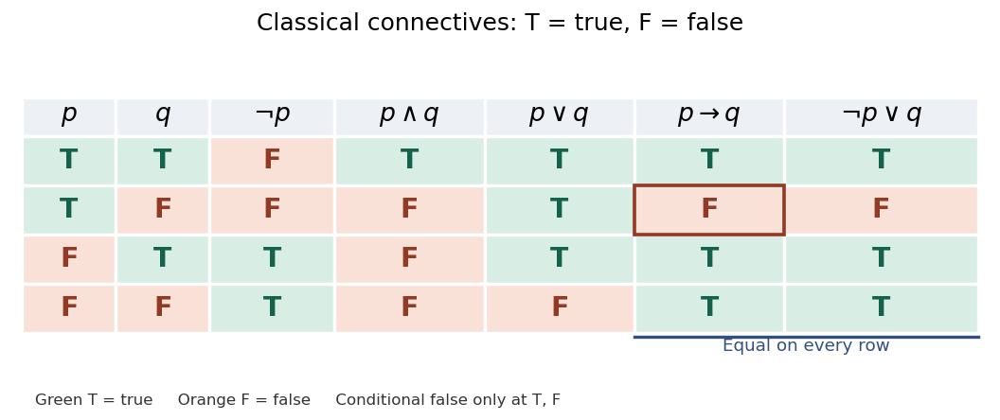
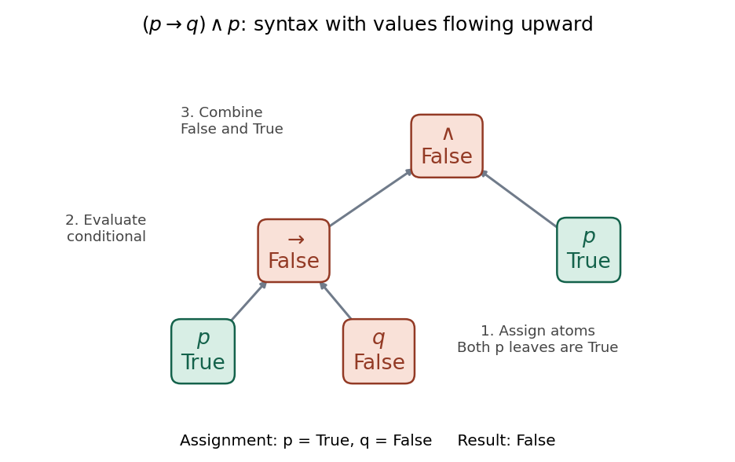
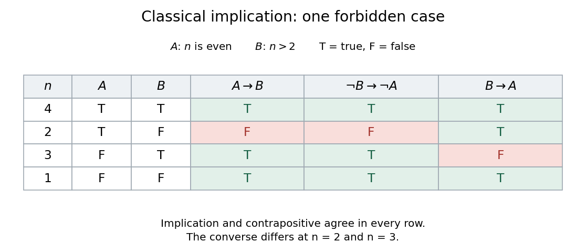
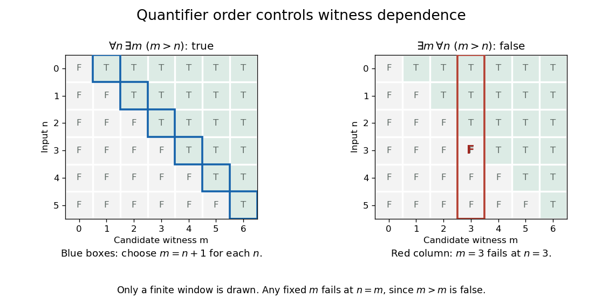

# Mathematical logic

↑ **Parent:** [Foundations of mathematics](foundations-of-mathematics.md)  
ⓦ [Wiki](https://en.wikipedia.org/wiki/Mathematical_logic)

Mathematical logic studies [formal languages](theoretical-computer-science.md#formal-language), [formal proofs](#formal-proof), [model theory](model-theory.md), [computability theory](computability-theory.md), and the [foundations of mathematics](foundations-of-mathematics.md). It makes the rules of reasoning explicit enough that reasoning itself becomes an object of [mathematics](mathematics.md). [Proof theory](#proof-theory) studies deductions; [model theory](model-theory.md) studies interpretations in which statements hold.

Three questions organize the subject: is an expression a well-formed [first-order formula](#first-order-formula), is it true in a specified [first-order structure](#first-order-structure), and does it have a [formal proof](#formal-proof) from specified [axioms](#axiom)? These questions are distinct. For example, $\exists n\,(n+n=1)$ is a [first-order sentence](#first-order-sentence) in an appropriate [first-order language](#first-order-language); it is false in the [natural numbers](arithmetic.md#natural-number) but true in the [rational numbers](number-theory.md#rational-number), with $n=1/2$.

The beauty of [mathematical logic](mathematical-logic.md) is that the same [logical connectives](#logical-connective) and rules of [universal quantification](#universal-quantification) and [existential quantification](#existential-quantification) organize arguments across [mathematics](mathematics.md). [Classical propositional logic](#classical-propositional-logic) uses two truth values; [Intuitionistic propositional logic](#intuitionistic-propositional-logic) interprets [logical implication](#logical-implication) through constructions on proofs, without unrestricted [law of excluded middle](#law-of-excluded-middle). This proof-based framework is developed in [Frank Pfenning, Natural Deduction, sections 1–3](https://www.cs.cmu.edu/~fp/courses/15317-s23/lectures/02-natded.pdf).

**Table of contents**

- [Logical formula](#logical-formula)
  - [Logical variable](#logical-variable)
- [Logical fixed point](#logical-fixed-point)
- [Modal logic](#modal-logic)
  - [Uniform substitution in modal logic](#uniform-substitution-in-modal-logic)
  - [Modal logic K4](#modal-logic-k4)
  - [Normal modal distribution axiom](#normal-modal-distribution-axiom)
  - [Modal formula](#modal-formula)
  - [Modalized occurrence](#modalized-occurrence)
  - [Positive introspection](#positive-introspection)
  - [Necessitation rule](#necessitation-rule)
  - [Provability logic](#provability-logic)
    - [Gödel-Löb logic](#godel-lob-logic)
      - [Löb axiom implies positive introspection](#lob-axiom-implies-positive-introspection)
      - [Fixed point of boxed negated provability](#fixed-point-of-boxed-negated-provability)
      - [Modalized fixed-point theorem for GL](#modalized-fixed-point-theorem-for-gl)
      - [Simultaneous boxed fixed-point elimination in GL](#simultaneous-boxed-fixed-point-elimination-in-gl)
        - [GL fixed point by truth substitution](#gl-fixed-point-by-truth-substitution)
      - [GL fixed point for a provability implication](#gl-fixed-point-for-a-provability-implication)
      - [Arithmetical soundness of GL](#arithmetical-soundness-of-gl)
  - [Modal operator](#modal-operator)
- [Description logic](#description-logic)
  - [Unique name assumption](#unique-name-assumption)
  - [Concept satisfiability](#concept-satisfiability)
  - [RL description logic](#rl-description-logic)
  - [EL](#el)
    - [EL with bottom](#el-with-bottom)
  - [ALC](#alc)
    - [Tableau algorithm for ALC](#tableau-algorithm-for-alc)
      - [Direct blocking in description logic](#direct-blocking-in-description-logic)
      - [Tableau clash](#tableau-clash)
  - [ABox](#abox)
  - [TBox](#tbox)
    - [TBox absorption](#tbox-absorption)
    - [TBox unfolding](#tbox-unfolding)
  - [General concept inclusion](#general-concept-inclusion)
  - [Description logic role](#description-logic-role)
  - [Description logic concept](#description-logic-concept)
- [Equisatisfiability](#equisatisfiability)
- [Temporal logic](#temporal-logic)
  - [Computation tree logic](#computation-tree-logic)
  - [Linear temporal logic](#linear-temporal-logic)
  - [Temporal operator](#temporal-operator)
    - [Weak until](#weak-until)
    - [Strong until](#strong-until)
    - [Next-time operator](#next-time-operator)
- [Inference rule](#inference-rule)
  - [Derived inference rule](#derived-inference-rule)
- [Logical derivation](#logical-derivation)
  - [Sequent](#sequent)
- [Negation normal form](#negation-normal-form)
- [Interpretation (logic)](#interpretation-logic)
- [Deductive reasoning](#deductive-reasoning)
- [Existence](#existence)
- [Uniqueness](#uniqueness)
- [Proof theory](#proof-theory)
  - [Hilbert proof system](#hilbert-proof-system)
    - [Case-elimination Hilbert calculus](#case-elimination-hilbert-calculus)
    - [Axiom-only complete propositional calculus](#axiom-only-complete-propositional-calculus)
  - [Resolution](#resolution)
    - [First-order resolution](#first-order-resolution)
      - [Resolution with free selection](#resolution-with-free-selection)
    - [Ground resolution](#ground-resolution)
- [Axiom](#axiom)
  - [Axiom set](#axiom-set)
    - [Independent axiom set](#independent-axiom-set)
      - [Independence of the Abelian group axioms](#independence-of-the-abelian-group-axioms)
- [Definition (mathematics)](#definition-mathematics)
- [Second-order logic](#second-order-logic)
  - [Second-order relation variable](#second-order-relation-variable)
  - [Existential second-order logic](#existential-second-order-logic)
    - [Second-order encoding of three-colorability](#second-order-encoding-of-three-colorability)
    - [Fagin's theorem](#fagin-s-theorem)
  - [Henkin semantics](#henkin-semantics)
  - [Full semantics for second-order logic](#full-semantics-for-second-order-logic)
  - [Second-order comprehension](#second-order-comprehension)
- [Second-order arithmetic](#second-order-arithmetic)
  - [Arithmetical transfinite recursion theory](#arithmetical-transfinite-recursion-theory)
- [Formal proof](#formal-proof)
  - [Formal derivability](#formal-derivability)
    - [Theoremhood](#theoremhood)
- [Infinitary logic](#infinitary-logic)
  - [Infinitary language](#infinitary-language)
    - [Countable infinitary logic](#countable-infinitary-logic)
      - [Scott isomorphism theorem](#scott-isomorphism-theorem)
      - [Scott sentence](#scott-sentence)
      - [Scott formula](#scott-formula)
- [Propositional logic](#propositional-logic)
  - [Propositional variable](#propositional-variable)
  - [Resolution inference rule](#resolution-inference-rule)
  - [Atomic proposition](#atomic-proposition)
  - [Semantic entailment](#semantic-entailment)
  - [Double negation](#double-negation)
  - [Finite-variable dependence of a propositional rule base](#finite-variable-dependence-of-a-propositional-rule-base)
  - [Contradiction](#contradiction)
  - [Lindenbaum algebra](#lindenbaum-algebra)
    - [N-variable Lindenbaum algebra](#n-variable-lindenbaum-algebra)
  - [Propositional theory](#propositional-theory)
    - [Propositional type](#propositional-type)
      - [Extended omitting types theorem for propositional logic](#extended-omitting-types-theorem-for-propositional-logic)
      - [Nonprincipal propositional type](#nonprincipal-propositional-type)
  - [Propositional formula](#propositional-formula)
    - [Subformula](#subformula)
      - [Subformula occurrence](#subformula-occurrence)
        - [Subformula replacement](#subformula-replacement)
      - [Subformula replacement theorem](#subformula-replacement-theorem)
        - [Replacement theorem for logical equivalence](#replacement-theorem-for-logical-equivalence)
    - [Balanced parentheses in propositional syntax](#balanced-parentheses-in-propositional-syntax)
    - [Propositional substitution](#propositional-substitution)
    - [Minterm](#minterm)
    - [Propositional variable elimination](#propositional-variable-elimination)
      - [Propositional interpolation](#propositional-interpolation)
  - [Deduction theorem for propositional logic](#deduction-theorem-for-propositional-logic)
    - [Conditional modus ponens](#conditional-modus-ponens)
    - [Deduction theorem for first-order logic](#deduction-theorem-for-first-order-logic)
      - [Arithmetized deduction theorem](#arithmetized-deduction-theorem)
  - [Classical propositional logic](#classical-propositional-logic)
    - [Peirce's law](#peirce-s-law)
    - [Tautology](#tautology)
    - [Logical validity](#logical-validity)
    - [Law of excluded middle](#law-of-excluded-middle)
    - [Double-negation elimination](#double-negation-elimination)
  - [Boolean valuation](#boolean-valuation)
    - [Truth table](#truth-table)
  - [Proposition](#proposition)
    - [Logical connective](#logical-connective)
      - [Logical biconditional](#logical-biconditional)
      - [Logical implication](#logical-implication)
        - [Satisfying-assignment count for nested implications](#satisfying-assignment-count-for-nested-implications)
        - [Contrapositive](#contrapositive)
        - [Converse implication](#converse-implication)
        - [Vacuous truth](#vacuous-truth)
      - [Logical conjunction](#logical-conjunction)
        - [AND gate](#and-gate)
      - [Logical disjunction](#logical-disjunction)
        - [OR gate](#or-gate)
      - [Logical truth](#logical-truth)
        - [Matrix semantics for a propositional proof system](#matrix-semantics-for-a-propositional-proof-system)
          - [Truth-matrix countermodel for a Hilbert axiom set](#truth-matrix-countermodel-for-a-hilbert-axiom-set)
      - [Logical falsity](#logical-falsity)
    - [Truth value](#truth-value)
  - [Natural deduction](#natural-deduction)
    - [Proof goal transformation](#proof-goal-transformation)
    - [Weakening](#weakening)
      - [Context-sensitive Hilbert weakening](#context-sensitive-hilbert-weakening)
    - [Equality introduction rule](#equality-introduction-rule)
    - [Biconditional introduction rule](#biconditional-introduction-rule)
    - [Exclusive-or natural deduction rules](#exclusive-or-natural-deduction-rules)
    - [Double-negation introduction](#double-negation-introduction)
    - [Subproof](#subproof)
    - [Temporary assumption](#temporary-assumption)
    - [Implication distribution rule](#implication-distribution-rule)
    - [Implication creation rule](#implication-creation-rule)
    - [Existential quantifier elimination rule](#existential-quantifier-elimination-rule)
    - [Eigenvariable condition](#eigenvariable-condition)
      - [Eigenvariable](#eigenvariable)
      - [Witness escape](#witness-escape)
    - [Assumption discharge](#assumption-discharge)
    - [Logical falsity elimination rule](#logical-falsity-elimination-rule)
    - [Equality elimination rule](#equality-elimination-rule)
    - [Existential quantifier introduction rule](#existential-quantifier-introduction-rule)
    - [Universal quantifier elimination rule](#universal-quantifier-elimination-rule)
    - [Universal quantifier introduction rule](#universal-quantifier-introduction-rule)
    - [Biconditional elimination rule](#biconditional-elimination-rule)
    - [Disjunction elimination rule](#disjunction-elimination-rule)
      - [Three-case disjunction elimination](#three-case-disjunction-elimination)
    - [Disjunction introduction rule](#disjunction-introduction-rule)
    - [Conjunction elimination rule](#conjunction-elimination-rule)
    - [Conjunction introduction rule](#conjunction-introduction-rule)
    - [Negation elimination rule](#negation-elimination-rule)
    - [Negation introduction rule](#negation-introduction-rule)
    - [Identity weakening rule](#identity-weakening-rule)
    - [Implication elimination rule](#implication-elimination-rule)
    - [Implication introduction rule](#implication-introduction-rule)
  - [Intuitionistic propositional logic](#intuitionistic-propositional-logic)
    - [Lattice](#lattice)
      - [Join and meet](#join-and-meet)
        - [Join in a lattice](#join-in-a-lattice)
        - [Meet in a lattice](#meet-in-a-lattice)
      - [Homomorphism of lattices](#homomorphism-of-lattices)
      - [Complete lattice](#complete-lattice)
        - [Knaster–Tarski fixed-point theorem](#knaster-tarski-fixed-point-theorem)
      - [Distributive lattice](#distributive-lattice)
        - [Distributive law for lattices](#distributive-law-for-lattices)
        - [Boolean algebra](#boolean-algebra)
          - [Atom of a Boolean algebra](#atom-of-a-boolean-algebra)
          - [Finite-cofinite Boolean algebra](#finite-cofinite-boolean-algebra)
          - [Boolean prime ideal theorem](#boolean-prime-ideal-theorem)
          - [Ideal frame of a Boolean algebra](#ideal-frame-of-a-boolean-algebra)
          - [Complete Boolean algebra](#complete-boolean-algebra)
          - [Double-negation Boolean algebra](#double-negation-boolean-algebra)
        - [Lattice filter](#lattice-filter)
          - [Prime filter of a distributive lattice](#prime-filter-of-a-distributive-lattice)
            - [Stone prime filter theorem](#stone-prime-filter-theorem)
        - [Lattice ideal](#lattice-ideal)
          - [Prime lattice ideal](#prime-lattice-ideal)
        - [Priestley duality](#priestley-duality)
          - [Priestley dual space](#priestley-dual-space)
            - [Clopen up-set](#clopen-up-set)
            - [Stone map of a distributive lattice](#stone-map-of-a-distributive-lattice)
    - [Heyting algebra](#heyting-algebra)
      - [Heyting implication](#heyting-implication)
        - [Pseudocomplement](#pseudocomplement)
      - [Heyting operations on subsheaves](#heyting-operations-on-subsheaves)
      - [Regular element of a Heyting algebra](#regular-element-of-a-heyting-algebra)
      - [Distributivity of a Heyting algebra](#distributivity-of-a-heyting-algebra)
    - [Implicational Curry-Howard correspondence](#implicational-curry-howard-correspondence)
    - [Curry-Howard correspondence](#curry-howard-correspondence)
    - [Kripke model for intuitionistic propositional logic](#kripke-model-for-intuitionistic-propositional-logic)
      - [Kripke forcing relation](#kripke-forcing-relation)
        - [Persistence of intuitionistic Kripke forcing](#persistence-of-intuitionistic-kripke-forcing)
        - [Kripke countermodel](#kripke-countermodel)
      - [Kripke completeness theorem for intuitionistic propositional logic](#kripke-completeness-theorem-for-intuitionistic-propositional-logic)
      - [Filtration of a Kripke model](#filtration-of-a-kripke-model)
      - [Unravelling of a Kripke model](#unravelling-of-a-kripke-model)
      - [Finite model property of intuitionistic propositional logic](#finite-model-property-of-intuitionistic-propositional-logic)
    - [Disjunction property of intuitionistic propositional logic](#disjunction-property-of-intuitionistic-propositional-logic)
    - [Implication-free fragment of intuitionistic propositional logic](#implication-free-fragment-of-intuitionistic-propositional-logic)
      - [Completeness of implication-free intuitionistic propositional logic for distributive lattices](#completeness-of-implication-free-intuitionistic-propositional-logic-for-distributive-lattices)
    - [Implicational fragment of intuitionistic propositional logic](#implicational-fragment-of-intuitionistic-propositional-logic)
      - [Canonical Kripke model for implicational intuitionistic logic](#canonical-kripke-model-for-implicational-intuitionistic-logic)
      - [Kripke completeness of implicational intuitionistic logic](#kripke-completeness-of-implicational-intuitionistic-logic)
      - [Conservativity of intuitionistic propositional logic over its implicational fragment](#conservativity-of-intuitionistic-propositional-logic-over-its-implicational-fragment)
  - [Soundness theorem for propositional logic](#soundness-theorem-for-propositional-logic)
  - [Completeness theorem for propositional logic](#completeness-theorem-for-propositional-logic)
    - [Maximal consistent set truth lemma](#maximal-consistent-set-truth-lemma)
      - [Maximum consistent propositional theory gives a model](#maximum-consistent-propositional-theory-gives-a-model)
    - [Uncountable-language proof of propositional completeness](#uncountable-language-proof-of-propositional-completeness)
  - [Decidability theorem for propositional logic](#decidability-theorem-for-propositional-logic)
  - [Deductively closed set of formulae](#deductively-closed-set-of-formulae)
  - [Consistent set of formulae](#consistent-set-of-formulae)
    - [Propositional consistency](#propositional-consistency)
  - [Finitary set of formulae](#finitary-set-of-formulae)
  - [Increasing union of deductively closed sets](#increasing-union-of-deductively-closed-sets)
  - [Maximal consistent set in propositional logic](#maximal-consistent-set-in-propositional-logic)
    - [Maximal consistency in propositional logic](#maximal-consistency-in-propositional-logic)
  - [Propositional compactness theorem](#propositional-compactness-theorem)
    - [Compactness obstruction to expressing totality over an infinite codomain](#compactness-obstruction-to-expressing-totality-over-an-infinite-codomain)
  - [Logical equivalence](#logical-equivalence)
    - [Shortest equivalent formula need not be unique](#shortest-equivalent-formula-need-not-be-unique)
- [First-order logic](#first-order-logic)
  - [Hilbert-style first-order calculus](#hilbert-style-first-order-calculus)
  - [Universal generalization rule](#universal-generalization-rule)
  - [Semantic consequence under an assignment](#semantic-consequence-under-an-assignment)
  - [First-order variable assignment](#first-order-variable-assignment)
  - [Guarded fragment](#guarded-fragment)
  - [Tuple-generating dependency](#tuple-generating-dependency)
  - [Herbrand universe](#herbrand-universe)
    - [Herbrand base](#herbrand-base)
    - [Herbrand structure](#herbrand-structure)
      - [Herbrand model](#herbrand-model)
        - [Least Herbrand model](#least-herbrand-model)
        - [Herbrand's theorem](#herbrand-s-theorem)
  - [First-order clause](#first-order-clause)
    - [Ground clause](#ground-clause)
    - [Clausal form](#clausal-form)
  - [Countermodel](#countermodel)
  - [Quantifier order and uniform witness](#quantifier-order-and-uniform-witness)
  - [First-order definition of exactly finitely many witnesses](#first-order-definition-of-exactly-finitely-many-witnesses)
  - [Unary predicate type](#unary-predicate-type)
    - [Distinct witnesses from incompatible unary predicates](#distinct-witnesses-from-incompatible-unary-predicates)
  - [Capture-avoiding first-order substitution](#capture-avoiding-first-order-substitution)
  - [Free for substitution](#free-for-substitution)
  - [First-order substitution](#first-order-substitution)
  - [Bound variable](#bound-variable)
  - [Closed-world assumption](#closed-world-assumption)
  - [Quantifier](#quantifier)
  - [Finite-variable logic](#finite-variable-logic)
    - [Least representatives of finite equivalence classes](#least-representatives-of-finite-equivalence-classes)
    - [Variable-recycling count on a linear order](#variable-recycling-count-on-a-linear-order)
  - [Geometric logic](#geometric-logic)
    - [Geometric theory](#geometric-theory)
      - [Propositional geometric theory](#propositional-geometric-theory)
        - [Prime-filter locale of a commutative ring](#prime-filter-locale-of-a-commutative-ring)
      - [Geometric quotient theory](#geometric-quotient-theory)
      - [Geometric syntactic category](#geometric-syntactic-category)
        - [Geometric syntactic topology](#geometric-syntactic-topology)
    - [Geometric formula](#geometric-formula)
  - [Regular logic](#regular-logic)
    - [Regular theory](#regular-theory)
      - [Chase completeness for regular logic](#chase-completeness-for-regular-logic)
      - [Disjunction property of regular theories](#disjunction-property-of-regular-theories)
      - [Regular syntactic category](#regular-syntactic-category)
    - [Regular formula](#regular-formula)
  - [Cartesian theory](#cartesian-theory)
    - [Horn theory](#horn-theory)
      - [Presheaf classifier of a Horn theory](#presheaf-classifier-of-a-horn-theory)
    - [Cartesian syntactic category](#cartesian-syntactic-category)
      - [Completeness of Cartesian theories](#completeness-of-cartesian-theories)
    - [Cartesian formula](#cartesian-formula)
  - [Coherent logic](#coherent-logic)
    - [Frobenius rule in coherent logic](#frobenius-rule-in-coherent-logic)
    - [Coherent theory](#coherent-theory)
      - [Coherent theory of local rings](#coherent-theory-of-local-rings)
      - [Classical completeness of coherent theories](#classical-completeness-of-coherent-theories)
      - [Coherent syntactic category](#coherent-syntactic-category)
        - [Conservative syntactic model](#conservative-syntactic-model)
    - [Coherent sequent](#coherent-sequent)
    - [Coherent formula](#coherent-formula)
  - [Logical equality](#logical-equality)
    - [Capture-safe equality replacement](#capture-safe-equality-replacement)
    - [Duplication obstruction to axiomatizing identity](#duplication-obstruction-to-axiomatizing-identity)
  - [Intuitionistic first-order logic](#intuitionistic-first-order-logic)
    - [Gödel-Gentzen negative translation](#godel-gentzen-negative-translation)
      - [Negative translation of a classical proof](#negative-translation-of-a-classical-proof)
    - [Stability of a formula under double negation](#stability-of-a-formula-under-double-negation)
  - [Classical first-order logic](#classical-first-order-logic)
  - [First-order formula](#first-order-formula)
    - [Quantified formula](#quantified-formula)
    - [Prenex normal form](#prenex-normal-form)
    - [First-order literal](#first-order-literal)
    - [Quantifier order](#quantifier-order)
      - [Pointwise witness](#pointwise-witness)
      - [Uniform witness](#uniform-witness)
    - [Quantifier rank](#quantifier-rank)
      - [Rank-n equivalence of structures](#rank-n-equivalence-of-structures)
    - [Primitive positive formula](#primitive-positive-formula)
    - [Existential quantification](#existential-quantification)
      - [Existential witness](#existential-witness)
      - [Existential quantification over a finitely named domain](#existential-quantification-over-a-finitely-named-domain)
      - [Existential formula](#existential-formula)
    - [Universal quantification](#universal-quantification)
      - [Universal formula](#universal-formula)
    - [Quantifier-free formula](#quantifier-free-formula)
      - [Closed-term witness property for quantifier-free existential sentences](#closed-term-witness-property-for-quantifier-free-existential-sentences)
      - [Quantifier-free sentence](#quantifier-free-sentence)
    - [Atomic formula](#atomic-formula)
      - [Ground atom](#ground-atom)
  - [First-order language](#first-order-language)
    - [Relational coding of function symbols](#relational-coding-of-function-symbols)
    - [Predicate symbol](#predicate-symbol)
    - [Function symbol](#function-symbol)
      - [Constant symbol](#constant-symbol)
    - [First-order signature](#first-order-signature)
    - [Language of ordered rings](#language-of-ordered-rings)
    - [First-order term](#first-order-term)
      - [Term valuation](#term-valuation)
      - [Term-value formula in relational coding](#term-value-formula-in-relational-coding)
      - [Closed term](#closed-term)
      - [Ground term](#ground-term)
    - [Finite language support](#finite-language-support)
  - [Free variable](#free-variable)
  - [First-order sentence](#first-order-sentence)
    - [Existential sentence](#existential-sentence)
  - [First-order theory](#first-order-theory)
    - [Finite axiomatizability](#finite-axiomatizability)
      - [Finite axiomatization](#finite-axiomatization)
    - [Bounded completeness of an arithmetic theory](#bounded-completeness-of-an-arithmetic-theory)
    - [Finite axiomatizability with infinitely many scalar symbols](#finite-axiomatizability-with-infinitely-many-scalar-symbols)
    - [Existential theory of a structure](#existential-theory-of-a-structure)
    - [Satisfiable first-order theory](#satisfiable-first-order-theory)
    - [Theory of infinitely many singleton and doubleton equivalence classes](#theory-of-infinitely-many-singleton-and-doubleton-equivalence-classes)
    - [Decidable theory](#decidable-theory)
    - [Soundness of an arithmetic theory](#soundness-of-an-arithmetic-theory)
      - [Omega-consistency of an arithmetic theory](#omega-consistency-of-an-arithmetic-theory)
        - [Complete omega-consistent arithmetic theories are sound](#complete-omega-consistent-arithmetic-theories-are-sound)
      - [Sigma-0 soundness](#sigma-0-soundness)
      - [Pi-1 soundness](#pi-1-soundness)
      - [Sigma-1 soundness](#sigma-1-soundness)
      - [One-consistency](#one-consistency)
        - [Complete one-consistent theories can prove false sentences](#complete-one-consistent-theories-can-prove-false-sentences)
    - [Robinson arithmetic](#robinson-arithmetic)
    - [Partial type](#partial-type)
      - [Principal formula of a type](#principal-formula-of-a-type)
        - [Types realized in finite structures are principal](#types-realized-in-finite-structures-are-principal)
      - [Quantifier-free type](#quantifier-free-type)
        - [Zero and one have the same quantifier-free type in the multiplicative integers](#zero-and-one-have-the-same-quantifier-free-type-in-the-multiplicative-integers)
      - [A-type over a structure](#a-type-over-a-structure)
      - [Nonprincipal partial type](#nonprincipal-partial-type)
        - [Local omission of a partial type](#local-omission-of-a-partial-type)
      - [Principal partial type](#principal-partial-type)
    - [Semidecidable axiomatization](#semidecidable-axiomatization)
      - [Craig trick](#craig-trick)
      - [Independent tagged axiomatization](#independent-tagged-axiomatization)
    - [Gödel numbering](#godel-numbering)
      - [Lambda quotation](#lambda-quotation)
        - [Self-quoting fixed point](#self-quoting-fixed-point)
      - [Gödel number](#godel-number)
      - [Arithmetical provability predicate](#arithmetical-provability-predicate)
        - [Weak definability of a numerical function](#weak-definability-of-a-numerical-function)
          - [Strong definability of a numerical function](#strong-definability-of-a-numerical-function)
        - [Arithmetical proof relation](#arithmetical-proof-relation)
        - [Separation of number sets in an arithmetic theory](#separation-of-number-sets-in-an-arithmetic-theory)
        - [Numeralwise enumeration in arithmetic](#numeralwise-enumeration-in-arithmetic)
        - [Rosser provability predicate](#rosser-provability-predicate)
          - [Rosser proof-order dependence](#rosser-proof-order-dependence)
            - [Rosser predicates in inconsistent theories depend on proof order](#rosser-predicates-in-inconsistent-theories-depend-on-proof-order)
        - [Full local reflection in a one-sentence extension is inconsistent](#full-local-reflection-in-a-one-sentence-extension-is-inconsistent)
        - [Löb's theorem](#lob-s-theorem)
          - [Iterated provability collapse implies the original theorem](#iterated-provability-collapse-implies-the-original-theorem)
          - [Internal form of Löb's theorem](#internal-form-of-lob-s-theorem)
        - [Hilbert-Bernays-Löb derivability conditions](#hilbert-bernays-lob-derivability-conditions)
      - [Prime-exponent encoding of a finite list](#prime-exponent-encoding-of-a-finite-list)
    - [Peano arithmetic](#peano-arithmetic)
      - [Arithmetical comprehension theory](#arithmetical-comprehension-theory)
      - [Primitive recursive arithmetic](#primitive-recursive-arithmetic)
      - [Gentzen ordinal reduction for arithmetic](#gentzen-ordinal-reduction-for-arithmetic)
      - [Prime-divisibility coding of a finite set](#prime-divisibility-coding-of-a-finite-set)
      - [True arithmetic](#true-arithmetic)
      - [Least-number principle](#least-number-principle)
      - [Non-standard model of arithmetic](#non-standard-model-of-arithmetic)
        - [Nonstandard prime in an elementary extension of the integers](#nonstandard-prime-in-an-elementary-extension-of-the-integers)
        - [Nonstandard element type](#nonstandard-element-type)
        - [Standard cut of a nonstandard model of arithmetic](#standard-cut-of-a-nonstandard-model-of-arithmetic)
        - [Overspill lemma](#overspill-lemma)
    - [Diagonal lemma](#diagonal-lemma)
      - [Gödel sentence](#godel-sentence)
        - [A semantic Gödel fixed point need not be canonical](#a-semantic-godel-fixed-point-need-not-be-canonical)
        - [Equivalence of a Gödel sentence and a consistency statement](#equivalence-of-a-godel-sentence-and-a-consistency-statement)
        - [Rosser sentence](#rosser-sentence)
          - [Rosser separation by a bounded stage comparison](#rosser-separation-by-a-bounded-stage-comparison)
          - [Strict Gödel-to-Rosser implication](#strict-godel-to-rosser-implication)
      - [Effective diagonal lemma](#effective-diagonal-lemma)
      - [Crude incompleteness theorem](#crude-incompleteness-theorem)
    - [Tennenbaum's theorem](#tennenbaum-s-theorem)
      - [Recursively inseparable-set proof of Tennenbaum theorem](#recursively-inseparable-set-proof-of-tennenbaum-theorem)
    - [First-order axiomatizable class](#first-order-axiomatizable-class)
      - [First-order axiomatization of torsion-free groups](#first-order-axiomatization-of-torsion-free-groups)
      - [First-order axiomatization of total orders](#first-order-axiomatization-of-total-orders)
    - [Consistent first-order theory](#consistent-first-order-theory)
      - [First-order consistency](#first-order-consistency)
      - [Maximal consistent set of first-order sentences](#maximal-consistent-set-of-first-order-sentences)
        - [Maximal consistency of a first-order theory](#maximal-consistency-of-a-first-order-theory)
      - [Formal consistency statement](#formal-consistency-statement)
        - [Consistency of a negated-consistency extension](#consistency-of-a-negated-consistency-extension)
        - [Gödel second incompleteness theorem](#godel-second-incompleteness-theorem)
          - [Refutable sentences have the consistency nonprovability statement](#refutable-sentences-have-the-consistency-nonprovability-statement)
        - [Consistency-strength preorder](#consistency-strength-preorder)
          - [Relative consistency](#relative-consistency)
          - [Consistency strength of a worldly cardinal](#consistency-strength-of-a-worldly-cardinal)
          - [Iterated consistency progression](#iterated-consistency-progression)
            - [Unrestricted consistency self-strengthening is inconsistent](#unrestricted-consistency-self-strengthening-is-inconsistent)
      - [Monotonicity of inconsistency](#monotonicity-of-inconsistency)
    - [Finite character of formal proofs](#finite-character-of-formal-proofs)
    - [Universal first-order theory](#universal-first-order-theory)
      - [Herbrand disjunction for a universal theory](#herbrand-disjunction-for-a-universal-theory)
      - [Universal sentences are preserved by substructures](#universal-sentences-are-preserved-by-substructures)
      - [Universal consequences of a theory](#universal-consequences-of-a-theory)
      - [Łoś-Tarski preservation theorem](#los-tarski-preservation-theorem)
        - [Existential axiomatization from extension closure](#existential-axiomatization-from-extension-closure)
      - [Universal sentence](#universal-sentence)
        - [Universal-existential sentence](#universal-existential-sentence)
      - [Finite forbidden-pattern axiomatization](#finite-forbidden-pattern-axiomatization)
  - [First-order structure](#first-order-structure)
    - [Canonical first-order structure](#canonical-first-order-structure)
    - [Symbol interpretation in a first-order structure](#symbol-interpretation-in-a-first-order-structure)
    - [Embedding of first-order structures](#embedding-of-first-order-structures)
    - [Assignment in a first-order structure](#assignment-in-a-first-order-structure)
    - [Term-generated model](#term-generated-model)
    - [Successor structure](#successor-structure)
    - [Definable set](#definable-set)
      - [Definable function](#definable-function)
      - [Parameter-free definability](#parameter-free-definability)
        - [Automorphism invariance of parameter-free definability](#automorphism-invariance-of-parameter-free-definability)
    - [Domain of a first-order structure](#domain-of-a-first-order-structure)
    - [Structure embedding](#structure-embedding)
      - [Structure isomorphism](#structure-isomorphism)
    - [Substructure of a first-order structure](#substructure-of-a-first-order-structure)
      - [Ground-term substructure](#ground-term-substructure)
      - [Simple closure](#simple-closure)
        - [Existential embedding](#existential-embedding)
    - [Satisfaction for a set structure](#satisfaction-for-a-set-structure)
    - [Elementary substructure](#elementary-substructure)
      - [Partial elementary map](#partial-elementary-map)
      - [Tarski-Vaught test](#tarski-vaught-test)
      - [Skolem hull](#skolem-hull)
        - [Skolem function](#skolem-function)
          - [Skolemization](#skolemization)
            - [Skolem normal form](#skolem-normal-form)
          - [Skolem expansion](#skolem-expansion)
    - [Model of a first-order theory](#model-of-a-first-order-theory)
      - [Definable element of a first-order structure](#definable-element-of-a-first-order-structure)
        - [Pointwise definable model](#pointwise-definable-model)
        - [Paris model](#paris-model)
          - [Paris models are well-founded when their complete theory has a well-founded model](#paris-models-are-well-founded-when-their-complete-theory-has-a-well-founded-model)
          - [Paris models are rigid when their complete theory has a well-founded model](#paris-models-are-rigid-when-their-complete-theory-has-a-well-founded-model)
    - [Automorphism of a first-order structure](#automorphism-of-a-first-order-structure)
      - [Prime-sign automorphism of the multiplicative integers](#prime-sign-automorphism-of-the-multiplicative-integers)
      - [Automorphism group of a first-order structure](#automorphism-group-of-a-first-order-structure)
      - [First-order axiomatization of an automorphism](#first-order-axiomatization-of-an-automorphism)
      - [Faithful automorphism action](#faithful-automorphism-action)
      - [Rigid first-order structure](#rigid-first-order-structure)
        - [Compactness transfer of finite nonrigidity](#compactness-transfer-of-finite-nonrigidity)
  - [Soundness theorem for first-order logic](#soundness-theorem-for-first-order-logic)
  - [Gödel's completeness theorem](#godel-s-completeness-theorem)
    - [Henkin construction](#henkin-construction)
      - [Henkin theory](#henkin-theory)
      - [Witness constant](#witness-constant)
      - [Term model](#term-model)
        - [Truth lemma for a Henkin term model](#truth-lemma-for-a-henkin-term-model)
      - [Henkin witness property](#henkin-witness-property)
        - [Full set of first-order sentences](#full-set-of-first-order-sentences)
        - [Henkin witness axiom](#henkin-witness-axiom)
  - [Compactness theorem](#compactness-theorem)
    - [Exactly one infinite equivalence class is not first-order axiomatizable](#exactly-one-infinite-equivalence-class-is-not-first-order-axiomatizable)
    - [Syntactic proof of first-order compactness](#syntactic-proof-of-first-order-compactness)
    - [Compactness obstruction to axiomatizing finitely many maximal elements](#compactness-obstruction-to-axiomatizing-finitely-many-maximal-elements)
    - [Compactness obstruction to an exclusive disjunction of infinitude](#compactness-obstruction-to-an-exclusive-disjunction-of-infinitude)
    - [Finite structures are not first-order axiomatizable](#finite-structures-are-not-first-order-axiomatizable)
    - [Well-orders are not first-order axiomatizable](#well-orders-are-not-first-order-axiomatizable)
    - [Finite subaxiomatization from an equivalent finite theory](#finite-subaxiomatization-from-an-equivalent-finite-theory)
  - [Löwenheim-Skolem theorem](#lowenheim-skolem-theorem)
    - [Skolem's paradox](#skolem-s-paradox)
    - [Upward Lowenheim-Skolem theorem](#upward-lowenheim-skolem-theorem)
    - [Downward Lowenheim-Skolem theorem](#downward-lowenheim-skolem-theorem)
  - [Finite satisfiability problem for first-order logic](#finite-satisfiability-problem-for-first-order-logic)
    - [Trakhtenbrot's theorem](#trakhtenbrot-s-theorem)
      - [Finite validity problem for first-order logic](#finite-validity-problem-for-first-order-logic)
- [Priestley space](#priestley-space)
- [Kripke semantics](#kripke-semantics)
- [Disjunction and existence properties](#disjunction-and-existence-properties)
- [Soundness](#soundness)
- [Free variables and bound variables](#free-variables-and-bound-variables)
- [Sentence (mathematical logic)](#sentence-mathematical-logic)
- [Theory (mathematical logic)](#theory-mathematical-logic)
- [Craig's theorem](#craig-s-theorem)
- [Overspill](#overspill)
- [Structure (mathematical logic)](#structure-mathematical-logic)

## Logical formula

↑ **Parent:** [Mathematical logic](mathematical-logic.md)

A [logical formula](#logical-formula) is a finite expression constructed by the [formation rules](foundations-of-mathematics.md#formal-grammar) of a [formal language](theoretical-computer-science.md#formal-language). [Propositional formulas](#propositional-formula) combine [propositional variables](#propositional-variable) by [logical connectives](#logical-connective). First-order [formulas](#logical-formula) additionally contain [terms](#first-order-term), [atomic relations](#atomic-formula) and [quantifiers](#quantifier). A [logical formula](#logical-formula) is a syntactic object; its truth is determined only after specifying a suitable interpretation and values for its [free variables](#free-variable).

### Logical variable

↑ **Parent:** [Logical formula](#logical-formula)

A [logical variable](#logical-variable) is a symbol whose value is supplied by the semantics of a [logical language](theoretical-computer-science.md#formal-language). A [propositional variable](#propositional-variable) receives a [truth value](#truth-value) under a [Boolean valuation](#boolean-valuation). An individual [variable](#logical-variable) of [first-order logic](#first-order-logic) receives an element of a [structure](#first-order-structure) under an [assignment](#assignment-in-a-first-order-structure). These are different kinds of [variable](#logical-variable) and should not be identified.

## Logical fixed point

↑ **Parent:** [Mathematical logic](mathematical-logic.md)

A logical fixed point is a formula or sentence equivalent to the result of applying a specified formula operation to itself. In [arithmetic](arithmetic.md), self-reference is mediated by a [Gödel number](#godel-number) and the [diagonal lemma](#diagonal-lemma), yielding a [first-order sentence](#first-order-sentence) $G$ with a provable equivalence $G\leftrightarrow H(\ulcorner G\urcorner)$. In [modal logic](#modal-logic), a [modal formula](#modal-formula) $A$ satisfies $A\leftrightarrow F(A)$ modulo the chosen logic. A merely true semantic equivalence is weaker than a specified provable or canonical construction, so its hypotheses must be kept distinct.

## Modal logic

↑ **Parent:** [Mathematical logic](mathematical-logic.md)  
ⓦ [Wiki](https://en.wikipedia.org/wiki/Modal_logic)

A [modal logic](#modal-logic) extends propositional connectives by operators such as $\Box$ and its dual $\Diamond A=\neg\Box\neg A$. An interpretation determines their meaning: necessity, knowledge and formal provability lead to different axiom systems. In a relational semantics, $\Box A$ holds at a world when $A$ holds at every accessible world. [Provability logic](#provability-logic) interprets the box through arithmetically coded proofs.

### Uniform substitution in modal logic

↑ **Parent:** [Modal logic](#modal-logic)

[Uniform substitution in modal logic](#uniform-substitution-in-modal-logic) replaces each occurrence of a [first-order sentence](#first-order-sentence) letter by the same [modal formula](#modal-formula). Normal modal [formal proof](#formal-proof) systems with axiom schemes are closed under this operation: substituted axioms remain instances, modus ponens is preserved, and necessitation commutes with substitution. Fresh auxiliary letters permit substituting a derived fixed point into fixed-point uniqueness theorems without changing other parameters.

### Modal logic K4

↑ **Parent:** [Modal logic](#modal-logic)

[Modal logic K4](#modal-logic-k4) extends the [normal modal distribution axiom](#normal-modal-distribution-axiom) and [necessitation rule](#necessitation-rule) by [positive introspection](#positive-introspection) $\Box A\to\Box\Box A$. Its [Kripke semantics](#kripke-semantics) uses transitive accessibility relations. The fixed point $B=\Box(\Box X\to X)$ satisfies $\Box(B\to\Box X)\to(B\to\Box X)$ in this logic.

### Normal modal distribution axiom

↑ **Parent:** [Modal logic](#modal-logic)

The normal distribution axiom says that a boxed implication and its boxed antecedent give the boxed consequent. Together with the [necessitation rule](#necessitation-rule), it permits boxed versions of propositional deductions. Under an arithmetic interpretation it is the internal modus-ponens condition among the [Hilbert-Bernays-Löb derivability conditions](#hilbert-bernays-lob-derivability-conditions). It does not permit dropping a box to assert the enclosed sentence.

### Modal formula

↑ **Parent:** [Modal logic](#modal-logic)

A [modal formula](#modal-formula) is built from [propositional variables](#propositional-variable) and logical constants using Boolean connectives and [modal operators](#modal-operator), such as the box operator. In [provability logic](#provability-logic), arithmetic realization replaces propositional letters by arithmetic sentences and interprets a box as the corresponding arithmetic provability assertion. Modal validity, theoremhood and truth under a particular arithmetic realization are distinct notions.

### Modalized occurrence

↑ **Parent:** [Modal logic](#modal-logic)

An occurrence of a propositional variable in a modal formula is modalized if it lies within the scope of a box operator. A variable occurs modalized in a formula when all its occurrences do. For example $p$ is modalized in $\Box p\to q$, while $q$ is not. Fixed-point and uniqueness theorems for [Gödel-Löb logic](#godel-lob-logic) impose this syntactic condition on the variable being solved for.

### Positive introspection

↑ **Parent:** [Modal logic](#modal-logic)

Positive introspection says that a boxed assertion can itself be boxed. For an [arithmetical provability predicate](#arithmetical-provability-predicate) it is the third of the [Hilbert-Bernays-Löb derivability conditions](#hilbert-bernays-lob-derivability-conditions): provability of $A$ implies provability of the assertion that $A$ is provable. It follows from formalized [Sigma-1 completeness](computability-theory.md#sigma-1-completeness) when provability assertions are Sigma-1. It is not the reflection principle $\Box A\to A$.

### Necessitation rule

↑ **Parent:** [Modal logic](#modal-logic)

The [necessitation rule](#necessitation-rule) permits boxing a theorem in a modal proof system. It does not permit boxing an arbitrary temporary assumption. Under an arithmetic interpretation, it uses the external first of the [derivability conditions](#hilbert-bernays-lob-derivability-conditions): an actual proof of $A$ supplies a proof that $A$ has a proof. This distinction matters when proving the [Internal form of Löb's theorem](#internal-form-of-lob-s-theorem).

### Provability logic

↑ **Parent:** [Modal logic](#modal-logic)  
ⓦ [Wiki](https://en.wikipedia.org/wiki/Provability_logic)

[Provability logic](#provability-logic) studies modal principles valid when $\Box A$ is interpreted by an [arithmetical provability predicate](#arithmetical-provability-predicate). The distribution axiom corresponds to formalized [modus ponens rule](#implication-elimination-rule), necessitation corresponds to verification of actual proofs, and the Löb axiom is the [Internal form of Löb's theorem](#internal-form-of-lob-s-theorem). The standard system capturing these principles is [Gödel-Löb logic](#godel-lob-logic).

<h4 id="godel-lob-logic">Gödel-Löb logic</h4>

↑ **Parent:** [Provability logic](#provability-logic)

The [Gödel-Löb logic](#godel-lob-logic) has propositional tautologies, $\Box(A\to B)\to(\Box A\to\Box B)$ and $\Box(\Box A\to A)\to\Box A$ as axiom schemes. Its rules are [modus ponens rule](#implication-elimination-rule) and the [necessitation rule](#necessitation-rule); uniform [propositional substitution](#propositional-substitution) is built into the schemes. Under an arithmetic realization, each axiom and each rule preserves provability in a theory with the [Hilbert-Bernays-Löb derivability conditions](#hilbert-bernays-lob-derivability-conditions) and diagonalization. This proves arithmetic soundness by induction on derivations; it is distinct from claiming that every true arithmetic sentence is provable.

<h5 id="lob-axiom-implies-positive-introspection">Löb axiom implies positive introspection</h5>

↑ **Parent:** [Gödel-Löb logic](#godel-lob-logic)

The Löb axiom $\Box(\Box A\to A)\to\Box A$ over normal [modal logic](#modal-logic) already implies $\Box X\to\Box\Box X$. Put $C=\Box X\wedge X$. Distribution gives $\Box C\to\Box X$, hence $X\to(\Box C\to C)$. Necessitation and distribution give $\Box X\to\Box(\Box C\to C)$; the Löb axiom gives $\Box C$, which implies $\Box\Box X$.

##### Fixed point of boxed negated provability

↑ **Parent:** [Gödel-Löb logic](#godel-lob-logic)

A formula provably equivalent to a boxed formula satisfies $F\to\Box F$ in [GL](#godel-lob-logic). The displayed [fixed point](#logical-fixed-point) then gives both $\Box\Box F$ and $\Box\neg\Box F$ under $F$, hence $\Box\bot$. Boxed explosion proves the reverse implication. Under arithmetic realization this is a formal inconsistency statement; [Sigma-1 soundness](#sigma-1-soundness) excludes its provability, while second incompleteness excludes provability of its [negation](theoretical-computer-science.md#negation).

##### Modalized fixed-point theorem for GL

↑ **Parent:** [Gödel-Löb logic](#godel-lob-logic)

If every occurrence of $p$ in $X(p)$ lies under a box, [Gödel-Löb logic](#godel-lob-logic) has a formula $F$ without $p$, using only the other letters of $X$, satisfying the displayed equivalence. Write $X(p)=H(\Box C_1(p),\ldots,\Box C_m(p))$ using the outermost boxes that contain $p$, so $H$ has no $p$. Solve $q_i\leftrightarrow\Box C_i(H(q_1,\ldots,q_m))$ by [simultaneous boxed fixed-point elimination in GL](#simultaneous-boxed-fixed-point-elimination-in-gl). If the solutions are $Q_i$, then $F=H(Q_1,\ldots,Q_m)$ works by replacement of provably equivalent formulas.

##### Simultaneous boxed fixed-point elimination in GL

↑ **Parent:** [Gödel-Löb logic](#godel-lob-logic)

In [Gödel-Löb logic](#godel-lob-logic), the one-variable identity $\Box C(\top)\leftrightarrow\Box C(\Box C(\top))$ solves a boxed equation with a formula omitting its unknown letter. A finite simultaneous system can be solved by elimination. First solve its last equation with the other unknowns treated as parameters, substitute that formula into the preceding equations, and apply induction. Substituting the resulting solutions back into the last formula completes the system. This construction introduces no new parameter letters.

###### GL fixed point by truth substitution

↑ **Parent:** [Simultaneous boxed fixed-point elimination in GL](#simultaneous-boxed-fixed-point-elimination-in-gl)

Let $U=\Box Y(\top)$ and $V=\Box Y(U)$. Boxed replacement gives $\Box U\to(U\leftrightarrow V)$, and [positive introspection](#positive-introspection) gives $U\to V$. For the reverse implication rewrite it as $V\to(\Box U\to U)$, necessitate, use $V\to\Box V$, and apply the Löb [axiom](#axiom) to obtain $V\to\Box U\to U$. This explicit one-variable construction needs no [reflection](#full-local-reflection-in-a-one-sentence-extension-is-inconsistent) [axiom](#axiom).

##### GL fixed point for a provability implication

↑ **Parent:** [Gödel-Löb logic](#godel-lob-logic)

The Löb axiom gives $\Box F\to\Box q$. The tautology $q\to F$, necessitated and distributed, gives $\Box q\to\Box F$. Thus $\Box F\leftrightarrow\Box q$, and replacing the antecedent in $\Box F\to q$ gives exactly $F$. Setting $q=\bot$ produces a negative-provability fixed point, provably equivalent to $\neg\Box\bot$.

##### Arithmetical soundness of GL

↑ **Parent:** [Gödel-Löb logic](#godel-lob-logic)

Map propositional letters to arithmetic sentences, map falsity to a refutable sentence, commute with implication and interpret $\Box$ by an [arithmetical provability predicate](#arithmetical-provability-predicate). Propositional axioms remain theorems. The K axiom uses the second of the [derivability conditions](#hilbert-bernays-lob-derivability-conditions), and the Löb axiom uses the [Internal form of Löb's theorem](#internal-form-of-lob-s-theorem). [Modus ponens rule](#implication-elimination-rule) is preserved directly, and the [necessitation rule](#necessitation-rule) uses the first derivability condition. Induction on a GL proof therefore proves the displayed soundness implication for [Peano arithmetic](#peano-arithmetic) with the stipulated provability predicate.

### Modal operator

↑ **Parent:** [Modal logic](#modal-logic)

A [modal operator](#modal-operator) forms a new formula from a formula, such as $A\mapsto\Box A$. In [provability logic](#provability-logic), it represents an assertion that a proof of $A$ exists, rather than an assertion that $A$ is true. A box is not interchangeable with an unboxed formula.

## Description logic

↑ **Parent:** [Mathematical logic](mathematical-logic.md)  
ⓦ [Wiki](https://en.wikipedia.org/wiki/Description_logic)

A family of logics describing classes of individuals and relationships between individuals, with restricted constructors chosen to support reasoning.

### Unique name assumption

↑ **Parent:** [Description logic](#description-logic)  
ⓦ [Wiki](https://en.wikipedia.org/wiki/Unique_name_assumption)

The assumption that distinct individual names denote distinct domain elements. Standard [ALC](#alc) semantics does not impose it; [Herbrand interpretations](#herbrand-structure) do treat distinct ground terms as distinct elements.

### Concept satisfiability

↑ **Parent:** [Description logic](#description-logic)

A [description logic concept](#description-logic-concept) is satisfiable with respect to a [TBox](#tbox) if some model of that [TBox](#tbox) interprets the concept as a nonempty set.

### RL description logic

↑ **Parent:** [Description logic](#description-logic)

A rule-oriented [description logic](#description-logic) fragment designed for translation to function-free Horn rules, allowing constraints but excluding existential witness generation in rule conclusions. In an equivalence, each direction must meet the relevant restrictions. [Section 4: OWL 2 RL](computer-science-bibliography.md#owl-2-web-ontology-language-profiles-second-edition)

### EL

↑ **Parent:** [Description logic](#description-logic)

The [description logic](#description-logic) generated by atomic concepts, $\top$, conjunction and existential restrictions. Some conventions also allow $\bot$; that extension is distinguished here as [EL with bottom](#el-with-bottom). Without $\bot$, every concept is satisfiable with respect to every [EL](#el) [TBox](#tbox).

#### EL with bottom

↑ **Parent:** [EL](#el)

[EL](#el) extended with $\bot$, allowing disjointness and unsatisfiable concepts. [Concept satisfiability](#concept-satisfiability) with respect to general [TBoxes](#tbox) is [P-complete](theoretical-computer-science.md#p-completeness).

### ALC

↑ **Parent:** [Description logic](#description-logic)

The [description logic](#description-logic) with atomic concepts, top and bottom, Boolean concept constructors, and existential and universal restrictions on [description logic roles](#description-logic-role).

#### Tableau algorithm for ALC

↑ **Parent:** [ALC](#alc)

A [concept satisfiability](#concept-satisfiability) procedure that expands concept labels into a graph, branches on disjunctions, creates witnesses for existential restrictions, propagates universal restrictions along existing edges, and tests for a [tableau clash](#tableau-clash). General [TBoxes](#tbox) require global constraints and a termination device such as [direct blocking in description logic](#direct-blocking-in-description-logic).

##### Direct blocking in description logic

↑ **Parent:** [Tableau algorithm for ALC](#tableau-algorithm-for-alc)

A test that stops further witness generation at a node when an appropriate earlier ancestor already represents its required pattern of labels. The exact test depends on the logic and tableau calculus. An isolated root has no ancestor and is not directly blocked.

##### Tableau clash

↑ **Parent:** [Tableau algorithm for ALC](#tableau-algorithm-for-alc)

An explicit contradiction in a node label, such as both $A$ and $\neg A$, or $\bot$. Opposite universal restrictions alone cause no clash when there are no successors.

### ABox

↑ **Parent:** [Description logic](#description-logic)

A collection of assertions about individuals, such as $A(a)$ and $R(a,b)$, interpreted together with a [TBox](#tbox).

### TBox

↑ **Parent:** [Description logic](#description-logic)

A collection of terminological axioms, including [general concept inclusions](#general-concept-inclusion), constraining the meanings of [description logic concepts](#description-logic-concept) and [description logic roles](#description-logic-role).

#### TBox absorption

↑ **Parent:** [TBox](#tbox)

Rewriting suitable general axioms into definitions or primitive inclusions that can be processed when an atomic label is encountered. For example, $A\sqcap B\sqsubseteq\bot$ can be absorbed as $A\sqsubseteq\neg B$.

#### TBox unfolding

↑ **Parent:** [TBox](#tbox)

Substitution of acyclic concept definitions into expressions to be tested. Primitive inclusions require care: $A\sqsubseteq D$ can be represented using a fresh name $A_0$ by $A\equiv A_0\sqcap D$, but is not equivalent to $A\equiv D$.

### General concept inclusion

↑ **Parent:** [Description logic](#description-logic)

An axiom requiring every instance of the [description logic concept](#description-logic-concept) $C$ to be an instance of $D$. It holds throughout the domain, not just at named individuals.

### Description logic role

↑ **Parent:** [Description logic](#description-logic)

A binary relation on individuals used by [description logic](#description-logic) restrictions such as $\exists R.C$ and $\forall R.C$.

### Description logic concept

↑ **Parent:** [Description logic](#description-logic)

A unary description interpreted as a subset of the domain. Atomic names can be combined using the constructors of the chosen [description logic](#description-logic).

## Equisatisfiability

↑ **Parent:** [Mathematical logic](mathematical-logic.md)  
ⓦ [Wiki](https://en.wikipedia.org/wiki/Equisatisfiability)

Two sentences or theories are equisatisfiable when one has a model if and only if the other has a model. They need not be true in the same interpretations or even use the same signature.

## Temporal logic

↑ **Parent:** [Mathematical logic](mathematical-logic.md)  
ⓦ [Wiki](https://en.wikipedia.org/wiki/Temporal_logic)

A family of [formal languages](theoretical-computer-science.md#formal-language) for assertions involving time or successive [states](theoretical-computer-science.md#state-computer-science), including [linear temporal logic](#linear-temporal-logic) and [computation tree logic](#computation-tree-logic).

### Computation tree logic

↑ **Parent:** [Temporal logic](#temporal-logic)  
ⓦ [Wiki](https://en.wikipedia.org/wiki/Computation_tree_logic)

A branching [temporal logic](#temporal-logic) whose operators quantify over [paths in a transition system](algorithm.md#path-in-a-transition-system) from a [state](theoretical-computer-science.md#state-computer-science). In particular, $AG\Phi$, also written $\forall\square\Phi$, holds at $s$ when every infinite [path in a transition system](algorithm.md#path-in-a-transition-system) from $s$ satisfies $\Phi$ at every position, including its initial position.

### Linear temporal logic

↑ **Parent:** [Temporal logic](#temporal-logic)  
ⓦ [Wiki](https://en.wikipedia.org/wiki/Linear_temporal_logic)

A [temporal logic](#temporal-logic) interpreted along infinite [paths in a transition system](algorithm.md#path-in-a-transition-system). At position $i$, $X\alpha$ requires $\alpha$ at $i+1$, $F\alpha$ requires it at some $j\geq i$, and $G\alpha$ requires it at every $j\geq i$. [Strong until](#strong-until) and [weak until](#weak-until) express conditions that hold up to a later event. A system satisfies a specification when all relevant initial [paths in a transition system](algorithm.md#path-in-a-transition-system) satisfy it.

### Temporal operator

↑ **Parent:** [Temporal logic](#temporal-logic)

#### Weak until

↑ **Parent:** [Temporal operator](#temporal-operator)

In [linear temporal logic](#linear-temporal-logic), $\alpha\mathbin{\mathrm W}\beta$ means $(\alpha\mathbin{\mathrm U}\beta)\lor G\alpha$. Thus it permits the left operand to hold forever without the right operand ever becoming true, unlike [strong until](#strong-until).

#### Strong until

↑ **Parent:** [Temporal operator](#temporal-operator)

In [linear temporal logic](#linear-temporal-logic), $\alpha\mathbin{\mathrm U}\beta$ holds at position $i$ exactly when some $j\geq i$ satisfies $\beta$ and every position $k$ with $i\leq k<j$ satisfies $\alpha$. The witness $j$ must exist. The case $j=i$ imposes no condition on $\alpha$.

#### Next-time operator

↑ **Parent:** [Temporal operator](#temporal-operator)

The [linear temporal logic](#linear-temporal-logic) operator $X\alpha$, true at position $i$ of a [path in a transition system](algorithm.md#path-in-a-transition-system) exactly when $\alpha$ is true at position $i+1$. Thus $XX\alpha$ tests two positions ahead.

## Inference rule

↑ **Parent:** [Mathematical logic](mathematical-logic.md)

An [inference rule](#inference-rule) licenses a conclusion from specified premises, possibly with side conditions. A [derived inference rule](#derived-inference-rule) is justified by a [logical derivation](#logical-derivation) using the primitive [inference rules](#inference-rule); using it subsequently abbreviates that [logical derivation](#logical-derivation).

### Derived inference rule

↑ **Parent:** [Inference rule](#inference-rule)

A [derived inference rule](#derived-inference-rule) abbreviates a [logical derivation](#logical-derivation) from the primitive [inference rules](#inference-rule). Its use retains the assumptions and side conditions required by that [logical derivation](#logical-derivation); proving the abbreviation once allows subsequent [proofs](foundations-of-mathematics.md#mathematical-proof) to use the rule without expanding every intermediate line.

## Logical derivation

↑ **Parent:** [Mathematical logic](mathematical-logic.md)

A [logical derivation](#logical-derivation) is a finite application of explicitly specified [inference rules](#inference-rule) to premises or [temporary assumptions](#temporary-assumption). In [natural deduction](#natural-deduction), which assumptions remain open is part of the [logical derivation](#logical-derivation): a conclusion reached inside a temporary subproof cannot simply be used outside it.

### Sequent

↑ **Parent:** [Logical derivation](#logical-derivation)

A [sequent](#sequent) $\Gamma\vdash A$ records that the formula $A$ is derivable with undischarged assumptions drawn from $\Gamma$. In [natural deduction](#natural-deduction), a [temporary assumption](#temporary-assumption) contributes to $\Gamma$ only until an appropriate discharge rule closes its scope.

## Negation normal form

↑ **Parent:** [Mathematical logic](mathematical-logic.md)

A [propositional formula](#propositional-formula) or [first-order formula](#first-order-formula) is in [negation normal form](#negation-normal-form) when its [negations](theoretical-computer-science.md#negation) occur only directly before [atomic formulas](#atomic-formula), and its other [logical connectives](#logical-connective) are conjunction and disjunction, together with [quantifiers](#quantifier) in the first-order case. Remove implications using $P\to Q\equiv\neg P\lor Q$, then push [negations](theoretical-computer-science.md#negation) inward using [De Morgan's laws](theoretical-computer-science.md#de-morgan-s-laws), double-negation cancellation, and

$$
\neg\forall x\,\psi\equiv\exists x\,\neg\psi,\qquad
\neg\exists x\,\psi\equiv\forall x\,\neg\psi.
$$

In particular, negating an implication gives $P\land\neg Q$, so its antecedent retains its original sign after the outer [negation](theoretical-computer-science.md#negation) has been pushed through.

## Interpretation (logic)

↑ **Parent:** [Mathematical logic](mathematical-logic.md)  
ⓦ [Wiki](https://en.wikipedia.org/wiki/Interpretation_(logic))

A choice of a domain and meanings for the symbols of a [formal language](theoretical-computer-science.md#formal-language), used to evaluate its sentences. The same sentence can have different [truth values](#truth-value) under different interpretations, unless it is valid under every admitted interpretation.

## Deductive reasoning

↑ **Parent:** [Mathematical logic](mathematical-logic.md)  
ⓦ [Wiki](https://en.wikipedia.org/wiki/Deductive_reasoning)

Reasoning in which the conclusion follows from the premises by valid inference. A valid argument need not have true premises; soundness additionally requires their truth.

## Existence

↑ **Parent:** [Mathematical logic](mathematical-logic.md)

A solution exists when at least one object satisfies all the stated conditions. In [first-order logic](#first-order-logic), this is expressed by [existential quantification](#existential-quantification). [Uniqueness](#uniqueness) additionally requires that any two solutions are equal.

## Uniqueness

↑ **Parent:** [Mathematical logic](mathematical-logic.md)

A solution is unique when any two objects satisfying the stated conditions are equal. This is an at-most-one assertion; [existence](#existence) is a separate requirement. A common proof assumes two solutions, subtracts their equations, and proves that their difference vanishes. For a [linear differential equation](differential-equation.md#linear-differential-equation) this turns the task into a homogeneous problem with zero boundary or initial data.

## Proof theory

↑ **Parent:** [Mathematical logic](mathematical-logic.md)  
ⓦ [Wiki](https://en.wikipedia.org/wiki/Proof_theory)

Proof theory studies [formal proofs](#formal-proof) and the deductive systems that produce them. It examines which conclusions follow from [axioms](#axiom), how proofs can be transformed, and what those transformations reveal about the chosen logic. [Natural deduction](#natural-deduction) organizes a proof through introduction and elimination rules for [logical connectives](#logical-connective) and quantifiers.

### Hilbert proof system

↑ **Parent:** [Proof theory](#proof-theory)

A [Hilbert proof system](#hilbert-proof-system) specifies [axiom schemes](#axiom) and [inference rules](#inference-rule), commonly including [modus ponens](#implication-elimination-rule). A [formal proof](#formal-proof) is a finite [sequence](sequence-and-series.md#sequence) of [axiom instances](#axiom), permitted assumptions and conclusions obtained from preceding lines by those rules. [Soundness](#soundness-theorem-for-propositional-logic) and completeness compare this syntactic [derivability](#formal-proof) with semantic validity or [semantic entailment](#semantic-entailment). These properties concern the particular chosen [axioms](#axiom) and rules.

#### Case-elimination Hilbert calculus

↑ **Parent:** [Hilbert proof system](#hilbert-proof-system)

One presentation of [classical propositional logic](#classical-propositional-logic) uses the schemes $A\to(B\to A)$, $(A\to(B\to C))\to((A\to(\neg B\to C))\to(A\to C))$, and $(A\to B)\to(A\to(\neg B\to C))$, together with [modus ponens rule](#implication-elimination-rule) and the case rule from $A\to B$ and $\neg A\to B$ to $B$. Its [deduction theorem for propositional logic](#deduction-theorem-for-propositional-logic) follows by induction on [logical derivations](#logical-derivation): [conditional modus ponens](#conditional-modus-ponens) handles a [modus ponens rule](#implication-elimination-rule) line, and the second scheme handles a case-rule line.

#### Axiom-only complete propositional calculus

↑ **Parent:** [Hilbert proof system](#hilbert-proof-system)

Take precisely the [propositional tautologies](#tautology) as [axioms](#axiom) and supply no [inference rules](#inference-rule). A one-line [proof](#formal-proof) then establishes exactly the valid [propositional formulas](#propositional-formula), so this calculus is sound and complete for [theoremhood](#formal-proof). Its [axiom set](#axiom) is decidable by finite [truth tables](#truth-table). This construction does not by itself give strong completeness for consequence from arbitrary assumptions.

### Resolution

↑ **Parent:** [Proof theory](#proof-theory)

An [inference rule](#inference-rule) deriving a [clause](theoretical-computer-science.md#clause-of-a-boolean-formula) from two [clauses](theoretical-computer-science.md#clause-of-a-boolean-formula) containing complementary literals. In [propositional logic](#propositional-logic) the displayed rule eliminates the atom $A$. For [first-order clauses](#first-order-clause), complementary atoms can first be made identical by a suitable [first-order substitution](#first-order-substitution).

#### First-order resolution

↑ **Parent:** [Resolution](#resolution)

A rule that combines [first-order clauses](#first-order-clause) by unifying complementary [first-order literals](#first-order-literal) and retaining the other literals under the resulting [first-order substitution](#first-order-substitution). Completeness requires the appropriate calculus and search conditions.

##### Resolution with free selection

↑ **Parent:** [First-order resolution](#first-order-resolution)

A family of resolution calculi for [first-order Horn clauses](theoretical-computer-science.md#first-order-horn-clause). A selection function chooses either the positive head atom alone or a nonempty set of body atoms. Permitted inferences respect those choices; fair saturation is refutationally complete. Function symbols need not be excluded, so completeness does not by itself guarantee termination. [Section 2, “Resolution with Free Selection”](computer-science-bibliography.md#rewriting-conjunctive-queries-under-description-logic-constraints)

#### Ground resolution

↑ **Parent:** [Resolution](#resolution)

The use of [resolution](#resolution) on [ground clauses](#ground-clause). A finite refutation ends in the empty [ground clause](#ground-clause) and establishes unsatisfiability of the chosen ground instances. [Herbrand's theorem](#herbrand-s-theorem) explains the completeness of searching for such refutations for universal equality-free [first-order clauses](#first-order-clause).

## Axiom

↑ **Parent:** [Mathematical logic](mathematical-logic.md)  
ⓦ [Wiki](https://en.wikipedia.org/wiki/Axiom)

An axiom is a sentence admitted as a starting assumption of a formal theory. An axiom schema specifies a collection of such sentences, usually one for each formula of an allowed form. A [model of a first-order theory](#model-of-a-first-order-theory) satisfies all its axioms; a [relative consistency](#relative-consistency) construction can show that the other axioms do not imply a particular omitted one.

### Axiom set

↑ **Parent:** [Axiom](#axiom)

An [axiom set](#axiom-set) is the collection of formulas available as [axioms](#axiom) in a specified [formal proof](#formal-proof) system. It may be finite or infinite, or specified by an [axiom](#axiom) scheme.

#### Independent axiom set

↑ **Parent:** [Axiom set](#axiom-set)

For an [independent axiom set](#independent-axiom-set), [semantic entailment](#semantic-entailment) of any one axiom from the remaining [axioms](#axiom) fails. By the completeness theorem, this is equivalent to no member being formally derivable from the others in a complete calculus. To establish independence it suffices to give, for each axiom, a [first-order structure](#first-order-structure) satisfying all the other [axioms](#axiom) and failing that one.

##### Independence of the Abelian group axioms

↑ **Parent:** [Independent axiom set](#independent-axiom-set)

The usual associative, identity, two-sided inverse and [commutativity](algebraic-operation.md#commutativity) [axioms](#axiom) form an [independent axiom set](#independent-axiom-set). A three-element commutative unital operation with self-inverses can fail [associativity](algebraic-operation.md#associative-property); a constant-zero operation can satisfy the other three [axioms](#axiom) while failing the identity condition; natural-number [addition](arithmetic.md#addition) fails the inverse condition; and a noncommutative [group](group.md) fails [commutativity](algebraic-operation.md#commutativity). Each example must be checked against all three retained [axioms](#axiom).

## Definition (mathematics)

↑ **Parent:** [Mathematical logic](mathematical-logic.md)

A mathematical definition fixes the meaning of a term or symbol using previously specified concepts. A definition by a [universal property](category-theory.md#universal-property) can still require a [mathematical proof](foundations-of-mathematics.md#mathematical-proof) that an object with that property exists. For example, the definition of a [product in a category](category.md#product-category-theory) specifies its mapping behavior, while existence is a further question about that [category](category.md).

## Second-order logic

↑ **Parent:** [Mathematical logic](mathematical-logic.md)  
ⓦ [Wiki](https://en.wikipedia.org/wiki/Second-order_logic)

[Second-order logic](#second-order-logic) extends [first-order logic](#first-order-logic) by allowing [existential quantification](#existential-quantification) and [universal quantification](#universal-quantification) over [second-order relation variables](#second-order-relation-variable), as well as over individual objects. In the relational presentation used here, an individual variable $x$ ranges over a domain $D$, while a [second-order relation variable](#second-order-relation-variable) $R$ of arity $k$ denotes a [subset](set.md#subset) of $D^k$. Unary [second-order relation variables](#second-order-relation-variable) denote [subsets](set.md#subset) of $D$; binary ones denote [binary relations](set-theory.md#binary-relation). Presentations with [function](function.md) variables can instead describe their graphs by [second-order relation variables](#second-order-relation-variable), with [first-order formulas](#first-order-formula) requiring a unique output for every input.

For a [graph](graph.md) with [vertices](graph.md#vertex-graph-theory) $D$ and fixed [graph adjacency](graph.md#graph-adjacency) $E$, the [first-order sentence](#first-order-sentence) $\forall x\,\exists y\,E(x,y)$ says that every [vertex](graph.md#vertex-graph-theory) has a neighbour. It selects individual [vertices](graph.md#vertex-graph-theory) while $E$ retains its given interpretation. By contrast,

$$
\exists P\,\bigl(\exists x\,P(x)\ \land\ \forall x\forall y\,((P(x)\land P(y))\to\neg E(x,y))\bigr)
$$

selects an entire [subset](set.md#subset) $P$ and says that it is a nonempty [independent set](graph-theory.md#independent-set-graph-theory). Here $P$ is a unary [second-order relation variable](#second-order-relation-variable), rather than a symbol in the input [first-order signature](#first-order-signature). This particular property also has a simple [first-order sentence](#first-order-sentence) on [simple graphs](graph.md#simple-graph); the example illustrates the change in what can be selected, rather than proving a separation in expressive power.

The usefulness of [second-order logic](#second-order-logic) is that one can describe a whole proposed solution, such as a [graph coloring](graph-coloring.md), and then impose local constraints on it. Syntax alone does not specify which proposed relations are available: [full semantics for second-order logic](#full-semantics-for-second-order-logic) permits all external [subsets](set.md#subset) of $D^k$, whereas [Henkin semantics](#henkin-semantics) supplies designated ranges. The [second-order encoding of three-colorability](#second-order-encoding-of-three-colorability) makes this distinction concrete.

### Second-order relation variable

↑ **Parent:** [Second-order logic](#second-order-logic)

A [second-order relation variable](#second-order-relation-variable) of arity $k\ge1$ can be assigned a [subset](set.md#subset) of the $k$-fold [Cartesian product](set-theory.md#cartesian-product) $D^k$; its application $R(x_1,\ldots,x_k)$ is true exactly when the [tuple](set-theory.md#finite-tuple) $(x_1,\ldots,x_k)$ belongs to that [subset](set.md#subset). Arity is the number of arguments, so a unary [second-order relation variable](#second-order-relation-variable) is a predicate on individual objects. For a [finite set](set.md#finite-set) $D$ of [cardinality](cardinal-number.md#cardinality) $n$, there are $n^k$ possible [tuples](set-theory.md#finite-tuple) and $2^{n^k}$ possible relations under [full semantics for second-order logic](#full-semantics-for-second-order-logic). A relation is encoded by $n^k$ membership bits once the objects have been numbered; the number of possible witnesses can be exponential even when each witness has a short encoding.

### Existential second-order logic

↑ **Parent:** [Second-order logic](#second-order-logic)

An [existential second-order logic](#existential-second-order-logic) sentence has the form

$$
\exists R_1\cdots\exists R_m\,\varphi,
$$

where each $R_i$ is a [second-order relation variable](#second-order-relation-variable) of fixed finite arity $k_i$ and $\varphi$ is a [first-order sentence](#first-order-sentence) over the input [first-order signature](#first-order-signature) expanded by the $R_i$. The [first-order sentence](#first-order-sentence) may contain both [universal quantification](#universal-quantification) and [existential quantification](#existential-quantification) over individuals; only the outer quantification over [second-order relation variables](#second-order-relation-variable) is required to be existential. Under [full semantics for second-order logic](#full-semantics-for-second-order-logic), truth means that some expansion by witness relations satisfies $\varphi$.

For a fixed [existential second-order logic](#existential-second-order-logic) sentence on a domain of [cardinality](cardinal-number.md#cardinality) $n$, the witnesses need $\sum_{i=1}^m n^{k_i}$ membership bits. The arities and the number of witnesses are constants because the sentence is fixed. After guessing those bits, a verifier evaluates the fixed [first-order sentence](#first-order-sentence) by enumerating assignments to its finitely many individual variables, taking [polynomial time](theoretical-computer-science.md#polynomial-time). In the [second-order encoding of three-colorability](#second-order-encoding-of-three-colorability), the three witnesses require $3n$ bits, and the edge constraints can be checked over at most $n^2$ ordered [vertex](graph.md#vertex-graph-theory) pairs. This is the logical form of the [NP](theoretical-computer-science.md#np-complexity) principle that a positive answer has a short [complexity certificate](theoretical-computer-science.md#certificate-complexity).

The fixed-sentence qualification matters: it is the input [first-order structure](#first-order-structure) that varies, rather than an arbitrarily large formula supplied with each input. [Fagin's theorem](#fagin-s-theorem) states the converse as well: every [isomorphism](algebra.md#isomorphism)-invariant [NP](theoretical-computer-science.md#np-complexity) property of finite relational [first-order structures](#first-order-structure) has such a description. The coloring example uses only unary [second-order relation variables](#second-order-relation-variable); the general theorem allows any fixed finite arities.

#### Second-order encoding of three-colorability

↑ **Parent:** [Existential second-order logic](#existential-second-order-logic)

Represent a finite [simple graph](graph.md#simple-graph) by a domain $D$ of [vertices](graph.md#vertex-graph-theory) and a symmetric, irreflexive [binary relation](set-theory.md#binary-relation) $E$ for [graph adjacency](graph.md#graph-adjacency). Introduce three unary [second-order relation variables](#second-order-relation-variable) $C_1,C_2,C_3$, one for each fixed named colour. Define the following abbreviations for [first-order formulas](#first-order-formula) in this expanded [first-order signature](#first-order-signature):

$$
\begin{aligned}
\operatorname{One}(x)&:=(C_1(x)\lor C_2(x)\lor C_3(x))\\
&\quad\land\neg(C_1(x)\land C_2(x))\\
&\quad\land\neg(C_1(x)\land C_3(x))\\
&\quad\land\neg(C_2(x)\land C_3(x)),\\
\operatorname{Different}(x,y)&:=\neg(C_1(x)\land C_1(y))\\
&\quad\land\neg(C_2(x)\land C_2(y))\\
&\quad\land\neg(C_3(x)\land C_3(y)).
\end{aligned}
$$

Then the [existential second-order logic](#existential-second-order-logic) sentence

$$
\Phi_3:=\exists C_1\exists C_2\exists C_3\,
\bigl(\forall x\,\operatorname{One}(x)\ \land\ \forall x\forall y\,(E(x,y)\to\operatorname{Different}(x,y))\bigr)
$$

asserts that every [vertex](graph.md#vertex-graph-theory) receives exactly one of the three colours and adjacent [vertices](graph.md#vertex-graph-theory) receive different colours. The first clause gives coverage and pairwise disjointness of the three [subsets](set.md#subset); the second makes each [subset](set.md#subset) an [independent set](graph-theory.md#independent-set-graph-theory). Empty colour classes are allowed, so $\Phi_3$ expresses existence of a [proper vertex coloring](graph-coloring.md#proper-vertex-coloring) using at most three colours.

For the [complete graph](graph-theory.md#complete-graph) $K_3$ on the fixed [vertices](graph.md#vertex-graph-theory) $a,b,c$, one witness is $C_1=\{a\}$, $C_2=\{b\}$, $C_3=\{c\}$. Each [vertex](graph.md#vertex-graph-theory) satisfies exactly one predicate, and each of the three [edges](graph-theory.md#edge-of-a-graph) joins different predicates. Every valid witness assigns different colours to all three [vertices](graph.md#vertex-graph-theory); there are $3!=6$ witness triples with these fixed [vertex](graph.md#vertex-graph-theory) labels and fixed named colours. We are counting assignments, without identifying them under colour permutations or [graph isomorphisms](graph.md#graph-isomorphism). For the [complete graph](graph-theory.md#complete-graph) $K_4$, the [pigeonhole principle](combinatorics.md#pigeonhole-principle) forces two of its four [vertices](graph.md#vertex-graph-theory) to share a colour, and those [vertices](graph.md#vertex-graph-theory) are adjacent. Thus it has no witness triple. This calculation illustrates a [complexity certificate](theoretical-computer-science.md#certificate-complexity) without requiring the reader to reconstruct a machine computation.

**[Figure 1](#image-six-relation-witnesses-for-the-labeled-complete-graph-k3-and-why-k4-has-none). Six relation witnesses for the labeled complete graph K3, and why K4 has none**.

Reproduce the diagram by running `python ../second-order-coloring-witness.py` from the repository's `_media` directory. The script checks all witness triples for these two [complete graphs](graph-theory.md#complete-graph) before drawing them.

<h4 id="fagin-s-theorem">Fagin's theorem</h4>

↑ **Parent:** [Existential second-order logic](#existential-second-order-logic)  
ⓦ [Wiki](https://en.wikipedia.org/wiki/Fagin's_theorem)

Fix a finite relational [first-order signature](#first-order-signature) $\tau$, and let $\mathcal K$ be a class of finite nonempty $\tau$-[first-order structures](#first-order-structure) closed under [isomorphism](algebra.md#isomorphism). [Fagin's theorem](#fagin-s-theorem) states that $\mathcal K$ is definable by one [existential second-order logic](#existential-second-order-logic) sentence under [full semantics for second-order logic](#full-semantics-for-second-order-logic) if and only if its language of standard finite encodings belongs to [NP](theoretical-computer-science.md#np-complexity). A standard encoding numbers the domain $\{0,\ldots,n-1\}$ and lists membership bits for each input relation, together with $n$; take an explicit encoding whose length is at least $n$. The encoding language contains all numbered copies of members of $\mathcal K$, with malformed encodings rejected. The [isomorphism](algebra.md#isomorphism) condition makes membership a property of the structure rather than an arbitrary choice of labels. Changing between the usual explicit encodings preserves the [NP](theoretical-computer-science.md#np-complexity) characterization by [polynomial time](theoretical-computer-science.md#polynomial-time) translations.

The forward direction is the witness-and-verifier calculation in [existential second-order logic](#existential-second-order-logic). For the reverse direction, the guiding idea is to encode an accepting [nondeterministic computation](theoretical-computer-science.md#nondeterministic-turing-machine) using [second-order relation variables](#second-order-relation-variable): fixed-length [tuples](set-theory.md#finite-tuple) of domain elements index enough time steps and storage positions for a [polynomial time](theoretical-computer-science.md#polynomial-time) computation. A [first-order sentence](#first-order-sentence) checks the initial input, legal transitions, and acceptance. The number of [tuples](set-theory.md#finite-tuple) grows with the input, although the checking sentence stays fixed. No [total order](set.md#total-order) must be supplied as part of the input [first-order signature](#first-order-signature): an auxiliary [total order](set.md#total-order) can itself be existentially guessed and constrained by a [first-order sentence](#first-order-sentence). [Isomorphism](algebra.md#isomorphism) invariance ensures that a change of this auxiliary numbering does not change membership in $\mathcal K$.

The [second-order encoding of three-colorability](#second-order-encoding-of-three-colorability) is a small instance of the forward direction. The beauty of [Fagin's theorem](#fagin-s-theorem) is the complete correspondence: the computational class [NP](theoretical-computer-science.md#np-complexity) can be characterized by the shape of a logical description, without mentioning a particular machine in the statement. The scope is finite relational [first-order structures](#first-order-structure) and fixed sentences; it is not a claim about deciding arbitrary [second-order logic](#second-order-logic) sentences or about arbitrary infinite domains.

Ronald Fagin published the result in [Generalized First-Order Spectra and Polynomial-Time Recognizable Sets, SIAM-AMS Proceedings 7 (1974), pp. 43–73, Section 4](https://s3.us.cloud-object-storage.appdomain.cloud/res-files/500-genspec.pdf). The original paper frames the correspondence using classes of finite expansions and their encodings. Fagin's [author-maintained publication list](https://ronfagin.com/papers/) explains that the abstract in the available copy was added in 2019; its modern summary should therefore not be mistaken for part of the 1974 printing.

### Henkin semantics

↑ **Parent:** [Second-order logic](#second-order-logic)

In [Henkin semantics](#henkin-semantics), a domain $D$ is accompanied by designated ranges $\mathcal H_k\subseteq\mathcal P(D^k)$ for [second-order relation variables](#second-order-relation-variable) of each arity $k$. A formula $\exists R\,\varphi(R)$ searches only $\mathcal H_k$, and $\forall R\,\varphi(R)$ checks only $\mathcal H_k$. These ranges can be proper subcollections of the external [power set](set.md#power-set). Keeping $D$ and its input relations fixed therefore need not fix the truth of a [second-order logic](#second-order-logic) sentence.

As a toy illustration of restricted quantification, take $D=\{a,b\}$ and unary range $\mathcal H_1=\{\varnothing,D\}$. The sentence

$$
\forall a\,\exists P\,\forall x\,(P(x)\leftrightarrow x=a)
$$

is true under [full semantics for second-order logic](#full-semantics-for-second-order-logic), but false with this selected range, because neither singleton is available. Likewise, on the [complete graph](graph-theory.md#complete-graph) $K_3$, the unary range $\{\varnothing,D\}$ admits no witness for the [second-order encoding of three-colorability](#second-order-encoding-of-three-colorability), even though a usual [proper vertex coloring](graph-coloring.md#proper-vertex-coloring) exists. This toy range illustrates the truth definition only: it fails [second-order comprehension](#second-order-comprehension) for the formula $x=a$, and is not a model of a system requiring that comprehension instance.

Admissible [Henkin semantics](#henkin-semantics) for a specified deductive system must satisfy its [axioms](#axiom), including its chosen [second-order comprehension](#second-order-comprehension) requirements or analogous closure conditions for predicate abstraction. Closure is relative to the permitted formulas and parameters, rather than a blanket property of every selected family. In particular, on a finite domain, allowing [logical equality](#logical-equality), individual parameters, all finite [logical disjunctions](#logical-disjunction), and comprehension for those formulas forces every finite-arity relation to be available: enumerate its [tuples](set-theory.md#finite-tuple) and disjoin the formulas naming them. Thus a proper restricted finite range cannot satisfy that entire scheme.

Treating each $\mathcal H_k$ as an additional sort, with an application relation between its members and $k$ individuals, translates this relational presentation into [first-order logic](#first-order-logic) with several sorts. Include [axioms](#axiom) saying that predicates with the same members are equal, together with whatever [second-order comprehension](#second-order-comprehension) the system requires. This makes [Henkin semantics](#henkin-semantics) useful for bringing [first-order logic](#first-order-logic) methods to reasoning about predicates; it does not license conclusions about all external relations.

Leon Henkin's [Completeness in the Theory of Types, Journal of Symbolic Logic 15 (1950), pp. 81–91](https://www.cambridge.org/core/journals/journal-of-symbolic-logic/article/abs/completeness-in-the-theory-of-types1/551D2896D3C6F197030D3D8EEA911F1E) develops general models and proves completeness for his typed deductive system. Its opening footnote 5 explicitly discusses closure under operations associated with formula formation. Henkin later described the discovery process in his [1996 author retrospective, The Discovery of My Completeness Proofs](https://www.cambridge.org/core/journals/bulletin-of-symbolic-logic/article/abs/discovery-of-my-completeness-proofs/D414E205C8FE0F4F1DCABA9EDAD72B36); that later account is a historical recollection, distinct from the original publication.

### Full semantics for second-order logic

↑ **Parent:** [Second-order logic](#second-order-logic)

Under [full semantics for second-order logic](#full-semantics-for-second-order-logic), a [second-order relation variable](#second-order-relation-variable) of arity $k$ ranges over exactly $\mathcal P(D^k)$, the external [power set](set.md#power-set) of the appropriate [Cartesian product](set-theory.md#cartesian-product). Thus

$$
\exists R\,\varphi(R)\quad\text{means}\quad
\text{some }S\subseteq D^k\text{ satisfies }\varphi(S),
$$

and [universal quantification](#universal-quantification) over $R$ checks every such [subset](set.md#subset). Here the [power set](set.md#power-set) is taken in the ambient mathematical universe, not merely among relations definable by formulas or represented by objects inside $D$.

For $D=\{a,b,c\}$, a unary [second-order relation variable](#second-order-relation-variable) has eight possible values, including the three singletons needed by the [second-order encoding of three-colorability](#second-order-encoding-of-three-colorability). The three unary witnesses can range independently over those eight [subsets](set.md#subset), giving $8^3=512$ candidate triples before the [first-order sentence](#first-order-sentence) is checked; only six triples pass for the [complete graph](graph-theory.md#complete-graph) $K_3$. For $K_4$, there are $16^3=4096$ candidate triples and none passes. Distinguishing the range of candidates from the constraints on valid witnesses clarifies both [full semantics for second-order logic](#full-semantics-for-second-order-logic) and the verifier view of [NP](theoretical-computer-science.md#np-complexity).

The appeal of [full semantics for second-order logic](#full-semantics-for-second-order-logic) is its literal reading of assertions about every [subset](set.md#subset) or every relation. A [first-order structure](#first-order-structure) fixes the second-order ranges automatically, in contrast to [Henkin semantics](#henkin-semantics). That expressive force comes with a limitation: there is no effective, sound deductive system complete for all valid [second-order logic](#second-order-logic) sentences under [full semantics for second-order logic](#full-semantics-for-second-order-logic). This limitation and the change of intended models motivating [Henkin semantics](#henkin-semantics) are described at the start of [Henkin's 1950 paper](https://www.cambridge.org/core/journals/journal-of-symbolic-logic/article/abs/completeness-in-the-theory-of-types1/551D2896D3C6F197030D3D8EEA911F1E).

For a domain $V_\lambda$, an external functional graph with all its individual [ordered pairs](set.md#ordered-pair) in $V_\lambda$ is therefore available, even if the whole graph does not belong to $V_\lambda$. More generally, a binary [second-order relation variable](#second-order-relation-variable) can denote any external [subset](set.md#subset) of $V_\lambda\times V_\lambda$; its [ordered pairs](set.md#ordered-pair) need not themselves be elements of the individual domain. Having endpoints in the domain is what matters. This distinction between internal objects and externally available relations is essential when applying [second-order logic](#second-order-logic) to the [cumulative hierarchy](set-theory.md#cumulative-hierarchy).

### Second-order comprehension

↑ **Parent:** [Second-order logic](#second-order-logic)

[Second-order comprehension](#second-order-comprehension) is a scheme asserting the existence of a [second-order relation variable](#second-order-relation-variable) whose members are exactly the [tuples](set-theory.md#finite-tuple) satisfying a permitted formula:

$$
\exists R\,\forall x_1\cdots\forall x_k\,
\bigl(R(x_1,\ldots,x_k)\leftrightarrow\varphi(x_1,\ldots,x_k,\bar a,\bar S)\bigr).
$$

Here $R$ is not free in $\varphi$, and the displayed individual and relation parameters are universally closed in each instance. Under [full semantics for second-order logic](#full-semantics-for-second-order-logic), the selected external [subset](set.md#subset) of $D^k$ is always available. Under [Henkin semantics](#henkin-semantics), the selected [subset](set.md#subset) must lie in $\mathcal H_k$ for every allowed assignment of parameters. Different systems permit different formula classes: for example, [arithmetical comprehension theory](#arithmetical-comprehension-theory) restricts comprehension to formulas without bound set variables, while still permitting set parameters. Consequently, the exact formula and parameter policy must accompany any claim that a restricted range satisfies [second-order comprehension](#second-order-comprehension).

## Second-order arithmetic

↑ **Parent:** [Mathematical logic](mathematical-logic.md)  
ⓦ [Wiki](https://en.wikipedia.org/wiki/Second-order_arithmetic)

[Second-order arithmetic](#second-order-arithmetic) has variables for [natural numbers](arithmetic.md#natural-number) and for sets of [natural numbers](arithmetic.md#natural-number). Subsystems restrict comprehension and induction; [arithmetical transfinite recursion theory](#arithmetical-transfinite-recursion-theory) is one important subsystem stronger than the first-order system [Peano arithmetic](#peano-arithmetic).

### Arithmetical transfinite recursion theory

↑ **Parent:** [Second-order arithmetic](#second-order-arithmetic)

[Arithmetical transfinite recursion theory](#arithmetical-transfinite-recursion-theory) permits [arithmetic](arithmetic.md) recursive definitions along coded countable well-orders, together with the usual [arithmetic](arithmetic.md) comprehension background. [Friedman's finite form of Kruskal's theorem](set.md#friedman-s-finite-form-of-kruskal-s-theorem) is not provable in this theory.

## Formal proof

↑ **Parent:** [Mathematical logic](mathematical-logic.md)

A formal proof is a finite sequence of formulae in which every line is an axiom, an assumption, or follows from earlier lines by a specified inference rule.

### Formal derivability

↑ **Parent:** [Formal proof](#formal-proof)

A conclusion is formally derivable from premises when a permitted [formal proof](#formal-proof) exists with those premises as its undischarged assumptions. This is a syntactic relation, distinct from [semantic entailment](#semantic-entailment).

#### Theoremhood

↑ **Parent:** [Formal derivability](#formal-derivability)

[Theoremhood](#theoremhood) is [formal derivability](#formal-derivability) with no undischarged assumptions. A [logical formula](#logical-formula) is a theorem of a calculus exactly when it has an assumption-free [formal proof](#formal-proof).

## Infinitary logic

↑ **Parent:** [Mathematical logic](mathematical-logic.md)  
ⓦ [Wiki](https://en.wikipedia.org/wiki/Infinitary_logic)

[Infinitary logic](#infinitary-logic) permits infinitary syntactic operations, such as infinite conjunctions, together with an interpretation of its formulas. The [infinitary language](#infinitary-language) $L_{\kappa,\lambda}$ specifies the permitted conjunction and quantifier lengths.

### Infinitary language

↑ **Parent:** [Infinitary logic](#infinitary-logic)

The infinitary language $L_{\kappa,\lambda}$ permits conjunctions and disjunctions of fewer than $\kappa$ formulas and simultaneous quantification over fewer than $\lambda$ variables. Ordinary first-order logic is $L_{\omega,\omega}$.

#### Countable infinitary logic

↑ **Parent:** [Infinitary language](#infinitary-language)

The logic $L_{\omega_1,\omega}$ extends [first-order logic](#first-order-logic) by countable [logical conjunctions](#logical-conjunction) and [logical disjunctions](#logical-disjunction). Each formula has finitely many [free variables](#free-variable), and quantifier strings are finite. In a countable [first-order language](#first-order-language), every countable structure has a [Scott sentence](#scott-sentence) in this logic that characterizes its [isomorphism](algebra.md#isomorphism) class among countable structures.

##### Scott isomorphism theorem

↑ **Parent:** [Countable infinitary logic](#countable-infinitary-logic)

Every countable structure in a countable [first-order language](#first-order-language) has a [Scott sentence](#scott-sentence). Hence countable structures satisfying the same sentences of [countable infinitary logic](#countable-infinitary-logic) are [isomorphic](algebra.md#isomorphism). The proof uses [Scott formulas](#scott-formula), stabilization on the countable set of finite [tuples](set-theory.md#finite-tuple), and the [back-and-forth method](model-theory.md#back-and-forth-method).

##### Scott sentence

↑ **Parent:** [Countable infinitary logic](#countable-infinitary-logic)

A Scott sentence for a countable structure is a sentence of [countable infinitary logic](#countable-infinitary-logic) satisfied, among countable structures in the same [first-order language](#first-order-language), exactly by its [isomorphic](algebra.md#isomorphism) copies. It may also have uncountable models. [Scott formulas](#scott-formula) and stabilized [back-and-forth method](model-theory.md#back-and-forth-method) equivalences give its construction.

##### Scott formula

↑ **Parent:** [Countable infinitary logic](#countable-infinitary-logic)

A Scott formula describes a finite [tuple](set-theory.md#finite-tuple) at a transfinite stage of the [back-and-forth method](model-theory.md#back-and-forth-method). Stage zero specifies the complete atomic description; successor stages specify matching one-element extensions in both directions; limit stages conjoin the earlier descriptions. For a countable structure the equivalences on its finite [tuples](set-theory.md#finite-tuple) stabilize at a countable [ordinal](ordinal.md).

## Propositional logic

↑ **Parent:** [Mathematical logic](mathematical-logic.md)  
ⓦ [Wiki](https://en.wikipedia.org/wiki/Propositional_logic)

[Propositional logic](#propositional-logic) studies reasoning with whole [propositions](#proposition) represented by letters such as $p$ and $q$, and [propositional formulas](#propositional-formula) built from them using [logical connectives](#logical-connective). The classical two-valued, truth-functional presentation below assigns each primitive [proposition](#proposition) either true or false: each compound value depends only on its component values. This is [classical propositional logic](#classical-propositional-logic); other systems, including [Intuitionistic propositional logic](#intuitionistic-propositional-logic), have different semantics and rules.

Starting with $p$ and $q$, one can build $\neg p$ by [logical negation](theoretical-computer-science.md#negation), $p\land q$ by [logical conjunction](#logical-conjunction), $p\lor q$ by [logical disjunction](#logical-disjunction), and $p\to q$ by [logical implication](#logical-implication), then combine these into larger [propositional formulas](#propositional-formula). Parentheses specify the construction: $(p\to q)\land p$ has [logical conjunction](#logical-conjunction) as its outermost [logical connective](#logical-connective). Primitive [propositions](#proposition) have no internal structure in this language; a [first-order formula](#first-order-formula) can additionally describe objects and quantify over them. The formation rules are given in [forall x: Calgary, chapter 6](https://forallx.openlogicproject.org/html/Ch6.html).

The following [truth table](#truth-table) shows the four basic [logical connectives](#logical-connective). [Logical disjunction](#logical-disjunction) is inclusive: $p\lor q$ is true when either or both inputs are true. Classical [logical implication](#logical-implication) has exactly the same values as $\neg p\lor q$; its only false row has $p$ true and $q$ false. These truth conditions are specified in [forall x: Calgary, chapter 9](https://forallx.openlogicproject.org/html/Ch9.html).

**[Figure 2](#image-classical-logical-connectives-on-all-four-boolean-valuations-with-matching-columns-for-p-to-q-and-neg-p-lor-q). Classical logical connectives on all four Boolean valuations, with matching columns for $p\to q$ and $\neg p\lor q$**.

Evaluate $(p\to q)\land p$ from the inside out: first the [logical implication](#logical-implication), then the outer [logical conjunction](#logical-conjunction). The final column also tests the [logical implication](#logical-implication) expressing the [modus ponens rule](#implication-elimination-rule):

$$
\begin{array}{cc|c|c|c}
p&q&p\to q&(p\to q)\land p&((p\to q)\land p)\to q\\\hline
\mathrm T&\mathrm T&\mathrm T&\mathrm T&\mathrm T\\
\mathrm T&\mathrm F&\mathrm F&\mathrm F&\mathrm T\\
\mathrm F&\mathrm T&\mathrm T&\mathrm F&\mathrm T\\
\mathrm F&\mathrm F&\mathrm T&\mathrm F&\mathrm T
\end{array}
$$

At $p=\mathrm T,q=\mathrm F$, the [logical implication](#logical-implication) is false, so the [logical conjunction](#logical-conjunction) is false. The [abstract syntax tree](programming-language.md#abstract-syntax-tree) below separates the construction of the [propositional formula](#propositional-formula) from the values propagated through it. Both occurrences of $p$ receive the same value from the [Boolean valuation](#boolean-valuation). With the opposite assignment $p=\mathrm F,q=\mathrm T$, the [logical implication](#logical-implication) is true but the [logical conjunction](#logical-conjunction) is still false because its second input $p$ is false. Recursive evaluation and exhaustive [truth tables](#truth-table) are explained in [forall x: Calgary, chapter 11](https://forallx.openlogicproject.org/html/Ch11.html).

**[Figure 3](#image-an-abstract-syntax-tree-evaluating-p-to-q-land-p-to-false-at-the-boolean-valuation-p-mathrm-t-q-mathrm-f). An abstract syntax tree evaluating $(p\to q)\land p$ to false at the Boolean valuation $p=\mathrm T,q=\mathrm F$**.

The last column is always true: $((p\to q)\land p)\to q$ is a [tautology](#tautology). This expresses the [logical validity](#logical-validity) of the [modus ponens rule](#implication-elimination-rule): whenever both premises $p\to q$ and $p$ are true, $q$ is true. It does not say the premises are true under every [Boolean valuation](#boolean-valuation); their [logical conjunction](#logical-conjunction) is true only on the first row. For a short [natural deduction](#natural-deduction) proof outline, assume $(p\to q)\land p$, extract both conjuncts, apply the [implication elimination rule](#implication-elimination-rule) to obtain $q$, then discharge the assumption by the [implication introduction rule](#implication-introduction-rule). See [forall x: Calgary, sections 17.3–17.5](https://forallx.openlogicproject.org/html/Ch17.html).

Three tests answer different questions: [Boolean satisfiability](theoretical-computer-science.md#boolean-satisfiability-problem) requires at least one true row, a [tautology](#tautology) requires every row true, and a [contradiction](#contradiction) has every row false. Thus $p\lor\neg p$ is a [tautology](#tautology), $p\land\neg p$ is a [contradiction](#contradiction), and $p\land q$ is satisfiable but not a [tautology](#tautology): it is true only at $p=q=\mathrm T$. See [forall x: Calgary, sections 12.1–12.4](https://forallx.openlogicproject.org/html/Ch12.html).

[Propositional logic](#propositional-logic) is useful because an inference pattern can be checked once and reused for many choices of [propositions](#proposition). Its beauty is that a finite [truth table](#truth-table) completely settles classical truth-functional questions about a fixed [propositional formula](#propositional-formula). But [logical validity](#logical-validity) does not verify real atomic claims. If $p$ means “the switch is closed” and $q$ means “the lamp is lit”, a valid use of the [modus ponens rule](#implication-elimination-rule) still requires establishing its premises about the apparatus; the [truth table](#truth-table) supplies neither an observation nor a causal explanation. See [forall x: Calgary, chapter 2](https://forallx.openlogicproject.org/html/Ch2.html) and [chapter 10](https://forallx.openlogicproject.org/html/Ch10.html).

### Propositional variable

↑ **Parent:** [Propositional logic](#propositional-logic)

A propositional variable is an atomic symbol assigned a [truth value](#truth-value) by a [Boolean valuation](#boolean-valuation). A [propositional formula](#propositional-formula) is built from these symbols by [logical connectives](#logical-connective). The variables carry no quantifiers over individuals; their values may be chosen independently.

### Resolution inference rule

↑ **Parent:** [Propositional logic](#propositional-logic)

From [Boolean clauses](theoretical-computer-science.md#clause-of-a-boolean-formula) containing complementary [Boolean literals](theoretical-computer-science.md#boolean-literal), derive the [Boolean clause](theoretical-computer-science.md#clause-of-a-boolean-formula) formed by removing that complementary pair and taking the remaining [Boolean literals](theoretical-computer-science.md#boolean-literal). For example, resolving $p\lor\neg q$ with $\neg p\lor\neg r$ gives $\neg q\lor\neg r$. Backward proof search with a positive-headed [Horn clause](theoretical-computer-science.md#horn-clause) and an all-negative query is a restricted use of this rule.

### Atomic proposition

↑ **Parent:** [Propositional logic](#propositional-logic)  
ⓦ [Wiki](https://en.wikipedia.org/wiki/Atomic_proposition)

An indivisible statement treated as either true or false. In a labelled [transition system](algorithm.md#transition-system), an [atomic proposition](#atomic-proposition) $p$ holds at [state](theoretical-computer-science.md#state-computer-science) $s$ exactly when $p\in L(s)$.

### Semantic entailment

↑ **Parent:** [Propositional logic](#propositional-logic)

A [propositional formula](#propositional-formula) $\varphi$ semantically entails $\psi$ when every [Boolean valuation](#boolean-valuation) satisfying $\varphi$ satisfies $\psi$. Equivalently, $\varphi\land\neg\psi$ is an [unsatisfiable Boolean formula](theoretical-computer-science.md#unsatisfiable-boolean-formula). Deciding [semantic entailment](#semantic-entailment) is [co-NP](theoretical-computer-science.md#co-np)-complete: a counterexample [Boolean valuation](#boolean-valuation) certifies failure in [polynomial time](theoretical-computer-science.md#polynomial-time), while $\theta\mapsto\langle\theta,p\land\neg p\rangle$ reduces unsatisfiability to [semantic entailment](#semantic-entailment).

### Double negation

↑ **Parent:** [Propositional logic](#propositional-logic)

In [propositional logic](#propositional-logic) with the usual two truth values, negating a proposition twice preserves its truth value. Thus the [complement of a set](set.md#complement-of-a-set) taken twice, in one fixed [universal set](set.md#universal-set), is the original [set](set.md).

### Finite-variable dependence of a propositional rule base

↑ **Parent:** [Propositional logic](#propositional-logic)

Every finite collection of finite [propositional formulas](#propositional-formula) mentions only finitely many [Boolean variables](theoretical-computer-science.md#boolean-variable). Two [Boolean valuations](#boolean-valuation) agreeing on those variables satisfy exactly the same formulas. They therefore have the same value under any [weighted formula utility representation](utility-function.md#weighted-formula-utility-representation) using that collection.

This observation limits representation over infinite sets. On $\mathbb N$, the function indicating whether the selected subset is infinite cannot be represented by a finite rule base: if $F$ is the finite set of mentioned indices, $\varnothing$ and $\mathbb N\setminus F$ agree on all those indices but require values zero and one. Completeness claims for finite propositional rule bases must therefore specify a finite underlying set or restrict the functions represented.

### Contradiction

↑ **Parent:** [Propositional logic](#propositional-logic)  
ⓦ [Wiki](https://en.wikipedia.org/wiki/Contradiction)

A contradiction is an assertion or collection of assumptions from which [logical falsity](#logical-falsity) follows. Deriving both a statement $P$ and its [logical negation](theoretical-computer-science.md#negation) is a standard example. A contradiction under a temporary assumption can establish that assumption's negation; classical [proof by contradiction](foundations-of-mathematics.md#reductio-ad-absurdum) additionally uses this to establish positive conclusions.

### Lindenbaum algebra

↑ **Parent:** [Propositional logic](#propositional-logic)

Identify classical propositional formulae when their equivalence is provable from a fixed theory. Their equivalence classes form the [Lindenbaum algebra](#lindenbaum-algebra): meet and join are induced by conjunction and disjunction, complementation by negation, and the order by provable implication. Provable equivalence is preserved by each connective, so these operations are well-defined; the familiar classical propositional identities make this a [Boolean algebra](#boolean-algebra). A [homomorphism of lattices](#homomorphism-of-lattices) to $\{0,1\}$ preserving zero and one also preserves complements and therefore specifies a truth valuation of the atomic propositions. All axioms of the fixed theory represent one. Separating the class of an unprovable formula from one consequently gives a countervaluation, proving the [completeness theorem for propositional logic](#completeness-theorem-for-propositional-logic).

#### N-variable Lindenbaum algebra

↑ **Parent:** [Lindenbaum algebra](#lindenbaum-algebra)

Take formulas whose [free variables](#free-variable) lie among a fixed $n$-tuple and identify them when their universal equivalence follows from $T$. [Conjunction](planetary-science.md#conjunction-astronomy), disjunction and [negation](theoretical-computer-science.md#negation) induce a [Boolean algebra](#boolean-algebra); its order is implication modulo $T$. [Complete types](model-theory.md#complete-type) correspond to [ultrafilters](set-theory.md#ultrafilter) and isolated [complete types](model-theory.md#complete-type) to [atoms](#atom-of-a-boolean-algebra). For a [complete theory](model-theory.md#complete-theory) in a [countable](cardinal-number.md#countable-set) language, finiteness of these algebras for every finite $n$ characterizes [countable](cardinal-number.md#countable-set) categoricity.

### Propositional theory

↑ **Parent:** [Propositional logic](#propositional-logic)

A [propositional theory](#propositional-theory) is a set of [propositional formulas](#propositional-formula), sometimes identified with its deductive closure. It is a [consistent set of formulae](#consistent-set-of-formulae) when contradiction is not derivable from it. The [completeness theorem for propositional logic](#completeness-theorem-for-propositional-logic) identifies consistency with existence of a satisfying [Boolean valuation](#boolean-valuation).

#### Propositional type

↑ **Parent:** [Propositional theory](#propositional-theory)

A [propositional type](#propositional-type) is a collection of [propositional formulas](#propositional-formula) to be jointly realized by a [Boolean valuation](#boolean-valuation). A valuation realizes it when every member is true and omits it when some member is false. For propositional omission arguments, the collection need not itself be consistent.

##### Extended omitting types theorem for propositional logic

↑ **Parent:** [Propositional type](#propositional-type)

If a consistent [propositional theory](#propositional-theory) locally omits every member of a countable family of [propositional types](#propositional-type), it has a [Boolean valuation](#boolean-valuation) omitting them all. One may also impose any finite condition consistent with the theory. Successively extend the condition by a negated member of the next type; local omission preserves consistency. The [propositional compactness theorem](#propositional-compactness-theorem) then supplies the valuation. Countability of the ambient language and decidability of consistency are not needed for this argument.

##### Nonprincipal propositional type

↑ **Parent:** [Propositional type](#propositional-type)

Relative to a consistent [propositional theory](#propositional-theory) $T$, a [nonprincipal propositional type](#nonprincipal-propositional-type) has no formula consistent with $T$ that implies every member modulo $T$. Equivalently, for each finite condition $\theta$ consistent with $T$, some member $\sigma$ leaves $T\cup\{\theta,\neg\sigma\}$ consistent. This is the local omission condition for the [extended omitting types theorem for propositional logic](#extended-omitting-types-theorem-for-propositional-logic).

### Propositional formula

↑ **Parent:** [Propositional logic](#propositional-logic)

A [propositional formula](#propositional-formula) is built from atomic propositions using [logical connectives](#logical-connective). Unlike a [first-order formula](#first-order-formula), it has no quantifiers over individuals. A [Boolean valuation](#boolean-valuation) interprets its atoms as truth values and evaluates its connectives recursively.

#### Subformula

↑ **Parent:** [Propositional formula](#propositional-formula)

A [subformula](#subformula) is a constituent [propositional formula](#propositional-formula) in a formula's recursive construction, including the whole formula itself. For an atomic variable the only [subformula](#subformula) is itself; for $\neg A$, add $\neg A$ to the [subformulas](#subformula) of $A$; for a binary connective, add the combined formula to the union of the two operands' [subformulas](#subformula). The set of distinct [subformulas](#subformula) can have smaller cardinality than the number of occurrences in the [abstract syntax tree](programming-language.md#abstract-syntax-tree) when the same expression appears more than once.

##### Subformula occurrence

↑ **Parent:** [Subformula](#subformula)

A [subformula occurrence](#subformula-occurrence) specifies a particular position in the [syntax tree of a formula](programming-language.md#syntax-tree-of-a-formula). Two occurrences can contain the same [logical formula](#logical-formula) while being different nodes. Replacement of one occurrence does not necessarily replace the others.

###### Subformula replacement

↑ **Parent:** [Subformula occurrence](#subformula-occurrence)

[Subformula replacement](#subformula-replacement) is the operation of replacing one specified [subformula occurrence](#subformula-occurrence) by another [logical formula](#logical-formula). Its preservation of well-formedness is the [subformula replacement theorem](#subformula-replacement-theorem).

##### Subformula replacement theorem

↑ **Parent:** [Subformula](#subformula)

Replacing one designated [subformula occurrence](#subformula) in a [propositional formula](#propositional-formula) by another [propositional formula](#propositional-formula) preserves well-formedness. Induct on the context surrounding the occurrence: at the root the result is the [replacement](#subformula-replacement-theorem) [formula](#logical-formula); under a [connective](#logical-connective) apply the induction hypothesis to the affected child and rebuild the parent using its [formation rule](foundations-of-mathematics.md#formal-grammar).

###### Replacement theorem for logical equivalence

↑ **Parent:** [Subformula replacement theorem](#subformula-replacement-theorem)

Replacing a designated [subformula](#subformula) by a logically equivalent [formula](#logical-formula) preserves [logical equivalence](#logical-equivalence) of the surrounding [propositional formulas](#propositional-formula). For any [Boolean valuation](#boolean-valuation) the two expressions at the replaced node have the same [truth value](#truth-value). Each [logical connective](#logical-connective) preserves this agreement when its other inputs are unchanged. Induction from that node to the root proves agreement of the whole [formulas](#logical-formula) under every [valuation](#boolean-valuation).

#### Balanced parentheses in propositional syntax

↑ **Parent:** [Propositional formula](#propositional-formula)

Every [propositional formula](#propositional-formula) generated by a parenthesized grammar has equally many opening and closing parentheses. By [structural induction](foundations-of-mathematics.md#structural-induction), atomic formulas begin with equal zero counts; [negation](theoretical-computer-science.md#negation) preserves them; and a parenthesized binary [logical connective](#logical-connective) adds its two subformula counts and one parenthesis of each kind. An optional paired-parenthesis construction also adds one to both counts. This necessary syntactic invariant is useful for checking generated expressions, though equal counts alone do not guarantee correctly nested syntax.

#### Propositional substitution

↑ **Parent:** [Propositional formula](#propositional-formula)

A [propositional substitution](#propositional-substitution) maps each atomic propositional variable to a [propositional formula](#propositional-formula) and extends recursively through every [logical connective](#logical-connective). Replacements are simultaneous: a variable appearing inside a replacement formula is not replaced again in the same substitution step. Since [propositional logic](#propositional-logic) has no variable-binding [quantifiers](#quantifier), this operation has no variable-capture problem.

#### Minterm

↑ **Parent:** [Propositional formula](#propositional-formula)

A conjunction containing each of a specified finite collection of [Boolean variables](theoretical-computer-science.md#boolean-variable) exactly once, either positively or negated. It is satisfied by exactly one [Boolean valuation](#boolean-valuation) of those variables. The [minterms](#minterm) for all valuations are mutually exclusive and collectively exhaustive, so they can encode an arbitrary finite table of values.

#### Propositional variable elimination

↑ **Parent:** [Propositional formula](#propositional-formula)

The displayed identity follows by testing the two possible truth values of $p$. Existentially forgetting $p$ gives $A[p:=\top]\vee A[p:=\bot]$. Repeating this operation produces a [propositional formula](#propositional-formula) on a specified remaining vocabulary. Logical truth constants are needed if that vocabulary is empty.

##### Propositional interpolation

↑ **Parent:** [Propositional variable elimination](#propositional-variable-elimination)

If $A\vdash B$, eliminate the letters private to $A$ by

$$
C=\bigvee_{\varepsilon:\operatorname{Var}(A)\setminus\operatorname{Var}(B)\to\{0,1\}}A[\varepsilon].
$$

Every assignment satisfying $A$ satisfies one disjunct of $C$. If an assignment satisfies $C$, change only the eliminated letters to its witnessing assignment. The modified assignment satisfies $A$ and hence $B$, whose letters were unchanged. Thus $A\models C\models B$, and the [propositional completeness theorem](#completeness-theorem-for-propositional-logic) gives the two derivations. The interpolant uses only common letters; an empty common vocabulary is handled by logical truth constants.

### Deduction theorem for propositional logic

↑ **Parent:** [Propositional logic](#propositional-logic)

An implication is derivable from a theory precisely when its conclusion is derivable after adjoining its antecedent. Together with classical contradiction rules, this identifies failure to prove a proposition with consistency after adjoining its negation.

#### Conditional modus ponens

↑ **Parent:** [Deduction theorem for propositional logic](#deduction-theorem-for-propositional-logic)

[Conditional modus ponens](#conditional-modus-ponens) derives $A\to C$ from $A\to B$ and $A\to(B\to C)$. It is the step which translates a [modus ponens rule](#implication-elimination-rule) inference when discharging a common assumption. In the [case-elimination Hilbert calculus](#case-elimination-hilbert-calculus), the third scheme first gives $A\to(\neg B\to C)$; the second scheme combines the two conditionals to give $A\to C$.

#### Deduction theorem for first-order logic

↑ **Parent:** [Deduction theorem for propositional logic](#deduction-theorem-for-propositional-logic)

In the usual first-order Hilbert system, [logical implication](#logical-implication) discharge requires the appropriate generalization restriction: a variable generalized in the derivation must not be free in the assumption being discharged. Equivalently use a proof system whose generalization rule already forbids variables free in open assumptions. One can first discharge a temporary assumption and then generalize if the quantified variable is not free in the remaining assumptions. Ignoring this side condition would allow deriving universal conclusions from a single arbitrary instance as an open hypothesis.

##### Arithmetized deduction theorem

↑ **Parent:** [Deduction theorem for first-order logic](#deduction-theorem-for-first-order-logic)

For standard effective proof presentations, the syntactic [deduction theorem](#deduction-theorem-for-first-order-logic) and its reverse give effective transformations between proofs in a one-sentence extension and proofs of an implication in the base [theory](#first-order-theory). Arithmetic can verify these transformations, yielding the displayed internal equivalence under the usual representation and proof-predicate hypotheses. It distinguishes internal proof transformations from an unlicensed [reflection](#full-local-reflection-in-a-one-sentence-extension-is-inconsistent) step taking provability to truth.

### Classical propositional logic

↑ **Parent:** [Propositional logic](#propositional-logic)

Classical propositional logic interprets propositions as true or false and validates principles such as the [law of excluded middle](#law-of-excluded-middle) and [double-negation elimination](#double-negation-elimination).

<h4 id="peirce-s-law">Peirce's law</h4>

↑ **Parent:** [Classical propositional logic](#classical-propositional-logic)  
ⓦ [Wiki](https://en.wikipedia.org/wiki/Peirce's_law)

Assume $H=(P\to Q)\to P$ and temporarily assume $\neg P$. A further assumption $P$ yields a contradiction and hence $Q$ by the [logical falsity elimination rule](#logical-falsity-elimination-rule); discharge it to obtain $P\to Q$. Applying $H$ gives $P$, contradicting $\neg P$. Discharge the latter assumption to obtain $\neg\neg P$, apply [double-negation elimination](#double-negation-elimination), and finally discharge $H$. This is a derivation from the primitive classical [natural deduction](#natural-deduction) rules. The principle is named for [Charles Sanders Peirce](README.md#charles-sanders-peirce).

#### Tautology

↑ **Parent:** [Classical propositional logic](#classical-propositional-logic)

A [tautology](#tautology) is a [propositional formula](#propositional-formula) true under every [Boolean valuation](#boolean-valuation) in [classical propositional logic](#classical-propositional-logic), such as the [law of excluded middle](#law-of-excluded-middle) $p\lor\neg p$. A primitive [proposition](#proposition) $p$ is not a [tautology](#tautology), even if it represents a true statement. See [forall x: Calgary, section 12.1](https://forallx.openlogicproject.org/html/Ch12.html).

#### Logical validity

↑ **Parent:** [Classical propositional logic](#classical-propositional-logic)

An argument has [logical validity](#logical-validity) in [classical propositional logic](#classical-propositional-logic) when no [Boolean valuation](#boolean-valuation) makes all premises $\Gamma$ true and the conclusion $A$ false: $\Gamma\models A$. With no premises, $\models A$ says that $A$ is a [tautology](#tautology). See [forall x: Calgary, sections 12.4–12.6](https://forallx.openlogicproject.org/html/Ch12.html).

#### Law of excluded middle

↑ **Parent:** [Classical propositional logic](#classical-propositional-logic)  
ⓦ [Wiki](https://en.wikipedia.org/wiki/Law_of_excluded_middle)

The law of excluded middle asserts that every proposition $A$ satisfies $A\vee\neg A$.

#### Double-negation elimination

↑ **Parent:** [Classical propositional logic](#classical-propositional-logic)

Double-negation elimination is the inference from $\neg\neg A$ to $A$.

### Boolean valuation

↑ **Parent:** [Propositional logic](#propositional-logic)

A [Boolean valuation](#boolean-valuation) $v$ assigns each primitive [proposition](#proposition) a value in $\{\mathrm F,\mathrm T\}$, equivalently $\{0,1\}$, and extends recursively to every [propositional formula](#propositional-formula) using the classical [logical connectives](#logical-connective). The same primitive [proposition](#proposition) always receives the same value within one [Boolean valuation](#boolean-valuation). For compound [propositional formulas](#propositional-formula) $A$ and $B$,

$$
\begin{aligned}
v(\neg A)=\mathrm T&\iff v(A)=\mathrm F,\\
v(A\land B)=\mathrm T&\iff v(A)=\mathrm T\text{ and }v(B)=\mathrm T,\\
v(A\lor B)=\mathrm T&\iff v(A)=\mathrm T\text{ or }v(B)=\mathrm T,\\
v(A\to B)=\mathrm F&\iff v(A)=\mathrm T\text{ and }v(B)=\mathrm F.
\end{aligned}
$$

Every other case receives the opposite value. Thus $v(p)=\mathrm T,v(q)=\mathrm F$ gives $v((p\to q)\land p)=\mathrm F$. A [truth table](#truth-table) varies the assignment; recursive evaluation computes one row. The truth-functional restriction means that changing what the primitive [propositions](#proposition) describe, while retaining their values, cannot change the value of the compound [propositional formula](#propositional-formula). See [forall x: Calgary, chapter 9](https://forallx.openlogicproject.org/html/Ch9.html) and [section 10.1](https://forallx.openlogicproject.org/html/Ch10.html).

#### Truth table

↑ **Parent:** [Boolean valuation](#boolean-valuation)  
ⓦ [Wiki](https://en.wikipedia.org/wiki/Truth_table)

A truth table lists a [propositional formula](#propositional-formula)'s value for every [Boolean valuation](#boolean-valuation) of its distinct primitive [propositions](#proposition). With $k$ primitive [propositions](#proposition), there are $2^k$ rows: each independently receives T or F. Evaluate compound columns from their subexpressions using the classical rules for [logical connectives](#logical-connective). This is exhaustive checking, so a formula true on every row is valid in [classical propositional logic](#classical-propositional-logic).

For a computed example over the [natural numbers](arithmetic.md#natural-number), let $A(n)$ mean that $n$ is an [even number](integer.md#even-number) and $B(n)$ mean $n>2$. The choices $n=4,2,3,1$ realize respectively $(A,B)=(\mathrm T,\mathrm T),(\mathrm T,\mathrm F),(\mathrm F,\mathrm T),(\mathrm F,\mathrm F)$: all four possible inputs.

**[Figure 4](#image-classical-logical-implication-its-contrapositive-and-its-converse-implication-on-all-four-inputs). Classical logical implication, its contrapositive, and its converse implication on all four inputs**.

The [logical implication](#logical-implication) $A\to B$ and its [contrapositive](#contrapositive) agree on every row; the [converse implication](#converse-implication) $B\to A$ differs on two rows. A [truth table](#truth-table) therefore checks equivalence or supplies a [counterexample](foundations-of-mathematics.md#counterexample). Classical truth conditions are given in [forall x: Calgary, section 31.2](https://forallx.openlogicproject.org/html/Ch31.html). These two-valued [truth tables](#truth-table) do not characterize validity in [Intuitionistic propositional logic](#intuitionistic-propositional-logic).

### Proposition

↑ **Parent:** [Propositional logic](#propositional-logic)  
ⓦ [Wiki](https://en.wikipedia.org/wiki/Proposition)

A proposition is a statement to which a logical truth value can be assigned.

#### Logical connective

↑ **Parent:** [Proposition](#proposition)  
ⓦ [Wiki](https://en.wikipedia.org/wiki/Logical_connective)

A [logical connective](#logical-connective) forms a compound [proposition](#proposition) from component [propositions](#proposition); [logical truth](#logical-truth) and [logical falsity](#logical-falsity) are the zero-input cases. [Logical negation](theoretical-computer-science.md#negation) has one input, while [logical conjunction](#logical-conjunction), [logical disjunction](#logical-disjunction), and [logical implication](#logical-implication) each have two. In [classical propositional logic](#classical-propositional-logic), these [logical connectives](#logical-connective) are truth-functional: their output value is determined by their input values, as listed in a [truth table](#truth-table). This does not characterize every kind of [logical connective](#logical-connective) in every logic. See [forall x: Calgary, section 10.1](https://forallx.openlogicproject.org/html/Ch10.html).

##### Logical biconditional

↑ **Parent:** [Logical connective](#logical-connective)

A binary [logical connective](#logical-connective) true exactly when its two arguments have the same [truth value](#truth-value). It is [logically equivalent](#logical-equivalence) to $(P\to Q)\land(Q\to P)$, and hence to $(\neg P\lor Q)\land(\neg Q\lor P)$. Its [truth table](#truth-table) has value one on input pairs $(0,0)$ and $(1,1)$, and zero on $(0,1)$ and $(1,0)$.

##### Logical implication

↑ **Parent:** [Logical connective](#logical-connective)

Logical implication forms the [proposition](#proposition) $A\to B$, read “if $A$, then $B$”. In [classical propositional logic](#classical-propositional-logic), it is false exactly when $A$ is true and $B$ is false. Equivalently, it has the same [truth table](#truth-table) as $\neg A\vee B$, using [logical negation](theoretical-computer-science.md#negation) and [logical disjunction](#logical-disjunction). A false hypothesis makes the [logical implication](#logical-implication) true regardless of its conclusion; thus it asserts neither the hypothesis nor a causal connection.

For example, for every [natural number](arithmetic.md#natural-number) $n$, [divisibility](divisibility.md) by four implies that $n$ is an [even number](integer.md#even-number): $n=4k=2(2k)$. At $n=8$, both statements are true. At $n=6$, the hypothesis is false and the conclusion true; at $n=3$, both are false. The only forbidden case is a multiple of four that is not an [even number](integer.md#even-number).

In [Intuitionistic propositional logic](#intuitionistic-propositional-logic), a proof of $A\to B$ consists of a construction transforming any proof of $A$ into a proof of $B$. The [implication introduction rule](#implication-introduction-rule) proves $B$ under a temporary assumption $A$; the [modus ponens rule](#implication-elimination-rule) applies the result when $A$ is available. The classical identification with $\neg A\vee B$ is not generally intuitionistically valid.

###### Satisfying-assignment count for nested implications

↑ **Parent:** [Logical implication](#logical-implication)

For distinct propositional variables, eliminate each right-associated [logical implication](#logical-implication) to obtain $\neg A_n\lor\cdots\lor\neg A_2\lor A_1$. Exactly one [Boolean valuation](#boolean-valuation) falsifies all these disjuncts: $A_1=0$ and $A_2=\cdots=A_n=1$. Of the $2^n$ assignments, the other $2^n-1$ are [satisfying assignments](theoretical-computer-science.md#satisfying-assignment). Left-associated implication chains have a different meaning and need not have the same count.

###### Contrapositive

↑ **Parent:** [Logical implication](#logical-implication)

The contrapositive of a [logical implication](#logical-implication) $A\to B$ reverses the direction and applies [logical negation](theoretical-computer-science.md#negation) to both sides: $\neg B\to\neg A$. In [classical propositional logic](#classical-propositional-logic) they are equivalent, so either can be proved in place of the other. The [contrapositive](#contrapositive) of “[divisibility](divisibility.md) by four implies being an [even number](integer.md#even-number)” says that a number that is not an [even number](integer.md#even-number) cannot be divisible by four.

In [Intuitionistic propositional logic](#intuitionistic-propositional-logic), $A\to B$ still implies its [contrapositive](#contrapositive): assumptions $A$ and $\neg B$ would yield $B$ and hence a [contradiction](#contradiction). The reverse direction is not generally valid. From $\neg B\to\neg A$ and $A$, one obtains only $\neg\neg B$; obtaining $B$ additionally requires [double-negation elimination](#double-negation-elimination).

###### Converse implication

↑ **Parent:** [Logical implication](#logical-implication)

The converse implication of $A\to B$ is $B\to A$. It exchanges hypothesis and conclusion without [logical negation](theoretical-computer-science.md#negation). It need not follow from the original [logical implication](#logical-implication): $n=2$ is an [even number](integer.md#even-number) but is not divisible by four. Thus “being an [even number](integer.md#even-number) implies [divisibility](divisibility.md) by four” is false, although the original implication holds for all [natural numbers](arithmetic.md#natural-number). Proving both directions establishes an “if and only if” statement; proving a [contrapositive](#contrapositive) establishes the original implication classically, without establishing its [converse implication](#converse-implication).

###### Vacuous truth

↑ **Parent:** [Logical implication](#logical-implication)  
ⓦ [Wiki](https://en.wikipedia.org/wiki/Vacuous_truth)

A [logical implication](#logical-implication) holds whenever its premise is false. For [partial correctness](algorithm.md#partial-correctness), an execution that never terminates supplies no final state violating the [postcondition](algorithm.md#postcondition).

##### Logical conjunction

↑ **Parent:** [Logical connective](#logical-connective)  
ⓦ [Wiki](https://en.wikipedia.org/wiki/Logical_conjunction)

The conjunction $A\wedge B$ holds when both $A$ and $B$ hold.

###### AND gate

↑ **Parent:** [Logical conjunction](#logical-conjunction)  
ⓦ [Wiki](https://en.wikipedia.org/wiki/AND_gate)

An [AND gate](#and-gate) computes $a\land b=ab$ for bits $a,b$. It is irreversible when only its one-bit output is retained. The [Toffoli gate](quantum-theory.md#toffoli-gate) embeds the operation reversibly as $(a,b,c)\mapsto(a,b,c\oplus ab)$; setting $c=0$ preserves the inputs while recording their [logical conjunction](#logical-conjunction).

##### Logical disjunction

↑ **Parent:** [Logical connective](#logical-connective)  
ⓦ [Wiki](https://en.wikipedia.org/wiki/Logical_disjunction)

The disjunction $A\vee B$ holds when at least one of $A$ and $B$ holds. Constructively, a proof records which disjunct holds and provides its proof.

###### OR gate

↑ **Parent:** [Logical disjunction](#logical-disjunction)

A [logic gate](theoretical-computer-science.md#logic-gate) computing inclusive [logical disjunction](#logical-disjunction): its output is one exactly when at least one input is one.

##### Logical truth

↑ **Parent:** [Logical connective](#logical-connective)

Logical truth is the nullary connective that is always true.

###### Matrix semantics for a propositional proof system

↑ **Parent:** [Logical truth](#logical-truth)

A logical matrix specifies [truth values](#truth-value), designated values, and operations interpreting the primitive connectives. To prove nonderivability from an axiom set, it suffices that every axiom instance is designated and every inference rule preserves designation, while the proposed conclusion is not designated under some valuation. The primitive connective symbols need not receive their intended classical meanings: preservation by the displayed rules is what makes the syntactic obstruction valid. Rules with discharged assumptions, such as a [deduction theorem for propositional logic](#deduction-theorem-for-propositional-logic), must also preserve consequence for arbitrary assumption sets.

###### Truth-matrix countermodel for a Hilbert axiom set

↑ **Parent:** [Matrix semantics for a propositional proof system](#matrix-semantics-for-a-propositional-proof-system)

Take ordinary material [logical implication](#logical-implication) on $\{0,1\}$, designate $1$, and interpret [negation](theoretical-computer-science.md#negation) by the constant-zero operation $N$. Then $A\to(B\to A)$ and $(NB\to A)\to(NA\to B)$ are always designated, and [modus ponens rule](#implication-elimination-rule) and [logical implication](#logical-implication) discharge preserve consequence. But $(NB\to NA)\to(A\to B)$ is false for $A=1,B=0$. Thus the first two schemes and the deduction rule do not derive the last scheme. This detects the loss of a genuine classical-negation principle even though all the displayed schemes are tautologies under the usual classical [negation](theoretical-computer-science.md#negation).

##### Logical falsity

↑ **Parent:** [Logical connective](#logical-connective)

Logical falsity is the nullary connective with no proof.

#### Truth value

↑ **Parent:** [Proposition](#proposition)  
ⓦ [Wiki](https://en.wikipedia.org/wiki/Truth_value)

In [classical propositional logic](#classical-propositional-logic), a [truth value](#truth-value) is false or true, encoded by a [bit](information-theory.md#bit) as zero or one. A [Boolean valuation](#boolean-valuation) assigns these values to primitive [propositions](#proposition) and extends to compound [propositional formulas](#propositional-formula) through [logical connectives](#logical-connective).

### Natural deduction

↑ **Parent:** [Propositional logic](#propositional-logic)  
ⓦ [Wiki](https://en.wikipedia.org/wiki/Natural_deduction)

Natural deduction presents logic through introduction and elimination rules for each logical connective.

#### Proof goal transformation

↑ **Parent:** [Natural deduction](#natural-deduction)

Reading an [inference rule](#inference-rule) backwards to replace a desired conclusion by sufficient subgoals. A conjunction goal can be replaced by its two conjuncts using the [conjunction introduction rule](#conjunction-introduction-rule); an available disjunction can instead lead to two case subgoals using the [disjunction elimination rule](#disjunction-elimination-rule). Different choices change the organization and sharing of [subproofs](#subproof). Scope and [assumption discharge](#assumption-discharge) conditions remain obligations even when a rule is applied backwards during proof search.

#### Weakening

↑ **Parent:** [Natural deduction](#natural-deduction)

Adding unused assumptions to the context of a [logical derivation](#logical-derivation). The original derivation still proves the same conclusion because it need not use every available assumption. When [eigenvariables](#eigenvariable) are used, rename them first if necessary to preserve the [eigenvariable condition](#eigenvariable-condition) for any newly added assumptions. This explains how [disjunction elimination](#disjunction-elimination-rule) with different branch contexts can be written using a common context containing all their assumptions.

##### Context-sensitive Hilbert weakening

↑ **Parent:** [Weakening](#weakening)

Thinning enlarges the assumptions without changing a conclusion. In a predicate-calculus presentation with context-sensitive [generalization](#universal-generalization-rule), a [generalization](#universal-generalization-rule) valid before adding an unused assumption may not be replayable with that assumption open. An explicit [weakening](#weakening) step nevertheless imports the already proved conclusion. In propositional calculus with only axiom schemes and [modus ponens](#implication-elimination-rule), [weakening](#weakening) is admissible by replaying the proof. The need for a separately stated rule depends on how proof dependencies are represented.

#### Equality introduction rule

↑ **Parent:** [Natural deduction](#natural-deduction)

The reflexivity rule for [first-order equality](#logical-equality): any well-formed term $t$ satisfies $t=t$ without additional premises. Together with the [equality elimination rule](#equality-elimination-rule), it derives symmetry: from $s=t$ and $s=s$, substitute in the first designated argument position of $u=s$ to obtain $t=s$. Transitivity follows from $s=t$ and $t=u$ by substitution in the second designated argument position of $s=v$.

#### Biconditional introduction rule

↑ **Parent:** [Natural deduction](#natural-deduction)

Derive each side of a [logical biconditional](#logical-biconditional) under a [temporary assumption](#temporary-assumption) of the other, then discharge both assumptions. The surrounding assumptions $\Gamma$ remain. This is equivalent to deriving the two implications and combining them as the two directions of equivalence.

#### Exclusive-or natural deduction rules

↑ **Parent:** [Natural deduction](#natural-deduction)

Introduce [exclusive or](theoretical-computer-science.md#exclusive-or) from either $P,\neg Q$ or $\neg P,Q$. To eliminate $P\oplus Q$, derive the same conclusion $K$ in two subproofs, one under $P,\neg Q$ and the other under $\neg P,Q$, then discharge both pairs of case assumptions. These rules express exactly the two disjuncts of the displayed [disjunctive normal form](theoretical-computer-science.md#disjunctive-normal-form). [Conjunction introduction](#conjunction-introduction-rule) and [disjunction introduction](#disjunction-introduction-rule) derive that formula in each elimination branch; conversely [disjunction elimination](#disjunction-elimination-rule) and [conjunction elimination](#conjunction-elimination-rule) supply the two introduction cases. This proves equivalence without adding an unproved truth-table inference to a formal derivation.

#### Double-negation introduction

↑ **Parent:** [Natural deduction](#natural-deduction)

From $P$, temporarily assume $\neg P$. [Negation elimination rule](#negation-elimination-rule) gives [logical falsity](#logical-falsity); discharge that temporary assumption by [negation introduction](#negation-introduction-rule) to obtain $\neg\neg P$. This is valid in [Intuitionistic propositional logic](#intuitionistic-propositional-logic), unlike unrestricted [double-negation elimination](#double-negation-elimination).

#### Subproof

↑ **Parent:** [Natural deduction](#natural-deduction)

A local derivation made under additional temporary assumptions. Its conclusions can be used within their scopes, but exporting a result requires a rule that accounts for those assumptions. Indentation, boxes or explicit assumption labels record that dependency information.

#### Temporary assumption

↑ **Parent:** [Natural deduction](#natural-deduction)

A [temporary assumption](#temporary-assumption) is introduced for a hypothetical subproof and retained only within that scope. A suitable [inference rule](#inference-rule) can discharge it while forming a conclusion valid under the surrounding assumptions. Its scope must be recorded even when the assumption is unused inside the subproof.

#### Implication distribution rule

↑ **Parent:** [Natural deduction](#natural-deduction)

From $\phi\to(\psi\to\rho)$ infer $(\phi\to\psi)\to(\phi\to\rho)$. Assume $\phi\to\psi$, then assume $\phi$. [Implication elimination rule](#implication-elimination-rule) gives $\psi$ and $\psi\to\rho$, hence $\rho$. Discharge $\phi$ and then $\phi\to\psi$ by the [implication introduction rule](#implication-introduction-rule). The original premise and any surrounding assumptions remain available.

#### Implication creation rule

↑ **Parent:** [Natural deduction](#natural-deduction)

From a [logical derivation](#logical-derivation) of $\psi$, infer $\phi\to\psi$ under the same surrounding assumptions. To derive the rule, temporarily assume $\phi$, retain the available $\psi$, and discharge $\phi$ by the [implication introduction rule](#implication-introduction-rule). Its being unused is allowed.

#### Existential quantifier elimination rule

↑ **Parent:** [Natural deduction](#natural-deduction)

From $\exists x\,A(x)$, reason under a [temporary assumption](#temporary-assumption) $A(u)$ for a fresh witness $u$. If this yields a conclusion $B$ not containing $u$ free, close the witness subproof and infer $B$. The [eigenvariable condition](#eigenvariable-condition) also requires that $u$ not be free in other undischarged assumptions. The rule does not authorize selecting one fixed named object as a witness or allowing the witness to escape its scope.

#### Eigenvariable condition

↑ **Parent:** [Natural deduction](#natural-deduction)

An [eigenvariable condition](#eigenvariable-condition) ensures that a variable chosen as arbitrary or as an existential witness cannot smuggle extra information into a [quantifier](#quantifier) inference. For the [universal quantifier introduction rule](#universal-quantifier-introduction-rule), the generalized variable must not occur free in any undischarged assumption. For the [existential quantifier elimination rule](#existential-quantifier-elimination-rule), the fresh witness must not occur free in the resulting conclusion or in the other undischarged assumptions. [Temporary assumptions](#temporary-assumption) may contain it if they are discharged before the final inference.

##### Eigenvariable

↑ **Parent:** [Eigenvariable condition](#eigenvariable-condition)

A variable used as an arbitrary parameter in a [natural deduction](#natural-deduction) subproof, subject to an [eigenvariable condition](#eigenvariable-condition). For [universal introduction](#universal-quantifier-introduction-rule), it must be free in no undischarged assumption. For [existential elimination](#existential-quantifier-elimination-rule), a temporary witness must also be free in no conclusion exported from its subproof. These restrictions distinguish an arbitrary object from one constrained by a special hypothesis.

##### Witness escape

↑ **Parent:** [Eigenvariable condition](#eigenvariable-condition)

An invalid quantifier inference that exports a formula still referring freely to a temporary existential witness. From $\exists x\,S(x)$ one cannot infer $S(v)$ for an independently named object $v$. A two-element interpretation with exactly one $S$-object refutes that inference. Introducing another quantifier after the invalid step does not repair it; the introduction must take place before the witness scope is closed.

#### Assumption discharge

↑ **Parent:** [Natural deduction](#natural-deduction)

[Assumption discharge](#assumption-discharge) closes a designated [temporary assumption](#temporary-assumption) together with its dependent subproof. [Implication introduction rule](#implication-introduction-rule) turns a [logical derivation](#logical-derivation) of $B$ under $A$ into $A\to B$ outside that temporary scope. [Negation introduction rule](#negation-introduction-rule) turns a [logical derivation](#logical-derivation) of [logical falsity](#logical-falsity) under $A$ into $\neg A$. [Disjunction elimination rule](#disjunction-elimination-rule) discharges its separate case assumptions while retaining any surrounding premises.

#### Logical falsity elimination rule

↑ **Parent:** [Natural deduction](#natural-deduction)

From [logical falsity](#logical-falsity) infer any [proposition](#proposition). This rule permits a contradictory case inside a [disjunction elimination rule](#disjunction-elimination-rule) proof to reach the common required conclusion.

#### Equality elimination rule

↑ **Parent:** [Natural deduction](#natural-deduction)

From $s=t$ and $A(s)$, infer $A(t)$ by capture-free substitution. Rewriting in the opposite direction first uses symmetry of equality.

#### Existential quantifier introduction rule

↑ **Parent:** [Natural deduction](#natural-deduction)

From $A(t)$, infer $\exists x\,A(x)$ when the substitution is capture-free. The term $t$ supplies a witness.

#### Universal quantifier elimination rule

↑ **Parent:** [Natural deduction](#natural-deduction)

From $\forall x\,A(x)$, infer $A(t)$ provided the substitution is free for $x$, meaning no free variable of $t$ becomes captured.

#### Universal quantifier introduction rule

↑ **Parent:** [Natural deduction](#natural-deduction)

If $A(u)$ is proved and $u$ is not free in any undischarged assumption, infer $\forall x\,A(x)$, with capture-free replacement. The freshness condition prevents generalizing from a special object.

#### Biconditional elimination rule

↑ **Parent:** [Natural deduction](#natural-deduction)

From $A\leftrightarrow B$, infer $A\to B$ or $B\to A$. Applying the resulting implication requires a further [modus ponens rule](#implication-elimination-rule).

#### Disjunction elimination rule

↑ **Parent:** [Natural deduction](#natural-deduction)

From $A\lor B$ and two subproofs deriving the same conclusion $C$, one under an additional assumption $A$ and the other under an additional assumption $B$, infer $C$ and discharge those two case assumptions. Any other assumptions remain in force.

##### Three-case disjunction elimination

↑ **Parent:** [Disjunction elimination rule](#disjunction-elimination-rule)

If each of $A$, $B$ and $C$ separately yields the same conclusion $K$, then $A\lor B\lor C$ yields $K$, with the three case assumptions discharged. For $(A\lor B)\lor C$, first eliminate the outer [logical disjunction](#logical-disjunction), using a nested applications of the [disjunction elimination rule](#disjunction-elimination-rule) on the $A\lor B$ branch. For $A\lor(B\lor C)$, nest the second elimination in the other branch. Common surrounding assumptions remain open.

#### Disjunction introduction rule

↑ **Parent:** [Natural deduction](#natural-deduction)

From $A$, infer $A\lor B$; from $B$, infer $A\lor B$.

#### Conjunction elimination rule

↑ **Parent:** [Natural deduction](#natural-deduction)

From $A\land B$, infer either $A$ or $B$.

#### Conjunction introduction rule

↑ **Parent:** [Natural deduction](#natural-deduction)

From derivations of $A$ and $B$ under the current assumptions, infer $A\land B$.

#### Negation elimination rule

↑ **Parent:** [Natural deduction](#natural-deduction)

From a [propositional formula](#propositional-formula) and its [negation](theoretical-computer-science.md#negation), infer [logical falsity](#logical-falsity). This identifies a contradiction inside a [natural deduction](#natural-deduction) derivation; a later [negation introduction rule](#negation-introduction-rule) may discharge the assumption that led to it.

#### Negation introduction rule

↑ **Parent:** [Natural deduction](#natural-deduction)

If a [natural deduction](#natural-deduction) subproof derives [logical falsity](#logical-falsity) from a temporary assumption $P$, discharge that assumption to conclude $\neg P$. Other undischarged assumptions remain available. This gives a constructive proof of a [negation](theoretical-computer-science.md#negation) and does not require [double-negation elimination](#double-negation-elimination).

#### Identity weakening rule

↑ **Parent:** [Natural deduction](#natural-deduction)

The rule with premises $C,D$ and conclusion $C$ retains the first derivation while allowing an unused second assumption. Under the [Curry-Howard correspondence](#curry-howard-correspondence), the output term is the first premise term, with the enlarged context. This allows a [lambda abstraction](computability-theory.md#lambda-abstraction) whose bound variable does not occur in its body.

#### Implication elimination rule

↑ **Parent:** [Natural deduction](#natural-deduction)

From $A\to B$ and $A$, implication elimination derives $B$. Under the [Curry-Howard correspondence](#curry-howard-correspondence), this is application: from [lambda terms](computability-theory.md#lambda-term) $f:A\to B$ and $a:A$ form $f\,a:B$.

#### Implication introduction rule

↑ **Parent:** [Natural deduction](#natural-deduction)

The implication introduction rule discharges a temporary assumption $A$ from a derivation of $B$, producing $A\to B$. Under the [Curry-Howard correspondence](#curry-howard-correspondence), a body $t:B$ under $a:A$ gives the [lambda abstraction](computability-theory.md#lambda-abstraction) $\lambda a^A.t:A\to B$. Unused assumptions may also be discharged.

### Intuitionistic propositional logic

↑ **Parent:** [Propositional logic](#propositional-logic)  
ⓦ [Wiki](https://en.wikipedia.org/wiki/Intuitionistic_propositional_logic)

Intuitionistic propositional logic omits unrestricted excluded middle and interprets implication constructively.

#### Lattice

↑ **Parent:** [Intuitionistic propositional logic](#intuitionistic-propositional-logic)  
ⓦ [Wiki](https://en.wikipedia.org/wiki/Lattice_(order))

A lattice is a partially ordered set in which every pair has a greatest lower bound, called its meet, and a least upper bound, called its join.

##### Join and meet

↑ **Parent:** [Lattice](#lattice)  
ⓦ [Wiki](https://en.wikipedia.org/wiki/Join_and_meet)

In a [lattice](#lattice), joins and meets are the pairwise [least upper bounds](set.md#least-upper-bound-in-a-partially-ordered-set) and [greatest lower bounds](set.md#greatest-lower-bound-in-a-partially-ordered-set).

###### Join in a lattice

↑ **Parent:** [Join and meet](#join-and-meet)

The join of two elements of a [lattice](#lattice) is their [least upper bound](set.md#least-upper-bound-in-a-partially-ordered-set). In a [lattice](#lattice) of closed [set families](extremal-set-theory.md#set-family), it is the closure of their union.

###### Meet in a lattice

↑ **Parent:** [Join and meet](#join-and-meet)

The meet of two elements of a [lattice](#lattice) is their [greatest lower bound](set.md#greatest-lower-bound-in-a-partially-ordered-set). For [set families](extremal-set-theory.md#set-family) ordered by inclusion, it is their intersection whenever that intersection lies in the specified [lattice](#lattice).

##### Homomorphism of lattices

↑ **Parent:** [Lattice](#lattice)

A homomorphism between [lattices](#lattice) preserves binary joins and meets: $f(x\vee y)=f(x)\vee f(y)$ and $f(x\wedge y)=f(x)\wedge f(y)$. It is order preserving, since $x\leq y$ implies $x=x\wedge y$ and hence $f(x)=f(x)\wedge f(y)$. For a map into the two-element lattice, the inverse image of zero is a [lattice ideal](#lattice-ideal), and meet preservation says this ideal is [prime](prime-number.md): if a meet belongs to it, at least one factor does. Conversely the indicator of the complement of a [prime](prime-number.md) [lattice ideal](#lattice-ideal) preserves both operations. Preservation of distinguished top and bottom elements is an additional requirement for homomorphisms of bounded lattices.

##### Complete lattice

↑ **Parent:** [Lattice](#lattice)  
ⓦ [Wiki](https://en.wikipedia.org/wiki/Complete_lattice)

A complete lattice is a [partially ordered set](set.md#partially-ordered-set) in which every subset has a meet and a join, including the empty subset.

<h6 id="knaster-tarski-fixed-point-theorem">Knaster–Tarski fixed-point theorem</h6>

↑ **Parent:** [Complete lattice](#complete-lattice)  
ⓦ [Wiki](https://en.wikipedia.org/wiki/Knaster–Tarski_fixed-point_theorem)

Every [order-preserving function](set.md#order-preserving-function) from a [complete lattice](#complete-lattice) to itself has a least and a greatest fixed point. More strongly, its set of fixed points is itself a complete lattice.

##### Distributive lattice

↑ **Parent:** [Lattice](#lattice)  
ⓦ [Wiki](https://en.wikipedia.org/wiki/Distributive_lattice)

A distributive lattice is a [lattice](#lattice) in which meet distributes over join and, equivalently, join distributes over meet.

###### Distributive law for lattices

↑ **Parent:** [Distributive lattice](#distributive-lattice)

In a [distributive lattice](#distributive-lattice),

$$
a\wedge(b\vee c)=(a\wedge b)\vee(a\wedge c),
\qquad
a\vee(b\wedge c)=(a\vee b)\wedge(a\vee c).
$$

###### Boolean algebra

↑ **Parent:** [Distributive lattice](#distributive-lattice)  
ⓦ [Wiki](https://en.wikipedia.org/wiki/Boolean_algebra)

A Boolean algebra is a bounded [distributive lattice](#distributive-lattice) in which every element has a complement. Its meet, join, and complement abstract conjunction, disjunction, and negation.

###### Atom of a Boolean algebra

↑ **Parent:** [Boolean algebra](#boolean-algebra)

An [atom](#atom-of-a-boolean-algebra) is a minimal nonzero Boolean-algebra element. In a [Lindenbaum algebra](#lindenbaum-algebra), its nonempty formula class isolates a [complete type](model-theory.md#complete-type). A finite [Boolean algebra](#boolean-algebra) is the [power set](set.md#power-set) of its finite [atom](#atom-of-a-boolean-algebra) [set](set.md). An infinite atomic [Boolean algebra](#boolean-algebra) need not contain every [union](set.md#set-union) of [atoms](#atom-of-a-boolean-algebra): the [finite-cofinite algebra](#finite-cofinite-boolean-algebra) is a simple counterexample.

###### Finite-cofinite Boolean algebra

↑ **Parent:** [Boolean algebra](#boolean-algebra)

On an [infinite set](set.md#infinite-set) $D$, take its finite and cofinite [subsets](set.md#subset) with ordinary [union](set.md#set-union), [intersection](set.md#set-intersection) and complement. [Singletons](set.md#singleton-mathematics) are its [atoms](#atom-of-a-boolean-algebra). Its Stone space consists of the isolated points of $D$ together with one nonisolated point whose [ultrafilter](set-theory.md#ultrafilter) contains all cofinite [sets](set.md). For countably infinite $D$ this is a [countable](cardinal-number.md#countable-set) [Boolean algebra](#boolean-algebra) with countably many [atoms](#atom-of-a-boolean-algebra), not the uncountable full [power set](set.md#power-set). It describes two-vector definability over a countably infinite [field](algebra.md#field): dependent directions are isolated [atoms](#atom-of-a-boolean-algebra) and the independent-pair type is the additional nonisolated point.

###### Boolean prime ideal theorem

↑ **Parent:** [Boolean algebra](#boolean-algebra)  
ⓦ [Wiki](https://en.wikipedia.org/wiki/Boolean_prime_ideal_theorem)

Every proper [lattice ideal](#lattice-ideal) of a [Boolean algebra](#boolean-algebra) extends to a prime [lattice ideal](#lattice-ideal). More generally, an ideal disjoint from a [lattice filter](#lattice-filter) extends to a prime ideal still disjoint from that filter. This Boolean case of the [Stone prime filter theorem](#stone-prime-filter-theorem) is equivalent to the [ultrafilter lemma](set-theory.md#ultrafilter-lemma) over [Zermelo–Fraenkel set theory](set-theory.md#zermelo-fraenkel-set-theory) and is weaker than the [axiom of choice](set-theory.md#axiom-of-choice).

###### Ideal frame of a Boolean algebra

↑ **Parent:** [Boolean algebra](#boolean-algebra)

The [lattice ideals](#lattice-ideal) of a [Boolean algebra](#boolean-algebra) form a [frame](category-theory.md#complete-heyting-algebra) under inclusion. Meets are intersections and joins are ideals generated by unions. A complemented ideal is principal: if $I\vee J=B$ and $I\cap J=\{0\}$, choose $b\in I,c\in J$ with $b\vee c=1$; then $c=\neg b$ and $I=\mathord\downarrow b$. This ideal frame defines an [extremally disconnected locale](category-theory.md#extremally-disconnected-locale) exactly when $B$ is complete.

###### Complete Boolean algebra

↑ **Parent:** [Boolean algebra](#boolean-algebra)  
ⓦ [Wiki](https://en.wikipedia.org/wiki/Complete_Boolean_algebra)

A Boolean algebra in which every set-indexed family has a join and a meet. [Double-negation Boolean algebra](#double-negation-boolean-algebra) is an intuitionistic example, with joins formed by regularizing unions. Completeness makes truth values for quantifiers possible in a [Boolean-valued inner universe over intuitionistic set theory](set-theory.md#boolean-valued-inner-universe-over-intuitionistic-set-theory).

###### Double-negation Boolean algebra

↑ **Parent:** [Boolean algebra](#boolean-algebra)

Inside [IZF](set-theory.md#intuitionistic-zermelo-fraenkel-set-theory), truth values are subsets of a singleton. Their double-negation-stable elements form a complete Boolean algebra: arbitrary meets are intersections and arbitrary joins are double-negation closures of unions. Negation gives Boolean complement. The join of $p$ and its complement is top although their ordinary union need not be top. The closure here is taken inside the fixed singleton; it does not assume that the class of all objects double-negatively belonging to an arbitrary set is itself a set.

###### Lattice filter

↑ **Parent:** [Distributive lattice](#distributive-lattice)

A lattice filter is a nonempty upward-closed subset closed under finite meets. A proper filter omits the bottom element.

A [lattice filter](#lattice-filter) is a [filter in an ordered set](set.md#filter-mathematics) when that order is a lattice; directedness and upward closure then imply closure under finite meets.

###### Prime filter of a distributive lattice

↑ **Parent:** [Lattice filter](#lattice-filter)

A prime filter is a proper [lattice filter](#lattice-filter) $P$ such that $a\vee b\in P$ implies $a\in P$ or $b\in P$.

###### Stone prime filter theorem

↑ **Parent:** [Prime filter of a distributive lattice](#prime-filter-of-a-distributive-lattice)

If a [lattice filter](#lattice-filter) $F$ and [lattice ideal](#lattice-ideal) $I$ in a [distributive lattice](#distributive-lattice) are disjoint, there is a [prime filter of a distributive lattice](#prime-filter-of-a-distributive-lattice) containing $F$ and disjoint from $I$.

The [Boolean prime ideal theorem](#boolean-prime-ideal-theorem) is the Boolean-algebra version; distributivity gives this corresponding filter-extension statement.

###### Lattice ideal

↑ **Parent:** [Distributive lattice](#distributive-lattice)

A lattice ideal is a nonempty downward-closed subset closed under finite joins. It is the order-dual notion to a [lattice filter](#lattice-filter).

###### Prime lattice ideal

↑ **Parent:** [Lattice ideal](#lattice-ideal)

A proper [lattice ideal](#lattice-ideal) $I$ is prime if $x\wedge y\in I$ implies $x\in I$ or $y\in I$. Its complement is a [prime filter of a distributive lattice](#prime-filter-of-a-distributive-lattice) when the lattice is distributive: downward closure of the ideal makes the complement upward closed, primeness makes it meet-closed, and join closure makes that filter prime. Equivalently, its complement indicator is a [homomorphism of lattices](#homomorphism-of-lattices) to the two-element lattice. Given $b\nleq a$ in a distributive lattice, maximize an ideal containing $a$ and avoiding $b$ using [Zorn lemma](set-theory.md#zorn-s-lemma). If $x,y$ lie outside it, the two enlarged ideals contain $b$, so $b\leq i\vee x$ and $b\leq j\vee y$ for some $i,j\in I$. Distributivity shows that $x\wedge y\in I$ would force $b\in I$, a contradiction. Thus this maximal avoiding ideal is prime and separates the two specified elements.

###### Priestley duality

↑ **Parent:** [Distributive lattice](#distributive-lattice)  
ⓦ [Wiki](https://en.wikipedia.org/wiki/Priestley_duality)

Priestley duality is a dual equivalence between bounded [distributive lattices](#distributive-lattice) and compact totally order-disconnected ordered topological spaces.

###### Priestley dual space

↑ **Parent:** [Priestley duality](#priestley-duality)

The Priestley dual space $\widehat L$ of a bounded [distributive lattice](#distributive-lattice) $L$ consists of its [prime filters](#prime-filter-of-a-distributive-lattice), ordered by inclusion and topologized by the sets $a^*=\{P:a\in P\}$ and their complements.

This construction yields a [Priestley space](#priestley-space): a compact ordered topological space in which suitable clopen upward-closed sets separate distinct comparable-order failures.

###### Clopen up-set

↑ **Parent:** [Priestley dual space](#priestley-dual-space)

A clopen up-set is both [clopen](topology.md#clopen-set) in the topology and upward closed in the order. The clopen up-sets of a Priestley space form a [distributive lattice](#distributive-lattice) under intersection and union.

###### Stone map of a distributive lattice

↑ **Parent:** [Priestley dual space](#priestley-dual-space)

The Stone map sends an element $a$ of a [distributive lattice](#distributive-lattice) to the [clopen up-set](#clopen-up-set) $a^*=\{P:a\in P\}$ of its [Priestley dual space](#priestley-dual-space). The [Stone prime filter theorem](#stone-prime-filter-theorem) makes this lattice homomorphism injective.

#### Heyting algebra

↑ **Parent:** [Intuitionistic propositional logic](#intuitionistic-propositional-logic)  
ⓦ [Wiki](https://en.wikipedia.org/wiki/Heyting_algebra)

A Heyting algebra is a bounded distributive lattice with an implication $a\Rightarrow b$ characterized by $x\leq(a\Rightarrow b)$ exactly when $x\wedge a\leq b$.

##### Heyting implication

↑ **Parent:** [Heyting algebra](#heyting-algebra)

In a [Heyting algebra](#heyting-algebra), $a\to b$ is the greatest $x$ with $x\wedge a\leq b$. Thus $x\leq a\to b$ if and only if $x\wedge a\leq b$. Every [frame](category-theory.md#complete-heyting-algebra) has this operation, obtained by taking the join of all such $x$. The [open nucleus](category-theory.md#open-nucleus) attached to $a$ is $x\mapsto a\to x$.

###### Pseudocomplement

↑ **Parent:** [Heyting implication](#heyting-implication)

The pseudocomplement of $a$ is the greatest element disjoint from $a$. It need not satisfy $a\vee\neg a=1$. In a [frame](category-theory.md#complete-heyting-algebra), double pseudocomplementation defines the [Booleanization of a locale](category-theory.md#booleanization-of-a-locale); its fixed elements are [regular open elements](#regular-element-of-a-heyting-algebra).

##### Heyting operations on subsheaves

↑ **Parent:** [Heyting algebra](#heyting-algebra)

Meets of subsheaves are pointwise intersections. Joins are J-closures of pointwise unions: a section lies in the join when its restrictions locally belong to some member, with the member allowed to vary. Implication consists of sections every restriction of which belongs to $D$ whenever it belongs to $A$; this gives $C\leq(A\Rightarrow D)$ exactly when $C\cap A\leq D$. Negation is implication into the initial [subobject](category.md#subobject). Empty covers mean that the initial sheaf need not be pointwise empty.

##### Regular element of a Heyting algebra

↑ **Parent:** [Heyting algebra](#heyting-algebra)

An element $a$ of a Heyting algebra is regular when $\neg\neg a=a$. The regular elements form its Booleanization.

##### Distributivity of a Heyting algebra

↑ **Parent:** [Heyting algebra](#heyting-algebra)

In a [Heyting algebra](#heyting-algebra), meet with a fixed element is left adjoint to Heyting implication, so it preserves joins:

$$
a\wedge(b\vee c)=(a\wedge b)\vee(a\wedge c).
$$

The dual distributive law follows from this one by the lattice absorption laws.

#### Implicational Curry-Howard correspondence

↑ **Parent:** [Intuitionistic propositional logic](#intuitionistic-propositional-logic)

In the implicational fragments, assumptions correspond to typed variables, implication introduction to lambda abstraction, and implication elimination to function application. Typing derivations in the simply typed lambda calculus correspond inductively to natural-deduction proofs.

#### Curry-Howard correspondence

↑ **Parent:** [Intuitionistic propositional logic](#intuitionistic-propositional-logic)  
ⓦ [Wiki](https://en.wikipedia.org/wiki/Curry-Howard_correspondence)

The Curry-Howard correspondence identifies propositions with types and proofs with typed programs; implication corresponds to a function type, conjunction to a product type, and falsity to the empty type.

#### Kripke model for intuitionistic propositional logic

↑ **Parent:** [Intuitionistic propositional logic](#intuitionistic-propositional-logic)

A Kripke model is a poset of worlds with a persistent valuation of atoms. Conjunction and disjunction are forced pointwise, while $w\Vdash\alpha\to\beta$ exactly when every $v\geq w$ that forces $\alpha$ also forces $\beta$.

The forcing relation is the intuitionistic instance of [Kripke semantics](#kripke-semantics); persistence and the order on worlds determine its implication clause.

##### Kripke forcing relation

↑ **Parent:** [Kripke model for intuitionistic propositional logic](#kripke-model-for-intuitionistic-propositional-logic)

The Kripke forcing relation $w\Vdash A$ records that formula $A$ holds at world $w$. For intuitionistic implication, $w\Vdash A\to B$ exactly when every extension of $w$ that forces $A$ also forces $B$.

###### Persistence of intuitionistic Kripke forcing

↑ **Parent:** [Kripke forcing relation](#kripke-forcing-relation)

If $w\leq v$ and $w\Vdash A$, then $v\Vdash A$. The proof is by structural induction on $A$.

###### Kripke countermodel

↑ **Parent:** [Kripke forcing relation](#kripke-forcing-relation)

A Kripke countermodel to a formula $A$ is a [Kripke model for intuitionistic propositional logic](#kripke-model-for-intuitionistic-propositional-logic) containing a world $w$ such that $w\nVdash A$.

##### Kripke completeness theorem for intuitionistic propositional logic

↑ **Parent:** [Kripke model for intuitionistic propositional logic](#kripke-model-for-intuitionistic-propositional-logic)

A proposition is derivable in intuitionistic propositional logic exactly when it is forced at every world of every intuitionistic Kripke model.

##### Filtration of a Kripke model

↑ **Parent:** [Kripke model for intuitionistic propositional logic](#kripke-model-for-intuitionistic-propositional-logic)

Filtration identifies worlds that force the same formulas in a fixed finite subformula-closed set. With order induced by inclusion of these finite theories, the quotient preserves forcing of every retained formula and has at most $2^n$ worlds for $n$ formulas.

##### Unravelling of a Kripke model

↑ **Parent:** [Kripke model for intuitionistic propositional logic](#kripke-model-for-intuitionistic-propositional-logic)

The unravelling of a rooted Kripke model has finite increasing paths from the root as worlds, ordered by extension and labelled by their endpoints. It is tree-like and preserves forcing.

##### Finite model property of intuitionistic propositional logic

↑ **Parent:** [Kripke model for intuitionistic propositional logic](#kripke-model-for-intuitionistic-propositional-logic)

Every intuitionistically underivable proposition has a finite rooted Kripke countermodel. Filtration and witness pruning bound the model in terms of the number of subformulas.

#### Disjunction property of intuitionistic propositional logic

↑ **Parent:** [Intuitionistic propositional logic](#intuitionistic-propositional-logic)

The disjunction property says that if $\vdash_{\mathrm{IPC}}A\vee B$, then $\vdash_{\mathrm{IPC}}A$ or $\vdash_{\mathrm{IPC}}B$.

This is the disjunction part of [disjunction and existence properties](#disjunction-and-existence-properties), specialized to [Intuitionistic propositional logic](#intuitionistic-propositional-logic).

#### Implication-free fragment of intuitionistic propositional logic

↑ **Parent:** [Intuitionistic propositional logic](#intuitionistic-propositional-logic)

The implication-free fragment uses only conjunction, disjunction, truth, and falsity, with their intuitionistic natural-deduction rules.

##### Completeness of implication-free intuitionistic propositional logic for distributive lattices

↑ **Parent:** [Implication-free fragment of intuitionistic propositional logic](#implication-free-fragment-of-intuitionistic-propositional-logic)

An implication-free formula is provable exactly when every valuation into every bounded [distributive lattice](#distributive-lattice) assigns it the top element.

#### Implicational fragment of intuitionistic propositional logic

↑ **Parent:** [Intuitionistic propositional logic](#intuitionistic-propositional-logic)

The implicational fragment of intuitionistic propositional logic contains formulas built from atoms using only [logical implication](#logical-implication), with only implication introduction, implication elimination, and assumptions as proof rules.

##### Canonical Kripke model for implicational intuitionistic logic

↑ **Parent:** [Implicational fragment of intuitionistic propositional logic](#implicational-fragment-of-intuitionistic-propositional-logic)

The canonical worlds are deductively closed implicational theories ordered by inclusion. A world forces an atom exactly when the atom belongs to that theory. The truth lemma says that a world forces an implicational formula exactly when the formula belongs to the theory.

##### Kripke completeness of implicational intuitionistic logic

↑ **Parent:** [Implicational fragment of intuitionistic propositional logic](#implicational-fragment-of-intuitionistic-propositional-logic)

For implicational formulas $\Gamma$ and $\varphi$,

$$
\Gamma\vdash_{\mathrm{IPC}(\to)}\varphi
\quad\Longleftrightarrow\quad
\Gamma\models_{\mathrm{Kripke}}\varphi.
$$

The reverse implication follows from the [canonical Kripke model for implicational intuitionistic logic](#canonical-kripke-model-for-implicational-intuitionistic-logic) and its truth lemma.

##### Conservativity of intuitionistic propositional logic over its implicational fragment

↑ **Parent:** [Implicational fragment of intuitionistic propositional logic](#implicational-fragment-of-intuitionistic-propositional-logic)

If $\Gamma$ and $\varphi$ are implicational and $\Gamma\vdash_{\mathrm{IPC}}\varphi$, then $\Gamma\vdash_{\mathrm{IPC}(\to)}\varphi$. Soundness for Kripke semantics followed by [Kripke completeness of implicational intuitionistic logic](#kripke-completeness-of-implicational-intuitionistic-logic) proves the claim.

### Soundness theorem for propositional logic

↑ **Parent:** [Propositional logic](#propositional-logic)

If $\Gamma\vdash t$, every valuation that satisfies all formulae in $\Gamma$ also satisfies $t$.

This is [soundness](#soundness) for the propositional proof system and valuation semantics.

### Completeness theorem for propositional logic

↑ **Parent:** [Propositional logic](#propositional-logic)

For a set of formulae $\Gamma$ and a formula $\varphi$,

$$
\Gamma\models\varphi\quad\Longrightarrow\quad\Gamma\vdash\varphi.
$$

Together with the [soundness theorem for propositional logic](#soundness-theorem-for-propositional-logic), this says that semantic consequence and syntactic provability coincide. Equivalently, every [consistent set of formulae](#consistent-set-of-formulae) has a satisfying Boolean valuation.

#### Maximal consistent set truth lemma

↑ **Parent:** [Completeness theorem for propositional logic](#completeness-theorem-for-propositional-logic)

Assign a primitive proposition true exactly when it belongs to a maximal consistent set. An induction on formulas proves that truth agrees with membership: maximal consistency gives the negation dichotomy, and deductive closure gives the implication truth table. This builds a model of every consistent propositional theory.

##### Maximum consistent propositional theory gives a model

↑ **Parent:** [Maximal consistent set truth lemma](#maximal-consistent-set-truth-lemma)

Consistency is preserved under unions of chains because proofs use finitely many assumptions. A maximal consistent extension then gives a valuation through its truth lemma, proving propositional completeness.

#### Uncountable-language proof of propositional completeness

↑ **Parent:** [Completeness theorem for propositional logic](#completeness-theorem-for-propositional-logic)

When the primitive propositions are not countable, replace sequential enumeration of the formulae by [Zorn lemma](set-theory.md#zorn-s-lemma). The union of a chain of consistent extensions is consistent because every formal proof is finite, so every consistent theory extends to a [maximal consistent set in propositional logic](#maximal-consistent-set-in-propositional-logic). Declaring an atom true exactly when it belongs to that maximal set and proving the truth lemma by structural induction produces a model.

### Decidability theorem for propositional logic

↑ **Parent:** [Propositional logic](#propositional-logic)

There is an algorithm deciding whether any finite propositional formula is a theorem. A formula contains only finitely many atoms, so a finite [truth table](#truth-table) decides whether it is valid; the [completeness theorem for propositional logic](#completeness-theorem-for-propositional-logic) identifies validity with provability.

The finite valuation space of [propositional logic](#propositional-logic) gives the decision procedure; this theorem is a property of that logic rather than an alternative name for it.

### Deductively closed set of formulae

↑ **Parent:** [Propositional logic](#propositional-logic)

A set $S$ of formulae is deductively closed when

$$
S\vdash\varphi\quad\Longrightarrow\quad\varphi\in S.
$$

Equivalently, $S$ equals its deductive closure $\operatorname{Cn}(S)$.

### Consistent set of formulae

↑ **Parent:** [Propositional logic](#propositional-logic)

A set $S$ is syntactically consistent when $S\not\vdash\bot$. Equivalently in classical logic, there is no formula $\varphi$ for which both $S\vdash\varphi$ and $S\vdash\neg\varphi$.

#### Propositional consistency

↑ **Parent:** [Consistent set of formulae](#consistent-set-of-formulae)

A collection of [propositional formulas](#propositional-formula) is consistent if it does not derive a [contradiction](#contradiction). Equivalently, in a standard classical calculus, it does not derive both a [logical formula](#logical-formula) and its [negation](theoretical-computer-science.md#negation).

### Finitary set of formulae

↑ **Parent:** [Propositional logic](#propositional-logic)

A set $S$ is finitary when it is deductively equivalent to some finite set $F$: both $S\vdash F$ and $F\vdash S$.

### Increasing union of deductively closed sets

↑ **Parent:** [Propositional logic](#propositional-logic)

If

$$
T_0\subsetneq T_1\subsetneq T_2\subsetneq\cdots
$$

are deductively closed, then each $T_i$ is consistent and their union is consistent and deductively closed. The union is not finitary. Each conclusion follows from the [finite character of formal proofs](#finite-character-of-formal-proofs).

### Maximal consistent set in propositional logic

↑ **Parent:** [Propositional logic](#propositional-logic)

A consistent set $T$ is maximal consistent when no proper extension is consistent. It is deductively closed and decides every formula: exactly one of $t$ and $\neg t$ belongs to $T$. Therefore $v(t)=1$ exactly when $t\in T$ defines a model of $T$.

#### Maximal consistency in propositional logic

↑ **Parent:** [Maximal consistent set in propositional logic](#maximal-consistent-set-in-propositional-logic)

A [propositionally consistent](#propositional-consistency) theory is maximally consistent when every proper extension by a new [propositional formula](#propositional-formula) is inconsistent. It decides each [propositional formula](#propositional-formula) or its [negation](theoretical-computer-science.md#negation).

### Propositional compactness theorem

↑ **Parent:** [Propositional logic](#propositional-logic)

A set of propositions has a model exactly when every finite subset has a model. Syntactically, a contradiction uses only finitely many assumptions, and every consistent set extends by [Zorn lemma](set-theory.md#zorn-s-lemma) to a [maximal consistent set in propositional logic](#maximal-consistent-set-in-propositional-logic).

#### Compactness obstruction to expressing totality over an infinite codomain

↑ **Parent:** [Propositional compactness theorem](#propositional-compactness-theorem)

With atoms $p_{x,y}$, finitary propositions can enforce that the true pairs form an injective partial function. If the codomain is infinite, they cannot enforce that every $x$ has a value: adjoining every $\neg p_{x_0,y}$ remains finitely satisfiable, so compactness produces a model omitting $x_0$.

### Logical equivalence

↑ **Parent:** [Propositional logic](#propositional-logic)  
ⓦ [Wiki](https://en.wikipedia.org/wiki/Logical_equivalence)

Two [propositional formulas](#propositional-formula) are logically equivalent in [classical propositional logic](#classical-propositional-logic) when they have the same [truth value](#truth-value) under every [Boolean valuation](#boolean-valuation). Identical output columns in a [truth table](#truth-table) prove [logical equivalence](#logical-equivalence); one differing row refutes it. [De Morgan's laws](theoretical-computer-science.md#de-morgan-s-laws) give useful examples.

#### Shortest equivalent formula need not be unique

↑ **Parent:** [Logical equivalence](#logical-equivalence)

Lengths of formulas [logically equivalent](#logical-equivalence) to a fixed [propositional formula](#propositional-formula) form a nonempty subset of the [natural numbers](arithmetic.md#natural-number), so a minimum exists. With variables counted as atomic symbols and no truth constants, $(p\to p)$ and $(p\leftrightarrow p)$ are distinct shortest [tautologies](#tautology). A formula with no binary connective is a variable preceded by negations and cannot be a tautology. Thus minimization need not give a canonical representative.

## First-order logic

↑ **Parent:** [Mathematical logic](mathematical-logic.md)  
ⓦ [Wiki](https://en.wikipedia.org/wiki/First-order_logic)

First-order logic permits quantification over elements of a structure while its nonlogical symbols describe operations, constants, and relations.

### Hilbert-style first-order calculus

↑ **Parent:** [First-order logic](#first-order-logic)

A Hilbert-style calculus specifies axiom schemes and a small collection of inference rules, typically implication elimination and universal [generalization](#universal-generalization-rule). Equality and [quantifier](#quantifier) schemes include substitution and free-variable side conditions. Proofs are finite syntactic derivations; validity is separately defined using structures and assignments. A context-sensitive presentation restricts [generalization](#universal-generalization-rule) by its actual undischarged assumptions.

### Universal generalization rule

↑ **Parent:** [First-order logic](#first-order-logic)

The rule is valid when $x$ is not a [free variable](#free-variable) in any undischarged assumption. Under that condition, changing the value of $x$ preserves the assumptions, so a derivable conclusion holds at every value of $x$. Without the condition, the invalid inference from the assumption $x=y$ to $\forall x(x=y)$ would be possible on a domain with more than one element.

### Semantic consequence under an assignment

↑ **Parent:** [First-order logic](#first-order-logic)

In a fixed [first-order structure](#first-order-structure), the satisfaction implication at a [first-order variable assignment](#first-order-variable-assignment) $v$ says that if all formulas of $\Gamma$ hold at $v$, then $\varphi$ holds at $v$. Semantic consequence requires that implication in every relevant structure and assignment. The assignment's codomain belongs to its structure; different domains are not silently assigned one common map. When all formulas are [first-order sentences](#first-order-sentence), assignments do not affect any of their truth values.

### First-order variable assignment

↑ **Parent:** [First-order logic](#first-order-logic)

For a [first-order structure](#first-order-structure) with domain $A$, an assignment maps every individual variable to an element of $A$. It extends recursively to [first-order terms](#first-order-term) using the interpreted functions. To evaluate $\forall x\varphi$, vary only the value of $x$ over $A$, holding the other values fixed. The [truth value](#truth-value) of a [first-order formula](#first-order-formula) depends only on its [free variables](#free-variable); a [first-order sentence](#first-order-sentence) is therefore independent of the assignment.

### Guarded fragment

↑ **Parent:** [First-order logic](#first-order-logic)  
ⓦ [Wiki](https://en.wikipedia.org/wiki/Guarded_fragment)

A relational fragment of [first-order logic](#first-order-logic) in which each quantification is guarded by an atom containing all the variables that must remain together in its scope. The usual fragment excludes nonconstant function symbols.

### Tuple-generating dependency

↑ **Parent:** [First-order logic](#first-order-logic)  
ⓦ [Wiki](https://en.wikipedia.org/wiki/Tuple-generating_dependency)

A function-free implication between conjunctions of positive [atomic formulas](#atomic-formula), allowing existentially quantified witnesses in its conclusion. Standard [tuple-generating dependencies](#tuple-generating-dependency) do not have disjunctive heads or negative constraints.

### Herbrand universe

↑ **Parent:** [First-order logic](#first-order-logic)

The set of all [ground terms](#ground-term) over a [first-order signature](#first-order-signature) $\sigma$. Add a fresh constant if the [first-order signature](#first-order-signature) has none, so that this domain is nonempty. A constant $a$ and unary function $f$ give the [Herbrand universe](#herbrand-universe) $\{a,f(a),f(f(a)),\ldots\}$.

#### Herbrand base

↑ **Parent:** [Herbrand universe](#herbrand-universe)

The set of all [ground atoms](#ground-atom) formed using a [Herbrand universe](#herbrand-universe) and the signature's predicates.

#### Herbrand structure

↑ **Parent:** [Herbrand universe](#herbrand-universe)

A [first-order structure](#first-order-structure) whose domain is the [Herbrand universe](#herbrand-universe), with constants denoting themselves and function symbols acting by syntactic term formation. Its predicates are specified by assigning [truth values](#truth-value) to ground atoms. With [first-order equality](#logical-equality), ordinary equality of syntactic terms imposes additional restrictions; more general term models may require quotienting by a congruence.

Equivalently, the predicate meanings of a [Herbrand interpretation](#herbrand-structure) correspond to a subset of its [Herbrand base](#herbrand-base).

##### Herbrand model

↑ **Parent:** [Herbrand structure](#herbrand-structure)

A [Herbrand structure](#herbrand-structure) satisfying the specified [first-order sentences](#first-order-sentence) or [first-order clauses](#first-order-clause).

###### Least Herbrand model

↑ **Parent:** [Herbrand model](#herbrand-model)

For a satisfiable equality-free universal [logical conjunction](#logical-conjunction) of [Horn clauses](theoretical-computer-science.md#horn-clause), intersecting the sets of true ground atoms of its [Herbrand models](#herbrand-model) gives another [Herbrand model](#herbrand-model), contained in every one of them. A ground atom is true in this [least Herbrand model](#least-herbrand-model) exactly when it holds in every [Herbrand model](#herbrand-model). Positive [existential sentences](#existential-sentence) are true in the [least Herbrand model](#least-herbrand-model) exactly when they follow from the [Horn clauses](theoretical-computer-science.md#horn-clause); allowing negated atoms makes this equivalence fail. For example, the [least Herbrand model](#least-herbrand-model) of $\forall x(P(x)\to Q(x))$ over a single constant $a$ makes both predicates empty and satisfies $\exists x\neg P(x)$, whereas the [first-order structure](#first-order-structure) making both predicates universal is a [countermodel](#countermodel) to that consequence.

<h6 id="herbrand-s-theorem">Herbrand's theorem</h6>

↑ **Parent:** [Herbrand model](#herbrand-model)  
ⓦ [Wiki](https://en.wikipedia.org/wiki/Herbrand's_theorem)

A set of universally quantified equality-free [first-order clauses](#first-order-clause) is unsatisfiable if and only if some finite set of its ground instances is propositionally unsatisfiable. Equivalently, such a set is satisfiable if and only if it has a [Herbrand model](#herbrand-model). General [first-order sentences](#first-order-sentence) can first undergo [Skolemization](#skolemization). A fresh constant is added if needed to make the [Herbrand universe](#herbrand-universe) nonempty; [first-order equality](#logical-equality) requires its corresponding equality treatment.

### First-order clause

↑ **Parent:** [First-order logic](#first-order-logic)

A finite [logical disjunction](#logical-disjunction) of atomic [first-order formulas](#first-order-formula) or their negations, normally understood to have all its [free variables](#free-variable) universally quantified. An empty [logical disjunction](#logical-disjunction) is false. A [Horn clause](theoretical-computer-science.md#horn-clause) has at most one positive atom.

#### Ground clause

↑ **Parent:** [First-order clause](#first-order-clause)

A [first-order clause](#first-order-clause) containing no variables. Its [first-order terms](#first-order-term) are [ground terms](#ground-term), so [resolution](#resolution) between such [first-order clauses](#first-order-clause) reduces to [propositional logic](#propositional-logic) on the ground atoms.

#### Clausal form

↑ **Parent:** [First-order clause](#first-order-clause)

A representation by a set of [first-order clauses](#first-order-clause), interpreted as their [logical conjunction](#logical-conjunction). General [first-order formulas](#first-order-formula) can be transformed by [Skolemization](#skolemization) and conversion to [conjunctive normal form](theoretical-computer-science.md#conjunctive-normal-form), preserving satisfiability in an expanded [first-order signature](#first-order-signature).

In an expanded signature, [Skolemization](#skolemization) preserves [equisatisfiability](#equisatisfiability) rather than equivalence under arbitrary interpretations of the new function symbols.

### Countermodel

↑ **Parent:** [First-order logic](#first-order-logic)

An interpretation, together with an assignment to any [free variables](#free-variable), in which all premises of a proposed inference hold and its conclusion fails. By soundness of the [inference rules](#inference-rule), a [countermodel](#countermodel) proves that the inference cannot be derived. For example, on $\{0,1\}$ with $P=Q=\{0\}$ and $x=0$, the formula $\forall y(P(y)\to Q(y))$ is true but $P(x)\to\forall y Q(y)$ is false. A pointwise assumption about $x$ cannot justify unrestricted [universal quantification](#universal-quantification).

### Quantifier order and uniform witness

↑ **Parent:** [First-order logic](#first-order-logic)

A single witness working for every object supplies a witness for each object individually. Eliminate the outer existential with a fresh witness, instantiate the universal at an arbitrary object, and introduce the required existential. Generalization can occur either before or after closing the witness scope, provided the [eigenvariable condition](#eigenvariable-condition) holds in the corresponding contexts. The converse fails on a two-element domain with $R(x,y)$ interpreted as equality: each object has itself as a witness, but no object works for both.

### First-order definition of exactly finitely many witnesses

↑ **Parent:** [First-order logic](#first-order-logic)

For a fixed positive [integer](integer.md) $k$, the displayed [first-order logic](#first-order-logic) sentence says that exactly $k$ distinct elements satisfy $R$. The pairwise inequalities and positive instances give at least $k$ witnesses; the universal exhaustiveness clause gives at most $k$. Additional parameters can remain fixed inside $R$. For $k=0$, use $\forall y\,\neg R(y)$ instead. Omitting distinctness or exhaustiveness changes exactly to a weaker counting condition.

### Unary predicate type

↑ **Parent:** [First-order logic](#first-order-logic)

For a fixed finite list of unary predicates, a unary predicate type specifies whether each predicate holds of an element. With $k$ predicates there are $2^k$ possible [truth value](#truth-value) patterns; a [first-order structure](#first-order-structure) may realize any subset of them. The notation $P^1=P$, $P^0=\neg P$ makes each pattern a [quantifier-free formula](#quantifier-free-formula).

#### Distinct witnesses from incompatible unary predicates

↑ **Parent:** [Unary predicate type](#unary-predicate-type)

The displayed [first-order sentence](#first-order-sentence) requires a domain with at least $2^k$ elements without using [logical equality](#logical-equality). Distinct patterns disagree on some predicate, so a single element cannot witness both. Conversely, a domain consisting of the $2^k$ [binary strings](theoretical-computer-science.md#binary-string) of length $k$, with $P_i$ selecting strings whose $i$th [bit](information-theory.md#bit) is one, realizes every pattern. More generally, requiring any $m$ distinct [unary predicate types](#unary-predicate-type) forces at least $m$ distinct elements.

### Capture-avoiding first-order substitution

↑ **Parent:** [First-order logic](#first-order-logic)

To perform a [first-order substitution](#first-order-substitution), first rename each conflicting [bound variable](#bound-variable) to a fresh name, then replace the designated free occurrences. The fresh names must avoid the formula's relevant free names and all names in the inserted [first-order term](#first-order-term). For instance, substituting $f(u,t)$ for $z$ in $\exists t\,Q(z,t)$ requires renaming the binder, producing $\exists s\,Q(f(u,t),s)$ rather than $\exists t\,Q(f(u,t),t)$. The latter would change the intended meaning by capturing $t$.

### Free for substitution

↑ **Parent:** [First-order logic](#first-order-logic)

A [first-order term](#first-order-term) $\tau$ is [free for substitution](#free-for-substitution) for a variable $z$ in a [first-order formula](#first-order-formula) when no [free variable](#free-variable) of $\tau$ becomes bound after replacing a free occurrence of $z$. Equivalently, at every free occurrence to be replaced, none of its enclosing [quantifiers](#quantifier) binds a variable appearing in $\tau$. The test depends on occurrences and scopes, not merely on which variable names appear anywhere in the formula.

### First-order substitution

↑ **Parent:** [First-order logic](#first-order-logic)

Replacing every free occurrence of variable $z$ in a [first-order formula](#first-order-formula) by a [first-order term](#first-order-term) $\tau$. Bound occurrences of $z$ are left alone. The operation requires either that $\tau$ be [free for substitution](#free-for-substitution) at those occurrences or that conflicting [bound variables](#bound-variable) first be renamed, as in [capture-avoiding first-order substitution](#capture-avoiding-first-order-substitution).

### Bound variable

↑ **Parent:** [First-order logic](#first-order-logic)

A variable occurrence in a [first-order formula](#first-order-formula) is bound when it lies in the scope of a [quantifier](#quantifier) binding that name. The same name can have both bound and free occurrences in one formula. A [first-order substitution](#first-order-substitution) replaces only free occurrences; a fresh renaming of bound occurrences and their binder preserves the formula up to [alpha equivalence](computability-theory.md#alpha-equivalence).

### Closed-world assumption

↑ **Parent:** [First-order logic](#first-order-logic)

The convention that ground facts not present in the current representation are false. In a basic [STRIPS](artificial-intelligence.md#strips) state, listing the true facts therefore determines a complete interpretation for its ground facts. This convention differs from a knowledge base in which an absent assertion is simply unknown.

### Quantifier

↑ **Parent:** [First-order logic](#first-order-logic)

A [quantifier](#quantifier) binds a [free variable](#free-variable) in a [first-order formula](#first-order-formula) and specifies how its truth depends on elements of a [first-order structure](#first-order-structure): [universal quantification](#universal-quantification) $\forall$ requires every element, while [existential quantification](#existential-quantification) $\exists$ requires at least one.

### Finite-variable logic

↑ **Parent:** [First-order logic](#first-order-logic)

The fragment $L^k$ permits at most $k$ distinct variable names, but allows bound names to be reused. It can contain formulas of arbitrarily large quantifier depth. On a linear order, alternating two variable names can express an increasing chain of any prescribed finite length.

#### Least representatives of finite equivalence classes

↑ **Parent:** [Finite-variable logic](#finite-variable-logic)

On a finite linearly ordered structure with an equivalence relation, the formula $\forall y(y<x\to\neg E(y,x))$ selects exactly the least element of each equivalence class. Variable-recycling counting therefore expresses any prescribed lower bound on the number of classes. The order and equivalence-relation axioms use three variable names. Finiteness matters: densely interleaved infinite classes need not have least elements.

#### Variable-recycling count on a linear order

↑ **Parent:** [Finite-variable logic](#finite-variable-logic)

For a formula $\phi(x)$ in $L^k$, $k\ge2$, with only $x$ free, define $C_1^x=\phi(x)$ and $C_{m+1}^x=\phi(x)\land\exists y(x<y\land C_m^y)$. Obtain the superscript-$y$ formula by globally interchanging the two variable names in the superscript-$x$ version. Then $\exists x\,C_m^x$ counts at least $m$ distinct satisfying elements without introducing any further variable names. The recursion works on finite and infinite linear orders.

### Geometric logic

↑ **Parent:** [First-order logic](#first-order-logic)

The fragment uses finite conjunction, set-indexed disjunction and existential quantification, with equality and atomic relations. It is preserved under [inverse image functors of geometric morphisms](category-theory.md#inverse-image-functor-of-a-geometric-morphism). The universal closure of an axiom is expressed by its variable context, not an unrestricted universal-quantifier constructor.

#### Geometric theory

↑ **Parent:** [Geometric logic](#geometric-logic)

A set of sequents between [geometric formulas](#geometric-formula) over a many-sorted signature. Its [geometric syntactic category](#geometric-syntactic-category) and [geometric syntactic topology](#geometric-syntactic-topology) yield its [classifying topos](category-theory.md#classifying-topos). A model satisfies a sequent when the interpreted antecedent [subobject](category.md#subobject) is contained in the consequent in the indicated context.

##### Propositional geometric theory

↑ **Parent:** [Geometric theory](#geometric-theory)

A geometric theory with only nullary relation symbols has formulas built from primitive propositions by finite conjunctions and set-indexed disjunctions. Its sequents present a [frame](category-theory.md#complete-heyting-algebra); its [locale](category-theory.md#locale) carries a canonical model in its [sheaf topos](category-theory.md#grothendieck-topos), where a proposition is interpreted as the corresponding open subterminal sheaf.

###### Prime-filter locale of a commutative ring

↑ **Parent:** [Propositional geometric theory](#propositional-geometric-theory)

For a [commutative ring](commutative-algebra.md#commutative-ring) $R$, this [locale](category-theory.md#locale) is presented by basic opens $U_r$ recording membership in a multiplicatively closed prime filter. Products give intersections. A ring map induces a [locale](category-theory.md#locale) map in the opposite direction. The basic opens satisfy $U_r\vee U_s=1$ exactly when $(r,s)=R$, making unit-ideal calculations a substitute for choosing prime ideals.

##### Geometric quotient theory

↑ **Parent:** [Geometric theory](#geometric-theory)

A geometric quotient adds geometric sequents over the same signature. Quotients are compared modulo provable equivalence. In a syntactic [site](functor.md#site-category-theory) the extra sequents become additional covers, giving a [subtopos](category-theory.md#subtopos) of the original [classifying topos](category-theory.md#classifying-topos). Stronger axioms correspond to a larger [site](functor.md#site-category-theory) topology and a smaller [subtopos](category-theory.md#subtopos).

##### Geometric syntactic category

↑ **Parent:** [Geometric theory](#geometric-theory)

Objects are [geometric formulas](#geometric-formula) in context modulo provable equivalence. Morphisms are provably total, single-valued geometric relations; composition is existential conjunction. Conjunction and equality give [finite limits](category.md#finite-limit). Interpreting formulas in a model gives a finite-limit-preserving [functor](functor.md), with the additional continuity condition supplied by the [geometric syntactic topology](#geometric-syntactic-topology).

###### Geometric syntactic topology

↑ **Parent:** [Geometric syntactic category](#geometric-syntactic-category)

A family of definable arrows covers a formula when the theory proves that their images jointly exhaust that formula. Such covers encode disjunction and existential quantification. The resulting [site](functor.md#site-category-theory) presents the [classifying topos](category-theory.md#classifying-topos) of the [geometric theory](#geometric-theory). Adding geometric axioms adds covering sieves, yielding the [duality between geometric quotients and subtoposes](category-theory.md#duality-between-geometric-quotients-and-subtoposes).

#### Geometric formula

↑ **Parent:** [Geometric logic](#geometric-logic)

A [geometric formula](#geometric-formula) is built from atoms by finite conjunction, arbitrary small disjunction and existential quantification. Empty conjunction and disjunction give truth and falsity. In a [Grothendieck topos](category-theory.md#grothendieck-topos), these constructions use [finite limits](category.md#finite-limit), unions and images. Formula contexts have finitely many variables.

### Regular logic

↑ **Parent:** [First-order logic](#first-order-logic)

Regular logic has atomic formulas and equality, truth, finite conjunction and unrestricted existential quantification. Its categorical semantics uses [regular categories](category.md#regular-category): conjunction is intersection and existential quantification is image. Disjunction and falsity are not added as formula constructors in the regular fragment.

#### Regular theory

↑ **Parent:** [Regular logic](#regular-logic)

A regular theory has axioms that are sequents between [regular formulas](#regular-formula). It has a [regular syntactic category](#regular-syntactic-category) and a classifying topos of sheaves for the [regular coverage](category.md#regular-coverage). Its regular formulas enjoy the [disjunction property of regular theories](#disjunction-property-of-regular-theories) when a finite disjunction is allowed as an outer coherent conclusion.

##### Chase completeness for regular logic

↑ **Parent:** [Regular theory](#regular-theory)

Classically, a [regular formula](#regular-formula) sequent that is not provable has a set-valued countermodel, with empty sorts allowed. Start with the finite diagram of its antecedent, successively adjoin witnesses to the existential consequences of each axiom, and identify elements when equality axioms require it. Every new fact about the original parameters has a finite derivation, so the nonderivable consequent remains false. The filtered union of this witness construction is a model. The conservativity property of this chase construction is studied in [Forssell and Lumsdaine's paper](https://arxiv.org/abs/1604.03851).

##### Disjunction property of regular theories

↑ **Parent:** [Regular theory](#regular-theory)

If a regular theory proves an outer coherent sequent $\phi\vdash\bigvee_{i=1}^n\psi_i$ with all formulas regular, it proves $\phi\vdash\psi_i$ for some $i$. In the classifying topos, the corresponding subobjects cover the representable associated with $\phi$. Irreducibility of that representable and full faithfulness of the syntactic Yoneda embedding produce the desired derivation.

##### Regular syntactic category

↑ **Parent:** [Regular theory](#regular-theory)

The regular syntactic category has regular formulas-in-context as objects and provably functional regular relations as arrows. It has finite limits and stable image factorizations, with existential quantification supplying images. The [regular coverage](category.md#regular-coverage) on this category presents the classifying topos of the theory.

#### Regular formula

↑ **Parent:** [Regular logic](#regular-logic)

A regular formula is built using the constructors of [regular logic](#regular-logic), with a finite variable context. The image of a definable relation interprets an existential quantifier. Regular formulas remain regular after substitution, conjunction and existential quantification.

### Cartesian theory

↑ **Parent:** [First-order logic](#first-order-logic)

A Cartesian theory uses a many-sorted [first-order signature](#first-order-signature) and sequents between [Cartesian formulas](#cartesian-formula). The fragment contains equality, atomic relations, truth, finite conjunction and existential quantification with provably unique witnesses. It has a [Cartesian syntactic category](#cartesian-syntactic-category) with finite limits, whose [finite-limit-preserving functors](functor.md#finite-limit-preserving-functor) classify its internal models. Arbitrary existential quantification, disjunction and falsity are not added as finite-limit constructors.

#### Horn theory

↑ **Parent:** [Cartesian theory](#cartesian-theory)

In the positive finite-limit convention, a [Horn theory](#horn-theory) uses atomic finite-conjunction sequents; uniquely witnessed existential extensions remain Cartesian. Its models are the finite-limit-preserving [functors](functor.md) out of its [Cartesian syntactic category](#cartesian-syntactic-category). This convention does not insert arbitrary existential witnesses or falsity as Cartesian constructors. Its classifier is the [presheaf classifier of a Horn theory](#presheaf-classifier-of-a-horn-theory).

##### Presheaf classifier of a Horn theory

↑ **Parent:** [Horn theory](#horn-theory)

Internal Horn models are finite-limit-preserving [functors](functor.md) out of the [Cartesian syntactic category](#cartesian-syntactic-category). Since that category has [finite limits](category.md#finite-limit), these are exactly [flat functors](functor.md#flat-functor); the presheaf [Diaconescu equivalence for geometric morphisms](category-theory.md#diaconescu-equivalence-for-geometric-morphisms) proves the classifying property. Equivalently the classifier is the covariant [functor](functor.md) category on finitely presented set-based models.

#### Cartesian syntactic category

↑ **Parent:** [Cartesian theory](#cartesian-theory)

Objects are Cartesian formulas-in-context modulo provable equivalence, and arrows are provably total single-valued Cartesian relations. Composition quantifies the unique intermediate tuple. Context concatenation, conjunction and equality give finite limits. Its canonical model interprets a formula as its own context subobject, so factorization of antecedent through consequent is exactly sequent derivability.

##### Completeness of Cartesian theories

↑ **Parent:** [Cartesian syntactic category](#cartesian-syntactic-category)

If a Cartesian sequent fails to factor its antecedent subobject $A\hookrightarrow C$ through its consequent, the covariant [representable functor](functor.md#representable-functor) $\mathcal C_{\mathbb T}(A,-)$ is a set-valued countermodel. It preserves finite limits, and the element named by the antecedent inclusion belongs to the antecedent but cannot belong to the consequent. Hence validity in every set model implies Cartesian derivability.

#### Cartesian formula

↑ **Parent:** [Cartesian theory](#cartesian-theory)

A Cartesian formula is built from atoms and equality using truth, finite conjunction and uniquely witnessed existential quantification. Uniqueness is proved relative to the theory before admitting the quantifier. In a finite-limit category, such a quantified relation projects monomorphically into the remaining context, so its semantics needs no arbitrary image operation.

### Coherent logic

↑ **Parent:** [First-order logic](#first-order-logic)

Coherent logic uses atomic formulas and equality, finite [logical conjunctions](#logical-conjunction) and [logical disjunctions](#logical-disjunction), truth, falsity and [existential quantification](#existential-quantification). Sequents are universally interpreted in a finite variable context. Its categorical semantics is provided by [coherent categories](category-theory.md#coherent-category), where conjunction is intersection, disjunction is finite union and existential quantification is image.

#### Frobenius rule in coherent logic

↑ **Parent:** [Coherent logic](#coherent-logic)

When $y$ is not free in $\theta$, the coherent quantifier obeys $\theta\wedge\exists y\,\phi\dashv\vdash\exists y(\theta\wedge\phi)$. Categorically this is the interaction of existential images with pullback, ensuring stable image factorizations in a [coherent category](category-theory.md#coherent-category).

#### Coherent theory

↑ **Parent:** [Coherent logic](#coherent-logic)

A coherent theory is a [first-order signature](#first-order-signature) with a set of [coherent sequents](#coherent-sequent) as axioms. It has a [coherent syntactic category](#coherent-syntactic-category) containing a [conservative syntactic model](#conservative-syntactic-model). Theories of groups, rings and integral domains admit coherent axiomatizations.

##### Coherent theory of local rings

↑ **Parent:** [Coherent theory](#coherent-theory)

Use the signature of unital [commutative rings](commutative-algebra.md#commutative-ring), its equational axioms, and the [coherent sequents](#coherent-sequent) $0=1\vdash\bot$ and $\top\vdash_x\operatorname{Inv}(x)\vee\operatorname{Inv}(1-x)$, where $\operatorname{Inv}(x)$ abbreviates $\exists y\,(xy=1)$. In a set-based model the nonunits form its unique [maximal ideal](commutative-algebra.md#maximal-ideal); this is the usual nonzero [local ring](commutative-algebra.md#local-ring). In a [topos](category-theory.md#elementary-topos) the disjunction expresses local existence of a unit witness. Its [classifying topos](category-theory.md#classifying-topos) is defined by the [Zariski coverage on finitely presented rings](functor.md#zariski-coverage-on-finitely-presented-rings).

##### Classical completeness of coherent theories

↑ **Parent:** [Coherent theory](#coherent-theory)

A coherent sequent true in all set models of a coherent theory is coherently derivable. A generic underivable sequent remains false after the [Boolean cover by a generic quasi-closed subtopos](category-theory.md#boolean-cover-by-a-generic-quasi-closed-subtopos). Slice over its nonzero Boolean counterexample to show classical consistency of the theory with a named tuple satisfying the antecedent and negated consequent. The [Henkin construction](#henkin-construction) then gives a set-valued countermodel. This argument does not assume that every Boolean topos has points.

##### Coherent syntactic category

↑ **Parent:** [Coherent theory](#coherent-theory)

Objects are [coherent formulas](#coherent-formula) in context and arrows are provably total, single-valued relations, modulo provable equivalence. Composition existentially eliminates the intermediate tuple. Conjunction constructs finite limits, existential formulas construct images and disjunction constructs finite unions. It is a [coherent category](category-theory.md#coherent-category).

###### Conservative syntactic model

↑ **Parent:** [Coherent syntactic category](#coherent-syntactic-category)

The canonical model interprets each sort as its truth-context object, each operation by its term graph and each relation by its atomic subobject. A coherent formula is interpreted by its own formula-in-context object. Consequently a [coherent sequent](#coherent-sequent) holds in this model exactly when it is derivable in the theory.

#### Coherent sequent

↑ **Parent:** [Coherent logic](#coherent-logic)

A coherent sequent is an implication $\phi\vdash_{\vec x}\psi$ between [coherent formulas](#coherent-formula) in a common context. Its semantics is inclusion of the two interpreted subobjects of that context. The context is universally quantified outside the formulas.

#### Coherent formula

↑ **Parent:** [Coherent logic](#coherent-logic)

A coherent formula is built from atomic relations and equality using $\top$, $\bot$, finite conjunction, finite disjunction and existential quantification. General negation and universal quantification are not constructors. Substitution of well-typed terms preserves coherent formulas.

### Logical equality

↑ **Parent:** [First-order logic](#first-order-logic)

In [first-order logic](#first-order-logic) with [logical equality](#logical-equality), $s=t$ asserts that the terms denote the same domain element. [Logical equality](#logical-equality) is interpreted as identity rather than as an arbitrary binary predicate. Its [natural deduction](#natural-deduction) rules include reflexivity and substitution: equal terms can replace one another in a [first-order formula](#first-order-formula), subject to [capture-avoiding substitution](computability-theory.md#capture-avoiding-substitution). Double-negating [logical equality](#logical-equality) atoms in a [Gödel-Gentzen negative translation](#godel-gentzen-negative-translation) preserves these rules when the transported translated [first-order formula](#first-order-formula) is stable.

#### Capture-safe equality replacement

↑ **Parent:** [Logical equality](#logical-equality)

Equal variables can replace selected free occurrences in a [first-order formula](#first-order-formula) if the inserted variable is not captured. Starting with atomic equality replacement, derive symmetry, then prove both replacement directions together by [structural induction](foundations-of-mathematics.md#structural-induction). [Negation](theoretical-computer-science.md#negation) uses the reverse induction implication; implication uses both directions; a [universal quantifier](#universal-quantification) is handled by instantiation, replacement and [generalization](#universal-generalization-rule) with a variable fresh for the equality assumptions. Bound occurrences are not replaced as free ones.

#### Duplication obstruction to axiomatizing identity

↑ **Parent:** [Logical equality](#logical-equality)

When an equality-like symbol is treated as an ordinary binary predicate, no [first-order theory](#first-order-theory) consisting of assertions valid for actual identity can force it to be identity. Given a genuine-equality structure on $A$, replace the domain by $A\times\{0,1\}$ and pull all relations back along the projection $\pi$. Lift functions so that $\pi$ commutes with them. Induction on [first-order formulas](#first-order-formula) preserves satisfaction because $\pi$ is surjective. Yet the two copies of each point satisfy the equality-like predicate. Thus actual identity must be part of the semantics, or the resulting equivalence classes must be quotiented out.

### Intuitionistic first-order logic

↑ **Parent:** [First-order logic](#first-order-logic)

[Intuitionistic first-order logic](#intuitionistic-first-order-logic) has the usual introduction and elimination rules for logical connectives, quantifiers and [logical equality](#logical-equality), but no unrestricted [double-negation elimination](#double-negation-elimination) or [law of excluded middle](#law-of-excluded-middle). Its proofs retain the witness and [logical disjunction](#logical-disjunction) information that can be lost in [classical first-order logic](#classical-first-order-logic).

<h4 id="godel-gentzen-negative-translation">Gödel-Gentzen negative translation</h4>

↑ **Parent:** [Intuitionistic first-order logic](#intuitionistic-first-order-logic)

For an [atomic formula](#atomic-formula) $P$ (including [logical equality](#logical-equality)), put $P^N=\neg\neg P$, and put $\bot^N=\bot$. Preserve [logical conjunction](#logical-conjunction), [logical implication](#logical-implication) and [universal quantification](#universal-quantification) recursively, while setting

$$
(A\lor B)^N=\neg\neg(A^N\lor B^N),\qquad (\exists x\,A)^N=\neg\neg\exists x\,A^N.
$$

[Logical negation](theoretical-computer-science.md#negation) is [logical implication](#logical-implication) to [logical falsity](#logical-falsity), so $(\neg A)^N=\neg A^N$. The displayed [logical disjunction](#logical-disjunction) and existence clauses are intuitionistically equivalent to the usual negative forms $\neg(\neg A^N\land\neg B^N)$ and $\neg\forall x\,\neg A^N$. Every translated [first-order formula](#first-order-formula) is stable by [stability of a formula under double negation](#stability-of-a-formula-under-double-negation). In classical logic the translation is equivalent to the original [first-order formula](#first-order-formula) by [mathematical induction](foundations-of-mathematics.md#mathematical-induction) and [double-negation elimination](#double-negation-elimination).

##### Negative translation of a classical proof

↑ **Parent:** [Gödel-Gentzen negative translation](#godel-gentzen-negative-translation)

The [Gödel-Gentzen negative translation](#godel-gentzen-negative-translation) transforms $\Gamma\vdash_{\mathrm{CL}}A$ into $\Gamma^N\vdash_{\mathrm{IL}}A^N$. Induct on a [natural deduction](#natural-deduction) derivation. The translated [logical conjunction](#logical-conjunction), [logical implication](#logical-implication) and universal rules are ordinary intuitionistic rules. [Logical disjunction](#logical-disjunction) and existential introduction add double [logical negation](theoretical-computer-science.md#negation); their elimination rules first derive the double [logical negation](theoretical-computer-science.md#negation) of the stable translated conclusion, then use its stability. Classical [double-negation elimination](#double-negation-elimination) translates precisely to stability. If [logical equality](#logical-equality) atoms are double-negated, transport a stable translated conclusion through a [logical equality](#logical-equality) by contradiction and then remove the resulting double [logical negation](theoretical-computer-science.md#negation). Original nonlogical axioms must also be translated; the result does not say arbitrary untranslated classical [first-order theories](#first-order-theory) are intuitionistically valid.

#### Stability of a formula under double negation

↑ **Parent:** [Intuitionistic first-order logic](#intuitionistic-first-order-logic)

A [first-order formula](#first-order-formula) $A$ is stable when [intuitionistic first-order logic](#intuitionistic-first-order-logic) proves $\neg\neg A\to A$. Double negations and [logical falsity](#logical-falsity) are stable. [Logical conjunction](#logical-conjunction) of stable [first-order formulas](#first-order-formula) is stable; a [logical implication](#logical-implication) is stable when its consequent is stable; and [universal quantification](#universal-quantification) preserves stability. For [logical implication](#logical-implication), from $\neg\neg(A\to B)$ and $A$, assuming $\neg B$ contradicts the first hypothesis, giving $\neg\neg B$ and then $B$. For universality, obtain $\neg\neg A(t)$ from $\neg\neg\forall x\,A(x)$ for arbitrary $t$, then use stability and generalize.

### Classical first-order logic

↑ **Parent:** [First-order logic](#first-order-logic)

[Classical first-order logic](#classical-first-order-logic) has the quantifier and [logical equality](#logical-equality) rules of [natural deduction](#natural-deduction) together with unrestricted [double-negation elimination](#double-negation-elimination), or equivalently the [law of excluded middle](#law-of-excluded-middle). It is interpreted in ordinary two-valued [first-order structures](#first-order-structure).

### First-order formula

↑ **Parent:** [First-order logic](#first-order-logic)  
ⓦ [Wiki](https://en.wikipedia.org/wiki/First-order_formula)

A first-order formula is built from atomic formulas using logical connectives and quantifiers over the elements of a structure.

#### Quantified formula

↑ **Parent:** [First-order formula](#first-order-formula)

A [quantified formula](#quantified-formula) has a [quantifier](#quantifier) as its outermost formation: it is of the form $\forall x\theta$ or $\exists x\theta$. The [quantifier](#quantifier) binds the indicated variable occurrences according to the formation rules.

#### Prenex normal form

↑ **Parent:** [First-order formula](#first-order-formula)  
ⓦ [Wiki](https://en.wikipedia.org/wiki/Prenex_normal_form)

A quantifier prefix followed by a quantifier-free matrix. This does not itself eliminate existential quantifiers.

#### First-order literal

↑ **Parent:** [First-order formula](#first-order-formula)

An [atomic formula](#atomic-formula) or its [logical negation](theoretical-computer-science.md#negation). A [first-order clause](#first-order-clause) is a finite disjunction of [first-order literals](#first-order-literal).

#### Quantifier order

↑ **Parent:** [First-order formula](#first-order-formula)

In general, exchanging a universal and an existential quantifier changes a formula's meaning. A [uniform witness](#uniform-witness) satisfies a condition for every input, while a [pointwise witness](#pointwise-witness) may vary with the input. For the equality relation on a two-element set, $\forall x\exists y\,(x=y)$ holds but $\exists y\forall x\,(x=y)$ fails.

##### Pointwise witness

↑ **Parent:** [Quantifier order](#quantifier-order)

A witness whose existence is asserted separately for each input. The witness need not be the same element for different inputs, so this condition is weaker than existence of a [uniform witness](#uniform-witness).

##### Uniform witness

↑ **Parent:** [Quantifier order](#quantifier-order)

One element that satisfies a relation simultaneously for every quantified input. A uniform witness also proves the corresponding pointwise statement, because it may be chosen for each particular input.

#### Quantifier rank

↑ **Parent:** [First-order formula](#first-order-formula)  
ⓦ [Wiki](https://en.wikipedia.org/wiki/Quantifier_rank)

The quantifier rank of a [first-order formula](#first-order-formula) is the maximum nesting depth of quantifiers. Atomic formulas have rank zero; negation preserves rank, binary Boolean connectives take the maximum, and either quantifier increases rank by one. It is not the total number of quantifiers.

##### Rank-n equivalence of structures

↑ **Parent:** [Quantifier rank](#quantifier-rank)

Two [first-order structures](#first-order-structure) are rank-n equivalent if they agree on all sentences of [quantifier rank](#quantifier-rank) at most $n$. The tuple version compares formulas at fixed tuples. For finite relational vocabulary this is equivalent to a Duplicator winning strategy in the $n$-round [Ehrenfeucht-Fraïssé game](model-theory.md#ehrenfeucht-fraisse-game).

#### Primitive positive formula

↑ **Parent:** [First-order formula](#first-order-formula)

A primitive positive formula is generated from [atomic formulas](#atomic-formula) using only [logical conjunction](#logical-conjunction) and [existential quantification](#existential-quantification). It can be put in the form $\exists\bar y\,\bigwedge_j\theta_j(\bar x,\bar y)$ with each $\theta_j$ atomic. The exam terminology tame formula refers to this fragment. Its [reduced product](model-theory.md#reduced-product) transfer needs only filter intersection and upward closure, together with coordinatewise choices of witnesses.

#### Existential quantification

↑ **Parent:** [First-order formula](#first-order-formula)  
ⓦ [Wiki](https://en.wikipedia.org/wiki/Existential_quantification)

[Existential quantification](#existential-quantification) forms $\exists x\,\varphi(x,\mathbf y)$. In a [first-order structure](#first-order-structure), it is true at an assignment to $\mathbf y$ when some domain element makes the instance true. In [natural deduction](#natural-deduction), elimination uses a fresh variable for the hypothetical witness; that variable may not escape into the conclusion or the remaining undischarged assumptions.

Existence requires at least one witness, not exactly one. Over the [natural numbers](arithmetic.md#natural-number) $\mathbb N=\{0,1,2,\ldots\}$, $\exists m\,(m>5)$ is true: $m=6$ works, as do $7,8,\ldots$. In [intuitionistic first-order logic](#intuitionistic-first-order-logic), a direct proof supplies a witness together with a proof of the corresponding instance; merely rejecting nonexistence is generally weaker.

Placing [existential quantification](#existential-quantification) before [universal quantification](#universal-quantification) requires a single witness that works throughout:

$$
\exists m\in\mathbb N\,\forall n\in\mathbb N\;(m>n).
$$

This [first-order sentence](#first-order-sentence) is false. For any proposed $m$, choose $n=m$: the required inequality becomes $m>m$. For example, $m=3$ works for $n=0,1,2$ but fails at $n=3$. No finite list of successful checks establishes [universal quantification](#universal-quantification) over the [natural numbers](arithmetic.md#natural-number).

##### Existential witness

↑ **Parent:** [Existential quantification](#existential-quantification)

An object, or a term denoting an object, that satisfies the predicate asserted by an [existential quantification](#existential-quantification). In a [natural deduction](#natural-deduction) use of the [existential quantifier elimination rule](#existential-quantifier-elimination-rule), a fresh [eigenvariable](#eigenvariable) represents an otherwise unspecified witness inside a [subproof](#subproof). The [eigenvariable condition](#eigenvariable-condition) prevents it from occurring freely in the exported conclusion or the other undischarged assumptions; violating this restriction is [witness escape](#witness-escape).

##### Existential quantification over a finitely named domain

↑ **Parent:** [Existential quantification](#existential-quantification)

Assume $\forall x\,(x=c_1\lor\cdots\lor x=c_n)$ with $n\ge1$. For the forward implication, open a fresh existential witness, instantiate domain exhaustiveness at it, and split into the equality cases. The [equality elimination rule](#equality-elimination-rule) transfers its predicate to the corresponding constant, which supplies the required disjunct. Closing the witness scope is legal because the result contains only the named constants. Conversely each named instance gives the existential by the [existential quantifier introduction rule](#existential-quantifier-introduction-rule), and cases combine those derivations. The constants need not denote distinct objects. A negated named instance can eliminate one case through contradiction and [logical falsity elimination rule](#logical-falsity-elimination-rule).

##### Existential formula

↑ **Parent:** [Existential quantification](#existential-quantification)

An existential formula is an existential block followed by a [quantifier-free formula](#quantifier-free-formula), with remaining free variables serving as parameters. Truth is preserved by [structure embeddings](#structure-embedding). Reflection of truth for every such formula defines an [existential embedding](#existential-embedding).

#### Universal quantification

↑ **Parent:** [First-order formula](#first-order-formula)  
ⓦ [Wiki](https://en.wikipedia.org/wiki/Universal_quantification)

[Universal quantification](#universal-quantification) forms $\forall x\,\varphi(x,\mathbf y)$. In a [first-order structure](#first-order-structure), it is true at an assignment to $\mathbf y$ when every domain element assigned to $x$ makes the instance true. Its introduction rule requires that the generalized variable not occur freely in undischarged assumptions.

Over the [natural numbers](arithmetic.md#natural-number), reversing the preceding [existential quantification](#existential-quantification) and [universal quantification](#universal-quantification) gives a true [first-order sentence](#first-order-sentence):

$$
\forall n\in\mathbb N\,\exists m\in\mathbb N\;(m>n).
$$

Choose $m=n+1$. The computed witnesses for $n=0,1,2,3$ are $m=1,2,3,4$. The choice may depend on the previously given $n$. The formula states that every [natural number](arithmetic.md#natural-number) has a larger [natural number](arithmetic.md#natural-number); the reversed formula demands one larger than all of them.

**[Figure 5](#image-universal-quantification-followed-by-existential-quantification-permits-a-different-witness-for-each-input). Universal quantification followed by existential quantification permits a different witness for each input**.

The diagram displays a finite window, while the rules $m=n+1$ and $n=m$ settle the two statements for every [natural number](arithmetic.md#natural-number). This dependence is why quantifier order matters in precise specifications. Choosing one $m$ that works for every $n$ would also provide a witness for each $n$; the reverse inference fails here.

To introduce [universal quantification](#universal-quantification) in [natural deduction](#natural-deduction), reason with an arbitrary input, without assuming a special property of it. The construction $m=n+1$ does exactly this and also gives a proof in [intuitionistic first-order logic](#intuitionistic-first-order-logic). The introduction and elimination rules for both quantifiers are developed in [Frank Pfenning, First-Order Logic and Type Theory, section 4.1](https://www.cs.cmu.edu/~fp/courses/15317-f08/lectures/06-quant.pdf).

##### Universal formula

↑ **Parent:** [Universal quantification](#universal-quantification)

A [universal formula](#universal-formula) has a block of [universal quantifiers](#universal-quantification) followed by a [quantifier-free formula](#quantifier-free-formula). Empty blocks are usually permitted. Truth transfers from a [first-order structure](#first-order-structure) to a [substructure of a first-order structure](#substructure-of-a-first-order-structure) for parameters in that substructure: every tuple in the smaller domain is available in the larger domain, and quantifier-free truth is preserved and reflected by the inclusion. This is the dual preservation direction to the forward preservation of an [existential formula](#existential-formula) under a [structure embedding](#structure-embedding).

#### Quantifier-free formula

↑ **Parent:** [First-order formula](#first-order-formula)

A quantifier-free [first-order formula](#first-order-formula) is built from [atomic formulas](#atomic-formula) using logical connectives, with no quantifiers. An embedding of [first-order structures](#first-order-structure) preserves and reflects its truth, by [mathematical induction](foundations-of-mathematics.md#mathematical-induction) on the [first-order formula](#first-order-formula). Both positive and negated atomic information are needed for this conclusion in a relational language.

##### Closed-term witness property for quantifier-free existential sentences

↑ **Parent:** [Quantifier-free formula](#quantifier-free-formula)

In a first-order language having at least one closed term, validity of a quantifier-free existential sentence forces inconsistency of the set of negations of all its closed-term instances. Otherwise take a model of those negations and its substructure generated by the closed terms. Quantifier-free truth is preserved there, so the valid existential sentence has a closed-term witness, a contradiction. Compactness then gives a finite disjunction of instances. The nonempty closed-term hypothesis is essential: in a language with no constants or nullary functions, the valid sentence $\exists x\,(x=x)$ has no closed-term instance.

##### Quantifier-free sentence

↑ **Parent:** [Quantifier-free formula](#quantifier-free-formula)

A quantifier-free sentence is a [quantifier-free formula](#quantifier-free-formula) with no free variables. In a language whose only closed group terms denote zero, all quantifier-free sentences have the same truth value in every group, even when existential sentences distinguish them.

#### Atomic formula

↑ **Parent:** [First-order formula](#first-order-formula)  
ⓦ [Wiki](https://en.wikipedia.org/wiki/Atomic_formula)

An atomic [first-order formula](#first-order-formula) is a relation applied to terms, or a [logical equality](#logical-equality) of two terms when [logical equality](#logical-equality) is included in the logic. It contains no logical connective or quantifier. Its truth is preserved and reflected by an embedding of [first-order structures](#first-order-structure).

##### Ground atom

↑ **Parent:** [Atomic formula](#atomic-formula)

An [atomic formula](#atomic-formula) containing no [variables](mathematics.md#variable-mathematics). In [STRIPS](artificial-intelligence.md#strips), a state records true [ground atoms](#ground-atom), and the [closed-world assumption](#closed-world-assumption) treats unlisted [ground atoms](#ground-atom) as false. Object names may occur as arguments: $\operatorname{OnTop}(c_1,c_2)$ is a [ground atom](#ground-atom) when $c_1,c_2$ are object constants.

### First-order language

↑ **Parent:** [First-order logic](#first-order-logic)

A first-order language specifies its constant, operation, and relation symbols, together with the arity of each nonconstant symbol.

#### Relational coding of function symbols

↑ **Parent:** [First-order language](#first-order-language)

Replace an $n$-ary function by an $(n+1)$-ary graph predicate asserted to have exactly one output for each input tuple. A constant can be replaced by a unary predicate selecting one element. [Term-value formulas in relational coding](#term-value-formula-in-relational-coding) translate arbitrary terms, and formulas translate recursively through the logical operations. The original structures correspond bijectively to relational structures satisfying the graph axioms on the same carrier. Truth and consequences are preserved; arbitrary relations not satisfying those axioms do not represent functions.

#### Predicate symbol

↑ **Parent:** [First-order language](#first-order-language)

A [predicate symbol](#predicate-symbol) of arity $k$ is interpreted as a subset of the $k$th Cartesian power of a structure's domain. Applying it to $k$ [first-order terms](#first-order-term) gives an [atomic formula](#atomic-formula). In a singleton domain there is only one possible argument tuple at each arity, but a predicate may still be interpreted as either the empty relation or the full relation.

#### Function symbol

↑ **Parent:** [First-order language](#first-order-language)

A [function symbol](#function-symbol) is part of the syntax of a [first-order language](#first-order-language), with a specified finite arity. In a [first-order structure](#first-order-structure) it is interpreted as a function from the corresponding finite power of the domain into the domain. Applying it to the appropriate number of [first-order terms](#first-order-term) forms another term. The symbol itself is distinguished from its interpretation in a particular structure.

##### Constant symbol

↑ **Parent:** [Function symbol](#function-symbol)

A [constant symbol](#constant-symbol) is a zero-ary [function symbol](#function-symbol). Its interpretation in a [first-order structure](#first-order-structure) names one fixed domain element, and the symbol is a [closed term](#closed-term). A language can contain no [constant symbols](#constant-symbol) unless a construction explicitly adds them.

#### First-order signature

↑ **Parent:** [First-order language](#first-order-language)

A signature specifies the sorts, operation symbols with their input and output sorts, and relation symbols with their input sorts. The logical connectives and quantifiers are supplied separately by the chosen logic. This separates the nonlogical vocabulary from the rules defining a [coherent theory](#coherent-theory).

#### Language of ordered rings

↑ **Parent:** [First-order language](#first-order-language)

For coding [arithmetic](arithmetic.md) computations, the signature in use is $0,1,+,\times,<,=$. Bounded remainder tests and polynomial equations use only these symbols. This is a statement about the language: interpretation in the [natural numbers](arithmetic.md#natural-number) does not impose the axioms of a ring.

#### First-order term

↑ **Parent:** [First-order language](#first-order-language)

A first-order term is built recursively from variables and constant symbols by applying function symbols to existing terms. Evaluation in a [first-order structure](#first-order-structure) follows the same recursion. An [atomic formula](#atomic-formula) applies a relation to terms, or asserts their [logical equality](#logical-equality).

##### Term valuation

↑ **Parent:** [First-order term](#first-order-term)

A [first-order structure](#first-order-structure) and an [assignment](#assignment-in-a-first-order-structure) determine the value of every [term](#first-order-term) recursively: a [variable](#logical-variable) has its assigned value, a [constant](#constant-symbol) has its interpreted value, and a compound [function](function.md) [term](#first-order-term) is evaluated by applying the interpreted [function](function.md) to the recursively evaluated arguments. This operation supplies the input values for the [satisfaction](#satisfaction-for-a-set-structure) clauses of [atomic formulas](#atomic-formula).

##### Term-value formula in relational coding

↑ **Parent:** [First-order term](#first-order-term)

After replacing functions by graph predicates and constants by [singleton](set.md#singleton-mathematics) predicates, $E_t(z)$ says that $z$ is the value of a term $t$. For a unary [function graph](function.md#graph-of-a-function) $P$ and constant predicate $Q$, use $E_x(z)=(z=x)$, $E_c(z)=Q(z)$ and $E_{f(t)}(z)=\exists y(E_t(y)\land P(y,z))$. Fresh witnesses avoid variable capture. Totality and uniqueness axioms make each value formula have exactly one witness under every assignment.

##### Closed term

↑ **Parent:** [First-order term](#first-order-term)

A closed term contains no variables, so its value in a [first-order structure](#first-order-structure) does not depend on an assignment. In a language containing only relations and the constant zero, zero is the only closed term. A [term-generated model](#term-generated-model) has every element denoted by such a term.

##### Ground term

↑ **Parent:** [First-order term](#first-order-term)

A [first-order term](#first-order-term) containing no variables. Constant symbols are [ground terms](#ground-term); applying a function symbol to [ground terms](#ground-term) produces another [ground term](#ground-term).

#### Finite language support

↑ **Parent:** [First-order language](#first-order-language)

A finite set of formulas mentions only finitely many nonlogical symbols. This observation lets compactness reduce arguments in a language indexed by a large set to a finite sublanguage.

### Free variable

↑ **Parent:** [First-order logic](#first-order-logic)

An occurrence of a variable is free when it is outside the scope of a quantifier binding that variable.

The distinction belongs to [free variables and bound variables](#free-variables-and-bound-variables); an occurrence bound by an enclosing quantifier is not free.

### First-order sentence

↑ **Parent:** [First-order logic](#first-order-logic)

A first-order sentence is a formula with no free variables, so its truth in a structure is independent of a variable assignment.

A [sentence](#sentence-mathematical-logic) has no free variables; a [first-order sentence](#first-order-sentence) is its first-order instance.

#### Existential sentence

↑ **Parent:** [First-order sentence](#first-order-sentence)

An existential sentence has a block of existential quantifiers followed by a [quantifier-free formula](#quantifier-free-formula). Empty blocks are allowed. These sentences are preserved when a [first-order structure](#first-order-structure) embeds into another structure.

### First-order theory

↑ **Parent:** [First-order logic](#first-order-logic)

A first-order theory is a set of sentences in one first-order language. Depending on convention, the term may instead mean its deductive closure.

This is a [theory](#theory-mathematical-logic) formulated in [first-order logic](#first-order-logic).

#### Finite axiomatizability

↑ **Parent:** [First-order theory](#first-order-theory)

A [first-order model](#model-of-a-first-order-theory) class is [finitely axiomatizable](#finite-axiomatizability) in a fixed language if a [finite set](set.md#finite-set) of sentences, equivalently one finite [conjunction](planetary-science.md#conjunction-astronomy), has exactly that [model](#model-of-a-first-order-theory) class. Relative [finite axiomatizability](#finite-axiomatizability) permits a fixed background [theory](#first-order-theory) and asks for only finitely many additional [axioms](#axiom). The distinction matters in an infinite [scalar](vector-space.md#scalar-multiplication) language, where even vector-space structure itself needs infinitely many named-symbol constraints.

##### Finite axiomatization

↑ **Parent:** [Finite axiomatizability](#finite-axiomatizability)

A [finite axiomatization](#finite-axiomatization) of a class of structures is a finite set of [first-order sentences](#first-order-sentence) whose [first-order models](#model-of-a-first-order-theory) are exactly that class. The existence of such a set is [finite axiomatizability](#finite-axiomatizability).

#### Bounded completeness of an arithmetic theory

↑ **Parent:** [First-order theory](#first-order-theory)

An [arithmetic theory](#first-order-theory) is [bounded-complete](#bounded-completeness-of-an-arithmetic-theory) if it proves every true closed formula with only bounded [quantifiers](#quantifier). It then proves every true [Sigma-1](computability-theory.md#sigma-1-formula) sentence by choosing a standard witness. If it is also [consistent](#consistent-first-order-theory), it cannot prove a false [Pi-1](computability-theory.md#pi-1-formula) sentence: a standard bounded counterexample supplies a provable [contradiction](#contradiction) to that universal theorem. This arithmetic condition is distinct from [bounded completeness](#bounded-completeness-of-an-arithmetic-theory) of a statistical [model](#model-of-a-first-order-theory) or family.

#### Finite axiomatizability with infinitely many scalar symbols

↑ **Parent:** [First-order theory](#first-order-theory)

No finite [theory](#first-order-theory) in the full language containing one [function symbol](#function-symbol) for each [scalar](vector-space.md#scalar-multiplication) of an infinite [field](algebra.md#field) can axiomatize exactly its nonzero [vector spaces](vector-space.md). It mentions only finitely many symbols; changing an unused [scalar](vector-space.md#scalar-multiplication) function to violate preservation of zero leaves those finite sentences unchanged. Relative to the vector-space [axiom](#axiom) schema, nonzeroness is instead the single [axiom](#axiom) $\exists x(x\ne0)$. Absolute [finite axiomatizability](#finite-axiomatizability) and finite additional axiomatizability must be distinguished.

#### Existential theory of a structure

↑ **Parent:** [First-order theory](#first-order-theory)

The [existential theory of a structure](#existential-theory-of-a-structure) is the [set](set.md) of [existential sentences](#existential-sentence) with quantifier-free matrices true in it. Its witnesses persist in extensions because quantifier-free truth is preserved by [structure embeddings](#structure-embedding). It differs from an existential diagram, which additionally uses names for [Elements](euclidean-geometry.md#euclid-s-elements).

#### Satisfiable first-order theory

↑ **Parent:** [First-order theory](#first-order-theory)

A set of first-order sentences is satisfiable when it has a nonempty structure in which all its sentences are true. Truth of a sentence is independent of [assignment in a first-order structure](#assignment-in-a-first-order-structure). The [soundness theorem for first-order logic](#soundness-theorem-for-first-order-logic) gives consistency from satisfiability, and [Gödel's completeness theorem](#godel-s-completeness-theorem) gives the converse for the standard classical deductive system.

#### Theory of infinitely many singleton and doubleton equivalence classes

↑ **Parent:** [First-order theory](#first-order-theory)

In the language containing one binary [equivalence relation](set-theory.md#equivalence-relation) $E$, require all classes to have size at most two and infinitely many classes of each of the two sizes. This is a [complete theory](model-theory.md#complete-theory): every countable model has countably many singleton classes and countably many doubleton classes, giving a class-by-class isomorphism; [Downward Lowenheim-Skolem theorem](#downward-lowenheim-skolem-theorem) then rules out a sentence separating arbitrary models. It is also an [aleph-zero-categorical theory](model-theory.md#omega-categorical-theory).

It is not finitely axiomatizable. Any finite fragment of the explicit infinitude schemes has a finite model with sufficiently many classes of each size; [compactness theorem](#compactness-theorem) would make such a finite fragment suffice if any finite axiomatization existed. It is not [model-complete](model-theory.md#model-complete-theory): adjoining a new singleton preserves the theory, and subsequently giving that new point a partner also preserves the theory, while changing the existential partner formula at that point. Naming the singleton-class predicate removes this particular obstruction to elementary embeddings.

#### Decidable theory

↑ **Parent:** [First-order theory](#first-order-theory)

A [first-order theory](#first-order-theory) whose consequences can be decided by an [algorithm](algorithm.md) that terminates on every input [first-order sentence](#first-order-sentence). Decidability of a chosen axiom set alone does not ensure decidability of its consequences.

#### Soundness of an arithmetic theory

↑ **Parent:** [First-order theory](#first-order-theory)

An [arithmetic](arithmetic.md) theory is sound if all its theorems hold in the standard [natural numbers](arithmetic.md#natural-number). [Arithmetic soundness](#soundness-of-an-arithmetic-theory) implies consistency and rules out a proof of the negation of a true sentence. It is a semantic property, distinct from effective axiomatizability.

##### Omega-consistency of an arithmetic theory

↑ **Parent:** [Soundness of an arithmetic theory](#soundness-of-an-arithmetic-theory)

A [first-order theory](#first-order-theory) is omega-consistent when it never proves $\exists x\phi(x)$ while proving $\neg\phi(\bar n)$ for every standard [natural number](arithmetic.md#natural-number) $n$. Restricting the matrix to [arithmetic](arithmetic.md) [bounded arithmetic formulas](computability-theory.md#arithmetic-bounded-formula) gives [one-consistency](#one-consistency). This condition concerns standard instances and is stronger tha [first-order consistency](#first-order-consistency).

###### Complete omega-consistent arithmetic theories are sound

↑ **Parent:** [Omega-consistency of an arithmetic theory](#omega-consistency-of-an-arithmetic-theory)

A bounded-complete complete omega-consistent [arithmetic](arithmetic.md) [first-order theory](#first-order-theory) is correct on every [arithmetic](arithmetic.md) [first-order sentence](#first-order-sentence). Completeness and [first-order consistency](#first-order-consistency) make its theoremhood obey the Boolean [truth tables](#truth-table). [Omega-consistency](#omega-consistency-of-an-arithmetic-theory) ensures that every proved [existential sentence](#existential-sentence) has a provable standard numeral instance, since otherwise completeness refutes all such instances. [Induction](foundations-of-mathematics.md#mathematical-induction) on [logical formulas](#logical-formula) now identifies theoremhood with standard truth.

##### Sigma-0 soundness

↑ **Parent:** [Soundness of an arithmetic theory](#soundness-of-an-arithmetic-theory)

A [first-order theory](#first-order-theory) is Sigma-0 [sound](#soundness) when every [arithmetic](arithmetic.md) [bounded arithmetic sentence](computability-theory.md#bounded-arithmetic-sentence) it proves is true in the standard [natural numbers](arithmetic.md#natural-number). For a [first-order theory](#first-order-theory) proving every true [bounded arithmetic sentence](computability-theory.md#bounded-arithmetic-sentence), this is equivalent to [first-order consistency](#first-order-consistency): a false bounded theorem would have a provable bounded [negation](theoretical-computer-science.md#negation), and an inconsistent [first-order theory](#first-order-theory) proves the false [bounded arithmetic sentence](computability-theory.md#bounded-arithmetic-sentence) $0=1$.

##### Pi-1 soundness

↑ **Parent:** [Soundness of an arithmetic theory](#soundness-of-an-arithmetic-theory)

[Pi-1 soundness](#pi-1-soundness) means that every closed [Pi-1](computability-theory.md#pi-1-formula) theorem is true in the standard [natural numbers](arithmetic.md#natural-number). [Consistency](#consistent-first-order-theory) plus [bounded completeness](#bounded-completeness-of-an-arithmetic-theory) implies it, since a false universal bounded statement has a standard counterexample whose arithmetic verification is provable. It is weaker than full soundness and does not prevent a [consistent](#consistent-first-order-theory) [arithmetic theory](#first-order-theory) from proving a false [Sigma-1](computability-theory.md#sigma-1-formula) sentence.

##### Sigma-1 soundness

↑ **Parent:** [Soundness of an arithmetic theory](#soundness-of-an-arithmetic-theory)

A theory has Sigma-1 soundness if every [Sigma-1 formula](computability-theory.md#sigma-1-formula) that is a closed theorem is true in the standard natural-number structure. It is weaker than full [arithmetic soundness](#soundness-of-an-arithmetic-theory). Under bounded completeness it is equivalent to [one-consistency](#one-consistency). The standard interpretation matters: an existential statement can have a witness in a nonstandard model while having no standard witness.

##### One-consistency

↑ **Parent:** [Soundness of an arithmetic theory](#soundness-of-an-arithmetic-theory)

An [arithmetic](arithmetic.md) theory is one-consistent if it does not prove $\exists x\,\delta(x)$ while proving every $\neg\delta(\overline n)$, for a [bounded arithmetic formula](computability-theory.md#arithmetic-bounded-formula) $\delta$ and all standard [natural numbers](arithmetic.md#natural-number) $n$. If the theory proves all true bounded sentences, this is equivalent to [Sigma-1 soundness](#sigma-1-soundness): a false existential theorem has every standard instance refuted by bounded completeness; conversely a true witness and its provable [negation](theoretical-computer-science.md#negation) contradict the assumption of a [consistent first-order theory](#consistent-first-order-theory).

###### Complete one-consistent theories can prove false sentences

↑ **Parent:** [One-consistency](#one-consistency)

Given a bounded-complete [one-consistent](#one-consistency) [arithmetic](arithmetic.md) [first-order theory](#first-order-theory) with a false theorem, enumerate [first-order sentences](#first-order-sentence) and successively choose [one-consistent](#one-consistency) one-sentence extensions. Every stage has [Sigma-1 soundness](#sigma-1-soundness), and a false Sigma-1 theorem in the [union](set.md#set-union) would already have a [formal proof](#formal-proof) at one stage. The [union](set.md#set-union) is therefore [one-consistent](#one-consistency) and complete while retaining the false theorem. It cannot be omega-consistent, since a complete bounded-complete omega-consistent [first-order theory](#first-order-theory) is [sound](#soundness).

#### Robinson arithmetic

↑ **Parent:** [First-order theory](#first-order-theory)  
ⓦ [Wiki](https://en.wikipedia.org/wiki/Robinson_arithmetic)

[Robinson arithmetic](#robinson-arithmetic) is a weak finitely axiomatized first-order theory sufficient for numeralwise representation of computable finite calculations and the [diagonal lemma](#diagonal-lemma). Its extensions are sufficiently strong for the soundness-based incompleteness argument.

#### Partial type

↑ **Parent:** [First-order theory](#first-order-theory)

A partial type over a [first-order theory](#first-order-theory) $T$ is a set of [first-order formulas](#first-order-formula) in a fixed finite tuple of variables which is jointly consistent with $T$. A tuple realizes it when it satisfies every formula in the set. A [complete type](model-theory.md#complete-type) additionally decides every formula in those variables.

##### Principal formula of a type

↑ **Parent:** [Partial type](#partial-type)

A [principal formula of a type](#principal-formula-of-a-type) is a [logical formula](#logical-formula) [first-order consistent](#first-order-consistency) with the base [first-order theory](#first-order-theory) that, modulo that [first-order theory](#first-order-theory), implies every [logical formula](#logical-formula) of the [partial type](#partial-type). For a [complete type](model-theory.md#complete-type) it isolates a single point of the [type space](model-theory.md#type-space). A realized finite-tuple [partial type](#partial-type) in a finite [first-order structure](#first-order-structure) has such a [logical formula](#logical-formula) by conjoining one distinguishing [logical formula](#logical-formula) for each competing [tuple](set-theory.md#finite-tuple) with a different [partial type](#partial-type).

###### Types realized in finite structures are principal

↑ **Parent:** [Principal formula of a type](#principal-formula-of-a-type)

Fix a [tuple](set-theory.md#finite-tuple) in a finite [first-order structure](#first-order-structure). For every [tuple](set-theory.md#finite-tuple) of a different [complete type](model-theory.md#complete-type), choose a [logical formula](#logical-formula) true at the first [tuple](set-theory.md#finite-tuple) and false at the competitor. The finite [conjunction](planetary-science.md#conjunction-astronomy) selects only [tuples](set-theory.md#finite-tuple) of the desired [partial type](#partial-type) inside the [first-order structure](#first-order-structure). Every implication from that [conjunction](planetary-science.md#conjunction-astronomy) to a member of the [partial type](#partial-type) is true in the [first-order structure](#first-order-structure) and hence belongs to its [complete theory](model-theory.md#complete-theory). Thus the [conjunction](planetary-science.md#conjunction-astronomy) isolates the [partial type](#partial-type), even in an infinite [first-order language](#first-order-language).

##### Quantifier-free type

↑ **Parent:** [Partial type](#partial-type)

The quantifier-free type of a tuple records all atomic and negated atomic formulas it satisfies, equivalently all quantifier-free formulas. Equal such types identify the generated substructures by sending each term value at one tuple to the value of the same term at the other tuple. Equality formulas make this correspondence well defined, and the relational formulas make it an isomorphism.

###### Zero and one have the same quantifier-free type in the multiplicative integers

↑ **Parent:** [Quantifier-free type](#quantifier-free-type)

In the constant-free language with multiplication as its sole nonlogical symbol, every term in one free variable is $x^k$ for some $k\geq1$. Every [atomic formula](#atomic-formula) $x^r=x^s$ holds at both zero and one. Hence every [quantifier-free formula](#quantifier-free-formula), being a finite Boolean combination of those atoms, has the same truth value at both points. They have the same [quantifier-free type](#quantifier-free-type), and neither singleton is quantifier-free definable. Quantifiers distinguish them: $\forall y(xy=x)$ defines zero, while $\forall y(xy=y)$ defines one. These formulas do not rely on named zero or one constants.

##### A-type over a structure

↑ **Parent:** [Partial type](#partial-type)

For $A\subseteq M$, an A-type over [first-order structure](#first-order-structure) $M$ is a set of formulas in a fixed finite tuple of variables, with parameters in $A$, consistent with the complete theory of $M$ expanded by constants for $A$. Every finite subset is realized in $M$. A [complete type](model-theory.md#complete-type) decides all formulas in its variables over those parameters.

##### Nonprincipal partial type

↑ **Parent:** [Partial type](#partial-type)

A [partial type](#partial-type) is nonprincipal when it is not a [principal partial type](#principal-partial-type). Equivalently, for every formula $\theta(\mathbf x)$ consistent with $T$, some $\psi\in p$ makes $\theta\land\neg\psi$ consistent with $T$. This is the exact extension property needed in the [Henkin construction](#henkin-construction) proving the [omitting types theorem](model-theory.md#omitting-types-theorem).

###### Local omission of a partial type

↑ **Parent:** [Nonprincipal partial type](#nonprincipal-partial-type)

A [first-order theory](#first-order-theory) locally omits a family $\Gamma(\mathbf x)$ if every formula $\theta(\mathbf x)$ consistent with it has a consistent refinement $\theta\land\neg\gamma$ for some $\gamma\in\Gamma$. Equivalently no consistent formula implies all of $\Gamma$. In a countable language the [omitting types theorem](model-theory.md#omitting-types-theorem) converts this local condition into a countable model with no realization of the family.

##### Principal partial type

↑ **Parent:** [Partial type](#partial-type)

A [partial type](#partial-type) $p(\mathbf x)$ is principal over $T$ if some formula $\theta(\mathbf x)$ with $T\cup\{\exists\mathbf x\,\theta\}$ consistent implies each formula of $p$ modulo $T$. For complete types this is the usual notion of an [isolated type](model-theory.md#isolated-type). For an incomplete type, the isolating formula need not belong to the type itself.

#### Semidecidable axiomatization

↑ **Parent:** [First-order theory](#first-order-theory)

A semidecidable axiomatization is a computably enumerable set of axioms. Its set of formal theorems is also computably enumerable by dovetailing over finite proofs.

##### Craig trick

↑ **Parent:** [Semidecidable axiomatization](#semidecidable-axiomatization)

The Craig trick converts an enumeration $A_1,A_2,\ldots$ of axioms into a decidable equivalent set by replacing $A_i$ with a syntactically self-indexing repetition containing $i$ copies of $A_i$. A candidate of length $m$ can only encode one of the first $m$ axioms, so membership is decidable after computing that finite prefix.

The construction proves [Craig's theorem](#craig-s-theorem): every computably enumerable axiomatizable theory has an equivalent decidable axiom set.

##### Independent tagged axiomatization

↑ **Parent:** [Semidecidable axiomatization](#semidecidable-axiomatization)

In a conservative language extension, attach a fresh nullary predicate $P_i$ to the $i$th axiom $A_i$ and use a self-indexing copy of $P_i\wedge A_i$. The fresh tag makes each new axiom independent of all the others, while forgetting the tags recovers exactly the original-language consequences. The [Craig trick](#craig-trick) makes the resulting axiom set decidable.

<h4 id="godel-numbering">Gödel numbering</h4>

↑ **Parent:** [First-order theory](#first-order-theory)  
ⓦ [Wiki](https://en.wikipedia.org/wiki/Gödel_numbering)

A Gödel numbering assigns [natural numbers](arithmetic.md#natural-number) effectively to symbols, formulas, and finite proofs. Syntactic predicates such as “$p$ codes a proof in $T$ of the formula with code $q$” can then be represented by arithmetical formulas.

##### Lambda quotation

↑ **Parent:** [Gödel numbering](#godel-numbering)

For an effective [Gödel numbering](#godel-numbering) $M\mapsto\#M$, the quotation $d(M)=c_{\#M}$ is a [Church numeral](computability-theory.md#church-numeral) coding the syntax of $M$. It is not a code of a [beta equivalence](computability-theory.md#beta-equivalence) class. The operations taking syntax codes to the code of an application, or to the code of the numeral itself, are [total computable functions](computability-theory.md#total-computable-function) and hence [lambda-definable functions](computability-theory.md#lambda-definable-function).

###### Self-quoting fixed point

↑ **Parent:** [Lambda quotation](#lambda-quotation)

Let $A$ code application and $C$ code numeral quotation. For a [lambda term](computability-theory.md#lambda-term) $F$, choose a fresh $x$ and put $H=\lambda x.F(Ax(Cx))$ and $Q=H d(H)$. Then $A d(H)(C d(H))\equiv_\beta d(Q)$, so $Q\equiv_\beta Fd(Q)$. This [diagonal argument](computability-theory.md#diagonal-argument) uses the syntax of the actual term $Q$, including any free variables, not an equivalence-class code.

<h5 id="godel-number">Gödel number</h5>

↑ **Parent:** [Gödel numbering](#godel-numbering)

A [natural number](arithmetic.md#natural-number) coding a finite syntactic object under a fixed [Gödel numbering](#godel-numbering). For program descriptions it records a [function in intension](computability-theory.md#function-in-intension); different codes may denote the same [function in extension](computability-theory.md#function-in-extension).

##### Arithmetical provability predicate

↑ **Parent:** [Gödel numbering](#godel-numbering)

For an effectively axiomatized [arithmetic](arithmetic.md) theory, a [arithmetical provability predicate](#arithmetical-provability-predicate) expresses that a [formal proof](#formal-proof) of the sentence with a specified code exists. If axioms are only enumerated, proof certificates also record finite stages at which their axioms appear. The resulting predicate is arithmetically expressible.

###### Weak definability of a numerical function

↑ **Parent:** [Arithmetical provability predicate](#arithmetical-provability-predicate)

A [logical formula](#logical-formula) weakly defines a total numerical [function](function.md) in a [first-order theory](#first-order-theory) when, at every standard input [tuple](set-theory.md#finite-tuple), it proves the graph instance with the correct standard output and refutes graph instances with every incorrect standard output. This is numeralwise representation of the graph; it does not yet assert uniqueness against nonstandard outputs inside a [first-order model](#model-of-a-first-order-theory).

###### Strong definability of a numerical function

↑ **Parent:** [Weak definability of a numerical function](#weak-definability-of-a-numerical-function)

[Strong definability of a numerical function](#strong-definability-of-a-numerical-function) adds internal uniqueness of the output at every standard input [tuple](set-theory.md#finite-tuple). Together with a proved correct instance, this says the [first-order theory](#first-order-theory) proves that the output [logical formula](#logical-formula) is equivalent to [logical equality](#logical-equality) with the correct numeral, for arbitrary potential outputs.

###### Arithmetical proof relation

↑ **Parent:** [Arithmetical provability predicate](#arithmetical-provability-predicate)

An [arithmetical proof relation](#arithmetical-proof-relation) represents the effective relation that a [natural number](arithmetic.md#natural-number) encodes a [formal proof](#formal-proof) of the [logical formula](#logical-formula) with a specified [Gödel number](#godel-number). With the usual coding apparatus its proof-checking relation is bounded. [Existential quantification](#existential-quantification) over the [formal proof](#formal-proof) code gives the ordinary [arithmetical provability predicate](#arithmetical-provability-predicate).

###### Separation of number sets in an arithmetic theory

↑ **Parent:** [Arithmetical provability predicate](#arithmetical-provability-predicate)

A formula separates the number [set](set.md) $A$ from $B$ in $S$ if the displayed numeralwise proof implications hold. No decision is required outside $A\cup B$. In a [consistent](#consistent-first-order-theory) [theory](#first-order-theory) the [sets](set.md) must be disjoint. A diagonal sentence asserting the [negation](theoretical-computer-science.md#negation) of its membership in a separator of provable from refutable codes is undecidable by the two direct [contradiction](#contradiction) cases.

###### Numeralwise enumeration in arithmetic

↑ **Parent:** [Arithmetical provability predicate](#arithmetical-provability-predicate)

A two-variable formula enumerates a [set](set.md) $A$ in a [theory](#first-order-theory) $S$ when membership supplies a standard [numeral](arithmetic.md#numeral) stage whose instance is provable, while nonmembership makes every standard-stage instance refutable. The notion contains these proof obligations, not merely a syntactic complexity restriction on the formula. With [bounded completeness](#bounded-completeness-of-an-arithmetic-theory), a bounded formula whose existential closure defines a [computably enumerable set](computability-theory.md#recursively-enumerable-set) provides such an enumerator.[Incompleteness Theorems, section3, definition of enumeration in a proof system](https://people.cs.uchicago.edu/~razborov/teaching/files/godel.pdf)

###### Rosser provability predicate

↑ **Parent:** [Arithmetical provability predicate](#arithmetical-provability-predicate)

A Rosser provability predicate adds a bounded proof-order test to an [arithmetical provability predicate](#arithmetical-provability-predicate): a proof of the sentence must occur before every proof of its [negation](theoretical-computer-science.md#negation). For a consistent theory it has the same standard extension as ordinary provability. Internally its behavior can differ: [arithmetic](arithmetic.md) proves $\neg R_T(\ulcorner\bot\urcorner)$ by splitting proof codes before and after a fixed proof of $\neg\bot$. This does not establish the usual consistency statement for ordinary provability.

###### Rosser proof-order dependence

↑ **Parent:** [Rosser provability predicate](#rosser-provability-predicate)

The internal [derivability conditions](#hilbert-bernays-lob-derivability-conditions) of a [Rosser provability predicate](#rosser-provability-predicate) depend on the proof numbering, even when the ordinary provability predicate is unchanged up to provable equivalence. Joining proofs of $A$ and $A\to B$ can increase their codes beyond the two bounds in the Rosser hypotheses, leaving the absence of earlier proofs of $\neg B$ unestablished. Internal [modus ponens rule](#implication-elimination-rule) therefore needs a separate argument for the chosen numbering. Proof predicates can be constructed with different combinations of closure and introspection properties. [Provability Logic, printed page 87, Rosser provability and proof-numbering dependence](https://sartemov.ws.gc.cuny.edu/files/2012/10/Artemov-Beklemishev.-Provability-logic.pdf). [Rosser provability and the second incompleteness theorem, constructions of differing derivability conditions](https://arxiv.org/abs/1902.06863).

###### Rosser predicates in inconsistent theories depend on proof order

↑ **Parent:** [Rosser proof-order dependence](#rosser-proof-order-dependence)

If a [first-order theory](#first-order-theory) proves both $A$ and $\neg A$, the external truth of its [Rosser provability predicate](#rosser-provability-predicate) for $A$ depends on which side has the earlier [formal proof](#formal-proof) code. A reserved least code for a [formal proof](#formal-proof) of $\neg A$ makes the Rosser assertion false. Reserving the least code for a [formal proof](#formal-proof) of $A$ makes it true. These are legitimate effective renumberings of the same [formal proofs](#formal-proof). Inconsistent [first-order theories](#first-order-theory) therefore require an explicit proof-order convention.

###### Full local reflection in a one-sentence extension is inconsistent

↑ **Parent:** [Arithmetical provability predicate](#arithmetical-provability-predicate)

Assume the [Hilbert-Bernays-Löb derivability conditions](#hilbert-bernays-lob-derivability-conditions) and the [diagonal lemma](#diagonal-lemma). If $T+X$ proves $\operatorname{Pr}_T(\ulcorner Y\urcorner)\to Y$ for every sentence $Y$, then $T\vdash\neg X$. Take the single instance $Y=\neg X$ and discharge the assumption: $T\vdash X\to(\Box\neg X\to\neg X)$. This propositionally implies $T\vdash\Box\neg X\to\neg X$, and [Löb's theorem](#lob-s-theorem) gives $T\vdash\neg X$. A diagonal proof is also possible using the [Gödel sentence](#godel-sentence) of the extension and formalized proof transfer, without appealing to Löb's theorem.

<h6 id="lob-s-theorem">Löb's theorem</h6>

↑ **Parent:** [Arithmetical provability predicate](#arithmetical-provability-predicate)  
ⓦ [Wiki](https://en.wikipedia.org/wiki/Löb's_theorem)

Assume the [Hilbert-Bernays-Löb derivability conditions](#hilbert-bernays-lob-derivability-conditions) and the [diagonal lemma](#diagonal-lemma). Choose $D$ with $T\vdash D\leftrightarrow(\Box D\to A)$. Necessitating the forward implication and using distribution and positive introspection gives $T\vdash\Box D\to\Box A$. If $T\vdash\Box A\to A$, then $T\vdash\Box D\to A$, so the reverse fixed-point implication gives $T\vdash D$. Necessitation gives $T\vdash\Box D$, and the preceding implications give $T\vdash A$. No consistency assumption is needed for this implication between provability assertions.

###### Iterated provability collapse implies the original theorem

↑ **Parent:** [Löb's theorem](#lob-s-theorem)

For standard provability satisfying [positive introspection](#positive-introspection), suppose $T\vdash\Box^j A\to A$ for some positive [integer](integer.md) $j$. [Positive introspection](#positive-introspection) gives $T\vdash\Box A\to\Box^j A$, hence $T\vdash\Box A\to A$. [Löb's theorem](#lob-s-theorem) yields $T\vdash A$. The same argument applies with an already iterated [first-order sentence](#first-order-sentence) in place of $A$.

<h6 id="internal-form-of-lob-s-theorem">Internal form of Löb's theorem</h6>

↑ **Parent:** [Löb's theorem](#lob-s-theorem)

In the [Löb's theorem](#lob-s-theorem) proof, $T\vdash\Box D\to\Box A$ is obtained before any reflection assumption. Put $H=(\Box A\to A)$. Propositional reasoning and the diagonal equation give $T\vdash H\to D$. Necessitation and distribution yield $T\vdash\Box H\to\Box D$, hence the displayed implication. This is the arithmetic interpretation of the Löb axiom in [Gödel-Löb logic](#godel-lob-logic), and avoids necessitating a temporary assumption.

<h6 id="hilbert-bernays-lob-derivability-conditions">Hilbert-Bernays-Löb derivability conditions</h6>

↑ **Parent:** [Arithmetical provability predicate](#arithmetical-provability-predicate)

For an [arithmetical provability predicate](#arithmetical-provability-predicate) write $\Box A=\operatorname{Pr}_T(\ulcorner A\urcorner)$. The conditions are: if $T\vdash A$ then $T\vdash\Box A$; $T\vdash\Box(A\to B)\to(\Box A\to\Box B)$; and $T\vdash\Box A\to\Box\Box A$. The first is an external rule, while the latter two are internal theorems. They formalize proof verification, closure under [modus ponens rule](#implication-elimination-rule) and positive introspection. None licenses reflection from a proved sentence $\Box A$ to $A$.

##### Prime-exponent encoding of a finite list

↑ **Parent:** [Gödel numbering](#godel-numbering)

For a finite list $(a_0,\ldots,a_{r-1})$ of [nonnegative integers](arithmetic.md#natural-number), encode its length with the exponent of two and its entries with the following [prime numbers](prime-number.md): $2^r\prod_{j<r}p_{j+2}^{a_j+1}$, where $p_i$ is the $i$th [prime number](prime-number.md). [Unique prime factorization](prime-number.md#fundamental-theorem-of-arithmetic) recovers both the length and entries. Requiring positive exponents on exactly the prescribed consecutive [primes](prime-number.md) also makes validity decidable. Nesting list descriptors therefore gives a [Gödel encoding](#godel-numbering) of [deterministic finite automata](foundations-of-mathematics.md#deterministic-finite-automaton) and other finite syntactic objects.

#### Peano arithmetic

↑ **Parent:** [First-order theory](#first-order-theory)  
ⓦ [Wiki](https://en.wikipedia.org/wiki/Peano_arithmetic)

Peano arithmetic is the first-order theory of the natural numbers with zero, successor, addition, multiplication, order, and the induction scheme.

##### Arithmetical comprehension theory

↑ **Parent:** [Peano arithmetic](#peano-arithmetic)

This subsystem of second-order arithmetic allows comprehension for arithmetical formulas and induction in its standard restricted presentation. Its first-order arithmetical consequences are those of [Peano arithmetic](#peano-arithmetic). It is a useful base for comparing [well-quasi-ordering](set.md#well-quasi-ordering) principles with [ordinal](ordinal.md) notation systems without assuming their global well-foundedness.

##### Primitive recursive arithmetic

↑ **Parent:** [Peano arithmetic](#peano-arithmetic)

Primitive recursive arithmetic formalizes [primitive recursive functions](computability-theory.md#primitive-recursive-function), their defining equations, and quantifier-free induction. It is a weak arithmetic base for coding finite syntax and checking effective proof reductions. Assertions that a combinatorial principle implies [formal consistency statement](#formal-consistency-statement) must specify such a base or another arithmetic metatheory.

##### Gentzen ordinal reduction for arithmetic

↑ **Parent:** [Peano arithmetic](#peano-arithmetic)

Gentzen's consistency argument associates finite arithmetic derivations with effective [ordinal](ordinal.md) notations below [epsilon zero](ordinal.md#epsilon-zero). An alleged contradiction admits an effective proof reduction preserving the contradictory end-sequent and strictly decreasing the assigned ordinal. Termination would therefore produce a normal contradiction, excluded by inspection of the logical rules and true atomic axioms. This explains why the relevant [transfinite induction](ordinal.md#transfinite-induction) principle implies [formal consistency statement](#formal-consistency-statement). For a finite slow-well-ordering formulation one additionally needs the controlled-termination miniaturization theorem, rather than assuming that ordinary proof reductions have linearly growing size. The reduction program is discussed in [https://math.stanford.edu/~feferman/papers/reductive.pdf](https://math.stanford.edu/~feferman/papers/reductive.pdf) .

##### Prime-divisibility coding of a finite set

↑ **Parent:** [Peano arithmetic](#peano-arithmetic)

An internally finite subset of $\{0,\ldots,c-1\}$ can be represented in [Peano arithmetic](#peano-arithmetic) by a product of distinct [prime numbers](prime-number.md): multiply the $e$th [prime number](prime-number.md) exactly when $e$ belongs to the subset. Divisibility by that prime recovers membership. Arithmetic induction proves existence of this code even for a definable subset with a nonstandard cutoff in a [nonstandard model of Peano arithmetic](#non-standard-model-of-arithmetic).

##### True arithmetic

↑ **Parent:** [Peano arithmetic](#peano-arithmetic)  
ⓦ [Wiki](https://en.wikipedia.org/wiki/True_arithmetic)

The theory of true arithmetic consists of all first-order arithmetic sentences true in the standard natural-number structure. It is complete but not computably enumerable.

##### Least-number principle

↑ **Parent:** [Peano arithmetic](#peano-arithmetic)

Every nonempty definable set of natural numbers has a least element. Over the usual arithmetic language, this principle is equivalent to the induction scheme.

The [well-ordering principle](arithmetic.md#well-ordering-principle-for-the-natural-numbers) quantifies over all nonempty subsets of the natural numbers; in first-order arithmetic this entry is its definable-set schema.

##### Non-standard model of arithmetic

↑ **Parent:** [Peano arithmetic](#peano-arithmetic)  
ⓦ [Wiki](https://en.wikipedia.org/wiki/Non-standard_model_of_arithmetic)

A nonstandard model of Peano arithmetic is a model not isomorphic to the standard natural-number structure. It contains the standard numerals as an initial segment and also contains elements larger than every standard numeral.

###### Nonstandard prime in an elementary extension of the integers

↑ **Parent:** [Non-standard model of arithmetic](#non-standard-model-of-arithmetic)

Name every [integer](integer.md) and add a new constant asserted to be prime and unequal to every named [integer](integer.md). Every finite part is satisfied by an ordinary prime outside a finite list, using [Euclid's theorem](prime-number.md#euclid-s-theorem). [Compactness theorem](#compactness-theorem) with the [elementary diagram](model-theory.md#elementary-diagram-of-a-structure) gives an [elementary extension](model-theory.md#elementary-extension) with the desired prime. A [countable](cardinal-number.md#countable-set) [elementary substructure](#elementary-substructure) retaining that prime cannot be [isomorphic](algebra.md#isomorphism) to the [integer](integer.md) [ring](commutative-algebra.md#ring), since any unital [ring isomorphism](algebra.md#ring-isomorphism) fixes every standard [integer](integer.md).

###### Nonstandard element type

↑ **Parent:** [Non-standard model of arithmetic](#non-standard-model-of-arithmetic)

In a model of [Peano arithmetic](#peano-arithmetic), an element realizes this [partial type](#partial-type) exactly when it is not a standard numeral. A model omitting it is isomorphic to the standard natural-number structure. For a complete consistent extension $T$ of arithmetic, the type is nonprincipal exactly when $T$ is the [theory of true arithmetic](#true-arithmetic): apply the [omitting types theorem](model-theory.md#omitting-types-theorem) in one direction and use an actual standard witness to refute any proposed isolating formula in the other. For incomplete theories, a principal partial type can still be omitted by some models.

###### Standard cut of a nonstandard model of arithmetic

↑ **Parent:** [Non-standard model of arithmetic](#non-standard-model-of-arithmetic)

The standard cut is the external initial segment consisting of the interpretations of the standard numerals. It is not definable, even with parameters, inside the nonstandard model.

###### Overspill lemma

↑ **Parent:** [Non-standard model of arithmetic](#non-standard-model-of-arithmetic)

If a definable property in a [nonstandard model of Peano arithmetic](#non-standard-model-of-arithmetic) holds of every standard natural number, then it holds of some nonstandard element. Equivalently, a definable set containing the entire [standard cut of a nonstandard model of arithmetic](#standard-cut-of-a-nonstandard-model-of-arithmetic) must overspill beyond it.

This is the arithmetic case of [overspill](#overspill), which also applies to internal subsets of nonstandard extensions in analysis.

#### Diagonal lemma

↑ **Parent:** [First-order theory](#first-order-theory)  
ⓦ [Wiki](https://en.wikipedia.org/wiki/Diagonal_lemma)

For every one-variable arithmetical formula $\theta(x)$, a sufficiently strong theory of arithmetic has a sentence $\gamma$ satisfying $\gamma\leftrightarrow\theta(\ulcorner\gamma\urcorner)$.

<h5 id="godel-sentence">Gödel sentence</h5>

↑ **Parent:** [Diagonal lemma](#diagonal-lemma)

A fixed point of the negated arithmetic provability predicate for a computably enumerable arithmetic theory $T$. Consistency excludes a proof of $G$, because a genuine proof is arithmetically verifiable and contradicts the fixed-point assertion. Omega-consistency excludes a proof of its negation. For a consistent theory extending Robinson arithmetic, this sentence is true in the standard natural numbers.

<h6 id="a-semantic-godel-fixed-point-need-not-be-canonical">A semantic Gödel fixed point need not be canonical</h6>

↑ **Parent:** [Gödel sentence](#godel-sentence)

Assuming PA is [consistent](#consistent-first-order-theory), the [theory](#first-order-theory) $S=\operatorname{PA}+\neg\operatorname{Con}_{\operatorname{PA}}$ is [consistent](#consistent-first-order-theory) by second incompleteness. Its false [axiom](#axiom) $G=\neg\operatorname{Con}_{\operatorname{PA}}$ is provable, so the standard semantic biconditional $G\leftrightarrow\neg\operatorname{Pr}_S(\ulcorner G\urcorner)$ is true with both sides false. Thus a true biconditional alone does not make an arbitrary sentence a true canonical [Gödel sentence](#godel-sentence). A canonical [Pi-1](computability-theory.md#pi-1-formula) construction adds the necessary syntactic or sound-base information. Truth, internal equivalence and canonical construction must be distinguished.

<h6 id="equivalence-of-a-godel-sentence-and-a-consistency-statement">Equivalence of a Gödel sentence and a consistency statement</h6>

↑ **Parent:** [Gödel sentence](#godel-sentence)

For a [Gödel sentence](#godel-sentence) $G\leftrightarrow\neg\Box G$ with the [Hilbert-Bernays-Löb derivability conditions](#hilbert-bernays-lob-derivability-conditions), fix a refutable contradiction sentence $\bot$. Since $\bot\to G$ is provable, $\Box\bot\to\Box G$, giving $G\to\neg\Box\bot$. For the reverse direction, $\Box G$ implies both $\Box\Box G$ and $\Box\neg\Box G$, hence $\Box\bot$. Contraposition gives $\neg\Box\bot\to\neg\Box G\to G$. This is an internal equivalence of sentences, not a rule asserting the theory's own consistency.

###### Rosser sentence

↑ **Parent:** [Gödel sentence](#godel-sentence)

This diagonal sentence says that any proof of itself has a no-later proof of its negation. A proof of $R$ contradicts finite verification that no earlier opposite proof exists. A proof of its negation, together with finite verification that no earlier proof of $R$ exists, proves the displayed universal condition and hence $R$. Thus consistency alone excludes both proofs, strengthening the original omega-consistency form of incompleteness.

###### Rosser separation by a bounded stage comparison

↑ **Parent:** [Rosser sentence](#rosser-sentence)

For disjoint [sets](set.md) numeralwise enumerated by $P,R$, finite-initial-segment and total-comparison [axioms](#axiom) let $H$ separate the first [set](set.md) from the second in the [theory](#first-order-theory). For a member of the first [set](set.md) use a positive $P$ stage and finitely many refutations of $R$. For a member of the second [set](set.md) use its positive $R$ stage: earlier proposed $P$ stages are all refuted by a finite bounded proof, while later stages lose to that known $R$ witness. This proves a separator without inferring arbitrary negative facts from the mere [Sigma-1](computability-theory.md#sigma-1-formula) form of the enumerators.

<h6 id="strict-godel-to-rosser-implication">Strict Gödel-to-Rosser implication</h6>

↑ **Parent:** [Rosser sentence](#rosser-sentence)

For the standard [Gödel sentence](#godel-sentence) and [Rosser sentence](#rosser-sentence), the formalized Rosser unprovability theorem and $G\leftrightarrow\operatorname{Con}(T)$ yield $T\vdash G\to R$. If $T+\operatorname{Con}(T)$ is consistent, the converse is unprovable under the usual formalized incompleteness hypotheses. A proof of $R\to G$ would give $\Box\neg G\to\Box\neg R$. Formalized negative unprovability identifies $\neg\Box\neg R$ with $\operatorname{Con}(T)$ and $\neg\Box\neg G$ with $\operatorname{Con}(T+\operatorname{Con}(T))$. The strengthened theory would then prove its own consistency, contradicting the [Gödel second incompleteness theorem](#godel-second-incompleteness-theorem). The consistency assumption belongs to this strictness conclusion.

##### Effective diagonal lemma

↑ **Parent:** [Diagonal lemma](#diagonal-lemma)

The [diagonal lemma](#diagonal-lemma) can be carried out uniformly: from a one-variable formula code, compute a sentence code whose assertion is equivalent to the original formula applied to that sentence code. The effective substitution operation is what turns a semantic diagonal argument into a productive [function](function.md).

##### Crude incompleteness theorem

↑ **Parent:** [Diagonal lemma](#diagonal-lemma)

Every consistent recursively axiomatized extension of elementary arithmetic is incomplete. If it were complete, its theorem set would be decidable; representing that decision procedure and diagonalizing against it yields a contradiction.

<h4 id="tennenbaum-s-theorem">Tennenbaum's theorem</h4>

↑ **Parent:** [First-order theory](#first-order-theory)  
ⓦ [Wiki](https://en.wikipedia.org/wiki/Tennenbaum's_theorem)

Tennenbaum's theorem says that no countable nonstandard model of [Peano arithmetic](#peano-arithmetic) can have both addition and multiplication computable under a presentation of its domain by the natural numbers.

##### Recursively inseparable-set proof of Tennenbaum theorem

↑ **Parent:** [Tennenbaum's theorem](#tennenbaum-s-theorem)

Choose disjoint computably enumerable, recursively inseparable sets $A,B$. A nonstandard arithmetic model internally codes the elements enumerated into $A$ below a nonstandard stage by divisibility by standard primes. If the model's addition and multiplication were computable, division by each standard prime would decide the coded standard set. It would contain $A$ and avoid $B$, contradicting recursive inseparability.

#### First-order axiomatizable class

↑ **Parent:** [First-order theory](#first-order-theory)

A class of structures is first-order axiomatizable when it is exactly the class of models of some first-order theory. If extra constants are allowed, the corresponding class of reducts consists of structures that admit interpretations of those constants satisfying the theory.

##### First-order axiomatization of torsion-free groups

↑ **Parent:** [First-order axiomatizable class](#first-order-axiomatizable-class)

The torsion-free groups are axiomatized by the group axioms together with, for every integer $n\geq2$,

$$
\forall x\,(x^n=e\Rightarrow x=e).
$$

##### First-order axiomatization of total orders

↑ **Parent:** [First-order axiomatizable class](#first-order-axiomatizable-class)

In the language with $\leq$, total orders are axiomatized by reflexivity, antisymmetry, transitivity, and totality

$$
\forall x\,\forall y\,(x\leq y\lor y\leq x).
$$

#### Consistent first-order theory

↑ **Parent:** [First-order theory](#first-order-theory)

A theory is consistent when it does not derive a contradiction. By first-order completeness, this is equivalent to having a model.

##### First-order consistency

↑ **Parent:** [Consistent first-order theory](#consistent-first-order-theory)

A [first-order theory](#first-order-theory) is consistent when it has no [formal proof](#formal-proof) of a [contradiction](#contradiction). This syntactic property concerns the specified calculus; its equivalence with having a [first-order model](#model-of-a-first-order-theory) uses the completeness theorem.

##### Maximal consistent set of first-order sentences

↑ **Parent:** [Consistent first-order theory](#consistent-first-order-theory)

A consistent set of first-order sentences is maximal when adding any new sentence makes it inconsistent. It is then deductively closed and decides every sentence by containing exactly one of it and its [negation](theoretical-computer-science.md#negation). Conversely a consistent deductively closed set that decides every sentence is maximal. Merely listing a finite axiom set for a complete theory does not make that raw list maximal: maximality applies to the deductive closure.

###### Maximal consistency of a first-order theory

↑ **Parent:** [Maximal consistent set of first-order sentences](#maximal-consistent-set-of-first-order-sentences)

A [first-order consistent](#first-order-consistency) theory is maximally consistent when it has no proper consistent extension in its fixed language. It decides each [first-order sentence](#first-order-sentence) or its [negation](theoretical-computer-science.md#negation).

##### Formal consistency statement

↑ **Parent:** [Consistent first-order theory](#consistent-first-order-theory)

After fixing a [Gödel numbering](#godel-numbering), the formal consistency statement $\operatorname{Con}(T)$ asserts that no natural number codes a $T$-proof of a contradiction. For a recursively axiomatized theory, this is an arithmetical sentence expressible inside any sufficiently strong base theory.

###### Consistency of a negated-consistency extension

↑ **Parent:** [Formal consistency statement](#formal-consistency-statement)

For adequate arithmetic [provability predicates](#arithmetical-provability-predicate), the [arithmetized deduction theorem](#arithmetized-deduction-theorem) identifies inconsistency of $S+\neg\operatorname{Con}_S$ with $S$-provability of $\operatorname{Con}_S$. Formalized second incompleteness gives $\Box_S\operatorname{Con}_S\to\Box_S\bot$. Contraposition yields the displayed conditional. This is an internal theorem and does not license removal of its [consistency](#consistent-first-order-theory) premise.

<h6 id="godel-second-incompleteness-theorem">Gödel second incompleteness theorem</h6>

↑ **Parent:** [Formal consistency statement](#formal-consistency-statement)

If $T$ is a consistent, recursively axiomatized theory containing enough arithmetic, then $T$ does not prove $\operatorname{Con}(T)$. The consistency assumption is external: an inconsistent theory proves every sentence, including its formal consistency statement.

###### Refutable sentences have the consistency nonprovability statement

↑ **Parent:** [Gödel second incompleteness theorem](#godel-second-incompleteness-theorem)

Let $T$ be a [first-order consistent](#first-order-consistency) [arithmetic](arithmetic.md) [first-order theory](#first-order-theory) with the [Hilbert-Bernays-Löb derivability conditions](#hilbert-bernays-lob-derivability-conditions), and suppose $T\vdash\neg A$. Provability of $A$ and provability of falsity are equivalent inside $T$, because either refutable [first-order sentence](#first-order-sentence) implies the other. Thus $\neg\operatorname{Pr}_T(A)$ is equivalent inside $T$ to its [formal consistency statement](#formal-consistency-statement). The second incompleteness theorem gives $T\nvdash\neg\operatorname{Pr}_T(A)$.

###### Consistency-strength preorder

↑ **Parent:** [Formal consistency statement](#formal-consistency-statement)

For theories $T,S$ extending a fixed base theory, one consistency-strength comparison is

$$
T\leq_{\mathrm{Cons}}S
\quad\Longleftrightarrow\quad
\mathrm{Cons}\cap C_T\subseteq\mathrm{Cons}\cap C_S,
$$

where $C_T$ is the set of consequences of $T$ and $\mathrm{Cons}$ is the chosen class of formal consistency statements. Its strict part $T<_{\mathrm{Cons}}S$ means $T\leq_{\mathrm{Cons}}S$ but not $S\leq_{\mathrm{Cons}}T$.

###### Relative consistency

↑ **Parent:** [Consistency-strength preorder](#consistency-strength-preorder)

A relative-consistency result constructs a [model of a first-order theory](#model-of-a-first-order-theory) $S$, or interprets its proofs, from the assumed consistency of a background theory $T$. It establishes $\operatorname{Con}(T)\Rightarrow\operatorname{Con}(S)$ in the stated metatheory, not an unconditional proof of consistency. For independence of an axiom $\varphi$ from $S$, obtain consistent models of both $S+\varphi$ and $S+\neg\varphi$, relative to the background assumption.

###### Consistency strength of a worldly cardinal

↑ **Parent:** [Consistency-strength preorder](#consistency-strength-preorder)

Let $T=\mathrm{ZFC}+\text{“there is a worldly cardinal”}$ and $T^*=\mathrm{ZFC}+\operatorname{Con}(\mathrm{ZFC})$. A worldly $\kappa$ makes $V_\kappa$ a model of ZFC, and [arithmetic absoluteness for a rank-initial model](cardinal-number.md#arithmetic-absoluteness-for-a-rank-initial-model) makes it a model of $T^*$, so $T$ proves $\operatorname{Con}(T^*)$. If $T^*$ proved $\operatorname{Con}(T)$, then the stronger theory $T$ would prove its own consistency, contradicting the [Gödel second incompleteness theorem](#godel-second-incompleteness-theorem). Thus, assuming consistency, $T^*<_{\mathrm{Cons}}T$.

###### Iterated consistency progression

↑ **Parent:** [Consistency-strength preorder](#consistency-strength-preorder)

Starting from a recursively axiomatized theory $T_0$, define

$$
T_{n+1}=T_n+\operatorname{Con}(T_n).
$$

Assuming consistency, [Gödel second incompleteness theorem](#godel-second-incompleteness-theorem) makes every step strict in the [consistency-strength preorder](#consistency-strength-preorder), while the effective union $T_\omega=\bigcup_{n<\omega}T_n$ lies strictly above every finite stage.

###### Unrestricted consistency self-strengthening is inconsistent

↑ **Parent:** [Iterated consistency progression](#iterated-consistency-progression)

Consider extending $S+\operatorname{Con}_S$ by a rule sending every $\operatorname{Con}_A$ to $\operatorname{Con}_{A+\operatorname{Con}_A}$. Put $A=S+\neg\operatorname{Con}_S$. The initial [consistency](#consistent-first-order-theory) [axiom](#axiom) proves $\operatorname{Con}_A$ by the negated-consistency extension theorem, so the rule proves $\operatorname{Con}_{A+\operatorname{Con}_A}$. But $\operatorname{Con}_A\to\operatorname{Con}_S$ is provable by inclusion of proofs, making $A+\operatorname{Con}_A$ [inconsistent](#consistent-first-order-theory). Arithmetic verifies its finite [contradiction](#contradiction) proof. Thus the unrestricted rule proves both that [theory](#first-order-theory)'s [consistency](#consistent-first-order-theory) and inconsistency. This differs from an externally justified progression along specified sound [theories](#first-order-theory).

##### Monotonicity of inconsistency

↑ **Parent:** [Consistent first-order theory](#consistent-first-order-theory)

Every theory containing an inconsistent subtheory is inconsistent, because the same finite derivation of contradiction remains available.

#### Finite character of formal proofs

↑ **Parent:** [First-order theory](#first-order-theory)

Every formal proof is a finite string and therefore uses only finitely many of the available assumptions.

#### Universal first-order theory

↑ **Parent:** [First-order theory](#first-order-theory)

A universal theory can be axiomatized by sentences whose quantifiers are all universal. Such sentences often forbid specified finite configurations.

##### Herbrand disjunction for a universal theory

↑ **Parent:** [Universal first-order theory](#universal-first-order-theory)

If a universal [first-order theory](#first-order-theory) in a [first-order language](#first-order-language) with a constant entails an [existential sentence](#existential-sentence) with quantifier-free matrix, it entails a finite disjunction of closed-term instances of that matrix. Otherwise a [first-order model](#model-of-a-first-order-theory) of the [first-order theory](#first-order-theory) and all negated ground instances would have a [ground-term substructure](#ground-term-substructure) satisfying the [first-order theory](#first-order-theory). An [existential witness](#existential-witness) there is a [tuple](set-theory.md#finite-tuple) of closed-term values, contradicting its negated ground instance. [Compactness theorem](#compactness-theorem) extracts finitely many instances.

##### Universal sentences are preserved by substructures

↑ **Parent:** [Universal first-order theory](#universal-first-order-theory)

Quantifier-free [logical formulas](#logical-formula) have the same [truth value](#truth-value) in a [substructure](#substructure-of-a-first-order-structure) and its ambient [first-order structure](#first-order-structure) on [tuples](set-theory.md#finite-tuple) from the smaller carrier. [First-order term](#first-order-term) evaluation agrees; atomic relations agree by restriction; Boolean connectives preserve agreement. A universally quantified quantifier-free matrix true on all ambient [tuples](set-theory.md#finite-tuple) is therefore true on all [substructure](#substructure-of-a-first-order-structure) [tuples](set-theory.md#finite-tuple).

##### Universal consequences of a theory

↑ **Parent:** [Universal first-order theory](#universal-first-order-theory)

The universal consequences $T_\forall$ of a [first-order theory](#first-order-theory) $T$ are all universal [first-order sentences](#first-order-sentence) entailed by $T$. Their model class is exactly the class of [substructures](#substructure-of-a-first-order-structure) of models of $T$, up to [structure embedding](#structure-embedding). This characterization follows from the [diagram embedding criterion for universal theories](model-theory.md#diagram-embedding-criterion-for-universal-theories).

<h5 id="los-tarski-preservation-theorem">Łoś-Tarski preservation theorem</h5>

↑ **Parent:** [Universal first-order theory](#universal-first-order-theory)

A [first-order theory](#first-order-theory) has its class of [first-order models](#model-of-a-first-order-theory) closed under [substructures of a first-order structure](#substructure-of-a-first-order-structure) exactly when it is equivalent to its universal consequences $T_\forall$. If $A\models T_\forall$, then $T\cup\operatorname{Diag}(A)$ is consistent. Otherwise a finite [logical conjunction](#logical-conjunction) $\delta$ of signed [diagram of a structure](model-theory.md#diagram-mathematical-logic) sentences yields a universal consequence $\forall\mathbf x\,\neg\delta(\mathbf x)$ false in $A$. The [compactness theorem](#compactness-theorem) gives a [first-order model](#model-of-a-first-order-theory) of $T$ containing an embedded copy of $A$, and closure under [substructures of a first-order structure](#substructure-of-a-first-order-structure) implies $A\models T$. The converse is preservation of [universal sentences](#universal-sentence). The [diagram of a structure](model-theory.md#diagram-mathematical-logic) must include negated as well as positive atomic sentences so that the resulting map is an embedding, not just a homomorphism.

###### Existential axiomatization from extension closure

↑ **Parent:** [Łoś-Tarski preservation theorem](#los-tarski-preservation-theorem)

A [first-order model](#model-of-a-first-order-theory) class axiomatized by a [theory](#first-order-theory) is closed under extensions exactly when it has an existential axiomatization. If $A$ satisfies all existential consequences of $T$, then $T$ is jointly satisfiable with the universal [theory](#first-order-theory) of $A$: any finite obstruction would negate a universal [conjunction](planetary-science.md#conjunction-astronomy) and produce a violated existential consequence. Embed a [model](#model-of-a-first-order-theory) of $T$ into a [model](#model-of-a-first-order-theory) [elementarily equivalent](model-theory.md#elementary-equivalence) to $A$, apply extension closure, and transfer truth back to $A$.

##### Universal sentence

↑ **Parent:** [Universal first-order theory](#universal-first-order-theory)

A [universal sentence](#universal-sentence) has the form $\forall\mathbf x\,\psi(\mathbf x)$ with [quantifier-free formula](#quantifier-free-formula) $\psi$, including an empty quantifier block. Its truth passes from a [first-order structure](#first-order-structure) to every [substructure of a first-order structure](#substructure-of-a-first-order-structure): tuples from the smaller domain are also tuples of the larger domain, and quantifier-free truth agrees. Therefore a [first-order theory](#first-order-theory) of [universal sentences](#universal-sentence) has a [first-order model](#model-of-a-first-order-theory) class closed under [substructures of a first-order structure](#substructure-of-a-first-order-structure).

###### Universal-existential sentence

↑ **Parent:** [Universal sentence](#universal-sentence)

A universal-existential sentence has a universal block followed by an existential block and a [quantifier-free formula](#quantifier-free-formula). Such axioms are preserved under unions of chains of structures: the universally chosen tuple occurs in one stage, whose existential witnesses remain in the union. An [inductive first-order theory](model-theory.md#inductive-first-order-theory) has an axiomatization by these sentences.

##### Finite forbidden-pattern axiomatization

↑ **Parent:** [Universal first-order theory](#universal-first-order-theory)

If failure of a property has a finite witness, one can often axiomatize the property by a universal sentence forbidding each possible finite witness. Compactness supplies finite witnesses when failure is expressed by inconsistency of an associated theory.

### First-order structure

↑ **Parent:** [First-order logic](#first-order-logic)

A structure supplies a nonempty domain and an interpretation of every constant, operation, and relation symbol in its language.

This is a [structure](#structure-mathematical-logic) for a [first-order language](#first-order-language), with finitary interpretations of its nonlogical symbols.

#### Canonical first-order structure

↑ **Parent:** [First-order structure](#first-order-structure)

A [canonical first-order structure](#canonical-first-order-structure) is generated by closed-term names: each element is the interpretation of a [closed term](#closed-term). In a [first-order language](#first-order-language) without [function symbols](#function-symbol) this says each element is named by a constant. The constant-name convention for [canonical first-order structures](#canonical-first-order-structure) agrees with this one in the function-free setting. [Logical equality](#logical-equality) identifies different names for the same element.

#### Symbol interpretation in a first-order structure

↑ **Parent:** [First-order structure](#first-order-structure)

In a [first-order structure](#first-order-structure), an interpretation assigns a relation of the specified arity to each [predicate symbol](#predicate-symbol), a total [function](function.md) of the specified arity to each [function symbol](#function-symbol), and an element to each [constant symbol](#constant-symbol). Evaluation of [first-order terms](#first-order-term) and truth of [logical formulas](#logical-formula) are then defined recursively. This specifies how symbols acquire their meanings on the underlying [set](set.md).

#### Embedding of first-order structures

↑ **Parent:** [First-order structure](#first-order-structure)

An [embedding of first-order structures](#embedding-of-first-order-structures) is an [injective](algebra.md#injective-function) [function](function.md) preserving [function symbols](#function-symbol) and constants and both preserving and reflecting every relation symbol. Its image is a [substructure](#substructure-of-a-first-order-structure). Satisfaction of an atomic [diagram of a structure](model-theory.md#diagram-mathematical-logic) in an expansion gives such an [embedding of first-order structures](#embedding-of-first-order-structures) by sending each named element to its new interpretation; literal inclusion requires fixing the interpretations of those names.

#### Assignment in a first-order structure

↑ **Parent:** [First-order structure](#first-order-structure)

An [assignment in a first-order structure](#assignment-in-a-first-order-structure) chooses a domain element for each variable. It determines the value of every [first-order term](#first-order-term) and the truth of every [first-order formula](#first-order-formula), once the interpretations of symbols are fixed. A [first-order sentence](#first-order-sentence) has no [free variables](#free-variable), so its truth is independent of the [assignment in a first-order structure](#assignment-in-a-first-order-structure). Quantification changes the value assigned to the [bound variable](#bound-variable) while retaining the other values.

#### Term-generated model

↑ **Parent:** [First-order structure](#first-order-structure)

A term-generated model has every element denoted by a [closed term](#closed-term) of its original language. Each element is then parameter-free definable by an equation $x=t$. A [term model](#term-model) of a complete Henkin theory is a syntactic construction with this property, but “term-generated” can be stated for an arbitrary structure without choosing such a construction.

#### Successor structure

↑ **Parent:** [First-order structure](#first-order-structure)

The standard successor structure has the [natural numbers](arithmetic.md#natural-number) as domain, the [successor function](computability-theory.md#successor-function) $s(n)=n+1$, and the named element zero. Its complete [first-order theory](#first-order-theory) is the [theory of successor](model-theory.md#theory-of-successor). Without addition, multiplication, or order, elements outside the zero-generated component are possible in other models of the same [complete theory](model-theory.md#complete-theory).

#### Definable set

↑ **Parent:** [First-order structure](#first-order-structure)  
ⓦ [Wiki](https://en.wikipedia.org/wiki/Definable_set)

A [definable set](#definable-set) in a [first-order structure](#first-order-structure) $M$ is the set of tuples satisfying one [first-order formula](#first-order-formula), possibly with a specified finite tuple of parameters $\mathbf b$ from the structure. A set definable over $B\subseteq M$ uses parameters from $B$. [Parameter-free definability](#parameter-free-definability) uses no extra named elements. The distinction matters: any singleton becomes definable if its own element is allowed as a parameter, while many singletons are not definable without parameters. Finite Boolean combinations of definable sets are definable, using [logical conjunction](#logical-conjunction), [logical disjunction](#logical-disjunction) and [logical negation](theoretical-computer-science.md#negation).

##### Definable function

↑ **Parent:** [Definable set](#definable-set)

A [function](function.md) $f:M^n\to M$ is a [definable function](#definable-function) if its [graph of a function](function.md#graph-of-a-function) is a [definable set](#definable-set). Equivalently, a [first-order formula](#first-order-formula) $\theta(\mathbf x,y)$ defines exactly the pairs with $y=f(\mathbf x)$. Totality and uniqueness mean $M\models\forall\mathbf x\exists!y\,\theta(\mathbf x,y)$. The same definition with restricted domains gives definable partial functions. A function need not be a symbol of the language to be definable; the graph can be specified through the existing relations and operations.

##### Parameter-free definability

↑ **Parent:** [Definable set](#definable-set)

A [definable set](#definable-set) has [parameter-free definability](#parameter-free-definability) when its defining [first-order formula](#first-order-formula) uses only the original [first-order language](#first-order-language), with no additional constants naming elements. Constants already present in the language are allowed. Every such set is invariant under all [automorphisms of a first-order structure](#automorphism-of-a-first-order-structure). For example, zero in the constant-free additive integers is defined by $x+x=x$, while the singleton containing one is not parameter-free definable because negation is an additive automorphism moving it. Invariance is a necessary condition in every structure, and becomes sufficient for finite sets in a countable [omega-saturated model](model-theory.md#omega-saturated-model).

###### Automorphism invariance of parameter-free definability

↑ **Parent:** [Parameter-free definability](#parameter-free-definability)

Every parameter-free [definable set](#definable-set) is preserved setwise by every [automorphism of a first-order structure](#automorphism-of-a-first-order-structure). For [atomic formulas](#atomic-formula), preservation follows from the definition of a structure automorphism. [Logical connectives](#logical-connective) preserve that equivalence, and a bijection transports existential and universal witnesses in both directions. Induction on [first-order formulas](#first-order-formula) therefore gives $M\models\varphi(\mathbf a)$ exactly when $M\models\varphi(\sigma\mathbf a)$. Applied to a defining formula, this proves the displayed equality. With parameters from $B$, restrict to automorphisms fixing $B$ pointwise. An automorphism moving a proposed singleton or taking a proposed function-graph point outside the graph is consequently a direct obstruction to definability.

#### Domain of a first-order structure

↑ **Parent:** [First-order structure](#first-order-structure)

The underlying [set](set.md) of elements over which the [quantifiers](#quantifier) of a [first-order structure](#first-order-structure) range. Relation symbols are interpreted as [finitary relations](set-theory.md#finitary-relation) on this [set](set.md), and function symbols as [functions](function.md) on it.

#### Structure embedding

↑ **Parent:** [First-order structure](#first-order-structure)

A structure embedding is an injective map respecting constants and operations and preserving and reflecting relations. Equivalently it preserves all [atomic formulas](#atomic-formula) and their negations. It identifies the source with a [substructure](#substructure-of-a-first-order-structure) of the target. An [elementary embedding](set-theory.md#elementary-embedding) additionally preserves every [first-order formula](#first-order-formula).

##### Structure isomorphism

↑ **Parent:** [Structure embedding](#structure-embedding)

A structure isomorphism is a bijective [structure embedding](#structure-embedding): it preserves constants and functions, and both preserves and reflects relations. Its inverse has the same properties. It therefore preserves truth of every [first-order formula](#first-order-formula), by [structural induction](foundations-of-mathematics.md#structural-induction), so it preserves realization and omission of parameter-free types.

#### Substructure of a first-order structure

↑ **Parent:** [First-order structure](#first-order-structure)

An $L$-[substructure of a first-order structure](#substructure-of-a-first-order-structure) $A\subseteq B$ has a nonempty domain containing all named constants and closed under the [functions](function.md) of $B$, and each relation of $A$ is the restriction of the corresponding relation of $B$. Consequently every [quantifier-free formula](#quantifier-free-formula) with parameters in $A$ has the same truth value in $A$ and $B$. This is weaker than being an [elementary substructure](#elementary-substructure), which preserves all [first-order formulas](#first-order-formula).

##### Ground-term substructure

↑ **Parent:** [Substructure of a first-order structure](#substructure-of-a-first-order-structure)

The values of all [closed terms](#closed-term) in a [first-order structure](#first-order-structure) form a [substructure](#substructure-of-a-first-order-structure) when the [first-order language](#first-order-language) has at least one constant. The constant ensures nonemptiness, and applying a [function symbol](#function-symbol) to closed-term values again gives a closed-term value. Relations are restricted from the ambient [first-order structure](#first-order-structure). Every [universal sentence](#universal-sentence) true in the ambient [first-order structure](#first-order-structure) remains true in this [substructure](#substructure-of-a-first-order-structure).

##### Simple closure

↑ **Parent:** [Substructure of a first-order structure](#substructure-of-a-first-order-structure)

A [substructure](#substructure-of-a-first-order-structure) $M\subseteq N$ is simply closed when each existential [quantifier-free formula](#quantifier-free-formula) over $M$ realized in $N$ is already realized in $M$. A single quantified variable suffices in the definition; iterating covers finite tuples. This property is also called existential closure in this specified extension. It is weaker than being an [elementary substructure](#elementary-substructure).

###### Existential embedding

↑ **Parent:** [Simple closure](#simple-closure)

An embedding of [first-order structures](#first-order-structure) is existential when every existential formula with parameters from the source has the same truth value in the source and target. Forward preservation follows from being a [structure embedding](#structure-embedding); reflection is the additional requirement. Applying [compactness theorem](#compactness-theorem) to the target's [diagram of a structure](model-theory.md#diagram-mathematical-logic) and the source's [elementary diagram](model-theory.md#elementary-diagram-of-a-structure) places the target inside an elementary extension of the source.

#### Satisfaction for a set structure

↑ **Parent:** [First-order structure](#first-order-structure)

The satisfaction relation says that the finite code $e$ of a [first-order formula](#first-order-formula) is true in a set-sized [first-order structure](#first-order-structure) $A$ at assignment $\vec a$. It is defined uniformly in set theory by recursion on the finite syntax tree: evaluate atomic relations, Boolean operations and quantifiers over the given domain. A code includes only finitely many subformulas, and their truth relations are [sets](set.md). This does not define a truth predicate for the ambient universe, whose domain is not a [set](set.md). [Finite relation closure for set-theoretic coding](definable-power-set.md#finite-relation-closure-for-set-theoretic-coding) gives an explicit closure criterion ensuring that these truth relations are computed correctly in a [transitive set](set-theory.md#transitive-set).

#### Elementary substructure

↑ **Parent:** [First-order structure](#first-order-structure)

A substructure $M\subseteq N$ is elementary when every [first-order formula](#first-order-formula) with parameters from $M$ has the same truth value in $M$ and $N$.

##### Partial elementary map

↑ **Parent:** [Elementary substructure](#elementary-substructure)

An injective map between subsets of structures is partial elementary when it preserves every first-order formula on tuples from its domain. This is stronger than a [partial embedding](model-theory.md#partial-embedding), which only preserves quantifier-free formulas. In countable models, successive one-point extensions in both directions produce an elementary isomorphism by the [back-and-forth method](model-theory.md#back-and-forth-method).

##### Tarski-Vaught test

↑ **Parent:** [Elementary substructure](#elementary-substructure)

A substructure $M\subseteq N$ is elementary if and only if, whenever $N\models\exists x\,\varphi(x,\bar a)$ with parameters $\bar a$ from $M$, some witness $b\in M$ satisfies $N\models\varphi(b,\bar a)$.

The witness criterion characterizes an [elementary substructure](#elementary-substructure), and hence preservation of all first-order formulas with parameters from the substructure.

##### Skolem hull

↑ **Parent:** [Elementary substructure](#elementary-substructure)  
ⓦ [Wiki](https://en.wikipedia.org/wiki/Skolem_hull)

After choosing a Skolem function for each existential formula, the Skolem hull of $A\subseteq N$ is the smallest subset containing $A$ and closed under those functions. The [Tarski-Vaught test](#tarski-vaught-test) makes it an [elementary substructure](#elementary-substructure) of $N$, and in a countable language an infinite hull has cardinality at most $|A|+\aleph_0$.

###### Skolem function

↑ **Parent:** [Skolem hull](#skolem-hull)

For each existential [first-order formula](#first-order-formula) $\exists y\,\varphi(y,\mathbf x)$ in a structure, a [Skolem function](#skolem-function) selects a witness when one exists, with an arbitrary default when none exists. An expansion containing these [functions](function.md) satisfies

$$
\forall\mathbf x\bigl(\exists y\,\varphi(y,\mathbf x)\to\varphi(f_\varphi(\mathbf x),\mathbf x)\bigr).
$$

A subset closed under all such [functions](function.md) is elementary in the original language by the [Tarski-Vaught test](#tarski-vaught-test). Simultaneously choosing these [functions](function.md) is performed in the ordinary classical metatheory with choice.

###### Skolemization

↑ **Parent:** [Skolem function](#skolem-function)

Replacing an existentially quantified variable by a fresh [Skolem function](#skolem-function) of the preceding universally quantified variables. A witness independent of all universal variables is represented by a fresh constant. The operation preserves satisfiability after expanding the [first-order signature](#first-order-signature); it is not generally [logical equivalence](#logical-equivalence) for arbitrary interpretations of the new symbols.

###### Skolem normal form

↑ **Parent:** [Skolemization](#skolemization)

A [first-order sentence](#first-order-sentence) consisting of a block of [universal quantifiers](#universal-quantification) followed by a [quantifier-free formula](#quantifier-free-formula), obtained by [Skolemization](#skolemization) in an expanded [first-order signature](#first-order-signature). Its matrix can additionally be put into [conjunctive normal form](theoretical-computer-science.md#conjunctive-normal-form) to obtain [clausal form](#clausal-form).

###### Skolem expansion

↑ **Parent:** [Skolem function](#skolem-function)

A [Skolem expansion](#skolem-expansion) adjoins a [Skolem function](#skolem-function) for every existential [first-order formula](#first-order-formula). Iterating through the successively enlarged languages, and taking their union, gives a language with witness [functions](function.md) even for [first-order formulas](#first-order-formula) involving previously added [functions](function.md). Starting from a language of size $\kappa$, the resulting language has size at most $\kappa+\aleph_0$. A hull closed under its [functions](function.md) is a [Skolem hull](#skolem-hull) and is elementary in the expanded structure by the [Tarski-Vaught test](#tarski-vaught-test).

#### Model of a first-order theory

↑ **Parent:** [First-order structure](#first-order-structure)

A structure $M$ is a model of $T$ when $M\models\sigma$ for every sentence $\sigma\in T$.

##### Definable element of a first-order structure

↑ **Parent:** [Model of a first-order theory](#model-of-a-first-order-theory)

An element $a$ of a structure $M$ is definable without parameters when some [first-order formula](#first-order-formula) $\varphi(x)$ uniquely identifies it:

$$
M\models\forall x\,(x=a\leftrightarrow\varphi(x)).
$$

###### Pointwise definable model

↑ **Parent:** [Definable element of a first-order structure](#definable-element-of-a-first-order-structure)

Every element of a pointwise definable model is uniquely specified by a formula with no added parameters. Finite tuples are then uniquely specified by conjunctions of their defining formulas. For a [complete theory](model-theory.md#complete-theory) these formulas isolate the tuple types, so such a model is an [atomic model](model-theory.md#atomic-model). The converse fails: a [countable](cardinal-number.md#countable-set) [dense linear order without endpoints](model-theory.md#dense-linear-order-without-endpoints) with a named point is atomic, while its other points are moved by [structure automorphisms](#automorphism-of-a-first-order-structure) fixing that point.

###### Paris model

↑ **Parent:** [Definable element of a first-order structure](#definable-element-of-a-first-order-structure)

A Paris model of a complete extension $T$ of [ZFC](set-theory.md#zermelo-fraenkel-set-theory-with-choice) is a set model $M\models T$ in which every internal [ordinal](ordinal.md) is a [definable element of a first-order structure](#definable-element-of-a-first-order-structure) without parameters.

###### Paris models are well-founded when their complete theory has a well-founded model

↑ **Parent:** [Paris model](#paris-model)

Let $N$ be a [well-founded model of set theory](set-theory.md#well-founded-model-of-set-theory) of a complete theory $T\supseteq\mathsf{ZFC}$, and let $M$ be a Paris model of $T$. If the internal ordinals of $M$ admitted an external descending sequence $\alpha_0\ni^M\alpha_1\ni^M\cdots$, choose formulas $\varphi_n$ defining them. Completeness makes $M$ and $N$ satisfy the same sentences, so the unique ordinals defined by the $\varphi_n$ in $N$ would form an externally descending membership sequence. This contradicts well-foundedness of $N$.

###### Paris models are rigid when their complete theory has a well-founded model

↑ **Parent:** [Paris model](#paris-model)

Under the hypothesis of [Paris models are well-founded when their complete theory has a well-founded model](#paris-models-are-well-founded-when-their-complete-theory-has-a-well-founded-model), a Paris model $M$ is well-founded. Every automorphism of $M$ is then the identity by external [epsilon induction](set-theory.md#epsilon-induction): once all members of $x$ are fixed, extensionality gives $\pi(x)=\{\pi(y):y\in^M x\}=x$. Hence $M$ is a [rigid first-order structure](#rigid-first-order-structure).

#### Automorphism of a first-order structure

↑ **Parent:** [First-order structure](#first-order-structure)

An automorphism is a bijection from a structure to itself that preserves every operation and relation in its language.

##### Prime-sign automorphism of the multiplicative integers

↑ **Parent:** [Automorphism of a first-order structure](#automorphism-of-a-first-order-structure)

For a fixed prime $p$, put $s_p(0)=0$ and $s_p(n)=(-1)^{v_p(n)}n$ for $n\ne0$, where $v_p(n)$ is its [P-adic valuation](number-theory.md#p-adic-valuation). Additivity of the valuation on products proves $s_p(mn)=s_p(m)s_p(n)$. Changing sign does not change the valuation, so $s_p^2$ is the identity. Thus this is a [structure automorphism](#automorphism-of-a-first-order-structure) of $(\mathbb Z,\cdot)$. At $p=2$ it fixes one and sends two to minus two, so it does not preserve the addition graph or the nonnegative integers. [Automorphism invariance of parameter-free definability](#automorphism-invariance-of-parameter-free-definability) therefore excludes both from definability in this multiplicative language.

##### Automorphism group of a first-order structure

↑ **Parent:** [Automorphism of a first-order structure](#automorphism-of-a-first-order-structure)

The automorphism group $\operatorname{Aut}(M)$ consists of all [automorphisms](#automorphism-of-a-first-order-structure) of $M$, with composition as its group operation.

##### First-order axiomatization of an automorphism

↑ **Parent:** [Automorphism of a first-order structure](#automorphism-of-a-first-order-structure)

After adjoining a unary function symbol $f$, injectivity, surjectivity, preservation of each operation, and preservation in both directions of each relation form an axiom scheme whose models interpret $f$ as an automorphism.

##### Faithful automorphism action

↑ **Parent:** [Automorphism of a first-order structure](#automorphism-of-a-first-order-structure)

A family $(f_g)_{g\in G}$ of automorphisms satisfying $f_gf_h=f_{gh}$ defines a group action. It is faithful exactly when distinct indices define distinct automorphisms, equivalently when $G$ embeds in the automorphism group.

##### Rigid first-order structure

↑ **Parent:** [Automorphism of a first-order structure](#automorphism-of-a-first-order-structure)

A first-order structure is rigid when its identity map is its only automorphism. Every finite linear order is rigid, whereas $(\mathbb Z,<)$ is nonrigid because every translation is an order automorphism.

Rigidity here means absence of nonidentity [automorphisms of a first-order structure](#automorphism-of-a-first-order-structure); it does not assert the mechanical rigidity of a rod-and-hinge framework.

###### Compactness transfer of finite nonrigidity

↑ **Parent:** [Rigid first-order structure](#rigid-first-order-structure)

If a theory has arbitrarily large finite nonrigid models, expand its language by a unary function $f$, axiomatize that $f$ is an automorphism, require $f$ to move some element, and add sentences demanding at least $n$ elements for every $n$. Every finite fragment has a sufficiently large finite nonrigid model, so compactness supplies an infinite nonrigid model.

### Soundness theorem for first-order logic

↑ **Parent:** [First-order logic](#first-order-logic)

Every sentence derivable from a first-order theory is true in every model of that theory.

This is [soundness](#soundness) of the first-order deduction system relative to its structure semantics.

<h3 id="godel-s-completeness-theorem">Gödel's completeness theorem</h3>

↑ **Parent:** [First-order logic](#first-order-logic)  
ⓦ [Wiki](https://en.wikipedia.org/wiki/Gödel's_completeness_theorem)

For first-order logic, every sentence true in every model of a theory is derivable from that theory. Equivalently, every consistent theory has a model.

#### Henkin construction

↑ **Parent:** [Gödel's completeness theorem](#godel-s-completeness-theorem)

A Henkin construction enlarges a consistent [first-order theory](#first-order-theory) by fresh constants, decides sentences while preserving consistency, and supplies constant witnesses for existential sentences. Countably many additional dense requirements can be interleaved, as in the [omitting types theorem](model-theory.md#omitting-types-theorem). A complete consistent extension with witnesses has a [term model](#term-model).

##### Henkin theory

↑ **Parent:** [Henkin construction](#henkin-construction)

A [Henkin theory](#henkin-theory) has named witnesses for its provable [existential sentences](#existential-sentence). In a [Henkin construction](#henkin-construction), fresh constants and the corresponding [Henkin witness axioms](#henkin-witness-axiom) give this witness property. Completeness or maximal consistency can be imposed in an additional extension step.

##### Witness constant

↑ **Parent:** [Henkin construction](#henkin-construction)

A [witness constant](#witness-constant) is a fresh [constant symbol](#constant-symbol) added to a first-order language so that an existential assertion has a named witness. In a [Henkin construction](#henkin-construction) one adds $\exists x\theta(x)\to\theta(c_\theta)$, with $c_\theta$ absent from the previous language. Freshness preserves [consistency](#consistent-first-order-theory). Repeating the construction for the successively enlarged languages supplies the witness property used in a [term model](#term-model).

##### Term model

↑ **Parent:** [Henkin construction](#henkin-construction)

For a complete consistent theory with the [Henkin witness property](#henkin-witness-property), the term model has closed terms modulo provable equality as elements. Functions are evaluated by forming terms, and atomic relations hold exactly when the corresponding atomic sentences belong to the theory. Provable equality makes these interpretations well defined.

###### Truth lemma for a Henkin term model

↑ **Parent:** [Term model](#term-model)

A sentence with closed-term parameters holds in a [term model](#term-model) if and only if it belongs to the complete consistent theory defining that model. Prove this by [structural induction](foundations-of-mathematics.md#structural-induction): atoms are the definition, Boolean steps use completeness and consistency, and existential sentences use the [Henkin witness property](#henkin-witness-property). Conversely any existential witness represented by a term gives the existential sentence by logical inference.

##### Henkin witness property

↑ **Parent:** [Henkin construction](#henkin-construction)

A theory in a language with constants has the Henkin witness property when every existential sentence $\exists x\,\phi(x)$ belonging to it has an instance $\phi(c)$ belonging to it for some constant $c$. This property proves the existential step of the [truth lemma for a Henkin term model](#truth-lemma-for-a-henkin-term-model).

###### Full set of first-order sentences

↑ **Parent:** [Henkin witness property](#henkin-witness-property)

A [full set of first-order sentences](#full-set-of-first-order-sentences) has existential witnesses among names in its own [first-order language](#first-order-language): if it proves an [existential sentence](#existential-sentence), it proves some closed-term instance of the matrix. For a deductively closed [set](set.md) this may be stated by membership of the [first-order sentences](#first-order-sentence). In a function-free [first-order language](#first-order-language) the witness is a [constant symbol](#constant-symbol). A [first-order consistent](#first-order-consistency) complete full [first-order theory](#first-order-theory) has a canonical [term model](#term-model).

###### Henkin witness axiom

↑ **Parent:** [Henkin witness property](#henkin-witness-property)

A [Henkin witness axiom](#henkin-witness-axiom) names a witness to an [existential sentence](#existential-sentence) using a fresh [constant symbol](#constant-symbol). Freshness is part of the consistency-preservation argument in the [Henkin construction](#henkin-construction).

### Compactness theorem

↑ **Parent:** [First-order logic](#first-order-logic)  
ⓦ [Wiki](https://en.wikipedia.org/wiki/Compactness_theorem)

A set of first-order sentences has a model if and only if every finite subset has a model.

#### Exactly one infinite equivalence class is not first-order axiomatizable

↑ **Parent:** [Compactness theorem](#compactness-theorem)

Suppose a [first-order theory](#first-order-theory) characterized [equivalence relations](set-theory.md#equivalence-relation) with exactly one infinite class. Name two inequivalent points and require each named class to have at least $n$ elements for every positive [integer](integer.md) $n$. Every finite [subset](set.md#subset) is satisfied with one infinite class and a sufficiently large finite class. [Compactness theorem](#compactness-theorem) would produce a [first-order model](#model-of-a-first-order-theory) with two infinite classes, a [contradiction](#contradiction).

#### Syntactic proof of first-order compactness

↑ **Parent:** [Compactness theorem](#compactness-theorem)

If a theory were inconsistent, a proof of contradiction would use a finite inconsistent subset. Therefore consistency of every finite subset implies consistency of the whole theory, and completeness supplies a model.

#### Compactness obstruction to axiomatizing finitely many maximal elements

↑ **Parent:** [Compactness theorem](#compactness-theorem)

If a theory claimed that a poset has only finitely many maximal elements, adjoining countably many constants required to be distinct and maximal would remain finitely satisfiable. Compactness would produce a model with infinitely many maximal elements, contradicting the claimed axiomatization.

#### Compactness obstruction to an exclusive disjunction of infinitude

↑ **Parent:** [Compactness theorem](#compactness-theorem)

Suppose a class requires exactly one of two definable sets to be infinite. Add constants witnessing arbitrarily many distinct members of both sets. Every finite fragment can keep one set infinite and make the other large but finite, whereas compactness makes both sets infinite. Therefore such an exclusive disjunction is not first-order axiomatizable.

#### Finite structures are not first-order axiomatizable

↑ **Parent:** [Compactness theorem](#compactness-theorem)

If a first-order theory had exactly the finite structures in a class containing arbitrarily large members, adjoin constants $c_1,c_2,\ldots$ and require them to be pairwise distinct. Every finite fragment has a sufficiently large finite model, while [compactness](#compactness-theorem) produces an infinite model, a contradiction. In particular, finite groups are not first-order axiomatizable.

#### Well-orders are not first-order axiomatizable

↑ **Parent:** [Compactness theorem](#compactness-theorem)

If a theory axiomatized the [well-orders](set.md#well-order), adjoin constants $c_0,c_1,\ldots$ and the sentences $c_{n+1}<c_n$. Every finite fragment has a finite well-ordered model, but [compactness](#compactness-theorem) would produce a model with an infinite descending chain.

#### Finite subaxiomatization from an equivalent finite theory

↑ **Parent:** [Compactness theorem](#compactness-theorem)

Suppose theories $S$ and finite $T$ have the same models. Let $\tau$ be the conjunction of $T$. Since $S\models\tau$, compactness supplies a finite $S_0\subseteq S$ with $S_0\models\tau$. Conversely $\tau\models S$, so $S_0$ and $S$ have the same models. Thus an axiomatization equivalent to a finite theory contains a finite equivalent subaxiomatization.

<h3 id="lowenheim-skolem-theorem">Löwenheim-Skolem theorem</h3>

↑ **Parent:** [First-order logic](#first-order-logic)  
ⓦ [Wiki](https://en.wikipedia.org/wiki/Löwenheim–Skolem_theorem)

The Löwenheim--Skolem theorems control the cardinalities of models of a first-order theory without changing its first-order truths.

<h4 id="skolem-s-paradox">Skolem's paradox</h4>

↑ **Parent:** [Löwenheim-Skolem theorem](#lowenheim-skolem-theorem)

A [countable](cardinal-number.md#countable-set) model of [set theory](set-theory.md) can internally assert that an [uncountable](cardinal-number.md#uncountable-set) set exists. There is no contradiction because “there is a [bijection](function.md#bijection)” ranges only over functions in the model. An external enumeration of its domain need not itself be an element of that domain. [Löwenheim-Skolem theorem](#lowenheim-skolem-theorem) controls external [cardinality](cardinal-number.md#cardinality); [Cantor's theorem](set.md#cantor-s-theorem) remains valid for the sets and functions that the model contains.

#### Upward Lowenheim-Skolem theorem

↑ **Parent:** [Löwenheim-Skolem theorem](#lowenheim-skolem-theorem)

If an $L$-theory has an infinite model, then it has models of arbitrarily large cardinality. For a cardinal $\kappa$, add constants $c_\alpha$ for $\alpha<\kappa$ and all inequalities $c_\alpha\ne c_\beta$. Every finite fragment is satisfiable in the given infinite model, so compactness gives a model with at least $\kappa$ elements. Applying the downward theorem produces a model of exactly $\kappa$ when $\kappa\geq|L|+\aleph_0$.

#### Downward Lowenheim-Skolem theorem

↑ **Parent:** [Löwenheim-Skolem theorem](#lowenheim-skolem-theorem)

If $A$ is an infinite $L$-structure and $|L|+\aleph_0\leq\kappa\leq|A|$, then $A$ has an elementary substructure of cardinality $\kappa$. One proof adds Skolem functions for existential formulas and closes a chosen $\kappa$-element subset under them; the closure still has size $\kappa$, and the Tarski--Vaught test makes it elementary.

### Finite satisfiability problem for first-order logic

↑ **Parent:** [First-order logic](#first-order-logic)

The finite satisfiability problem asks whether a first-order sentence has a finite model. It is computably enumerable because finite structures and their truth relations can be searched effectively.

<h4 id="trakhtenbrot-s-theorem">Trakhtenbrot's theorem</h4>

↑ **Parent:** [Finite satisfiability problem for first-order logic](#finite-satisfiability-problem-for-first-order-logic)  
ⓦ [Wiki](https://en.wikipedia.org/wiki/Trakhtenbrot's_theorem)

The finite satisfiability problem is undecidable, and the set of first-order sentences valid in every finite structure is not computably enumerable. A halting computation can be encoded as a finite ordered tableau satisfying finitely many local first-order constraints; the resulting sentence has a finite model exactly when the computation halts.

##### Finite validity problem for first-order logic

↑ **Parent:** [Trakhtenbrot's theorem](#trakhtenbrot-s-theorem)

The finite validity problem asks whether a sentence holds in every finite structure. Its complement is computably enumerable by searching for a finite countermodel, but [Trakhtenbrot theorem](#trakhtenbrot-s-theorem) says that finite validity itself is not computably enumerable.

## Priestley space

↑ **Parent:** [Mathematical logic](mathematical-logic.md)  
ⓦ [Wiki](https://en.wikipedia.org/wiki/Priestley_space)

A [Priestley space](#priestley-space) is a compact topological [partially ordered set](set.md#partially-ordered-set) that is totally order-disconnected: if $x\not\leq y$, a clopen upward-closed set contains $x$ and omits $y$. A [Priestley dual space](#priestley-dual-space) is a space of this kind constructed from the prime filters of a bounded distributive lattice.

## Kripke semantics

↑ **Parent:** [Mathematical logic](mathematical-logic.md)  
ⓦ [Wiki](https://en.wikipedia.org/wiki/Kripke_semantics)

[Kripke semantics](#kripke-semantics) interprets logical formulas at worlds related by an accessibility relation or an information order. Modal logics use accessibility to interpret modal operators; intuitionistic logics use persistent valuations and quantify over stronger worlds for implication.

## Disjunction and existence properties

↑ **Parent:** [Mathematical logic](mathematical-logic.md)  
ⓦ [Wiki](https://en.wikipedia.org/wiki/Disjunction_and_existence_properties)

A theory has the disjunction property when provability of a closed disjunction implies provability of one disjunct. It has the existence property when a provable existential sentence has a witness whose substitution is provably valid. These are distinct constructive properties; [disjunction property of intuitionistic propositional logic](#disjunction-property-of-intuitionistic-propositional-logic) is one instance of the former.

## Soundness

↑ **Parent:** [Mathematical logic](mathematical-logic.md)  
ⓦ [Wiki](https://en.wikipedia.org/wiki/Soundness)

A proof system is [sound](#soundness) with respect to its semantics when every derivable conclusion is true in every interpretation satisfying its premises. Both [soundness theorem for propositional logic](#soundness-theorem-for-propositional-logic) and [soundness theorem for first-order logic](#soundness-theorem-for-first-order-logic) establish this property for particular languages and semantics.

## Free variables and bound variables

↑ **Parent:** [Mathematical logic](mathematical-logic.md)  
ⓦ [Wiki](https://en.wikipedia.org/wiki/Free_variables_and_bound_variables)

A variable occurrence is bound when it falls within the scope of a binding operation that binds that occurrence; otherwise it is free. Quantifiers and lambda abstractions are common binders. In first-order formulas, a [free variable](#free-variable) occurrence is outside the scope of a corresponding quantifier.

## Sentence (mathematical logic)

↑ **Parent:** [Mathematical logic](mathematical-logic.md)  
ⓦ [Wiki](https://en.wikipedia.org/wiki/Sentence_(mathematical_logic))

A [sentence](#sentence-mathematical-logic) is a closed formula, with no free variable occurrences. Its truth does not depend on a variable assignment. A [first-order sentence](#first-order-sentence) uses a first-order formal language.

## Theory (mathematical logic)

↑ **Parent:** [Mathematical logic](mathematical-logic.md)  
ⓦ [Wiki](https://en.wikipedia.org/wiki/Theory_(mathematical_logic))

A [theory](#theory-mathematical-logic) is a set of sentences in a formal language, sometimes understood to be closed under deduction. A [first-order theory](#first-order-theory) uses a first-order language; consistency and completeness are separate properties of a theory.

<h2 id="craig-s-theorem">Craig's theorem</h2>

↑ **Parent:** [Mathematical logic](mathematical-logic.md)  
ⓦ [Wiki](https://en.wikipedia.org/wiki/Craig's_theorem)

[Craig's theorem](#craig-s-theorem) says that a theory with a computably enumerable axiomatization has an equivalent decidable axiomatization. The [Craig trick](#craig-trick) gives a constructive proof by encoding an enumeration index in repeated conjunctions of the enumerated axiom.

## Overspill

↑ **Parent:** [Mathematical logic](mathematical-logic.md)  
ⓦ [Wiki](https://en.wikipedia.org/wiki/Overspill)

[Overspill](#overspill) is the principle that an internal subset of a nonstandard extension containing every standard natural number must contain some nonstandard natural number. The [overspill lemma](#overspill-lemma) is its definable-set instance in nonstandard arithmetic.

## Structure (mathematical logic)

↑ **Parent:** [Mathematical logic](mathematical-logic.md)  
ⓦ [Wiki](https://en.wikipedia.org/wiki/Structure_(mathematical_logic))

A [structure](#structure-mathematical-logic) consists of a domain together with interpretations of the symbols of a formal language. In the usual finitary setting it interprets constant, function, and relation symbols of their declared arities. A [first-order structure](#first-order-structure) is such an interpretation for first-order logic.

## ↑ Ancestors (4)

1. [Foundations of mathematics](foundations-of-mathematics.md)
2. [Area of mathematics](mathematics.md#area-of-mathematics)
3. [Mathematics](mathematics.md)
4. [Codex Wiki](README.md)

## ← Incoming links (7)

- [Foundations of mathematics](foundations-of-mathematics.md)
- [Free variable in a linear system](linear-algebra.md#free-variable-in-a-linear-system)
- [George Boole](mathematics.md#george-boole)
- [Mathematical logic](mathematical-logic.md)
- [2007](past-exam-of-the-logic-and-set-theory-course-of-the-university-of-oxford/2007.md)
- [2008](past-exam-of-the-logic-and-set-theory-course-of-the-university-of-oxford/2008.md)
- [Ramsey theory](ramsey-theory.md)
