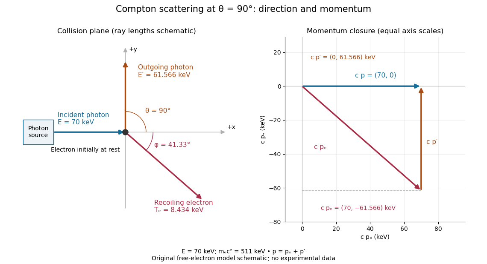
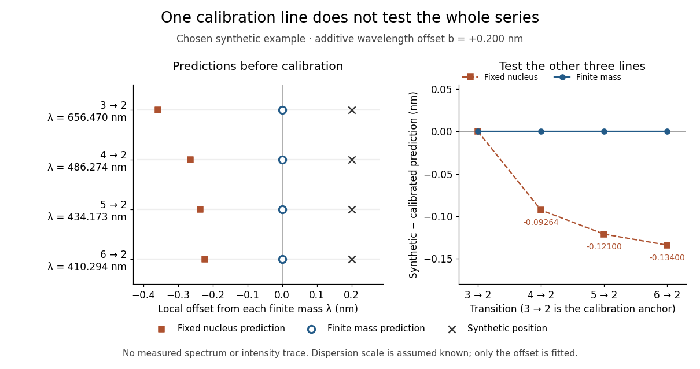
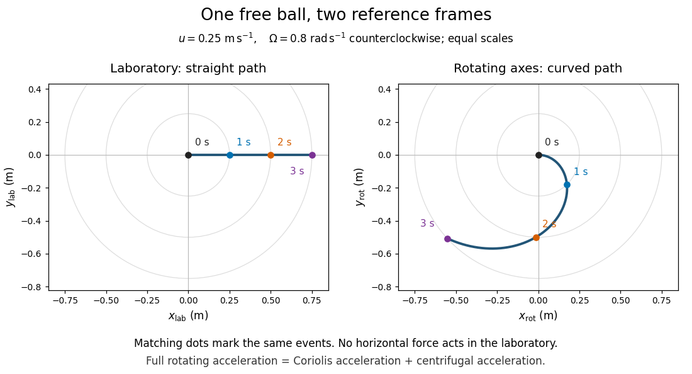
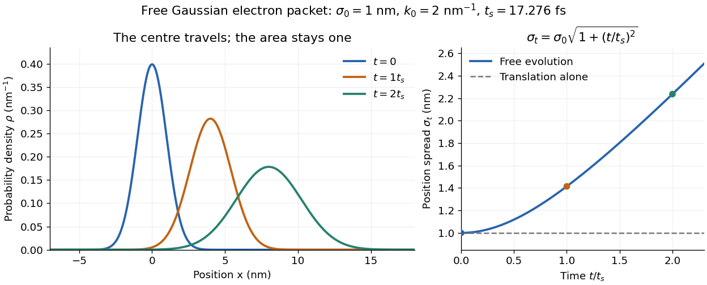
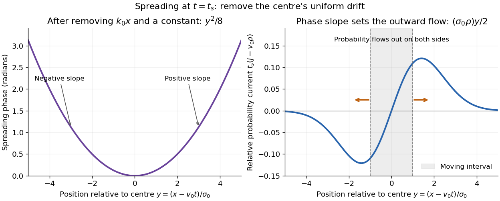
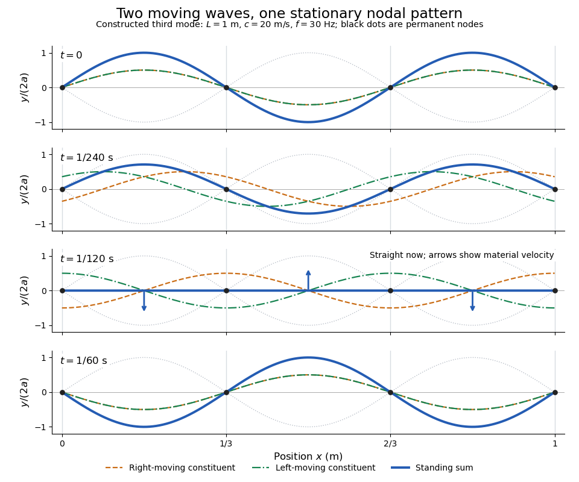
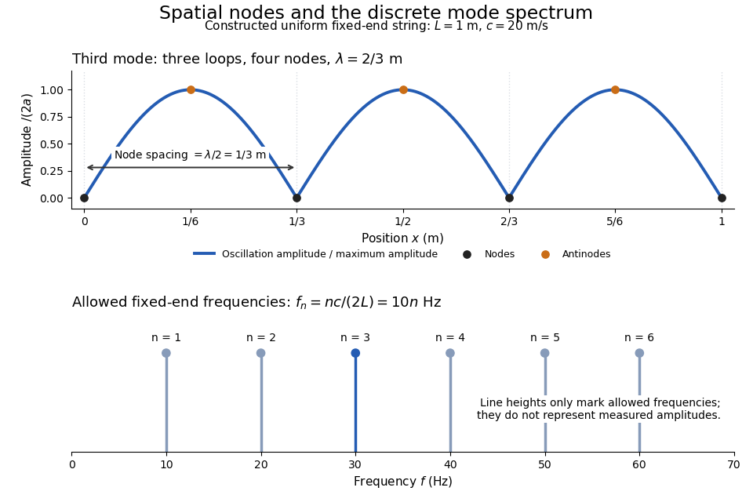

# Mathematical physics

↑ **Parent:** [Physics](physics.md)  
ⓦ [Wiki](https://en.wikipedia.org/wiki/Mathematical_physics)

**Table of contents**

- [Compactification (physics)](#compactification-physics)
  - [Brane-world scenario](#brane-world-scenario)
  - [Kaluza-Klein theory](#kaluza-klein-theory)
    - [Periodic electrostatic Green function with one compact dimension](#periodic-electrostatic-green-function-with-one-compact-dimension)
    - [Retarded circle-compactified massless propagator](#retarded-circle-compactified-massless-propagator)
      - [Static Green function across a circle compactification](#static-green-function-across-a-circle-compactification)
    - [Maxwell reduction on a circle](#maxwell-reduction-on-a-circle)
    - [Kaluza-Klein monopole](#kaluza-klein-monopole)
  - [Radion](#radion)
    - [Radius stabilization](#radius-stabilization)
      - [Goldberger–Wise stabilization mechanism](#goldberger-wise-stabilization-mechanism)
  - [Randall–Sundrum model](#randall-sundrum-model)
    - [High-energy braneworld expansion](#high-energy-braneworld-expansion)
      - [Dark radiation on a cosmological brane](#dark-radiation-on-a-cosmological-brane)
    - [Gravity localization in a noncompact warped dimension](#gravity-localization-in-a-noncompact-warped-dimension)
      - [Warped-brane proper acceleration](#warped-brane-proper-acceleration)
  - [Large extra dimensions](#large-extra-dimensions)
  - [Stone-Čech compactification](#stone-cech-compactification)
    - [Clopen separation in discrete Stone-Čech compactifications](#clopen-separation-in-discrete-stone-cech-compactifications)
    - [Discrete Stone-Čech compactifications are extremally disconnected](#discrete-stone-cech-compactifications-are-extremally-disconnected)
  - [Planck mass from compactification volume](#planck-mass-from-compactification-volume)
  - [Kaluza-Klein mode](#kaluza-klein-mode)
    - [Kaluza-Klein tower](#kaluza-klein-tower)
      - [Kaluza-Klein compactification scale](#kaluza-klein-compactification-scale)
        - [Large separation does not impose a Kaluza-Klein low-energy limit](#large-separation-does-not-impose-a-kaluza-klein-low-energy-limit)
    - [Kaluza-Klein charge quantization](#kaluza-klein-charge-quantization)
    - [Static potential across a compact circle](#static-potential-across-a-compact-circle)
  - [Dimensional reduction](#dimensional-reduction)
    - [Toroidal reduction of a p-form gauge field](#toroidal-reduction-of-a-p-form-gauge-field)
- [Spacetime diagram](#spacetime-diagram)
- [Continuum limit](#continuum-limit)
- [Added mass](#added-mass)
  - [Oscillation frequency with fluid added mass](#oscillation-frequency-with-fluid-added-mass)
  - [Added mass of a circular cylinder](#added-mass-of-a-circular-cylinder)
  - [Added mass of a sphere](#added-mass-of-a-sphere)
    - [Acceleration of a freely falling sphere with added mass](#acceleration-of-a-freely-falling-sphere-with-added-mass)
- [Central force](#central-force)
  - [Bertrand's theorem](#bertrand-s-theorem)
  - [Radial oscillation of an elastic-string orbit](#radial-oscillation-of-an-elastic-string-orbit)
  - [Radial-impulse circularization of a harmonic central orbit](#radial-impulse-circularization-of-a-harmonic-central-orbit)
  - [Inverse-cube central force](#inverse-cube-central-force)
    - [Inverse-cube central orbit classification](#inverse-cube-central-orbit-classification)
      - [Marginal circular orbit under an inverse-cube force](#marginal-circular-orbit-under-an-inverse-cube-force)
  - [Pedal equation for a central-force orbit](#pedal-equation-for-a-central-force-orbit)
- [Compton wavelength](#compton-wavelength)
  - [Reduced Compton wavelength](#reduced-compton-wavelength)
  - [Compton scattering](#compton-scattering)
    - [Bound-electron scattering without a Thomson frequency window](#bound-electron-scattering-without-a-thomson-frequency-window)
    - [Compton recoil kinematics](#compton-recoil-kinematics)
    - [Inverse Compton scattering](#inverse-compton-scattering)
    - [Compton scattering experiment of 1923](#compton-scattering-experiment-of-1923)
    - [Kompaneets equation](#kompaneets-equation)
      - [Compton y parameter](#compton-y-parameter)
        - [Integrated Compton parameter](#integrated-compton-parameter)
    - [One-loop diagram classes for Compton scattering](#one-loop-diagram-classes-for-compton-scattering)
    - [Tree-level Compton amplitude](#tree-level-compton-amplitude)
    - [Double Compton scattering](#double-compton-scattering)
- [Conservation of energy](#conservation-of-energy)
  - [Energy balance](#energy-balance)
- [Dimensional analysis](#dimensional-analysis)
  - [Drum-frequency dimensional scaling](#drum-frequency-dimensional-scaling)
  - [Mass-radius scaling of confinement energy](#mass-radius-scaling-of-confinement-energy)
  - [Pump power affinity law](#pump-power-affinity-law)
  - [Nondimensionalization](#nondimensionalization)
  - [Physical dimension](#physical-dimension)
  - [Natural units](#natural-units)
    - [Planck units](#planck-units)
      - [Reduced Planck units](#reduced-planck-units)
  - [Dimensional homogeneity](#dimensional-homogeneity)
- [Effective potential](#effective-potential)
  - [Centrifugal barrier](#centrifugal-barrier)
  - [Rotating-frame effective potential](#rotating-frame-effective-potential)
    - [Rotating-flow pressure potential](#rotating-flow-pressure-potential)
  - [Effective gravity in a rotating frame](#effective-gravity-in-a-rotating-frame)
    - [Parabolic free surface of a rigidly rotating liquid](#parabolic-free-surface-of-a-rigidly-rotating-liquid)
  - [Effective potential stability criterion](#effective-potential-stability-criterion)
- [Electromagnetic boundary condition](#electromagnetic-boundary-condition)
  - [Magnetic field-line refraction at a permeability interface](#magnetic-field-line-refraction-at-a-permeability-interface)
  - [Tangential magnetic field jump from a free surface current](#tangential-magnetic-field-jump-from-a-free-surface-current)
- [Electromagnetic damping](#electromagnetic-damping)
  - [Rotational damping of a resistive loop in an oscillating field](#rotational-damping-of-a-resistive-loop-in-an-oscillating-field)
- [Flux conservation in a superconducting loop](#flux-conservation-in-a-superconducting-loop)
  - [Orientation torque on a flux-conserving loop](#orientation-torque-on-a-flux-conserving-loop)
- [Fermat principle](#fermat-principle)
  - [Parabolic light rays in a reciprocal-square-root speed profile](#parabolic-light-rays-in-a-reciprocal-square-root-speed-profile)
  - [Conserved transverse optical momentum](#conserved-transverse-optical-momentum)
  - [Two optical rays in a square-root refractive-index profile](#two-optical-rays-in-a-square-root-refractive-index-profile)
  - [Ray in a linear-speed medium](#ray-in-a-linear-speed-medium)
  - [Ray in an exponential-speed medium](#ray-in-an-exponential-speed-medium)
- [Spherical shell theorem](#spherical-shell-theorem)
  - [Uniform-Earth chord oscillator](#uniform-earth-chord-oscillator)
    - [Critical gravity-tunnel settling time](#critical-gravity-tunnel-settling-time)
  - [Gravity of a concentric hollow sphere](#gravity-of-a-concentric-hollow-sphere)
  - [Hollow-sphere gravitational transit](#hollow-sphere-gravitational-transit)
- [Hydrogen atom](#hydrogen-atom)
  - [Hydrogen ground-state probability beyond the classical turning point](#hydrogen-ground-state-probability-beyond-the-classical-turning-point)
  - [Hydrogen ground-state nuclear-volume probability](#hydrogen-ground-state-nuclear-volume-probability)
  - [Nodeless Coulomb radial eigenstate](#nodeless-coulomb-radial-eigenstate)
  - [Hydrogen radial Hamiltonian factorization](#hydrogen-radial-hamiltonian-factorization)
    - [Coulomb angular-momentum intertwining](#coulomb-angular-momentum-intertwining)
      - [Bound-state ladder termination by norm positivity](#bound-state-ladder-termination-by-norm-positivity)
  - [Noninteracting Coulomb-shell filling](#noninteracting-coulomb-shell-filling)
  - [Finite proton-shell correction to hydrogen ground energy](#finite-proton-shell-correction-to-hydrogen-ground-energy)
  - [Hydrogen spectral series](#hydrogen-spectral-series)
  - [Electric field of a hydrogen ground-state electron cloud](#electric-field-of-a-hydrogen-ground-state-electron-cloud)
  - [Rydberg formula](#rydberg-formula)
  - [Balmer series](#balmer-series)
    - [H-alpha](#h-alpha)
  - [Lyman series](#lyman-series)
  - [Lyman limit](#lyman-limit)
  - [Lyman-alpha line](#lyman-alpha-line)
    - [Lyman-alpha absorption](#lyman-alpha-absorption)
      - [Damped Lyman-alpha system](#damped-lyman-alpha-system)
      - [Lyman limit system](#lyman-limit-system)
      - [Neutral-hydrogen column-density distribution](#neutral-hydrogen-column-density-distribution)
        - [Ionized gas density from an absorption distribution](#ionized-gas-density-from-an-absorption-distribution)
        - [Neutral gas density from an absorption distribution](#neutral-gas-density-from-an-absorption-distribution)
      - [Absorber incidence and comoving number density](#absorber-incidence-and-comoving-number-density)
        - [Absorption distance](#absorption-distance)
      - [Random-orientation absorbing-disk cross-section](#random-orientation-absorbing-disk-cross-section)
    - [Lyman-alpha emission](#lyman-alpha-emission)
  - [Bohr model](#bohr-model)
    - [Circular-orbit derivation of the Bohr model](#circular-orbit-derivation-of-the-bohr-model)
    - [Hydrogen transition wavelengths in the Bohr model](#hydrogen-transition-wavelengths-in-the-bohr-model)
    - [Discharge spectra and the Bohr model](#discharge-spectra-and-the-bohr-model)
  - [Principal quantum number](#principal-quantum-number)
  - [Ionization energy](#ionization-energy)
  - [Coulomb two-body reduced mass](#coulomb-two-body-reduced-mass)
  - [Bohr radius](#bohr-radius)
  - [Circular Coulomb bound state](#circular-coulomb-bound-state)
    - [Mean radius of a circular Coulomb bound state](#mean-radius-of-a-circular-coulomb-bound-state)
  - [Hydrogen energy eigenbasis](#hydrogen-energy-eigenbasis)
    - [Hydrogen energy-level degeneracy](#hydrogen-energy-level-degeneracy)
    - [Electric-dipole selection rules for hydrogen](#electric-dipole-selection-rules-for-hydrogen)
    - [First excited hydrogen eigenspace](#first-excited-hydrogen-eigenspace)
      - [Orbital-angular-momentum-squared perturbation of hydrogen](#orbital-angular-momentum-squared-perturbation-of-hydrogen)
      - [Position-momentum selection rules in the first excited hydrogen eigenspace](#position-momentum-selection-rules-in-the-first-excited-hydrogen-eigenspace)
        - [Rotating-frame solution for a harmonically driven two-level system](#rotating-frame-solution-for-a-harmonically-driven-two-level-system)
  - [Radial Schrodinger equation for the hydrogen atom](#radial-schrodinger-equation-for-the-hydrogen-atom)
    - [Radial momentum operator](#radial-momentum-operator)
    - [Near-origin probability in a maximal-angular-momentum hydrogen state](#near-origin-probability-in-a-maximal-angular-momentum-hydrogen-state)
    - [Maximal-angular-momentum hydrogen state](#maximal-angular-momentum-hydrogen-state)
    - [Coulomb WKB quantization with the Langer correction](#coulomb-wkb-quantization-with-the-langer-correction)
    - [Series-termination quantization of the Coulomb radial equation](#series-termination-quantization-of-the-coulomb-radial-equation)
      - [Hydrogen ground-state energy](#hydrogen-ground-state-energy)
        - [Compactly supported linear trial for hydrogen](#compactly-supported-linear-trial-for-hydrogen)
  - [Radial normalization of the hydrogen ground state](#radial-normalization-of-the-hydrogen-ground-state)
- [Stark effect](#stark-effect)
  - [AC Stark shift](#ac-stark-shift)
  - [Rotational Stark effect](#rotational-stark-effect)
    - [Quadratic Stark shift of a polar linear rotor](#quadratic-stark-shift-of-a-polar-linear-rotor)
      - [Rotational polarizability outside the weak-field regime](#rotational-polarizability-outside-the-weak-field-regime)
      - [Dipole moment from a rotational Stark doublet](#dipole-moment-from-a-rotational-stark-doublet)
        - [Polarization selection of a rotational Stark doublet](#polarization-selection-of-a-rotational-stark-doublet)
      - [Degenerate rotor manifold without a first-order Stark shift](#degenerate-rotor-manifold-without-a-first-order-stark-shift)
  - [Quadratic Stark effect](#quadratic-stark-effect)
  - [Stark canal-ray experiment](#stark-canal-ray-experiment)
  - [Linear Stark effect in the first excited hydrogen eigenspace](#linear-stark-effect-in-the-first-excited-hydrogen-eigenspace)
    - [Spectral components of the linear hydrogen Stark effect](#spectral-components-of-the-linear-hydrogen-stark-effect)
  - [Stark effect of the hydrogen ground state](#stark-effect-of-the-hydrogen-ground-state)
- [Kepler's laws of planetary motion](#kepler-s-laws-of-planetary-motion)
  - [Kepler's first law](#kepler-s-first-law)
  - [Kepler's third law](#kepler-s-third-law)
    - [Last-orbit frequency of a compact binary](#last-orbit-frequency-of-a-compact-binary)
  - [Kepler's second law](#kepler-s-second-law)
- [Magnetic monopole](#magnetic-monopole)
  - [Two-patch vector potential for a radial monopole](#two-patch-vector-potential-for-a-radial-monopole)
  - [Dyon](#dyon)
- [Physical pendulum](#physical-pendulum)
  - [Edge-hinged cube with a central spherical cavity](#edge-hinged-cube-with-a-central-spherical-cavity)
  - [Minimum-period offset of a physical pendulum](#minimum-period-offset-of-a-physical-pendulum)
  - [Finite-radius spherical pendulum bob](#finite-radius-spherical-pendulum-bob)
  - [Uniform disc pivoted at its rim](#uniform-disc-pivoted-at-its-rim)
  - [Pendulum with quadratic damping](#pendulum-with-quadratic-damping)
  - [Small oscillations of a hoop with a sliding bead](#small-oscillations-of-a-hoop-with-a-sliding-bead)
- [Planck mass](#planck-mass)
  - [Reduced Planck mass](#reduced-planck-mass)
  - [Planck length](#planck-length)
- [Quantum transmission](#quantum-transmission)
- [Relativistic aberration](#relativistic-aberration)
  - [Annual stellar aberration amplitude](#annual-stellar-aberration-amplitude)
  - [Angular-diameter ratio under a collinear boost](#angular-diameter-ratio-under-a-collinear-boost)
  - [Half-angle boost aberration of a null spinor](#half-angle-boost-aberration-of-a-null-spinor)
  - [Angular size under a collinear relativistic boost](#angular-size-under-a-collinear-relativistic-boost)
  - [Photon-number half-cone under relativistic aberration](#photon-number-half-cone-under-relativistic-aberration)
- [Reference frame](#reference-frame)
  - [Laboratory frame](#laboratory-frame)
  - [Fictitious force](#fictitious-force)
  - [Translating accelerated reference frame](#translating-accelerated-reference-frame)
  - [Inertial frame](#inertial-frame)
    - [Rest frame](#rest-frame)
    - [Local inertial frame](#local-inertial-frame)
  - [Rotating reference frame](#rotating-reference-frame)
    - [Rotating saddle trap](#rotating-saddle-trap)
      - [Rapidly rotating saddle confinement](#rapidly-rotating-saddle-confinement)
    - [Artificial gravity in a rotating ring](#artificial-gravity-in-a-rotating-ring)
    - [Geodesic equation in a uniformly rotating Minkowski chart](#geodesic-equation-in-a-uniformly-rotating-minkowski-chart)
    - [Centrifugal governor](#centrifugal-governor)
      - [Gravity-restored centrifugal governor bifurcation](#gravity-restored-centrifugal-governor-bifurcation)
      - [Spring-loaded centrifugal governor](#spring-loaded-centrifugal-governor)
    - [Energy balance in a uniformly rotating frame](#energy-balance-in-a-uniformly-rotating-frame)
    - [Particle on a uniformly rotating inclined plane](#particle-on-a-uniformly-rotating-inclined-plane)
    - [Bead on a horizontal hoop rotating about its rim](#bead-on-a-horizontal-hoop-rotating-about-its-rim)
    - [Rotating-frame derivative formula](#rotating-frame-derivative-formula)
    - [Coriolis force](#coriolis-force)
      - [Coriolis bank angle for eastward flight](#coriolis-bank-angle-for-eastward-flight)
      - [Polar projectile Coriolis deflection](#polar-projectile-coriolis-deflection)
      - [Transverse miss on a rotating platform](#transverse-miss-on-a-rotating-platform)
      - [Wrong-sign Coriolis steering error](#wrong-sign-coriolis-steering-error)
      - [Coriolis force does no work](#coriolis-force-does-no-work)
      - [Coriolis acceleration](#coriolis-acceleration)
        - [Free particle in rotating coordinates](#free-particle-in-rotating-coordinates)
        - [Coriolis acceleration in local Earth coordinates](#coriolis-acceleration-in-local-earth-coordinates)
          - [Coriolis deflection of vertical launch and drop](#coriolis-deflection-of-vertical-launch-and-drop)
        - [Coriolis deflection of a vertical projectile](#coriolis-deflection-of-a-vertical-projectile)
      - [Rotating-table demonstration of Coriolis deflection](#rotating-table-demonstration-of-coriolis-deflection)
    - [Euler force](#euler-force)
      - [Euler acceleration](#euler-acceleration)
    - [Centrifugal force](#centrifugal-force)
      - [Centrifugal acceleration](#centrifugal-acceleration)
    - [Centrifugal potential](#centrifugal-potential)
    - [Rotating conical pendulum with an offset pivot](#rotating-conical-pendulum-with-an-offset-pivot)
    - [Rotating-hoop bead](#rotating-hoop-bead)
      - [Pitchfork bifurcation of a rotating hoop bead](#pitchfork-bifurcation-of-a-rotating-hoop-bead)
- [Schrödinger equation](#schrodinger-equation)
  - [Radial Schrödinger equation for a central potential](#radial-schrodinger-equation-for-a-central-potential)
  - [Pauli equation](#pauli-equation)
    - [Zero modes of a positive transverse Pauli field](#zero-modes-of-a-positive-transverse-pauli-field)
  - [Free Schrodinger equation](#free-schrodinger-equation)
  - [Time-independent Schrödinger equation](#time-independent-schrodinger-equation)
    - [Inverse construction of a quantum potential](#inverse-construction-of-a-quantum-potential)
    - [Classically forbidden region](#classically-forbidden-region)
    - [Classically allowed region](#classically-allowed-region)
    - [Wavefunction matching at a finite potential step](#wavefunction-matching-at-a-finite-potential-step)
      - [Bound-state matching in a symmetric stepped well](#bound-state-matching-in-a-symmetric-stepped-well)
      - [Quantum quarter-wave matching layer](#quantum-quarter-wave-matching-layer)
    - [Schrödinger operator](#schrodinger-operator)
    - [Bound-state quantization condition](#bound-state-quantization-condition)
  - [Time-dependent Schrödinger equation](#time-dependent-schrodinger-equation)
    - [Madelung equations](#madelung-equations)
  - [Nondegeneracy of one-dimensional bound states](#nondegeneracy-of-one-dimensional-bound-states)
- [Shallow water equations](#shallow-water-equations)
  - [Variable-width shallow-water characteristics](#variable-width-shallow-water-characteristics)
  - [Boundary-driven shallow-water wave steepening](#boundary-driven-shallow-water-wave-steepening)
  - [Momentum correction for lateral mass addition](#momentum-correction-for-lateral-mass-addition)
  - [Shallow-water specific energy](#shallow-water-specific-energy)
  - [Variable-section channel characteristics](#variable-section-channel-characteristics)
    - [Standing modes in an exponentially tapered channel](#standing-modes-in-an-exponentially-tapered-channel)
  - [Hydraulic jump](#hydraulic-jump)
    - [Hydraulic bore](#hydraulic-bore)
  - [Prismatic-channel shallow water equations](#prismatic-channel-shallow-water-equations)
    - [Dry-bed dam break with cubic wetted area](#dry-bed-dam-break-with-cubic-wetted-area)
      - [Finite-reservoir reflection of a cubic-area dam-break rarefaction](#finite-reservoir-reflection-of-a-cubic-area-dam-break-rarefaction)
    - [Triangular-channel dry-bed dam break](#triangular-channel-dry-bed-dam-break)
    - [Parabolic-channel dry-bed dam break](#parabolic-channel-dry-bed-dam-break)
  - [Shallow-water dispersion relation](#shallow-water-dispersion-relation)
  - [Rigid-lid approximation](#rigid-lid-approximation)
    - [Rigid-lid pressure in two-layer flow](#rigid-lid-pressure-in-two-layer-flow)
  - [Variable-buoyancy shallow water equations](#variable-buoyancy-shallow-water-equations)
  - [Shallow-water approximation](#shallow-water-approximation)
    - [Water depth](#water-depth)
    - [Seiche](#seiche)
      - [Quarter-wave basin resonance](#quarter-wave-basin-resonance)
  - [Linearized shallow water equations](#linearized-shallow-water-equations)
    - [Variable-Coriolis shallow-water height equation](#variable-coriolis-shallow-water-height-equation)
    - [Depth-integrated shallow-water transport](#depth-integrated-shallow-water-transport)
    - [Depth independence of hydrostatic shallow-water flow](#depth-independence-of-hydrostatic-shallow-water-flow)
    - [Rotating shallow-water height equation with variable depth](#rotating-shallow-water-height-equation-with-variable-depth)
  - [Rossby deformation radius](#rossby-deformation-radius)
  - [Geostrophic balance](#geostrophic-balance)
    - [Validity criteria for geostrophic balance](#validity-criteria-for-geostrophic-balance)
    - [Atmospheric isobar](#atmospheric-isobar)
    - [Gradient wind](#gradient-wind)
    - [Geostrophic wind](#geostrophic-wind)
      - [Geostrophic wind with linear drag](#geostrophic-wind-with-linear-drag)
        - [Pressure work in a steady cross-isobaric wind](#pressure-work-in-a-steady-cross-isobaric-wind)
      - [Meridional-pressure-gradient geostrophic wind](#meridional-pressure-gradient-geostrophic-wind)
- [Vortex stretching](#vortex-stretching)
- [Vorticity equation](#vorticity-equation)
  - [Baroclinity](#baroclinity)
    - [Baroclinic vorticity generation](#baroclinic-vorticity-generation)
  - [Beltrami flow](#beltrami-flow)
- [Conservation law](#conservation-law)
  - [Flux](#flux)
    - [Fick's laws](#fick-s-laws)
    - [Diffusive flux](#diffusive-flux)
  - [Local conservation law](#local-conservation-law)
  - [Volume conservation](#volume-conservation)
  - [Mass flux](#mass-flux)
    - [Mass loss rate](#mass-loss-rate)
  - [Momentum flux](#momentum-flux)
    - [Kinetic energy flux of a uniform jet](#kinetic-energy-flux-of-a-uniform-jet)
  - [Energy flux](#energy-flux)
  - [Continuity equation](#continuity-equation)
  - [Concentration](#concentration)
    - [Equilibrium concentration](#equilibrium-concentration)
    - [Protein concentration](#protein-concentration)
    - [Concentration gradient](#concentration-gradient)
    - [Salinity](#salinity)
    - [Molar concentration](#molar-concentration)
- [Standing wave](#standing-wave)
  - [Standing-and-travelling decomposition of a reflected string wave](#standing-and-travelling-decomposition-of-a-reflected-string-wave)
  - [Pinned-square surface displacement mode](#pinned-square-surface-displacement-mode)
  - [Two-mode string recurrence](#two-mode-string-recurrence)
  - [Standing wave node spacing](#standing-wave-node-spacing)
  - [Fixed-end standing wave frequencies](#fixed-end-standing-wave-frequencies)
  - [Standing wave phase and energy](#standing-wave-phase-and-energy)
  - [Driven string standing wave experiment](#driven-string-standing-wave-experiment)

## Compactification (physics)

↑ **Parent:** [Mathematical physics](mathematical-physics.md)  
ⓦ [Wiki](https://en.wikipedia.org/wiki/Compactification_(physics))

Compactification makes some spatial dimensions compact, so modes along them acquire discrete momenta. At energies below the first nonzero compact-mode mass, a [dimensional reduction](#dimensional-reduction) to the zero modes gives a lower-dimensional [effective field theory](quantum-field-theory.md#effective-field-theory). The compact volume fixes the gravitational kinetic coefficient in an unwarped product background.

### Brane-world scenario

↑ **Parent:** [Compactification (physics)](#compactification-physics)

In a brane-world model some fields, typically ordinary matter and gauge fields, are localized on a lower-dimensional [brane](string-theory.md#brane), while gravity propagates through the higher-dimensional bulk. Compact volume or a warped metric can then separate the observed gravitational scale from local matter scales. A model must specify field localization, boundary conditions and stabilization rather than identifying a brane with an arbitrary compactification.

### Kaluza-Klein theory

↑ **Parent:** [Compactification (physics)](#compactification-physics)  
ⓦ [Wiki](https://en.wikipedia.org/wiki/Kaluza-Klein_theory)

Kaluza-Klein theory obtains lower-dimensional fields from a higher-dimensional metric and other fields on compact dimensions. In the displayed fixed-radius circle ansatz, the off-diagonal metric supplies a vector. The coordinate change $y\mapsto y+\lambda(x)$ is compensated by $A\mapsto A-d\lambda$, producing an Abelian [gauge symmetry](relativistic-quantum-field.md#gauge-invariance). Allowing the radius to vary adds a scalar modulus. [Kaluza-Klein modes](#kaluza-klein-mode) also include nonzero internal momenta, giving a tower of massive fields.

// Target: quantum-field-theory.bigb

#### Periodic electrostatic Green function with one compact dimension

↑ **Parent:** [Kaluza-Klein theory](#kaluza-klein-theory)

For the [Poisson equation](partial-differential-equation.md#poisson-s-equation) $\nabla_4^2\phi=-4\pi Rq\,\delta^3(\mathbf x)\delta_{2\pi R}(z)$ on $\mathbb R^3\times S^1$, expand the periodic delta as $(2\pi R)^{-1}\sum_ne^{inz/R}$. The $n$th [Kaluza-Klein mode](#kaluza-klein-mode) has radial potential $q e^{-|n|r/R}/(2\pi r)$, since $(\nabla_3^2-m^2)e^{-mr}/r=-4\pi\delta^3(\mathbf x)$. Summing the geometric series gives the displayed [Green function](green-s-function.md). At equal compact coordinate it reduces to $q\coth(r/(2R))/(2\pi r)$. Thus the interaction energy changes from $q_1q_2/(2\pi r)$ at large separation to $q_1q_2R/(\pi r^2)$ at small separation, with normalization fixed by the stated Poisson equation.

#### Retarded circle-compactified massless propagator

↑ **Parent:** [Kaluza-Klein theory](#kaluza-klein-theory)

For a massless field on Minkowski space times a circle of circumference $R$, the compact delta distribution expands as $R^{-1}\sum_ne^{2\pi in\Delta w/R}$. The noncompact [retarded Green function](quantum-field-theory.md#retarded-green-function) in each Fourier sector is that of a four-dimensional field with mass $m_n$. Equivalently, the time-frequency denominator is $\mathbf k^2+m_n^2-(\omega+i0)^2$, putting both poles below the real axis. At equal compact positions the sum has one zero mode and a doubly counted nonzero mass tower.

##### Static Green function across a circle compactification

↑ **Parent:** [Retarded circle-compactified massless propagator](#retarded-circle-compactified-massless-propagator)

At zero frequency, sum the [Kaluza-Klein tower](#kaluza-klein-tower) of three-spatial-dimensional Yukawa kernels: $[4\pi Rr]^{-1}(1+2\sum_{n\geq1}e^{-2\pi nr/R})$. The geometric series gives the displayed function. It behaves as $1/(4\pi^2r^2)$ for $r\ll R$, the four-spatial-dimensional Coulomb kernel, and as $1/(4\pi Rr)$ for $r\gg R$, the three-spatial-dimensional kernel with a zero-mode normalization factor.

#### Maxwell reduction on a circle

↑ **Parent:** [Kaluza-Klein theory](#kaluza-klein-theory)

A real five-dimensional [Maxwell field](electromagnetism.md#electromagnetic-field) on a circle of radius $r$ has a [Fourier series](fourier-series.md) with coefficients $A_M^{(n)}$, $A_M^{(-n)}=(A_M^{(n)})^*$. Its mixed field-strength component is $F_{\mu5}^{(n)}=\partial_\mu A_5^{(n)}-inA_\mu^{(n)}/r$. The nonzero modes transform as $\delta A_\mu^{(n)}=\partial_\mu\Lambda^{(n)}$, $\delta A_5^{(n)}=in\Lambda^{(n)}/r$. Thus $A_5^{(n)}$ is a [Stueckelberg mechanism](relativistic-quantum-field.md#stueckelberg-mechanism) field and the gauge-invariant massive vector is $A_\mu^{(n)}-r\partial_\mu A_5^{(n)}/(in)$. Its mass is $|n|/r$ and it has three physical polarizations. The zero modes instead consist of a massless four-dimensional [Maxwell field](electromagnetism.md#electromagnetic-field) and a real massless [scalar field](classical-field-theory.md#scalar-field); the latter cannot be removed by a periodic infinitesimal [gauge transformation](electromagnetism.md#gauge-transformation). A positive Fourier level and its negative level are conjugate, not independent real fields.

#### Kaluza-Klein monopole

↑ **Parent:** [Kaluza-Klein theory](#kaluza-klein-theory)

A gravitational magnetic monopole for a compact circle, whose fibre is nontrivially twisted over a surrounding two-sphere. With flat spectator directions its nonsingular local geometry is a [Taub–NUT space](general-relativity.md#taub-nut-space). Reducing along the M-circle yields the [D6-brane](string-theory.md#d6-brane). The magnetic dual of the IIB circle vector is instead a five-brane in nine noncompact dimensions.

// Target: geometry-and-topology.bigb

### Radion

↑ **Parent:** [Compactification (physics)](#compactification-physics)

A radion is a lower-dimensional [scalar field](classical-field-theory.md#scalar-field) describing the size or separation modulus of compact extra dimensions. In a two-brane [Randall–Sundrum model](#randall-sundrum-model), its expectation determines the inter-brane separation and the warp-generated hierarchy. A background size alone does not supply a radion potential or a stabilization mechanism.

// Target: supersymmetry.bigb

#### Radius stabilization

↑ **Parent:** [Radion](#radion)

[Radius stabilization](#radius-stabilization) fixes the size of a [compactification](#compactification-physics) dynamically rather than choosing it as an undetermined parameter. If the four-dimensional [low-energy effective action](quantum-field-theory.md#low-energy-effective-action) contains a [radion](#radion) $R$ with positive kinetic coefficient $Z(R)$ and [scalar potential](classical-field-theory.md#scalar-potential) $V(R)$, a stable radius $R_0$ requires $V'(R_0)=0$ and $m_R^2=V''(R_0)/Z(R_0)>0$. This matters for the [hierarchy problem](standard-model.md#hierarchy-problem): the volume or warp factor explains a hierarchy only if a consistent dynamics selects and maintains the required geometry.

<h5 id="goldberger-wise-stabilization-mechanism">Goldberger–Wise stabilization mechanism</h5>

↑ **Parent:** [Radius stabilization](#radius-stabilization)

The [Goldberger–Wise stabilization mechanism](#goldberger-wise-stabilization-mechanism) generates a [radion](#radion) potential in the [Randall–Sundrum model](#randall-sundrum-model) using a weakly backreacting bulk [scalar field](classical-field-theory.md#scalar-field). On $0\leq y\leq L$, its static profile obeys $\chi''-4k\chi'-m_\chi^2\chi=0$, hence $\chi=Ae^{(4+\epsilon)ky}+Be^{-\epsilon ky}$, where $\epsilon=\sqrt{4+m_\chi^2/k^2}-2$. Boundary potentials approximately fix $\chi(0)=v_0$, $\chi(L)=v_L$. For $\epsilon\ll1$ and $kL\gg1$, the leading radius-dependent potential is proportional to $e^{-4kL}(v_L-v_0e^{-\epsilon kL})^2$. Its leading minimum satisfies $kL\simeq\epsilon^{-1}\log(v_0/v_L)$. Thus a modest ratio of boundary values can generate a large warp exponent. Corrections shift this minimum; the approximation requires small [scalar field](classical-field-theory.md#scalar-field) backreaction, and the four-dimensional [cosmological constant](cosmology.md#cosmological-constant) still needs adjustment.

<h3 id="randall-sundrum-model">Randall–Sundrum model</h3>

↑ **Parent:** [Compactification (physics)](#compactification-physics)  
ⓦ [Wiki](https://en.wikipedia.org/wiki/Randall–Sundrum_model)

A warped five-dimensional geometry redshifts masses of fields localized on the distant [brane](string-theory.md#brane): $m_{\rm IR}=e^{-kL}m_0$. For the usual doubled orbifold interval, integration of the [Einstein-Hilbert action](einstein-field-equations.md#einstein-hilbert-action) gives $M_{\rm Pl}^2=M_5^3(1-e^{-2kL})/k$. Exponential redshift can generate a large separation of observable scales with a moderately sized dimensionless distance $kL$. Stabilizing the [radion](#radion) remains a dynamical requirement.

// Target: physics.bigb

#### High-energy braneworld expansion

↑ **Parent:** [Randall–Sundrum model](#randall-sundrum-model)

For a spatially flat, tuned one-brane background without energy transfer to the bulk, the [Israel junction conditions](general-relativity.md#israel-junction-conditions) produce the displayed modified [Friedmann equation](cosmology.md#friedmann-equations). Positive [brane tension](string-theory.md#brane-tension) $\lambda$ gives ordinary expansion when $\rho\ll\lambda$, while the quadratic density correction enhances expansion at high energy. [Big Bang nucleosynthesis](cosmology.md#big-bang-nucleosynthesis), early acoustic evolution and primordial spectra can constrain this change. Spatial curvature, a residual cosmological constant and bulk energy exchange require their additional terms rather than this special formula.

##### Dark radiation on a cosmological brane

↑ **Parent:** [High-energy braneworld expansion](#high-energy-braneworld-expansion)

Projected bulk [Weyl tensor](riemann-curvature-tensor.md#weyl-tensor) can contribute a radiation-scaling term to the brane [Friedmann equation](cosmology.md#friedmann-equations), even without ordinary brane photons. For an anti-de Sitter black-hole bulk the integration constant is related to its mass. This [dark radiation on a cosmological brane](#dark-radiation-on-a-cosmological-brane) changes the expansion rate tested by [Big Bang nucleosynthesis](cosmology.md#big-bang-nucleosynthesis) and [Cosmic microwave background anisotropy](cosmic-microwave-background-anisotropy.md); it should not automatically be identified with a freely specifiable thermal particle species.

#### Gravity localization in a noncompact warped dimension

↑ **Parent:** [Randall–Sundrum model](#randall-sundrum-model)

In a one-brane warped background, the proper extra dimension can be infinite while the four-dimensional [graviton](quantum-theory.md#graviton) zero mode has finite norm. The [Einstein-Hilbert action](einstein-field-equations.md#einstein-hilbert-action) weighs its four-dimensional curvature term by the warp factor integral shown above, finite for $k>0$. Thus the proper length is not the effective gravitational volume. This differs from an unwarped noncompact direction, whose volume integral diverges. It also differs from the two-brane hierarchy mechanism, where finite brane separation redshifts masses on the distant brane. The noncompact construction is established in [the original single-brane warped-gravity paper](https://arxiv.org/abs/hep-th/9906064).

##### Warped-brane proper acceleration

↑ **Parent:** [Gravity localization in a noncompact warped dimension](#gravity-localization-in-a-noncompact-warped-dimension)

An inertial observer of a fixed-$y$ flat brane in metric $dy^2+e^{-2y/L}\eta_{\mu\nu}dx^\mu dx^\nu$ is accelerated relative to the higher-dimensional bulk. Normalization and $\Gamma^y_{\mu\nu}=e^{-2y/L}\eta_{\mu\nu}/L$ give $a^y=-1/L$. This is its invariant bulk [proper acceleration](special-relativity.md#proper-acceleration), not a nonzero intrinsic four-dimensional acceleration on the flat induced brane metric.

### Large extra dimensions

↑ **Parent:** [Compactification (physics)](#compactification-physics)  
ⓦ [Wiki](https://en.wikipedia.org/wiki/Large_extra_dimensions)

Large-extra-dimension models lower the fundamental higher-dimensional gravitational scale $M_*$ while obtaining a large four-dimensional [reduced Planck mass](#reduced-planck-mass) from compact volume $V_n$. Ordinary matter can be localized on a [brane](string-theory.md#brane) while gravity propagates in the bulk. The [Planck mass from compactification volume](#planck-mass-from-compactification-volume) relation explains weak effective four-dimensional gravity but leaves volume stabilization and the origin of a large internal volume as separate problems.

// Target: physics.bigb

<h3 id="stone-cech-compactification">Stone-Čech compactification</h3>

↑ **Parent:** [Compactification (physics)](#compactification-physics)

For a [completely regular Hausdorff space](topology.md#completely-regular-hausdorff-space), the Stone-Čech compactification is the weak-star closure of the evaluation functionals in the dual unit ball of $C_b(X)$. The [Banach-Alaoglu theorem](functional-analysis.md#banach-alaoglu-theorem) gives compactness; complete regularity makes evaluation a [topological embedding](topology.md#topological-embedding). Every bounded real [continuous function](calculus.md#continuous-function) extends by $\widetilde f(p)=p(f)$, yielding an isometric isomorphism $C_b(X)\cong C(\beta X)$. For a continuous map into a [compact Hausdorff space](topology.md#compact-hausdorff-space) $K$, the adjoint of pullback sends this closure into the closed evaluation copy of $K$, yielding the unique continuous extension. Uniqueness follows from density. It is a universal compactification, not a homeomorphism between $X$ and the whole dual space.

<h4 id="clopen-separation-in-discrete-stone-cech-compactifications">Clopen separation in discrete Stone-Čech compactifications</h4>

↑ **Parent:** [Stone-Čech compactification](#stone-cech-compactification)

In the [Stone-Čech compactification](#stone-cech-compactification) of a [discrete space](topology.md#discrete-space), the closure of each subset of $X$ is [clopen](topology.md#clopen-set), because its indicator extends to a continuous zero-one-valued function. For disjoint closed sets $A,B\subseteq\beta X$, choose $u=0$ on $A$ and $u=1$ on $B$ by [Urysohn's lemma](topology.md#urysohn-s-lemma). Then $U=\overline{\{x\in X:u(x)<1/2\}}$ and $V=\beta X\setminus U$ are disjoint clopen sets containing $A$ and $B$, respectively. Density proves these containments.

<h4 id="discrete-stone-cech-compactifications-are-extremally-disconnected">Discrete Stone-Čech compactifications are extremally disconnected</h4>

↑ **Parent:** [Stone-Čech compactification](#stone-cech-compactification)

For a [discrete space](topology.md#discrete-space) $X$ and $D\subseteq X$, the continuous extension of $\mathbf1_D$ to $\beta X$ remains idempotent by density, so it takes values in $\{0,1\}$. Its one-set is the clopen closure of $D$. If $O$ is any [open set](topology.md#open-set) in $\beta X$, density gives $\overline O=\overline{O\cap X}$, so this closure is clopen as well. Thus $\beta X$ is an [extremally disconnected space](topology.md#extremally-disconnected-space). For infinite $X$, this does not imply that every subset of $\beta X$ has open closure.

### Planck mass from compactification volume

↑ **Parent:** [Compactification (physics)](#compactification-physics)

For an unwarped product metric with fixed compact volume $V_n$, integrating the higher-dimensional [Einstein-Hilbert action](einstein-field-equations.md#einstein-hilbert-action) gives $M_{\rm Pl}^2=M_*^{n+2}V_n$ when the action coefficient is $M_D^{D-2}/2$. The [reduced Planck mass](#reduced-planck-mass) convention must be distinguished from the unreduced one, and stabilizing the internal metric is a separate dynamical issue.

### Kaluza-Klein mode

↑ **Parent:** [Compactification (physics)](#compactification-physics)

A Kaluza-Klein mode is a coefficient in a field expansion in eigenfunctions on compact extra dimensions. On a circle of circumference $L$, momentum is $2\pi\ell/L$, and a higher-dimensional massless field has lower-dimensional squared mass $(2\pi\ell/L)^2$. Nonzero modes give exponentially suppressed static-potential corrections at distances much larger than $L$.

#### Kaluza-Klein tower

↑ **Parent:** [Kaluza-Klein mode](#kaluza-klein-mode)

For a field periodic on a circle of radius $R$, a [Fourier series](fourier-series.md) gives modes with quantized internal momentum $n/R$. Each mode is a lower-dimensional field with the displayed squared mass. The entire sequence is the tower; retaining only modes below a chosen energy gives an [effective field theory](quantum-field-theory.md#effective-field-theory). The tower is distinct from any individual [Kaluza-Klein mode](#kaluza-klein-mode).

##### Kaluza-Klein compactification scale

↑ **Parent:** [Kaluza-Klein tower](#kaluza-klein-tower)

The compactification scale is the first nonzero internal-mode mass. On a circle it equals $1/R$ for a higher-dimensional massless field. A zero-mode [dimensional reduction](#dimensional-reduction) applies at energies well below it. Warping, nontrivial geometry and boundary conditions can change the relation between the first mass and a geometric radius.

###### Large separation does not impose a Kaluza-Klein low-energy limit

↑ **Parent:** [Kaluza-Klein compactification scale](#kaluza-klein-compactification-scale)

A pointlike pulse can contain frequencies above the compactification gap even when its travel time and distance greatly exceed the circle size. Its [retarded circle-compactified massless propagator](#retarded-circle-compactified-massless-propagator) can resolve winding images and massive-mode oscillations. Suppressing those modes requires low-frequency or long-wavelength sources/measurements, or suitable smearing; mere coordinate separation is not that restriction. The [static Green function across a circle compactification](#static-green-function-across-a-circle-compactification) gives a precise long-distance zero-mode limit without this ambiguity.

#### Kaluza-Klein charge quantization

↑ **Parent:** [Kaluza-Klein mode](#kaluza-klein-mode)

For a periodic scalar on a circle of circumference $2\pi R$, its [Fourier series](fourier-series.md) has modes $\psi_n(x)e^{inz/R}$. In the fixed-radius metric $ds_5^2=\gamma_{ij}dx^idx^j+(dz+A_idx^i)^2$, the five-dimensional [Klein-Gordon equation](wave-equation.md#klein-gordon-equation) becomes $(D_iD^i-M^2-n^2/R^2)\psi_n=0$ with $D_i=\nabla_i-inA_i/R$. Thus the geometric gauge charge is quantized in units $1/R$ in units $\hbar=1$, or the conserved compact momentum in units $\hbar/R$. A rescaling to a canonically normalized electromagnetic potential changes the corresponding numerical unit of physical electric charge.

#### Static potential across a compact circle

↑ **Parent:** [Kaluza-Klein mode](#kaluza-klein-mode)

On three noncompact spatial dimensions times a circle of circumference $L$, the [method of images](mathematics.md#method-of-images) gives $\sum_{j\in\mathbb Z}[r^2+j^2L^2]^{-1}=\pi\coth(\pi r/L)/(Lr)$ at equal compact coordinates. This interpolates from $1/r^2$ at short distances to $\pi/(Lr)$ at long distances. A gravitational circle-radius scalar can change the long-range coefficient if it remains unstabilized.

### Dimensional reduction

↑ **Parent:** [Compactification (physics)](#compactification-physics)

Dimensional reduction retains fields independent of chosen internal coordinates. In a flat-torus zero-mode reduction, a metric supplies a metric, internal-component vectors and internal metric scalars; a [massless p-form gauge field](relativistic-quantum-field.md#massless-p-form-gauge-field) supplies lower-rank fields with internal indices. Fluxes, twists or projections can alter the spectrum and preserved [supercharges](supersymmetry.md#supersymmetry-generator).

#### Toroidal reduction of a p-form gauge field

↑ **Parent:** [Dimensional reduction](#dimensional-reduction)

The zero-mode [dimensional reduction](#dimensional-reduction) on a flat $(D-4)$-torus splits a [massless p-form gauge field](relativistic-quantum-field.md#massless-p-form-gauge-field) by the number $r$ of spacetime indices. Each sector has $\binom{D-4}{p-r}$ copies and $\binom2r$ local polarizations per copy. Comparing coefficients in $(1+t)^{D-4}(1+t)^2$ gives $\sum_r\binom{D-4}{p-r}\binom2r=\binom{D-2}{p}$, proving polarization matching. Four-dimensional three- and four-form potentials contribute no local propagating states.

// Target: supersymmetry.bigb

## Spacetime diagram

↑ **Parent:** [Mathematical physics](mathematical-physics.md)  
ⓦ [Wiki](https://en.wikipedia.org/wiki/Spacetime_diagram)

A spacetime diagram plots one spatial coordinate against time. Curves on it represent trajectories, wavefronts, or characteristics, and their slopes encode propagation speeds.

## Continuum limit

↑ **Parent:** [Mathematical physics](mathematical-physics.md)  
ⓦ [Wiki](https://en.wikipedia.org/wiki/Continuum_limit)

A continuum limit replaces lattice variables that vary slowly over many lattice spacings by smooth fields. Lattice sums become spatial integrals and finite differences become derivatives, while short-distance information survives in effective coefficients and higher-derivative corrections.

## Added mass

↑ **Parent:** [Mathematical physics](mathematical-physics.md)  
ⓦ [Wiki](https://en.wikipedia.org/wiki/Added_mass)

Added mass is the effective inertia contributed by fluid accelerated together with an immersed body.

### Oscillation frequency with fluid added mass

↑ **Parent:** [Added mass](#added-mass)

Fluid [added mass](#added-mass) increases inertia but need not alter the same restoring [force](force.md). A submerged spring's constant [buoyancy](fluid-mechanics.md#buoyancy) shifts equilibrium, whereas a pendulum's [buoyancy](fluid-mechanics.md#buoyancy) reduces its restoring [torque](momentum.md#torque). Thus an unbounded-fluid sphere has spring [frequency](wave.md#frequency) factor $\sqrt{\rho/(\rho+\rho_f/2)}$ and downward-pendulum factor $\sqrt{(\rho-\rho_f)/(\rho+\rho_f/2)}$. The latter stable configuration requires $\rho>\rho_f$.

### Added mass of a circular cylinder

↑ **Parent:** [Added mass](#added-mass)

An infinitely long [circular cylinder](differential-geometry.md#circular-cylinder) of radius $a$ translating across its axis through otherwise stationary, inviscid incompressible fluid has [added mass](#added-mass) $m_a=\rho\pi a^2$ per unit length. The decaying, circulation-free [velocity potential](fluid-mechanics.md#velocity-potential) is $\phi=-Ua^2\cos\theta/r$. In moving centre coordinates, the fixed-laboratory derivative is $\phi_t=-\dot U a^2\cos\theta/r-U^2a^2\cos(2\theta)/r^2$. The [Unsteady Bernoulli equation](euler-equations-for-an-inviscid-fluid.md#unsteady-bernoulli-equation) gives $p-p_\infty=\rho a^2\dot U\cos\theta/r+\rho U^2a^2\cos(2\theta)/r^2-\rho U^2a^4/(2r^4)$. Integrating $-pa\cos\theta$ around $r=a$ yields $F_x=-\rho\pi a^2\dot U$; the transverse force vanishes. Taking a derivative at fixed centre coordinates would omit the necessary convective correction.

### Added mass of a sphere

↑ **Parent:** [Added mass](#added-mass)

A sphere of volume $V$ translating through unbounded inviscid incompressible fluid has fluid kinetic energy

$$
K_f=\frac12\left(\frac{\rho V}{2}\right)U^2.
$$

Its added mass is therefore one half of the displaced fluid mass.

#### Acceleration of a freely falling sphere with added mass

↑ **Parent:** [Added mass of a sphere](#added-mass-of-a-sphere)

A sphere of density $\rho_s$ falling in inviscid fluid of density $\rho$ has effective inertia $(\rho_s+\rho/2)V$ and net weight $(\rho_s-\rho)Vg$. Hence

$$
\dot U=\frac{\rho_s-\rho}{\rho_s+\rho/2}g.
$$

## Central force

↑ **Parent:** [Mathematical physics](mathematical-physics.md)  
ⓦ [Wiki](https://en.wikipedia.org/wiki/Central_force)

<h3 id="bertrand-s-theorem">Bertrand's theorem</h3>

↑ **Parent:** [Central force](#central-force)  
ⓦ [Wiki](https://en.wikipedia.org/wiki/Bertrand's_theorem)

[Joseph Bertrand](mathematics.md#joseph-bertrand)'s theorem states that, among smooth attractive [central potentials](energy.md#central-potential) admitting stable [circular orbits](classical-mechanics.md#circular-orbit), requiring every [bound orbit](dynamical-systems.md#bound-orbit) to be closed singles out the inverse-distance [potential energy](energy.md#potential-energy) and the isotropic quadratic [potential energy](energy.md#potential-energy), up to additive constants. Rational radial-to-angular [frequency](wave.md#frequency) ratios near a [circular orbit](classical-mechanics.md#circular-orbit) provide only a necessary local closure test; finite-amplitude closure is the additional content. In $U=Br^n$, the radial-to-angular [frequency](wave.md#frequency) ratio near a stable circle is $\sqrt{n+2}$, and stability requires $nB>0$ and $n>-2$. The all-bound-orbit cases are $n=-1$ and $n=2$.

### Radial oscillation of an elastic-string orbit

↑ **Parent:** [Central force](#central-force)

For a taut elastic string with potential $k(r-L)^2/2$, a circular orbit has $\omega_0^2=k(r_0-L)/(mr_0)$. A radial impulse preserves angular momentum, so the curvature of the fixed-angular-momentum effective potential gives $\Omega^2=k/m+3\omega_0^2$. The ratio is three at $r_0=6L/5$ and approaches two at $r_0\gg L$. Rational linearized frequency ratios describe leading small-amplitude closed sketches without proving exact closure at finite amplitude.

### Radial-impulse circularization of a harmonic central orbit

↑ **Parent:** [Central force](#central-force)

For $\mathbf F=-A\mathbf r$, the turning radii obey $L^2=mAr_{\min}^2r_{\max}^2$. A radial impulse preserves [angular momentum](momentum.md#angular-momentum). Its circular orbit therefore has $r_c^4=L^2/(mA)$, or $r_c=\sqrt{r_{\min}r_{\max}}$. Cancel the radial velocity where the original orbit crosses $r_c$.

### Inverse-cube central force

↑ **Parent:** [Central force](#central-force)

A radial [force](force.md) proportional to $r^{-3}$. For potential $V=B/r^2$, its outward radial component is $2B/r^3$: positive $B$ is repulsive and negative $B$ is attractive.

#### Inverse-cube central orbit classification

↑ **Parent:** [Inverse-cube central force](#inverse-cube-central-force)

For nonzero [angular momentum](momentum.md#angular-momentum) $L$, put $u=1/r$ and $\lambda=1+2mB/L^2$. The [Binet equation](celestial-mechanics.md#binet-equation) is $u_{\theta\theta}+\lambda u=0$. Positive $\lambda$ gives cosine scattering branches, zero gives linear reciprocal radius, and negative gives exponential combinations, with [energy](energy.md) distinguishing sinh, exponential and cosh branches. Only intervals with $u>0$ are physical.

##### Marginal circular orbit under an inverse-cube force

↑ **Parent:** [Inverse-cube central orbit classification](#inverse-cube-central-orbit-classification)

At $B=-L^2/(2m)$ the centrifugal and [force](force.md) potentials cancel. With zero radial [speed](classical-mechanics.md#speed), any radius is a circular solution, but there is no radial restoring [force](force.md); radial-velocity perturbations are not confined.

### Pedal equation for a central-force orbit

↑ **Parent:** [Central force](#central-force)

Let $p$ be the perpendicular distance from the force centre to the tangent of a regular planar [orbit](dynamical-systems.md#orbit-dynamical-system). Conserved physical [angular momentum](momentum.md#angular-momentum) has magnitude $|h|=mpv$, while conserved [energy](energy.md) is $E=mv^2/2+V(r)$. Eliminating speed gives the displayed equation when $h\ne0$. For a differentiable polar curve, $p=r^2/\sqrt{r^2+(dr/d\theta)^2}$, connecting the geometric tangent distance to the radial energy equation.

## Compton wavelength

↑ **Parent:** [Mathematical physics](mathematical-physics.md)  
ⓦ [Wiki](https://en.wikipedia.org/wiki/Compton_wavelength)

The [Compton wavelength](#compton-wavelength) of a [subatomic particle](physics.md#subatomic-particle) of [rest mass](special-relativity.md#invariant-mass) $m>0$ is $\lambda_C=h/(mc)$, where $h$ is the [Planck constant](quantum-mechanics.md#planck-constant) and $c$ the [speed of light](special-relativity.md#speed-of-light). It is the [wavelength](wave-equation.md#wavelength) of a [photon](quantum-mechanics.md#photon) whose [energy](energy.md) $hc/\lambda_C$ equals that [subatomic particle](physics.md#subatomic-particle)'s [rest energy](special-relativity.md#rest-energy) $mc^2$. It is a characteristic scale, rather than a measured geometric radius of the [subatomic particle](physics.md#subatomic-particle).

The reduced [Compton wavelength](#compton-wavelength) is $\bar\lambda_C=\hbar/(mc)=\lambda_C/(2\pi)$, with $\hbar=h/(2\pi)$. Keep that factor of $2\pi$: the [Compton scattering](#compton-scattering) [wavelength](wave-equation.md#wavelength) shift below uses $h/(m_ec)$, not $\hbar/(m_ec)$. Here we choose the rounded [electron](physics.md#electron) value $\lambda_C=2.426\,\mathrm{pm}$, where $1\,\mathrm{pm}=10^{-12}\,\mathrm m$; the maximum single-collision [wavelength](wave-equation.md#wavelength) increase is $2\lambda_C=4.852\,\mathrm{pm}$.

Why this scale? A [photon](quantum-mechanics.md#photon) of [wavelength](wave-equation.md#wavelength) $\lambda$ has [momentum](momentum.md) magnitude $h/\lambda$. At $\lambda\sim\lambda_C$ that [momentum](momentum.md) is comparable with $mc$, so transfer of an appreciable fraction of it can make the recoiling [subatomic particle](physics.md#subatomic-particle) relativistic. Even for longer [wavelengths](wave-equation.md#wavelength), [Compton scattering](#compton-scattering) can resolve the small [energy](energy.md) transferred into [electron](physics.md#electron) [kinetic energy](energy.md#kinetic-energy).

### Reduced Compton wavelength

↑ **Parent:** [Compton wavelength](#compton-wavelength)

The [Compton wavelength](#compton-wavelength) divided by $2\pi$. A massive static [propagator](quantum-field-theory.md#propagator) produces an exponential factor $e^{-r/\bar\lambda_C}$, making this the natural range scale for a [Yukawa potential](electromagnetism.md#yukawa-potential). It is not a sharp geometric radius or a hard interaction cutoff.

### Compton scattering

↑ **Parent:** [Compton wavelength](#compton-wavelength)  
ⓦ [Wiki](https://en.wikipedia.org/wiki/Compton_scattering)

[Compton scattering](#compton-scattering) redistributes [photon](quantum-mechanics.md#photon) [energy](energy.md) and [momentum](momentum.md) in a [collision](classical-mechanics.md#collision) with a charged [subatomic particle](physics.md#subatomic-particle), here an [electron](physics.md#electron). For a free [electron](physics.md#electron) initially at rest in the chosen [inertial frame](#inertial-frame), an incident [photon](quantum-mechanics.md#photon) of [energy](energy.md) $E=hc/\lambda$ leaves with [energy](energy.md) $E'=hc/\lambda'$ after deflection through $\theta$. The angle $\theta\in[0,\pi]$ is between the incident and outgoing [photon](quantum-mechanics.md#photon) directions; it is not the [electron](physics.md#electron) recoil angle. [Four-momentum conservation](special-relativity.md#four-momentum-conservation) gives

$$
E'=\frac{E}{1+\dfrac{E}{m_ec^2}(1-\cos\theta)},
\qquad
\lambda'-\lambda=\frac{h}{m_ec}(1-\cos\theta),
\qquad
T_e=E-E',
$$

where $m_e$ is the [electron](physics.md#electron) [rest mass](special-relativity.md#invariant-mass) and $T_e$ its final [kinetic energy](energy.md#kinetic-energy). The [photon](quantum-mechanics.md#photon) [energy](energy.md) loss pays for the [electron](physics.md#electron) recoil: neither [energy](energy.md) nor [momentum](momentum.md) disappears.

For an original worked example, stipulate $E=70\,\mathrm{keV}$, the rounded [electron](physics.md#electron) [rest energy](special-relativity.md#rest-energy) $m_ec^2=511\,\mathrm{keV}$, and the rounded [Compton wavelength](#compton-wavelength) $\lambda_C=2.426\,\mathrm{pm}$; $\mathrm{keV}$ means $10^3$ [electronvolts](electronegativity.md#electronvolt). Treat these rounded inputs as the example's constants. They give the following calculated values, with [energies](energy.md) rounded to three decimal places:

| [Photon](quantum-mechanics.md#photon) deflection $\theta$ | Outgoing [photon](quantum-mechanics.md#photon) [energy](energy.md) $E'$ in $\mathrm{keV}$ | [Electron](physics.md#electron) [kinetic energy](energy.md#kinetic-energy) $T_e$ in $\mathrm{keV}$ | [Wavelength](wave-equation.md#wavelength) increase in $\mathrm{pm}$ | $0^\circ$ | $70.000$ | $0.000$ | $0.000$ | $60^\circ$ | $65.513$ | $4.487$ | $1.213$ | $90^\circ$ | $61.566$ | $8.434$ | $2.426$ | $180^\circ$ | $54.946$ | $15.054$ | $4.852$ |
| --- | --- | --- | --- | --- | --- | --- | --- | --- | --- | --- | --- | --- | --- | --- | --- | --- | --- | --- | --- |

Since $0\leq1-\cos\theta\leq2$, every outgoing [photon](quantum-mechanics.md#photon) has $0<E'\leq E$ and $T_e\geq0$. At zero deflection there is no recoil; backscattering transfers the most [energy](energy.md). At fixed $\theta$, the absolute [wavelength](wave-equation.md#wavelength) increase is independent of incident [energy](energy.md), while the fractional [energy](energy.md) loss grows with $E/(m_ec^2)$. This makes [Compton scattering](#compton-scattering) useful for inferring [energy](energy.md) transfers from directions in [photon](quantum-mechanics.md#photon) detectors.

**[Figure 1](#image-calculated-compton-scattering-energy-and-wavelength-shift-for-a-70-mathrm-kev-photon). Calculated Compton scattering energy and wavelength shift for a $70\,\mathrm{keV}$ photon**. Original ideal free-[electron](physics.md#electron) curves with calculated points at four chosen deflections. Both horizontal axes show [photon](quantum-mechanics.md#photon) deflection from the incident direction. These are model predictions, not historical measurements or an angular [wave intensity](wave.md#intensity-physics) distribution.

The free-[electron](physics.md#electron)-at-rest assumption matters. An [electron](physics.md#electron) in a [bound state](quantum-system.md#bound-state) has [binding energy](energy.md#binding-energy) and an initial [momentum](momentum.md) distribution. Neglecting these is useful when the transferred [energy](energy.md) is large compared with the relevant [binding energy](energy.md#binding-energy) and the initial [momentum](momentum.md) is small compared with the resolved [momentum transfer](quantum-scattering.md#momentum-transfer). Otherwise the outgoing [photon](quantum-mechanics.md#photon) [energies](energy.md) can broaden or depart from the stationary-target formula; an initially moving [electron](physics.md#electron) can even give [energy](energy.md) to the [photon](quantum-mechanics.md#photon).

A material may also scatter [X-rays](electromagnetic-radiation.md#x-ray) through a [coherent elastic scattering](quantum-scattering.md#coherent-elastic-scattering) channel with an effectively unshifted component. When an intact [chemical atom](physics.md#atom-physics) of [mass](classical-mechanics.md#mass) $M$ takes the recoil, the corresponding [Compton wavelength](#compton-wavelength) $h/(Mc)$ is much smaller than the [electron](physics.md#electron) value. The single free-[electron](physics.md#electron) curve does not predict that component's weight. More generally, [energy](energy.md) versus angle is a kinematic constraint; angular [wave intensity](wave.md#intensity-physics) requires a [differential scattering cross-section](quantum-scattering.md#differential-scattering-cross-section), together with target and detector information.

#### Bound-electron scattering without a Thomson frequency window

↑ **Parent:** [Compton scattering](#compton-scattering)

A classical [Thomson scattering](cosmic-microwave-background-anisotropy.md#thomson-scattering) frequency window for a harmonically bound [electron](physics.md#electron) requires $\omega_0\ll\omega\ll\omega_C$, with $\omega_0=\sqrt{k/m}$ and recoil scale $\omega_C=mc^2/\hbar$. There is no parametrically separated window if $\omega_0\gtrsim\omega_C$, equivalently $k\gtrsim m^3c^4/\hbar^2$. This is a scale comparison, not a prediction of a sharp transition between scattering mechanisms.

At that binding scale, an oscillator quantum has [energy](energy.md) comparable with the [electron](physics.md#electron) rest [energy](energy.md). The nonrelativistic [Lorentz oscillator model](permittivity.md#lorentz-oscillator-model) is then inadequate, so a physical cross-section requires a relativistic quantum description. [Compton scattering](#compton-scattering) itself does not switch on discontinuously at $\hbar\omega=mc^2$; its recoil corrections become substantial near that scale and tend to the [Thomson scattering](cosmic-microwave-background-anisotropy.md#thomson-scattering) limit at low photon [energy](energy.md) for a free target.

#### Compton recoil kinematics

↑ **Parent:** [Compton scattering](#compton-scattering)

Choose the incident [photon](quantum-mechanics.md#photon) direction as $+x$ and the plane of the [collision](classical-mechanics.md#collision) as the $xy$ plane, with the outgoing [photon](quantum-mechanics.md#photon) above the $x$ axis. The [electron](physics.md#electron) initially has zero [momentum](momentum.md). [Conservation of energy](#conservation-of-energy) and [momentum conservation](momentum.md#momentum-conservation), using the relativistic [energy–momentum relation](special-relativity.md#energy-momentum-relation), give

$$
E+m_ec^2=E'+\sqrt{m_e^2c^4+c^2|\mathbf p_e|^2},
\qquad
c\mathbf p_e=(E-E'\cos\theta)\hat{\mathbf x}-E'\sin\theta\hat{\mathbf y}.
$$

Squaring the [electron](physics.md#electron) [energy](energy.md) and the [momentum](momentum.md) magnitude in these two equations yields

$$
(m_ec^2+E-E')^2
=m_e^2c^4+E^2+E'^2-2EE'\cos\theta.
$$

Cancel common terms to obtain $m_ec^2(E-E')=EE'(1-\cos\theta)$. Division by $EE'>0$ gives $1/E'-1/E=(1-\cos\theta)/(m_ec^2)$. Substitution of $\lambda=hc/E$ proves both [Compton scattering](#compton-scattering) formulas. Using the nonrelativistic approximation $T_e=|\mathbf p_e|^2/(2m_e)$ here would lose the exact relativistic result.

Let $\phi$ be the nonnegative [electron](physics.md#electron) recoil angle below the incident direction. For $0<\theta<\pi$, the [vector components](vector-space.md#coordinate-linear-algebra) above imply

$$
\tan\phi=\frac{E'\sin\theta}{E-E'\cos\theta}
=\frac{\cot(\theta/2)}{1+E/(m_ec^2)}.
$$

This assumes exactly the same initially stationary free [electron](physics.md#electron) and single outgoing [photon](quantum-mechanics.md#photon). At $\theta=\pi$, the [electron](physics.md#electron) moves forward with $\phi=0$; at $\theta=0$ it stays at rest, so its recoil direction is undefined even though the limiting angle as $\theta\downarrow0$ is $\pi/2$. At $\theta=90^\circ$ in the chosen example, $c\mathbf p_e=(70,-61.566)\,\mathrm{keV}$ and $\phi\simeq41.33^\circ$.

**[Figure 2](#image-photon-deflection-and-electron-recoil-in-compton-scattering). Photon deflection and electron recoil in Compton scattering**. Original $90^\circ$ example. Left: directions in the plane of the [collision](classical-mechanics.md#collision), with a labeled incident [photon](quantum-mechanics.md#photon) source and an initially stationary [electron](physics.md#electron); ray lengths are schematic. Right: [momentum](momentum.md) vectors multiplied by $c$, in $\mathrm{keV}$, with equal horizontal and vertical scales. The translated outgoing [photon](quantum-mechanics.md#photon) [momentum](momentum.md) closes the triangle: $\mathbf p=\mathbf p_e+\mathbf p'$. No experimental trace is shown.

#### Inverse Compton scattering

↑ **Parent:** [Compton scattering](#compton-scattering)

[Inverse Compton scattering](#inverse-compton-scattering) transfers [energy](energy.md) from an energetic [electron](physics.md#electron) to a [photon](quantum-mechanics.md#photon).

#### Compton scattering experiment of 1923

↑ **Parent:** [Compton scattering](#compton-scattering)

In [Arthur Holly Compton](physicist.md#arthur-holly-compton)'s [A Quantum Theory of the Scattering of X-rays by Light Elements](https://doi.org/10.1103/PhysRev.21.483) (1923), pp. 494–495 and Figure 4 compare [X-rays](electromagnetic-radiation.md#x-ray) from a [molybdenum](chemical-substance.md#molybdenum) target with rays scattered by [graphite](chemical-substance.md#graphite) at right angles. Slits select the rays; a [calcite](chemical-substance.md#calcite) crystal analyzes their [wavelengths](wave-equation.md#wavelength) by [Bragg's law](quantum-scattering.md#bragg-s-law). The plotted readout is scattered [wave intensity](wave.md#intensity-physics) against the crystal's glancing angle, distinct from the fixed $90^\circ$ [photon](quantum-mechanics.md#photon) deflection. The primary-beam comparison uses the same slits, crystal, and tube potential. First-order [diffraction](quantum-scattering.md#diffraction) lines on both sides establish angular zero. The displaced [spectral line](stellar-astrophysics.md#spectral-line) supports a longer outgoing [wavelength](wave-equation.md#wavelength) and hence [photon](quantum-mechanics.md#photon) [energy](energy.md) transfer. The two curves use different vertical scales, so their heights cannot directly compare absolute [wave intensities](wave.md#intensity-physics). The paper postpones a fuller apparatus description; it also states on p. 496 that recoil [electrons](physics.md#electron) from ordinary [X-rays](electromagnetic-radiation.md#x-ray) had not been observed. Thus this spectral test infers recoil through the conservation model rather than directly tracking an [electron](physics.md#electron).[Compton, Physical Review 21 (1923), pp. 494–496, Experimental Test, Figure 4 and opening of Velocity of recoil of the scattering electrons](physics-bibliography.md#a-quantum-theory-of-the-scattering-of-x-rays-by-light-elements-by-arthur-holly-compton)

#### Kompaneets equation

↑ **Parent:** [Compton scattering](#compton-scattering)  
ⓦ [Wiki](https://en.wikipedia.org/wiki/Kompaneets_equation)

The [Kompaneets equation](#kompaneets-equation) describes frequency diffusion of a mean [photon](quantum-mechanics.md#photon) [occupation number](quantum-field-theory.md#occupation-number) $n$ through repeated nonrelativistic [Compton scattering](#compton-scattering). For thermal [electrons](physics.md#electron), with $x_e=h\nu/(k_BT_e)$ and $dy=(k_BT_e/m_ec^2)n_e\sigma_Tc\,dt$, its full homogeneous form is $\partial_y n=x_e^{-2}\partial_{x_e}[x_e^4(\partial_{x_e}n+n+n^2)]$. The drift and stimulated terms permit a thermal stationary spectrum. In the hot-electron limit $T_e\gg T_\gamma$, with low photon energies, they can be neglected relative to the diffusion term; any fixed linear frequency variable $x$ then gives $\partial_y n=x^{-2}\partial_x(x^4\partial_xn)$. The quantity $n$ is not the frequency-integrated [photon number density](statistical-physics.md#photon-number-density).

##### Compton y parameter

↑ **Parent:** [Kompaneets equation](#kompaneets-equation)

The [Compton y parameter](#compton-y-parameter) is the [Thomson scattering](cosmic-microwave-background-anisotropy.md#thomson-scattering) [optical depth](astrophysics.md#optical-depth) weighted by the dimensionless [electron](physics.md#electron) [temperature](temperature.md). It measures the integrated electron [pressure](pressure.md) along a [line of sight](astrophysics.md#line-of-sight). When hot, nonrelativistic electrons scatter much colder [photons](quantum-mechanics.md#photon), the first-order radiation energy gain is $4y$ times the incident energy. The spectrum is redistributed while the total [photon number density](statistical-physics.md#photon-number-density) is conserved locally by scattering.

###### Integrated Compton parameter

↑ **Parent:** [Compton y parameter](#compton-y-parameter)

For a source at [angular diameter distance](cosmology.md#angular-diameter-distance) $D_A$,

$$
Y=\frac{\sigma_T}{m_ec^2D_A^2}\int P_e\,dV.
$$

The quantity $YD_A^2$ measures volume-integrated [electron](physics.md#electron) [pressure](pressure.md), hence thermal [energy](energy.md) up to a known ideal-gas factor. The redshift independence of the thermal SZ distortion's [surface brightness](astrophysics.md#surface-brightness) does not make $Y$ distance independent. Angular integration region, beam convolution, [temperature](temperature.md) structure and cluster geometry matter when comparing measurements and mass proxies.

#### One-loop diagram classes for Compton scattering

↑ **Parent:** [Compton scattering](#compton-scattering)

At order $e^4$, the open electron line can carry an internal-electron [self-energy](perturbative-quantum-field-theory.md#self-energy), a correction at either photon vertex, or a virtual photon spanning both vertices. Include the crossed external-photon order for each class. External-electron self-energies and external-photon [vacuum polarization](perturbative-quantum-field-theory.md#vacuum-polarization) insertions appear in unamputated functions and are treated by [LSZ reduction](perturbative-quantum-field-theory.md#lsz-reduction-formula) and field residues in physical amplitudes. A closed loop with three photon vertices cancels between orientations by [Furry's theorem](quantum-field-theory.md#furry-s-theorem). Renormalized calculations also include the mass, field and vertex [counterterms](perturbative-quantum-field-theory.md#counterterm) of the same perturbative order.

#### Tree-level Compton amplitude

↑ **Parent:** [Compton scattering](#compton-scattering)

For a charged Dirac particle, incoming momenta $p,k$ and outgoing momenta $p',k'$ obey $p+k=p'+k'$. The two [QED](perturbative-quantum-field-theory.md#quantum-electrodynamics) diagrams have internal [fermion](tensor-product-of-quantum-systems.md#fermion) momenta $p+k$ and $p-k'$, giving $s$ and $u$ channels. The amplitude is proportional to $\bar u(p')[\not\epsilon'^*R(p+k)\not\epsilon+\not\epsilon R(p-k')\not\epsilon'^*]u(p)$, where $R(q)=(\not q+m)/(q^2-m^2+i0)$. It is related to particle-[antiparticle](relativistic-quantum-field.md#antiparticle) two-[photon](quantum-mechanics.md#photon) annihilation by [crossing symmetry](quantum-scattering.md#crossing-symmetry), with appropriate changes to external wavefunctions and conjugations.

#### Double Compton scattering

↑ **Parent:** [Compton scattering](#compton-scattering)

[Double Compton scattering](#double-compton-scattering) is $e^-+\gamma\to e^-+\gamma+\gamma$, together with its inverse. The forward reaction has one incoming and two outgoing [photons](quantum-mechanics.md#photon), so it changes their number and can source the [divergence](multivariable-calculus.md#divergence) of the [photon number current](statistical-physics.md#photon-number-current). Ordinary [Compton scattering](#compton-scattering) has one incoming and one outgoing [photon](quantum-mechanics.md#photon) and conserves [photon](quantum-mechanics.md#photon) number. Forward and inverse rates can balance without either reaction individually conserving it.

## Conservation of energy

↑ **Parent:** [Mathematical physics](mathematical-physics.md)  
ⓦ [Wiki](https://en.wikipedia.org/wiki/Conservation_of_energy)

### Energy balance

↑ **Parent:** [Conservation of energy](#conservation-of-energy)

An [energy balance](#energy-balance) accounts for the change of stored [energy](energy.md) as inputs minus outputs. For mechanical motion, externally supplied [power](energy.md#power) and dissipative losses must be included before imposing a conserved mechanical [energy](energy.md).

## Dimensional analysis

↑ **Parent:** [Mathematical physics](mathematical-physics.md)  
ⓦ [Wiki](https://en.wikipedia.org/wiki/Dimensional_analysis)

Dimensional analysis checks the [physical dimensions](#physical-dimension) of quantities and identifies combinations unchanged by the choice of units. It catches impossible equations and reveals scaling before a full dynamical calculation. Adding two quantities requires the same [physical dimension](#physical-dimension); replacing metres by centimetres must change numerical values consistently while preserving physical predictions.

For the ideal [simple pendulum](simple-pendulum.md), suppose its [oscillation period](classical-mechanics.md#period-of-an-oscillation) $T$ depends only on mass $m$, [length](physics.md#length) $\ell$, [gravitational acceleration](newton-s-law-of-universal-gravitation.md#gravitational-acceleration) $g$, and dimensionless angular [amplitude](wave.md#wave-amplitude) $\theta_0$. Write $T=m^a\ell^bg^c F(\theta_0)$. Since $[m]=M$, $[\ell]=L$, and $[g]=LT^{-2}$, matching [physical dimensions](#physical-dimension) gives $a=0$, $b+c=0$, and $-2c=1$. Consequently

$$
T=\sqrt{\frac\ell g}\,F(\theta_0).
$$

The angular [amplitude](wave.md#wave-amplitude) is dimensionless when expressed in [radians](geometry-and-topology.md#radian). Dimensional analysis establishes the length/gravity scaling and the absence of a mass factor under these assumptions, but cannot determine $F$. The [harmonic oscillator equation](classical-mechanics.md#simple-harmonic-motion) gives $F\to2\pi$ at small [amplitude](wave.md#wave-amplitude); the full [simple pendulum](simple-pendulum.md) supplies its finite-amplitude correction. A model with drag or a finite massive support has additional parameters, so the same dimensional argument does not automatically apply.

The result is useful for comparison: at fixed angular [amplitude](wave.md#wave-amplitude) and $g$, lengths in the ratio $1:4$ give periods in the ratio $1:2$. The ratio $T\sqrt{g/\ell}$ should be the same for both in this ideal model. A failure to collapse onto the same value points to measurement error or an omitted parameter. Correct [physical dimensions](#physical-dimension) are a necessary consistency check, while the coefficient and the adequacy of the model require more information.

### Drum-frequency dimensional scaling

↑ **Parent:** [Dimensional analysis](#dimensional-analysis)

A geometrically similar taut membrane of [radius](topology.md#radius) $r$, uniform isotropic [tension](force.md#tension) $T$ per unit [length](physics.md#length) and areal [mass density](fluid-mechanics.md#density) $\sigma$ has [normal mode](wave-equation.md#normal-mode) [frequencies](wave.md#frequency) $f=C r^{-1}\sqrt{T/\sigma}$. Matching [mass](classical-mechanics.md#mass), [length](physics.md#length) and time dimensions fixes these exponents; the dimensionless constant depends on the [normal mode](wave-equation.md#normal-mode) and boundary shape. The result does not apply unchanged when bending stiffness adds an independent material parameter.

### Mass-radius scaling of confinement energy

↑ **Parent:** [Dimensional analysis](#dimensional-analysis)

If [mass](classical-mechanics.md#mass) m, confinement radius R and [Planck constant](quantum-mechanics.md#planck-constant) h are the only dimensional inputs to a nonrelativistic [kinetic energy](energy.md#kinetic-energy), matching [mass](classical-mechanics.md#mass), length and time dimensions gives $K=Ch^2/(mR^2)$. The dimensionless coefficient C depends on the [boundary condition](differential-equation.md#boundary-condition) and state. Ratios of energies therefore scale as inverse [mass](classical-mechanics.md#mass) and inverse radius squared only when that dimensionless physics is unchanged. This separates a robust scaling law from a claim about an unspecified confinement spectrum.

### Pump power affinity law

↑ **Parent:** [Dimensional analysis](#dimensional-analysis)

If pump [power](energy.md#power) depends only on fluid [mass density](fluid-mechanics.md#density) $\rho$, impeller diameter $D$ and [angular velocity](rigid-body-dynamics.md#angular-velocity) $\omega$, [dimensional analysis](#dimensional-analysis) fixes $P=C_P\rho\omega^3D^5$, where $C_P$ is dimensionless. Comparing pumps with the same $C_P$ gives the displayed scaling. Geometrical or flow-regime changes can change $C_P$; the law is not a universal comparison of arbitrary pumps.

### Nondimensionalization

↑ **Parent:** [Dimensional analysis](#dimensional-analysis)  
ⓦ [Wiki](https://en.wikipedia.org/wiki/Nondimensionalization)

Rescaling dimensional quantities by chosen characteristic scales produces [dimensionless variables](mathematics.md#dimensionless-variable). The remaining dimensionless ratios identify independent parameters and possible asymptotic regimes.

In the [simple pendulum](simple-pendulum.md) equation, choose the time scale $t_* =\sqrt{\ell/g}$ and put $\tau=t/t_*$. The [chain rule](calculus.md#chain-rule) gives $\ddot\theta=(g/\ell)d^2\theta/d\tau^2$, so the equation becomes $d^2\theta/d\tau^2+\sin\theta=0$. This removes $\ell$ and $g$ from the equation, while the [initial conditions](differential-equation.md#initial-condition) still include angular [amplitude](wave.md#wave-amplitude) and dimensionless initial angular speed. A solution can therefore be calculated once and rescaled to many physical lengths and gravity values with the same dimensionless initial data.

### Physical dimension

↑ **Parent:** [Dimensional analysis](#dimensional-analysis)

The physical dimension of a quantity records its powers of chosen base dimensions, independently of units. For example, [velocity](classical-mechanics.md#velocity) has dimension $LT^{-1}$ and [force](force.md) has dimension $MLT^{-2}$. [Dimensional analysis](#dimensional-analysis) compares these expressions in physical equations.

### Natural units

↑ **Parent:** [Dimensional analysis](#dimensional-analysis)  
ⓦ [Wiki](https://en.wikipedia.org/wiki/Natural_units)

Natural units choose units so that selected fundamental constants have numerical value one. In relativistic [quantum field theory](quantum-field-theory.md) the standard choice is $\hbar=c=1$: [energy](energy.md), [mass](classical-mechanics.md#mass) and inverse length then have the same units. This is a convention, not a physical change of the constants; other natural-unit systems may also normalize other constants.

#### Planck units

↑ **Parent:** [Natural units](#natural-units)  
ⓦ [Wiki](https://en.wikipedia.org/wiki/Planck_units)

Planck units use fundamental constants to set natural units of [mass](classical-mechanics.md#mass), [length](physics.md#length) and [time](classical-mechanics.md#time-in-physics). The displayed convention sets the ordinary [Planck mass](#planck-mass) to one. The related [reduced Planck units](#reduced-planck-units) convention instead normalizes the [reduced Planck mass](#reduced-planck-mass).

##### Reduced Planck units

↑ **Parent:** [Planck units](#planck-units)

Here the [reduced Planck mass](#reduced-planck-mass) $M_{\rm Pl}=(8\pi G)^{-1/2}$ is one, so the [Friedmann equation](cosmology.md#friedmann-equations) for an energy density $\rho$ is $3H^2=\rho$. This differs by a factor of $\sqrt{8\pi}$ from setting the ordinary [Planck mass](#planck-mass) to one; the convention must be stated in inflationary amplitudes.

### Dimensional homogeneity

↑ **Parent:** [Dimensional analysis](#dimensional-analysis)

[Dimensional homogeneity](#dimensional-homogeneity) requires all terms added in a physical [equation](algebra.md#equation), and both sides of that [equation](algebra.md#equation), to have the same [physical dimension](#physical-dimension). It permits a meaningful comparison independently of the chosen [units of measurement](physics.md#unit-of-measurement).

## Effective potential

↑ **Parent:** [Mathematical physics](mathematical-physics.md)  
ⓦ [Wiki](https://en.wikipedia.org/wiki/Effective_potential)

### Centrifugal barrier

↑ **Parent:** [Effective potential](#effective-potential)

For a central [gravitational potential](newton-s-law-of-universal-gravitation.md#newtonian-potential-of-a-point-mass) and nonzero [specific angular momentum](celestial-mechanics.md#specific-angular-momentum) $L$, the positive $L^2/(2r^2)$ contribution to the radial [effective potential](#effective-potential) can prevent the orbit reaching the centre at finite energy. It dominates the attractive $-\mu/r$ term at small $r$ in a [Kepler orbit](celestial-mechanics.md#kepler-orbit). A more singular attractive term may overcome it: for $\Phi=-\mu/r-\mu a/r^2$, the net inverse-square coefficient is $(L^2-2\mu a)/2$, so a central barrier exists only when that coefficient is positive.

### Rotating-frame effective potential

↑ **Parent:** [Effective potential](#effective-potential)

For uniform rotation, the [Newtonian gravitational potential](newton-s-law-of-universal-gravitation.md#newtonian-gravitational-potential) plus the centrifugal potential generates the non-Coriolis part of the [equation of motion in a rotating frame](classical-mechanics.md#equation-of-motion-in-a-rotating-frame). Stationary particles obey $\nabla\Phi_{\rm eff}=0$. The [Coriolis force](#coriolis-force) changes perturbation dynamics, so curvature of this potential alone is not a general rotating-frame stability criterion.

#### Rotating-flow pressure potential

↑ **Parent:** [Rotating-frame effective potential](#rotating-frame-effective-potential)

For a uniformly rotating incompressible fluid of constant [mass density](fluid-mechanics.md#density), [pressure](pressure.md) and conservative body forces combine as the gradient of this scalar. The centrifugal term has a negative sign. [Pressure](pressure.md) enforces [incompressible flow](fluid-mechanics.md#incompressible-flow), whereas the velocity-dependent [Coriolis force](#coriolis-force) remains explicit and cannot be included in a scalar position potential. Adding a spatially constant function of time to $\psi$ does not change the motion.

### Effective gravity in a rotating frame

↑ **Parent:** [Effective potential](#effective-potential)

Effective gravity in a uniformly rotating frame is minus the [gradient](multivariable-calculus.md#gradient) of the sum of the gravitational and centrifugal potentials. A fluid surface in rotational equilibrium is an [equipotential surface](energy.md#equipotential-surface) and is therefore normal to this effective gravity.

#### Parabolic free surface of a rigidly rotating liquid

↑ **Parent:** [Effective gravity in a rotating frame](#effective-gravity-in-a-rotating-frame)

A liquid in rigid [rotation](riemannian-geometry.md#rotation-mathematics) about a vertical axis is at rest in its [rotating reference frame](#rotating-reference-frame). Constant surface [pressure](pressure.md) makes $gz-\Omega^2r^2/2$ constant along the [free surface](fluid-mechanics.md#free-surface), giving the displayed paraboloid. Comparing with $z-z_0=r^2/(4f)$ gives the focal length $f$. The result assumes uniform [gravitational acceleration](newton-s-law-of-universal-gravitation.md#gravitational-acceleration), a vertical rotation axis and negligible surface-tension corrections. It explains how a rotating liquid can form a reflecting surface or a mould for a mirror.

### Effective potential stability criterion

↑ **Parent:** [Effective potential](#effective-potential)

After reducing conserved cyclic momenta, an equilibrium at a strict local minimum of the resulting effective potential is stable in the reduced one-degree-of-freedom dynamics.

## Electromagnetic boundary condition

↑ **Parent:** [Mathematical physics](mathematical-physics.md)  
ⓦ [Wiki](https://en.wikipedia.org/wiki/Electromagnetic_boundary_condition)

### Magnetic field-line refraction at a permeability interface

↑ **Parent:** [Electromagnetic boundary condition](#electromagnetic-boundary-condition)

For linear isotropic media with no free sheet current, continuity of normal $B$ and tangential $H$ gives $\tan\theta_2/\tan\theta_1=\mu_2/\mu_1$, where the angles are measured from the normal. It is a consequence of the two different magnetic [boundary conditions](differential-equation.md#boundary-condition), not continuity of every component of $B$.

### Tangential magnetic field jump from a free surface current

↑ **Parent:** [Electromagnetic boundary condition](#electromagnetic-boundary-condition)

With interface normal from medium 1 to medium 2, Ampère's [boundary condition](differential-equation.md#boundary-condition) is $\hat{\mathbf n}\times(\mathbf H_2-\mathbf H_1)=\mathbf K_f$. With no free surface current, tangential $H$ is continuous. Normal $B$ is continuous independently because magnetic monopoles are absent.

## Electromagnetic damping

↑ **Parent:** [Mathematical physics](mathematical-physics.md)  
ⓦ [Wiki](https://en.wikipedia.org/wiki/Electromagnetic_damping)

Motion-dependent induced current can produce a magnetic force opposing motion and dissipating energy resistively.

### Rotational damping of a resistive loop in an oscillating field

↑ **Parent:** [Electromagnetic damping](#electromagnetic-damping)

For negligible [self-inductance](electromagnetism.md#self-inductance), a loop with [electrical resistance](electric-charge.md#electrical-resistance) $R$ obeys $I=-\dot\Phi_{\rm ext}/R$. With $\Phi_{\rm ext}=AB(t)\cos\theta$, this gives $I=-(A/R)\dot B\cos\theta+(A/R)B\sin\theta\,\dot\theta$. Its [magnetic torque](astrophysical-disk.md#surface-magnetic-torque-on-an-accretion-disk) is

$$
\tau_\theta=\frac{A^2}{R}B\dot B\sin\theta\cos\theta-\frac{A^2}{R}B^2\sin^2\theta\,\dot\theta.
$$

For $B=B_0\sin\omega t$ and slow mechanical motion, the first term averages to zero while the second gives the displayed opposing torque. A stationary loop nevertheless experiences an alternating torque at $2\omega$ and generally executes small forced motion. The zero leading mean aligning torque is not a claim of exactly zero instantaneous motion or of no higher-order effect.

## Flux conservation in a superconducting loop

↑ **Parent:** [Mathematical physics](mathematical-physics.md)  
ⓦ [Wiki](https://en.wikipedia.org/wiki/Flux_conservation_in_a_superconducting_loop)

An ideal superconducting loop supports persistent current that preserves linked magnetic flux when resistance vanishes.

### Orientation torque on a flux-conserving loop

↑ **Parent:** [Flux conservation in a superconducting loop](#flux-conservation-in-a-superconducting-loop)

For a loop of area $A$ and [self-inductance](electromagnetism.md#self-inductance) $L$, negligible resistance conserves $LI+\Phi_{\rm ext}$. With zero trapped total flux and $\Phi_{\rm ext}=AB_0\sin(\omega t)\cos\theta$, the [electric current](electric-charge.md#electric-current) is $I=-AB_0\sin(\omega t)\cos\theta/L$. The [magnetic torque](astrophysical-disk.md#surface-magnetic-torque-on-an-accretion-disk) generalized to the angle between loop normal and field is $\tau_\theta=-IAB\sin\theta$. For an orientation varying slowly over a field cycle, averaging gives the displayed torque and effective potential $U_{\rm av}=A^2B_0^2\cos^2\theta/(4L)$. Its stable orientations have loop normal perpendicular to the applied field. Without [damping](wave-equation.md#damping), a freely released loop librates around such an orientation instead of settling there.

## Fermat principle

↑ **Parent:** [Mathematical physics](mathematical-physics.md)  
ⓦ [Wiki](https://en.wikipedia.org/wiki/Fermat_principle)

### Parabolic light rays in a reciprocal-square-root speed profile

↑ **Parent:** [Fermat principle](#fermat-principle)

For speed $c(y)=c_0/\sqrt{1-ky}$, with $1-ky>0$, the elapsed-time integrand is $\sqrt{(1-ky)(1+(y')^2)}/c_0$. The [Beltrami identity](analysis.md#beltrami-identity) gives $(1-ky)/(1+(y')^2)=1-ky_0$, where $y_0$ is the turning height. Integration yields the displayed [parabola](euclidean-geometry.md#parabola). If the endpoints are $(\pm x_0,0)$, symmetry gives $x_c=0$ and $(kx_0)^2=4ky_0(1-ky_0)$. Hence $kx_0\leq1$, and the two algebraic turning heights are $[1\pm\sqrt{1-k^2x_0^2}]/(2k)$. Only heights lying within the specified optical layer are admissible.

### Conserved transverse optical momentum

↑ **Parent:** [Fermat principle](#fermat-principle)

For a positive [refractive index](electromagnetic-wave.md#refractive-index) depending only on $x$, [Fermat principle](#fermat-principle) applied to $\int\mu(x)\sqrt{1+y'^2}\,dx$ has $y$ as a [cyclic coordinate](lagrangian-mechanics.md#cyclic-coordinate). The [Euler-Lagrange equation](analysis.md#euler-lagrange-equation) therefore makes the displayed quantity constant along a stationary ray. When $\mu^2>p^2$, its slope is $y'=p/\sqrt{\mu^2-p^2}$. If $\theta$ is the angle to the $x$ axis, this is conservation of $\mu\sin\theta$, the stratified-medium form of [Snell's law](partial-differential-equation.md#snell-s-law). For fixed endpoint values, the integrand has second derivative $\mu(1+y'^2)^{-3/2}>0$ with respect to $y'$. Its strict [convexity](real-analysis.md#convex-function) and the constant momentum show, by the tangent-line inequality and integration, that any such ray is the unique minimum among competing graph paths with the same endpoints.

### Two optical rays in a square-root refractive-index profile

↑ **Parent:** [Fermat principle](#fermat-principle)

For [refractive index](electromagnetic-wave.md#refractive-index) $n(y)=c\sqrt y$ with $c>0$, the optical-length integrand is $c\sqrt{y}\sqrt{1+y'^2}$. The [Beltrami identity](analysis.md#beltrami-identity) gives $\sqrt y/\sqrt{1+y'^2}=\sqrt h$, while the full [Euler-Lagrange equation](analysis.md#euler-lagrange-equation) gives $2yy''=1+y'^2$. Together these yield the displayed parabolas and exclude a spurious constant solution of the squared first integral. Equal-height endpoints $(\pm L,Y)$ force $x_0=0$ and $h^2-Yh+L^2/4=0$. There are two positive stationary rays for $Y>L$, one coalesced ray for $Y=L$, and none of this smooth family for $Y<L$. For $L=1,Y=5/4$, the two paths are $y=1+x^2/4$ and $y=1/4+x^2$. [Fermat principle](#fermat-principle) requires stationary optical length, not a global minimum over every competing path.

### Ray in a linear-speed medium

↑ **Parent:** [Fermat principle](#fermat-principle)

For light speed $c(y)=y>0$, the travel-time integrand is $\sqrt{1+y'^2}/y$. The [Beltrami identity](analysis.md#beltrami-identity) gives $y\sqrt{1+y'^2}=R$, so nonvertical rays are semicircles centred on $y=0$. Boundary endpoints at $y=0$ have infinite travel time: along any rectifiable path entering positive height, $ds/y\geq |dy|/y$ and the integral diverges. These semicircles are therefore ideal-endpoint [hyperbolic geodesics](hyperbolic-geometry.md#geodesic-in-the-poincare-half-plane-model), not finite-time optical minimizers joining zero-speed endpoints.

### Ray in an exponential-speed medium

↑ **Parent:** [Fermat principle](#fermat-principle)

For positive $\lambda$ and light speed $c(y)=c_0e^{\lambda y}$, the [Fermat principle](#fermat-principle) uses the time integrand $c_0^{-1}e^{-\lambda y}\sqrt{1+y'^2}$. The [Beltrami identity](analysis.md#beltrami-identity) sets $e^{-\lambda y}/\sqrt{1+y'^2}$ constant. Solving this first integral gives the displayed symmetric ray between $(\pm a,0)$ when $0<\lambda a<\pi/2$. Its travel time is $2\sin(\lambda a)/(c_0\lambda)$. The ray's central height diverges as $\lambda a\uparrow\pi/2$, while its travel time tends to $2/(c_0\lambda)$.

## Spherical shell theorem

↑ **Parent:** [Mathematical physics](mathematical-physics.md)  
ⓦ [Wiki](https://en.wikipedia.org/wiki/Spherical_shell_theorem)

A uniformly charged spherical shell produces zero field inside and the field of a point charge outside.

### Uniform-Earth chord oscillator

↑ **Parent:** [Spherical shell theorem](#spherical-shell-theorem)

Inside a homogeneous spherical [mass](classical-mechanics.md#mass), [gravity](physics.md#gravity) is proportional to position. Projection onto a fixed straight chord gives $\ddot y=-\omega_0^2y$, independently of its perpendicular offset from the [sphere](euclidean-geometry.md#sphere) centre. Release from one surface endpoint at rest reaches the opposite endpoint after $\pi/\omega_0$. The transverse [force](force.md) is supplied by the tunnel constraint. This idealization neglects removed tunnel [mass](classical-mechanics.md#mass), rotation, density variation and dissipative [forces](force.md).

#### Critical gravity-tunnel settling time

↑ **Parent:** [Uniform-Earth chord oscillator](#uniform-earth-chord-oscillator)

Adding a velocity-proportional [force](force.md) $-b\dot y$ produces a [damped harmonic oscillator](analysis.md#damped-harmonic-oscillator). The fastest non-oscillatory release from rest is critical [damping](wave-equation.md#damping), with the repeated-root solution in the title. Reaching fraction $\varepsilon$ of the initial displacement requires $(1+s)e^{-s}=\varepsilon$, $s=\omega_0t$. At one percent, $s=6.638352\ldots$, rather than $\log100$. Exact arrival at equilibrium takes infinite time; the tolerance reference must be stated.

### Gravity of a concentric hollow sphere

↑ **Parent:** [Spherical shell theorem](#spherical-shell-theorem)

For constant [mass density](fluid-mechanics.md#density) $\rho$ on $a<r<b$, the [shell theorem](#spherical-shell-theorem) gives zero [gravitational field](physics.md#gravitational-field) for $r\le a$, inward magnitude $4\pi G\rho(r^3-a^3)/(3r^2)$ for $a<r<b$, and $4\pi G\rho(b^3-a^3)/(3r^2)$ outside. These formulas agree continuously at both boundaries. The empty cavity has zero [gravitational field](physics.md#gravitational-field) but generally nonzero constant [gravitational potential](newton-s-law-of-universal-gravitation.md#newtonian-potential-of-a-point-mass).

### Hollow-sphere gravitational transit

↑ **Parent:** [Spherical shell theorem](#spherical-shell-theorem)

For a spherical shell of uniform [mass density](fluid-mechanics.md#density) $\rho$, inner radius $a$ and outer radius $2a$, suppose a negligible-width radial tunnel permits a small [mass](classical-mechanics.md#mass) $m$ to fall from rest at the outer surface. The enclosed [mass](classical-mechanics.md#mass) at radius $r$ within the material is $4\pi\rho(r^3-a^3)/3$. The [spherical shell theorem](#spherical-shell-theorem) gives inward [gravitational acceleration](newton-s-law-of-universal-gravitation.md#gravitational-acceleration) $g(r)=4\pi G\rho(r-a^3/r^2)/3$. Integrating from $a$ to $2a$ gives released [gravitational potential energy](energy.md#gravitational-energy) $4\pi G\rho ma^2/3$, hence speed $a\sqrt{8\pi G\rho/3}$ at the cavity. The cavity has zero [gravitational field](physics.md#gravitational-field), so the diameter transit time is the title expression, independent of $a$ and $m$.

## Hydrogen atom

↑ **Parent:** [Mathematical physics](mathematical-physics.md)  
ⓦ [Wiki](https://en.wikipedia.org/wiki/Hydrogen_atom)

### Hydrogen ground-state probability beyond the classical turning point

↑ **Parent:** [Hydrogen atom](#hydrogen-atom)

The nonrelativistic hydrogen ground [energy](energy.md) is $-e^2/(8\pi\epsilon_0a_0)$. Requiring nonnegative classical [kinetic energy](energy.md#kinetic-energy) restricts radius to $r\leq2a_0$. Integrating the quantum ground-state radial [probability density](wave-function.md#probability-density) beyond that radius instead gives $13e^{-4}\simeq0.238$. A bound-state tail can therefore have substantial integrated [probability](probability-theory.md#probability) outside the classically allowed region without violating [energy](energy.md) conservation.

### Hydrogen ground-state nuclear-volume probability

↑ **Parent:** [Hydrogen atom](#hydrogen-atom)

For the point-Coulomb [ground state](quantum-mechanics.md#ground-state), radial [probability density](wave-function.md#probability-density) is $4r^2e^{-2r/a_0}/a_0^3$. Integrating to $r_p$ gives $1-e^{-2u}(1+2u+2u^2)$, with $u=r_p/a_0$, whose small-$u$ expansion is the displayed result. A finite [proton](physics.md#proton) charge distribution changes the interior potential, and a [proton](physics.md#proton) radius is not literally a sharp material boundary; the expression is an estimate of a small overlap region.

### Nodeless Coulomb radial eigenstate

↑ **Parent:** [Hydrogen atom](#hydrogen-atom)

For the nonrelativistic point-Coulomb hydrogen [Hamiltonian](hamiltonian-mechanics.md#hamiltonian), the lowest radial state at fixed [orbital angular momentum](quantum-mechanics.md#orbital-angular-momentum) $\ell$ has [principal quantum number](#principal-quantum-number) $n=\ell+1$ and no positive-radius [wavefunction nodes](wave-equation.md#wavefunction-node). Substituting the displayed radial shape cancels the centrifugal inverse-square term and fixes $a_0=4\pi\epsilon_0\hbar^2/(me^2)$. With $b=a_0(\ell+1)$ and unit-normalized [spherical harmonic](analysis.md#spherical-harmonic), $A=(2/b)^{\ell+3/2}/\sqrt{(2\ell+2)!}$. Excited radial states require additional polynomial factors.

### Hydrogen radial Hamiltonian factorization

↑ **Parent:** [Hydrogen atom](#hydrogen-atom)

With [Bohr radius](#bohr-radius) $a$, define $A_l=a[i p_r/\hbar-(l+1)/r+1/((l+1)a)]/\sqrt2$. For regular radial [bound states](quantum-system.md#bound-state) the radial inner product and compatible domains give the displayed [factorization](algebra.md#factorization). Expanding the first-order factors produces the centrifugal term $l(l+1)\hbar^2/(2mr^2)$ and Coulomb term $-\hbar^2/(mar)$. [factorization](algebra.md#factorization) converts a second-order spectral problem into a positivity bound and first-order terminating-state equation.

#### Coulomb angular-momentum intertwining

↑ **Parent:** [Hydrogen radial Hamiltonian factorization](#hydrogen-radial-hamiltonian-factorization)

The Coulomb radial factors satisfy $[A_l,A_l^\dagger]=a^2(l+1)/r^2=ma^2(H_{l+1}-H_l)/\hbar^2$. Commuting $A_l$ through its factorized [Hamiltonian](hamiltonian-mechanics.md#hamiltonian) gives the displayed intertwining relation. A nonzero transformed radial [eigenfunction](linear-operator-theory.md#eigenfunction) has the same [energy](energy.md) in the next angular-momentum sector; this changes the radial sector, rather than being the usual magnetic-quantum-number raising operator within a fixed $l$ multiplet.

##### Bound-state ladder termination by norm positivity

↑ **Parent:** [Coulomb angular-momentum intertwining](#coulomb-angular-momentum-intertwining)

For a normalized bound eigenstate of a factorized Coulomb radial [Hamiltonian](hamiltonian-mechanics.md#hamiltonian), the displayed squared norm must be nonnegative. At fixed negative $E$, increasing $l$ indefinitely would make it negative. The intertwining chain must therefore terminate with zero norm, giving $E=-\hbar^2/[2ma^2(L+1)^2]$. The positivity contradiction does not apply to the positive-energy continuum; domain preservation and normalizability are necessary assumptions.

### Noninteracting Coulomb-shell filling

↑ **Parent:** [Hydrogen atom](#hydrogen-atom)

In a fixed attractive [Coulomb potential](electrostatics.md#coulomb-potential-energy), neglecting electron-electron interactions leaves hydrogenic one-particle levels with spin-inclusive degeneracy $2n^2$. The [Pauli exclusion principle](tensor-product-of-quantum-systems.md#pauli-exclusion-principle) fills these levels in increasing [energy](energy.md). A partially filled degenerate shell gives many states at the same total [energy](energy.md); the first higher [energy](energy.md) requires promotion to a different principal shell. This model does not describe the screening and configuration-dependent energies of a real many-electron atom.

### Finite proton-shell correction to hydrogen ground energy

↑ **Parent:** [Hydrogen atom](#hydrogen-atom)

Model a [proton](physics.md#proton) as a uniformly charged thin [spherical shell](euclidean-geometry.md#spherical-shell) of radius $b$. Write $C=e^2/(4\pi\epsilon_0)$. The [shell theorem](#spherical-shell-theorem) gives an electron [potential energy](energy.md#potential-energy) $-C/b$ inside the shell and $-C/r$ outside. Relative to a point [Coulomb potential](electrostatics.md#coulomb-potential-energy), the perturbation is consequently $C(1/r-1/b)$ for $r<b$ and zero otherwise.

For the [hydrogen atom](#hydrogen-atom) [ground state](quantum-mechanics.md#ground-state), [time-independent perturbation theory](quantum-mechanics.md#time-independent-perturbation-theory) gives the [first-order energy correction](quantum-mechanics.md#first-order-energy-correction)

$$
\Delta E=\frac{4C}{a_0^3}\int_0^b e^{-2r/a_0}\left(r-\frac{r^2}{b}\right)\,dr
=\frac{2Cb^2}{3a_0^3}+O\left(\frac{Cb^3}{a_0^4}\right).
$$

Since $E_{1s}=-C/(2a_0)$, the signed fractional change is $\Delta E/E_{1s}=-4b^2/(3a_0^2)+O((b/a_0)^3)$. The correction $\Delta E$ is positive: distributing the positive charge weakens the attraction near the origin and reduces the magnitude of the binding energy. Here $a_0$ is the [Bohr radius](#bohr-radius) and $b\ll a_0$ is the small-radius approximation.

### Hydrogen spectral series

↑ **Parent:** [Hydrogen atom](#hydrogen-atom)

A family of hydrogen emission lines terminating at a fixed lower [principal quantum number](#principal-quantum-number) $n_f$. In the nonrelativistic [Bohr model](#bohr-model), their inverse [wavelengths](wave-equation.md#wavelength) are $1/\lambda=R_H(1/n_f^2-1/n_i^2)$ for integers $n_i>n_f$. Holding $n_f$ fixed and increasing $n_i$ gives lines approaching the series limit $1/\lambda=R_H/n_f^2$. [Reduced mass](classical-mechanics.md#reduced-mass) shifts the Rydberg constant, while additional interactions produce corrections to this gross spectral pattern.

### Electric field of a hydrogen ground-state electron cloud

↑ **Parent:** [Hydrogen atom](#hydrogen-atom)

For spherical charge density $\rho_e=-e e^{-2r/a_0}/(\pi a_0^3)$, integrate $4\pi s^2\rho_e(s)$ from zero to $r$ to obtain the displayed enclosed charge. [Gauss's law](maxwell-equations.md#gauss-s-law) then gives $E_e=Q_e(r)/(4\pi\epsilon_0r^2)$, directed inward. Near the origin $E_e\simeq-er/(3\pi\epsilon_0a_0^3)$; at large radius it approaches the field of charge $-e$.

Adding a point nucleus of charge $+e$ leaves the unperturbed total field

$$
E_{\mathrm{atom}}(r)=\frac{e e^{-2r/a_0}}{4\pi\epsilon_0}\left(\frac1{r^2}+\frac2{a_0r}+\frac2{a_0^2}\right).
$$

It is exponentially small rather than identically zero, because the electron cloud has no compact boundary. This frozen-density field alone does not describe the dominant long-range response to another charge: [charge-induced dipole attraction](electrostatics.md#charge-induced-dipole-attraction) requires allowing the atom to polarize.

### Rydberg formula

↑ **Parent:** [Hydrogen atom](#hydrogen-atom)  
ⓦ [Wiki](https://en.wikipedia.org/wiki/Rydberg_formula)

For the elementary [hydrogen atom](#hydrogen-atom) derivation, see the [Bohr model](#bohr-model).

### Balmer series

↑ **Parent:** [Hydrogen atom](#hydrogen-atom)  
ⓦ [Wiki](https://en.wikipedia.org/wiki/Balmer_series)

[Hydrogen atom](#hydrogen-atom) [spectral lines](stellar-astrophysics.md#spectral-line) terminating at [principal quantum number](#principal-quantum-number) $n=2$; see the [Bohr model](#bohr-model) for the elementary wavelength calculation.

#### H-alpha

↑ **Parent:** [Balmer series](#balmer-series)

The [hydrogen](chemical-substance.md#hydrogen) Balmer emission line from the transition between principal quantum numbers three and two. Recombination-line emission from gas photoionized by short-lived massive stars makes it a star-formation tracer, subject to dust attenuation, escape of ionizing [photons](quantum-mechanics.md#photon) and contamination by other excitation sources.

### Lyman series

↑ **Parent:** [Hydrogen atom](#hydrogen-atom)  
ⓦ [Wiki](https://en.wikipedia.org/wiki/Lyman_series)

[Hydrogen atom](#hydrogen-atom) [spectral lines](stellar-astrophysics.md#spectral-line) terminating at [principal quantum number](#principal-quantum-number) $n=1$; see the [Bohr model](#bohr-model) for the elementary [energy](energy.md) difference calculation.

### Lyman limit

↑ **Parent:** [Hydrogen atom](#hydrogen-atom)  
ⓦ [Wiki](https://en.wikipedia.org/wiki/Lyman_limit)

The [Lyman limit](#lyman-limit) is the short-wavelength limit of transitions to the [hydrogen atom](#hydrogen-atom) ground state. Its [photon](quantum-mechanics.md#photon) energy, approximately $13.6\,\mathrm{eV}$, is the ground-state [ionization energy](#ionization-energy).

### Lyman-alpha line

↑ **Parent:** [Hydrogen atom](#hydrogen-atom)  
ⓦ [Wiki](https://en.wikipedia.org/wiki/Lyman-alpha_line)

The [Lyman-alpha line](#lyman-alpha-line) is the [hydrogen](chemical-substance.md#hydrogen) $2p\leftrightarrow1s$ electric-dipole transition, with photon energy about $10.2\,\mathrm{eV}$ and vacuum wavelength about $1216$ angstroms. Its emission cools collisionally excited gas, while absorption traces neutral [hydrogen](chemical-substance.md#hydrogen) along a background-source sightline.

#### Lyman-alpha absorption

↑ **Parent:** [Lyman-alpha line](#lyman-alpha-line)

A neutral [hydrogen atom](#hydrogen-atom) absorbs a photon near the Lyman-alpha resonance by excitation from $1s$ to $2p$. Absorption lines in a quasar spectrum can therefore locate [hydrogen](chemical-substance.md#hydrogen) along the sightline by their redshift, subject to peculiar-velocity and line-profile effects.

##### Damped Lyman-alpha system

↑ **Parent:** [Lyman-alpha absorption](#lyman-alpha-absorption)  
ⓦ [Wiki](https://en.wikipedia.org/wiki/Damped_Lyman-alpha_system)

A damped Lyman-alpha system has a sufficiently high neutral-hydrogen [column density](statistical-physics.md#column-density) that the Lorentzian wings of its [Voigt profile](stellar-astrophysics.md#voigt-profile) are conspicuous. These wings come from the finite lifetime of the excited atomic state, not from unusually high gas [temperature](temperature.md). Damped systems usually trace substantial neutral reservoirs associated with [galaxies](galaxy.md).

##### Lyman limit system

↑ **Parent:** [Lyman-alpha absorption](#lyman-alpha-absorption)

A Lyman limit system has approximately unit or greater optical depth at the neutral-hydrogen [Lyman limit](#lyman-limit) near $91.2\,\mathrm{nm}$. The threshold follows from $\tau_{912}=N_{\rm HI}\sigma_{912}$ with $\sigma_{912}\simeq6.3\times10^{-18}\,\mathrm{cm}^2$. Its strong continuum absorption distinguishes it from ordinary weak [Lyman-alpha forest](astrophysics.md#lyman-alpha-forest) lines. Classification conventions often separate [damped Lyman-alpha systems](#damped-lyman-alpha-system) as the highest-column category.

##### Neutral-hydrogen column-density distribution

↑ **Parent:** [Lyman-alpha absorption](#lyman-alpha-absorption)

The neutral-hydrogen column-density distribution counts [Lyman-alpha absorption](#lyman-alpha-absorption) systems per unit [column density](statistical-physics.md#column-density) and [redshift](optics.md#redshift). A count in logarithmic column bins is $N\ln(10)f(N,z)$. At low forest columns an approximate power law $f\propto N^{-\beta}$ with $\beta$ near $1.5$ is useful, but the slope and normalization depend on column range and epoch. [Lyman limit systems](#lyman-limit-system) are optically thick at the hydrogen photoionization edge; [damped Lyman-alpha systems](#damped-lyman-alpha-system) have strong radiative damping wings. A distribution per [absorption distance](#absorption-distance) instead removes the geometrical path factor.

###### Ionized gas density from an absorption distribution

↑ **Parent:** [Neutral-hydrogen column-density distribution](#neutral-hydrogen-column-density-distribution)

A neutral-hydrogen [column density](statistical-physics.md#column-density) $N$ traces total hydrogen column $N/x_{\rm HI}$ only after specifying its neutral fraction $x_{\rm HI}$. Integrating the latter against the distribution per [absorption distance](#absorption-distance) gives the comoving gas [mass density](fluid-mechanics.md#density) in the displayed expression. The factor $\mu_H$ includes helium if desired. In [photoionization equilibrium](galaxy.md#photoionization-equilibrium) for optically thin, almost fully ionized hydrogen, $x_{\rm HI}\simeq\alpha(T)n_H/\Gamma$, so gas density, [temperature](temperature.md), [photoionization rate](atomic-physics.md#photoionization-rate) and absorber size are required. An observed distribution alone does not fix the total baryon inventory.

###### Neutral gas density from an absorption distribution

↑ **Parent:** [Neutral-hydrogen column-density distribution](#neutral-hydrogen-column-density-distribution)

Let $f_X=\partial^2\mathcal N/(\partial N\partial X)$ count neutral [hydrogen](chemical-substance.md#hydrogen) absorbers per [column density](statistical-physics.md#column-density) and [absorption distance](#absorption-distance). The summed column per unit proper light-path length is the mean neutral [number density](statistical-physics.md#number-density). Since $d\ell=c\,dz/[(1+z)H(z)]$ and $dX/dz=H_0(1+z)^2/H(z)$, that density is $(H_0/c)(1+z)^3\int Nf_X\,dN$. Dividing the proper [mass density](fluid-mechanics.md#density) by $(1+z)^3$ gives the comoving density in the displayed formula. The denominator is today's [critical density](cosmology.md#critical-density); including neutral helium requires a stated mass correction. For a distribution per redshift, replace $H_0f_X$ by $H(z)f_z/(1+z)^2$.

##### Absorber incidence and comoving number density

↑ **Parent:** [Lyman-alpha absorption](#lyman-alpha-absorption)

For a population with [comoving number density](cosmology.md#comoving-number-density) $n_c$ and proper interception area $\sigma_p$, the absorption incidence is the proper density multiplied by cross-section and proper light-path length $c\,dz/[H(z)(1+z)]$. The displayed relation assumes one counted absorption system per interception. Completeness, covering fraction, evolution and the distinction between observed and rest-frame wavelength separation must be stated in an inference from a spectrum.

###### Absorption distance

↑ **Parent:** [Absorber incidence and comoving number density](#absorber-incidence-and-comoving-number-density)

Absorption distance is a dimensionless path variable chosen so a non-evolving comoving absorber population with fixed proper cross-section has constant $d\mathcal N/dX$. It absorbs the geometrical factor in [absorber incidence and comoving number density](#absorber-incidence-and-comoving-number-density). A distribution per $dN\,dX$ and one per $dN\,dz$ therefore differ by $dX/dz$.

##### Random-orientation absorbing-disk cross-section

↑ **Parent:** [Lyman-alpha absorption](#lyman-alpha-absorption)

A circular, opaque, geometrically thin disk has projected area $\pi R^2|\cos i|$. For isotropically oriented normals, $|\cos i|$ is uniform on $[0,1]$, so the mean interception area is half the face-on area. A nonunit covering fraction multiplies this cross-section. Finite thickness, orientation-dependent absorption thresholds and incomplete coverage can change it; this is an average over randomly placed disks, not the inclination distribution conditional on an observed interception.

#### Lyman-alpha emission

↑ **Parent:** [Lyman-alpha line](#lyman-alpha-line)

Radiative decay from the [hydrogen](chemical-substance.md#hydrogen) $2p$ level to $1s$ produces a Lyman-alpha photon. In an optically thin collisionally excited gas, escape of this photon removes the excitation energy deposited by an [electron](physics.md#electron) collision. The excitation threshold is responsible for the rapid temperature sensitivity of this cooling channel.

### Bohr model

↑ **Parent:** [Hydrogen atom](#hydrogen-atom)  
ⓦ [Wiki](https://en.wikipedia.org/wiki/Bohr_model)

The Bohr model assumes circular electron orbits with quantized [orbital angular momentum](quantum-mechanics.md#orbital-angular-momentum) $N\hbar$. It reproduces the hydrogen energy levels, but [wavefunctions](wave-function.md) in quantum mechanics describe spatial probability distributions rather than definite trajectories. In particular, spherically symmetric [Coulomb bound states](quantum-system.md#coulomb-bound-state) have zero [orbital angular momentum](quantum-mechanics.md#orbital-angular-momentum).

The puzzle is the coexistence of reproducible [spectral lines](stellar-astrophysics.md#spectral-line) and stable [chemical atoms](physics.md#atom-physics). A classical circular [orbit](dynamical-systems.md#orbit-dynamical-system) in a [Coulomb potential](electrostatics.md#coulomb-potential-energy) can have any negative [energy](energy.md): [Coulomb's law](electrostatics.md#coulomb-s-law) alone selects no special radius or emitted [frequency](wave.md#frequency). Moreover, its [electron](physics.md#electron) has [centripetal acceleration](classical-mechanics.md#centripetal-acceleration). The [Larmor formula](electromagnetic-radiation.md#larmor-formula) then predicts positive radiated power, so [conservation of energy](#conservation-of-energy) makes the [orbit](dynamical-systems.md#orbit-dynamical-system) shrink. Simply drawing concentric circles explains neither stability nor a discrete [spectrum](linear-operator-theory.md#spectrum-functional-analysis).

[Niels Bohr](physicist.md#niels-bohr) postulated nonradiating [stationary states](quantum-system.md#stationary-state) and emission with $h\nu=E_i-E_f$. His circular-orbit condition is $L=n\hbar$. These assumptions override classical radiation; the emitted [frequency](wave.md#frequency) need not equal an orbital [frequency](wave.md#frequency).[Part I, pp. 7–8, 15: postulates](physics-bibliography.md#on-the-constitution-of-atoms-and-molecules-part-i-by-niels-bohr)

#### Circular-orbit derivation of the Bohr model

↑ **Parent:** [Bohr model](#bohr-model)

Consider a single [electron](physics.md#electron) of [mass](classical-mechanics.md#mass) $m_e$ and a point [atomic nucleus](atomic-nucleus.md) of [mass](classical-mechanics.md#mass) $M$ and positive [electric charge](electric-charge.md) $Ze$, with $e>0$ the [elementary charge](electric-charge.md#elementary-charge). Use nonrelativistic [classical mechanics](classical-mechanics.md), omit external fields and interactions with other [electrons](physics.md#electron), and write

$$
\mu=\frac{m_eM}{m_e+M},\qquad
\kappa=\frac{Ze^2}{4\pi\epsilon_0},\qquad
\hbar=\frac{h}{2\pi}.
$$

Here $\mu$ is the [Coulomb two-body reduced mass](#coulomb-two-body-reduced-mass), $\epsilon_0$ the [vacuum permittivity](permittivity.md#vacuum-permittivity), and $h$ the [Planck constant](quantum-mechanics.md#planck-constant). The separation $r$ and relative speed $v$ describe the [two-particle relative coordinate](classical-mechanics.md#two-particle-relative-coordinate); neither body is silently pinned in place. The [electron](physics.md#electron)'s own radius about the [centre of mass](classical-mechanics.md#center-of-mass) is $Mr/(M+m_e)$.

For the assumed circular [orbit](dynamical-systems.md#orbit-dynamical-system), [Coulomb's law](electrostatics.md#coulomb-s-law) provides the required [centripetal acceleration](classical-mechanics.md#centripetal-acceleration), and the imposed [orbital angular momentum](quantum-mechanics.md#orbital-angular-momentum) condition is

$$
\frac{\mu v^2}{r}=\frac{\kappa}{r^2},\qquad
L=\mu vr=n\hbar,\qquad n=1,2,3,\ldots.
$$

Substitute $v=n\hbar/(\mu r)$ into the first equation and cancel $r^{-2}$ to obtain

$$
r_n=\frac{n^2\hbar^2}{\mu\kappa},\qquad
v_n=\frac{\kappa}{n\hbar}.
$$

The [kinetic energy](energy.md#kinetic-energy) is $K=\mu v^2/2=\kappa/(2r)$ and the [Coulomb potential energy](electrostatics.md#coulomb-potential-energy) is $U=-\kappa/r$, with zero [energy](energy.md) at infinite separation. Hence

$$
E_n=K+U=-\frac{\kappa}{2r_n}
=-\frac{\mu Z^2e^4}{2(4\pi\epsilon_0)^2\hbar^2n^2}.
$$

This derives the [energy](energy.md) sequence from the stated circular model; the modern [Schrödinger equation](#schrodinger-equation) derivation is the distinct [series-termination quantization of the Coulomb radial equation](#series-termination-quantization-of-the-coulomb-radial-equation). The radius above scales as $n^2/Z$, whereas the [binding energy](energy.md#binding-energy) scales as $\mu Z^2/n^2$. The [Bohr radius](#bohr-radius) article supplies the corresponding [Coulomb potential](electrostatics.md#coulomb-potential-energy) length scale. The nonrelativistic assumption requires $v_n\ll c$, with $c$ the [speed of light](special-relativity.md#speed-of-light).

For an original numerical example choose $Z=1$, $M=1.67262192369\times10^{-27}\,\mathrm{kg}$, $m_e=9.1093837015\times10^{-31}\,\mathrm{kg}$, $e=1.602176634\times10^{-19}\,\mathrm C$, $h=6.62607015\times10^{-34}\,\mathrm{J\,s}$, $\epsilon_0=8.8541878128\times10^{-12}\,\mathrm{F\,m^{-1}}$, and $c=299792458\,\mathrm{m\,s^{-1}}$. Treat these as stipulated constants for the calculation. They give $\mu/m_e=0.99945568$, $r_1=0.0529465\,\mathrm{nm}$, $E_1=-13.598287\,\mathrm{eV}$ and $v_1/c\simeq0.00730$, where $\mathrm{eV}$ denotes an [electronvolt](electronegativity.md#electronvolt). At $n=2$, $r_2=4r_1$ and $E_2=E_1/4$; the ground-state [ionization energy](#ionization-energy) is $-E_1$.

Taking $M\to\infty$ gives $\mu\to m_e$. A finite nuclear [mass](classical-mechanics.md#mass) reduces every [binding energy](energy.md#binding-energy) by $\mu/m_e$ and increases each separation by $m_e/\mu$. This follows from relative motion, not a fitted correction to individual [spectral lines](stellar-astrophysics.md#spectral-line). Replacing the [atomic nucleus](atomic-nucleus.md) by a heavier [isotope](chemical-substance.md#isotope) changes the same factor, providing another check of the model.

#### Hydrogen transition wavelengths in the Bohr model

↑ **Parent:** [Bohr model](#bohr-model)

For emission take integers $n_i>n_f\geq1$. Applying [conservation of energy](#conservation-of-energy) to the model's internal [energy](energy.md) difference, while neglecting the much smaller whole-atom [photon](quantum-mechanics.md#photon) recoil, gives

$$
\Delta E=E_{n_i}-E_{n_f}
=B_H\left(\frac{1}{n_f^2}-\frac{1}{n_i^2}\right),\qquad
B_H=\frac{\mu e^4}{2(4\pi\epsilon_0)^2\hbar^2},
$$

$$
\nu=\frac{\Delta E}{h},\qquad
\lambda=\frac{c}{\nu},\qquad
\frac{1}{\lambda}=R_H\left(\frac{1}{n_f^2}-\frac{1}{n_i^2}\right),\qquad
R_H=\frac{B_H}{hc}.
$$

Thus [Johannes Robert Rydberg](physicist.md#johannes-robert-rydberg)'s [Rydberg formula](#rydberg-formula) is a difference of two [energy levels](quantum-mechanics.md#energy-level) expressed as a [spectroscopic wavenumber](wave-equation.md#spectroscopic-wavenumber). The same constants determine every line; there is no new parameter for each [electronic transition](atomic-physics.md#electronic-transition). With the chosen inputs, $R_H=1.096775834\times10^7\,\mathrm{m^{-1}}$. All [wavelengths](wave-equation.md#wavelength) below are calculated in vacuum, not air, and are rounded model predictions rather than historical measurements.

| [Electronic transition](atomic-physics.md#electronic-transition) $n_i\to n_f$ | Series | [Photon](quantum-mechanics.md#photon) [energy](energy.md) in [electronvolts](electronegativity.md#electronvolt) | Vacuum [wavelength](wave-equation.md#wavelength) in $\mathrm{nm}$ | $2\to1$ | [Lyman series](#lyman-series) | $10.19872$ | $121.568$ | $3\to1$ | [Lyman series](#lyman-series) | $12.08737$ | $102.573$ | $3\to2$ | [Balmer series](#balmer-series) | $1.88865$ | $656.470$ | $4\to2$ | [Balmer series](#balmer-series) | $2.54968$ | $486.274$ | $5\to2$ | [Balmer series](#balmer-series) | $2.85564$ | $434.173$ | $6\to2$ | [Balmer series](#balmer-series) | $3.02184$ | $410.294$ |
| --- | --- | --- | --- | --- | --- | --- | --- | --- | --- | --- | --- | --- | --- | --- | --- | --- | --- | --- | --- | --- | --- | --- | --- | --- | --- | --- | --- |

The conventional names commemorate [Theodore Lyman](physicist.md#theodore-lyman) and [Johann Jakob Balmer](mathematics.md#johann-jakob-balmer). Fixing $n_f=1$ produces the ultraviolet [Lyman series](#lyman-series), beginning with the [Lyman-alpha line](#lyman-alpha-line); fixing $n_f=2$ produces the [Balmer series](#balmer-series). As $n_i\to\infty$, the [wavelength](wave-equation.md#wavelength) approaches $n_f^2/R_H$: $91.1763\,\mathrm{nm}$ at the [Lyman limit](#lyman-limit) and $364.705\,\mathrm{nm}$ for the [Balmer series](#balmer-series). Crowding follows directly from $E_{n+1}-E_n\sim2B_H/n^3$. Discreteness therefore coexists with a series limit.

**[Figure 3](#image-calculated-hydrogen-atom-energy-levels-and-selected-lyman-series-and-balmer-series-emissions). Calculated hydrogen atom energy levels and selected Lyman series and Balmer series emissions**. Original [Bohr model](#bohr-model) prediction using the stipulated finite nuclear [mass](classical-mechanics.md#mass). Left: the full [energy](energy.md) scale with the [ionization energy](#ionization-energy) threshold at zero. Right: an expanded upper-level view makes the [Balmer series](#balmer-series) arrows readable. Downward arrows mark internal [energy](energy.md) differences, not spatial [electron](physics.md#electron) trajectories; their selection does not predict relative line strengths.

Correct line positions do not give [wave intensities](wave.md#intensity-physics), lifetimes or [electric-dipole selection rules for hydrogen](#electric-dipole-selection-rules-for-hydrogen). Those require a theory of the [wavefunctions](wave-function.md) and their coupling to [electromagnetic radiation](electromagnetic-radiation.md). The circular model also omits [spin](angular-momentum-operator.md#spin), relativistic corrections and the [Lamb shift](atomic-physics.md#lamb-shift). Its successful gross [energy levels](quantum-mechanics.md#energy-level) do not make its assumed [orbits](dynamical-systems.md#orbit-dynamical-system) modern [atomic orbitals](chemistry.md#atomic-orbital).

#### Discharge spectra and the Bohr model

↑ **Parent:** [Bohr model](#bohr-model)

In [On the Constitution of Atoms and Molecules, Part I](https://doi.org/10.1080/14786441308634955) (1913), pp. 8–9, [Niels Bohr](physicist.md#niels-bohr) interprets existing [hydrogen](chemical-substance.md#hydrogen) discharge and astronomical spectra. Electrical discharge in a vacuum tube removes [electrons](physics.md#electron); recombination supplies [spectral lines](stellar-astrophysics.md#spectral-line). This is a theoretical interpretation, without a reported [spectrograph](optical-instrument.md#spectrograph) of his own.[Part I, section 2, pp. 8–9: existing spectra](physics-bibliography.md#on-the-constitution-of-atoms-and-molecules-part-i-by-niels-bohr)

An actual optical obstacle appears in [Theodore Lyman](physicist.md#theodore-lyman)'s measurements: [hydrogen](chemical-substance.md#hydrogen) discharge light entered an evacuated [spectrograph](optical-instrument.md#spectrograph) directly through a slit, avoiding a transmitting window. A concave reflection [diffraction grating](physical-optics.md#diffraction-grating) dispersed the light onto photographic film. Pumping preserved the vacuum; a second slit supplied a known spectral displacement for [wavelength](wave-equation.md#wavelength) calibration. Gas contamination and vacuum leaks limited the measurement. This apparatus resolved ultraviolet [spectral lines](stellar-astrophysics.md#spectral-line); it did not image [orbits](dynamical-systems.md#orbit-dynamical-system).[Paul Horowitz, Theodore Lyman, Pioneer of Ultraviolet Vacuum Spectroscopy, pp. 3–4, figures 2–5: windowless discharge connection, grating, film, pumping and dual-slit calibration](physics-bibliography.md#theodore-lyman-pioneer-of-ultraviolet-vacuum-spectroscopy-by-paul-horowitz)

For a separate original calibration exercise, suppose an idealized [spectrograph](optical-instrument.md#spectrograph) returns synthetic vacuum line positions $x_n=\lambda_{n\to2}+b$ for $n=3,4,5,6$, with chosen additive offset $b=0.200\,\mathrm{nm}$. Assume its dispersion scale is already known and only this offset is uncertain. Compare the finite-[mass](classical-mechanics.md#mass) prediction with the fixed-nucleus prediction $\lambda_n^{(\infty)}=(\mu/m_e)\lambda_{n\to2}$. Calibrate each model using only the $3\to2$ line: $\widehat b=x_3-\lambda_3^{\rm model}$. Then hold that offset fixed and test the other lines with residuals

$$
d_n=x_n-\widehat b-\lambda_n^{\rm model}.
$$

For the finite-[mass](classical-mechanics.md#mass) model every $d_n=0$. The fixed-nucleus model has $\widehat b=0.55733\,\mathrm{nm}$ and residuals $d_4=-0.09264\,\mathrm{nm}$, $d_5=-0.12100\,\mathrm{nm}$, $d_6=-0.13400\,\mathrm{nm}$. Algebraically $d_n=(1-\mu/m_e)(\lambda_n-\lambda_3)$: one additive calibration cannot absorb a multiplicative change of the [wavelengths](wave-equation.md#wavelength). Allowing an unknown multiplicative dispersion factor as well would make the two models degenerate in this exercise, so independent scale calibration matters.

**[Figure 4](#image-balmer-series-predictions-tested-after-calibrating-one-line). Balmer series predictions tested after calibrating one line**. Original synthetic calibration exercise with chosen $b=0.200\,\mathrm{nm}$. Left: finite-[mass](classical-mechanics.md#mass) vacuum predictions and deliberately offset synthetic positions, displayed on a separate local [wavelength](wave-equation.md#wavelength) axis for each line. Right: model residuals after anchoring the $3\to2$ line; the remaining three lines test the prediction. Symbols are exact synthetic inputs and calculated results, not historical observations, error bars or an intensity trace.

### Principal quantum number

↑ **Parent:** [Hydrogen atom](#hydrogen-atom)  
ⓦ [Wiki](https://en.wikipedia.org/wiki/Principal_quantum_number)

For a hydrogenic bound state, the principal quantum number is the positive integer $n$ that determines the unperturbed energy. Its allowed orbital quantum numbers are $\ell=0,\ldots,n-1$.

### Ionization energy

↑ **Parent:** [Hydrogen atom](#hydrogen-atom)  
ⓦ [Wiki](https://en.wikipedia.org/wiki/Ionization_energy)

The ionization energy is the minimum energy needed to remove an electron from an isolated atom or molecule in a specified state. Ground-state hydrogen has ionization energy $13.6\,\mathrm{eV}$.

### Coulomb two-body reduced mass

↑ **Parent:** [Hydrogen atom](#hydrogen-atom)

For two particles of masses $m_1,m_2$ interacting through a central Coulomb potential, separation of the centre of mass leaves the relative-coordinate Schrödinger equation with

$$
\mu=\frac{m_1m_2}{m_1+m_2}.
$$

### Bohr radius

↑ **Parent:** [Hydrogen atom](#hydrogen-atom)  
ⓦ [Wiki](https://en.wikipedia.org/wiki/Bohr_radius)

For reduced mass $\mu$, the Coulomb length scale is

$$
a=\frac{4\pi\epsilon_0\hbar^2}{\mu e^2}.
$$

### Circular Coulomb bound state

↑ **Parent:** [Hydrogen atom](#hydrogen-atom)

A no-radial-node Coulomb eigenstate has principal quantum number $n=l+1$ and radial factor

$$
R(r)\propto r^l e^{-r/[a(l+1)]}.
$$

Its energy is $-e^2/[8\pi\epsilon_0a(l+1)^2]$.

#### Mean radius of a circular Coulomb bound state

↑ **Parent:** [Circular Coulomb bound state](#circular-coulomb-bound-state)

For $R(r)\propto r^l e^{-r/[a(l+1)]}$, the radial probability density is proportional to $r^{2l+2}e^{-2r/[a(l+1)]}$ and

$$
\langle r\rangle=\frac{(2l+3)(l+1)}2a.
$$

### Hydrogen energy eigenbasis

↑ **Parent:** [Hydrogen atom](#hydrogen-atom)

Neglecting spin, bound hydrogen eigenstates are labelled $|n,\ell,m\rangle$, where $\ell=0,\ldots,n-1$ and $m=-\ell,\ldots,\ell$. Their unperturbed energy depends only on $n$.

#### Hydrogen energy-level degeneracy

↑ **Parent:** [Hydrogen energy eigenbasis](#hydrogen-energy-eigenbasis)

Neglecting spin, the hydrogen level with principal quantum number $n$ has degeneracy

$$
\sum_{\ell=0}^{n-1}(2\ell+1)=n^2.
$$

#### Electric-dipole selection rules for hydrogen

↑ **Parent:** [Hydrogen energy eigenbasis](#hydrogen-energy-eigenbasis)

For the $z$ component of position,

$$
\langle n',\ell',m'|z|n,\ell,m\rangle\ne0
$$

requires $\Delta m=0$ and $\Delta\ell=\pm1$. The first condition follows from $[L_z,z]=0$; the second follows from the vector-operator angular-momentum relation together with odd parity.

#### First excited hydrogen eigenspace

↑ **Parent:** [Hydrogen energy eigenbasis](#hydrogen-energy-eigenbasis)

The $n=2$ eigenspace has basis

$$
|2,0,0\rangle,\quad
|2,1,-1\rangle,\quad
|2,1,0\rangle,\quad
|2,1,1\rangle.
$$

##### Orbital-angular-momentum-squared perturbation of hydrogen

↑ **Parent:** [First excited hydrogen eigenspace](#first-excited-hydrogen-eigenspace)

A perturbation $gL^2$ preserves the hydrogen eigenbasis and shifts $|n,\ell,m\rangle$ by

$$
g\hbar^2\ell(\ell+1).
$$

In the first excited eigenspace, the $2s$ state is unshifted and the three $2p$ states receive the common shift $2g\hbar^2$.

##### Position-momentum selection rules in the first excited hydrogen eigenspace

↑ **Parent:** [First excited hydrogen eigenspace](#first-excited-hydrogen-eigenspace)

The operators $X_3$ and $P_3$ commute with $L_3$, so they preserve $m$. Both are odd under parity, so they connect only states of opposite orbital parity. Within the $n=2$ eigenspace, only the pair $|2,0,0\rangle$ and $|2,1,0\rangle$ can therefore have nonzero matrix elements.

###### Rotating-frame solution for a harmonically driven two-level system

↑ **Parent:** [Position-momentum selection rules in the first excited hydrogen eigenspace](#position-momentum-selection-rules-in-the-first-excited-hydrogen-eigenspace)

For

$$
H(t)=
\begin{pmatrix}
0&ce^{i\omega t/\hbar}\\
ce^{-i\omega t/\hbar}&0
\end{pmatrix},
$$

set $a=U(t)b$ with

$$
U(t)=\operatorname{diag}
\left(e^{i\omega t/(2\hbar)},e^{-i\omega t/(2\hbar)}\right).
$$

Then $b$ evolves under the constant Hamiltonian

$$
H_{\rm eff}=
\begin{pmatrix}
\omega/2&c\\
c&-\omega/2
\end{pmatrix},
\qquad
H_{\rm eff}^2=\left(c^2+\frac{\omega^2}{4}\right)I.
$$

### Radial Schrodinger equation for the hydrogen atom

↑ **Parent:** [Hydrogen atom](#hydrogen-atom)

For zero orbital angular momentum and Coulomb potential $-q^2/r$, the radial equation is

$$
R''+\frac2rR'+\left(\frac\beta r-\gamma^2\right)R=0,
\qquad
\beta=\frac{2mq^2}{\hbar^2},
\qquad
\gamma^2=-\frac{2mE}{\hbar^2}.
$$

#### Radial momentum operator

↑ **Parent:** [Radial Schrodinger equation for the hydrogen atom](#radial-schrodinger-equation-for-the-hydrogen-atom)

For three-dimensional radial [wavefunctions](wave-function.md) with measure $r^2dr$, this formal symmetric [momentum](momentum.md) expression obeys $[f(r),p_r]=i\hbar f'(r)$ on appropriate test functions and has square $-\hbar^2(\partial_r^2+2\partial_r/r)$. It is useful in separating [kinetic energy](energy.md#kinetic-energy) as $p^2=p_r^2+L^2/r^2$. Formal [symmetry](physics.md#symmetry-physics) and these identities do not establish a self-adjoint [momentum](momentum.md) observable on the half-line; domains and origin conditions must be specified when taking adjoints or defining products.

#### Near-origin probability in a maximal-angular-momentum hydrogen state

↑ **Parent:** [Radial Schrodinger equation for the hydrogen atom](#radial-schrodinger-equation-for-the-hydrogen-atom)

For a normalized [maximal-angular-momentum hydrogen state](#maximal-angular-momentum-hydrogen-state), the probability inside a small radius $r_p$ is the integral of $|R|^2r^2$. Since $R$ behaves as $r^l$ near zero, it equals $2^{2l+3}(r_p/a)^{2l+3}/[(2l+3)!(l+1)^{2l+3}]$ times $1+O(r_p/a)$. Increasing angular momentum strongly suppresses penetration toward the Coulomb centre.

#### Maximal-angular-momentum hydrogen state

↑ **Parent:** [Radial Schrodinger equation for the hydrogen atom](#radial-schrodinger-equation-for-the-hydrogen-atom)

A [hydrogen atom](#hydrogen-atom) state with principal quantum number $n=l+1$ has no radial nodes and radial factor $R(r)=Ar^l e^{-r/[a(l+1)]}$, where $a$ is the [Bohr radius](#bohr-radius). Its energy is $-\hbar^2/[2ma^2(l+1)^2]$. With unit-normalized [spherical harmonics](analysis.md#spherical-harmonic), the radial normalization gives $|A|^2=2^{2l+3}/[a^{2l+3}(l+1)^{2l+3}(2l+2)!]$.

#### Coulomb WKB quantization with the Langer correction

↑ **Parent:** [Radial Schrodinger equation for the hydrogen atom](#radial-schrodinger-equation-for-the-hydrogen-atom)

After the logarithmic radial coordinate $r=e^x$, the Langer replacement $l(l+1)\mapsto(l+1/2)^2$ turns the radial Coulomb problem into a two-turning-point [WKB approximation](analysis.md#wkb-approximation) problem. Its action integral gives

$$
E_{n,l}\sim-\frac{mV_0^2}{2\hbar^2(n+l+1)^2},
$$

which in this Coulomb case agrees with the exact dependence on the principal quantum number.

#### Series-termination quantization of the Coulomb radial equation

↑ **Parent:** [Radial Schrodinger equation for the hydrogen atom](#radial-schrodinger-equation-for-the-hydrogen-atom)

For a radial solution regular at the origin, writing $R=e^{-\gamma r}\sum_{n\geq0}a_nr^n$ gives

$$
a_n=\frac{2\gamma n-\beta}{n(n+1)}a_{n-1}.
$$

Normalizability at infinity forces the series to terminate, so $2\gamma N=\beta$ for a positive integer $N$ and $E_N=-mq^4/(2\hbar^2N^2)$.

##### Hydrogen ground-state energy

↑ **Parent:** [Series-termination quantization of the Coulomb radial equation](#series-termination-quantization-of-the-coulomb-radial-equation)

The lowest Coulomb bound-state energy is

$$
E_1=-\frac{mq^4}{2\hbar^2}.
$$

###### Compactly supported linear trial for hydrogen

↑ **Parent:** [Hydrogen ground-state energy](#hydrogen-ground-state-energy)

In [atomic units](physics.md#atomic-units), use the radial trial [wavefunction](wave-function.md) $\psi(r)=\max(1-r/\beta,0)$ with $\beta>0$. Its radial norm integral is $\int r^2\psi^2dr=\beta^3/30$, its gradient contribution is $\int r^2\psi'^2dr=\beta/3$, and its Coulomb contribution is $-2\int r\psi^2dr=-\beta^2/6$. In the hydrogen radial [Rayleigh quotient](linear-operator-theory.md#rayleigh-quotient), this gives the displayed energy, minimized at $\beta=4$. It is above the exact [hydrogen ground-state energy](#hydrogen-ground-state-energy) $-1/2$, as required by the [quantum variational principle](quantum-mechanics.md#quantum-variational-principle). The derivative jumps at $r=\beta$, but the function has a square-integrable weak first derivative and is an admissible trial for the energy quadratic form. One must use that form rather than assume that a classical second derivative exists at the join.

### Radial normalization of the hydrogen ground state

↑ **Parent:** [Hydrogen atom](#hydrogen-atom)

With normalized $Y_{00}$, the radial ground state $R(r)=Ce^{-r/a_0}$ has

$$
C=2a_0^{-3/2},
\qquad
\langle r\rangle=\frac32a_0.
$$

If the angular factor is absorbed into the spherically symmetric wavefunction, its normalization constant is instead $(\pi a_0^3)^{-1/2}$.

## Stark effect

↑ **Parent:** [Mathematical physics](mathematical-physics.md)  
ⓦ [Wiki](https://en.wikipedia.org/wiki/Stark_effect)

An [electric field](electric-field.md) shifts and can split the [energy eigenvalues](energy-eigenvalue.md) of an [atom](physics.md#atom-physics). This is the Stark effect; its [hydrogen atom](#hydrogen-atom) ground-state case is quadratic in a weak field.

The observable in [Stark effect](#stark-effect) [spectroscopy](physics.md#spectroscopy) is a change in a [spectral line](stellar-astrophysics.md#spectral-line), rather than a direct reading of an individual [energy eigenvalue](energy-eigenvalue.md). If an upper [energy eigenstate](energy-eigenvalue.md#energy-eigenstate) $u$ emits a [photon](quantum-mechanics.md#photon) into a lower [energy eigenstate](energy-eigenvalue.md#energy-eigenstate) $l$, the [Planck constant](quantum-mechanics.md#planck-constant) $h$ relates its [frequency](wave.md#frequency) to the difference:

$$
h\nu(\mathcal E)=E_u(\mathcal E)-E_l(\mathcal E),
\qquad
h\,\Delta\nu=\Delta E_u-\Delta E_l.
$$

Here $\mathcal E$ denotes the applied [electric field](electric-field.md) component along a chosen axis. Both levels can move, and [electric-dipole selection rules for hydrogen](#electric-dipole-selection-rules-for-hydrogen) decide which pairs produce observable [spectral lines](stellar-astrophysics.md#spectral-line). This makes [Stark effect](#stark-effect) [spectroscopy](physics.md#spectroscopy) a probe of [energy eigenstates](energy-eigenvalue.md#energy-eigenstate) and their [electric dipole moments](electrostatics.md#electric-dipole-moment): the slope $-\partial E/\partial\mathcal E$ is the corresponding dipole component by the [Hellmann–Feynman theorem](quantum-mechanics.md#hellmann-feynman-theorem). The comparison with [Zeeman splitting](atomic-physics.md#zeeman-splitting) is useful: there an applied [magnetic field](magnetic-field.md) supplies the perturbation.

### AC Stark shift

↑ **Parent:** [Stark effect](#stark-effect)

The [energy](energy.md) shift produced by an oscillating [electric field](electric-field.md), often called a [light shift](#ac-stark-shift). For a far-detuned two-level drive with coupling $\hbar\Omega/2$ and $\Delta=\omega_L-\omega_{eg}$, the ground-state shift is approximately $\hbar|\Omega|^2/(4\Delta)$. Multilevel atoms can have polarization-dependent differential shifts.

### Rotational Stark effect

↑ **Parent:** [Stark effect](#stark-effect)

An electric-field shift or splitting of molecular rotational levels. The observed line shift is the difference of upper- and lower-level shifts, subject to polarization-dependent [selection rules](atomic-physics.md#selection-rule); shifting only one endpoint gives an incorrect spectral splitting.

#### Quadratic Stark shift of a polar linear rotor

↑ **Parent:** [Rotational Stark effect](#rotational-stark-effect)

The dipole coupling $-pE\cos\theta$ connects only $J\pm1$ at fixed $m$. For $J\ge1$, second order gives $(pE)^2[J(J+1)-3m^2]/[2BJ(J+1)(2J-1)(2J+3)]$; the ground-state result is separately $-(pE)^2/(6B)$. Here $B$ has [energy](energy.md) units and $\theta$ is the [polar angle](multivariable-calculus.md#polar-angle) to the field.

##### Rotational polarizability outside the weak-field regime

↑ **Parent:** [Quadratic Stark shift of a polar linear rotor](#quadratic-stark-shift-of-a-polar-linear-rotor)

##### Dipole moment from a rotational Stark doublet

↑ **Parent:** [Quadratic Stark shift of a polar linear rotor](#quadratic-stark-shift-of-a-polar-linear-rotor)

For $J=0\to1$, the $m=0$ and $|m|=1$ [frequency](wave.md#frequency) shifts are $4(pE)^2/(15Bh)$ and $7(pE)^2/(60Bh)$. Their difference is $3(pE)^2/(20Bh)$, so $p=(h/E)\sqrt{(20/3)(B/h)\Delta\nu}$. The common lower-state shift cancels from the splitting but not from either absolute transition [frequency](wave.md#frequency).

###### Polarization selection of a rotational Stark doublet

↑ **Parent:** [Dipole moment from a rotational Stark doublet](#dipole-moment-from-a-rotational-stark-doublet)

Radiation polarized along the static field drives the zero-projection change, while transverse [polarization](wave.md#polarization-waves) supplies the two circular components with projection changes plus or minus one. The opposite signs of the excited [magnetic quantum number](quantum-mechanics.md#magnetic-quantum-number) remain degenerate in a pure static [electric field](electric-field.md); they need not be separate spectral lines.

##### Degenerate rotor manifold without a first-order Stark shift

↑ **Parent:** [Quadratic Stark shift of a polar linear rotor](#quadratic-stark-shift-of-a-polar-linear-rotor)

Every state in a fixed-$J$ manifold has [parity](quantum-mechanics.md#parity) $(-1)^J$, while the dipole component is odd. Therefore its complete matrix within that degenerate manifold vanishes. One must check the whole degenerate block, not only one diagonal element, before concluding that first-order splitting is absent.

### Quadratic Stark effect

↑ **Parent:** [Stark effect](#stark-effect)

The quadratic [Stark effect](#stark-effect) is an [energy level](quantum-mechanics.md#energy-level) shift whose leading term is quadratic in an applied [electric field](electric-field.md). For a nondegenerate [energy eigenstate](energy-eigenvalue.md#energy-eigenstate) of definite parity, the diagonal [matrix element](vector-space.md#matrix-element) of an odd electric-dipole perturbation vanishes. [Second-order nondegenerate perturbation theory](quantum-mechanics.md#second-order-nondegenerate-perturbation-theory) gives

$$
\delta E_n^{(2)}=\sum_{k\ne n}\frac{|\langle k|V|n\rangle|^2}{E_n^{(0)}-E_k^{(0)}}.
$$

Every term is negative for the ground state. If field reversal is implemented by the [parity operator](quantum-mechanics.md#parity-operator), an analytic nondegenerate energy branch is even in the field. This symmetry explains the absence of odd powers; it does not apply without qualification to a degeneracy split linearly by the field.

### Stark canal-ray experiment

↑ **Parent:** [Stark effect](#stark-effect)

In 1913 [Johannes Stark](physicist.md#johannes-stark) reported that an applied [electric field](electric-field.md) resolved the [hydrogen](chemical-substance.md#hydrogen) $H_\beta$ and $H_\gamma$ [spectral lines](stellar-astrophysics.md#spectral-line) into five components at his instrument's [spectral resolving power](optical-instrument.md#spectral-resolving-power), viewed perpendicular to the [electric field](electric-field.md). Three inner components had [polarization of an electromagnetic wave](electromagnetic-wave.md#polarization-of-an-electromagnetic-wave) perpendicular to the [electric field](electric-field.md); two outer components had it parallel.[Stark, Nature 92 (1913), p. 401, two opening paragraphs; issue dated 4 December](physics-bibliography.md#observation-of-the-separation-of-spectral-lines-by-an-electric-field-by-johannes-stark)

In his lecture of 3 June 1920 for the 1919 prize, [Johannes Stark](physicist.md#johannes-stark) describes [canal rays](physics.md#anode-ray) emerging through a perforated [cathode](electrochemistry.md#cathode) into the [electric field](electric-field.md) between it and a supplementary [electrode](electrochemistry.md#electrode). A [spectrograph](optical-instrument.md#spectrograph) recorded the emitted [light](optics.md#light). His earlier [Doppler effect](wave.md#doppler-effect) comparison used a [collimator](optical-instrument.md#collimator) perpendicular to the beam and then along approaching rays. Later beam/[electric field](electric-field.md) reversal changed component intensities.[Nobel Lectures, Physics 1901–1921; Stark, Structural and spectral changes of chemical atoms, printed pp. 430, 433–435; lecture date p. 427](physics-bibliography.md#nobel-lectures-physics-1901-1921/structural-and-spectral-changes-of-chemical-atoms-by-johannes-stark)

The historical account distinguishes observation perpendicular to the [electric field](electric-field.md), with five resolved components, from observation parallel to it, with three. These are viewing directions, distinct from the direction of the [polarization of an electromagnetic wave](electromagnetic-wave.md#polarization-of-an-electromagnetic-wave).[Kox, The discovery of the Stark effect and its early theoretical explanations, §2 Johannes Stark, paragraph following Figure 2](physics-bibliography.md#the-discovery-of-the-stark-effect-and-its-early-theoretical-explanations-by-a-j-kox)

The experimental distinctions matter. Changing the viewing direction tests a [Doppler effect](wave.md#doppler-effect) contribution; changing the applied [electric field](electric-field.md) tests the [Stark effect](#stark-effect); analyzing [polarization of an electromagnetic wave](electromagnetic-wave.md#polarization-of-an-electromagnetic-wave) separates components that may overlap in an unpolarized record. A comparison with the unperturbed [spectral line](stellar-astrophysics.md#spectral-line) fixes the origin of a displacement. These are different controls, and the earlier [Doppler effect](wave.md#doppler-effect) comparison should not be described as a field-off control of the later discovery. A [spectrograph](optical-instrument.md#spectrograph)'s finite [spectral resolving power](optical-instrument.md#spectral-resolving-power) can merge several components into one. In particular, a count of visible [spectral lines](stellar-astrophysics.md#spectral-line) does not by itself count all [energy eigenstates](energy-eigenvalue.md#energy-eigenstate).

**[Figure 5](#image-stark-spectroscopy-field-beam-and-viewing-axes). Stark spectroscopy: field, beam and viewing axes**. Original conceptual reconstruction of the [canal ray](physics.md#anode-ray) source and two alternative viewing geometries. No dimensions, [electric field](electric-field.md) strengths or measured [wavelengths](wave-equation.md#wavelength) are specified. The axial optical path requires an opening or adapted [electrode](electrochemistry.md#electrode); it is not a ray passing through the solid [electrode](electrochemistry.md#electrode) drawn here.

For a modern idealization of the gap, an [electric potential difference](electric-field.md#electric-potential-difference) $\Delta V$ over separation $d$ gives $|\mathcal E|\simeq|\Delta V|/d$ only if edge effects and the [charge density](electric-charge.md#charge-density) in the gas are negligible. This is a calibration model, not a historical value assigned to Stark's apparatus. Similarly, a [canal ray](physics.md#anode-ray) beam need not be a pure beam of neutral excited [hydrogen atoms](#hydrogen-atom); the [quantum mechanics](quantum-mechanics.md) model below isolates one neutral [hydrogen atom](#hydrogen-atom) from the source's preparation and collision processes.

### Linear Stark effect in the first excited hydrogen eigenspace

↑ **Parent:** [Stark effect](#stark-effect)

Consider a fixed [proton](physics.md#proton) and one [electron](physics.md#electron), omitting [spin](angular-momentum-operator.md#spin), [fine structure](atomic-physics.md#fine-structure) and the [Lamb shift](atomic-physics.md#lamb-shift). Let $e>0$ be the [elementary charge](electric-charge.md#elementary-charge), $a_0$ the [Bohr radius](#bohr-radius) in this fixed-nucleus model, and $\mathbf E=\mathcal E\widehat{\mathbf z}$. Because the [electron](physics.md#electron)'s [electric dipole moment](electrostatics.md#electric-dipole-moment) is $\mathbf d=-e\mathbf r$, its [electric-dipole interaction](quantum-mechanics.md#electric-dipole-interaction) is

$$
H'= -\mathbf d\cdot\mathbf E=e\mathcal E z.
$$

The [first excited hydrogen eigenspace](#first-excited-hydrogen-eigenspace) has a common unperturbed [energy eigenvalue](energy-eigenvalue.md) $E_2$. Write $|s\rangle=|2,0,0\rangle$ and $|p_m\rangle=|2,1,m\rangle$ in the [hydrogen energy eigenbasis](#hydrogen-energy-eigenbasis). The [electric-dipole selection rules for hydrogen](#electric-dipole-selection-rules-for-hydrogen) leave only the $s,p_0$ coupling within this [eigenspace](linear-operator-theory.md#eigenspace). Each diagonal [matrix element](vector-space.md#matrix-element) vanishes by [parity](quantum-mechanics.md#parity), but that does not make the entire perturbation vanish. [Degenerate perturbation theory](quantum-mechanics.md#degenerate-perturbation-theory) requires its [eigenvalues](linear-operator-theory.md#eigenvalue) in the whole [eigenspace](linear-operator-theory.md#eigenspace). With the usual real [wavefunction](wave-function.md) phases the off-diagonal position [matrix element](vector-space.md#matrix-element) is $\langle s|z|p_0\rangle=-3a_0$.[Quantum Mechanics by Richard Fitzpatrick; Fitzpatrick, Linear Stark Effect, equations (7.82)–(7.86)](physics-bibliography.md#quantum-mechanics-by-richard-fitzpatrick/linear-stark-effect)

The factor three can be checked directly. Set $\rho=r/a_0$ and use normalized radial [wavefunctions](wave-function.md) and [spherical harmonics](analysis.md#spherical-harmonic):

$$
R_{20}=\frac{(2-\rho)e^{-\rho/2}}{2\sqrt2\,a_0^{3/2}},
\qquad
R_{21}=\frac{\rho e^{-\rho/2}}{2\sqrt6\,a_0^{3/2}},
\qquad
Y_{00}=\frac1{\sqrt{4\pi}},
\qquad
Y_{10}=\sqrt{\frac3{4\pi}}\cos\theta.
$$

The angular [integral](integral.md) is $\int Y_{00}^*\cos\theta Y_{10}\,d\Omega=1/\sqrt3$. Including $z=r\cos\theta$ and the radial volume factor $r^2$ then gives

$$
\langle s|z|p_0\rangle
=\frac{a_0}{24}\int_0^\infty\rho^4(2-\rho)e^{-\rho}\,d\rho
=\frac{a_0}{24}(2\cdot4!-5!)=-3a_0.
$$

Reversing the [quantum phase](quantum-system.md#quantum-phase) of $|p_0\rangle$ reverses this sign, with no change to the predicted [energy eigenvalues](energy-eigenvalue.md).

Thus the nontrivial two-dimensional block and its [determinant](multilinear-algebra.md#determinant) equation are

$$
H'_{s,p_0}=e a_0\mathcal E
\begin{pmatrix}0&-3\\-3&0\end{pmatrix},
\qquad
\det(H'_{s,p_0}-\Delta E I)
=(\Delta E)^2-9e^2a_0^2\mathcal E^2=0.
$$

Consequently, for the displayed sign convention,

$$
|\psi_-\rangle=\frac{|s\rangle+|p_0\rangle}{\sqrt2},
\quad \Delta E_-=-3ea_0\mathcal E,
\qquad
|\psi_+\rangle=\frac{|s\rangle-|p_0\rangle}{\sqrt2},
\quad \Delta E_+=+3ea_0\mathcal E.
$$

The two remaining [energy eigenstates](energy-eigenvalue.md#energy-eigenstate) $|p_{+1}\rangle,|p_{-1}\rangle$ have zero first-order shifts. The slopes correspond to opposite [electric dipole moments](electrostatics.md#electric-dipole-moment), $\langle d_z\rangle=+3ea_0$ and $-3ea_0$. The [electric field](electric-field.md) selects combinations of opposite [parity](quantum-mechanics.md#parity) that already have these dipole expectations at leading order. This is why applying [first-order nondegenerate perturbation theory](quantum-mechanics.md#first-order-nondegenerate-perturbation-theory) separately to $2s$ and $2p_0$, and obtaining two zero diagonal entries, misses the splitting.

The approximation requires $ea_0|\mathcal E|$ small compared with the separation to other [principal quantum numbers](#principal-quantum-number). For real [hydrogen atoms](#hydrogen-atom), it also requires the relevant [electric-dipole interaction](quantum-mechanics.md#electric-dipole-interaction) to dominate the small splittings omitted here, including the [Lamb shift](atomic-physics.md#lamb-shift). At sufficiently small [electric fields](electric-field.md) a pre-existing nonzero $2s$–$2p$ separation must be retained before taking the limit. A simple two-state illustration with unperturbed separation $\delta>0$ has shifts relative to its mean

$$
E_\pm-\overline E=\pm\sqrt{(\delta/2)^2+(3ea_0\mathcal E)^2}.
$$

For $3ea_0|\mathcal E|\ll\delta$, the lower branch moves by $-(3ea_0\mathcal E)^2/\delta+O(\mathcal E^4)$ relative to its zero-field value. At $\delta=0$ the splitting is linear. This interpolation explains the importance of the [hydrogen energy-level degeneracy](#hydrogen-energy-level-degeneracy); it is not a complete model of the [fine structure](atomic-physics.md#fine-structure) multiplet.

#### Spectral components of the linear hydrogen Stark effect

↑ **Parent:** [Linear Stark effect in the first excited hydrogen eigenspace](#linear-stark-effect-in-the-first-excited-hydrogen-eigenspace)

For an illustrative $n=2\to1s$ emission calculation, retain only the first-order shifts above and neglect the quadratic shift of the [hydrogen atom](#hydrogen-atom) [ground state](quantum-mechanics.md#ground-state). The unperturbed [Lyman-alpha line](#lyman-alpha-line) [frequency](wave.md#frequency) is $\nu_0=(E_2-E_1)/h$. The possible offsets are

$$
\nu-\nu_0=-\frac{3ea_0\mathcal E}{h},\quad 0,\quad +\frac{3ea_0\mathcal E}{h}.
$$

The outer pair originates in the $p_0$ parts of $|\psi_\pm\rangle$ and has transition [electric dipole moments](electrostatics.md#electric-dipole-moment) along the applied [electric field](electric-field.md), conventionally called $\pi$ components. The central pair originates in $p_{\pm1}$ and has transverse rotating transition [electric dipole moments](electrostatics.md#electric-dipole-moment), conventionally called $\sigma^\pm$ components. Because [electromagnetic radiation](electromagnetic-radiation.md) is transverse, the $\pi$ components disappear when viewed along the [electric field](electric-field.md). Viewed from the side, the $\pi$ and $\sigma$ components have [polarization of an electromagnetic wave](electromagnetic-wave.md#polarization-of-an-electromagnetic-wave) respectively parallel and perpendicular to the applied [electric field](electric-field.md). Line intensities additionally require the initial [quantum state](quantum-system.md#quantum-state) populations and the collection geometry.

**[Figure 6](#image-linear-stark-effect-a-coulomb-model-prediction). Linear Stark effect: a Coulomb-model prediction**. Original [first excited hydrogen eigenspace](#first-excited-hydrogen-eigenspace) level shifts and schematic $n=2\to1s$ [spectral line](stellar-astrophysics.md#spectral-line) positions. Equal stick heights encode no intensities. The field scale is arbitrary. This [Lyman-alpha line](#lyman-alpha-line) example is distinct from the visible [hydrogen](chemical-substance.md#hydrogen) lines in the 1913 experiment.

### Stark effect of the hydrogen ground state

↑ **Parent:** [Stark effect](#stark-effect)

The even, spherically symmetric [hydrogen atom](#hydrogen-atom) ground state has no permanent [electric dipole](electrostatics.md#electric-dipole), so a uniform [electric field](electric-field.md) gives no first-order energy shift. The [electric-dipole selection rules for hydrogen](#electric-dipole-selection-rules-for-hydrogen) allow odd-parity excited states to mix in at second order, yielding a negative shift quadratic in the field.

Here there is a [nondegenerate energy eigenvalue](quantum-mechanics.md#nondegenerate-energy-eigenvalue), so [second-order nondegenerate perturbation theory](quantum-mechanics.md#second-order-nondegenerate-perturbation-theory) applies. With $H'=e\mathcal E z$, it gives

$$
\Delta E_{1s}^{(2)}
=e^2\mathcal E^2\sum_{k\ne1s}
\frac{|\langle k|z|1s\rangle|^2}{E_1-E_k}
=-\frac12\alpha_{1s}\mathcal E^2,
\qquad
\alpha_{1s}=\frac92\,4\pi\epsilon_0a_0^3.
$$

The notation includes integration over the [continuous spectrum](linear-operator-theory.md#continuous-spectrum), as well as a sum over discrete [energy eigenstates](energy-eigenvalue.md#energy-eigenstate). All denominators are negative because $1s$ is the [ground state](quantum-mechanics.md#ground-state). The positive [electric polarizability](electrostatics.md#electric-polarizability) $\alpha_{1s}$ therefore lowers its [energy](energy.md).[Quantum Mechanics by Richard Fitzpatrick; Fitzpatrick, Quadratic Stark Effect, equations (7.57) and (7.65): quadratic convention and exact polarizability](physics-bibliography.md#quantum-mechanics-by-richard-fitzpatrick/quadratic-stark-effect)

An independent way to see the coefficient avoids truncating that sum. Define $E_{\rm h}=e^2/(4\pi\epsilon_0a_0)$ and $f=ea_0\mathcal E/E_{\rm h}$. In coordinates $\boldsymbol\rho=\mathbf r/a_0$, the dimensionless unperturbed [Hamiltonian operator](quantum-system.md#hamiltonian-quantum-mechanics) and normalized [wavefunction](wave-function.md) are $h_0=-\nabla_\rho^2/2-1/\rho$ and $\psi_0=\pi^{-1/2}e^{-\rho}$, with [energy eigenvalue](energy-eigenvalue.md) $-1/2$. Writing the first-order [wavefunction](wave-function.md) correction as $f\chi$, substitution into the [time-independent Schrödinger equation](#time-independent-schrodinger-equation) gives

$$
(h_0+1/2)\chi=-\rho\cos\theta\,\psi_0,
\qquad
\chi=-\tfrac12\rho(\rho+2)\cos\theta\,\psi_0.
$$

The second equality can be checked by differentiation. Its [parity](quantum-mechanics.md#parity) makes $\chi$ orthogonal to $\psi_0$. The resulting [integral](integral.md) is

$$
\frac{\Delta E_{1s}^{(2)}}{E_{\rm h}}
=f^2\langle\psi_0|\rho\cos\theta|\chi\rangle
=-\frac{f^2}{6}\bigl(\langle\rho^3\rangle_0+2\langle\rho^2\rangle_0\bigr)
=-\frac94 f^2,
$$

since the normalized radial [probability density](wave-function.md#probability-density) is $4\rho^2e^{-2\rho}$, giving $\langle\rho^2\rangle_0=3$ and $\langle\rho^3\rangle_0=15/2$. Converting back to [SI](physics.md#international-system-of-units) units gives the stated [electric polarizability](electrostatics.md#electric-polarizability). The induced [electric dipole moment](electrostatics.md#electric-dipole-moment) is $-\partial\Delta E/\partial\mathcal E=\alpha_{1s}\mathcal E$ and tends to zero with the [electric field](electric-field.md), unlike the selected degenerate branches' leading dipoles. Both calculations describe weak-field level shifts; a spatially uniform static [electric field](electric-field.md) also allows eventual [quantum tunnelling](quantum-mechanics.md#quantum-tunnelling) and [ionization](atomic-physics.md#ionization), which these real [energy](energy.md) corrections do not calculate.

<h2 id="kepler-s-laws-of-planetary-motion">Kepler's laws of planetary motion</h2>

↑ **Parent:** [Mathematical physics](mathematical-physics.md)  
ⓦ [Wiki](https://en.wikipedia.org/wiki/Kepler's_laws_of_planetary_motion)

Kepler's laws describe three connected features of an [elliptic orbit](celestial-mechanics.md#elliptic-orbit): its shape, how fast it is traversed, and how its size determines its [orbital period](celestial-mechanics.md#orbital-period). [Kepler's first law](#kepler-s-first-law) gives an [ellipse](euclidean-geometry.md#ellipse) with the attracting centre at one [focus of a conic](euclidean-geometry.md#focus-of-a-conic); [Kepler's second law](#kepler-s-second-law) gives equal swept areas in equal times; [Kepler's third law](#kepler-s-third-law) relates the squared [orbital period](celestial-mechanics.md#orbital-period) to the cubed [semi-major axis](celestial-mechanics.md#semi-major-axis). Together they turn a drawing of a [Kepler orbit](celestial-mechanics.md#kepler-orbit) into a prediction of where the bodies will be and when they will return. [NASA, Basics of Space Flight: Kepler's laws](https://science.nasa.gov/learn/basics-of-space-flight/chapter3-3/)

Here the [mathematical model](mathematics.md#mathematical-model) is an isolated [two-body problem](celestial-mechanics.md#two-body-problem) in [Newtonian gravity](newton-s-law-of-universal-gravitation.md#gravitational-acceleration), with [point masses](classical-mechanics.md#point-mass) $M,m>0$ and a bound, noncolliding [elliptic orbit](celestial-mechanics.md#elliptic-orbit). Let $\mathbf r=\mathbf r_m-\mathbf r_M$ be the relative displacement, $r=|\mathbf r|$ the separation, and $\mu=G(M+m)$ the [gravitational parameter](newton-s-law-of-universal-gravitation.md#standard-gravitational-parameter), where $G$ is the [gravitational constant](newton-s-law-of-universal-gravitation.md#gravitational-constant). [Newton's law of universal gravitation](newton-s-law-of-universal-gravitation.md) then gives

$$
\ddot{\mathbf r}=-\frac{\mu}{r^3}\mathbf r.
$$

The relative [Kepler orbit](celestial-mechanics.md#kepler-orbit) has [semi-major axis](celestial-mechanics.md#semi-major-axis) $a$ and [orbital eccentricity](celestial-mechanics.md#orbital-eccentricity) $0\le e<1$. Both bodies move around their shared [astronomical barycenter](classical-mechanics.md#barycenter-astronomy), the system's [centre of mass](classical-mechanics.md#center-of-mass). In its rest frame their displacements are $\mathbf r_m=M\mathbf r/(M+m)$ and $\mathbf r_M=-m\mathbf r/(M+m)$. Their individual [semi-major axes](celestial-mechanics.md#semi-major-axis) therefore add to $a$; the relative [ellipse](euclidean-geometry.md#ellipse)'s attracting [focus of a conic](euclidean-geometry.md#focus-of-a-conic) represents zero separation, rather than a body fixed in space.

One example will connect all three laws. After [nondimensionalization](#nondimensionalization), choose $a=1$, $e=0.6$ and $\mu=1$. The [semi-minor axis](celestial-mechanics.md#semi-minor-axis) is $b=a\sqrt{1-e^2}=0.8$, while the [periapsis distance](celestial-mechanics.md#pericentre-distance) and [apoapsis distance](celestial-mechanics.md#apocentre-distance) are

$$
r_{\rm p}=a(1-e)=0.4,\qquad r_{\rm a}=a(1+e)=1.6.
$$

Thus $a=(0.4+1.6)/2=1$ measures the [ellipse](euclidean-geometry.md#ellipse)'s size even though the separation changes fourfold. The [specific angular momentum](celestial-mechanics.md#specific-angular-momentum) will be $0.8$, the two endpoint [speeds](classical-mechanics.md#speed) $2$ and $0.5$, and the [orbital period](celestial-mechanics.md#orbital-period) $2\pi$. These are values in the chosen scaled units, not measurements of a particular [planet](planetary-science.md#planet).

[Johannes Kepler](astronomy.md#johannes-kepler) published [Kepler's first law](#kepler-s-first-law) and [Kepler's second law](#kepler-s-second-law) in _Astronomia Nova_ in 1609 and [Kepler's third law](#kepler-s-third-law) in _Harmonices Mundi_ in 1619. These publication dates are documented by [NASA Scientific Visualization Studio, Kepler's laws](https://svs.gsfc.nasa.gov/4642). Their appeal is that three short statements organize both geometry and timing; [Newtonian gravity](newton-s-law-of-universal-gravitation.md#gravitational-acceleration) supplies a common dynamical explanation.

<h3 id="kepler-s-first-law">Kepler's first law</h3>

↑ **Parent:** [Kepler's laws of planetary motion](#kepler-s-laws-of-planetary-motion)

The bound relative [Kepler orbit](celestial-mechanics.md#kepler-orbit) is an [ellipse](euclidean-geometry.md#ellipse) with the attracting centre at one [focus of a conic](euclidean-geometry.md#focus-of-a-conic). In [polar coordinates](multivariable-calculus.md#polar-coordinates), its separation is the displayed function of [true anomaly](celestial-mechanics.md#true-anomaly) $f$, the angle measured from [periapsis](celestial-mechanics.md#periapsis). For $a=1$ and $e=0.6$, it becomes $r=0.64/(1+0.6\cos f)$, giving $0.4$ at $f=0$ and $1.6$ at $f=\pi$. Setting [orbital eccentricity](celestial-mechanics.md#orbital-eccentricity) to zero gives a [circular orbit](classical-mechanics.md#circular-orbit). This specifies the path; [Kepler's second law](#kepler-s-second-law) specifies how it is traversed.

<h3 id="kepler-s-third-law">Kepler's third law</h3>

↑ **Parent:** [Kepler's laws of planetary motion](#kepler-s-laws-of-planetary-motion)

For an isolated [two-body problem](celestial-mechanics.md#two-body-problem) in [Newtonian gravity](newton-s-law-of-universal-gravitation.md#gravitational-acceleration), the relative [elliptic orbit](celestial-mechanics.md#elliptic-orbit)'s [orbital period](celestial-mechanics.md#orbital-period) $T$ obeys

$$
T^2=\frac{4\pi^2a^3}{G(M+m)}=\frac{4\pi^2a^3}{\mu}.
$$

Here $a$ is the relative [semi-major axis](celestial-mechanics.md#semi-major-axis), and $M+m$ is the sum of the two [masses](classical-mechanics.md#mass). The separation $r$ varies during an [elliptic orbit](celestial-mechanics.md#elliptic-orbit), so replacing $a$ by $r$ works only for a [circular orbit](classical-mechanics.md#circular-orbit), where $r=a$. Likewise, either body's individual [semi-major axis](celestial-mechanics.md#semi-major-axis) about the [centre of mass](classical-mechanics.md#center-of-mass) must first be converted to the relative one. When $m$ is negligible compared with $M$, the denominator can be approximated by $GM$.

For fixed [gravitational parameter](newton-s-law-of-universal-gravitation.md#standard-gravitational-parameter), the [orbital period](celestial-mechanics.md#orbital-period) depends on the [semi-major axis](celestial-mechanics.md#semi-major-axis) and is independent of [orbital eccentricity](celestial-mechanics.md#orbital-eccentricity). Our $a=1$, $\mu=1$ example gives $T=2\pi$ both for $e=0.6$ and for a [circular orbit](classical-mechanics.md#circular-orbit) with $e=0$. The eccentric body's rapidly changing [speed](classical-mechanics.md#speed) compensates for its different path. A compact way to see the cancellation uses [Kepler's second law](#kepler-s-second-law): divide the [ellipse](euclidean-geometry.md#ellipse)'s area $\pi ab$ by its [areal velocity](momentum.md#areal-velocity) $h/2$. With $b=a\sqrt{1-e^2}$ and [specific angular momentum](celestial-mechanics.md#specific-angular-momentum) $h=\sqrt{\mu a(1-e^2)}$, the result is $2\pi\sqrt{a^3/\mu}$.

Compare two separate [Kepler orbits](celestial-mechanics.md#kepler-orbit) with the same [gravitational parameter](newton-s-law-of-universal-gravitation.md#standard-gravitational-parameter), $a_1=1$ and $a_2=4$:

$$
\frac{T_2}{T_1}=\left(\frac{a_2}{a_1}\right)^{3/2}=4^{3/2}=8.
$$

With $\mu=1$, their [orbital periods](celestial-mechanics.md#orbital-period) are $2\pi$ and $16\pi$; measured in units of $T_1$, these are $1$ and $8$. Quadrupling the size therefore takes eight times as long to complete a circuit. This [power law](analysis.md#power-law) makes comparisons possible without first choosing physical units.

**[Figure 7](#image-quadrupling-the-relative-semi-major-axis-multiplies-the-orbital-period-by-eight-at-fixed-total-mass). Quadrupling the relative semi-major axis multiplies the orbital period by eight at fixed total mass**.

The same relation can be inverted to weigh a system: $M+m=4\pi^2a^3/(GT^2)$. An observed relative [semi-major axis](celestial-mechanics.md#semi-major-axis) and [orbital period](celestial-mechanics.md#orbital-period) determine the total [mass](classical-mechanics.md#mass), while additional information is needed to separate the two [masses](classical-mechanics.md#mass). This is useful for [binary stars](stellar-astrophysics.md#binary-star), as discussed in [NASA, Orbits and Kepler's Laws: measuring masses](https://science.nasa.gov/solar-system/orbits-and-keplers-laws/). Geometry and a clock together become a weighing instrument.

#### Last-orbit frequency of a compact binary

↑ **Parent:** [Kepler's third law](#kepler-s-third-law)

As a heuristic approximation, inserting $r=6GM/c^2$ into the [circular orbit](classical-mechanics.md#circular-orbit) form of [Kepler's third law](#kepler-s-third-law), with $M$ here denoting the total [mass](classical-mechanics.md#mass), gives

$$
T=12\pi\sqrt6\,\frac{GM}{c^3}.
$$

The dominant quadrupole gravitational-wave frequency is twice the orbital frequency, $f_{\rm GW}=2/T$.

<h3 id="kepler-s-second-law">Kepler's second law</h3>

↑ **Parent:** [Kepler's laws of planetary motion](#kepler-s-laws-of-planetary-motion)

The relative displacement of a [Kepler orbit](celestial-mechanics.md#kepler-orbit) sweeps equal areas about the attracting [focus of a conic](euclidean-geometry.md#focus-of-a-conic) in equal times. A short interval near [periapsis](celestial-mechanics.md#periapsis) covers a wide angle at small separation; the same interval near [apoapsis](celestial-mechanics.md#apoapsis) covers a narrow angle at large separation. The swept areas are equal even though the travelled distances are different. In particular, the sectors have curved [ellipse](euclidean-geometry.md#ellipse) boundaries: triangles formed by joining their endpoints only approximate the swept areas for short intervals.

Let $h=|\mathbf r\times\dot{\mathbf r}|$ be the relative [specific angular momentum](celestial-mechanics.md#specific-angular-momentum). The [areal velocity](momentum.md#areal-velocity) is

$$
\frac{dA}{dt}=\frac12|\mathbf r\times\dot{\mathbf r}|=\frac h2.
$$

A [central force](#central-force) exerts zero [torque](momentum.md#torque) about its centre, so [conservation of angular momentum](momentum.md#conservation-of-angular-momentum) makes this rate constant. This explanation also applies to other [central forces](#central-force); the [ellipse](euclidean-geometry.md#ellipse) shape specifically comes from [Newtonian gravity](newton-s-law-of-universal-gravitation.md#gravitational-acceleration).

In the $a=1$, $e=0.6$, $\mu=1$ example, [specific angular momentum](celestial-mechanics.md#specific-angular-momentum) is $h=\sqrt{\mu a(1-e^2)}=\sqrt{0.64}=0.8$, giving [areal velocity](momentum.md#areal-velocity) $0.4$. At [periapsis](celestial-mechanics.md#periapsis) and [apoapsis](celestial-mechanics.md#apoapsis), the [velocity](classical-mechanics.md#velocity) is perpendicular to the relative displacement, so $h=rv$. The endpoint [speeds](classical-mechanics.md#speed) are consequently

$$
v_{\rm p}=\frac{0.8}{0.4}=2,\qquad v_{\rm a}=\frac{0.8}{1.6}=0.5.
$$

The fourfold [speed](classical-mechanics.md#speed) difference is consistent with the fourfold separation difference. Away from these endpoints, $h/r$ gives only the transverse component of [velocity](classical-mechanics.md#velocity); the full [speed](classical-mechanics.md#speed) follows from the [vis-viva equation](celestial-mechanics.md#vis-viva-equation).

To actually place equal-time markers, use [Kepler's equation](celestial-mechanics.md#kepler-s-equation). Write [mean anomaly](celestial-mechanics.md#mean-anomaly) as $\mathcal M=nt$, with $t=0$ at [periapsis](celestial-mechanics.md#periapsis) and [mean motion](celestial-mechanics.md#mean-motion) $n=\sqrt{\mu/a^3}=1$. The different symbol $\mathcal M$ avoids confusing this angle with the [mass](classical-mechanics.md#mass) $M$. Solve for [eccentric anomaly](celestial-mechanics.md#eccentric-anomaly) $E$ in [radians](geometry-and-topology.md#radian), then compute the relative position:

$$
\mathcal M=E-e\sin E,\qquad x=a(\cos E-e),\qquad y=b\sin E.
$$

This timing procedure is explained in [NASA educational archive, How Orbital Motion is Calculated](https://pwg.gsfc.nasa.gov/stargaze/Smotion.htm).

**[Figure 8](#image-equal-time-positions-and-equal-swept-areas-on-the-relative-ellipse-with-a-1-and-e-0-6). Equal-time positions and equal swept areas on the relative ellipse with a=1 and e=0.6**.

For the first interval $0\le t\le\pi/6$, the final [eccentric anomaly](celestial-mechanics.md#eccentric-anomaly) is $E\approx1.041495$. For the equal interval $\pi\le t\le7\pi/6$ starting at [apoapsis](celestial-mechanics.md#apoapsis), it ends at $E\approx3.471065$. Both swept areas are $\Delta A=(h/2)\Delta t=0.4\pi/6=\pi/15\approx0.209440$, one twelfth of the entire [ellipse](euclidean-geometry.md#ellipse)'s area $0.8\pi$. The diagram computes its markers from [Kepler's equation](celestial-mechanics.md#kepler-s-equation), making visible how uniform time steps become uneven spatial steps.

## Magnetic monopole

↑ **Parent:** [Mathematical physics](mathematical-physics.md)  
ⓦ [Wiki](https://en.wikipedia.org/wiki/Magnetic_monopole)

### Two-patch vector potential for a radial monopole

↑ **Parent:** [Magnetic monopole](#magnetic-monopole)

The radial [vector field](multivariable-calculus.md#vector-field) $B=e_r/r^2$ on punctured three-dimensional [Euclidean space](normed-vector-space.md#euclidean-norm) has flux $4\pi$ through every centered [sphere](euclidean-geometry.md#sphere). It has no [vector potential](multivariable-calculus.md#vector-potential) smooth on an entire enclosing sphere: the [Stokes theorem](multivariable-calculus.md#stokes-theorem) on a closed surface would force zero flux. Two overlapping patches suffice. In [spherical coordinates](multivariable-calculus.md#spherical-coordinate-system) take $A_+=(1-\cos\theta)e_\phi/(r\sin\theta)$, regular away from the negative $z$ axis, and $A_-=-(1+\cos\theta)e_\phi/(r\sin\theta)$, regular away from the positive $z$ axis. Their [curls](multivariable-calculus.md#curl) both equal $B$.

The Cartesian forms $A_+=(-y,x,0)/[r(r+z)]$ and $A_-=(y,-x,0)/[r(r-z)]$ show that the first is smooth at the north pole and the second at the south pole. On the overlap their difference is $A_+-A_-=2\nabla\phi$, where the [azimuth](astrophysics.md#azimuth) $\phi$ is defined locally. Its multivaluedness around the axis explains the circulation difference $4\pi$. Splitting the sphere along a latitude, applying the [Stokes theorem](multivariable-calculus.md#stokes-theorem) with $A_+$ on the north and $A_-$ on the south, and using their opposite boundary orientations recovers the total flux. A [coordinate singularity](general-relativity.md#coordinate-singularity) in the tangential spherical basis does not by itself make a vanishing smooth vector field singular at a pole.

### Dyon

↑ **Parent:** [Magnetic monopole](#magnetic-monopole)  
ⓦ [Wiki](https://en.wikipedia.org/wiki/Dyon)

A dyon carries both electric and magnetic charge. In an appropriate [extended supersymmetry](supersymmetry.md#extended-supersymmetry) theory, a [BPS state](supersymmetry.md#bps-state) with these charges has mass fixed by their complex combination in the [central charge in supersymmetry](supersymmetry.md#central-charge-in-supersymmetry). Not every electrically and magnetically charged state must saturate that bound.

## Physical pendulum

↑ **Parent:** [Mathematical physics](mathematical-physics.md)  
ⓦ [Wiki](https://en.wikipedia.org/wiki/Physical_pendulum)

### Edge-hinged cube with a central spherical cavity

↑ **Parent:** [Physical pendulum](#physical-pendulum)

For a uniform cube of [mass](classical-mechanics.md#mass) $M$ and side $a$ hinged along an edge, the centre is $a/\sqrt2$ from the hinge and $I_h=2Ma^2/3$. Removing a concentric [sphere](euclidean-geometry.md#sphere) of [radius](topology.md#radius) $a/2$ removes [mass](classical-mechanics.md#mass) $\pi M/6$ and hinge inertia $\pi Ma^2/10$, without shifting the centre. Combining the reduced weight and reduced inertia in $\omega^2=Mgd/I_h$ proves the displayed [frequency](wave.md#frequency) ratio. Updating only the inertia would miss the change of gravitational restoring [torque](momentum.md#torque).

### Minimum-period offset of a physical pendulum

↑ **Parent:** [Physical pendulum](#physical-pendulum)

With a pivot at distance a from the centre of mass, the [parallel axis theorem](rigid-body-dynamics.md#parallel-axis-theorem) and small-angle restoring torque give $T^2=(4\pi^2/g)[a+I_{\rm CM}/(Ma)]$. Differentiation, or the arithmetic–geometric mean inequality, minimizes the period at the radius of gyration $\sqrt{I_{\rm CM}/M}$. The minimum is $T_{\min}=2\pi\sqrt{2a_{\min}/g}$. The allowed pivot locations must include this point; a constraint keeping the pivot outside the body can move the physical optimum to a boundary.

### Finite-radius spherical pendulum bob

↑ **Parent:** [Physical pendulum](#physical-pendulum)

A homogeneous spherical bob rigidly fixed to a massless support has centre-of-mass distance $L$ from its pivot and intrinsic [moment of inertia](rigid-body-dynamics.md#moment-of-inertia) $2Ma^2/5$. The [parallel axis theorem](rigid-body-dynamics.md#parallel-axis-theorem) and linear gravitational restoring [torque](momentum.md#torque) give the title [period](mathematics.md#period-of-a-function) for small [oscillations](wave.md#oscillation). Relative to a [point mass](classical-mechanics.md#point-mass) at the same centre, the leading fractional [period](mathematics.md#period-of-a-function) increase is $a^2/(5L^2)$. If $L$ is instead measured to the [sphere](euclidean-geometry.md#sphere)'s surface, the centre distance must first be changed to $L+a$.

### Uniform disc pivoted at its rim

↑ **Parent:** [Physical pendulum](#physical-pendulum)

A uniform circular disc of radius $a$ and [mass](classical-mechanics.md#mass) $m$, pivoted on a perpendicular axis through its rim, has [moment of inertia](rigid-body-dynamics.md#moment-of-inertia) $I_A=3ma^2/2$ by the [parallel axis theorem](rigid-body-dynamics.md#parallel-axis-theorem). Its hanging [small oscillations](lagrangian-mechanics.md#small-oscillation) have period $2\pi\sqrt{3a/(2g)}$. Measured from the upright position, the falling equation is $\ddot\theta=2g\sin\theta/(3a)$. Exact upright rest remains an unstable equilibrium; the energy level of that state describes a limiting [separatrix](dynamical-systems.md#separatrix) after perturbation, with $\dot\theta^2=4g(1-\cos\theta)/(3a)$. The center acceleration and pivot reaction follow by resolving radial and tangential components.

### Pendulum with quadratic damping

↑ **Parent:** [Physical pendulum](#physical-pendulum)

In nondimensional time the [quadratic damping](fluid-mechanics.md#quadratic-damping) removes energy from the pendulum at rate $-c|\omega|^3$. Downward resting positions are nonhyperbolic asymptotically stable spirals, even though the linearized equation has a centre. Upward resting positions remain [saddle equilibria](dynamical-systems.md#saddle-equilibrium). Each fixed-sign branch of $\omega$ has a linear equation for $\omega^2$ as a function of angle.

### Small oscillations of a hoop with a sliding bead

↑ **Parent:** [Physical pendulum](#physical-pendulum)

For equal hoop and bead masses, with the hoop suspended from its circumference, the quadratic mass and stiffness matrices are proportional to

$$
M=\begin{pmatrix}3&1\\1&1\end{pmatrix},
\qquad
K=\begin{pmatrix}2&0\\0&1\end{pmatrix}.
$$

The dimensionless squared frequencies are the roots of $2c^2-5c+2$, namely $c=1/2$ and $c=2$.

## Planck mass

↑ **Parent:** [Mathematical physics](mathematical-physics.md)  
ⓦ [Wiki](https://en.wikipedia.org/wiki/Planck_mass)

### Reduced Planck mass

↑ **Parent:** [Planck mass](#planck-mass)

The reduced Planck mass is

$$
M_{\rm Pl}=\sqrt{\frac{\hbar c}{8\pi G}}.
$$

In natural units, Einstein's gravitational coupling is $M_{\rm Pl}^{-2}=8\pi G$.

### Planck length

↑ **Parent:** [Planck mass](#planck-mass)  
ⓦ [Wiki](https://en.wikipedia.org/wiki/Planck_length)

The Planck length is $\ell_P=\sqrt{\hbar G/c^3}$. Together with the [Planck mass](#planck-mass) $m_P=\sqrt{\hbar c/G}$ it satisfies $Gm_P/c^2=\ell_P$.

## Quantum transmission

↑ **Parent:** [Mathematical physics](mathematical-physics.md)  
ⓦ [Wiki](https://en.wikipedia.org/wiki/Quantum_transmission)

## Relativistic aberration

↑ **Parent:** [Mathematical physics](mathematical-physics.md)  
ⓦ [Wiki](https://en.wikipedia.org/wiki/Relativistic_aberration)

### Annual stellar aberration amplitude

↑ **Parent:** [Relativistic aberration](#relativistic-aberration)

At a sightline perpendicular to [Earth](planetary-science.md#earth)'s instantaneous orbital [velocity](classical-mechanics.md#velocity), a heliocentrically transverse ray acquires an apparent angular displacement towards the observer's motion. A [telescope](physics.md#telescope) of [length](physics.md#length) $L$ moves transversely by $v_\oplus L/c$ during the light crossing, giving the first-order result. The exact transverse Lorentz boost gives $\sin\delta=v_\oplus/c$. For a circular orbital [radius](topology.md#radius) $R$ and year $Y$, $v_\oplus=2\pi R/Y$. The [amplitude](wave.md#wave-amplitude) is half the full opposite-season excursion for a suitable sightline; it is not annual parallax, which depends on stellar distance.

### Angular-diameter ratio under a collinear boost

↑ **Parent:** [Relativistic aberration](#relativistic-aberration)

For two coincident observers with relative motion along the sightline to a small distant source, its [angular diameter](geometry-and-topology.md#angular-diameter) changes by a [rapidity](special-relativity.md#rapidity) factor. A boost toward the source compresses its incoming angular cone: $\tan(\vartheta'/2)=e^{-\eta}\tan(\vartheta/2)$ for angular radius $\vartheta$. For a small source the larger-to-smaller diameter ratio is $r=e^{|\eta|}$, giving the displayed relative speed. A finite angular size requires the half-angle formula, and arbitrary transverse relative motion cannot be inferred from one diameter ratio alone.

### Half-angle boost aberration of a null spinor

↑ **Parent:** [Relativistic aberration](#relativistic-aberration)

The [spinor](algebra-over-a-field.md#spinor) boost $\operatorname{diag}(e^{\kappa/2},e^{-\kappa/2})$ changes the component-magnitude ratio by $e^{-\kappa}$. The associated active positive-$z$ [Lorentz boost](special-relativity.md#lorentz-boost) therefore changes the polar half-angle as displayed and leaves [azimuth](astrophysics.md#azimuth) unchanged. Its null-vector [time](classical-mechanics.md#time-in-physics) scale changes by $\cosh\kappa+\sinh\kappa\cos\theta$, which must be retained separately when normalizing a [spinor](algebra-over-a-field.md#spinor) to encode direction.

### Angular size under a collinear relativistic boost

↑ **Parent:** [Relativistic aberration](#relativistic-aberration)

Let an observer move towards the centre of a small distant source with [velocity](classical-mechanics.md#velocity) $\beta c$, where $c$ is the [speed of light](special-relativity.md#speed-of-light). For source-direction [angle](geometry-and-topology.md#angle) $\theta$, the photon arrives with longitudinal [momentum](momentum.md) $-E\cos\theta/c$. A [Lorentz transformation](special-relativity.md#lorentz-transformation) gives $E'=\gamma E(1+\beta\cos\theta)$ and therefore the [relativistic aberration](#relativistic-aberration) law

$$
\cos\theta'=\frac{\cos\theta+\beta}{1+\beta\cos\theta},\qquad
\tan\frac{\theta'}2=e^{-\eta}\tan\frac\theta2,
$$

where $\eta=\operatorname{artanh}\beta$ is the [rapidity](special-relativity.md#rapidity). For a small [angular diameter](geometry-and-topology.md#angular-diameter) $\Theta$, the displayed angular-size ratio follows by linearizing at $\theta=0$. Two momentarily coincident observers can consequently measure different angular sizes without any change in their observation event. If their diameter ratio is $q\ge1$, their relative speed is $c(q^2-1)/(q^2+1)$.

### Photon-number half-cone under relativistic aberration

↑ **Parent:** [Relativistic aberration](#relativistic-aberration)

For isotropic planar photon emission in a rest frame, [aberration of light](#relativistic-aberration) maps its forward half of the angular directions into a lab cone of semi-angle $\alpha$ satisfying the displayed equation. This follows from $\cos\theta=(\cos\theta'+\beta)/(1+\beta\cos\theta')$ at $\theta'=\pm\pi/2$. For a fast positive [Lorentz boost](special-relativity.md#lorentz-boost), $\alpha\sim1/\gamma$. The half fraction concerns [photon](quantum-mechanics.md#photon) count or directions: the [relativistic Doppler effect](wave.md#relativistic-doppler-effect) changes the angular energy weights, so the cone need not contain half the radiant energy.

## Reference frame

↑ **Parent:** [Mathematical physics](mathematical-physics.md)  
ⓦ [Wiki](https://en.wikipedia.org/wiki/Reference_frame)

A reference frame assigns spatial coordinates and time coordinates to physical events.

### Laboratory frame

↑ **Parent:** [Reference frame](#reference-frame)

The [laboratory frame](#laboratory-frame) is the [reference frame](#reference-frame) in which an experiment's measuring apparatus is at rest. It need not be the [centre-of-momentum frame](special-relativity.md#center-of-momentum-frame): a target at rest in the laboratory can be struck by a projectile carrying nonzero total [momentum](momentum.md).

### Fictitious force

↑ **Parent:** [Reference frame](#reference-frame)  
ⓦ [Wiki](https://en.wikipedia.org/wiki/Fictitious_force)

An inertial force is an additional term used to express [Newton's second law](force.md#newton-s-second-law) in an accelerating [reference frame](#reference-frame). For origin acceleration $\mathbf A$ and axes with [angular velocity](rigid-body-dynamics.md#angular-velocity) $\boldsymbol\Omega$, the apparent force on a particle is

$$
\mathbf F_{\rm inertial}=-m\mathbf A-2m\boldsymbol\Omega\times\mathbf v'-m\dot{\boldsymbol\Omega}\times\mathbf r-m\boldsymbol\Omega\times(\boldsymbol\Omega\times\mathbf r).
$$

Here $\mathbf r$ and $\mathbf v'$ are measured relative to that frame. The rotation terms are the [Coriolis force](#coriolis-force), [Euler force](#euler-force) and [centrifugal force](#centrifugal-force). Their values depend on the frame rather than on an additional physical interaction.

### Translating accelerated reference frame

↑ **Parent:** [Reference frame](#reference-frame)

If the origin of a nonrotating [reference frame](#reference-frame) has inertial [position](classical-mechanics.md#position) $\mathbf a(t)$ and a particle has relative [position](classical-mechanics.md#position) $\mathbf R$, then $\mathbf r=\mathbf R+\mathbf a$. [Newton's second law](force.md#newton-s-second-law) becomes $m\ddot{\mathbf R}=\mathbf F-m\ddot{\mathbf a}$. The effective inertial [force](force.md) is therefore $-m\ddot{\mathbf a}$. No rotation-dependent terms arise because the coordinate axes remain parallel to the inertial axes.

### Inertial frame

↑ **Parent:** [Reference frame](#reference-frame)  
ⓦ [Wiki](https://en.wikipedia.org/wiki/Inertial_frame)

An inertial frame is a [reference frame](#reference-frame) in which a force-free particle moves with constant [velocity](classical-mechanics.md#velocity).

#### Rest frame

↑ **Parent:** [Inertial frame](#inertial-frame)

The rest frame of a massive particle is an [inertial frame](#inertial-frame) in which its spatial [momentum](momentum.md) is zero. Its [four-momentum](special-relativity.md#four-momentum) is then $(mc,\mathbf0)$ and its energy is $mc^2$. Such a frame exists for a future-directed timelike four-momentum: the [Lorentz transformation](special-relativity.md#lorentz-transformation) with boost velocity $\mathbf v=c^2\mathbf p/E$ makes the spatial momentum zero, and the [mass shell](special-relativity.md#mass-shell) relation implies $|\mathbf v|<c$. A massless particle has no rest frame, because $E=c|\mathbf p|$ would require a boost with speed $c$.

#### Local inertial frame

↑ **Parent:** [Inertial frame](#inertial-frame)

A local inertial frame is a coordinate frame in which, at one chosen spacetime event, the [metric tensor](general-relativity.md#metric-tensor) is Minkowskian and the [Levi-Civita connection](general-relativity.md#levi-civita-connection) vanishes. Freely falling experiments confined to a sufficiently small neighbourhood therefore obey the laws of [special relativity](special-relativity.md) up to tidal corrections.

### Rotating reference frame

↑ **Parent:** [Reference frame](#reference-frame)  
ⓦ [Wiki](https://en.wikipedia.org/wiki/Rotating_reference_frame)

#### Rotating saddle trap

↑ **Parent:** [Rotating reference frame](#rotating-reference-frame)

A planar quadratic saddle $m\omega^2(x^2-y^2)/2$ rotated at angular [speed](classical-mechanics.md#speed) $\Omega$ becomes linearly confining for the displayed strict inequality. Its rotating-frame mode [frequencies](wave.md#frequency) obey $\epsilon_\pm^2=\Omega^2\pm\omega^2$. Equality has a zero-frequency secular mode and is not robust bounded-motion stability. This is a rotating potential model; a rolling ball on an actual surface has additional constraints.

##### Rapidly rotating saddle confinement

↑ **Parent:** [Rotating saddle trap](#rotating-saddle-trap)

In rapid rotation, both rotating-frame modes are nearly circular and counter-rotate relative to the axes at [frequency](wave.md#frequency) near $|\Omega|$. Transforming back to the laboratory leaves a slow nearly harmonic oscillation and small rapid micromotion. For positive rotation the slow ellipse also has higher-order prograde precession at rate $\omega^4/(8\Omega^3)$. These follow by expanding $\sqrt{\Omega^2\pm\omega^2}$ and combining the two laboratory circular components.[preprint pp. 2 and 6–7, model distinction and equations (12)–(18)](physics-bibliography.md#rotating-saddle-trap-as-foucault-s-pendulum-by-oleg-n-kirillov-and-mark-levi)

#### Artificial gravity in a rotating ring

↑ **Parent:** [Rotating reference frame](#rotating-reference-frame)

At radius $a$ in a ring rotating at rate $\omega$, a walker with signed tangential [speed](classical-mechanics.md#speed) $u$ relative to the ring has inertial [speed](classical-mechanics.md#speed) $a\omega+u$. The normal reaction per [mass](classical-mechanics.md#mass) is $(a\omega+u)^2/a$; the [curvature](differential-geometry.md#curvature) of the relative path matters as well as the [centrifugal force](#centrifugal-force) and the [Coriolis force](#coriolis-force).

#### Geodesic equation in a uniformly rotating Minkowski chart

↑ **Parent:** [Rotating reference frame](#rotating-reference-frame)

Set the inertial cylindrical angle to $\Phi=\phi+\omega t$. The [Minkowski metric](special-relativity.md#minkowski-metric) becomes $ds^2=(c^2-\omega^2r^2)dt^2-2\omega r^2dt\,d\phi-dr^2-r^2d\phi^2-dz^2$. For a massive [geodesic](riemannian-geometry.md#geodesic) parametrized by [proper time](special-relativity.md#proper-time), its [cyclic coordinates](lagrangian-mechanics.md#cyclic-coordinate) give conserved covariant [four-momentum](special-relativity.md#four-momentum) components $p_t=m[(c^2-\omega^2r^2)\dot t-\omega r^2\dot\phi]$, $p_\phi=-mr^2(\dot\phi+\omega\dot t)$ and $p_z=-m\dot z$. Their combination gives $\dot t=(p_t-\omega p_\phi)/(mc^2)$. The radial [Euler-Lagrange equation](analysis.md#euler-lagrange-equation) gives the displayed coordinate [acceleration](classical-mechanics.md#acceleration), although the free worldline is straight in inertial coordinates. The conserved inertial [energy](energy.md) is $p_t-\omega p_\phi$, and the inertial axial [angular momentum](momentum.md#angular-momentum) is $-p_\phi$.

#### Centrifugal governor

↑ **Parent:** [Rotating reference frame](#rotating-reference-frame)  
ⓦ [Wiki](https://en.wikipedia.org/wiki/Centrifugal_governor)

A mechanism in which rotating weights move outward as [angular speed](rigid-body-dynamics.md#angular-speed) increases, allowing their displacement to indicate or regulate a machine's speed. The steady configuration follows the balance of actual applied [forces](force.md) and [centripetal acceleration](classical-mechanics.md#centripetal-acceleration), or equivalently of applied [forces](force.md) and [centrifugal force](#centrifugal-force) in a [rotating reference frame](#rotating-reference-frame). Geometry and the restoring mechanism determine the speed-displacement relation.

##### Gravity-restored centrifugal governor bifurcation

↑ **Parent:** [Centrifugal governor](#centrifugal-governor)

For total ball mass $m$, arm length $l$ and imposed constant shaft speed $\Omega$, the reduced effective potential is $V_{\rm eff}/(ml^2)=-\Omega^2\sin^2\theta/2-\omega_0^2\cos\theta$. Its equilibrium equation is $\sin\theta(\omega_0^2-\Omega^2\cos\theta)=0$. The downward state is stable for $|\Omega|<\omega_0$ and loses linear stability above it; nonzero stable openings then satisfy the displayed relation. Extending the angle to signed values gives a [supercritical pitchfork bifurcation](bifurcation-theory.md#supercritical-pitchfork-bifurcation). Squared [angular frequencies](lagrangian-mechanics.md#angular-frequency) of [small oscillations](lagrangian-mechanics.md#small-oscillation) are $\omega_0^2-\Omega^2$ at the downward state and $\Omega^2-\omega_0^4/\Omega^2$ at the open states. At threshold the quadratic term vanishes but the quartic potential is positive, so zero linear frequency does not imply finite-amplitude free motion.

##### Spring-loaded centrifugal governor

↑ **Parent:** [Centrifugal governor](#centrifugal-governor)

Consider two equal balls of [mass](classical-mechanics.md#mass) $m$, four light rods each of length $L$, a fixed upper pivot and a light sliding lower collar. Each upper and lower rod makes angle $\theta$ with the spindle. A [spring](elasticity-physics.md#spring) of [spring constant](elasticity-physics.md#spring-constant) $k$ is uncompressed at $\theta=0$ and is compressed by collar motion. Its compression is $\delta=2L(1-\cos\theta)$. Collar balance gives $2T_l\cos\theta=k\delta$, while vertical ball balance gives $(T_u-T_l)\cos\theta=mg$. Radial [Newton's second law](force.md#newton-s-second-law) gives $(T_u+T_l)\sin\theta=m\omega^2L\sin\theta$. Eliminating the rod [tensions](force.md#tension) proves the displayed relation for nonzero $\theta$.

#### Energy balance in a uniformly rotating frame

↑ **Parent:** [Rotating reference frame](#rotating-reference-frame)

For uniform [angular velocity](rigid-body-dynamics.md#angular-velocity) $\omega$, potential $\phi$, and additional [forces](force.md) doing no work in the rotating frame,

$$
E=\frac m2|v'|^2+\phi-\frac m2|\omega\times r|^2,
\qquad \dot E=(\partial_t\phi)_{r'}.
$$

The [Coriolis force](#coriolis-force) does no work; the [centrifugal potential](#centrifugal-potential) accounts for the remaining apparent [force](force.md). This energy is conserved precisely when the potential has no explicit time dependence in the rotating coordinates. An inertial time-independent [conservative force](energy.md#conservative-force) need not meet that condition unless its potential is also invariant under the frame's rotation. The balance prevents applying a rotating-frame conservation law to a nonaxisymmetric stationary inertial potential.

#### Particle on a uniformly rotating inclined plane

↑ **Parent:** [Rotating reference frame](#rotating-reference-frame)

For a smooth plane at inclination $\theta$ rotating about a vertical axis at constant [angular velocity](rigid-body-dynamics.md#angular-velocity) $\omega$, choose rotating coordinates $\xi$ horizontally and $\eta$ uphill, with their cross product the upward [normal vector](differential-geometry.md#normal-vector). A sliding particle under gravity satisfies

$$
\ddot\xi=\omega^2\xi+2\omega\dot\eta\cos\theta,\qquad\ddot\eta=\omega^2\eta\cos^2\theta-2\omega\dot\xi\cos\theta-g\sin\theta.
$$

The [normal reaction](force.md#normal-force) is $N=m(g\cos\theta-2\omega\dot\xi\sin\theta+\omega^2\eta\sin\theta\cos\theta)$ while contact is maintained. The [Coriolis force](#coriolis-force) does no work in the rotating frame, giving the conserved specific [energy](energy.md)

$$
\frac12(\dot\xi^2+\dot\eta^2)+g\eta\sin\theta-\frac{\omega^2}{2}(\xi^2+\eta^2\cos^2\theta).
$$

The last term is the [centrifugal potential](#centrifugal-potential); this quantity need not equal the inertial [mechanical energy](energy.md#mechanical-energy).

#### Bead on a horizontal hoop rotating about its rim

↑ **Parent:** [Rotating reference frame](#rotating-reference-frame)

For a smooth horizontal circular hoop of radius $a$, rotated at constant [angular velocity](rigid-body-dynamics.md#angular-velocity) $\omega$ about a vertical axis through a rim point, measure $\theta$ at that pivot from the diameter toward the bead. In rotating [Cartesian coordinate system](linear-algebra.md#cartesian-coordinate-system) coordinates, $\mathbf r=a(1+\cos2\theta,\sin2\theta,0)$. The tangential component of the [centrifugal acceleration](#centrifugal-acceleration) gives the displayed equation; the [Coriolis acceleration](#coriolis-acceleration) is normal to the hoop. The farthest point $\theta=0$ is stable for $\omega\ne0$, with [small oscillation](lagrangian-mechanics.md#small-oscillation) angular frequency $|\omega|$. The pivot itself is unstable. This geometry differs from a vertical rotating hoop and has no tangential gravitational term.

#### Rotating-frame derivative formula

↑ **Parent:** [Rotating reference frame](#rotating-reference-frame)

If a frame rotates with [angular velocity](rigid-body-dynamics.md#angular-velocity) $\boldsymbol\Omega$ relative to an inertial frame, the derivatives of any vector $\mathbf a(t)$ satisfy

$$
\left(\frac{d\mathbf a}{dt}\right)_{\rm inertial}
=\left(\frac{d\mathbf a}{dt}\right)_{\rm rotating}
+\boldsymbol\Omega\times\mathbf a.
$$

Applying this formula twice to a [position](classical-mechanics.md#position) gives the [Coriolis acceleration](#coriolis-acceleration), [Euler acceleration](#euler-acceleration), and [centrifugal acceleration](#centrifugal-acceleration) terms.

#### Coriolis force

↑ **Parent:** [Rotating reference frame](#rotating-reference-frame)  
ⓦ [Wiki](https://en.wikipedia.org/wiki/Coriolis_force)

The Coriolis force is the apparent [force](force.md) proportional to a particle's [velocity](classical-mechanics.md#velocity) relative to a [rotating reference frame](#rotating-reference-frame). For constant [angular velocity](rigid-body-dynamics.md#angular-velocity) $\boldsymbol\Omega$ and particle [mass](classical-mechanics.md#mass) $m$,

$$
\mathbf F_{\rm cor}=-2m\boldsymbol\Omega\times\mathbf v_{\rm rot},
\qquad
\mathbf v_{\rm rot}=\left(\frac{d\mathbf r}{dt}\right)_{\rm rot}.
$$

Here $\mathbf v$ in the title formula means $\mathbf v_{\rm rot}$, not the [velocity](classical-mechanics.md#velocity) measured in an [inertial frame](#inertial-frame). The [Coriolis force](#coriolis-force) belongs to the chosen [reference frame](#reference-frame): a particle stationary in that [rotating reference frame](#rotating-reference-frame) has no [Coriolis force](#coriolis-force), even though it can have a nonzero [velocity](classical-mechanics.md#velocity) in the laboratory. Other [reference frames](#reference-frame) assign different [angular velocities](rigid-body-dynamics.md#angular-velocity) and relative [velocities](classical-mechanics.md#velocity), and hence different [Coriolis forces](#coriolis-force) to the same motion.

The [cross product](vector-space.md#cross-product) makes the [Coriolis force](#coriolis-force) perpendicular to both $\boldsymbol\Omega$ and $\mathbf v_{\rm rot}$, with magnitude $2m\Omega|\mathbf v_{\rm rot}|\sin\alpha$, where $\alpha$ is the [angle](geometry-and-topology.md#angle) between them. Apply the [right-hand rule](electromagnetism.md#right-hand-rule) to $\boldsymbol\Omega\times\mathbf v_{\rm rot}$ and then reverse its direction. Motion parallel to the rotation axis gives zero [Coriolis force](#coriolis-force); reversing the relative [velocity](classical-mechanics.md#velocity) reverses the [Coriolis force](#coriolis-force).

The appeal of this description is practical: axes attached to the [Earth](planetary-science.md#earth) or a turning apparatus can be kept fixed on the page, provided [Newton's second law](force.md#newton-s-second-law) includes the extra terms. A [free particle in rotating coordinates](#free-particle-in-rotating-coordinates) shows exactly how a straight laboratory [trajectory](classical-mechanics.md#trajectory) can become curved, while [Coriolis acceleration in local Earth coordinates](#coriolis-acceleration-in-local-earth-coordinates) gives a useful terrestrial scale. The [rotating-table demonstration of Coriolis deflection](#rotating-table-demonstration-of-coriolis-deflection) makes the two viewpoints visible in one experiment.

##### Coriolis bank angle for eastward flight

↑ **Parent:** [Coriolis force](#coriolis-force)

For a locally eastward aircraft [velocity](classical-mechanics.md#velocity) at northern latitude $\lambda$, the horizontal [Coriolis acceleration](#coriolis-acceleration) is southward with magnitude $2\Omega v\sin\lambda$. Banking to direct part of the lift northward cancels this [acceleration](classical-mechanics.md#acceleration). If vertical lift balances weight, the [force](force.md) ratio gives the displayed angle. Including vertical [Coriolis acceleration](#coriolis-acceleration) replaces $g$ by $g-2\Omega v\cos\lambda$. This is a local rotational correction, not a full navigation model of motion along a curved latitude circle.

##### Polar projectile Coriolis deflection

↑ **Parent:** [Coriolis force](#coriolis-force)

In a flat uniform-gravity model at the North pole, [Earth's rotation](planetary-science.md#earth-s-rotation) is vertical. To first order in angular [speed](classical-mechanics.md#speed), the horizontal component $u\cos\theta$ gives constant transverse [Coriolis acceleration](#coriolis-acceleration) $-2\Omega u\cos\theta$ toward the right of the aiming direction. The return flight time is $2u\sin\theta/g$, proving the displayed miss distance. At the maximum unperturbed range, $\theta=45^\circ$, it becomes $\sqrt2\Omega u^3/g^2$. [curvature](differential-geometry.md#curvature), varying gravity, air drag and second-order rotational terms are excluded.

##### Transverse miss on a rotating platform

↑ **Parent:** [Coriolis force](#coriolis-force)

A projectile thrown across a rotating disk's diameter at [speed](classical-mechanics.md#speed) $v$ relative to the thrower inherits the thrower's tangential [velocity](classical-mechanics.md#velocity). During its approximate flight time $2a/v$, a receiver at the opposite rim moves tangentially in the opposite direction. The relative sideways [displacement](classical-mechanics.md#displacement) is consequently $4\omega a^2/v$ to leading order in $a\omega/v$. Integrating the [Coriolis force](#coriolis-force) in the disk's frame gives the same result.

##### Wrong-sign Coriolis steering error

↑ **Parent:** [Coriolis force](#coriolis-force)

In a leading meridional-track approximation, an aircraft starts southward from the equator at constant speed $v$, with latitude $\lambda=-vt/R$. If lateral steering applies the [Coriolis force](#coriolis-force) rather than its negative, the two eastward effects add: $\ddot x_E=-4\Omega v\sin\lambda$. With zero initial cross-track velocity and displacement, double integration gives the displayed local-plane offset at southern latitude $-\Lambda$. For small $\Lambda$, it is $2\Omega R^2\Lambda^3/(3v)$. This assumes steering is a force transverse to the actual velocity while thrust and drag balance along it. It is not compatible with a literally fixed velocity vector. A spherical calculation also includes the transport of the local east and north basis, changing finite-latitude corrections.

##### Coriolis force does no work

↑ **Parent:** [Coriolis force](#coriolis-force)

The instantaneous [power](energy.md#power) of the [Coriolis force](#coriolis-force), evaluated with the [velocity](classical-mechanics.md#velocity) in the same [rotating reference frame](#rotating-reference-frame), vanishes:

$$
\mathbf F_{\rm cor}\cdot\mathbf v_{\rm rot}
=-2m(\boldsymbol\Omega\times\mathbf v_{\rm rot})\cdot\mathbf v_{\rm rot}=0.
$$

This follows from the perpendicularity of the [cross product](vector-space.md#cross-product) and the [dot product](inner-product.md#dot-product) definition of [power](energy.md#power). The [Coriolis force](#coriolis-force) alone does no [work](energy.md#work) and cannot change the rotating-frame [kinetic energy](energy.md#kinetic-energy) $m|\mathbf v_{\rm rot}|^2/2$. It can change the direction of the relative [velocity](classical-mechanics.md#velocity). Actual [forces](force.md) and the [centrifugal force](#centrifugal-force) can still change that [kinetic energy](energy.md#kinetic-energy), as the [free particle in rotating coordinates](#free-particle-in-rotating-coordinates) illustrates. Conservation of an appropriate total [energy](energy.md) has the additional conditions stated under [energy balance in a uniformly rotating frame](#energy-balance-in-a-uniformly-rotating-frame).

##### Coriolis acceleration

↑ **Parent:** [Coriolis force](#coriolis-force)

The Coriolis acceleration is the [Coriolis force](#coriolis-force) divided by the particle's [mass](classical-mechanics.md#mass):

$$
\mathbf a_{\rm cor}=-2\boldsymbol\Omega\times\mathbf v_{\rm rot}.
$$

It is therefore independent of [mass](classical-mechanics.md#mass) for a specified relative [velocity](classical-mechanics.md#velocity) and [angular velocity](rigid-body-dynamics.md#angular-velocity). This is one contribution to the [acceleration](classical-mechanics.md#acceleration) measured in a [rotating reference frame](#rotating-reference-frame). For a fixed common origin with an [inertial frame](#inertial-frame) and constant $\boldsymbol\Omega$, the full [equation of motion in a rotating frame](classical-mechanics.md#equation-of-motion-in-a-rotating-frame) is

$$
\underbrace{\ddot{\mathbf r}_{\rm rot}}_{\text{full rotating acceleration}}
=\frac{\mathbf F_{\rm real}}m
\underbrace{-2\boldsymbol\Omega\times\dot{\mathbf r}_{\rm rot}}_{\text{Coriolis}}
\underbrace{-\boldsymbol\Omega\times(\boldsymbol\Omega\times\mathbf r)}_{\text{centrifugal}}.
$$

All [vectors](vector-space.md#vector) here are expressed in the rotating axes; $\mathbf F_{\rm real}$ is the sum of actual [forces](force.md). An accelerating origin adds a translational apparent [force](force.md), and time-dependent [angular velocity](rigid-body-dynamics.md#angular-velocity) also adds the [Euler acceleration](#euler-acceleration).

The factor two follows directly from the [rotating-frame derivative formula](#rotating-frame-derivative-formula). First $\mathbf v_{\rm lab}=\dot{\mathbf r}_{\rm rot}+\boldsymbol\Omega\times\mathbf r$. Differentiate again in the [inertial frame](#inertial-frame): differentiating $\dot{\mathbf r}_{\rm rot}$ contributes one $\boldsymbol\Omega\times\dot{\mathbf r}_{\rm rot}$, and differentiating $\boldsymbol\Omega\times\mathbf r$ contributes another. Move both terms to the rotating side of [Newton's second law](force.md#newton-s-second-law) to obtain the minus sign and the factor two. The [centrifugal acceleration](#centrifugal-acceleration) comes from the remaining double [cross product](vector-space.md#cross-product).

###### Free particle in rotating coordinates

↑ **Parent:** [Coriolis acceleration](#coriolis-acceleration)

Consider a ball moving horizontally with no net horizontal [force](force.md) in the laboratory. Treat its horizontal motion as that of a free particle: $\mathbf r_{\rm lab}=(ut,0)$ with constant $u>0$. Axes rotating counterclockwise at constant [angular velocity](rigid-body-dynamics.md#angular-velocity) $\boldsymbol\Omega=\Omega\mathbf e_z$ about the launch point assign it the [position](classical-mechanics.md#position)

$$
\mathbf r_{\rm rot}=
\begin{pmatrix}\cos\Omega t&\sin\Omega t\\-\sin\Omega t&\cos\Omega t\end{pmatrix}
\begin{pmatrix}ut\\0\end{pmatrix}
=\begin{pmatrix}ut\cos\Omega t\\-ut\sin\Omega t\end{pmatrix}.
$$

This is an exact [rotation matrix](linear-algebra.md#rotation-matrix) transformation, with the axes coinciding at $t=0$. Taking $u=0.25\ \mathrm{m\,s^{-1}}$, $\Omega=0.8\ \mathrm{rad\,s^{-1}}$, and $0\leq t\leq3\ \mathrm s$ gives the two views below. At $t=3\ \mathrm s$, the laboratory [position](classical-mechanics.md#position) is $(0.75,0)\ \mathrm m$, but the rotating [position](classical-mechanics.md#position) is approximately $(-0.5530,-0.5066)\ \mathrm m$. Both assign the same distance $0.75\ \mathrm m$ from the origin.

**[Figure 9](#image-one-free-ball-straight-laboratory-trajectory-and-curved-rotating-coordinate-trajectory). One free ball: straight laboratory trajectory and curved rotating-coordinate trajectory**.

The entire rotating [acceleration](classical-mechanics.md#acceleration) must include the [centrifugal acceleration](#centrifugal-acceleration) as well as the [Coriolis acceleration](#coriolis-acceleration). To see the balance explicitly, write $c=\cos\Omega t$ and $s=\sin\Omega t$. Direct [differentiation](calculus.md#differentiation) gives

$$
\mathbf v_{\rm rot}=u(c-\Omega ts,-s-\Omega tc),
\qquad
\ddot{\mathbf r}_{\rm rot}=u(-2\Omega s-\Omega^2tc,-2\Omega c+\Omega^2ts).
$$

The two apparent contributions are

$$
\begin{aligned}
\mathbf a_{\rm cor}&=u(-2\Omega s-2\Omega^2tc,-2\Omega c+2\Omega^2ts),\\
\mathbf a_{\rm cf}&=u\Omega^2t(c,-s),\\
\ddot{\mathbf r}_{\rm rot}&=\mathbf a_{\rm cor}+\mathbf a_{\rm cf}.
\end{aligned}
$$

At launch $\mathbf r=0$, so only the [Coriolis acceleration](#coriolis-acceleration) contributes to the initial bending. Later the [centrifugal acceleration](#centrifugal-acceleration) also contributes; the full curved [trajectory](classical-mechanics.md#trajectory) cannot be explained by keeping only the [Coriolis force](#coriolis-force). In particular, $|\mathbf v_{\rm rot}|^2=u^2(1+\Omega^2t^2)$ grows even though the [Coriolis force does no work](#coriolis-force-does-no-work): the rotating-frame [kinetic energy](energy.md#kinetic-energy) increase is supplied by [work](energy.md#work) from the [centrifugal force](#centrifugal-force). The laboratory [kinetic energy](energy.md#kinetic-energy) remains $mu^2/2$.

###### Coriolis acceleration in local Earth coordinates

↑ **Parent:** [Coriolis acceleration](#coriolis-acceleration)

Use local east, north, and up [unit vectors](vector-space.md#unit-vector) $(\mathbf e_E,\mathbf e_N,\mathbf e_U)$, with $\mathbf e_E\times\mathbf e_N=\mathbf e_U$. In a spherical-[Earth](planetary-science.md#earth) approximation at [geographical latitude](astrophysics.md#geographical-latitude) $\varphi$, the [angular velocity](rigid-body-dynamics.md#angular-velocity) has components $\boldsymbol\Omega=(0,\Omega\cos\varphi,\Omega\sin\varphi)$. Expanding the [cross product](vector-space.md#cross-product) for relative [velocity](classical-mechanics.md#velocity) $(v_E,v_N,v_U)$ gives

$$
\begin{aligned}
a_E&=2\Omega\sin\varphi\,v_N-2\Omega\cos\varphi\,v_U,\\
a_N&=-2\Omega\sin\varphi\,v_E,\\
a_U&=2\Omega\cos\varphi\,v_E.
\end{aligned}
$$

These are [Coriolis acceleration](#coriolis-acceleration) components, not the total [acceleration](classical-mechanics.md#acceleration). For horizontal motion, the horizontal part is $(fv_N,-fv_E)$, where the [Coriolis parameter](geophysical-fluid-dynamics.md#coriolis-parameter) is $f=2\Omega\sin\varphi$. Thus northward motion in the northern hemisphere has an eastward [Coriolis acceleration](#coriolis-acceleration), to the right of its [velocity](classical-mechanics.md#velocity); in the southern hemisphere the horizontal turning is to the left. At the equator $f=0$, but the full [Coriolis acceleration](#coriolis-acceleration) need not vanish: vertical or eastward motion still couples through $\Omega\cos\varphi$.

For a numerical example, take the [Earth](planetary-science.md#earth) rotation rate $\Omega=7.292115\times10^{-5}\ \mathrm{s^{-1}}$, [geographical latitude](astrophysics.md#geographical-latitude) $\varphi=45^\circ$, and an initially northward relative [velocity](classical-mechanics.md#velocity) $\mathbf v_{\rm rot}=20\mathbf e_N\ \mathrm{m\,s^{-1}}$. Then

$$
f\simeq1.03126\times10^{-4}\ \mathrm{s^{-1}},
\qquad
a_E=fu\simeq0.0020625\ \mathrm{m\,s^{-2}}.
$$

**[Figure 10](#image-latitude-local-rotation-geometry-and-the-scale-of-eastward-coriolis-acceleration-for-northward-motion). Latitude, local rotation geometry, and the scale of eastward Coriolis acceleration for northward motion**.

For a local, short-time estimate with no other horizontal [force](force.md) and zero initial eastward [velocity](classical-mechanics.md#velocity), hold the initial northward [velocity](classical-mechanics.md#velocity) in the leading term: $\Delta x_E\simeq\tfrac12fu t^2$. At $t=10\ \mathrm s$ this gives about $0.1031\ \mathrm m$ eastward. It assumes nearly fixed local axes and [geographical latitude](astrophysics.md#geographical-latitude), negligible changes of height, and $|ft|\ll1$. It is not a complete wind [trajectory](classical-mechanics.md#trajectory): [pressure gradients](fluid-mechanics.md#pressure-gradient), [friction](newtonian-mechanics.md#friction), and evolving [velocity](classical-mechanics.md#velocity) must enter an atmospheric [equation of motion](classical-mechanics.md#equation-of-motion). The [effective gravity in a rotating frame](#effective-gravity-in-a-rotating-frame) already combines ordinary [gravity](physics.md#gravity) with the steady terrestrial [centrifugal acceleration](#centrifugal-acceleration).

###### Coriolis deflection of vertical launch and drop

↑ **Parent:** [Coriolis acceleration in local Earth coordinates](#coriolis-acceleration-in-local-earth-coordinates)

At first order in [Earth](planetary-science.md#earth)'s rotation, vertical [velocity](classical-mechanics.md#velocity) gives east [acceleration](classical-mechanics.md#acceleration) $-2\Omega\cos\lambda\,\dot z$. A launch returning to its initial height lands westward, while a drop from the launch's maximum height lands eastward with one quarter the displacement magnitude. These results assume constant effective gravity, no air [drag](fluid-mechanics.md#drag-physics) and no horizontal [velocity](classical-mechanics.md#velocity) in the Coriolis term. The northern component vanishes at this order.

###### Coriolis deflection of a vertical projectile

↑ **Parent:** [Coriolis acceleration](#coriolis-acceleration)

At colatitude $\theta$, ignore terms quadratic in Earth angular speed and use uniform vertical gravity. A vertically launched particle has zeroth-order height $z=vt-gt^2/2$. Its eastward [Coriolis acceleration](#coriolis-acceleration) is $-2\omega\sin\theta\,\dot z$, so its horizontal velocity is $-2\omega\sin\theta\,z$. Integrating over the flight time $2v/g$ gives the westward displacement displayed above. Descent reverses the horizontal acceleration but does not cancel the accumulated displacement.

##### Rotating-table demonstration of Coriolis deflection

↑ **Parent:** [Coriolis force](#coriolis-force)

The Technische Universität Darmstadt demonstration uses a steel ball launched outward from the centre of a rotating disc. A fixed lecture-room camera records a straight path, while a camera carried above the disc records a curved path. The instructions specify launching toward the fixed camera so that the laboratory motion is clearly visible. The rotating iPod transmits its view wirelessly through Apple TV; two vertical support rods of length $1\ \mathrm m$ are specified for the slow-motion arrangement. The paired video views are the readout: one physical motion is represented in two [reference frames](#reference-frame).[Coriolis-Kraft, demonstration M C 13 2: Info; Beschreibung, Hinweis zur Durchführung and Hinweis zum Aufbau](physics-bibliography.md#coriolis-kraft-at-technische-universitat-darmstadt)

A useful preparation control appears in the Universität Freiburg instructions: with the disc stationary, check that the ball travels radially toward its edge. A camera is mounted on supports attached to the disc; turn the disc by hand as the ball leaves its centre and observe the camera view.[Kugel auf rotierender Scheibe: Durchführung, Material, Aufbau and Durchführung](physics-bibliography.md#kugel-auf-rotierender-scheibe-at-universitat-freiburg)

The inference is a dependence of the observed [trajectory](classical-mechanics.md#trajectory) on the rotating axes; a curved camera trace alone does not isolate the [Coriolis force](#coriolis-force). To compare with the constant-[angular velocity](rigid-body-dynamics.md#angular-velocity) [free particle in rotating coordinates](#free-particle-in-rotating-coordinates), measure the disc [angular velocity](rigid-body-dynamics.md#angular-velocity), calibrate lengths in the camera image, and compare launches at rest and with opposite rotation directions. These are checks of the ideal model, not reported measurements from the manuals. A rolling ball can exchange [forces](force.md) with the surface through [friction](newtonian-mechanics.md#friction), and hand rotation need not have constant [angular velocity](rigid-body-dynamics.md#angular-velocity); an [Euler acceleration](#euler-acceleration) then enters too. The ideal free-ball drawing deliberately omits those effects. Neither manual supplies a numerical uncertainty or a precision measurement of the [Coriolis acceleration](#coriolis-acceleration).

#### Euler force

↑ **Parent:** [Rotating reference frame](#rotating-reference-frame)  
ⓦ [Wiki](https://en.wikipedia.org/wiki/Euler_force)

A [mass](classical-mechanics.md#mass) $m$ in a [rotating reference frame](#rotating-reference-frame) with varying [angular velocity](rigid-body-dynamics.md#angular-velocity) experiences this apparent [force](force.md). Dividing it by $m$ gives the [Euler acceleration](#euler-acceleration).

##### Euler acceleration

↑ **Parent:** [Euler force](#euler-force)

When a reference frame has time-dependent angular velocity $\boldsymbol\Omega(t)$, a particle at position $\mathbf r$ has apparent Euler acceleration $-\dot{\boldsymbol\Omega}\times\mathbf r$.

#### Centrifugal force

↑ **Parent:** [Rotating reference frame](#rotating-reference-frame)  
ⓦ [Wiki](https://en.wikipedia.org/wiki/Centrifugal_force)

In a [rotating reference frame](#rotating-reference-frame), this apparent [force](force.md) acts away from the rotation axis. The corresponding [centrifugal acceleration](#centrifugal-acceleration) is the force per unit [mass](classical-mechanics.md#mass).

##### Centrifugal acceleration

↑ **Parent:** [Centrifugal force](#centrifugal-force)

In a uniformly rotating frame, centrifugal acceleration points away from the rotation axis and equals $-\boldsymbol\Omega\times(\boldsymbol\Omega\times\mathbf r)$.

#### Centrifugal potential

↑ **Parent:** [Rotating reference frame](#rotating-reference-frame)

For uniform rotation about an axis, centrifugal acceleration is the negative gradient of the potential $-\Omega^2s^2/2$, where $s$ is distance from the rotation axis.

#### Rotating conical pendulum with an offset pivot

↑ **Parent:** [Rotating reference frame](#rotating-reference-frame)

A pendulum of length $a$ whose pivot rotates at radius $L$ can remain at angle $\phi$ from the downward vertical when

$$
\omega^2=\frac{g\tan\phi}{L+a\sin\phi}.
$$

If the connector is a spring of extension $x$, replace $a$ in the radius by $a+x$ and use vertical balance to determine $x$.

#### Rotating-hoop bead

↑ **Parent:** [Rotating reference frame](#rotating-reference-frame)

For a smooth circular hoop of radius $R$ rotating about its vertical diameter at angular speed $\omega$, a bead at angle $\theta$ from the downward vertical obeys

$$
\ddot\theta=(\omega^2\cos\theta-g/R)\sin\theta.
$$

##### Pitchfork bifurcation of a rotating hoop bead

↑ **Parent:** [Rotating-hoop bead](#rotating-hoop-bead)

At $\omega^2=g/R$, the stable downward equilibrium of a rotating-hoop bead loses stability and two stable equilibria with

$$
\cos\theta=\frac{g}{R\omega^2}
$$

emerge symmetrically.

<h2 id="schrodinger-equation">Schrödinger equation</h2>

↑ **Parent:** [Mathematical physics](mathematical-physics.md)  
ⓦ [Wiki](https://en.wikipedia.org/wiki/Schrödinger_equation)

The [Schrödinger equation](#schrodinger-equation) governs the evolution of a [quantum state](quantum-system.md#quantum-state) between instances of [measurement in quantum mechanics](quantum-measurement.md). For a particle of [mass](classical-mechanics.md#mass) $m>0$ moving in a prescribed real [potential energy](energy.md#potential-energy) $V(\mathbf r,t)$, its position [wavefunction](wave-function.md) satisfies

$$
i\hbar\frac{\partial\psi}{\partial t}=H(t)\psi,
\qquad H(t)=-\frac{\hbar^2}{2m}\nabla^2+V(\mathbf r,t),
\qquad \hbar=\frac{h}{2\pi}.
$$

Here $h$ is the [Planck constant](quantum-mechanics.md#planck-constant), $\nabla^2$ is the [Laplace operator](partial-differential-equation.md#laplace-operator), and the [Hamiltonian operator](quantum-system.md#hamiltonian-quantum-mechanics) combines [kinetic energy](energy.md#kinetic-energy) with [potential energy](energy.md#potential-energy). Specify an initial [wavefunction](wave-function.md), an [operator domain](vector-space.md#operator-domain) and any [boundary conditions](differential-equation.md#boundary-condition): the differential expression alone does not completely specify a physical model. The [Born rule](wave-function.md#born-rule) then turns the evolving [probability amplitude](wave-function.md#probability-amplitude) into position [probabilities](probability-theory.md#probability) through $\rho=|\psi|^2$ and integration over a region.

This scalar [Schrödinger operator](#schrodinger-operator) describes [nonrelativistic quantum mechanics](quantum-mechanics.md#nonrelativistic-quantum-mechanics), with relevant [momenta](momentum.md) much smaller than $mc$, where $c$ is the [speed of light](special-relativity.md#speed-of-light). It omits the constant rest [energy](energy.md) $mc^2$, assumes fixed particle number, and suppresses active [spin](angular-momentum-operator.md#spin) dynamics and coupling to a [magnetic vector potential](electromagnetism.md#magnetic-vector-potential). A free [electron](physics.md#electron) with a fixed, uncoupled [spin](angular-momentum-operator.md#spin) state can still use this scalar model; the [Pauli equation](#pauli-equation) supplies the additional [spin](angular-momentum-operator.md#spin) components and magnetic coupling when needed. A prescribed real $V$ describes a closed evolution model or an approximation in which the source of that [potential energy](energy.md#potential-energy) is treated as external. Dissipation, particle creation and a general [measurement in quantum mechanics](quantum-measurement.md) need further modelling.

For a time-independent [self-adjoint](linear-operator-theory.md#self-adjoint-operator) [Hamiltonian operator](quantum-system.md#hamiltonian-quantum-mechanics), the [spectral theorem](hilbert-space.md#spectral-theorem) defines [unitary time evolution](quantum-system.md#unitary-time-evolution) by

$$
\psi(t)=e^{-iHt/\hbar}\psi(0),\qquad
\|\psi(t)\|^2=\|\psi(0)\|^2.
$$

Initial states in the [operator domain](vector-space.md#operator-domain) satisfy the differential equation in the [Hilbert space](hilbert-space.md) sense; the [unitary operator](vector-space.md#unitary-operator) also evolves all other states in that [Hilbert space](hilbert-space.md). Time-dependent [Hamiltonian operators](quantum-system.md#hamiltonian-quantum-mechanics) need suitable regularity and domain hypotheses; their evolution is not generally the exponential of $-itH(t)/\hbar$.

The local reason for conservation is especially tangible. Multiply the [Schrödinger equation](#schrodinger-equation) by the [complex conjugate](complex-analysis.md#complex-conjugate) $\psi^*$, subtract its conjugate multiplied by $\psi$, and use the fact that the real [potential energy](energy.md#potential-energy) terms cancel. For smooth [wavefunctions](wave-function.md) this gives the [probability continuity equation](wave-function.md#probability-continuity-equation)

$$
\partial_t\rho+\nabla\cdot\mathbf j=0,\qquad
\mathbf j=\frac{\hbar}{m}\operatorname{Im}(\psi^*\nabla\psi).
$$

The [divergence theorem](multivariable-calculus.md#divergence-theorem) identifies the change in probability inside a region with minus the outward [probability current](wave-function.md#probability-current). Decay at infinity, or appropriate probability-conserving [boundary conditions](differential-equation.md#boundary-condition), preserves [wavefunction normalization](wave-function.md#wavefunction-normalization). Conservation of total probability does not require a stationary [probability density](wave-function.md#probability-density).

Its usefulness comes from being a [linear partial differential equation](partial-differential-equation.md#linear-partial-differential-equation): [quantum superpositions](quantum-system.md#quantum-superposition) of solutions are solutions, while different [quantum phases](quantum-system.md#quantum-phase) can produce [interference](physical-optics.md#interference-wave-propagation). For a fixed [Hamiltonian operator](quantum-system.md#hamiltonian-quantum-mechanics), the [time-independent Schrödinger equation](#time-independent-schrodinger-equation) finds the [energy eigenstates](energy-eigenvalue.md#energy-eigenstate); each then acquires just its own time-dependent [quantum phase](quantum-system.md#quantum-phase). One [eigenvalue problem](linear-operator-theory.md#eigenvalue-problem) therefore organizes both allowed [energies](energy.md) and the evolution of arbitrary [quantum superpositions](quantum-system.md#quantum-superposition), with a [continuous spectrum](linear-operator-theory.md#continuous-spectrum) included when required. This is the attractive bridge between a spatial wave problem and a clock: [energy](energy.md) differences determine the rate at which relative [quantum phases](quantum-system.md#quantum-phase) change. It makes atomic [spectral lines](stellar-astrophysics.md#spectral-line), [quantum tunnelling](quantum-mechanics.md#quantum-tunnelling) and [quantum scattering](quantum-scattering.md) calculable from a specified model.

For an explicit example without confinement, take a [free particle](quantum-mechanics.md#free-particle) on the whole line, $V=0$, initially in a [Gaussian wave packet](wave-function.md#gaussian-wave-packet) with position [standard deviation](variance.md#standard-deviation) $\sigma_0$ and mean [momentum](momentum.md) $\hbar k_0$:

$$
\psi(x,0)=\frac{e^{-x^2/(4\sigma_0^2)+ik_0x}}{(2\pi\sigma_0^2)^{1/4}},\qquad
t_s=\frac{2m\sigma_0^2}{\hbar},\quad \tau=\frac{t}{t_s},\quad v_0=\frac{\hbar k_0}{m}.
$$

Unlike a single [plane wave](wave-function.md#plane-wave), this [wavefunction](wave-function.md) satisfies [wavefunction normalization](wave-function.md#wavefunction-normalization). A [Fourier transform](fourier-transform.md) writes it as a [quantum superposition](quantum-system.md#quantum-superposition) of [plane waves](wave-function.md#plane-wave). Their [dispersion relation](dispersion-relation.md) is $\omega(k)=\hbar k^2/(2m)$, so each Fourier component gains the factor $e^{-i\hbar k^2t/(2m)}$. Completing the square in the resulting [Gaussian integral](integral.md#gaussian-integral) gives

$$
\psi(x,t)=\frac{1}{(2\pi\sigma_0^2)^{1/4}\sqrt{1+i\tau}}
\exp\!\left[-\frac{(x-v_0t)^2}{4\sigma_0^2(1+i\tau)}+ik_0x-\frac{i\hbar k_0^2t}{2m}\right],
$$

with the square root chosen continuously from $t=0$. Its position [probability density](wave-function.md#probability-density) and [standard deviation](variance.md#standard-deviation) are

$$
\rho(x,t)=\frac{\exp[-(x-v_0t)^2/(2\sigma_t^2)]}{\sqrt{2\pi}\,\sigma_t},\qquad
\sigma_t=\sigma_0\sqrt{1+\tau^2}.
$$

The centre moves with the [group velocity](dispersion-relation.md#group-velocity) $\omega'(k_0)=v_0$ and the [wave packet](dispersion-relation.md#wave-packet) spreads because different [wavenumbers](wave-equation.md#wavenumber) have different [group velocities](dispersion-relation.md#group-velocity). This is unitary [wave dispersion](dispersion-relation.md#wave-dispersion), without a random [force](force.md) or loss of probability. Independently, the initial [momentum](momentum.md) [standard deviation](variance.md#standard-deviation) is $\Delta p=\hbar/(2\sigma_0)$ and the initial position-momentum [covariance](variance.md#covariance) vanishes. Free evolution gives $x(t)=x(0)+p(0)t/m$ in the [Heisenberg picture](quantum-system.md#heisenberg-picture), hence

$$
\sigma_t^2=\sigma_0^2+\frac{t^2}{m^2}(\Delta p)^2
=\sigma_0^2+\frac{\hbar^2t^2}{4m^2\sigma_0^2}.
$$

This independently checks the spreading law. The [Gaussian integral](integral.md#gaussian-integral) of $\rho$ is one at every time; the decreasing peak is exactly offset by increasing width.

As hypothetical preparation parameters, choose a free [electron](physics.md#electron) with $\sigma_0=1\,\mathrm{nm}$ and $k_0=2\,\mathrm{nm}^{-1}$. Using $\hbar\simeq1.054571817\times10^{-34}\,\mathrm{J\,s}$ and $m\simeq9.1093837\times10^{-31}\,\mathrm{kg}$ gives

$$
t_s\simeq17.276\,\mathrm{fs},\qquad
v_0\simeq2.31535\times10^5\,\mathrm{m\,s^{-1}},\qquad
\Delta p\simeq5.27286\times10^{-26}\,\mathrm{kg\,m\,s^{-1}}.
$$

The rounded [electron](physics.md#electron) [mass](classical-mechanics.md#mass) uses the 2022 adjustment.[Electron mass, 2022 CODATA adjustment; rounded here to eight significant figures](physics-bibliography.md#codata-value-electron-mass-by-national-institute-of-standards-and-technology) At $t=t_s$, the centre is $4\,\mathrm{nm}$ and $\sigma_t=\sqrt2\,\mathrm{nm}$; at $t=2t_s$, they are $8\,\mathrm{nm}$ and $\sqrt5\,\mathrm{nm}$. The mean [kinetic energy](energy.md#kinetic-energy) stays

$$
\langle H\rangle=\frac{\hbar^2}{2m}\left(k_0^2+\frac{1}{4\sigma_0^2}\right)\simeq0.1619\,\mathrm{eV}.
$$

It includes both mean motion and the [momentum](momentum.md) spread. The mean speed is about $7.72\times10^{-4}c$ and the [momentum](momentum.md) spread corresponds to $1.93\times10^{-4}c$, making the nonrelativistic model accurate for the appreciably occupied part of this ideal [Gaussian distribution](probability-distribution.md#normal-distribution). Its mathematically unbounded tails are an idealization.

**[Figure 11](#image-translation-and-spreading-of-a-free-gaussian-wave-packet). Translation and spreading of a free Gaussian wave packet**. [Source](schrodinger-free-gaussian-spreading.py). Calculated [electron](physics.md#electron) position [probability densities](wave-function.md#probability-density) for the hypothetical $1\,\mathrm{nm}$ preparation above, together with the position [standard deviation](variance.md#standard-deviation). The area under every curve is one. The dashed width curve illustrates pure translation without spreading for comparison; it is not the free solution. No curve represents measured data.

The complex width also explains where the probability goes. Write $\psi=\sqrt\rho\,e^{i\theta}$, where $\theta$ is the dimensionless [quantum phase](quantum-system.md#quantum-phase). Differentiating the exact solution gives

$$
\partial_x\theta=k_0+\frac{\tau(x-v_0t)}{2\sigma_0^2(1+\tau^2)},\qquad
\frac{j}{\rho}=\frac{\hbar}{m}\partial_x\theta
=v_0+\frac{t}{t_s^2+t^2}(x-v_0t).
$$

Relative to the moving centre, the [probability current](wave-function.md#probability-current) $j_{\mathrm{rel}}=j-v_0\rho$ points outward on both sides for $t>0$. This is a flux statement, not an additional assumption about individual particle trajectories. At $t=t_s$ and $x-v_0t=\pm\sigma_0$, the relative flow speeds $j_{\mathrm{rel}}/\rho$ are $\pm\sigma_0/(2t_s)$, about $\pm2.8942\times10^4\,\mathrm{m\,s^{-1}}$. The probability within a moving interval of half-width $\sigma_0$ falls from about $0.6827$ initially to $0.5205$ at $t_s$, exactly because of this outward [probability current](wave-function.md#probability-current).

**[Figure 12](#image-curved-quantum-phase-drives-spreading-probability-current). Curved quantum phase drives spreading probability current**. [Source](schrodinger-gaussian-phase-current.py). The same free [Gaussian wave packet](wave-function.md#gaussian-wave-packet) at $t=t_s$. With $y=(x-v_0t)/\sigma_0$, removing the carrier $k_0x$ and a spatially constant [quantum phase](quantum-system.md#quantum-phase) leaves $y^2/8$. The right panel plots $t_sj_{\mathrm{rel}}=(\sigma_0\rho)y/2$: negative to the left, positive to the right. Flux through the marked moving interval endpoints explains its decreasing probability.

Historically, the 1926 [Quantisierung als Eigenwertproblem (Erste Mitteilung) by Erwin Schrödinger](physics-bibliography.md#quantisierung-als-eigenwertproblem-erste-mitteilung-by-erwin-schrodinger) began with the stationary [hydrogen atom](#hydrogen-atom) problem. It distinguishes discrete negative [energies](energy.md) from a positive [continuous spectrum](linear-operator-theory.md#continuous-spectrum); it is not yet the general evolution equation displayed above.[Printed pp. 361–363, especially p. 362: discrete and continuous spectrum](physics-bibliography.md#quantisierung-als-eigenwertproblem-erste-mitteilung-by-erwin-schrodinger) The opening of [quantum mechanics](quantum-mechanics.md) discusses its original vibrating-string analogy.

In the 12 December 1933 lecture [The fundamental idea of wave mechanics by Erwin Schrödinger](physics-bibliography.md#nobel-lectures-physics-1922-1941/the-fundamental-idea-of-wave-mechanics-by-erwin-schrodinger), [Erwin Schrödinger](physicist.md#erwin-schrodinger) explains the move from independent rays to waves through [diffraction](quantum-scattering.md#diffraction), then applies that analogy to [atomic physics](atomic-physics.md). His closing pages explicitly acknowledge the difficulty of reconciling wave language with observed particle tracks. This retrospective physical argument motivates the model; it does not derive the modern [Born rule](wave-function.md#born-rule) from [classical mechanics](classical-mechanics.md).[Nobel Lectures, Physics 1922–1941, printed pp. 313–316; inspected in the Columbia University mirror](physics-bibliography.md#nobel-lectures-physics-1922-1941/the-fundamental-idea-of-wave-mechanics-by-erwin-schrodinger)

The dates separate proposal from measurement: the [de Broglie wavelength](wave-function.md#de-broglie-wavelength) belongs to the 1924 thesis, the [Schrödinger equation](#schrodinger-equation) to 1926, and the [Davisson–Germer experiment](quantum-scattering.md#davisson-germer-experiment)'s [electron diffraction](quantum-scattering.md#electron-diffraction) beams to 1927.[Printed pp. 389–390: 1924 proposal, deliberate 1926 search and early-1927 diffraction discovery](physics-bibliography.md#the-discovery-of-electron-waves-by-clinton-j-davisson) That linked experiment describes the prepared [nickel](chemical-substance.md#nickel) crystal, evacuated [electron](physics.md#electron) gun, angular collector scans, retarding-potential selection and heating controls. Its measured collector [electric current](electric-charge.md#electric-current) tests wave-dependent scattering probabilities; it neither measures a [wavefunction](wave-function.md) directly nor establishes this equation uniquely.

<h3 id="radial-schrodinger-equation-for-a-central-potential">Radial Schrödinger equation for a central potential</h3>

↑ **Parent:** [Schrödinger equation](#schrodinger-equation)

For a spherically symmetric [potential energy](energy.md#potential-energy) $V(r)$, [separation of variables](partial-differential-equation.md#separation-of-variables) with $\psi=R(r)Y_{lm}(\theta,\phi)$ reduces the [Schrödinger equation](#schrodinger-equation) to the displayed radial equation. Writing $u=rR$ instead removes the first [derivative](calculus.md#derivative):

$$
-\frac{\hbar^2}{2m}u''+
\left[V(r)+\frac{\hbar^2l(l+1)}{2mr^2}\right]u=Eu.
$$

The angular contribution acts as a centrifugal barrier. Boundary behavior and [wavefunction normalization](wave-function.md#wavefunction-normalization) must still be imposed; an arbitrary radial function is not an [energy eigenfunction](energy-eigenvalue.md#energy-eigenfunction).

### Pauli equation

↑ **Parent:** [Schrödinger equation](#schrodinger-equation)

For a nonrelativistic spin-one-half electron of charge $-e$, with $e>0$, the Pauli Hamiltonian is

$$
H_P=\frac1{2m}(-i\hbar\nabla+eA)^2+\frac{e\hbar}{2m}\sigma\cdot B-e\phi.
$$

The wavefunction has two spin components and $B=\nabla\times A$. If $\pi=-i\hbar\nabla+eA$, then $[\pi_i,\pi_j]=-ie\hbar\epsilon_{ijk}B_k$; the [Pauli matrix multiplication law](algebra.md#pauli-matrix-multiplication-law) gives $(\sigma\cdot\pi)^2=\pi^2+e\hbar\sigma\cdot B$, explaining the spin-coupling sign. Thus $i\hbar\partial_t\Psi=H_P\Psi$ extends the [Schrödinger equation](#schrodinger-equation) to include the electron's magnetic moment.

#### Zero modes of a positive transverse Pauli field

↑ **Parent:** [Pauli equation](#pauli-equation)

For $B=B(y)e_z$ with $B(y)\ge B_0>0$, take $a(y)=(e/\hbar)\int_0^yB(s)ds$. The spin-down transverse Hamiltonian at momentum label $-k$ is proportional to $M^\dagger M$, where $M=\partial_y+k+a(y)$. It is nonnegative, and $M\chi_k=0$ gives the displayed zero mode. Since $a'\ge eB_0/\hbar$, its exponent has a negative quadratic upper bound at both infinities, proving square integrability for every $k$. The continuously varying momentum label supplies an infinitely degenerate zero-energy space.

### Free Schrodinger equation

↑ **Parent:** [Schrödinger equation](#schrodinger-equation)

The free Schrodinger equation describes linear dispersive evolution without a potential term. In this normalization a spectral mode is $e^{ikx-ik^2t}$. On a half-line, boundary data enter through the [global relation for the half-line free Schrodinger equation](integrable-systems.md#global-relation-for-the-half-line-free-schrodinger-equation).

<h3 id="time-independent-schrodinger-equation">Time-independent Schrödinger equation</h3>

↑ **Parent:** [Schrödinger equation](#schrodinger-equation)

For a time-independent [Hamiltonian operator](quantum-system.md#hamiltonian-quantum-mechanics) $H$, an [energy eigenstate](energy-eigenvalue.md#energy-eigenstate) satisfies

$$
H\psi=E\psi.
$$

For a one-dimensional particle of [mass](classical-mechanics.md#mass) $m$ in a real [potential energy](energy.md#potential-energy) $U(x)$,

$$
-\frac{\hbar^2}{2m}\psi''+U(x)\psi=E\psi.
$$

Its full time-dependent [wavefunction](wave-function.md) is $\Psi(x,t)=\psi(x)e^{-iEt/\hbar}$: substitution in the [Schrödinger equation](#schrodinger-equation) checks both the minus sign and the factor $\hbar$. Thus an [energy eigenstate](energy-eigenvalue.md#energy-eigenstate) has stationary position [probability density](wave-function.md#probability-density), even though its [quantum phase](quantum-system.md#quantum-phase) evolves. The [boundary conditions](differential-equation.md#boundary-condition) and [operator domain](vector-space.md#operator-domain) are part of this [eigenvalue problem](linear-operator-theory.md#eigenvalue-problem), selecting physically allowed solutions; the [infinite square well](quantum-mechanics.md#infinite-square-well) and [Radial Schrodinger equation for the hydrogen atom](#radial-schrodinger-equation-for-the-hydrogen-atom) give complementary confined examples.

For a complete discrete [orthonormal basis](inner-product.md#orthonormal-basis) of [energy eigenstates](energy-eigenvalue.md#energy-eigenstate), [linearity](vector-space.md#linearity) gives $\Psi(x,t)=\sum_n c_n\psi_n(x)e^{-iE_nt/\hbar}$, with $\sum_n|c_n|^2=1$. Cross terms in $|\Psi|^2$ oscillate at [angular frequencies](lagrangian-mechanics.md#angular-frequency) $(E_n-E_m)/\hbar$. A [continuous spectrum](linear-operator-theory.md#continuous-spectrum) requires the corresponding spectral integrals; for a [free particle](quantum-mechanics.md#free-particle) on the whole line, individual [plane waves](wave-function.md#plane-wave) are generalized [eigenfunctions](linear-operator-theory.md#eigenfunction), and a normalized [Gaussian wave packet](wave-function.md#gaussian-wave-packet) is their integral [quantum superposition](quantum-system.md#quantum-superposition). Adding a spatially constant real $C$ to $U$ shifts every [energy eigenvalue](energy-eigenvalue.md) by $C$ and multiplies the full state by $e^{-iCt/\hbar}$, a [global phase](quantum-system.md#global-phase); [energy](energy.md) differences, position [probabilities](probability-theory.md#probability) and [probability current](wave-function.md#probability-current) are unchanged.

#### Inverse construction of a quantum potential

↑ **Parent:** [Time-independent Schrödinger equation](#time-independent-schrodinger-equation)

For a real, sufficiently smooth, nonvanishing [wavefunction](wave-function.md) of a particle with constant [mass](classical-mechanics.md#mass), the [time-independent Schrödinger equation](#time-independent-schrodinger-equation) determines the [potential energy](energy.md#potential-energy) through the displayed logarithmic-curvature formula. An additive choice of [energy](energy.md) origin fixes the remaining constant. For $\psi=e^{-ax^4}$ with $a>0$ and $V(0)=0$, it gives $E=0$ and $V=(\hbar^2/2m)(16a^2x^6-12ax^2)$. At a node the quotient must instead be interpreted by a limit; an arbitrary trial [wavefunction](wave-function.md) can produce singularities rather than a regular potential.

#### Classically forbidden region

↑ **Parent:** [Time-independent Schrödinger equation](#time-independent-schrodinger-equation)

A [classically forbidden region](#classically-forbidden-region) would require negative classical [kinetic energy](energy.md#kinetic-energy), but a quantum [wavefunction](wave-function.md) need not vanish there. For constant [potential energy](energy.md#potential-energy), it is $Ae^{qx}+Be^{-qx}$ with $q=\sqrt{2m(V-E)}/\hbar$. Boundary matching determines both coefficients. Beside a hard wall at $D$, a nonzero forbidden-region solution is proportional to $\sinh[q(D-x)]$, and therefore has no interior [nodes](dynamical-systems.md#node-dynamical-systems). Across a finite barrier, both exponentials are generally needed; a pure decaying exponential is appropriate only when the other boundary condition permits it.

#### Classically allowed region

↑ **Parent:** [Time-independent Schrödinger equation](#time-independent-schrodinger-equation)

For a particle of fixed [energy](energy.md) $E$, a [classically allowed region](#classically-allowed-region) has positive classical [kinetic energy](energy.md#kinetic-energy) $E-V(x)$. For a constant [potential energy](energy.md#potential-energy), the stationary [wavefunction](wave-function.md) is a combination of $e^{ikx}$ and $e^{-ikx}$, where $k=\sqrt{2m(E-V)}/\hbar$ is the [wavenumber](wave-equation.md#wavenumber). In a varying [potential energy](energy.md#potential-energy) this local value underlies the [WKB approximation](analysis.md#wkb-approximation) away from turning points.

#### Wavefunction matching at a finite potential step

↑ **Parent:** [Time-independent Schrödinger equation](#time-independent-schrodinger-equation)

For a finite jump in a one-dimensional [potential energy](energy.md#potential-energy), with constant [mass](classical-mechanics.md#mass) and no [delta potential](quantum-mechanics.md#delta-potential), both the [wavefunction](wave-function.md) and its first spatial [derivative](calculus.md#derivative) are continuous. Integrating the [time-independent Schrödinger equation](#time-independent-schrodinger-equation) across a vanishing interval makes the jump in $\psi'$ vanish, since the integral of $(V-E)\psi$ vanishes. A jump in $\psi$ itself would produce a derivative of a [Dirac delta function](distribution-theory.md#dirac-delta-function) in $\psi''$, with no matching term in the equation. The second [derivative](calculus.md#derivative) can jump. This matching allows transmission and [quantum tunnelling](quantum-mechanics.md#quantum-tunnelling); a finite step is not a hard wall.

##### Bound-state matching in a symmetric stepped well

↑ **Parent:** [Wavefunction matching at a finite potential step](#wavefunction-matching-at-a-finite-potential-step)

In an even, piecewise constant potential, integrate outward from the centre with either even [boundary conditions](differential-equation.md#boundary-condition) $\psi'(0)=0$ or odd [boundary conditions](differential-equation.md#boundary-condition) $\psi(0)=0$. Match the [wavefunction](wave-function.md) and its [derivative](calculus.md#derivative) at every finite step and impose [exponential decay](analysis.md#exponential-decay) outside. The resulting discrete [energies](energy.md) alternate in [parity](quantum-mechanics.md#parity), with the fourth [bound state](quantum-system.md#bound-state) odd and containing three [nodes of a wavefunction](wave-function.md#node-of-a-wavefunction). There is no hard-wall zero at a finite step; the second [derivative](calculus.md#derivative) changes according to $\psi''=2m(V-E)\psi/\hbar^2$.

##### Quantum quarter-wave matching layer

↑ **Parent:** [Wavefunction matching at a finite potential step](#wavefunction-matching-at-a-finite-potential-step)

For equal-mass one-dimensional scattering between regions with real wavenumbers $k_0>k_2>0$, insert a layer of width $a$ and wavenumber $k_1$. For a purely right-moving incident wave of amplitude $A$ and no reflection, continuity at the first edge gives interior amplitudes $C=A(1+k_0/k_1)/2$ and $D=A(1-k_0/k_1)/2$. If $k_1a=\pi/2$, continuity at the second edge gives a transmitted edge amplitude $F=i(k_0/k_1)A$ and the matching condition $k_1^2=k_0k_2$. Thus $F/A=i\sqrt{k_0/k_2}$ and the transmitted [probability current](wave-function.md#probability-current) equals the incident current, despite their unequal amplitudes.

For potentials $0,V_1,V_2$ with $E>V_2>V_1>0$, the condition is $(E-V_1)^2=E(E-V_2)$, or $E=V_1^2/(2V_1-V_2)$, requiring $V_2/2<V_1<V_2$. It is the quantum-wave counterpart of a [quarter-wave impedance transformer](electrical-circuit.md#quarter-wave-impedance-transformer): the intermediate wavenumber is the geometric mean and the two reflected amplitudes cancel.

<h4 id="schrodinger-operator">Schrödinger operator</h4>

↑ **Parent:** [Time-independent Schrödinger equation](#time-independent-schrodinger-equation)

A Schrödinger operator is a differential operator of the form

$$
H=-a\Delta+V,
\qquad a>0,
$$

where $\Delta$ is the [Laplace operator](partial-differential-equation.md#laplace-operator) and $V$ is a [potential function](energy.md#potential-function). Its [eigenvalue problem](linear-operator-theory.md#eigenvalue-problem) is the [time-independent Schrödinger equation](#time-independent-schrodinger-equation).

A [self-adjoint operator](linear-operator-theory.md#self-adjoint-operator) of this form with $a=\hbar^2/(2m)$ supplies the [Quantum Hamiltonian](quantum-system.md#hamiltonian-quantum-mechanics) of a particle in the potential $V$.

#### Bound-state quantization condition

↑ **Parent:** [Time-independent Schrödinger equation](#time-independent-schrodinger-equation)

Matching a wavefunction and its derivative across finite potential discontinuities, together with decay or wall conditions, permits only discrete bound-state energies.

<h3 id="time-dependent-schrodinger-equation">Time-dependent Schrödinger equation</h3>

↑ **Parent:** [Schrödinger equation](#schrodinger-equation)

The time-dependent Schrodinger equation evolves a quantum state according to

$$
i\hbar\frac{\partial\psi}{\partial t}=H\psi.
$$

#### Madelung equations

↑ **Parent:** [Time-dependent Schrödinger equation](#time-dependent-schrodinger-equation)  
ⓦ [Wiki](https://en.wikipedia.org/wiki/Madelung_equations)

Writing the [wavefunction](wave-function.md) in modulus and dimensionless [quantum phase](quantum-system.md#quantum-phase) gives a [probability continuity equation](wave-function.md#probability-continuity-equation) and a [Hamilton-Jacobi equation](hamiltonian-mechanics.md#hamilton-jacobi-equation) with a [quantum potential](foundations-of-quantum-mechanics.md#quantum-potential):

$$
\partial_t(R^2)+\nabla\cdot\left(R^2\frac\hbar m\nabla S\right)=0,\qquad
\hbar S_t+\frac{\hbar^2}{2m}|\nabla S|^2+V-\frac{\hbar^2}{2m}\frac{\nabla^2R}{R}=0.
$$

The phase equations hold locally away from [wavefunction](wave-function.md) nodes. They follow by equating real and imaginary parts of the [Time-dependent Schrödinger equation](#time-dependent-schrodinger-equation).

### Nondegeneracy of one-dimensional bound states

↑ **Parent:** [Schrödinger equation](#schrodinger-equation)

Two bound-state solutions of the same one-dimensional time-independent [Schrödinger equation](#schrodinger-equation) have constant [Wronskian](linear-ordinary-differential-equation.md#wronskian). Their decay at infinity makes this constant zero, so the two solutions are linearly dependent. Every bound-state energy is therefore [nondegenerate](quantum-mechanics.md#nondegenerate-energy-eigenvalue).

## Shallow water equations

↑ **Parent:** [Mathematical physics](mathematical-physics.md)  
ⓦ [Wiki](https://en.wikipedia.org/wiki/Shallow_water_equations)

### Variable-width shallow-water characteristics

↑ **Parent:** [Shallow water equations](#shallow-water-equations)

For a rectangular channel with stationary width $b(x)$ and constant [reduced gravity](reduced-gravity.md) $g'$, [volume conservation](#volume-conservation) and [momentum conservation](momentum.md#momentum-conservation) give $h_t+uh_x+hu_x=-hu b'/b$ and $u_t+uu_x+g'h_x=0$. With $c=\sqrt{g'h}$ the [characteristic curves](transport-equation.md#characteristic-curve) have speeds $u\pm c$. The combinations $u\pm2c$ obey the displayed compatibility equations; they are [Riemann invariants](compressible-flow.md#riemann-invariant) only when the width source term vanishes.

### Boundary-driven shallow-water wave steepening

↑ **Parent:** [Shallow water equations](#shallow-water-equations)

For an outgoing [simple wave](compressible-flow.md#simple-wave) into water initially at rest at depth $H$, the incoming [Riemann invariant](compressible-flow.md#riemann-invariant) is $u-2\sqrt{gh}=-2\sqrt{gH}$. Thus $\sqrt{gh}=\sqrt{gH}+u/2$ and the outgoing [characteristic speed](transport-equation.md#characteristic-speed) is $v=\sqrt{gH}+3u/2$. A boundary characteristic emitted at time $s$ is $x=v(s)(t-s)$. Its envelope satisfies $t=s+v/v'$ and $x=v^2/v'$. At a zero-velocity onset with positive acceleration, the leading-edge intersection is the displayed distance. Later [characteristic curves](transport-equation.md#characteristic-curve) can form a shock earlier elsewhere in a sufficiently strong waveform.

### Momentum correction for lateral mass addition

↑ **Parent:** [Shallow water equations](#shallow-water-equations)

In a sectionally uniform flow, a volume source $Q_x$ per downstream length brings axial velocity $u_a$. [Momentum conservation](momentum.md#momentum-conservation) gives the displayed source correction, with $A$ the wetted area. The head derivative is $[h+H+u^2/(2g)]_x=Q_x(u_a-u)/(gA)$. Removing fluid at the local velocity preserves the head in this approximation. Adding fluid at rest does not: its acceleration reduces that head. The volume source alone cannot specify the momentum exchange without a velocity assumption.

### Shallow-water specific energy

↑ **Parent:** [Shallow water equations](#shallow-water-equations)

For a steady rectangular-channel flow with discharge $Q=bhu$, the [shallow-water specific energy](#shallow-water-specific-energy) relative to the bed is $E=h+Q^2/(2gb^2h^2)$. At fixed discharge and width, $E_h=1-F^2$, where the [Froude number](reduced-gravity.md#froude-number) satisfies $F^2=Q^2/(gb^2h^3)$. The minimum is $E_c=3h_c/2$, with $h_c=(Q^2/(gb^2))^{1/3}$. Without dissipation, $E+H$ is the conserved [Bernoulli equation](euler-equations-for-an-inviscid-fluid.md#bernoulli-equation) head for bed elevation $H$.

### Variable-section channel characteristics

↑ **Parent:** [Shallow water equations](#shallow-water-equations)

For cross-sectional area $S(x,h)$ and cross-sectionally uniform velocity, [volume conservation](#volume-conservation) gives $S_h(h_t+uh_x)+Su_x+uS_x=0$, while hydrostatic inviscid momentum gives $u_t+uu_x+gh_x=0$. Their [characteristic speeds](transport-equation.md#characteristic-speed) are $u\pm c$. With $D_\pm=\partial_t+(u\pm c)\partial_x$, the robust compatibility equation is $(g/c)D_\pm h\pm D_\pm u=-ucS_x/S$. Replacing $D_\pm h$ by $D_\pm c/c_h$ requires $c_x=0$ at fixed height; otherwise an explicit geometry term remains.

#### Standing modes in an exponentially tapered channel

↑ **Parent:** [Variable-section channel characteristics](#variable-section-channel-characteristics)

For constant long-wave speed and $S_0\propto e^{\beta x}$, a standing free-surface amplitude obeys $\eta''+\beta\eta'+k^2\eta=0$. The transformation $\eta=e^{-\beta x/2}Y$ gives $Y''+(k^2-\beta^2/4)Y=0$. Impermeable ends at $0,L$ impose $\eta'=0$, yielding the displayed nonzero-frequency eigenvalues and $\eta_n\propto e^{-\beta x/2}[\cos(n\pi x/L)+\beta L\sin(n\pi x/L)/(2n\pi)]$. A separate zero-frequency mode changes the uniform water level.

### Hydraulic jump

↑ **Parent:** [Shallow water equations](#shallow-water-equations)  
ⓦ [Wiki](https://en.wikipedia.org/wiki/Hydraulic_jump)

A hydraulic jump connects shallow [supercritical flow](reduced-gravity.md#supercritical-flow) to deeper [subcritical flow](reduced-gravity.md#subcritical-flow) while conserving discharge and momentum and dissipating mechanical energy. Its [Rankine-Hugoniot condition](transport-equation.md#rankine-hugoniot-conditions) uses the channel's actual area and integrated [hydrostatic pressure](fluid-mechanics.md#hydrostatic-pressure), which depend on cross-sectional geometry.

#### Hydraulic bore

↑ **Parent:** [Hydraulic jump](#hydraulic-jump)

A hydraulic bore is a propagating abrupt depth change described as a moving [hydraulic jump](#hydraulic-jump). In the [shock frame](compressible-flow.md#shock-frame), an admissible rightward through-flow goes from [supercritical flow](reduced-gravity.md#supercritical-flow) to [subcritical flow](reduced-gravity.md#subcritical-flow), with the appropriate [characteristic curves](transport-equation.md#characteristic-curve) entering the jump.

### Prismatic-channel shallow water equations

↑ **Parent:** [Shallow water equations](#shallow-water-equations)

In a channel whose transverse width $b(z)$ does not depend on downstream position, the wetted area is $A(h)=\int_0^h b(z)\,dz$ and the integrated [hydrostatic pressure](fluid-mechanics.md#hydrostatic-pressure) force divided by density is $P(h)=g\int_0^h(h-z)b(z)\,dz$. With cross-sectionally uniform velocity, [volume conservation](#volume-conservation) and [momentum conservation](momentum.md#momentum-conservation) give the displayed [shallow water equations](#shallow-water-equations). Since $P'(h)=gA(h)$, the two [characteristic speeds](transport-equation.md#characteristic-speed) are $u\pm c$ with $c^2=gA/A'$. For $b(z)=Cz^p$, $c^2=gh/(p+1)$ and the [Riemann invariants](compressible-flow.md#riemann-invariant) are $u\pm2(p+1)c$.

#### Dry-bed dam break with cubic wetted area

↑ **Parent:** [Prismatic-channel shallow water equations](#prismatic-channel-shallow-water-equations)

A channel with width $b(z)=\alpha z^2$ has wetted area $A=\alpha h^3/3$. Its inviscid [shallow water equations](#shallow-water-equations) have characteristic speeds $u\pm c$ and the displayed [Riemann invariants](compressible-flow.md#riemann-invariant). Releasing a reservoir of depth $H$ at rest into a dry channel gives a left-family [rarefaction wave](transport-equation.md#rarefaction-wave): $c=(6c_0-x/t)/7$, $u=6(c_0+x/t)/7$, $h/H=[(6-x/(c_0t))/7]^2$ between $x=-c_0t$ and $x=6c_0t$, where $c_0=\sqrt{gH/3}$. This width law differs from a geometrically parabolic trough, whose width is proportional to $\sqrt z$.

##### Finite-reservoir reflection of a cubic-area dam-break rarefaction

↑ **Parent:** [Dry-bed dam break with cubic wetted area](#dry-bed-dam-break-with-cubic-wetted-area)

An impermeable wall at $x=-\ell$ first receives the upstream-moving head at $t_1$. The leading downstream [characteristic curve](transport-equation.md#characteristic-curve) of the reflected adjustment obeys $\dot x=u+c=(12c_0+5x/t)/7$ in the unmodified [rarefaction wave](transport-equation.md#rarefaction-wave), giving the displayed curve. It stays behind the inviscid dry tip $x_f=6c_0t$ at every finite time. The finite reservoir drains and its upstream depth decreases, while only the region behind $x_r$ has yet received the wall signal. Bottom drag or other tip physics can change the front law.

#### Triangular-channel dry-bed dam break

↑ **Parent:** [Prismatic-channel shallow water equations](#prismatic-channel-shallow-water-equations)

In a prismatic triangular channel with wetted area proportional to $h^2$, the [Riemann invariants](compressible-flow.md#riemann-invariant) are $u\pm4c$, with $c^2=gh/2$. Releasing water initially at rest into a dry channel produces a [rarefaction wave](transport-equation.md#rarefaction-wave) with $u+4c=4c_0$ and $x/t=u-c$. Hence $c=(4c_0-x/t)/5$, $u=4(c_0+x/t)/5$ and the displayed depth profile for $-c_0t<x<4c_0t$. The dry front advances at $4c_0$ before finite-reservoir or varying-channel effects become important.

#### Parabolic-channel dry-bed dam break

↑ **Parent:** [Prismatic-channel shallow water equations](#prismatic-channel-shallow-water-equations)

For water initially at rest at depth $H$ on one side of a dam and a dry bed on the other, a channel with $b(z)=C\sqrt z$ has $c_0=\sqrt{2gH/3}$. The centered [rarefaction wave](transport-equation.md#rarefaction-wave) has $u+3c=3c_0$ and $x/t=u-c$. Thus $c=(3c_0-x/t)/4$ and $u=3(c_0+x/t)/4$ within $-c_0t<x<3c_0t$. The reservoir remains undisturbed to the left and the bed dry to the right. This is an outer [shallow-water approximation](#shallow-water-approximation) before finite-reservoir boundary signals return.

### Shallow-water dispersion relation

↑ **Parent:** [Shallow water equations](#shallow-water-equations)

For linear surface gravity waves with wavelength much larger than the depth, $\omega^2=gh\kappa^2$. It follows from $\omega^2=g\kappa\tanh(\kappa h)$ when $\kappa h\ll1$, and the wave speed is $\sqrt{gh}$.

### Rigid-lid approximation

↑ **Parent:** [Shallow water equations](#shallow-water-equations)

The rigid-lid approximation suppresses [free surface](fluid-mechanics.md#free-surface) displacement in a fluid layer while retaining a variable pressure that enforces the mass constraint. At constant depth it gives horizontally nondivergent motion. In a one-layer [quasi-geostrophic approximation](geophysical-fluid-dynamics.md#quasi-geostrophic-approximation), removing free-surface stretching eliminates the $-\psi/R_D^2$ term from [shallow-water quasi-geostrophic potential vorticity](geophysical-fluid-dynamics.md#shallow-water-quasi-geostrophic-potential-vorticity). This is also the small-horizontal-scale limit compared with the [Rossby deformation radius](#rossby-deformation-radius), when that term is negligible rather than exactly absent.

#### Rigid-lid pressure in two-layer flow

↑ **Parent:** [Rigid-lid approximation](#rigid-lid-approximation)

The [rigid-lid approximation](#rigid-lid-approximation) removes external surface displacement from volume conservation while retaining its pressure as a constraint multiplier. It does not mean zero horizontal pressure gradient. In two-layer geostrophic flow, $f_0\psi_1=\Pi$ and $f_0\psi_2=\Pi-g\prime\chi$, so the upper-layer depth anomaly is $\chi=f_0(\psi_1-\psi_2)/g\prime$. This pressure difference supplies internal potential-vorticity coupling.

### Variable-buoyancy shallow water equations

↑ **Parent:** [Shallow water equations](#shallow-water-equations)

A vertically mixed [gravity current](reduced-gravity.md#gravity-current) with horizontally varying [reduced gravity](reduced-gravity.md) $b$ obeys $h_t+(hu)_x=0$ and $(hu)_t+(hu^2+bh^2/2)_x=0$. Consequently the [material acceleration](continuum-mechanics.md#material-acceleration) is $Du/Dt=-b h_x-hb_x/2$. Advected density variables add repeated contact [characteristic curves](transport-equation.md#characteristic-curve) of speed $u$ to the gravity-wave [characteristic curves](transport-equation.md#characteristic-curve) of speeds $u\pm\sqrt{bh}$.

### Shallow-water approximation

↑ **Parent:** [Shallow water equations](#shallow-water-equations)

The shallow-water approximation applies when a fluid layer's vertical scale is much smaller than its horizontal scale. Vertical acceleration is then negligible to leading order, pressure is [hydrostatic pressure](fluid-mechanics.md#hydrostatic-pressure), and the horizontal velocity can be represented by a depth average.

#### Water depth

↑ **Parent:** [Shallow-water approximation](#shallow-water-approximation)

#### Seiche

↑ **Parent:** [Shallow-water approximation](#shallow-water-approximation)

A [seiche](#seiche) is a standing oscillation of a body of water. Its [natural frequencies](classical-mechanics.md#natural-frequency) depend on the basin geometry, [water depth](#water-depth) and the boundary conditions at its closed walls or open connections.

##### Quarter-wave basin resonance

↑ **Parent:** [Seiche](#seiche)

An ideal uniform shallow basin, closed at one end and held at zero displacement at its open end, has its lowest [standing wave](#standing-wave) with a displacement [node](dynamical-systems.md#node-dynamical-systems) at the opening and an [antinode](wave-equation.md#antinode) at the closed end. Its [wavelength](wave-equation.md#wavelength) is four times its length. Real mouths need not satisfy this perfectly reflecting idealization.

### Linearized shallow water equations

↑ **Parent:** [Shallow water equations](#shallow-water-equations)

For a homogeneous layer of mean depth $H_0$ on an f-plane, linearization about rest gives

$$
u_t-fv=-g\eta_x,\qquad
v_t+fu=-g\eta_y,\qquad
\eta_t+H_0(u_x+v_y)=0.
$$

#### Variable-Coriolis shallow-water height equation

↑ **Parent:** [Linearized shallow water equations](#linearized-shallow-water-equations)

On a [beta plane](geophysical-fluid-dynamics.md#beta-plane) with $f=f_0+\beta y$, set $\mathcal F_y=\partial_t^2+f(y)^2$. Exact elimination of the [depth-integrated shallow-water transports](#depth-integrated-shallow-water-transport) gives

$$
\mathcal F_y\left[\nabla_h^2\eta-\frac{\mathcal F_y\eta}{c^2}\right]_t=\beta(\eta_{xtt}+2f\eta_{yt}-f^2\eta_x).
$$

The essential commutator is $\partial_y(\mathcal F_yV)=\mathcal F_yV_y+2f\beta V$. Freezing undifferentiated $f$ factors to $f_0$ is a local approximation. The slow-wave limit gives the [shallow-water Rossby-wave dispersion relation](geophysical-fluid-dynamics.md#shallow-water-rossby-wave-dispersion-relation) with a negative zonal phase velocity for $\beta>0$.

#### Depth-integrated shallow-water transport

↑ **Parent:** [Linearized shallow water equations](#linearized-shallow-water-equations)

For a depth-independent horizontal velocity in a layer of reference depth $H$, the linear transports are $U=Hu$, $V=Hv$. They have dimensions of area per time and satisfy the surface [continuity equation](#continuity-equation) $\eta_t+U_x+V_y=0$. Their momentum equations are obtained by multiplying the depth-independent velocity equations by $H$.

#### Depth independence of hydrostatic shallow-water flow

↑ **Parent:** [Linearized shallow water equations](#linearized-shallow-water-equations)

In a homogeneous layer under the [hydrostatic approximation](fluid-mechanics.md#hydrostatic-approximation), the horizontal [pressure gradient](fluid-mechanics.md#pressure-gradient) is independent of depth. The depth derivatives of velocity obey $(u_z)_t-fv_z=0$, $(v_z)_t+fu_z=0$. If the motion starts without shear, these derivatives remain zero. Hydrostatic pressure alone does not eliminate a pre-existing freely oscillating shear.

#### Rotating shallow-water height equation with variable depth

↑ **Parent:** [Linearized shallow water equations](#linearized-shallow-water-equations)

For linear rotating [shallow water equations](#shallow-water-equations) with fixed depth $H(y)$ and constant [Coriolis parameter](geophysical-fluid-dynamics.md#coriolis-parameter) $f$, elimination of the horizontal velocity gives

$$
\partial_t\left[\eta_{tt}+f^2\eta-g\nabla_h\cdot(H\nabla_h\eta)\right]+fgH_y\eta_x=0.
$$

At a depth step this is interpreted distributionally, with continuity of surface elevation and normal volume flux. Because velocity elimination raises the time order, initial height alone is insufficient; the original velocity and continuity equations determine the remaining initial derivatives.

### Rossby deformation radius

↑ **Parent:** [Shallow water equations](#shallow-water-equations)  
ⓦ [Wiki](https://en.wikipedia.org/wiki/Rossby_deformation_radius)

In a rotating shallow-water layer,

$$
L_R=\frac{\sqrt{gh_0}}{|f|}
$$

is the horizontal scale on which gravity and Coriolis effects balance.

### Geostrophic balance

↑ **Parent:** [Shallow water equations](#shallow-water-equations)  
ⓦ [Wiki](https://en.wikipedia.org/wiki/Geostrophic_balance)

A steady horizontal pressure gradient can balance the Coriolis force:

$$
\mathbf f\times\mathbf u=-g\nabla\eta.
$$

#### Validity criteria for geostrophic balance

↑ **Parent:** [Geostrophic balance](#geostrophic-balance)

The [Rossby number](geophysical-fluid-dynamics.md#rossby-number) compares advective acceleration with [Coriolis acceleration](#coriolis-acceleration), and the second ratio compares local time dependence with it. Both should be small when pressure and Coriolis terms dominate horizontal momentum. Surface stress, sharp curvature, small scales, rapid evolution and the near-equatorial region can invalidate the approximation. The vertical [hydrostatic equilibrium](statistical-physics.md#hydrostatic-equilibrium) assumption is a separate scale approximation.

#### Atmospheric isobar

↑ **Parent:** [Geostrophic balance](#geostrophic-balance)

An [atmospheric isobar](#atmospheric-isobar) is a line of equal [pressure](pressure.md) on a specified atmospheric map. Its spacing indicates the horizontal [pressure gradient](fluid-mechanics.md#pressure-gradient) at that map's reference level; a closer spacing means a larger gradient for the same contour interval.

#### Gradient wind

↑ **Parent:** [Geostrophic balance](#geostrophic-balance)

The [gradient wind](#gradient-wind) retains the centripetal [acceleration](classical-mechanics.md#acceleration) of a curved flow as well as the [Coriolis force](#coriolis-force) and horizontal [pressure gradient force](fluid-mechanics.md#pressure-gradient-force). For cyclonic circular flow in the northern hemisphere, $v^2/r+fv=\rho^{-1}dp/dr$, with $r$ increasing away from the low-pressure centre.

#### Geostrophic wind

↑ **Parent:** [Geostrophic balance](#geostrophic-balance)

The [geostrophic wind](#geostrophic-wind) is the horizontal flow for which the [pressure gradient force](fluid-mechanics.md#pressure-gradient-force) balances the [Coriolis force](#coriolis-force). It runs along [atmospheric isobars](#atmospheric-isobar) and has speed proportional to their [pressure gradient](fluid-mechanics.md#pressure-gradient), at fixed [density](fluid-mechanics.md#density) and nonzero [Coriolis parameter](geophysical-fluid-dynamics.md#coriolis-parameter). Curvature, [friction](newtonian-mechanics.md#friction) and small spatial scales can invalidate that approximation.

##### Geostrophic wind with linear drag

↑ **Parent:** [Geostrophic wind](#geostrophic-wind)

A steady horizontal parcel with drag acceleration $-r\mathbf u$ obeys $0=-\nabla_hp/\rho-f\hat{\mathbf z}\times\mathbf u-r\mathbf u$. Inverting the horizontal rotation-plus-drag matrix gives the title. For $r>0$, the velocity has a component toward lower pressure and a component along [atmospheric isobars](#atmospheric-isobar). For $p_x=0$, $f>0$, $p_y>0$, both $u,v$ are negative. The cross-isobar angle is $\arctan(r/f)$, and the speed is smaller than the corresponding frictionless wind. A vertically resolved turbulent stress is not generally equivalent to one constant $r$.

###### Pressure work in a steady cross-isobaric wind

↑ **Parent:** [Geostrophic wind with linear drag](#geostrophic-wind-with-linear-drag)

Dot the steady linear-drag momentum equation with the velocity. The [Coriolis force does no work](#coriolis-force-does-no-work), so pressure-gradient work balances frictional dissipation. In a strictly geostrophic flow the wind is along isobars and pressure work vanishes. Cross-isobar motion supplies the positive pressure work needed to maintain a dissipative equilibrium.

##### Meridional-pressure-gradient geostrophic wind

↑ **Parent:** [Geostrophic wind](#geostrophic-wind)

With $x$ eastward and $y$ northward, a purely meridional [pressure gradient](fluid-mechanics.md#pressure-gradient) gives the velocity in the title. For $f>0$, pressure increasing northward gives westward wind, leaving lower pressure to the wind's left. Reversing the pressure gradient reverses the velocity. At a fixed gradient and density the speed scales as $1/|\sin\phi|$; the formal equatorial divergence signals breakdown of [geostrophic balance](#geostrophic-balance), rather than a real infinite wind.

## Vortex stretching

↑ **Parent:** [Mathematical physics](mathematical-physics.md)  
ⓦ [Wiki](https://en.wikipedia.org/wiki/Vortex_stretching)

## Vorticity equation

↑ **Parent:** [Mathematical physics](mathematical-physics.md)  
ⓦ [Wiki](https://en.wikipedia.org/wiki/Vorticity_equation)

### Baroclinity

↑ **Parent:** [Vorticity equation](#vorticity-equation)  
ⓦ [Wiki](https://en.wikipedia.org/wiki/Baroclinity)

The [pressure gradient](fluid-mechanics.md#pressure-gradient) and the gradient of [mass density](fluid-mechanics.md#density) are misaligned in a baroclinic fluid. Their [cross product](vector-space.md#cross-product) contributes a source to the [vorticity equation](#vorticity-equation).

#### Baroclinic vorticity generation

↑ **Parent:** [Baroclinity](#baroclinity)

Vorticity is generated when density and pressure gradients are not parallel. Under the [Boussinesq approximation](geophysical-fluid-dynamics.md#boussinesq-approximation), the source is $\nabla(\rho'/\rho_0)\times\mathbf g$.

### Beltrami flow

↑ **Parent:** [Vorticity equation](#vorticity-equation)  
ⓦ [Wiki](https://en.wikipedia.org/wiki/Beltrami_flow)

A Beltrami flow has velocity parallel to vorticity.

## Conservation law

↑ **Parent:** [Mathematical physics](mathematical-physics.md)  
ⓦ [Wiki](https://en.wikipedia.org/wiki/Conservation_law)

A conservation law equates local time change of a density with the divergence of its flux.

### Flux

↑ **Parent:** [Conservation law](#conservation-law)  
ⓦ [Wiki](https://en.wikipedia.org/wiki/Flux)

A flux records transport of a quantity through a surface per unit time. A flux density $\mathbf j$ gives total transport rate $\int_S\mathbf j\cdot\mathbf n\,dS$, where $\mathbf n$ is the unit [normal vector](differential-geometry.md#normal-vector). A [conservation law](#conservation-law) relates its [divergence](multivariable-calculus.md#divergence) to the local change in the quantity's density.

<h4 id="fick-s-laws">Fick's laws</h4>

↑ **Parent:** [Flux](#flux)  
ⓦ [Wiki](https://en.wikipedia.org/wiki/Fick's_laws)

Fick's laws describe transport down a concentration [gradient](multivariable-calculus.md#gradient) and the resulting change of concentration with time. Combining [Fick's first law](diffusion-equation.md#fick-s-first-law) with a [conservation law](#conservation-law) gives the [diffusion equation](diffusion-equation.md).

#### Diffusive flux

↑ **Parent:** [Flux](#flux)

A diffusive flux transports a density $u$ down its [gradient](multivariable-calculus.md#gradient) according to [Fick's first law](diffusion-equation.md#fick-s-first-law). For scalar [diffusion coefficient](brownian-motion.md#diffusion-coefficient) $D>0$, $\mathbf j=-D\nabla u$ and the [conservation law](#conservation-law) $u_t+\operatorname{div}\mathbf j=0$ gives a [diffusion equation](diffusion-equation.md). If $D$ depends on $u$, this becomes a [nonlinear diffusion equation](diffusion-equation.md#nonlinear-diffusion-equation).

### Local conservation law

↑ **Parent:** [Conservation law](#conservation-law)

A density and flux satisfy a differential balance whose spatial integral is conserved when the boundary flux vanishes. Rapid decay provides this boundary condition for dispersive equations on the real line.

### Volume conservation

↑ **Parent:** [Conservation law](#conservation-law)

Volume conservation states that the volume of incompressible material can change only through boundary fluxes or specified sources and sinks. In a one-dimensional shallow layer of depth $h$ and depth-averaged speed $u$, it has the form $h_t+(hu)_x=s$.

### Mass flux

↑ **Parent:** [Conservation law](#conservation-law)

Mass flux is the [mass](classical-mechanics.md#mass) crossing a unit area per unit time. In a one-dimensional flow it is $\rho u$. Integrating its normal component over a surface gives the [mass flow rate](fluid-mechanics.md#mass-flow-rate).

#### Mass loss rate

↑ **Parent:** [Mass flux](#mass-flux)

The mass loss rate is the positive rate at which a body loses mass. For a steady spherical [stellar wind](stellar-astrophysics.md#stellar-wind), the [continuity equation](#continuity-equation) gives $\dot M=4\pi r^2\rho u_r$, constant across spheres enclosing the source. It is positive for outward radial flow; an accretion convention often uses a separate positive inward rate.

### Momentum flux

↑ **Parent:** [Conservation law](#conservation-law)

Momentum flux includes advected momentum and stress. In a one-dimensional inviscid flow it is $p+\rho u^2$.

#### Kinetic energy flux of a uniform jet

↑ **Parent:** [Momentum flux](#momentum-flux)

A steady uniform incompressible jet has [mass flow rate](fluid-mechanics.md#mass-flow-rate) $\rho Au$, [momentum flux](#momentum-flux) $\rho Au^2$ and kinetic-energy flux $\rho Au^3/2$. These use the area and velocity at the same cross section. A nonuniform profile instead requires integrating powers of local speed; using mean speed in a cubic flux without a profile correction is generally wrong.

### Energy flux

↑ **Parent:** [Conservation law](#conservation-law)

Energy flux is the energy crossing a unit area per unit time. For a one-dimensional inviscid gas with internal-energy density $W$, it is

$$
u\left(p+W+\frac12\rho u^2\right).
$$

### Continuity equation

↑ **Parent:** [Conservation law](#conservation-law)  
ⓦ [Wiki](https://en.wikipedia.org/wiki/Continuity_equation)

The continuity equation expresses local conservation as time change plus flux divergence equal to zero.

### Concentration

↑ **Parent:** [Conservation law](#conservation-law)  
ⓦ [Wiki](https://en.wikipedia.org/wiki/Concentration)

Concentration measures the amount of a constituent per unit amount of a mixture. An advected concentration changes when sources, sinks, diffusion, or entrainment alter the constituent relative to the carrier material.

#### Equilibrium concentration

↑ **Parent:** [Concentration](#concentration)

An [equilibrium concentration](#equilibrium-concentration) is a constant [concentration](#concentration) satisfying the [fixed point](function.md#fixed-point) equations of a specified dynamical model. Balance between production and loss can maintain such a value without implying thermodynamic [chemical equilibrium](chemical-potential.md#chemical-equilibrium).

#### Protein concentration

↑ **Parent:** [Concentration](#concentration)

[Protein concentration](#protein-concentration) specifies protein amount per sample volume, commonly as mass concentration or molar concentration. A molar value must state the counted entity, such as chains or oligomeric particles, and quantification must account for contaminants and optical properties.

#### Concentration gradient

↑ **Parent:** [Concentration](#concentration)

#### Salinity

↑ **Parent:** [Concentration](#concentration)  
ⓦ [Wiki](https://en.wikipedia.org/wiki/Salinity)

[Salinity](#salinity) measures dissolved salt content. A transport model must specify its units; salt mass fraction is one convenient convention. A dilute solution's [ice](chemical-substance.md#ice) [liquidus](thermodynamic-potential.md#liquidus) is often approximated by $T_L=T_m-mC$. Salt-free [ice](chemical-substance.md#ice) has zero [salinity](#salinity), and the moving interface's salt balance distinguishes [salt rejection](geophysics.md#salt-rejection) during [freezing](critical-phenomenon.md#freezing) from dilution during [melting](critical-phenomenon.md#melting).

#### Molar concentration

↑ **Parent:** [Concentration](#concentration)  
ⓦ [Wiki](https://en.wikipedia.org/wiki/Molar_concentration)

[Molar concentration](#molar-concentration) is [amount of substance](physics.md#amount-of-substance) of a named [chemical species](mathematical-biology.md#chemical-species) per final [chemical solution](mixture.md#solution-chemistry) [volume](thermodynamics.md#volume-thermodynamics): $c=n/V$. State whether the count describes dissolved species or a conserved [analytical concentration](acid-base-chemistry.md#analytical-concentration).

## Standing wave

↑ **Parent:** [Mathematical physics](mathematical-physics.md)  
ⓦ [Wiki](https://en.wikipedia.org/wiki/Standing_wave)

A [standing wave](#standing-wave) results from the [superposition principle](vector-space.md#superposition-principle) applied to equal-[frequency](wave.md#frequency), equal-[amplitude](wave.md#wave-amplitude) [waves](wave.md) travelling in opposite directions. Its spatial [nodes of a standing wave](wave-equation.md#node-physics) remain fixed while its [displacement](classical-mechanics.md#displacement) oscillates in time.

For a pure [standing wave](#standing-wave), the two [travelling waves](analysis.md#travelling-wave) also have equal [amplitudes](wave.md#wave-amplitude): their [interference](physical-optics.md#interference-wave-propagation) leaves a fixed [mode shape](wave-equation.md#mode-shape), rather than a profile moving along the string. Choose the position origin and time origin so that their transverse [displacements](classical-mechanics.md#displacement) are

$$
y_+(x,t)=a\sin(kx-\omega t),\qquad y_-(x,t)=a\sin(kx+\omega t).
$$

Here $a>0$ is each constituent's [amplitude](wave.md#wave-amplitude), $k=2\pi/\lambda$ is the [wavenumber](wave-equation.md#wavenumber), $\lambda$ is the [wavelength](wave-equation.md#wavelength), and $\omega=2\pi f$ is the [angular frequency](lagrangian-mechanics.md#angular-frequency) corresponding to [frequency](wave.md#frequency) $f$. Their [wave speed](wave-equation.md#wave-speed) is $c=\omega/k$. The [superposition principle](vector-space.md#superposition-principle) and the [sine addition formula](geometry-and-topology.md#sine-addition-formula) give

$$
y=y_++y_-=2a\sin(kx)\cos(\omega t).
$$

The spatial factor stays put; the temporal factor changes its size and sign. Other constant [wave phases](wave.md#phase-waves) shift the position or time origin. Unequal constituent [amplitudes](wave.md#wave-amplitude) generally leave moving [displacement](classical-mechanics.md#displacement) at the would-be [nodes of a standing wave](wave-equation.md#node-physics), rather than this exact factorization.[Standing waves on cord, interference explanation and sum-of-sines derivation](physics-bibliography.md#40-75-standing-waves-on-cord-ucsb-department-of-physics)

For an original ideal-string example, set $L=1\,\mathrm m$, $c=20\,\mathrm{m\,s^{-1}}$, and choose the third [normal mode](wave-equation.md#normal-mode). Then $k=3\pi\,\mathrm{m^{-1}}$, $\omega=60\pi\,\mathrm{s^{-1}}$, and $f=30\,\mathrm{Hz}$ by [fixed-end standing wave frequencies](#fixed-end-standing-wave-frequencies). With each constituent [amplitude](wave.md#wave-amplitude) $a=5\,\mathrm{mm}$,

$$
y(x,t)=0.010\,\mathrm m\;\sin\left(\frac{3\pi x}{1\,\mathrm m}\right)\cos\left(\frac{60\pi t}{1\,\mathrm s}\right).
$$

Its [nodes of a standing wave](wave-equation.md#node-physics) are at $x=0,1/3,2/3,1\,\mathrm m$ and its [antinodes](wave-equation.md#antinode) at $x=1/6,1/2,5/6\,\mathrm m$. These are constructed model parameters, not experimental readings.

**[Figure 13](#image-opposite-travelling-waves-add-to-a-standing-third-mode-permanent-nodes-survive-every-phase-snapshot). Opposite travelling waves add to a standing third mode; permanent nodes survive every phase snapshot**.

At $t=1/120\,\mathrm s$, every point has zero [displacement](classical-mechanics.md#displacement), but most have nonzero transverse [velocity](classical-mechanics.md#velocity): the string is crossing its straight configuration. The black dots alone mark permanent [nodes of a standing wave](wave-equation.md#node-physics). At an [antinode](wave-equation.md#antinode) the greatest transverse [speed](classical-mechanics.md#speed) is $2a\omega=0.6\pi\,\mathrm{m\,s^{-1}}$, much smaller than the chosen $20\,\mathrm{m\,s^{-1}}$ [wave speed](wave-equation.md#wave-speed). One is motion of string material; the other is propagation of the constituent profiles.

The beauty of a [standing wave](#standing-wave) is that motion reveals geometry: fixed [nodes of a standing wave](wave-equation.md#node-physics) turn a moving disturbance into a spatial ruler. Their separation measures [wavelength](wave-equation.md#wavelength), and [boundary conditions](differential-equation.md#boundary-condition) turn the continuous choice of [wavenumber](wave-equation.md#wavenumber) into a discrete set of [normal modes](wave-equation.md#normal-mode). This is useful both for interpreting string vibrations and for understanding how a bounded [wave equation](wave-equation.md) selects its [eigenfrequencies](wave-equation.md#eigenfrequency).

### Standing-and-travelling decomposition of a reflected string wave

↑ **Parent:** [Standing wave](#standing-wave)

For real negative displacement reflection amplitude $r=-a$, with $0<a<1$, use

$$
A[\cos(kx-\omega t)-a\cos(kx+\omega t)]
=(1-a)A\cos(kx-\omega t)+2aA\sin kx\sin\omega t.
$$

This separates a travelling field and a standing field algebraically. Their individual [powers](energy.md#power) cannot be treated as independent incident-power fractions because the two fields interfere. Reflected and transmitted [power](energy.md#power) should instead be calculated from travelling-wave amplitudes with the appropriate [characteristic impedance](electrical-engineering.md#characteristic-impedance) factors.

### Pinned-square surface displacement mode

↑ **Parent:** [Standing wave](#standing-wave)

A surface displacement constrained to vanish on all four sides of an ideal square has sine factors $\sin(n\pi x/L)\sin(m\pi y/L)$, with $n,m\geq1$. The fundamental therefore has [wavenumber](wave-equation.md#wavenumber) $\sqrt2\pi/L$. This differs from the impermeable-wall condition in a closed tank, which permits cosine modes with a zero index. For an elastic plate a simply supported edge also supplies its bending [boundary condition](differential-equation.md#boundary-condition); clamping imposes a different problem.

### Two-mode string recurrence

↑ **Parent:** [Standing wave](#standing-wave)

For two distinct [sine](geometry-and-topology.md#sine) [normal modes](wave-equation.md#normal-mode) with nonzero [amplitudes](wave.md#wave-amplitude) and initial [cosine](geometry-and-topology.md#cosine) [phases](wave.md#phase-waves) zero, [linear independence](vector-space.md#linear-independence) of their spatial profiles means the initial shape returns exactly only when both time factors equal one. A rational [frequency](wave.md#frequency) ratio $\omega_2/\omega_1=p/q$ in lowest terms gives first positive recurrence $2\pi q/\omega_1$. An irrational ratio gives no exact positive recurrence, although arbitrarily close two-mode returns exist. These statements refer to the complete spatial profile, not a displacement at one observation point.

### Standing wave node spacing

↑ **Parent:** [Standing wave](#standing-wave)

A [node of a standing wave](wave-equation.md#node-physics) must have $y(x,t)=0$ for every time, not merely at one snapshot. For $y=2a\sin(kx)\cos(\omega t)$, with $a,k,\omega>0$, set $t=0$ to see that this requires $\sin(kx)=0$. Thus

$$
x_j=\frac{j\pi}{k}=\frac{j\lambda}{2},\qquad x_{j+1}-x_j=\frac{\lambda}{2},\qquad j\in\mathbb Z.
$$

An [antinode](wave-equation.md#antinode) instead maximizes the oscillation [amplitude](wave.md#wave-amplitude) $2a|\sin(kx)|$ and lies halfway between successive [nodes of a standing wave](wave-equation.md#node-physics), at $x=(2j+1)\lambda/4$. Neighbouring [antinodes](wave-equation.md#antinode) are also separated by $\lambda/2$; the distance from a [node of a standing wave](wave-equation.md#node-physics) to its nearest [antinode](wave-equation.md#antinode) is $\lambda/4$. These distances refer to the string's longitudinal coordinate, not its curved arc length.

Within one interval between [nodes of a standing wave](wave-equation.md#node-physics), all moving points have the same [oscillation phase](wave.md#phase-waves). Adjacent intervals have opposite signs of $\sin(kx)$, so their [phase difference](wave.md#phase-difference) is $\pi$: one loop rises while the next falls. The [oscillation phase](wave.md#phase-waves) at an exact [node of a standing wave](wave-equation.md#node-physics) is undefined because its [amplitude](wave.md#wave-amplitude) is zero. A ruler measures the spacing of the fixed pattern; it does not track a moving [wave crest](dispersion-relation.md#wave-crest).

### Fixed-end standing wave frequencies

↑ **Parent:** [Standing wave](#standing-wave)

For the ideal uniform [wave equation on a string](wave-equation.md#wave-equation-on-a-string), the [wave speed](wave-equation.md#wave-speed) is $c=\sqrt{\tau/\mu}$, where $\tau$ is constant [tension](force.md#tension) and $\mu$ is [linear mass density](fluid-mechanics.md#linear-mass-density). Assume small transverse slopes, negligible bending stiffness and no [damping](wave-equation.md#damping). Fix both ends at zero [displacement](classical-mechanics.md#displacement), giving the homogeneous [Dirichlet boundary conditions](differential-equation.md#dirichlet-boundary-condition) $y(0,t)=y(L,t)=0$. Our [standing wave](#standing-wave) already satisfies the first. For a nonzero [amplitude](wave.md#wave-amplitude), the second requires $\sin(kL)=0$, hence

$$
k_n=\frac{n\pi}{L},\qquad \lambda_n=\frac{2L}{n},\qquad \omega_n=ck_n,\qquad f_n=\frac{\omega_n}{2\pi}=\frac{nc}{2L},\qquad n=1,2,3,\ldots.
$$

The value $n=0$ gives zero [displacement](classical-mechanics.md#displacement) in this sine family, not a vibrating [normal mode](wave-equation.md#normal-mode). Each positive $n$ fits $n$ half-[wavelengths](wave-equation.md#wavelength) into the string: it has $n$ [antinodes](wave-equation.md#antinode), $n-1$ interior [nodes of a standing wave](wave-equation.md#node-physics), and two endpoint [nodes of a standing wave](wave-equation.md#node-physics). For $L=1\,\mathrm m$ and $c=20\,\mathrm{m\,s^{-1}}$, $f_n=10n\,\mathrm{Hz}$; the third [normal mode](wave-equation.md#normal-mode) has $f_3=30\,\mathrm{Hz}$ and [wavelength](wave-equation.md#wavelength) $2/3\,\mathrm m$.

**[Figure 14](#image-third-mode-nodes-and-antinodes-with-the-discrete-frequency-spectrum-of-a-one-metre-ideal-string-at-wave-speed-twenty-metres-per-second). Third-mode nodes and antinodes, with the discrete frequency spectrum of a one-metre ideal string at wave speed twenty metres per second**.

The equally spaced [eigenfrequencies](wave-equation.md#eigenfrequency) follow from this string's uniform [wave speed](wave-equation.md#wave-speed) and fixed-end [boundary conditions](differential-equation.md#boundary-condition). They are not a universal spectrum for every vibrating object. Changing an endpoint constraint changes the allowed [mode shapes](wave-equation.md#mode-shape); changing [tension](force.md#tension) changes [wave speed](wave-equation.md#wave-speed). At fixed $L$ and $\mu$, quadrupling $\tau$ doubles every $f_n$. The more general construction of arbitrary initial motion belongs to [normal mode](wave-equation.md#normal-mode) and [wave equation on a string](wave-equation.md#wave-equation-on-a-string).

### Standing wave phase and energy

↑ **Parent:** [Standing wave](#standing-wave)

A stationary [mode shape](wave-equation.md#mode-shape) does not imply absence of [energy](energy.md). Write $A=2a$ and $y=A\sin(kx)\cos(\omega t)$. For the ideal [wave equation on a string](wave-equation.md#wave-equation-on-a-string), the [kinetic energy](energy.md#kinetic-energy) and elastic [potential energy](energy.md#potential-energy) per unit reference length add to

$$
e=\frac{\mu}{2}y_t^2+\frac{\tau}{2}y_x^2,
\qquad P=-\tau y_x y_t.
$$

Here $P$ is signed [power](energy.md#power) crossing a position on the string, positive to the right; $e$ is an [energy density](statistical-physics.md#energy-density) per length, not per volume. Differentiation and $\mu y_{tt}=\tau y_{xx}$ give the local [conservation of energy](#conservation-of-energy) identity $\partial_t e+\partial_x P=0$. Substitution into $P$ gives

$$
P(x,t)=\tau A^2k\omega\sin(kx)\cos(kx)\sin(\omega t)\cos(\omega t).
$$

It can be nonzero away from a [node of a standing wave](wave-equation.md#node-physics) or an [antinode](wave-equation.md#antinode), but its time average over an [oscillation period](classical-mechanics.md#period-of-an-oscillation) is zero. Energy flows locally back and forth even though this pure [standing wave](#standing-wave) transports no net [energy](energy.md) across a section over a complete cycle. At a [node of a standing wave](wave-equation.md#node-physics), $y_t=0$, so [kinetic energy](energy.md#kinetic-energy) density is zero, but $y_x$ need not vanish: elastic [potential energy](energy.md#potential-energy) density can be positive there.

For a fixed-end [normal mode](wave-equation.md#normal-mode), integration over $0\leq x\leq L$ gives

$$
K(t)=\frac{\mu A^2\omega^2L}{4}\sin^2(\omega t),\qquad U(t)=\frac{\tau A^2k^2L}{4}\cos^2(\omega t),\qquad E=K+U=\frac{\mu A^2\omega^2L}{4}.
$$

The last equality uses $\tau k^2=\mu\omega^2$. At a straight-string snapshot, $U=0$ while $K=E$; at an extreme snapshot, $K=0$ while $U=E$. This is [normal-mode energy exchange](wave-equation.md#normal-mode-energy-exchange). A driven real string with [damping](wave-equation.md#damping) requires continuing input [power](energy.md#power) to replace lost [energy](energy.md), so a visually stationary pattern does not establish zero average supplied [power](energy.md#power).

### Driven string standing wave experiment

↑ **Parent:** [Standing wave](#standing-wave)

The University of California, Santa Barbara's cord demonstration uses a [function generator](electrical-engineering.md#function-generator) and mechanical driver loosely attached near a clamped cord end. The other end passes over a pulley to a mass hanger, setting [tension](force.md#tension). Its photograph shows operation with a strobe; the page reports measured and calculated lowest-mode [frequencies](wave.md#frequency). Varying drive [frequency](wave.md#frequency) at fixed loading selects higher [normal modes](wave-equation.md#normal-mode). This clamp arrangement differs from a string tied directly to a moving driver.[Standing waves on cord, opening apparatus description, operating photograph, fixed-end explanation, and calculated versus measured frequency table](physics-bibliography.md#40-75-standing-waves-on-cord-ucsb-department-of-physics)

A controlled [frequency](wave.md#frequency) scan holds the cord, endpoint separation and hanging load fixed, then varies [frequency](wave.md#frequency) slowly to locate large steady [amplitudes](wave.md#wave-amplitude). Read stationary [nodes of a standing wave](wave-equation.md#node-physics) and count loops; compare the inferred $\lambda=2L/n$ with $c=f\lambda$. As additional checks, compare small drive settings, repeat the scan in reverse, and change only the hanging load to test the predicted square-root [tension](force.md#tension) dependence. These checks test the ideal model rather than adding measurements to the demonstration.

An elastic cord's stretched [linear mass density](fluid-mechanics.md#linear-mass-density) can differ from its relaxed value; the published calculation uses the relaxed value. A strobe can freeze motion at misleading settings, so identify [nodes of a standing wave](wave-equation.md#node-physics) across several snapshots. A moving attachment need not be an exact [node of a standing wave](wave-equation.md#node-physics). These limits qualify any comparison with ideal fixed-end [eigenfrequencies](wave-equation.md#eigenfrequency).[Standing waves on cord, clamp and nearby driver distinction, optional strobe, and relaxed-cord linear-density assumption](physics-bibliography.md#40-75-standing-waves-on-cord-ucsb-department-of-physics)

## ↑ Ancestors (2)

1. [Physics](physics.md)
2. [Codex Wiki](README.md)

## ← Incoming links (1)

- [Giovanni Jona-Lasinio](physicist.md#giovanni-jona-lasinio)
