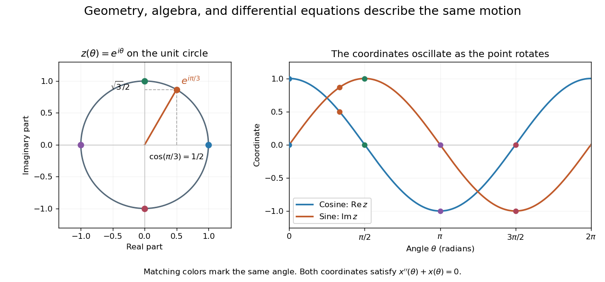

# Mathematics

↑ **Parent:** [Codex Wiki](split.md)  
ⓦ [Wiki](https://en.wikipedia.org/wiki/Mathematics)

Mathematics studies patterns in quantity, structure, space, and change by giving objects precise [mathematical definitions](mathematical-definition.md) and examining what follows from them. [Arithmetic](arithmetic-split.md) starts with operations on [numbers](number.md); [algebra](algebra-split.md) organizes relations and transformations; [geometry and topology](geometry-and-topology-split.md) studies shapes and the structures preserved by maps; [analysis](analysis-split.md) studies [limits](limit-of-a-function.md) and continuous change. These fields connect because the same structure can appear in different forms.

A small example shows the value of changing viewpoint. A point moving around the [unit circle](complex-unit-circle.md) has coordinates $x=\cos\theta$, $y=\sin\theta$. Regard the plane as [complex numbers](complex-number.md) and the same point is $z=e^{i\theta}$, by [Euler's formula](euler-s-formula.md). Adding two [angles](angle.md) now corresponds to multiplying their [complex exponentials](complex-exponential-function.md): $e^{i\alpha}e^{i\beta}=e^{i(\alpha+\beta)}$. A geometric rotation has become an algebraic operation.

The connection reaches [calculus](calculus-split.md) too. Differentiating twice gives $x''+x=0$ and $y''+y=0$, so the two coordinates solve the [harmonic oscillator equation](simple-harmonic-motion.md). At angle $\theta=\pi/3$, $z=1/2+i\sqrt3/2$; one point supplies an exact [cosine](cosine.md), an exact [sine](sine.md), and the state of an oscillation. The [Pythagorean trigonometric identity](pythagorean-trigonometric-identity.md) records that the [modulus](modulus.md) stays one. Seeing these as descriptions of one object makes each formula easier to remember and reuse.

**[Figure 1](#image-uniform-motion-around-the-unit-circle-connects-complex-exponentials-and-real-oscillations). Uniform motion around the unit circle connects complex exponentials and real oscillations**.

This is why a useful mathematical explanation provides both a reliable [mathematical proof](mathematical-proof.md) and a way to see what the result is doing. In his 1994 essay, [William Thurston](william-thurston.md) discusses mathematical progress in terms of advancing understanding, and uses the many interpretations of a [derivative](derivative.md) to illustrate this aim. [Thurston, On proof and progress in mathematics, sections 1–2](https://arxiv.org/abs/math/9404236) A diagram, a computed example, and a concise argument can make different parts of the same idea accessible.

Applications ask us to select a [mathematical model](mathematical-model.md) of a physical or other system. Its assumptions determine which conclusions transfer to that system. Within mathematics, the same practice of making assumptions explicit lets a result about [groups](group-split.md), [vector spaces](vector-space-split.md), or [probability distributions](probability-distribution.md) apply to many concrete examples. The beauty is the combination of precision and reuse: an argument can reveal more than the particular case that first suggested it.

**Table of contents**

- [Mathematics author](mathematics-author.md)
- [Mathematics bibliography](mathematics-bibliography.md)
- [Mathematical economics](mathematical-economics.md)
- [Scale invariance](scale-invariance.md)
- [Infinity](infinity.md)
- [Cantor function](cantor-function.md)
- [Cayley-Hamilton theorem](cayley-hamilton-theorem.md)
- [Chinese remainder theorem](chinese-remainder-theorem.md)
- [Cycle decomposition of a permutation](cycle-decomposition-of-a-permutation.md)
- [Mathematical model](mathematical-model.md)
- [Dimensionless variable](dimensionless-variable.md)
- [Transcendental equation](transcendental-equation.md)
- [Method of images](method-of-images.md)
- [Metrizable space](metrizable-space.md)
- [Nakayama lemma](nakayama-lemma.md)
- [Pattern waiting time](pattern-waiting-time.md)
- [Period of a function](period-of-a-function.md)
- [Quasi-steady approximation](quasi-steady-approximation.md)
- [Rational root theorem](rational-root-theorem.md)
- [Rodrigues rotation formula](rodrigues-rotation-formula.md)
- [Run of successes](run-of-successes.md)
- [Simultaneous diagonalization](simultaneous-diagonalization.md)
- [Spectral mapping theorem](spectral-mapping-theorem.md)
- [Termwise integration](termwise-integration.md)
- [Thomae function](thomae-function.md)
- [Zero divisor](zero-divisor.md)
- [Variable (mathematics)](variable-mathematics.md)
- [Constant (mathematics)](constant-mathematics.md)
- [Constant of proportionality](constant-of-proportionality.md)
- [Invariant (mathematics)](invariant-mathematics.md)
- [Mathematician](mathematician.md)
- [Area of mathematics](area-of-mathematics.md)

## ↑ Ancestors (1)

1. [Codex Wiki](split.md)

## ← Incoming links (5)

- [Area of mathematics](area-of-mathematics.md)
- [Computer science](computer-science-split.md)
- [Geophysics](geophysics-split.md)
- [Mathematical logic](mathematical-logic-split.md)
- [Set theory](set-theory-split.md)
