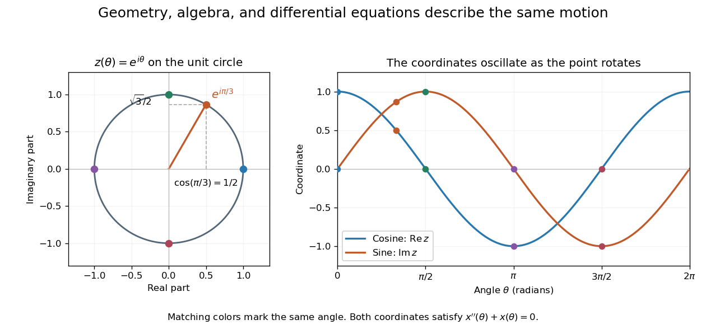

# Mathematics

↑ **Parent:** [Codex Wiki](split.md)  
ⓦ [Wiki](https://en.wikipedia.org/wiki/Mathematics)

Mathematics studies patterns in quantity, structure, space, and change by giving objects precise [mathematical definitions](mathematical-definition.md) and examining what follows from them. [Arithmetic](arithmetic-split.md) starts with operations on [numbers](number.md); [algebra](algebra-split.md) organizes relations and transformations; [geometry and topology](geometry-and-topology-split.md) studies shapes and the structures preserved by maps; [analysis](analysis-split.md) studies [limits](limit-of-a-function.md) and continuous change. These fields connect because the same structure can appear in different forms.

A small example shows the value of changing viewpoint. A point moving around the [unit circle](complex-unit-circle.md) has coordinates $x=\cos\theta$, $y=\sin\theta$. Regard the plane as [complex numbers](complex-number.md) and the same point is $z=e^{i\theta}$, by [Euler's formula](euler-s-formula.md). Adding two [angles](angle.md) now corresponds to multiplying their [complex exponentials](complex-exponential-function.md): $e^{i\alpha}e^{i\beta}=e^{i(\alpha+\beta)}$. A geometric rotation has become an algebraic operation.

The connection reaches [calculus](calculus-split.md) too. Differentiating twice gives $x''+x=0$ and $y''+y=0$, so the two coordinates solve the [harmonic oscillator equation](simple-harmonic-motion.md). At angle $\theta=\pi/3$, $z=1/2+i\sqrt3/2$; one point supplies an exact [cosine](cosine.md), an exact [sine](sine.md), and the state of an oscillation. The [Pythagorean trigonometric identity](pythagorean-trigonometric-identity.md) records that the [modulus](modulus.md) stays one. Seeing these as descriptions of one object makes each formula easier to remember and reuse.

**[Figure 1](#image-uniform-motion-around-the-unit-circle-connects-complex-exponentials-and-real-oscillations). Uniform motion around the unit circle connects complex exponentials and real oscillations**.

This is why a useful mathematical explanation provides both a reliable [mathematical proof](mathematical-proof.md) and a way to see what the result is doing. In his 1994 essay, [William Thurston](william-thurston.md) discusses mathematical progress in terms of advancing understanding, and uses the many interpretations of a [derivative](derivative.md) to illustrate this aim. [Thurston, On proof and progress in mathematics, sections 1–2](https://arxiv.org/abs/math/9404236) A diagram, a computed example, and a concise argument can make different parts of the same idea accessible.

Applications ask us to select a [mathematical model](mathematical-model.md) of a physical or other system. Its assumptions determine which conclusions transfer to that system. Within mathematics, the same practice of making assumptions explicit lets a result about [groups](group-split.md), [vector spaces](vector-space-split.md), or [probability distributions](probability-distribution-split.md) apply to many concrete examples. The beauty is the combination of precision and reuse: an argument can reveal more than the particular case that first suggested it.

**Table of contents**

- [Mathematics author](mathematics-author.md)
  - [Ralf Stephan](mathematics-author.md#ralf-stephan)
  - [John Harris (writer)](mathematics-author.md#john-harris-writer)
  - [Achi Brandt](mathematics-author.md#achi-brandt)
  - [Andrey Kolmogorov](mathematics-author.md#andrey-kolmogorov)
  - [Barry W. Peyton](mathematics-author.md#barry-w-peyton)
  - [Donald J. Rose](mathematics-author.md#donald-j-rose)
  - [Durham Statistics and Probability teaching team](mathematics-author.md#durham-statistics-and-probability-teaching-team)
  - [George S. Lueker](mathematics-author.md#george-s-lueker)
  - [Gilbert Strang](mathematics-author.md#gilbert-strang)
  - [Glenn Shafer](mathematics-author.md#glenn-shafer)
  - [James Demmel](mathematics-author.md#james-demmel)
  - [Jean R. S. Blair](mathematics-author.md#jean-r-s-blair)
  - [John Tsitsiklis](mathematics-author.md#john-tsitsiklis)
  - [Lieven Vandenberghe](mathematics-author.md#lieven-vandenberghe)
  - [Long Chen](mathematics-author.md#long-chen)
  - [Martin S. Andersen](mathematics-author.md#martin-s-andersen)
  - [Massachusetts Institute of Technology, Department of Electrical Engineering and Computer Science](mathematics-author.md#massachusetts-institute-of-technology-department-of-electrical-engineering-and-computer-science)
  - [Patrick Jaillet](mathematics-author.md#patrick-jaillet)
  - [Vladimir Vovk](mathematics-author.md#vladimir-vovk)
  - [William L. Briggs](mathematics-author.md#william-l-briggs)
  - [Carl Pomerance](mathematics-author.md#carl-pomerance)
  - [Jordan Bell](mathematics-author.md#jordan-bell)
  - [Romyar Sharifi](mathematics-author.md#romyar-sharifi)
  - [Tom Leinster](mathematics-author.md#tom-leinster)
  - [Edwin “Jed” Herman](mathematics-author.md#edwin-“jed”-herman)
  - [Jiří Lebl](mathematics-author.md#jiri-lebl)
  - [Andrew Lin](mathematics-author.md#andrew-lin)
  - [Casey Rodriguez](mathematics-author.md#casey-rodriguez)
  - [Martin Luther D'Ooge](mathematics-author.md#martin-luther-d-ooge)
  - [Nathanael Hahn](mathematics-author.md#nathanael-hahn)
  - [Robert G. Gallager](mathematics-author.md#robert-g-gallager)
  - [Günter Last](mathematics-author.md#gunter-last)
  - [Mathew Penrose](mathematics-author.md#mathew-penrose)
  - [Reinhard Diestel](mathematics-author.md#reinhard-diestel)
  - [Tuukka Korhonen](mathematics-author.md#tuukka-korhonen)
  - [Michał Pilipczuk](mathematics-author.md#michal-pilipczuk)
  - [Giannos Stamoulis](mathematics-author.md#giannos-stamoulis)
  - [Matt Pharr](mathematics-author.md#matt-pharr)
  - [Wenzel Jakob](mathematics-author.md#wenzel-jakob)
  - [Greg Humphreys](mathematics-author.md#greg-humphreys)
  - [Scott Le Grand](mathematics-author.md#scott-le-grand)
  - [Yury Polyanskiy](mathematics-author.md#yury-polyanskiy)
  - [Yihong Wu](mathematics-author.md#yihong-wu)
  - [Claude Shannon](mathematics-author.md#claude-shannon)
  - [Christian Clason](mathematics-author.md#christian-clason)
  - [Hubert W. Lilliefors](mathematics-author.md#hubert-w-lilliefors)
  - [Vladimir Dobrushkin](mathematics-author.md#vladimir-dobrushkin)
  - [A. F. Andersen](mathematics-author.md#a-f-andersen)
  - [Wissam Raji](mathematics-author.md#wissam-raji)
  - [James Milne (mathematician)](mathematics-author.md#james-milne-mathematician)
  - [John A. Beachy](mathematics-author.md#john-a-beachy)
  - [William D. Blair](mathematics-author.md#william-d-blair)
  - [Jonny Evans](mathematics-author.md#jonny-evans)
  - [Ryan Tibshirani](mathematics-author.md#ryan-tibshirani)
  - [Gavin C. Cawley](mathematics-author.md#gavin-c-cawley)
  - [Nicola L. C. Talbot](mathematics-author.md#nicola-l-c-talbot)
  - [Jeremy Orloff](mathematics-author.md#jeremy-orloff)
  - [Ranjan Roy](mathematics-author.md#ranjan-roy)
  - [Richard A. Askey](mathematics-author.md#richard-a-askey)
  - [Roderick S. C. Wong](mathematics-author.md#roderick-s-c-wong)
  - [William P. Reinhardt](mathematics-author.md#william-p-reinhardt)
  - [Darij Grinberg](mathematics-author.md#darij-grinberg)
  - [Tobin A. Driscoll](mathematics-author.md#tobin-a-driscoll)
  - [Richard J. Braun](mathematics-author.md#richard-j-braun)
  - [John Duchi](mathematics-author.md#john-duchi)
  - [Wassily Hoeffding](mathematics-author.md#wassily-hoeffding)
  - [Jan Verschelde](mathematics-author.md#jan-verschelde)
  - [Milan Mossé](mathematics-author.md#milan-mosse)
  - [Victor Shoup](mathematics-author.md#victor-shoup)
  - [David A. Huffman](mathematics-author.md#david-a-huffman)
  - [Ben Lynn](mathematics-author.md#ben-lynn)
  - [Scott Sheffield](mathematics-author.md#scott-sheffield)
  - [Rick Durrett](mathematics-author.md#rick-durrett)
  - [Ming Gu](mathematics-author.md#ming-gu)
  - [David Bindel](mathematics-author.md#david-bindel)
  - [Bruce Ikenaga](mathematics-author.md#bruce-ikenaga)
  - [Peter Cameron (mathematician)](mathematics-author.md#peter-cameron-mathematician)
  - [D. A. Preece](mathematics-author.md#d-a-preece)
  - [Ana Cannas da Silva](mathematics-author.md#ana-cannas-da-silva)
  - [Tilmann Gneiting](mathematics-author.md#tilmann-gneiting)
  - [Adrian Raftery](mathematics-author.md#adrian-raftery)
  - [I. J. Good](mathematics-author.md#i-j-good)
  - [Hossein Pishro-Nik](mathematics-author.md#hossein-pishro-nik)
  - [David A. Levin](mathematics-author.md#david-a-levin)
  - [Yuval Peres](mathematics-author.md#yuval-peres)
  - [Elizabeth L. Wilmer](mathematics-author.md#elizabeth-l-wilmer)
  - [LAPACK project](mathematics-author.md#lapack-project)
  - [Adrian Baddeley](mathematics-author.md#adrian-baddeley)
  - [Karl Dilcher](mathematics-author.md#karl-dilcher)
  - [Donald Knuth](mathematics-author.md#donald-knuth)
  - [Herman Chernoff](mathematics-author.md#herman-chernoff)
  - [Dan Margalit (mathematician)](mathematics-author.md#dan-margalit-mathematician)
  - [Joseph Rabinoff](mathematics-author.md#joseph-rabinoff)
  - [David I. Ketcheson](mathematics-author.md#david-i-ketcheson)
  - [Randall J. LeVeque](mathematics-author.md#randall-j-leveque)
  - [Mauricio J. del Razo](mathematics-author.md#mauricio-j-del-razo)
  - [Carl Edward Rasmussen](mathematics-author.md#carl-edward-rasmussen)
  - [Christopher K. I. Williams](mathematics-author.md#christopher-k-i-williams)
  - [Ryan Giordano](mathematics-author.md#ryan-giordano)
  - [Imre Csiszár](mathematics-author.md#imre-csiszar)
  - [Stephen Boyd](mathematics-author.md#stephen-boyd)
  - [Sheldon Axler](mathematics-author.md#sheldon-axler)
  - [John K. Hunter](mathematics-author.md#john-k-hunter)
  - [Paul C. Shields](mathematics-author.md#paul-c-shields)
  - [Andrew Granville](mathematics-author.md#andrew-granville)
  - [Kannan Soundararajan](mathematics-author.md#kannan-soundararajan)
  - [Stéphane Mallat](mathematics-author.md#stephane-mallat)
  - [Allen Hatcher](mathematics-author.md#allen-hatcher)
  - [J. Peter May](mathematics-author.md#j-peter-may)
  - [Tom M. Apostol](mathematics-author.md#tom-m-apostol)
  - [Edward Anderson](mathematics-author.md#edward-anderson)
  - [University of Tennessee](mathematics-author.md#university-of-tennessee)
  - [University of California Berkeley](mathematics-author.md#university-of-california-berkeley)
  - [University of Colorado Denver](mathematics-author.md#university-of-colorado-denver)
  - [NAG Ltd.](mathematics-author.md#nag-ltd)
  - [Simo Särkkä](mathematics-author.md#simo-sarkka)
  - [Arno Solin](mathematics-author.md#arno-solin)
  - [Kevin M. Lynch](mathematics-author.md#kevin-m-lynch)
  - [Frank C. Park](mathematics-author.md#frank-c-park)
  - [Constantin Teleman](mathematics-author.md#constantin-teleman)
  - [Nigel Hitchin](mathematics-author.md#nigel-hitchin)
  - [Peter H. Westfall](mathematics-author.md#peter-h-westfall)
  - [Janet Heine Barnett](mathematics-author.md#janet-heine-barnett)
  - [Timothy Gowers](mathematics-author.md#timothy-gowers)
  - [Gordan Žitković](mathematics-author.md#gordan-zitkovic)
  - [Arthur Cayley](mathematics-author.md#arthur-cayley)
  - [Frank Hampel](mathematics-author.md#frank-hampel)
  - [Peter J. Huber](mathematics-author.md#peter-j-huber)
  - [George Dantzig](mathematics-author.md#george-dantzig)
  - [D. R. Fulkerson](mathematics-author.md#d-r-fulkerson)
  - [Selmer M. Johnson](mathematics-author.md#selmer-m-johnson)
  - [William Rowan Hamilton](mathematics-author.md#william-rowan-hamilton)
  - [Arpon Raksit](mathematics-author.md#arpon-raksit)
  - [Michel Goemans](mathematics-author.md#michel-goemans)
  - [Cosma Rohilla Shalizi](mathematics-author.md#cosma-rohilla-shalizi)
  - [Stan Development Team](mathematics-author.md#stan-development-team)
  - [Victor Ivrii](mathematics-author.md#victor-ivrii)
  - [Bernard Bolzano](mathematics-author.md#bernard-bolzano)
  - [Karl Weierstrass](mathematics-author.md#karl-weierstrass)
  - [Will Fithian](mathematics-author.md#will-fithian)
- [Mathematics bibliography](mathematics-bibliography.md)
  - [Sequential Quadratic Programming Methods by Philip E. Gill and Elizabeth Wong](mathematics-bibliography.md#sequential-quadratic-programming-methods-by-philip-e-gill-and-elizabeth-wong)
  - [Topology and Groups by Marc Lackenby](mathematics-bibliography.md#topology-and-groups-by-marc-lackenby)
  - [John F. Banzhaf III faculty profile](mathematics-bibliography.md#john-f-banzhaf-iii-faculty-profile)
  - [Weighted Voting Doesn't Work: A Mathematical Analysis by John Banzhaf](mathematics-bibliography.md#weighted-voting-doesn-t-work-a-mathematical-analysis-by-john-banzhaf)
  - [A Value for N-Person Games by Lloyd Shapley (RAND paper)](mathematics-bibliography.md#a-value-for-n-person-games-by-lloyd-shapley-rand-paper)
  - [OEIS entry A005132](mathematics-bibliography.md#oeis-entry-a005132)
  - [IEEE arithmetic in Oracle's Numerical Computation Guide](mathematics-bibliography.md#ieee-arithmetic-in-oracle-s-numerical-computation-guide)
  - [On the Complexity of Cooperative Solution Concepts by Xiaotie Deng and Christos Papadimitriou](mathematics-bibliography.md#on-the-complexity-of-cooperative-solution-concepts-by-xiaotie-deng-and-christos-papadimitriou)
  - [Examiners' Report: Final Honour School of Mathematics Part A (2015)](mathematics-bibliography.md#examiners-report-final-honour-school-of-mathematics-part-a-2015)
  - [One dimensional minimization in the GNU Scientific Library manual](mathematics-bibliography.md#one-dimensional-minimization-in-the-gnu-scientific-library-manual)
  - [Markov Chains by James R. Norris](mathematics-bibliography.md#markov-chains-by-james-r-norris)
  - [Extensive games and the problem of information by Harold W. Kuhn](mathematics-bibliography.md#extensive-games-and-the-problem-of-information-by-harold-w-kuhn)
  - [Expected utility theory by EconPort](mathematics-bibliography.md#expected-utility-theory-by-econport)
  - [Two-Sample t-Test for Equal Means by National Institute of Standards and Technology](mathematics-bibliography.md#two-sample-t-test-for-equal-means-by-national-institute-of-standards-and-technology)
  - [The one-way ANOVA model and assumptions by National Institute of Standards and Technology](mathematics-bibliography.md#the-one-way-anova-model-and-assumptions-by-national-institute-of-standards-and-technology)
  - [One-Way ANOVA by National Institute of Standards and Technology](mathematics-bibliography.md#one-way-anova-by-national-institute-of-standards-and-technology)
  - [Discrete mathematics, continuous mathematics, and probability examination paper A10100W1 (2022)](mathematics-bibliography.md#discrete-mathematics-continuous-mathematics-and-probability-examination-paper-a10100w1-2022)
  - [Binomial Proportion Confidence Intervals by NIST](mathematics-bibliography.md#binomial-proportion-confidence-intervals-by-nist)
  - [Quasi-Newton Methods by NEOS Guide](mathematics-bibliography.md#quasi-newton-methods-by-neos-guide)
  - [A Class of Methods for Solving Nonlinear Simultaneous Equations by Charles George Broyden](mathematics-bibliography.md#a-class-of-methods-for-solving-nonlinear-simultaneous-equations-by-charles-george-broyden)
  - [Information theory examination paper A16551W1 (2023)](mathematics-bibliography.md#information-theory-examination-paper-a16551w1-2023)
  - [Non-bipartite matching lecture notes by MIT](mathematics-bibliography.md#non-bipartite-matching-lecture-notes-by-mit)
  - [The Practice of Social Research (13th edition) by Earl Babbie](mathematics-bibliography.md#the-practice-of-social-research-13th-edition-by-earl-babbie)
  - [The Difference Between Significant and Not Significant is not Itself Statistically Significant by Andrew Gelman and Hal Stern](mathematics-bibliography.md#the-difference-between-significant-and-not-significant-is-not-itself-statistically-significant-by-andrew-gelman-and-hal-stern)
  - [Rhind mathematical papyrus](mathematics-bibliography.md#rhind-mathematical-papyrus)
  - [Airy function asymptotics in the Digital Library of Mathematical Functions](mathematics-bibliography.md#airy-function-asymptotics-in-the-digital-library-of-mathematical-functions)
  - [Conformal Maps and Geometry by Dmitry Beliaev (2015 lecture notes)](mathematics-bibliography.md#conformal-maps-and-geometry-by-dmitry-beliaev-2015-lecture-notes)
  - [Continuity and Irrational Numbers by Richard Dedekind](mathematics-bibliography.md#continuity-and-irrational-numbers-by-richard-dedekind)
  - [Sur la convergence des séries trigonométriques qui servent à représenter une fonction arbitraire entre des limites données by Peter Gustav Lejeune Dirichlet](mathematics-bibliography.md#sur-la-convergence-des-series-trigonometriques-qui-servent-a-representer-une-fonction-arbitraire-entre-des-limites-donnees-by-peter-gustav-lejeune-dirichlet)
  - [The Analyst by George Berkeley](mathematics-bibliography.md#the-analyst-by-george-berkeley)
  - [Nova methodus pro maximis et minimis by Gottfried Wilhelm Leibniz](mathematics-bibliography.md#nova-methodus-pro-maximis-et-minimis-by-gottfried-wilhelm-leibniz)
  - [Introduction to the Quadrature of Curves by Isaac Newton](mathematics-bibliography.md#introduction-to-the-quadrature-of-curves-by-isaac-newton)
  - [An Investigation of the Laws of Thought by George Boole](mathematics-bibliography.md#an-investigation-of-the-laws-of-thought-by-george-boole)
  - [On Quaternions, or on a new System of Imaginaries in Algebra by William Rowan Hamilton](mathematics-bibliography.md#on-quaternions-or-on-a-new-system-of-imaginaries-in-algebra-by-william-rowan-hamilton)
  - [A Treatise on Algebra by George Peacock](mathematics-bibliography.md#a-treatise-on-algebra-by-george-peacock)
  - [Elements of Algebra by Leonhard Euler](mathematics-bibliography.md#elements-of-algebra-by-leonhard-euler)
  - [Arithmetica universalis by Isaac Newton](mathematics-bibliography.md#arithmetica-universalis-by-isaac-newton)
  - [La Géométrie by René Descartes](mathematics-bibliography.md#la-geometrie-by-rene-descartes)
  - [In artem analyticem isagoge by François Viète](mathematics-bibliography.md#in-artem-analyticem-isagoge-by-francois-viete)
  - [On the date of Cauchy's contributions to the founding of the theory of groups by Peter Michael Neumann](mathematics-bibliography.md#on-the-date-of-cauchy-s-contributions-to-the-founding-of-the-theory-of-groups-by-peter-michael-neumann)
  - [Augustin-Louis Cauchy by Hans Freudenthal](mathematics-bibliography.md#augustin-louis-cauchy-by-hans-freudenthal)
  - [Augustin-Louis Cauchy by the MacTutor History of Mathematics Archive](mathematics-bibliography.md#augustin-louis-cauchy-by-the-mactutor-history-of-mathematics-archive)
  - [Mémoire sur les intégrales définies, prises entre des limites imaginaires by Augustin-Louis Cauchy](mathematics-bibliography.md#memoire-sur-les-integrales-definies-prises-entre-des-limites-imaginaires-by-augustin-louis-cauchy)
  - [Résumé des leçons sur le calcul infinitésimal by Augustin-Louis Cauchy](mathematics-bibliography.md#resume-des-lecons-sur-le-calcul-infinitesimal-by-augustin-louis-cauchy)
  - [Cours d'analyse by Augustin-Louis Cauchy](mathematics-bibliography.md#cours-d-analyse-by-augustin-louis-cauchy)
  - [The abstract group concept by the MacTutor History of Mathematics Archive](mathematics-bibliography.md#the-abstract-group-concept-by-the-mactutor-history-of-mathematics-archive)
  - [Beweis des Satzes, dass jede eigentlich primitive quadratische Form unendlich viele Primzahlen darzustellen fähig ist by Heinrich Weber](mathematics-bibliography.md#beweis-des-satzes-dass-jede-eigentlich-primitive-quadratische-form-unendlich-viele-primzahlen-darzustellen-fahig-ist-by-heinrich-weber)
  - [Theoria residuorum biquadraticorum, commentatio secunda by Carl Friedrich Gauss](mathematics-bibliography.md#theoria-residuorum-biquadraticorum-commentatio-secunda-by-carl-friedrich-gauss)
  - [Announcement of the second biquadratic-residue memoir by Carl Friedrich Gauss](mathematics-bibliography.md#announcement-of-the-second-biquadratic-residue-memoir-by-carl-friedrich-gauss)
  - [A case of mathematical eponymy: the Vandermonde determinant by Bernard Ycart](mathematics-bibliography.md#a-case-of-mathematical-eponymy-the-vandermonde-determinant-by-bernard-ycart)
  - [Mémoire sur l'élimination by Alexandre-Théophile Vandermonde](mathematics-bibliography.md#memoire-sur-l-elimination-by-alexandre-theophile-vandermonde)
  - [Fermat's rule for maxima and minima by the Garden of Archimedes](mathematics-bibliography.md#fermat-s-rule-for-maxima-and-minima-by-the-garden-of-archimedes)
  - [Varia opera mathematica by Pierre de Fermat](mathematics-bibliography.md#varia-opera-mathematica-by-pierre-de-fermat)
  - [The Elements of Geometrie by Henry Billingsley](mathematics-bibliography.md#the-elements-of-geometrie-by-henry-billingsley)
  - [Error and attack tolerance of complex networks by Réka Albert and others](mathematics-bibliography.md#error-and-attack-tolerance-of-complex-networks-by-reka-albert-and-others)
  - [The chemical basis of morphogenesis by Alan Turing](mathematics-bibliography.md#the-chemical-basis-of-morphogenesis-by-alan-turing)
  - [Simple mathematical models with very complicated dynamics by Robert M. May](mathematics-bibliography.md#simple-mathematical-models-with-very-complicated-dynamics-by-robert-m-may)
  - [Emergence of scaling in random networks by Albert-László Barabási and Réka Albert](mathematics-bibliography.md#emergence-of-scaling-in-random-networks-by-albert-laszlo-barabasi-and-reka-albert)
  - [Collective dynamics of small-world networks by Duncan J. Watts and Steven H. Strogatz](mathematics-bibliography.md#collective-dynamics-of-small-world-networks-by-duncan-j-watts-and-steven-h-strogatz)
  - [Stan Reference Manual by Stan Development Team](mathematics-bibliography.md#stan-reference-manual-by-stan-development-team)
  - [Fast unfolding of communities in large networks by Vincent D. Blondel and others](mathematics-bibliography.md#fast-unfolding-of-communities-in-large-networks-by-vincent-d-blondel-and-others)
  - [Network ‘Small-World-Ness’: A Quantitative Method for Determining Canonical Network Equivalence by Mark D. Humphries and others](mathematics-bibliography.md#network-‘small-world-ness’-a-quantitative-method-for-determining-canonical-network-equivalence-by-mark-d-humphries-and-others)
  - [Simple Continued Fractions for Some Irrational Numbers by Jeffrey Shallit](mathematics-bibliography.md#simple-continued-fractions-for-some-irrational-numbers-by-jeffrey-shallit)
  - [Diocles by John Joseph O'Connor and Edmund Frederick Robertson](mathematics-bibliography.md#diocles-by-john-joseph-o-connor-and-edmund-frederick-robertson)
  - [A Multigrid Tutorial (lecture slides) by William L. Briggs](mathematics-bibliography.md#a-multigrid-tutorial-lecture-slides-by-william-l-briggs)
  - [Algorithmic Aspects of Vertex Elimination on Graphs by Donald J. Rose and others](mathematics-bibliography.md#algorithmic-aspects-of-vertex-elimination-on-graphs-by-donald-j-rose-and-others)
  - [An Introduction to Chordal Graphs and Clique Trees by Jean R. S. Blair and others](mathematics-bibliography.md#an-introduction-to-chordal-graphs-and-clique-trees-by-jean-r-s-blair-and-others)
  - [Chordal Graphs and Semidefinite Optimization by Lieven Vandenberghe and others](mathematics-bibliography.md#chordal-graphs-and-semidefinite-optimization-by-lieven-vandenberghe-and-others)
  - [Computational Science and Engineering by Gilbert Strang](mathematics-bibliography.md#computational-science-and-engineering-by-gilbert-strang)
  - [CS267: Supplemental Notes for Lecture 17 — How Multigrid Damps High Frequencies by James Demmel](mathematics-bibliography.md#cs267-supplemental-notes-for-lecture-17-how-multigrid-damps-high-frequencies-by-james-demmel)
  - [Grundbegriffe der Wahrscheinlichkeitsrechnung by Andrei N. Kolmogorov](mathematics-bibliography.md#grundbegriffe-der-wahrscheinlichkeitsrechnung-by-andrei-n-kolmogorov)
  - [Introduction to Multigrid Methods by Long Chen](mathematics-bibliography.md#introduction-to-multigrid-methods-by-long-chen)
  - [Introduction to Probability, Lecture 1: Probability Models and Axioms by John Tsitsiklis and others](mathematics-bibliography.md#introduction-to-probability-lecture-1-probability-models-and-axioms-by-john-tsitsiklis-and-others)
  - [Multi-Level Adaptive Solutions to Boundary-Value Problems by Achi Brandt](mathematics-bibliography.md#multi-level-adaptive-solutions-to-boundary-value-problems-by-achi-brandt)
  - [Probability 1 lecture notes, Chapter 1: Axioms of probability by Durham Statistics and Probability teaching team](mathematics-bibliography.md#probability-1-lecture-notes-chapter-1-axioms-of-probability-by-durham-statistics-and-probability-teaching-team)
  - [Recitation 8: Junction Trees by Massachusetts Institute of Technology, Department of Electrical Engineering and Computer Science](mathematics-bibliography.md#recitation-8-junction-trees-by-massachusetts-institute-of-technology-department-of-electrical-engineering-and-computer-science)
  - [The Sources of Kolmogorov’s Grundbegriffe by Glenn Shafer and others](mathematics-bibliography.md#the-sources-of-kolmogorov’s-grundbegriffe-by-glenn-shafer-and-others)
  - [Théorie analytique de la chaleur by Joseph Fourier](mathematics-bibliography.md#theorie-analytique-de-la-chaleur-by-joseph-fourier)
  - [Observations on a certain theorem of Fermat and on others concerning prime numbers by Leonhard Euler](mathematics-bibliography.md#observations-on-a-certain-theorem-of-fermat-and-on-others-concerning-prime-numbers-by-leonhard-euler)
  - [Primality testing: then and now by Carl Pomerance](mathematics-bibliography.md#primality-testing-then-and-now-by-carl-pomerance)
  - [Point-Set Topology by Romyar Sharifi](mathematics-bibliography.md#point-set-topology-by-romyar-sharifi)
  - [General Topology by Tom Leinster](mathematics-bibliography.md#general-topology-by-tom-leinster)
  - [Calculus Volume 1 by Gilbert Strang and others](mathematics-bibliography.md#calculus-volume-1-by-gilbert-strang-and-others)
  - [Basic Analysis: Introduction to Real Analysis, Volume I by Jiří Lebl](mathematics-bibliography.md#basic-analysis-introduction-to-real-analysis-volume-i-by-jiri-lebl)
  - [18.102 Introduction to Functional Analysis, Spring 2021 (lecture notes) by Andrew Lin](mathematics-bibliography.md#18-102-introduction-to-functional-analysis-spring-2021-lecture-notes-by-andrew-lin)
  - [Introduction to Arithmetic by Nicomachus (Hahn teacher edition)](mathematics-bibliography.md#introduction-to-arithmetic-by-nicomachus-hahn-teacher-edition)
  - [Discrete Stochastic Processes (draft of 2nd edition, 31 January 2011) by Robert Gallager](mathematics-bibliography.md#discrete-stochastic-processes-draft-of-2nd-edition-31-january-2011-by-robert-gallager)
  - [Lectures on the Poisson Process by Günter Last and others](mathematics-bibliography.md#lectures-on-the-poisson-process-by-gunter-last-and-others)
  - [Graph Theory by Reinhard Diestel](mathematics-bibliography.md#graph-theory-by-reinhard-diestel)
  - [Minor Containment and Disjoint Paths in almost-linear time by Tuukka Korhonen and others](mathematics-bibliography.md#minor-containment-and-disjoint-paths-in-almost-linear-time-by-tuukka-korhonen-and-others)
  - [Physically Based Rendering: From Theory to Implementation (4th edition) by Matt Pharr and others](mathematics-bibliography.md#physically-based-rendering-from-theory-to-implementation-4th-edition-by-matt-pharr-and-others)
  - [GPU Gems 3](mathematics-bibliography.md#gpu-gems-3)
  - [Collision: Dynamic Tree](mathematics-bibliography.md#collision-dynamic-tree)
  - [6.441 Information Theory (Spring 2016 lecture notes) by Yury Polyanskiy and others](mathematics-bibliography.md#6-441-information-theory-spring-2016-lecture-notes-by-yury-polyanskiy-and-others)
  - [A Mathematical Theory of Communication by Claude Shannon](mathematics-bibliography.md#a-mathematical-theory-of-communication-by-claude-shannon)
  - [Using the Borsuk-Ulam Theorem by Jiří Matoušek](mathematics-bibliography.md#using-the-borsuk-ulam-theorem-by-jiri-matousek)
  - [Drei Sätze über die n-dimensionale euklidische Sphäre by Karol Borsuk](mathematics-bibliography.md#drei-satze-uber-die-n-dimensionale-euklidische-sphare-by-karol-borsuk)
  - [Enumerative Combinatorics, Volume 1 (second-edition draft) by Richard Stanley](mathematics-bibliography.md#enumerative-combinatorics-volume-1-second-edition-draft-by-richard-stanley)
  - [Introduction to Finite Element Methods by Christian Clason](mathematics-bibliography.md#introduction-to-finite-element-methods-by-christian-clason)
  - [Bilinear Forms by Keith Conrad](mathematics-bibliography.md#bilinear-forms-by-keith-conrad)
  - [NIST and SEMATECH e-Handbook of Statistical Methods](mathematics-bibliography.md#nist-and-sematech-e-handbook-of-statistical-methods)
  - [Kolmogorov-Smirnov Tests (ks.test, R stats documentation)](mathematics-bibliography.md#kolmogorov-smirnov-tests-ks-test-r-stats-documentation)
  - [On the Kolmogorov-Smirnov Test for Normality with Mean and Variance Unknown by Hubert W. Lilliefors](mathematics-bibliography.md#on-the-kolmogorov-smirnov-test-for-normality-with-mean-and-variance-unknown-by-hubert-w-lilliefors)
  - [18.03SC Differential Equations, Fall 2011](mathematics-bibliography.md#18-03sc-differential-equations-fall-2011)
  - [Notes on Diffy Qs: Differential Equations for Engineers by Jiří Lebl](mathematics-bibliography.md#notes-on-diffy-qs-differential-equations-for-engineers-by-jiri-lebl)
  - [Basic Analysis: Introduction to Real Analysis, Volume II by Jiří Lebl](mathematics-bibliography.md#basic-analysis-introduction-to-real-analysis-volume-ii-by-jiri-lebl)
  - [Cesàro Summation (Mathematica tutorial) by Vladimir Dobrushkin](mathematics-bibliography.md#cesaro-summation-mathematica-tutorial-by-vladimir-dobrushkin)
  - [Sur la multiplication de séries absolument convergentes par des séries sommables par la méthode de Cesàro by A. F. Andersen](mathematics-bibliography.md#sur-la-multiplication-de-series-absolument-convergentes-par-des-series-sommables-par-la-methode-de-cesaro-by-a-f-andersen)
  - [254A – analytic prime number theory](mathematics-bibliography.md#254a-analytic-prime-number-theory)
  - [Elementary Number Theory](mathematics-bibliography.md#elementary-number-theory)
  - [Group Theory (v4.01) by James S. Milne](mathematics-bibliography.md#group-theory-v4-01-by-james-s-milne)
  - [Abstract Algebra (second edition) by John A. Beachy and others](mathematics-bibliography.md#abstract-algebra-second-edition-by-john-a-beachy-and-others)
  - [Topology and Groups](mathematics-bibliography.md#topology-and-groups)
  - [Data Mining: 36-462 and 36-662](mathematics-bibliography.md#data-mining-36-462-and-36-662)
  - [Advanced Topics in Statistical Learning, Spring 2023](mathematics-bibliography.md#advanced-topics-in-statistical-learning-spring-2023)
  - [On Over-fitting in Model Selection and Subsequent Selection Bias in Performance Evaluation by Gavin C. Cawley and others](mathematics-bibliography.md#on-over-fitting-in-model-selection-and-subsequent-selection-bias-in-performance-evaluation-by-gavin-c-cawley-and-others)
  - [Topic 11: Argument Principle by Jeremy Orloff](mathematics-bibliography.md#topic-11-argument-principle-by-jeremy-orloff)
  - [NIST Digital Library of Mathematical Functions](mathematics-bibliography.md#nist-digital-library-of-mathematical-functions)
  - [Solutio problematis ad geometriam situs pertinentis by Leonhard Euler](mathematics-bibliography.md#solutio-problematis-ad-geometriam-situs-pertinentis-by-leonhard-euler)
  - [Euler Archive, E53: Solutio problematis ad geometriam situs pertinentis](mathematics-bibliography.md#euler-archive-e53-solutio-problematis-ad-geometriam-situs-pertinentis)
  - [Math 530: Graph Theory (Combinatorial Mathematics I), Spring 2023](mathematics-bibliography.md#math-530-graph-theory-combinatorial-mathematics-i-spring-2023)
  - [Fundamentals of Numerical Computation by Tobin A. Driscoll and others](mathematics-bibliography.md#fundamentals-of-numerical-computation-by-tobin-a-driscoll-and-others)
  - [Calculus by Gilbert Strang](mathematics-bibliography.md#calculus-by-gilbert-strang)
  - [CS229 Supplemental Lecture notes](mathematics-bibliography.md#cs229-supplemental-lecture-notes)
  - [Probability Inequalities for Sums of Bounded Random Variables by Wassily Hoeffding](mathematics-bibliography.md#probability-inequalities-for-sums-of-bounded-random-variables-by-wassily-hoeffding)
  - [Rational Univariate Representation (Lecture 12) by Jan Verschelde](mathematics-bibliography.md#rational-univariate-representation-lecture-12-by-jan-verschelde)
  - [Newton's Identities (January 2019 notes) by Milan Mossé](mathematics-bibliography.md#newton-s-identities-january-2019-notes-by-milan-mosse)
  - [A Computational Introduction to Number Theory and Algebra by Victor Shoup](mathematics-bibliography.md#a-computational-introduction-to-number-theory-and-algebra-by-victor-shoup)
  - [Euler’s Theorem by Keith Conrad](mathematics-bibliography.md#euler’s-theorem-by-keith-conrad)
  - [Orders of Units in Modular Arithmetic by Keith Conrad](mathematics-bibliography.md#orders-of-units-in-modular-arithmetic-by-keith-conrad)
  - [A Method for the Construction of Minimum-Redundancy Codes by David A. Huffman](mathematics-bibliography.md#a-method-for-the-construction-of-minimum-redundancy-codes-by-david-a-huffman)
  - [Symbol Codes by Ben Lynn](mathematics-bibliography.md#symbol-codes-by-ben-lynn)
  - [18.175 Lecture 16: Conditional expectation, random walks, martingales by Scott Sheffield](mathematics-bibliography.md#18-175-lecture-16-conditional-expectation-random-walks-martingales-by-scott-sheffield)
  - [Probability: Theory and Examples (fifth edition) by Rick Durrett](mathematics-bibliography.md#probability-theory-and-examples-fifth-edition-by-rick-durrett)
  - [Templates for the Solution of Algebraic Eigenvalue Problems: A Practical Guide](mathematics-bibliography.md#templates-for-the-solution-of-algebraic-eigenvalue-problems-a-practical-guide)
  - [Numerical Analysis, Spring 2022](mathematics-bibliography.md#numerical-analysis-spring-2022)
  - [Coding Theorems for a Discrete Source With a Fidelity Criterion by Claude Shannon](mathematics-bibliography.md#coding-theorems-for-a-discrete-source-with-a-fidelity-criterion-by-claude-shannon)
  - [Wilson's Theorem and Fermat's Theorem by Bruce Ikenaga](mathematics-bibliography.md#wilson-s-theorem-and-fermat-s-theorem-by-bruce-ikenaga)
  - [Notes on primitive lambda-roots by Peter J. Cameron and others](mathematics-bibliography.md#notes-on-primitive-lambda-roots-by-peter-j-cameron-and-others)
  - [Handbook of Differential Geometry, Volume II](mathematics-bibliography.md#handbook-of-differential-geometry-volume-ii)
  - [Strictly Proper Scoring Rules, Prediction, and Estimation by Tilmann Gneiting and others](mathematics-bibliography.md#strictly-proper-scoring-rules-prediction-and-estimation-by-tilmann-gneiting-and-others)
  - [Rational Decisions by I. J. Good](mathematics-bibliography.md#rational-decisions-by-i-j-good)
  - [Group Actions by Keith Conrad](mathematics-bibliography.md#group-actions-by-keith-conrad)
  - [Transitive Group Actions by Keith Conrad](mathematics-bibliography.md#transitive-group-actions-by-keith-conrad)
  - [Algorithms, 4th edition by Robert Sedgewick and others](mathematics-bibliography.md#algorithms-4th-edition-by-robert-sedgewick-and-others)
  - [Introduction to Probability, Statistics, and Random Processes by Hossein Pishro-Nik](mathematics-bibliography.md#introduction-to-probability-statistics-and-random-processes-by-hossein-pishro-nik)
  - [Markov Chains and Mixing Times, second edition by David A. Levin and others](mathematics-bibliography.md#markov-chains-and-mixing-times-second-edition-by-david-a-levin-and-others)
  - [DGETRS (LAPACK 3.3.1) by LAPACK project](mathematics-bibliography.md#dgetrs-lapack-3-3-1-by-lapack-project)
  - [Stochastic Geometry: Lectures given at the C.I.M.E. Summer School held in Martina Franca, Italy, September 13-18, 2004](mathematics-bibliography.md#stochastic-geometry-lectures-given-at-the-c-i-m-e-summer-school-held-in-martina-franca-italy-september-13-18-2004)
  - [Johann Faulhaber and sums of powers by Donald E. Knuth](mathematics-bibliography.md#johann-faulhaber-and-sums-of-powers-by-donald-e-knuth)
  - [Information Theory: From Coding to Learning, October 2022 draft by Yury Polyanskiy and others](mathematics-bibliography.md#information-theory-from-coding-to-learning-october-2022-draft-by-yury-polyanskiy-and-others)
  - [A Measure of Asymptotic Efficiency for Tests of an Hypothesis Based on the Sum of Observations, technical report by Herman Chernoff](mathematics-bibliography.md#a-measure-of-asymptotic-efficiency-for-tests-of-an-hypothesis-based-on-the-sum-of-observations-technical-report-by-herman-chernoff)
  - [Interactive Linear Algebra by Dan Margalit and others](mathematics-bibliography.md#interactive-linear-algebra-by-dan-margalit-and-others)
  - [Linear Algebra, MIT 18.06, Spring 2010](mathematics-bibliography.md#linear-algebra-mit-18-06-spring-2010)
  - [Line graphs and edge coloring](mathematics-bibliography.md#line-graphs-and-edge-coloring)
  - [Riemann Problems and Jupyter Solutions by David I. Ketcheson, Randall J. LeVeque, and Mauricio J. del Razo](mathematics-bibliography.md#riemann-problems-and-jupyter-solutions-by-david-i-ketcheson-randall-j-leveque-and-mauricio-j-del-razo)
  - [Gaussian Processes for Machine Learning by Carl Edward Rasmussen and Christopher K. I. Williams](mathematics-bibliography.md#gaussian-processes-for-machine-learning-by-carl-edward-rasmussen-and-christopher-k-i-williams)
  - [The kernel trick by Ryan Giordano](mathematics-bibliography.md#the-kernel-trick-by-ryan-giordano)
  - [The Method of Types by Imre Csiszár](mathematics-bibliography.md#the-method-of-types-by-imre-csiszar)
  - [Information Theoretical Analysis of Multivariate Correlation by Satosi Watanabe](mathematics-bibliography.md#information-theoretical-analysis-of-multivariate-correlation-by-satosi-watanabe)
  - [Convex Optimization by Stephen Boyd and Lieven Vandenberghe](mathematics-bibliography.md#convex-optimization-by-stephen-boyd-and-lieven-vandenberghe)
  - [Measure, Integration & Real Analysis by Sheldon Axler](mathematics-bibliography.md#measure-integration-and-real-analysis-by-sheldon-axler)
  - [Measure Theory by John K. Hunter](mathematics-bibliography.md#measure-theory-by-john-k-hunter)
  - [Information Theory and Statistics: A Tutorial by Imre Csiszár and Paul C. Shields](mathematics-bibliography.md#information-theory-and-statistics-a-tutorial-by-imre-csiszar-and-paul-c-shields)
  - [I-Divergence Geometry of Probability Distributions and Minimization Problems by Imre Csiszár](mathematics-bibliography.md#i-divergence-geometry-of-probability-distributions-and-minimization-problems-by-imre-csiszar)
  - [Multiplicative number theory: The pretentious approach by Andrew Granville and K. Soundararajan](mathematics-bibliography.md#multiplicative-number-theory-the-pretentious-approach-by-andrew-granville-and-k-soundararajan)
  - [SciPy 1.16.2 documentation](mathematics-bibliography.md#scipy-1-16-2-documentation)
  - [A Wavelet Tour of Signal Processing by Stéphane Mallat](mathematics-bibliography.md#a-wavelet-tour-of-signal-processing-by-stephane-mallat)
  - [Linear Algebra Done Right by Sheldon Axler (4th edition)](mathematics-bibliography.md#linear-algebra-done-right-by-sheldon-axler-4th-edition)
  - [Tensor Products I by Keith Conrad](mathematics-bibliography.md#tensor-products-i-by-keith-conrad)
  - [An elementary proof of a theorem of Johnson and Lindenstrauss by Sanjoy Dasgupta and Anupam Gupta](mathematics-bibliography.md#an-elementary-proof-of-a-theorem-of-johnson-and-lindenstrauss-by-sanjoy-dasgupta-and-anupam-gupta)
  - [Lecture notes on metric embeddings by Jiří Matoušek](mathematics-bibliography.md#lecture-notes-on-metric-embeddings-by-jiri-matousek)
  - [Algebraic Topology by Allen Hatcher](mathematics-bibliography.md#algebraic-topology-by-allen-hatcher)
  - [A Concise Course in Algebraic Topology by J. P. May](mathematics-bibliography.md#a-concise-course-in-algebraic-topology-by-j-p-may)
  - [18.357 Interfacial Phenomena lecture notes (Fall 2010)](mathematics-bibliography.md#18-357-interfacial-phenomena-lecture-notes-fall-2010)
  - [Geometry of catenoidal soap film collapse induced by boundary deformation by Raymond E. Goldstein and others](mathematics-bibliography.md#geometry-of-catenoidal-soap-film-collapse-induced-by-boundary-deformation-by-raymond-e-goldstein-and-others)
  - [Planar Graphs; Bipartite Matching by Albert R. Meyer (6.042J lecture 5f)](mathematics-bibliography.md#planar-graphs-bipartite-matching-by-albert-r-meyer-6-042j-lecture-5f)
  - [Mathematics for Computer Science by Eric Lehman and others](mathematics-bibliography.md#mathematics-for-computer-science-by-eric-lehman-and-others)
  - [Quadratic Reciprocity by Ben Lynn](mathematics-bibliography.md#quadratic-reciprocity-by-ben-lynn)
  - [DLARTG (LAPACK 3.12.1) by Edward Anderson](mathematics-bibliography.md#dlartg-lapack-3-12-1-by-edward-anderson)
  - [DROT (Reference BLAS, LAPACK 3.12.1) by LAPACK project](mathematics-bibliography.md#drot-reference-blas-lapack-3-12-1-by-lapack-project)
  - [On the Theory of the Brownian Motion by G. E. Uhlenbeck and L. S. Ornstein](mathematics-bibliography.md#on-the-theory-of-the-brownian-motion-by-g-e-uhlenbeck-and-l-s-ornstein)
  - [Applied Stochastic Differential Equations by Simo Särkkä and Arno Solin](mathematics-bibliography.md#applied-stochastic-differential-equations-by-simo-sarkka-and-arno-solin)
  - [A Primal-Dual Potential Reduction Method for Problems Involving Matrix Inequalities by Lieven Vandenberghe and Stephen Boyd](mathematics-bibliography.md#a-primal-dual-potential-reduction-method-for-problems-involving-matrix-inequalities-by-lieven-vandenberghe-and-stephen-boyd)
  - [Modern Robotics: Mechanics, Planning, and Control by Kevin M. Lynch and Frank C. Park](mathematics-bibliography.md#modern-robotics-mechanics-planning-and-control-by-kevin-m-lynch-and-frank-c-park)
  - [Riemann Surfaces by Constantin Teleman (Lent Term 2003)](mathematics-bibliography.md#riemann-surfaces-by-constantin-teleman-lent-term-2003)
  - [Geometry of Surfaces by Nigel Hitchin (B3a course 2013)](mathematics-bibliography.md#geometry-of-surfaces-by-nigel-hitchin-b3a-course-2013)
  - [Kurtosis as Peakedness, 1905 – 2014. R.I.P. by Peter H. Westfall](mathematics-bibliography.md#kurtosis-as-peakedness-1905-2014-r-i-p-by-peter-h-westfall)
  - [DGTSV (LAPACK 3.12.1) by LAPACK project](mathematics-bibliography.md#dgtsv-lapack-3-12-1-by-lapack-project)
  - [Thomas algorithm (NPTEL Lecture 13)](mathematics-bibliography.md#thomas-algorithm-nptel-lecture-13)
  - [Abstract awakenings in algebra: Early group theory in the works of Lagrange, Cauchy, and Cayley by Janet Heine Barnett](mathematics-bibliography.md#abstract-awakenings-in-algebra-early-group-theory-in-the-works-of-lagrange-cauchy-and-cayley-by-janet-heine-barnett)
  - [Zorn’s Lemma and Some Applications by Keith Conrad](mathematics-bibliography.md#zorn’s-lemma-and-some-applications-by-keith-conrad)
  - [How to use Zorn’s lemma by Timothy Gowers](mathematics-bibliography.md#how-to-use-zorn’s-lemma-by-timothy-gowers)
  - [Lecture notes for Introduction to Stochastic Processes by Gordan Žitković](mathematics-bibliography.md#lecture-notes-for-introduction-to-stochastic-processes-by-gordan-zitkovic)
  - [The Influence Curve and Its Role in Robust Estimation by Frank R. Hampel](mathematics-bibliography.md#the-influence-curve-and-its-role-in-robust-estimation-by-frank-r-hampel)
  - [Robust Estimation of a Location Parameter by Peter J. Huber](mathematics-bibliography.md#robust-estimation-of-a-location-parameter-by-peter-j-huber)
  - [Solution of a Large-Scale Traveling-Salesman Problem by George B. Dantzig and others](mathematics-bibliography.md#solution-of-a-large-scale-traveling-salesman-problem-by-george-b-dantzig-and-others)
  - [The Icosian Calculus, Hamilton papers archive](mathematics-bibliography.md#the-icosian-calculus-hamilton-papers-archive)
  - [18.901, Fall 2024 lecture notes](mathematics-bibliography.md#18-901-fall-2024-lecture-notes)
  - [The Weierstrass approximation theorem (Georgia Tech handout)](mathematics-bibliography.md#the-weierstrass-approximation-theorem-georgia-tech-handout)
  - [Matroid optimization by Michel Goemans](mathematics-bibliography.md#matroid-optimization-by-michel-goemans)
  - [Advanced Data Analysis from an Elementary Point of View, 2015 draft by Cosma Rohilla Shalizi](mathematics-bibliography.md#advanced-data-analysis-from-an-elementary-point-of-view-2015-draft-by-cosma-rohilla-shalizi)
  - [Stan User's Guide by Stan Development Team](mathematics-bibliography.md#stan-user-s-guide-by-stan-development-team)
  - [Partial Differential Equations by Victor Ivrii](mathematics-bibliography.md#partial-differential-equations-by-victor-ivrii)
  - [Asymptotic and Perturbation Methods by Victor Ivrii](mathematics-bibliography.md#asymptotic-and-perturbation-methods-by-victor-ivrii)
  - [Information Theory I — Scene Setting and Statistical Applications (Lecture 9)](mathematics-bibliography.md#information-theory-i-scene-setting-and-statistical-applications-lecture-9)
  - [Notes on the design of a conference scheduler by David R. MacIver](mathematics-bibliography.md#notes-on-the-design-of-a-conference-scheduler-by-david-r-maciver)
  - [Sufficiency (Stat 210a, Fall 2025) by Will Fithian](mathematics-bibliography.md#sufficiency-stat-210a-fall-2025-by-will-fithian)
  - [Fermat's Test by Keith Conrad](mathematics-bibliography.md#fermat-s-test-by-keith-conrad)
  - [Mycielski graphs and PR proofs by Emre Yolcu and others](mathematics-bibliography.md#mycielski-graphs-and-pr-proofs-by-emre-yolcu-and-others)
  - [Ordinary Differential Equations and Dynamical Systems by Gerald Teschl](mathematics-bibliography.md#ordinary-differential-equations-and-dynamical-systems-by-gerald-teschl)
  - [Condition Estimates for Pseudo-Arclength Continuation by K. I. Dickson and others](mathematics-bibliography.md#condition-estimates-for-pseudo-arclength-continuation-by-k-i-dickson-and-others)
  - [246B, Notes 1: Zeroes, poles, and factorisation of meromorphic functions by Terence Tao](mathematics-bibliography.md#246b-notes-1-zeroes-poles-and-factorisation-of-meromorphic-functions-by-terence-tao)
  - [Regression towards mediocrity in hereditary stature by Francis Galton](mathematics-bibliography.md#regression-towards-mediocrity-in-hereditary-stature-by-francis-galton)
  - [Curves and Surfaces in Geometric Modeling: Theory and Algorithms by Jean Gallier](mathematics-bibliography.md#curves-and-surfaces-in-geometric-modeling-theory-and-algorithms-by-jean-gallier)
  - [On the sums of series of reciprocals by Leonhard Euler](mathematics-bibliography.md#on-the-sums-of-series-of-reciprocals-by-leonhard-euler)
  - [Two theorems in graph theory by Claude Berge](mathematics-bibliography.md#two-theorems-in-graph-theory-by-claude-berge)
  - [Inequalities by Godfrey Harold Hardy and others](mathematics-bibliography.md#inequalities-by-godfrey-harold-hardy-and-others)
  - [Perfect numbers and Mersenne primes by Keith Conrad](mathematics-bibliography.md#perfect-numbers-and-mersenne-primes-by-keith-conrad)
  - [Euclid's Elements by Euclid](mathematics-bibliography.md#euclid-s-elements-by-euclid)
  - [On Orientations and Shortest Paths by Refael Hassin and others](mathematics-bibliography.md#on-orientations-and-shortest-paths-by-refael-hassin-and-others)
  - [Introduction to Probability by Charles M. Grinstead and J. Laurie Snell](mathematics-bibliography.md#introduction-to-probability-by-charles-m-grinstead-and-j-laurie-snell)
  - [Bijective Proof Problems by Richard P. Stanley](mathematics-bibliography.md#bijective-proof-problems-by-richard-p-stanley)
  - [History of Catalan numbers by Igor Pak](mathematics-bibliography.md#history-of-catalan-numbers-by-igor-pak)
  - [Wie weet wie Willem Wijthoff was? by Robbert Fokkink](mathematics-bibliography.md#wie-weet-wie-willem-wijthoff-was-by-robbert-fokkink)
  - [P-adic numbers by Jan-Hendrik Evertse](mathematics-bibliography.md#p-adic-numbers-by-jan-hendrik-evertse)
  - [The p-adic expansion of rational numbers by Keith Conrad](mathematics-bibliography.md#the-p-adic-expansion-of-rational-numbers-by-keith-conrad)
  - [Asymptotic Analysis and Singular Perturbation Theory by John K. Hunter](mathematics-bibliography.md#asymptotic-analysis-and-singular-perturbation-theory-by-john-k-hunter)
  - [Maximum Likelihood from Incomplete Data via the EM Algorithm by Arthur Pentland Dempster and others](mathematics-bibliography.md#maximum-likelihood-from-incomplete-data-via-the-em-algorithm-by-arthur-pentland-dempster-and-others)
  - [A Guide to Complex Variables by Steven G. Krantz](mathematics-bibliography.md#a-guide-to-complex-variables-by-steven-g-krantz)
  - [Branch Points and Branch Cuts by Rodolfo R. Rosales](mathematics-bibliography.md#branch-points-and-branch-cuts-by-rodolfo-r-rosales)
  - [Numerical solution of ordinary differential equations: One step methods by André Jürgen Massing](mathematics-bibliography.md#numerical-solution-of-ordinary-differential-equations-one-step-methods-by-andre-jurgen-massing)
  - [245C, Notes 2: The Fourier transform by Terence Tao](mathematics-bibliography.md#245c-notes-2-the-fourier-transform-by-terence-tao)
  - [Number Theory I, MIT 18.785, Fall 2021](mathematics-bibliography.md#number-theory-i-mit-18-785-fall-2021)
  - [Nonlinear Optimization, MIT 6.7220 and 15.084, Spring 2025](mathematics-bibliography.md#nonlinear-optimization-mit-6-7220-and-15-084-spring-2025)
  - [Sampling Theory](mathematics-bibliography.md#sampling-theory)
  - [Intro to Lattice Algs & Crypto, Mastermath Spring 2018](mathematics-bibliography.md#intro-to-lattice-algs-and-crypto-mastermath-spring-2018)
  - [Topology I: smooth manifolds, University of Toronto MAT1300HF, 2012](mathematics-bibliography.md#topology-i-smooth-manifolds-university-of-toronto-mat1300hf-2012)
  - [Introduction to Topological Manifolds, second edition by John M. Lee](mathematics-bibliography.md#introduction-to-topological-manifolds-second-edition-by-john-m-lee)
  - [Sur les équations différentielles linéaires à coefficients périodiques by Gaston Floquet (1883)](mathematics-bibliography.md#sur-les-equations-differentielles-lineaires-a-coefficients-periodiques-by-gaston-floquet-1883)
  - [Dihedral Groups by Keith Conrad](mathematics-bibliography.md#dihedral-groups-by-keith-conrad)
  - [Random: Probability, Mathematical Statistics, Stochastic Processes by Kyle Siegrist](mathematics-bibliography.md#random-probability-mathematical-statistics-stochastic-processes-by-kyle-siegrist)
  - [Prealgebra 2e by Lynn Marecek and others](mathematics-bibliography.md#prealgebra-2e-by-lynn-marecek-and-others)
  - [Calculus Volume 3 by Gilbert Strang and others](mathematics-bibliography.md#calculus-volume-3-by-gilbert-strang-and-others)
  - [Discrete Mathematics: An Open Introduction (3rd edition) by Oscar Levin](mathematics-bibliography.md#discrete-mathematics-an-open-introduction-3rd-edition-by-oscar-levin)
  - [Exterior Powers by Keith Conrad](mathematics-bibliography.md#exterior-powers-by-keith-conrad)
  - [Quadratic Residue Patterns Modulo a Prime by Keith Conrad](mathematics-bibliography.md#quadratic-residue-patterns-modulo-a-prime-by-keith-conrad)
  - [Quadratic Residues by Ben Lynn](mathematics-bibliography.md#quadratic-residues-by-ben-lynn)
  - [Precalculus 2e by Jay Abramson](mathematics-bibliography.md#precalculus-2e-by-jay-abramson)
  - [Carmichael Numbers and Korselt's Criterion by Keith Conrad](mathematics-bibliography.md#carmichael-numbers-and-korselt-s-criterion-by-keith-conrad)
  - [Zbytky z arithmetické posloupnosti by Václav Šimerka](mathematics-bibliography.md#zbytky-z-arithmeticke-posloupnosti-by-vaclav-simerka)
  - [Remarks on the Cauchy functional equation and variations of it by Daniel Reem](mathematics-bibliography.md#remarks-on-the-cauchy-functional-equation-and-variations-of-it-by-daniel-reem)
  - [Math 221, Matrix Computations, Fall 2009](mathematics-bibliography.md#math-221-matrix-computations-fall-2009)
  - [UW STAT 535: Statistical Machine Learning, Autumn 2026](mathematics-bibliography.md#uw-stat-535-statistical-machine-learning-autumn-2026)
  - [Bootstrap Methods: Another Look at the Jackknife by Bradley Efron, 1979 journal article](mathematics-bibliography.md#bootstrap-methods-another-look-at-the-jackknife-by-bradley-efron-1979-journal-article)
  - [Bootstrap Methods: Another Look at the Jackknife by Bradley Efron, BIO 32 technical report](mathematics-bibliography.md#bootstrap-methods-another-look-at-the-jackknife-by-bradley-efron-bio-32-technical-report)
  - [Complex Variables with Applications, MIT 18.04, Spring 2018](mathematics-bibliography.md#complex-variables-with-applications-mit-18-04-spring-2018)
  - [Complex Analysis Lecture Notes by Dan Romik](mathematics-bibliography.md#complex-analysis-lecture-notes-by-dan-romik)
  - [18.03 Supplementary Notes by Haynes Miller](mathematics-bibliography.md#18-03-supplementary-notes-by-haynes-miller)
  - [18.02SC Multivariable Calculus, Fall 2010](mathematics-bibliography.md#18-02sc-multivariable-calculus-fall-2010)
  - [Cantor-Schroeder-Bernstein Theorem by Paul Garrett](mathematics-bibliography.md#cantor-schroeder-bernstein-theorem-by-paul-garrett)
  - [DPOTRF (LAPACK 3.12.1) by LAPACK project](mathematics-bibliography.md#dpotrf-lapack-3-12-1-by-lapack-project)
  - [ZPOTRF (LAPACK 3.12.1) by LAPACK project](mathematics-bibliography.md#zpotrf-lapack-3-12-1-by-lapack-project)
  - [La méthode de Cholesky by Claude Brezinski](mathematics-bibliography.md#la-methode-de-cholesky-by-claude-brezinski)
  - [Fields and Galois Theory by James S. Milne](mathematics-bibliography.md#fields-and-galois-theory-by-james-s-milne)
  - [Abstract Algebra by Romyar Sharifi](mathematics-bibliography.md#abstract-algebra-by-romyar-sharifi)
  - [Über den Variabilitätsbereich der Fourier’schen Konstanten von positiven harmonischen Funktionen by Constantin Carathéodory](mathematics-bibliography.md#uber-den-variabilitatsbereich-der-fourier’schen-konstanten-von-positiven-harmonischen-funktionen-by-constantin-caratheodory)
  - [Experimental unit (NC3Rs Experimental Design Assistant)](mathematics-bibliography.md#experimental-unit-nc3rs-experimental-design-assistant)
  - [Pseudoreplication and the Design of Ecological Field Experiments by Stuart H. Hurlbert](mathematics-bibliography.md#pseudoreplication-and-the-design-of-ecological-field-experiments-by-stuart-h-hurlbert)
  - [Convex geometry (BME course BMETE94AM22)](mathematics-bibliography.md#convex-geometry-bme-course-bmete94am22)
  - [David Milman (1912–1982) by Israel Gohberg and others](mathematics-bibliography.md#david-milman-1912-1982-by-israel-gohberg-and-others)
  - [On extreme points of regular convex sets by Mark Krein and David Milman](mathematics-bibliography.md#on-extreme-points-of-regular-convex-sets-by-mark-krein-and-david-milman)
  - [Calculus Volume 2 by Gilbert Strang and others](mathematics-bibliography.md#calculus-volume-2-by-gilbert-strang-and-others)
  - [Math 221, Matrix Computations, Fall 2023](mathematics-bibliography.md#math-221-matrix-computations-fall-2023)
  - [François Viète by John Joseph O'Connor and Edmund Frederick Robertson](mathematics-bibliography.md#francois-viete-by-john-joseph-o-connor-and-edmund-frederick-robertson)
  - [John Joseph O'Connor by John Joseph O'Connor and Edmund Frederick Robertson](mathematics-bibliography.md#john-joseph-o-connor-by-john-joseph-o-connor-and-edmund-frederick-robertson)
  - [Edmund Frederick Robertson by John Joseph O'Connor and Edmund Frederick Robertson](mathematics-bibliography.md#edmund-frederick-robertson-by-john-joseph-o-connor-and-edmund-frederick-robertson)
  - [Intermediate Algebra 2e by Lynn Marecek and Andrea Honeycutt Mathis](mathematics-bibliography.md#intermediate-algebra-2e-by-lynn-marecek-and-andrea-honeycutt-mathis)
  - [Al-Khwarizmi by John Joseph O'Connor and Edmund Frederick Robertson](mathematics-bibliography.md#al-khwarizmi-by-john-joseph-o-connor-and-edmund-frederick-robertson)
  - [Lecture 7a: Efron Stein inequality by Purnamrita Sarkar](mathematics-bibliography.md#lecture-7a-efron-stein-inequality-by-purnamrita-sarkar)
  - [The Jackknife Estimate of Variance by Bradley Efron and Charles M. Stein](mathematics-bibliography.md#the-jackknife-estimate-of-variance-by-bradley-efron-and-charles-m-stein)
  - [Bradley Efron's Profile, Stanford University](mathematics-bibliography.md#bradley-efron-s-profile-stanford-university)
  - [Ueber einen Mittelwerthssatz by Otto Hölder](mathematics-bibliography.md#ueber-einen-mittelwerthssatz-by-otto-holder)
  - [Ludwig Otto Hölder by John Joseph O'Connor and Edmund Frederick Robertson](mathematics-bibliography.md#ludwig-otto-holder-by-john-joseph-o-connor-and-edmund-frederick-robertson)
  - [Number Theory for Mathematical Contests by David Anthony Santos](mathematics-bibliography.md#number-theory-for-mathematical-contests-by-david-anthony-santos)
  - [Real Analysis Lecture Notes: 3.5 Functions of Bounded Variation by Christopher E. Heil](mathematics-bibliography.md#real-analysis-lecture-notes-3-5-functions-of-bounded-variation-by-christopher-e-heil)
  - [Marie Ennemond Camille Jordan by John Joseph O'Connor and Edmund Frederick Robertson](mathematics-bibliography.md#marie-ennemond-camille-jordan-by-john-joseph-o-connor-and-edmund-frederick-robertson)
  - [Curriculum Vitae by Christopher E. Heil](mathematics-bibliography.md#curriculum-vitae-by-christopher-e-heil)
  - [Universal Identities by Keith Conrad](mathematics-bibliography.md#universal-identities-by-keith-conrad)
  - [A Memoir on the Theory of Matrices by Arthur Cayley](mathematics-bibliography.md#a-memoir-on-the-theory-of-matrices-by-arthur-cayley)
  - [On the shortest spanning subtree of a graph and the traveling salesman problem by Joseph Bernard Kruskal](mathematics-bibliography.md#on-the-shortest-spanning-subtree-of-a-graph-and-the-traveling-salesman-problem-by-joseph-bernard-kruskal)
  - [Bayes Factors by Robert E. Kass and Adrian E. Raftery](mathematics-bibliography.md#bayes-factors-by-robert-e-kass-and-adrian-e-raftery)
  - [Elementa doctrinae solidorum by Leonhard Euler](mathematics-bibliography.md#elementa-doctrinae-solidorum-by-leonhard-euler)
  - [Joseph Bernard Kruskal, Jr. by John Joseph O'Connor and Edmund Frederick Robertson](mathematics-bibliography.md#joseph-bernard-kruskal-jr-by-john-joseph-o-connor-and-edmund-frederick-robertson)
  - [All of Nonparametric Statistics by Larry Wasserman](mathematics-bibliography.md#all-of-nonparametric-statistics-by-larry-wasserman)
  - [STAT 414: Introduction to Probability Theory at Pennsylvania State University](mathematics-bibliography.md#stat-414-introduction-to-probability-theory-at-pennsylvania-state-university)
  - [The Probable Error of a Mean by William Sealy Gosset](mathematics-bibliography.md#the-probable-error-of-a-mean-by-william-sealy-gosset)
  - [William Sealy Gosset by John Joseph O'Connor and Edmund Frederick Robertson](mathematics-bibliography.md#william-sealy-gosset-by-john-joseph-o-connor-and-edmund-frederick-robertson)
  - [Gosset, William Sealy (‘Student’) by Philip J. Boland](mathematics-bibliography.md#gosset-william-sealy-‘student’-by-philip-j-boland)
  - [SciPy 1.18.0 documentation](mathematics-bibliography.md#scipy-1-18-0-documentation)
  - [Algebraic Techniques and Semidefinite Optimization, MIT 6.972, Spring 2006](mathematics-bibliography.md#algebraic-techniques-and-semidefinite-optimization-mit-6-972-spring-2006)
  - [Power laws, Pareto distributions and Zipf's law by Mark Newman](mathematics-bibliography.md#power-laws-pareto-distributions-and-zipf-s-law-by-mark-newman)
  - [College Admissions and the Stability of Marriage by David Gale and Lloyd Shapley](mathematics-bibliography.md#college-admissions-and-the-stability-of-marriage-by-david-gale-and-lloyd-shapley)
  - [NIST Dataplot Reference Manual](mathematics-bibliography.md#nist-dataplot-reference-manual)
  - [The Collected Mathematical Papers of James Joseph Sylvester, Volume I](mathematics-bibliography.md#the-collected-mathematical-papers-of-james-joseph-sylvester-volume-i)
  - [Applications of Parallel Computers, CS267, Spring 1996](mathematics-bibliography.md#applications-of-parallel-computers-cs267-spring-1996)
  - [Optimization by Simulated Annealing by Scott Kirkpatrick and others](mathematics-bibliography.md#optimization-by-simulated-annealing-by-scott-kirkpatrick-and-others)
  - [Sur certains processus stochastiques homogènes by Paul Lévy](mathematics-bibliography.md#sur-certains-processus-stochastiques-homogenes-by-paul-levy)
  - [Delay-differential equations by Skip Thompson](mathematics-bibliography.md#delay-differential-equations-by-skip-thompson)
  - [Principles of geostatistics by Georges Matheron](mathematics-bibliography.md#principles-of-geostatistics-by-georges-matheron)
- [Discrete mathematics](discrete-mathematics.md)
- [Mathematical notation](mathematical-notation.md)
  - [Numeral system](numeral-system.md)
  - [Expression notation](expression-notation.md)
- [Normalization](normalization.md)
- [Approximation](approximation.md)
- [Order theory](order-theory.md)
- [Numeral notation](numeral-notation.md)
- [Mathematical economics](mathematical-economics.md)
  - [Utility](utility.md)
  - [General equilibrium theory](general-equilibrium-theory.md)
- [Scale invariance](scale-invariance.md)
  - [Dilatation](dilatation.md)
- [Infinity](infinity.md)
- [Cantor function](cantor-function.md)
- [Chinese remainder theorem](chinese-remainder-theorem.md)
  - [Common power residues from coprime exponent congruences](common-power-residues-from-coprime-exponent-congruences.md)
  - [Consecutive integers divisible by prescribed prime powers](consecutive-integers-divisible-by-prescribed-prime-powers.md)
  - [Garner's algorithm](garner-s-algorithm.md)
  - [Chinese remainder theorem for noncoprime moduli](chinese-remainder-theorem-for-noncoprime-moduli.md)
  - [Chinese remainder theorem for ideals](chinese-remainder-theorem-for-ideals.md)
  - [Prime-power fraction decomposition](prime-power-fraction-decomposition.md)
  - [Lagrange theorem for polynomial congruences](lagrange-theorem-for-polynomial-congruences.md)
  - [Chinese remainder theorem for unit groups](chinese-remainder-theorem-for-unit-groups.md)
- [Cycle decomposition of a permutation](cycle-decomposition-of-a-permutation.md)
  - [Permutations without two-cycles](permutations-without-two-cycles.md)
- [Mathematical model](mathematical-model.md)
  - [Parameter](parameter.md)
  - [Mathematical model parameter](mathematical-model-parameter.md)
  - [Box model](box-model.md)
  - [Computer simulation](computer-simulation.md)
  - [Agent-based modeling](agent-based-modeling.md)
  - [Uncertainty quantification](uncertainty-quantification.md)
  - [Model validation](model-validation.md)
  - [Model verification](model-verification.md)
- [Dimensionless variable](dimensionless-variable.md)
- [Transcendental equation](transcendental-equation.md)
- [Method of images](method-of-images.md)
  - [Unequal charges above a grounded conducting plane](unequal-charges-above-a-grounded-conducting-plane.md)
  - [Electric dipole above a grounded conducting plane](electric-dipole-above-a-grounded-conducting-plane.md)
  - [Image charges in a sixty-degree conducting wedge](image-charges-in-a-sixty-degree-conducting-wedge.md)
  - [Image line charge for a grounded conducting cylinder](image-line-charge-for-a-grounded-conducting-cylinder.md)
  - [Image force on a line charge above a conducting plane](image-force-on-a-line-charge-above-a-conducting-plane.md)
  - [Finite image construction for a planar wedge](finite-image-construction-for-a-planar-wedge.md)
  - [Neumann image lattice for a point source in a strip](neumann-image-lattice-for-a-point-source-in-a-strip.md)
  - [Cylinder-plane image charges](cylinder-plane-image-charges.md)
  - [Spherical Neumann dipole images](spherical-neumann-dipole-images.md)
  - [Unfolding a reflected interval trajectory](unfolding-a-reflected-interval-trajectory.md)
- [Metrizable space](metrizable-space.md)
  - [Urysohn's metrization theorem](urysohn-s-metrization-theorem.md)
  - [Metrizable separability and the Lindelöf property](metrizable-separability-and-the-lindelof-property.md)
- [Nakayama lemma](nakayama-lemma.md)
  - [Compact Nakayama lemma](compact-nakayama-lemma.md)
  - [Graded Nakayama lemma](graded-nakayama-lemma.md)
- [Pattern waiting time](pattern-waiting-time.md)
  - [Waiting time for a word in independent nonuniform symbols](waiting-time-for-a-word-in-independent-nonuniform-symbols.md)
- [Period of a function](period-of-a-function.md)
- [Quasi-steady approximation](quasi-steady-approximation.md)
- [Rational root theorem](rational-root-theorem.md)
- [Rodrigues rotation formula](rodrigues-rotation-formula.md)
- [Run of successes](run-of-successes.md)
- [Simultaneous diagonalization](simultaneous-diagonalization.md)
  - [Eigenvalue addition in a common eigenbasis](eigenvalue-addition-in-a-common-eigenbasis.md)
  - [Commuting symmetric matrices have a common orthonormal eigenbasis](commuting-symmetric-matrices-have-a-common-orthonormal-eigenbasis.md)
  - [Simple spectrum gives simultaneous diagonalization](simple-spectrum-gives-simultaneous-diagonalization.md)
  - [Joint spectrum](joint-spectrum.md)
- [Spectral mapping theorem](spectral-mapping-theorem.md)
  - [Holomorphic spectral mapping theorem](holomorphic-spectral-mapping-theorem.md)
  - [Resolvent spectral mapping identity](resolvent-spectral-mapping-identity.md)
- [Termwise integration](termwise-integration.md)
- [Thomae function](thomae-function.md)
  - [Reduced-denominator function unbounded on every interval](reduced-denominator-function-unbounded-on-every-interval.md)
- [Zero divisor](zero-divisor.md)
  - [Non-zero-divisor](non-zero-divisor.md)
- [Variable (mathematics)](variable-mathematics.md)
- [Constant (mathematics)](constant-mathematics.md)
- [Constant of proportionality](constant-of-proportionality.md)
- [Invariant (mathematics)](invariant-mathematics.md)
- [Mathematician](mathematician.md)
  - [Joseph Bertrand](joseph-bertrand.md)
  - [List of mathematicians](list-of-mathematicians.md)
  - [Richard Dedekind](richard-dedekind.md)
  - [Christiaan Huygens](christiaan-huygens.md)
  - [Carl Friedrich Gauss](carl-friedrich-gauss.md)
  - [William Thurston](william-thurston.md)
  - [Nicomachus](nicomachus.md)
  - [Pierre Wantzel](pierre-wantzel.md)
  - [Pierre de Fermat](pierre-de-fermat.md)
  - [Leonhard Euler](leonhard-euler.md)
  - [Samuel Eilenberg](samuel-eilenberg.md)
  - [Saunders Mac Lane](saunders-mac-lane.md)
  - [Blaise Pascal](blaise-pascal.md)
  - [Simon Stevin](simon-stevin.md)
  - [Maurice Fréchet](maurice-frechet.md)
  - [William George Horner](william-george-horner.md)
  - [Brook Taylor](brook-taylor.md)
  - [John Napier](john-napier.md)
  - [Johan Jensen](johan-jensen.md)
  - [Richard Bellman](richard-bellman.md)
  - [Pafnuty Chebyshev](pafnuty-chebyshev.md)
  - [Joseph Fourier](joseph-fourier.md)
  - [Josiah Willard Gibbs](josiah-willard-gibbs.md)
  - [Jiří Matoušek (mathematician)](jiri-matousek-mathematician.md)
  - [Karol Borsuk](karol-borsuk.md)
  - [Richard P. Stanley](richard-p-stanley.md)
  - [Ernesto Cesàro](ernesto-cesaro.md)
  - [Luigi Guido Grandi](luigi-guido-grandi.md)
  - [Albert Girard](albert-girard.md)
  - [Isaac Newton](isaac-newton.md)
- [History of mathematics](history-of-mathematics.md)
  - [Logistica speciosa](logistica-speciosa.md)
  - [Logistica numerosa](logistica-numerosa.md)
  - [Universal arithmetic](universal-arithmetic.md)
  - [Symbolical algebra](symbolical-algebra.md)
  - [Arithmetical algebra](arithmetical-algebra.md)
  - [Adequality](adequality.md)
  - [Historian of mathematics](historian-of-mathematics.md)
- [Area of mathematics](area-of-mathematics.md)
  - [Algebra](algebra.md)
  - [Analysis](analysis.md)
  - [Arithmetic](arithmetic.md)
  - [Combinatorics](combinatorics.md)
  - [Control theory](control-theory.md)
  - [Foundations of mathematics](foundations-of-mathematics.md)
  - [Geometry and topology](geometry-and-topology.md)
  - [Mathematical optimization](mathematical-optimization.md)
  - [Number theory](number-theory.md)
  - [Probability and statistics](probability-and-statistics.md)
  - [Glossary of areas of mathematics](glossary-of-areas-of-mathematics.md)

## ↑ Ancestors (1)

1. [Codex Wiki](split.md)

## ← Incoming links (32)

- [Academic achievement](academic-achievement.md)
- [Andrea Honeycutt Mathis](andrea-honeycutt-mathis.md)
- [Area of mathematics](area-of-mathematics.md)
- [Computer science](computer-science-split.md)
- [Geophysics](geophysics-split.md)
- [Lynn Marecek](lynn-marecek.md)
- [MaryAnne Anthony-Smith](maryanne-anthony-smith.md)
- [Mathematical logic](mathematical-logic-split.md)
- [Mixed mathematics](mixed-mathematics.md)
- [MSc in mathematical sciences course of the University of Oxford](msc-in-mathematical-sciences-course-of-the-university-of-oxford.md)
- [Solution](past-exam-of-the-developmental-science-course-of-the-year-2-of-the-psychology-experimental-course-of-the-university-of-oxford/2022/1/solution.md)
- [Solution](past-exam-of-the-history-of-science-supplementary-subject-of-the-university-of-oxford/2016/2/solution.md)
- [Solution](past-exam-of-the-history-of-science-supplementary-subject-of-the-university-of-oxford/2016/3/solution.md)
- [Solution](past-exam-of-the-history-of-science-supplementary-subject-of-the-university-of-oxford/2018/2/solution.md)
- [Solution](past-exam-of-the-history-of-science-supplementary-subject-of-the-university-of-oxford/2022/1/solution.md)
- [Solution](past-exam-of-the-history-of-science-supplementary-subject-of-the-university-of-oxford/2022/8/solution.md)
- [Solution](past-exam-of-the-year-1-of-the-computer-science-course-of-the-university-of-oxford/2015/discrete-mathematics-continuous-mathematics-and-probability-resit/8/b/iii/solution.md)
- [Project Euler](project-euler-split.md)
- [Set theory](set-theory-split.md)
- [University of Oxford](university-of-oxford-split.md)
- [Year 1 of the computer science and philosophy course of the University of Oxford](year-1-of-the-computer-science-and-philosophy-course-of-the-university-of-oxford.md)
- [Year 1 of the mathematics and computer science course of the University of Oxford](year-1-of-the-mathematics-and-computer-science-course-of-the-university-of-oxford.md)
- [Year 1 of the mathematics and philosophy course of the University of Oxford](year-1-of-the-mathematics-and-philosophy-course-of-the-university-of-oxford.md)
- [Year 1 of the mathematics course of the University of Oxford](year-1-of-the-mathematics-course-of-the-university-of-oxford.md)
- [Year 2 of the materials science course of the University of Oxford](year-2-of-the-materials-science-course-of-the-university-of-oxford.md)
- [Year 2 of the mathematics and computer science course of the University of Oxford](year-2-of-the-mathematics-and-computer-science-course-of-the-university-of-oxford.md)
- [Year 2 of the mathematics and philosophy course of the University of Oxford](year-2-of-the-mathematics-and-philosophy-course-of-the-university-of-oxford.md)
- [Year 2 of the mathematics and statistics course of the University of Oxford](year-2-of-the-mathematics-and-statistics-course-of-the-university-of-oxford.md)
- [Year 3 of the mathematics and philosophy course of the University of Oxford](year-3-of-the-mathematics-and-philosophy-course-of-the-university-of-oxford.md)
- [Year 4 of the mathematics and computer science course of the University of Oxford](year-4-of-the-mathematics-and-computer-science-course-of-the-university-of-oxford.md)
- [Year 4 of the mathematics and philosophy course of the University of Oxford](year-4-of-the-mathematics-and-philosophy-course-of-the-university-of-oxford.md)
- [Year 4 of the mathematics and statistics course of the University of Oxford](year-4-of-the-mathematics-and-statistics-course-of-the-university-of-oxford.md)
