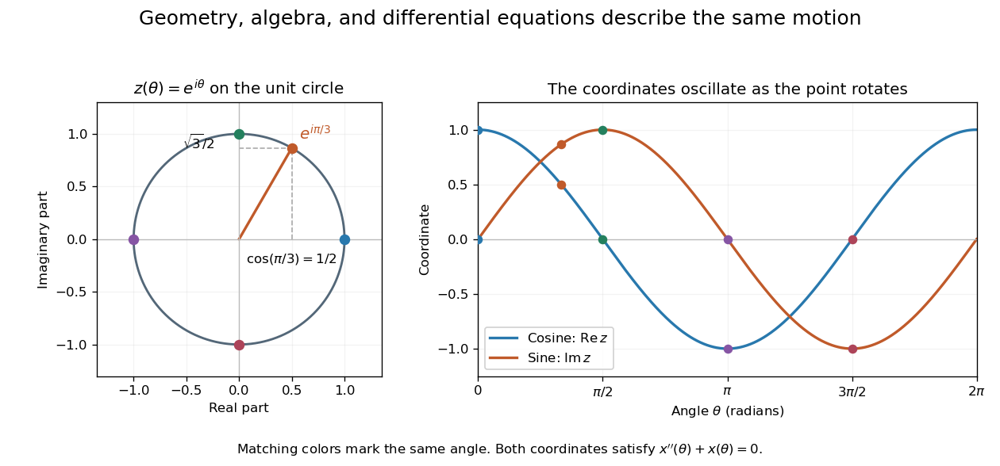
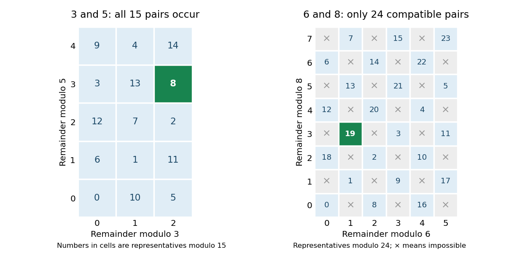

# Mathematics

↑ **Parent:** [Codex Wiki](README.md)  
ⓦ [Wiki](https://en.wikipedia.org/wiki/Mathematics)

Mathematics studies patterns in quantity, structure, space, and change by giving objects precise [mathematical definitions](foundations-of-mathematics.md#mathematical-definition) and examining what follows from them. [Arithmetic](arithmetic.md) starts with operations on [numbers](arithmetic.md#number); [algebra](algebra.md) organizes relations and transformations; [geometry and topology](geometry-and-topology.md) studies shapes and the structures preserved by maps; [analysis](analysis.md) studies [limits](calculus.md#limit-of-a-function) and continuous change. These fields connect because the same structure can appear in different forms.

A small example shows the value of changing viewpoint. A point moving around the [unit circle](complex-analysis.md#complex-unit-circle) has coordinates $x=\cos\theta$, $y=\sin\theta$. Regard the plane as [complex numbers](complex-analysis.md#complex-number) and the same point is $z=e^{i\theta}$, by [Euler's formula](complex-analysis.md#euler-s-formula). Adding two [angles](geometry-and-topology.md#angle) now corresponds to multiplying their [complex exponentials](calculus.md#complex-exponential-function): $e^{i\alpha}e^{i\beta}=e^{i(\alpha+\beta)}$. A geometric rotation has become an algebraic operation.

The connection reaches [calculus](calculus.md) too. Differentiating twice gives $x''+x=0$ and $y''+y=0$, so the two coordinates solve the [harmonic oscillator equation](classical-mechanics.md#simple-harmonic-motion). At angle $\theta=\pi/3$, $z=1/2+i\sqrt3/2$; one point supplies an exact [cosine](geometry-and-topology.md#cosine), an exact [sine](geometry-and-topology.md#sine), and the state of an oscillation. The [Pythagorean trigonometric identity](geometry-and-topology.md#pythagorean-trigonometric-identity) records that the [modulus](complex-analysis.md#modulus) stays one. Seeing these as descriptions of one object makes each formula easier to remember and reuse.

**[Figure 1](#image-uniform-motion-around-the-unit-circle-connects-complex-exponentials-and-real-oscillations). Uniform motion around the unit circle connects complex exponentials and real oscillations**.

This is why a useful mathematical explanation provides both a reliable [mathematical proof](foundations-of-mathematics.md#mathematical-proof) and a way to see what the result is doing. In his 1994 essay, [William Thurston](#william-thurston) discusses mathematical progress in terms of advancing understanding, and uses the many interpretations of a [derivative](calculus.md#derivative) to illustrate this aim. [Thurston, On proof and progress in mathematics, sections 1–2](https://arxiv.org/abs/math/9404236) A diagram, a computed example, and a concise argument can make different parts of the same idea accessible.

Applications ask us to select a [mathematical model](#mathematical-model) of a physical or other system. Its assumptions determine which conclusions transfer to that system. Within mathematics, the same practice of making assumptions explicit lets a result about [groups](group.md), [vector spaces](vector-space.md), or [probability distributions](probability-distribution.md) apply to many concrete examples. The beauty is the combination of precision and reuse: an argument can reveal more than the particular case that first suggested it.

**Table of contents**

- [Mathematics author](mathematics-author.md)
  - [Ralf Stephan](mathematics-author.md#ralf-stephan)
  - [John Harris (writer)](mathematics-author.md#john-harris-writer)
  - [Achi Brandt](mathematics-author.md#achi-brandt)
  - [Andrey Kolmogorov](mathematics-author.md#andrey-kolmogorov)
  - [Barry W. Peyton](mathematics-author.md#barry-w-peyton)
  - [Donald J. Rose](mathematics-author.md#donald-j-rose)
  - [Durham Statistics and Probability teaching team](mathematics-author.md#durham-statistics-and-probability-teaching-team)
  - [George S. Lueker](mathematics-author.md#george-s-lueker)
  - [Gilbert Strang](mathematics-author.md#gilbert-strang)
  - [Glenn Shafer](mathematics-author.md#glenn-shafer)
  - [James Demmel](mathematics-author.md#james-demmel)
  - [Jean R. S. Blair](mathematics-author.md#jean-r-s-blair)
  - [John Tsitsiklis](mathematics-author.md#john-tsitsiklis)
  - [Lieven Vandenberghe](mathematics-author.md#lieven-vandenberghe)
  - [Long Chen](mathematics-author.md#long-chen)
  - [Martin S. Andersen](mathematics-author.md#martin-s-andersen)
  - [Massachusetts Institute of Technology, Department of Electrical Engineering and Computer Science](mathematics-author.md#massachusetts-institute-of-technology-department-of-electrical-engineering-and-computer-science)
  - [Patrick Jaillet](mathematics-author.md#patrick-jaillet)
  - [Vladimir Vovk](mathematics-author.md#vladimir-vovk)
  - [William L. Briggs](mathematics-author.md#william-l-briggs)
  - [Carl Pomerance](mathematics-author.md#carl-pomerance)
  - [Jordan Bell](mathematics-author.md#jordan-bell)
  - [Romyar Sharifi](mathematics-author.md#romyar-sharifi)
  - [Tom Leinster](mathematics-author.md#tom-leinster)
  - [Edwin “Jed” Herman](mathematics-author.md#edwin-“jed”-herman)
  - [Jiří Lebl](mathematics-author.md#jiri-lebl)
  - [Andrew Lin](mathematics-author.md#andrew-lin)
  - [Casey Rodriguez](mathematics-author.md#casey-rodriguez)
  - [Martin Luther D'Ooge](mathematics-author.md#martin-luther-d-ooge)
  - [Nathanael Hahn](mathematics-author.md#nathanael-hahn)
  - [Robert G. Gallager](mathematics-author.md#robert-g-gallager)
  - [Günter Last](mathematics-author.md#gunter-last)
  - [Mathew Penrose](mathematics-author.md#mathew-penrose)
  - [Reinhard Diestel](mathematics-author.md#reinhard-diestel)
  - [Tuukka Korhonen](mathematics-author.md#tuukka-korhonen)
  - [Michał Pilipczuk](mathematics-author.md#michal-pilipczuk)
  - [Giannos Stamoulis](mathematics-author.md#giannos-stamoulis)
  - [Matt Pharr](mathematics-author.md#matt-pharr)
  - [Wenzel Jakob](mathematics-author.md#wenzel-jakob)
  - [Greg Humphreys](mathematics-author.md#greg-humphreys)
  - [Scott Le Grand](mathematics-author.md#scott-le-grand)
  - [Yury Polyanskiy](mathematics-author.md#yury-polyanskiy)
  - [Yihong Wu](mathematics-author.md#yihong-wu)
  - [Claude Shannon](mathematics-author.md#claude-shannon)
  - [Christian Clason](mathematics-author.md#christian-clason)
  - [Hubert W. Lilliefors](mathematics-author.md#hubert-w-lilliefors)
  - [Vladimir Dobrushkin](mathematics-author.md#vladimir-dobrushkin)
  - [A. F. Andersen](mathematics-author.md#a-f-andersen)
  - [Wissam Raji](mathematics-author.md#wissam-raji)
  - [James Milne (mathematician)](mathematics-author.md#james-milne-mathematician)
  - [John A. Beachy](mathematics-author.md#john-a-beachy)
  - [William D. Blair](mathematics-author.md#william-d-blair)
  - [Jonny Evans](mathematics-author.md#jonny-evans)
  - [Ryan Tibshirani](mathematics-author.md#ryan-tibshirani)
  - [Gavin C. Cawley](mathematics-author.md#gavin-c-cawley)
  - [Nicola L. C. Talbot](mathematics-author.md#nicola-l-c-talbot)
  - [Jeremy Orloff](mathematics-author.md#jeremy-orloff)
  - [Ranjan Roy](mathematics-author.md#ranjan-roy)
  - [Richard A. Askey](mathematics-author.md#richard-a-askey)
  - [Roderick S. C. Wong](mathematics-author.md#roderick-s-c-wong)
  - [William P. Reinhardt](mathematics-author.md#william-p-reinhardt)
  - [Darij Grinberg](mathematics-author.md#darij-grinberg)
  - [Tobin A. Driscoll](mathematics-author.md#tobin-a-driscoll)
  - [Richard J. Braun](mathematics-author.md#richard-j-braun)
  - [John Duchi](mathematics-author.md#john-duchi)
  - [Wassily Hoeffding](mathematics-author.md#wassily-hoeffding)
  - [Jan Verschelde](mathematics-author.md#jan-verschelde)
  - [Milan Mossé](mathematics-author.md#milan-mosse)
  - [Victor Shoup](mathematics-author.md#victor-shoup)
  - [David A. Huffman](mathematics-author.md#david-a-huffman)
  - [Ben Lynn](mathematics-author.md#ben-lynn)
  - [Scott Sheffield](mathematics-author.md#scott-sheffield)
  - [Rick Durrett](mathematics-author.md#rick-durrett)
  - [Ming Gu](mathematics-author.md#ming-gu)
  - [David Bindel](mathematics-author.md#david-bindel)
  - [Bruce Ikenaga](mathematics-author.md#bruce-ikenaga)
  - [Peter Cameron (mathematician)](mathematics-author.md#peter-cameron-mathematician)
  - [D. A. Preece](mathematics-author.md#d-a-preece)
  - [Ana Cannas da Silva](mathematics-author.md#ana-cannas-da-silva)
  - [Tilmann Gneiting](mathematics-author.md#tilmann-gneiting)
  - [Adrian Raftery](mathematics-author.md#adrian-raftery)
  - [I. J. Good](mathematics-author.md#i-j-good)
  - [Hossein Pishro-Nik](mathematics-author.md#hossein-pishro-nik)
  - [David A. Levin](mathematics-author.md#david-a-levin)
  - [Yuval Peres](mathematics-author.md#yuval-peres)
  - [Elizabeth L. Wilmer](mathematics-author.md#elizabeth-l-wilmer)
  - [LAPACK project](mathematics-author.md#lapack-project)
  - [Adrian Baddeley](mathematics-author.md#adrian-baddeley)
  - [Karl Dilcher](mathematics-author.md#karl-dilcher)
  - [Donald Knuth](mathematics-author.md#donald-knuth)
  - [Herman Chernoff](mathematics-author.md#herman-chernoff)
  - [Dan Margalit (mathematician)](mathematics-author.md#dan-margalit-mathematician)
  - [Joseph Rabinoff](mathematics-author.md#joseph-rabinoff)
  - [David I. Ketcheson](mathematics-author.md#david-i-ketcheson)
  - [Randall J. LeVeque](mathematics-author.md#randall-j-leveque)
  - [Mauricio J. del Razo](mathematics-author.md#mauricio-j-del-razo)
  - [Carl Edward Rasmussen](mathematics-author.md#carl-edward-rasmussen)
  - [Christopher K. I. Williams](mathematics-author.md#christopher-k-i-williams)
  - [Ryan Giordano](mathematics-author.md#ryan-giordano)
  - [Imre Csiszár](mathematics-author.md#imre-csiszar)
  - [Stephen Boyd](mathematics-author.md#stephen-boyd)
  - [Sheldon Axler](mathematics-author.md#sheldon-axler)
  - [John K. Hunter](mathematics-author.md#john-k-hunter)
  - [Paul C. Shields](mathematics-author.md#paul-c-shields)
  - [Andrew Granville](mathematics-author.md#andrew-granville)
  - [Kannan Soundararajan](mathematics-author.md#kannan-soundararajan)
  - [Stéphane Mallat](mathematics-author.md#stephane-mallat)
  - [Allen Hatcher](mathematics-author.md#allen-hatcher)
  - [J. Peter May](mathematics-author.md#j-peter-may)
  - [Tom M. Apostol](mathematics-author.md#tom-m-apostol)
  - [Edward Anderson](mathematics-author.md#edward-anderson)
  - [University of Tennessee](mathematics-author.md#university-of-tennessee)
  - [University of California Berkeley](mathematics-author.md#university-of-california-berkeley)
  - [University of Colorado Denver](mathematics-author.md#university-of-colorado-denver)
  - [NAG Ltd.](mathematics-author.md#nag-ltd)
  - [Simo Särkkä](mathematics-author.md#simo-sarkka)
  - [Arno Solin](mathematics-author.md#arno-solin)
  - [Kevin M. Lynch](mathematics-author.md#kevin-m-lynch)
  - [Frank C. Park](mathematics-author.md#frank-c-park)
  - [Constantin Teleman](mathematics-author.md#constantin-teleman)
  - [Nigel Hitchin](mathematics-author.md#nigel-hitchin)
  - [Peter H. Westfall](mathematics-author.md#peter-h-westfall)
  - [Janet Heine Barnett](mathematics-author.md#janet-heine-barnett)
  - [Timothy Gowers](mathematics-author.md#timothy-gowers)
  - [Gordan Žitković](mathematics-author.md#gordan-zitkovic)
  - [Arthur Cayley](mathematics-author.md#arthur-cayley)
  - [Frank Hampel](mathematics-author.md#frank-hampel)
  - [Peter J. Huber](mathematics-author.md#peter-j-huber)
  - [George Dantzig](mathematics-author.md#george-dantzig)
  - [D. R. Fulkerson](mathematics-author.md#d-r-fulkerson)
  - [Selmer M. Johnson](mathematics-author.md#selmer-m-johnson)
  - [William Rowan Hamilton](mathematics-author.md#william-rowan-hamilton)
  - [Arpon Raksit](mathematics-author.md#arpon-raksit)
  - [Michel Goemans](mathematics-author.md#michel-goemans)
  - [Cosma Rohilla Shalizi](mathematics-author.md#cosma-rohilla-shalizi)
  - [Stan Development Team](mathematics-author.md#stan-development-team)
  - [Victor Ivrii](mathematics-author.md#victor-ivrii)
  - [Bernard Bolzano](mathematics-author.md#bernard-bolzano)
  - [Karl Weierstrass](mathematics-author.md#karl-weierstrass)
  - [Will Fithian](mathematics-author.md#will-fithian)
- [Mathematics bibliography](mathematics-bibliography.md)
  - [Sequential Quadratic Programming Methods by Philip E. Gill and Elizabeth Wong](mathematics-bibliography.md#sequential-quadratic-programming-methods-by-philip-e-gill-and-elizabeth-wong)
  - [Topology and Groups by Marc Lackenby](mathematics-bibliography.md#topology-and-groups-by-marc-lackenby)
  - [John F. Banzhaf III faculty profile](mathematics-bibliography.md#john-f-banzhaf-iii-faculty-profile)
  - [Weighted Voting Doesn't Work: A Mathematical Analysis by John Banzhaf](mathematics-bibliography.md#weighted-voting-doesn-t-work-a-mathematical-analysis-by-john-banzhaf)
  - [A Value for N-Person Games by Lloyd Shapley (RAND paper)](mathematics-bibliography.md#a-value-for-n-person-games-by-lloyd-shapley-rand-paper)
  - [OEIS entry A005132](mathematics-bibliography.md#oeis-entry-a005132)
  - [IEEE arithmetic in Oracle's Numerical Computation Guide](mathematics-bibliography.md#ieee-arithmetic-in-oracle-s-numerical-computation-guide)
  - [On the Complexity of Cooperative Solution Concepts by Xiaotie Deng and Christos Papadimitriou](mathematics-bibliography.md#on-the-complexity-of-cooperative-solution-concepts-by-xiaotie-deng-and-christos-papadimitriou)
  - [Examiners' Report: Final Honour School of Mathematics Part A (2015)](mathematics-bibliography.md#examiners-report-final-honour-school-of-mathematics-part-a-2015)
  - [One dimensional minimization in the GNU Scientific Library manual](mathematics-bibliography.md#one-dimensional-minimization-in-the-gnu-scientific-library-manual)
  - [Markov Chains by James R. Norris](mathematics-bibliography.md#markov-chains-by-james-r-norris)
  - [Extensive games and the problem of information by Harold W. Kuhn](mathematics-bibliography.md#extensive-games-and-the-problem-of-information-by-harold-w-kuhn)
  - [Expected utility theory by EconPort](mathematics-bibliography.md#expected-utility-theory-by-econport)
  - [Two-Sample t-Test for Equal Means by National Institute of Standards and Technology](mathematics-bibliography.md#two-sample-t-test-for-equal-means-by-national-institute-of-standards-and-technology)
  - [The one-way ANOVA model and assumptions by National Institute of Standards and Technology](mathematics-bibliography.md#the-one-way-anova-model-and-assumptions-by-national-institute-of-standards-and-technology)
  - [One-Way ANOVA by National Institute of Standards and Technology](mathematics-bibliography.md#one-way-anova-by-national-institute-of-standards-and-technology)
  - [Discrete mathematics, continuous mathematics, and probability examination paper A10100W1 (2022)](mathematics-bibliography.md#discrete-mathematics-continuous-mathematics-and-probability-examination-paper-a10100w1-2022)
  - [Binomial Proportion Confidence Intervals by NIST](mathematics-bibliography.md#binomial-proportion-confidence-intervals-by-nist)
  - [Quasi-Newton Methods by NEOS Guide](mathematics-bibliography.md#quasi-newton-methods-by-neos-guide)
  - [A Class of Methods for Solving Nonlinear Simultaneous Equations by Charles George Broyden](mathematics-bibliography.md#a-class-of-methods-for-solving-nonlinear-simultaneous-equations-by-charles-george-broyden)
  - [Information theory examination paper A16551W1 (2023)](mathematics-bibliography.md#information-theory-examination-paper-a16551w1-2023)
  - [Non-bipartite matching lecture notes by MIT](mathematics-bibliography.md#non-bipartite-matching-lecture-notes-by-mit)
  - [The Practice of Social Research (13th edition) by Earl Babbie](mathematics-bibliography.md#the-practice-of-social-research-13th-edition-by-earl-babbie)
  - [The Difference Between Significant and Not Significant is not Itself Statistically Significant by Andrew Gelman and Hal Stern](mathematics-bibliography.md#the-difference-between-significant-and-not-significant-is-not-itself-statistically-significant-by-andrew-gelman-and-hal-stern)
  - [Rhind mathematical papyrus](mathematics-bibliography.md#rhind-mathematical-papyrus)
  - [Airy function asymptotics in the Digital Library of Mathematical Functions](mathematics-bibliography.md#airy-function-asymptotics-in-the-digital-library-of-mathematical-functions)
  - [Conformal Maps and Geometry by Dmitry Beliaev (2015 lecture notes)](mathematics-bibliography.md#conformal-maps-and-geometry-by-dmitry-beliaev-2015-lecture-notes)
  - [Continuity and Irrational Numbers by Richard Dedekind](mathematics-bibliography.md#continuity-and-irrational-numbers-by-richard-dedekind)
  - [Sur la convergence des séries trigonométriques qui servent à représenter une fonction arbitraire entre des limites données by Peter Gustav Lejeune Dirichlet](mathematics-bibliography.md#sur-la-convergence-des-series-trigonometriques-qui-servent-a-representer-une-fonction-arbitraire-entre-des-limites-donnees-by-peter-gustav-lejeune-dirichlet)
  - [The Analyst by George Berkeley](mathematics-bibliography.md#the-analyst-by-george-berkeley)
  - [Nova methodus pro maximis et minimis by Gottfried Wilhelm Leibniz](mathematics-bibliography.md#nova-methodus-pro-maximis-et-minimis-by-gottfried-wilhelm-leibniz)
  - [Introduction to the Quadrature of Curves by Isaac Newton](mathematics-bibliography.md#introduction-to-the-quadrature-of-curves-by-isaac-newton)
  - [An Investigation of the Laws of Thought by George Boole](mathematics-bibliography.md#an-investigation-of-the-laws-of-thought-by-george-boole)
  - [On Quaternions, or on a new System of Imaginaries in Algebra by William Rowan Hamilton](mathematics-bibliography.md#on-quaternions-or-on-a-new-system-of-imaginaries-in-algebra-by-william-rowan-hamilton)
  - [A Treatise on Algebra by George Peacock](mathematics-bibliography.md#a-treatise-on-algebra-by-george-peacock)
  - [Elements of Algebra by Leonhard Euler](mathematics-bibliography.md#elements-of-algebra-by-leonhard-euler)
  - [Arithmetica universalis by Isaac Newton](mathematics-bibliography.md#arithmetica-universalis-by-isaac-newton)
  - [La Géométrie by René Descartes](mathematics-bibliography.md#la-geometrie-by-rene-descartes)
  - [In artem analyticem isagoge by François Viète](mathematics-bibliography.md#in-artem-analyticem-isagoge-by-francois-viete)
  - [On the date of Cauchy's contributions to the founding of the theory of groups by Peter Michael Neumann](mathematics-bibliography.md#on-the-date-of-cauchy-s-contributions-to-the-founding-of-the-theory-of-groups-by-peter-michael-neumann)
  - [Augustin-Louis Cauchy by Hans Freudenthal](mathematics-bibliography.md#augustin-louis-cauchy-by-hans-freudenthal)
  - [Augustin-Louis Cauchy by the MacTutor History of Mathematics Archive](mathematics-bibliography.md#augustin-louis-cauchy-by-the-mactutor-history-of-mathematics-archive)
  - [Mémoire sur les intégrales définies, prises entre des limites imaginaires by Augustin-Louis Cauchy](mathematics-bibliography.md#memoire-sur-les-integrales-definies-prises-entre-des-limites-imaginaires-by-augustin-louis-cauchy)
  - [Résumé des leçons sur le calcul infinitésimal by Augustin-Louis Cauchy](mathematics-bibliography.md#resume-des-lecons-sur-le-calcul-infinitesimal-by-augustin-louis-cauchy)
  - [Cours d'analyse by Augustin-Louis Cauchy](mathematics-bibliography.md#cours-d-analyse-by-augustin-louis-cauchy)
  - [The abstract group concept by the MacTutor History of Mathematics Archive](mathematics-bibliography.md#the-abstract-group-concept-by-the-mactutor-history-of-mathematics-archive)
  - [Beweis des Satzes, dass jede eigentlich primitive quadratische Form unendlich viele Primzahlen darzustellen fähig ist by Heinrich Weber](mathematics-bibliography.md#beweis-des-satzes-dass-jede-eigentlich-primitive-quadratische-form-unendlich-viele-primzahlen-darzustellen-fahig-ist-by-heinrich-weber)
  - [Theoria residuorum biquadraticorum, commentatio secunda by Carl Friedrich Gauss](mathematics-bibliography.md#theoria-residuorum-biquadraticorum-commentatio-secunda-by-carl-friedrich-gauss)
  - [Announcement of the second biquadratic-residue memoir by Carl Friedrich Gauss](mathematics-bibliography.md#announcement-of-the-second-biquadratic-residue-memoir-by-carl-friedrich-gauss)
  - [A case of mathematical eponymy: the Vandermonde determinant by Bernard Ycart](mathematics-bibliography.md#a-case-of-mathematical-eponymy-the-vandermonde-determinant-by-bernard-ycart)
  - [Mémoire sur l'élimination by Alexandre-Théophile Vandermonde](mathematics-bibliography.md#memoire-sur-l-elimination-by-alexandre-theophile-vandermonde)
  - [Fermat's rule for maxima and minima by the Garden of Archimedes](mathematics-bibliography.md#fermat-s-rule-for-maxima-and-minima-by-the-garden-of-archimedes)
  - [Varia opera mathematica by Pierre de Fermat](mathematics-bibliography.md#varia-opera-mathematica-by-pierre-de-fermat)
  - [The Elements of Geometrie by Henry Billingsley](mathematics-bibliography.md#the-elements-of-geometrie-by-henry-billingsley)
  - [Error and attack tolerance of complex networks by Réka Albert and others](mathematics-bibliography.md#error-and-attack-tolerance-of-complex-networks-by-reka-albert-and-others)
  - [The chemical basis of morphogenesis by Alan Turing](mathematics-bibliography.md#the-chemical-basis-of-morphogenesis-by-alan-turing)
  - [Simple mathematical models with very complicated dynamics by Robert M. May](mathematics-bibliography.md#simple-mathematical-models-with-very-complicated-dynamics-by-robert-m-may)
  - [Emergence of scaling in random networks by Albert-László Barabási and Réka Albert](mathematics-bibliography.md#emergence-of-scaling-in-random-networks-by-albert-laszlo-barabasi-and-reka-albert)
  - [Collective dynamics of small-world networks by Duncan J. Watts and Steven H. Strogatz](mathematics-bibliography.md#collective-dynamics-of-small-world-networks-by-duncan-j-watts-and-steven-h-strogatz)
  - [Stan Reference Manual by Stan Development Team](mathematics-bibliography.md#stan-reference-manual-by-stan-development-team)
  - [Fast unfolding of communities in large networks by Vincent D. Blondel and others](mathematics-bibliography.md#fast-unfolding-of-communities-in-large-networks-by-vincent-d-blondel-and-others)
  - [Network ‘Small-World-Ness’: A Quantitative Method for Determining Canonical Network Equivalence by Mark D. Humphries and others](mathematics-bibliography.md#network-‘small-world-ness’-a-quantitative-method-for-determining-canonical-network-equivalence-by-mark-d-humphries-and-others)
  - [Simple Continued Fractions for Some Irrational Numbers by Jeffrey Shallit](mathematics-bibliography.md#simple-continued-fractions-for-some-irrational-numbers-by-jeffrey-shallit)
  - [Diocles by John Joseph O'Connor and Edmund Frederick Robertson](mathematics-bibliography.md#diocles-by-john-joseph-o-connor-and-edmund-frederick-robertson)
  - [A Multigrid Tutorial (lecture slides) by William L. Briggs](mathematics-bibliography.md#a-multigrid-tutorial-lecture-slides-by-william-l-briggs)
  - [Algorithmic Aspects of Vertex Elimination on Graphs by Donald J. Rose and others](mathematics-bibliography.md#algorithmic-aspects-of-vertex-elimination-on-graphs-by-donald-j-rose-and-others)
  - [An Introduction to Chordal Graphs and Clique Trees by Jean R. S. Blair and others](mathematics-bibliography.md#an-introduction-to-chordal-graphs-and-clique-trees-by-jean-r-s-blair-and-others)
  - [Chordal Graphs and Semidefinite Optimization by Lieven Vandenberghe and others](mathematics-bibliography.md#chordal-graphs-and-semidefinite-optimization-by-lieven-vandenberghe-and-others)
  - [Computational Science and Engineering by Gilbert Strang](mathematics-bibliography.md#computational-science-and-engineering-by-gilbert-strang)
  - [CS267: Supplemental Notes for Lecture 17 — How Multigrid Damps High Frequencies by James Demmel](mathematics-bibliography.md#cs267-supplemental-notes-for-lecture-17-how-multigrid-damps-high-frequencies-by-james-demmel)
  - [Grundbegriffe der Wahrscheinlichkeitsrechnung by Andrei N. Kolmogorov](mathematics-bibliography.md#grundbegriffe-der-wahrscheinlichkeitsrechnung-by-andrei-n-kolmogorov)
  - [Introduction to Multigrid Methods by Long Chen](mathematics-bibliography.md#introduction-to-multigrid-methods-by-long-chen)
  - [Introduction to Probability, Lecture 1: Probability Models and Axioms by John Tsitsiklis and others](mathematics-bibliography.md#introduction-to-probability-lecture-1-probability-models-and-axioms-by-john-tsitsiklis-and-others)
  - [Multi-Level Adaptive Solutions to Boundary-Value Problems by Achi Brandt](mathematics-bibliography.md#multi-level-adaptive-solutions-to-boundary-value-problems-by-achi-brandt)
  - [Probability 1 lecture notes, Chapter 1: Axioms of probability by Durham Statistics and Probability teaching team](mathematics-bibliography.md#probability-1-lecture-notes-chapter-1-axioms-of-probability-by-durham-statistics-and-probability-teaching-team)
  - [Recitation 8: Junction Trees by Massachusetts Institute of Technology, Department of Electrical Engineering and Computer Science](mathematics-bibliography.md#recitation-8-junction-trees-by-massachusetts-institute-of-technology-department-of-electrical-engineering-and-computer-science)
  - [The Sources of Kolmogorov’s Grundbegriffe by Glenn Shafer and others](mathematics-bibliography.md#the-sources-of-kolmogorov’s-grundbegriffe-by-glenn-shafer-and-others)
  - [Théorie analytique de la chaleur by Joseph Fourier](mathematics-bibliography.md#theorie-analytique-de-la-chaleur-by-joseph-fourier)
  - [Observations on a certain theorem of Fermat and on others concerning prime numbers by Leonhard Euler](mathematics-bibliography.md#observations-on-a-certain-theorem-of-fermat-and-on-others-concerning-prime-numbers-by-leonhard-euler)
  - [Primality testing: then and now by Carl Pomerance](mathematics-bibliography.md#primality-testing-then-and-now-by-carl-pomerance)
  - [Point-Set Topology by Romyar Sharifi](mathematics-bibliography.md#point-set-topology-by-romyar-sharifi)
  - [General Topology by Tom Leinster](mathematics-bibliography.md#general-topology-by-tom-leinster)
  - [Calculus Volume 1 by Gilbert Strang and others](mathematics-bibliography.md#calculus-volume-1-by-gilbert-strang-and-others)
  - [Basic Analysis: Introduction to Real Analysis, Volume I by Jiří Lebl](mathematics-bibliography.md#basic-analysis-introduction-to-real-analysis-volume-i-by-jiri-lebl)
  - [18.102 Introduction to Functional Analysis, Spring 2021 (lecture notes) by Andrew Lin](mathematics-bibliography.md#18-102-introduction-to-functional-analysis-spring-2021-lecture-notes-by-andrew-lin)
  - [Introduction to Arithmetic by Nicomachus (Hahn teacher edition)](mathematics-bibliography.md#introduction-to-arithmetic-by-nicomachus-hahn-teacher-edition)
  - [Discrete Stochastic Processes (draft of 2nd edition, 31 January 2011) by Robert Gallager](mathematics-bibliography.md#discrete-stochastic-processes-draft-of-2nd-edition-31-january-2011-by-robert-gallager)
  - [Lectures on the Poisson Process by Günter Last and others](mathematics-bibliography.md#lectures-on-the-poisson-process-by-gunter-last-and-others)
  - [Graph Theory by Reinhard Diestel](mathematics-bibliography.md#graph-theory-by-reinhard-diestel)
  - [Minor Containment and Disjoint Paths in almost-linear time by Tuukka Korhonen and others](mathematics-bibliography.md#minor-containment-and-disjoint-paths-in-almost-linear-time-by-tuukka-korhonen-and-others)
  - [Physically Based Rendering: From Theory to Implementation (4th edition) by Matt Pharr and others](mathematics-bibliography.md#physically-based-rendering-from-theory-to-implementation-4th-edition-by-matt-pharr-and-others)
  - [GPU Gems 3](mathematics-bibliography.md#gpu-gems-3)
  - [Collision: Dynamic Tree](mathematics-bibliography.md#collision-dynamic-tree)
  - [6.441 Information Theory (Spring 2016 lecture notes) by Yury Polyanskiy and others](mathematics-bibliography.md#6-441-information-theory-spring-2016-lecture-notes-by-yury-polyanskiy-and-others)
  - [A Mathematical Theory of Communication by Claude Shannon](mathematics-bibliography.md#a-mathematical-theory-of-communication-by-claude-shannon)
  - [Using the Borsuk-Ulam Theorem by Jiří Matoušek](mathematics-bibliography.md#using-the-borsuk-ulam-theorem-by-jiri-matousek)
  - [Drei Sätze über die n-dimensionale euklidische Sphäre by Karol Borsuk](mathematics-bibliography.md#drei-satze-uber-die-n-dimensionale-euklidische-sphare-by-karol-borsuk)
  - [Enumerative Combinatorics, Volume 1 (second-edition draft) by Richard Stanley](mathematics-bibliography.md#enumerative-combinatorics-volume-1-second-edition-draft-by-richard-stanley)
  - [Introduction to Finite Element Methods by Christian Clason](mathematics-bibliography.md#introduction-to-finite-element-methods-by-christian-clason)
  - [Bilinear Forms by Keith Conrad](mathematics-bibliography.md#bilinear-forms-by-keith-conrad)
  - [NIST and SEMATECH e-Handbook of Statistical Methods](mathematics-bibliography.md#nist-and-sematech-e-handbook-of-statistical-methods)
  - [Kolmogorov-Smirnov Tests (ks.test, R stats documentation)](mathematics-bibliography.md#kolmogorov-smirnov-tests-ks-test-r-stats-documentation)
  - [On the Kolmogorov-Smirnov Test for Normality with Mean and Variance Unknown by Hubert W. Lilliefors](mathematics-bibliography.md#on-the-kolmogorov-smirnov-test-for-normality-with-mean-and-variance-unknown-by-hubert-w-lilliefors)
  - [18.03SC Differential Equations, Fall 2011](mathematics-bibliography.md#18-03sc-differential-equations-fall-2011)
  - [Notes on Diffy Qs: Differential Equations for Engineers by Jiří Lebl](mathematics-bibliography.md#notes-on-diffy-qs-differential-equations-for-engineers-by-jiri-lebl)
  - [Basic Analysis: Introduction to Real Analysis, Volume II by Jiří Lebl](mathematics-bibliography.md#basic-analysis-introduction-to-real-analysis-volume-ii-by-jiri-lebl)
  - [Cesàro Summation (Mathematica tutorial) by Vladimir Dobrushkin](mathematics-bibliography.md#cesaro-summation-mathematica-tutorial-by-vladimir-dobrushkin)
  - [Sur la multiplication de séries absolument convergentes par des séries sommables par la méthode de Cesàro by A. F. Andersen](mathematics-bibliography.md#sur-la-multiplication-de-series-absolument-convergentes-par-des-series-sommables-par-la-methode-de-cesaro-by-a-f-andersen)
  - [254A – analytic prime number theory](mathematics-bibliography.md#254a-analytic-prime-number-theory)
  - [Elementary Number Theory](mathematics-bibliography.md#elementary-number-theory)
  - [Group Theory (v4.01) by James S. Milne](mathematics-bibliography.md#group-theory-v4-01-by-james-s-milne)
  - [Abstract Algebra (second edition) by John A. Beachy and others](mathematics-bibliography.md#abstract-algebra-second-edition-by-john-a-beachy-and-others)
  - [Topology and Groups](mathematics-bibliography.md#topology-and-groups)
  - [Data Mining: 36-462 and 36-662](mathematics-bibliography.md#data-mining-36-462-and-36-662)
  - [Advanced Topics in Statistical Learning, Spring 2023](mathematics-bibliography.md#advanced-topics-in-statistical-learning-spring-2023)
  - [On Over-fitting in Model Selection and Subsequent Selection Bias in Performance Evaluation by Gavin C. Cawley and others](mathematics-bibliography.md#on-over-fitting-in-model-selection-and-subsequent-selection-bias-in-performance-evaluation-by-gavin-c-cawley-and-others)
  - [Topic 11: Argument Principle by Jeremy Orloff](mathematics-bibliography.md#topic-11-argument-principle-by-jeremy-orloff)
  - [NIST Digital Library of Mathematical Functions](mathematics-bibliography.md#nist-digital-library-of-mathematical-functions)
  - [Solutio problematis ad geometriam situs pertinentis by Leonhard Euler](mathematics-bibliography.md#solutio-problematis-ad-geometriam-situs-pertinentis-by-leonhard-euler)
  - [Euler Archive, E53: Solutio problematis ad geometriam situs pertinentis](mathematics-bibliography.md#euler-archive-e53-solutio-problematis-ad-geometriam-situs-pertinentis)
  - [Math 530: Graph Theory (Combinatorial Mathematics I), Spring 2023](mathematics-bibliography.md#math-530-graph-theory-combinatorial-mathematics-i-spring-2023)
  - [Fundamentals of Numerical Computation by Tobin A. Driscoll and others](mathematics-bibliography.md#fundamentals-of-numerical-computation-by-tobin-a-driscoll-and-others)
  - [Calculus by Gilbert Strang](mathematics-bibliography.md#calculus-by-gilbert-strang)
  - [CS229 Supplemental Lecture notes](mathematics-bibliography.md#cs229-supplemental-lecture-notes)
  - [Probability Inequalities for Sums of Bounded Random Variables by Wassily Hoeffding](mathematics-bibliography.md#probability-inequalities-for-sums-of-bounded-random-variables-by-wassily-hoeffding)
  - [Rational Univariate Representation (Lecture 12) by Jan Verschelde](mathematics-bibliography.md#rational-univariate-representation-lecture-12-by-jan-verschelde)
  - [Newton's Identities (January 2019 notes) by Milan Mossé](mathematics-bibliography.md#newton-s-identities-january-2019-notes-by-milan-mosse)
  - [A Computational Introduction to Number Theory and Algebra by Victor Shoup](mathematics-bibliography.md#a-computational-introduction-to-number-theory-and-algebra-by-victor-shoup)
  - [Euler’s Theorem by Keith Conrad](mathematics-bibliography.md#euler’s-theorem-by-keith-conrad)
  - [Orders of Units in Modular Arithmetic by Keith Conrad](mathematics-bibliography.md#orders-of-units-in-modular-arithmetic-by-keith-conrad)
  - [A Method for the Construction of Minimum-Redundancy Codes by David A. Huffman](mathematics-bibliography.md#a-method-for-the-construction-of-minimum-redundancy-codes-by-david-a-huffman)
  - [Symbol Codes by Ben Lynn](mathematics-bibliography.md#symbol-codes-by-ben-lynn)
  - [18.175 Lecture 16: Conditional expectation, random walks, martingales by Scott Sheffield](mathematics-bibliography.md#18-175-lecture-16-conditional-expectation-random-walks-martingales-by-scott-sheffield)
  - [Probability: Theory and Examples (fifth edition) by Rick Durrett](mathematics-bibliography.md#probability-theory-and-examples-fifth-edition-by-rick-durrett)
  - [Templates for the Solution of Algebraic Eigenvalue Problems: A Practical Guide](mathematics-bibliography.md#templates-for-the-solution-of-algebraic-eigenvalue-problems-a-practical-guide)
  - [Numerical Analysis, Spring 2022](mathematics-bibliography.md#numerical-analysis-spring-2022)
  - [Coding Theorems for a Discrete Source With a Fidelity Criterion by Claude Shannon](mathematics-bibliography.md#coding-theorems-for-a-discrete-source-with-a-fidelity-criterion-by-claude-shannon)
  - [Wilson's Theorem and Fermat's Theorem by Bruce Ikenaga](mathematics-bibliography.md#wilson-s-theorem-and-fermat-s-theorem-by-bruce-ikenaga)
  - [Notes on primitive lambda-roots by Peter J. Cameron and others](mathematics-bibliography.md#notes-on-primitive-lambda-roots-by-peter-j-cameron-and-others)
  - [Handbook of Differential Geometry, Volume II](mathematics-bibliography.md#handbook-of-differential-geometry-volume-ii)
  - [Strictly Proper Scoring Rules, Prediction, and Estimation by Tilmann Gneiting and others](mathematics-bibliography.md#strictly-proper-scoring-rules-prediction-and-estimation-by-tilmann-gneiting-and-others)
  - [Rational Decisions by I. J. Good](mathematics-bibliography.md#rational-decisions-by-i-j-good)
  - [Group Actions by Keith Conrad](mathematics-bibliography.md#group-actions-by-keith-conrad)
  - [Transitive Group Actions by Keith Conrad](mathematics-bibliography.md#transitive-group-actions-by-keith-conrad)
  - [Algorithms, 4th edition by Robert Sedgewick and others](mathematics-bibliography.md#algorithms-4th-edition-by-robert-sedgewick-and-others)
  - [Introduction to Probability, Statistics, and Random Processes by Hossein Pishro-Nik](mathematics-bibliography.md#introduction-to-probability-statistics-and-random-processes-by-hossein-pishro-nik)
  - [Markov Chains and Mixing Times, second edition by David A. Levin and others](mathematics-bibliography.md#markov-chains-and-mixing-times-second-edition-by-david-a-levin-and-others)
  - [DGETRS (LAPACK 3.3.1) by LAPACK project](mathematics-bibliography.md#dgetrs-lapack-3-3-1-by-lapack-project)
  - [Stochastic Geometry: Lectures given at the C.I.M.E. Summer School held in Martina Franca, Italy, September 13-18, 2004](mathematics-bibliography.md#stochastic-geometry-lectures-given-at-the-c-i-m-e-summer-school-held-in-martina-franca-italy-september-13-18-2004)
  - [Johann Faulhaber and sums of powers by Donald E. Knuth](mathematics-bibliography.md#johann-faulhaber-and-sums-of-powers-by-donald-e-knuth)
  - [Information Theory: From Coding to Learning, October 2022 draft by Yury Polyanskiy and others](mathematics-bibliography.md#information-theory-from-coding-to-learning-october-2022-draft-by-yury-polyanskiy-and-others)
  - [A Measure of Asymptotic Efficiency for Tests of an Hypothesis Based on the Sum of Observations, technical report by Herman Chernoff](mathematics-bibliography.md#a-measure-of-asymptotic-efficiency-for-tests-of-an-hypothesis-based-on-the-sum-of-observations-technical-report-by-herman-chernoff)
  - [Interactive Linear Algebra by Dan Margalit and others](mathematics-bibliography.md#interactive-linear-algebra-by-dan-margalit-and-others)
  - [Linear Algebra, MIT 18.06, Spring 2010](mathematics-bibliography.md#linear-algebra-mit-18-06-spring-2010)
  - [Line graphs and edge coloring](mathematics-bibliography.md#line-graphs-and-edge-coloring)
  - [Riemann Problems and Jupyter Solutions by David I. Ketcheson, Randall J. LeVeque, and Mauricio J. del Razo](mathematics-bibliography.md#riemann-problems-and-jupyter-solutions-by-david-i-ketcheson-randall-j-leveque-and-mauricio-j-del-razo)
  - [Gaussian Processes for Machine Learning by Carl Edward Rasmussen and Christopher K. I. Williams](mathematics-bibliography.md#gaussian-processes-for-machine-learning-by-carl-edward-rasmussen-and-christopher-k-i-williams)
  - [The kernel trick by Ryan Giordano](mathematics-bibliography.md#the-kernel-trick-by-ryan-giordano)
  - [The Method of Types by Imre Csiszár](mathematics-bibliography.md#the-method-of-types-by-imre-csiszar)
  - [Information Theoretical Analysis of Multivariate Correlation by Satosi Watanabe](mathematics-bibliography.md#information-theoretical-analysis-of-multivariate-correlation-by-satosi-watanabe)
  - [Convex Optimization by Stephen Boyd and Lieven Vandenberghe](mathematics-bibliography.md#convex-optimization-by-stephen-boyd-and-lieven-vandenberghe)
  - [Measure, Integration & Real Analysis by Sheldon Axler](mathematics-bibliography.md#measure-integration-and-real-analysis-by-sheldon-axler)
  - [Measure Theory by John K. Hunter](mathematics-bibliography.md#measure-theory-by-john-k-hunter)
  - [Information Theory and Statistics: A Tutorial by Imre Csiszár and Paul C. Shields](mathematics-bibliography.md#information-theory-and-statistics-a-tutorial-by-imre-csiszar-and-paul-c-shields)
  - [I-Divergence Geometry of Probability Distributions and Minimization Problems by Imre Csiszár](mathematics-bibliography.md#i-divergence-geometry-of-probability-distributions-and-minimization-problems-by-imre-csiszar)
  - [Multiplicative number theory: The pretentious approach by Andrew Granville and K. Soundararajan](mathematics-bibliography.md#multiplicative-number-theory-the-pretentious-approach-by-andrew-granville-and-k-soundararajan)
  - [SciPy 1.16.2 documentation](mathematics-bibliography.md#scipy-1-16-2-documentation)
  - [A Wavelet Tour of Signal Processing by Stéphane Mallat](mathematics-bibliography.md#a-wavelet-tour-of-signal-processing-by-stephane-mallat)
  - [Linear Algebra Done Right by Sheldon Axler (4th edition)](mathematics-bibliography.md#linear-algebra-done-right-by-sheldon-axler-4th-edition)
  - [Tensor Products I by Keith Conrad](mathematics-bibliography.md#tensor-products-i-by-keith-conrad)
  - [An elementary proof of a theorem of Johnson and Lindenstrauss by Sanjoy Dasgupta and Anupam Gupta](mathematics-bibliography.md#an-elementary-proof-of-a-theorem-of-johnson-and-lindenstrauss-by-sanjoy-dasgupta-and-anupam-gupta)
  - [Lecture notes on metric embeddings by Jiří Matoušek](mathematics-bibliography.md#lecture-notes-on-metric-embeddings-by-jiri-matousek)
  - [Algebraic Topology by Allen Hatcher](mathematics-bibliography.md#algebraic-topology-by-allen-hatcher)
  - [A Concise Course in Algebraic Topology by J. P. May](mathematics-bibliography.md#a-concise-course-in-algebraic-topology-by-j-p-may)
  - [18.357 Interfacial Phenomena lecture notes (Fall 2010)](mathematics-bibliography.md#18-357-interfacial-phenomena-lecture-notes-fall-2010)
  - [Geometry of catenoidal soap film collapse induced by boundary deformation by Raymond E. Goldstein and others](mathematics-bibliography.md#geometry-of-catenoidal-soap-film-collapse-induced-by-boundary-deformation-by-raymond-e-goldstein-and-others)
  - [Planar Graphs; Bipartite Matching by Albert R. Meyer (6.042J lecture 5f)](mathematics-bibliography.md#planar-graphs-bipartite-matching-by-albert-r-meyer-6-042j-lecture-5f)
  - [Mathematics for Computer Science by Eric Lehman and others](mathematics-bibliography.md#mathematics-for-computer-science-by-eric-lehman-and-others)
  - [Quadratic Reciprocity by Ben Lynn](mathematics-bibliography.md#quadratic-reciprocity-by-ben-lynn)
  - [DLARTG (LAPACK 3.12.1) by Edward Anderson](mathematics-bibliography.md#dlartg-lapack-3-12-1-by-edward-anderson)
  - [DROT (Reference BLAS, LAPACK 3.12.1) by LAPACK project](mathematics-bibliography.md#drot-reference-blas-lapack-3-12-1-by-lapack-project)
  - [On the Theory of the Brownian Motion by G. E. Uhlenbeck and L. S. Ornstein](mathematics-bibliography.md#on-the-theory-of-the-brownian-motion-by-g-e-uhlenbeck-and-l-s-ornstein)
  - [Applied Stochastic Differential Equations by Simo Särkkä and Arno Solin](mathematics-bibliography.md#applied-stochastic-differential-equations-by-simo-sarkka-and-arno-solin)
  - [A Primal-Dual Potential Reduction Method for Problems Involving Matrix Inequalities by Lieven Vandenberghe and Stephen Boyd](mathematics-bibliography.md#a-primal-dual-potential-reduction-method-for-problems-involving-matrix-inequalities-by-lieven-vandenberghe-and-stephen-boyd)
  - [Modern Robotics: Mechanics, Planning, and Control by Kevin M. Lynch and Frank C. Park](mathematics-bibliography.md#modern-robotics-mechanics-planning-and-control-by-kevin-m-lynch-and-frank-c-park)
  - [Riemann Surfaces by Constantin Teleman (Lent Term 2003)](mathematics-bibliography.md#riemann-surfaces-by-constantin-teleman-lent-term-2003)
  - [Geometry of Surfaces by Nigel Hitchin (B3a course 2013)](mathematics-bibliography.md#geometry-of-surfaces-by-nigel-hitchin-b3a-course-2013)
  - [Kurtosis as Peakedness, 1905 – 2014. R.I.P. by Peter H. Westfall](mathematics-bibliography.md#kurtosis-as-peakedness-1905-2014-r-i-p-by-peter-h-westfall)
  - [DGTSV (LAPACK 3.12.1) by LAPACK project](mathematics-bibliography.md#dgtsv-lapack-3-12-1-by-lapack-project)
  - [Thomas algorithm (NPTEL Lecture 13)](mathematics-bibliography.md#thomas-algorithm-nptel-lecture-13)
  - [Abstract awakenings in algebra: Early group theory in the works of Lagrange, Cauchy, and Cayley by Janet Heine Barnett](mathematics-bibliography.md#abstract-awakenings-in-algebra-early-group-theory-in-the-works-of-lagrange-cauchy-and-cayley-by-janet-heine-barnett)
  - [Zorn’s Lemma and Some Applications by Keith Conrad](mathematics-bibliography.md#zorn’s-lemma-and-some-applications-by-keith-conrad)
  - [How to use Zorn’s lemma by Timothy Gowers](mathematics-bibliography.md#how-to-use-zorn’s-lemma-by-timothy-gowers)
  - [Lecture notes for Introduction to Stochastic Processes by Gordan Žitković](mathematics-bibliography.md#lecture-notes-for-introduction-to-stochastic-processes-by-gordan-zitkovic)
  - [The Influence Curve and Its Role in Robust Estimation by Frank R. Hampel](mathematics-bibliography.md#the-influence-curve-and-its-role-in-robust-estimation-by-frank-r-hampel)
  - [Robust Estimation of a Location Parameter by Peter J. Huber](mathematics-bibliography.md#robust-estimation-of-a-location-parameter-by-peter-j-huber)
  - [Solution of a Large-Scale Traveling-Salesman Problem by George B. Dantzig and others](mathematics-bibliography.md#solution-of-a-large-scale-traveling-salesman-problem-by-george-b-dantzig-and-others)
  - [The Icosian Calculus, Hamilton papers archive](mathematics-bibliography.md#the-icosian-calculus-hamilton-papers-archive)
  - [18.901, Fall 2024 lecture notes](mathematics-bibliography.md#18-901-fall-2024-lecture-notes)
  - [The Weierstrass approximation theorem (Georgia Tech handout)](mathematics-bibliography.md#the-weierstrass-approximation-theorem-georgia-tech-handout)
  - [Matroid optimization by Michel Goemans](mathematics-bibliography.md#matroid-optimization-by-michel-goemans)
  - [Advanced Data Analysis from an Elementary Point of View, 2015 draft by Cosma Rohilla Shalizi](mathematics-bibliography.md#advanced-data-analysis-from-an-elementary-point-of-view-2015-draft-by-cosma-rohilla-shalizi)
  - [Stan User's Guide by Stan Development Team](mathematics-bibliography.md#stan-user-s-guide-by-stan-development-team)
  - [Partial Differential Equations by Victor Ivrii](mathematics-bibliography.md#partial-differential-equations-by-victor-ivrii)
  - [Asymptotic and Perturbation Methods by Victor Ivrii](mathematics-bibliography.md#asymptotic-and-perturbation-methods-by-victor-ivrii)
  - [Information Theory I — Scene Setting and Statistical Applications (Lecture 9)](mathematics-bibliography.md#information-theory-i-scene-setting-and-statistical-applications-lecture-9)
  - [Notes on the design of a conference scheduler by David R. MacIver](mathematics-bibliography.md#notes-on-the-design-of-a-conference-scheduler-by-david-r-maciver)
  - [Sufficiency (Stat 210a, Fall 2025) by Will Fithian](mathematics-bibliography.md#sufficiency-stat-210a-fall-2025-by-will-fithian)
  - [Fermat's Test by Keith Conrad](mathematics-bibliography.md#fermat-s-test-by-keith-conrad)
  - [Mycielski graphs and PR proofs by Emre Yolcu and others](mathematics-bibliography.md#mycielski-graphs-and-pr-proofs-by-emre-yolcu-and-others)
  - [Ordinary Differential Equations and Dynamical Systems by Gerald Teschl](mathematics-bibliography.md#ordinary-differential-equations-and-dynamical-systems-by-gerald-teschl)
  - [Condition Estimates for Pseudo-Arclength Continuation by K. I. Dickson and others](mathematics-bibliography.md#condition-estimates-for-pseudo-arclength-continuation-by-k-i-dickson-and-others)
  - [246B, Notes 1: Zeroes, poles, and factorisation of meromorphic functions by Terence Tao](mathematics-bibliography.md#246b-notes-1-zeroes-poles-and-factorisation-of-meromorphic-functions-by-terence-tao)
  - [Regression towards mediocrity in hereditary stature by Francis Galton](mathematics-bibliography.md#regression-towards-mediocrity-in-hereditary-stature-by-francis-galton)
  - [Curves and Surfaces in Geometric Modeling: Theory and Algorithms by Jean Gallier](mathematics-bibliography.md#curves-and-surfaces-in-geometric-modeling-theory-and-algorithms-by-jean-gallier)
  - [On the sums of series of reciprocals by Leonhard Euler](mathematics-bibliography.md#on-the-sums-of-series-of-reciprocals-by-leonhard-euler)
  - [Two theorems in graph theory by Claude Berge](mathematics-bibliography.md#two-theorems-in-graph-theory-by-claude-berge)
  - [Inequalities by Godfrey Harold Hardy and others](mathematics-bibliography.md#inequalities-by-godfrey-harold-hardy-and-others)
  - [Perfect numbers and Mersenne primes by Keith Conrad](mathematics-bibliography.md#perfect-numbers-and-mersenne-primes-by-keith-conrad)
  - [Euclid's Elements by Euclid](mathematics-bibliography.md#euclid-s-elements-by-euclid)
  - [On Orientations and Shortest Paths by Refael Hassin and others](mathematics-bibliography.md#on-orientations-and-shortest-paths-by-refael-hassin-and-others)
  - [Introduction to Probability by Charles M. Grinstead and J. Laurie Snell](mathematics-bibliography.md#introduction-to-probability-by-charles-m-grinstead-and-j-laurie-snell)
  - [Bijective Proof Problems by Richard P. Stanley](mathematics-bibliography.md#bijective-proof-problems-by-richard-p-stanley)
  - [History of Catalan numbers by Igor Pak](mathematics-bibliography.md#history-of-catalan-numbers-by-igor-pak)
  - [Wie weet wie Willem Wijthoff was? by Robbert Fokkink](mathematics-bibliography.md#wie-weet-wie-willem-wijthoff-was-by-robbert-fokkink)
  - [P-adic numbers by Jan-Hendrik Evertse](mathematics-bibliography.md#p-adic-numbers-by-jan-hendrik-evertse)
  - [The p-adic expansion of rational numbers by Keith Conrad](mathematics-bibliography.md#the-p-adic-expansion-of-rational-numbers-by-keith-conrad)
  - [Asymptotic Analysis and Singular Perturbation Theory by John K. Hunter](mathematics-bibliography.md#asymptotic-analysis-and-singular-perturbation-theory-by-john-k-hunter)
  - [Maximum Likelihood from Incomplete Data via the EM Algorithm by Arthur Pentland Dempster and others](mathematics-bibliography.md#maximum-likelihood-from-incomplete-data-via-the-em-algorithm-by-arthur-pentland-dempster-and-others)
  - [A Guide to Complex Variables by Steven G. Krantz](mathematics-bibliography.md#a-guide-to-complex-variables-by-steven-g-krantz)
  - [Branch Points and Branch Cuts by Rodolfo R. Rosales](mathematics-bibliography.md#branch-points-and-branch-cuts-by-rodolfo-r-rosales)
  - [Numerical solution of ordinary differential equations: One step methods by André Jürgen Massing](mathematics-bibliography.md#numerical-solution-of-ordinary-differential-equations-one-step-methods-by-andre-jurgen-massing)
  - [245C, Notes 2: The Fourier transform by Terence Tao](mathematics-bibliography.md#245c-notes-2-the-fourier-transform-by-terence-tao)
  - [Number Theory I, MIT 18.785, Fall 2021](mathematics-bibliography.md#number-theory-i-mit-18-785-fall-2021)
  - [Nonlinear Optimization, MIT 6.7220 and 15.084, Spring 2025](mathematics-bibliography.md#nonlinear-optimization-mit-6-7220-and-15-084-spring-2025)
  - [Sampling Theory](mathematics-bibliography.md#sampling-theory)
  - [Intro to Lattice Algs & Crypto, Mastermath Spring 2018](mathematics-bibliography.md#intro-to-lattice-algs-and-crypto-mastermath-spring-2018)
  - [Topology I: smooth manifolds, University of Toronto MAT1300HF, 2012](mathematics-bibliography.md#topology-i-smooth-manifolds-university-of-toronto-mat1300hf-2012)
  - [Introduction to Topological Manifolds, second edition by John M. Lee](mathematics-bibliography.md#introduction-to-topological-manifolds-second-edition-by-john-m-lee)
  - [Sur les équations différentielles linéaires à coefficients périodiques by Gaston Floquet (1883)](mathematics-bibliography.md#sur-les-equations-differentielles-lineaires-a-coefficients-periodiques-by-gaston-floquet-1883)
  - [Dihedral Groups by Keith Conrad](mathematics-bibliography.md#dihedral-groups-by-keith-conrad)
  - [Random: Probability, Mathematical Statistics, Stochastic Processes by Kyle Siegrist](mathematics-bibliography.md#random-probability-mathematical-statistics-stochastic-processes-by-kyle-siegrist)
  - [Prealgebra 2e by Lynn Marecek and others](mathematics-bibliography.md#prealgebra-2e-by-lynn-marecek-and-others)
  - [Calculus Volume 3 by Gilbert Strang and others](mathematics-bibliography.md#calculus-volume-3-by-gilbert-strang-and-others)
  - [Discrete Mathematics: An Open Introduction (3rd edition) by Oscar Levin](mathematics-bibliography.md#discrete-mathematics-an-open-introduction-3rd-edition-by-oscar-levin)
  - [Exterior Powers by Keith Conrad](mathematics-bibliography.md#exterior-powers-by-keith-conrad)
  - [Quadratic Residue Patterns Modulo a Prime by Keith Conrad](mathematics-bibliography.md#quadratic-residue-patterns-modulo-a-prime-by-keith-conrad)
  - [Quadratic Residues by Ben Lynn](mathematics-bibliography.md#quadratic-residues-by-ben-lynn)
  - [Precalculus 2e by Jay Abramson](mathematics-bibliography.md#precalculus-2e-by-jay-abramson)
  - [Carmichael Numbers and Korselt's Criterion by Keith Conrad](mathematics-bibliography.md#carmichael-numbers-and-korselt-s-criterion-by-keith-conrad)
  - [Zbytky z arithmetické posloupnosti by Václav Šimerka](mathematics-bibliography.md#zbytky-z-arithmeticke-posloupnosti-by-vaclav-simerka)
  - [Remarks on the Cauchy functional equation and variations of it by Daniel Reem](mathematics-bibliography.md#remarks-on-the-cauchy-functional-equation-and-variations-of-it-by-daniel-reem)
  - [Math 221, Matrix Computations, Fall 2009](mathematics-bibliography.md#math-221-matrix-computations-fall-2009)
  - [UW STAT 535: Statistical Machine Learning, Autumn 2026](mathematics-bibliography.md#uw-stat-535-statistical-machine-learning-autumn-2026)
  - [Bootstrap Methods: Another Look at the Jackknife by Bradley Efron, 1979 journal article](mathematics-bibliography.md#bootstrap-methods-another-look-at-the-jackknife-by-bradley-efron-1979-journal-article)
  - [Bootstrap Methods: Another Look at the Jackknife by Bradley Efron, BIO 32 technical report](mathematics-bibliography.md#bootstrap-methods-another-look-at-the-jackknife-by-bradley-efron-bio-32-technical-report)
  - [Complex Variables with Applications, MIT 18.04, Spring 2018](mathematics-bibliography.md#complex-variables-with-applications-mit-18-04-spring-2018)
  - [Complex Analysis Lecture Notes by Dan Romik](mathematics-bibliography.md#complex-analysis-lecture-notes-by-dan-romik)
  - [18.03 Supplementary Notes by Haynes Miller](mathematics-bibliography.md#18-03-supplementary-notes-by-haynes-miller)
  - [18.02SC Multivariable Calculus, Fall 2010](mathematics-bibliography.md#18-02sc-multivariable-calculus-fall-2010)
  - [Cantor-Schroeder-Bernstein Theorem by Paul Garrett](mathematics-bibliography.md#cantor-schroeder-bernstein-theorem-by-paul-garrett)
  - [DPOTRF (LAPACK 3.12.1) by LAPACK project](mathematics-bibliography.md#dpotrf-lapack-3-12-1-by-lapack-project)
  - [ZPOTRF (LAPACK 3.12.1) by LAPACK project](mathematics-bibliography.md#zpotrf-lapack-3-12-1-by-lapack-project)
  - [La méthode de Cholesky by Claude Brezinski](mathematics-bibliography.md#la-methode-de-cholesky-by-claude-brezinski)
  - [Fields and Galois Theory by James S. Milne](mathematics-bibliography.md#fields-and-galois-theory-by-james-s-milne)
  - [Abstract Algebra by Romyar Sharifi](mathematics-bibliography.md#abstract-algebra-by-romyar-sharifi)
  - [Über den Variabilitätsbereich der Fourier’schen Konstanten von positiven harmonischen Funktionen by Constantin Carathéodory](mathematics-bibliography.md#uber-den-variabilitatsbereich-der-fourier’schen-konstanten-von-positiven-harmonischen-funktionen-by-constantin-caratheodory)
  - [Experimental unit (NC3Rs Experimental Design Assistant)](mathematics-bibliography.md#experimental-unit-nc3rs-experimental-design-assistant)
  - [Pseudoreplication and the Design of Ecological Field Experiments by Stuart H. Hurlbert](mathematics-bibliography.md#pseudoreplication-and-the-design-of-ecological-field-experiments-by-stuart-h-hurlbert)
  - [Convex geometry (BME course BMETE94AM22)](mathematics-bibliography.md#convex-geometry-bme-course-bmete94am22)
  - [David Milman (1912–1982) by Israel Gohberg and others](mathematics-bibliography.md#david-milman-1912-1982-by-israel-gohberg-and-others)
  - [On extreme points of regular convex sets by Mark Krein and David Milman](mathematics-bibliography.md#on-extreme-points-of-regular-convex-sets-by-mark-krein-and-david-milman)
  - [Calculus Volume 2 by Gilbert Strang and others](mathematics-bibliography.md#calculus-volume-2-by-gilbert-strang-and-others)
  - [Math 221, Matrix Computations, Fall 2023](mathematics-bibliography.md#math-221-matrix-computations-fall-2023)
  - [François Viète by John Joseph O'Connor and Edmund Frederick Robertson](mathematics-bibliography.md#francois-viete-by-john-joseph-o-connor-and-edmund-frederick-robertson)
  - [John Joseph O'Connor by John Joseph O'Connor and Edmund Frederick Robertson](mathematics-bibliography.md#john-joseph-o-connor-by-john-joseph-o-connor-and-edmund-frederick-robertson)
  - [Edmund Frederick Robertson by John Joseph O'Connor and Edmund Frederick Robertson](mathematics-bibliography.md#edmund-frederick-robertson-by-john-joseph-o-connor-and-edmund-frederick-robertson)
  - [Intermediate Algebra 2e by Lynn Marecek and Andrea Honeycutt Mathis](mathematics-bibliography.md#intermediate-algebra-2e-by-lynn-marecek-and-andrea-honeycutt-mathis)
  - [Al-Khwarizmi by John Joseph O'Connor and Edmund Frederick Robertson](mathematics-bibliography.md#al-khwarizmi-by-john-joseph-o-connor-and-edmund-frederick-robertson)
  - [Lecture 7a: Efron Stein inequality by Purnamrita Sarkar](mathematics-bibliography.md#lecture-7a-efron-stein-inequality-by-purnamrita-sarkar)
  - [The Jackknife Estimate of Variance by Bradley Efron and Charles M. Stein](mathematics-bibliography.md#the-jackknife-estimate-of-variance-by-bradley-efron-and-charles-m-stein)
  - [Bradley Efron's Profile, Stanford University](mathematics-bibliography.md#bradley-efron-s-profile-stanford-university)
  - [Ueber einen Mittelwerthssatz by Otto Hölder](mathematics-bibliography.md#ueber-einen-mittelwerthssatz-by-otto-holder)
  - [Ludwig Otto Hölder by John Joseph O'Connor and Edmund Frederick Robertson](mathematics-bibliography.md#ludwig-otto-holder-by-john-joseph-o-connor-and-edmund-frederick-robertson)
  - [Number Theory for Mathematical Contests by David Anthony Santos](mathematics-bibliography.md#number-theory-for-mathematical-contests-by-david-anthony-santos)
  - [Real Analysis Lecture Notes: 3.5 Functions of Bounded Variation by Christopher E. Heil](mathematics-bibliography.md#real-analysis-lecture-notes-3-5-functions-of-bounded-variation-by-christopher-e-heil)
  - [Marie Ennemond Camille Jordan by John Joseph O'Connor and Edmund Frederick Robertson](mathematics-bibliography.md#marie-ennemond-camille-jordan-by-john-joseph-o-connor-and-edmund-frederick-robertson)
  - [Curriculum Vitae by Christopher E. Heil](mathematics-bibliography.md#curriculum-vitae-by-christopher-e-heil)
  - [Universal Identities by Keith Conrad](mathematics-bibliography.md#universal-identities-by-keith-conrad)
  - [A Memoir on the Theory of Matrices by Arthur Cayley](mathematics-bibliography.md#a-memoir-on-the-theory-of-matrices-by-arthur-cayley)
  - [On the shortest spanning subtree of a graph and the traveling salesman problem by Joseph Bernard Kruskal](mathematics-bibliography.md#on-the-shortest-spanning-subtree-of-a-graph-and-the-traveling-salesman-problem-by-joseph-bernard-kruskal)
  - [Bayes Factors by Robert E. Kass and Adrian E. Raftery](mathematics-bibliography.md#bayes-factors-by-robert-e-kass-and-adrian-e-raftery)
  - [Elementa doctrinae solidorum by Leonhard Euler](mathematics-bibliography.md#elementa-doctrinae-solidorum-by-leonhard-euler)
  - [Joseph Bernard Kruskal, Jr. by John Joseph O'Connor and Edmund Frederick Robertson](mathematics-bibliography.md#joseph-bernard-kruskal-jr-by-john-joseph-o-connor-and-edmund-frederick-robertson)
  - [All of Nonparametric Statistics by Larry Wasserman](mathematics-bibliography.md#all-of-nonparametric-statistics-by-larry-wasserman)
  - [STAT 414: Introduction to Probability Theory at Pennsylvania State University](mathematics-bibliography.md#stat-414-introduction-to-probability-theory-at-pennsylvania-state-university)
  - [The Probable Error of a Mean by William Sealy Gosset](mathematics-bibliography.md#the-probable-error-of-a-mean-by-william-sealy-gosset)
  - [William Sealy Gosset by John Joseph O'Connor and Edmund Frederick Robertson](mathematics-bibliography.md#william-sealy-gosset-by-john-joseph-o-connor-and-edmund-frederick-robertson)
  - [Gosset, William Sealy (‘Student’) by Philip J. Boland](mathematics-bibliography.md#gosset-william-sealy-‘student’-by-philip-j-boland)
  - [SciPy 1.18.0 documentation](mathematics-bibliography.md#scipy-1-18-0-documentation)
  - [Algebraic Techniques and Semidefinite Optimization, MIT 6.972, Spring 2006](mathematics-bibliography.md#algebraic-techniques-and-semidefinite-optimization-mit-6-972-spring-2006)
  - [Power laws, Pareto distributions and Zipf's law by Mark Newman](mathematics-bibliography.md#power-laws-pareto-distributions-and-zipf-s-law-by-mark-newman)
  - [College Admissions and the Stability of Marriage by David Gale and Lloyd Shapley](mathematics-bibliography.md#college-admissions-and-the-stability-of-marriage-by-david-gale-and-lloyd-shapley)
  - [NIST Dataplot Reference Manual](mathematics-bibliography.md#nist-dataplot-reference-manual)
  - [The Collected Mathematical Papers of James Joseph Sylvester, Volume I](mathematics-bibliography.md#the-collected-mathematical-papers-of-james-joseph-sylvester-volume-i)
  - [Applications of Parallel Computers, CS267, Spring 1996](mathematics-bibliography.md#applications-of-parallel-computers-cs267-spring-1996)
  - [Optimization by Simulated Annealing by Scott Kirkpatrick and others](mathematics-bibliography.md#optimization-by-simulated-annealing-by-scott-kirkpatrick-and-others)
  - [Sur certains processus stochastiques homogènes by Paul Lévy](mathematics-bibliography.md#sur-certains-processus-stochastiques-homogenes-by-paul-levy)
  - [Delay-differential equations by Skip Thompson](mathematics-bibliography.md#delay-differential-equations-by-skip-thompson)
  - [Principles of geostatistics by Georges Matheron](mathematics-bibliography.md#principles-of-geostatistics-by-georges-matheron)
- [Discrete mathematics](#discrete-mathematics)
- [Mathematical notation](#mathematical-notation)
  - [Numeral system](#numeral-system)
  - [Expression notation](#expression-notation)
- [Normalization](#normalization)
- [Approximation](#approximation)
- [Order theory](#order-theory)
- [Numeral notation](#numeral-notation)
- [Mathematical economics](#mathematical-economics)
  - [Utility](#utility)
  - [General equilibrium theory](#general-equilibrium-theory)
- [Scale invariance](#scale-invariance)
  - [Dilatation](#dilatation)
- [Infinity](#infinity)
- [Cantor function](#cantor-function)
- [Chinese remainder theorem](#chinese-remainder-theorem)
  - [Common power residues from coprime exponent congruences](#common-power-residues-from-coprime-exponent-congruences)
  - [Consecutive integers divisible by prescribed prime powers](#consecutive-integers-divisible-by-prescribed-prime-powers)
  - [Garner's algorithm](#garner-s-algorithm)
  - [Chinese remainder theorem for noncoprime moduli](#chinese-remainder-theorem-for-noncoprime-moduli)
  - [Chinese remainder theorem for ideals](#chinese-remainder-theorem-for-ideals)
  - [Prime-power fraction decomposition](#prime-power-fraction-decomposition)
  - [Lagrange theorem for polynomial congruences](#lagrange-theorem-for-polynomial-congruences)
  - [Chinese remainder theorem for unit groups](#chinese-remainder-theorem-for-unit-groups)
- [Cycle decomposition of a permutation](#cycle-decomposition-of-a-permutation)
  - [Permutations without two-cycles](#permutations-without-two-cycles)
- [Mathematical model](#mathematical-model)
  - [Parameter](#parameter)
  - [Mathematical model parameter](#mathematical-model-parameter)
  - [Box model](#box-model)
  - [Computer simulation](#computer-simulation)
  - [Agent-based modeling](#agent-based-modeling)
  - [Uncertainty quantification](#uncertainty-quantification)
  - [Model validation](#model-validation)
  - [Model verification](#model-verification)
- [Dimensionless variable](#dimensionless-variable)
- [Transcendental equation](#transcendental-equation)
- [Method of images](#method-of-images)
  - [Unequal charges above a grounded conducting plane](#unequal-charges-above-a-grounded-conducting-plane)
  - [Electric dipole above a grounded conducting plane](#electric-dipole-above-a-grounded-conducting-plane)
  - [Image charges in a sixty-degree conducting wedge](#image-charges-in-a-sixty-degree-conducting-wedge)
  - [Image line charge for a grounded conducting cylinder](#image-line-charge-for-a-grounded-conducting-cylinder)
  - [Image force on a line charge above a conducting plane](#image-force-on-a-line-charge-above-a-conducting-plane)
  - [Finite image construction for a planar wedge](#finite-image-construction-for-a-planar-wedge)
  - [Neumann image lattice for a point source in a strip](#neumann-image-lattice-for-a-point-source-in-a-strip)
  - [Cylinder-plane image charges](#cylinder-plane-image-charges)
  - [Spherical Neumann dipole images](#spherical-neumann-dipole-images)
  - [Unfolding a reflected interval trajectory](#unfolding-a-reflected-interval-trajectory)
- [Metrizable space](#metrizable-space)
  - [Urysohn's metrization theorem](#urysohn-s-metrization-theorem)
  - [Metrizable separability and the Lindelöf property](#metrizable-separability-and-the-lindelof-property)
- [Nakayama lemma](#nakayama-lemma)
  - [Compact Nakayama lemma](#compact-nakayama-lemma)
  - [Graded Nakayama lemma](#graded-nakayama-lemma)
- [Pattern waiting time](#pattern-waiting-time)
  - [Waiting time for a word in independent nonuniform symbols](#waiting-time-for-a-word-in-independent-nonuniform-symbols)
- [Period of a function](#period-of-a-function)
- [Quasi-steady approximation](#quasi-steady-approximation)
- [Rational root theorem](#rational-root-theorem)
- [Rodrigues rotation formula](#rodrigues-rotation-formula)
- [Run of successes](#run-of-successes)
- [Simultaneous diagonalization](#simultaneous-diagonalization)
  - [Eigenvalue addition in a common eigenbasis](#eigenvalue-addition-in-a-common-eigenbasis)
  - [Commuting symmetric matrices have a common orthonormal eigenbasis](#commuting-symmetric-matrices-have-a-common-orthonormal-eigenbasis)
  - [Simple spectrum gives simultaneous diagonalization](#simple-spectrum-gives-simultaneous-diagonalization)
  - [Joint spectrum](#joint-spectrum)
- [Spectral mapping theorem](#spectral-mapping-theorem)
  - [Holomorphic spectral mapping theorem](#holomorphic-spectral-mapping-theorem)
  - [Resolvent spectral mapping identity](#resolvent-spectral-mapping-identity)
- [Termwise integration](#termwise-integration)
- [Thomae function](#thomae-function)
  - [Reduced-denominator function unbounded on every interval](#reduced-denominator-function-unbounded-on-every-interval)
- [Zero divisor](#zero-divisor)
  - [Non-zero-divisor](#non-zero-divisor)
- [Variable (mathematics)](#variable-mathematics)
- [Constant (mathematics)](#constant-mathematics)
- [Constant of proportionality](#constant-of-proportionality)
- [Invariant (mathematics)](#invariant-mathematics)
- [Mathematician](#mathematician)
  - [Joseph Bertrand](#joseph-bertrand)
  - [List of mathematicians](#list-of-mathematicians)
  - [Richard Dedekind](#richard-dedekind)
  - [Christiaan Huygens](#christiaan-huygens)
  - [Carl Friedrich Gauss](#carl-friedrich-gauss)
  - [William Thurston](#william-thurston)
  - [Nicomachus](#nicomachus)
  - [Pierre Wantzel](#pierre-wantzel)
  - [Pierre de Fermat](#pierre-de-fermat)
  - [Leonhard Euler](#leonhard-euler)
  - [Samuel Eilenberg](#samuel-eilenberg)
  - [Saunders Mac Lane](#saunders-mac-lane)
  - [Blaise Pascal](#blaise-pascal)
  - [Simon Stevin](#simon-stevin)
  - [Maurice Fréchet](#maurice-frechet)
  - [William George Horner](#william-george-horner)
  - [Brook Taylor](#brook-taylor)
  - [John Napier](#john-napier)
  - [Johan Jensen](#johan-jensen)
  - [Richard Bellman](#richard-bellman)
  - [Pafnuty Chebyshev](#pafnuty-chebyshev)
  - [Joseph Fourier](#joseph-fourier)
  - [Josiah Willard Gibbs](#josiah-willard-gibbs)
  - [Jiří Matoušek (mathematician)](#jiri-matousek-mathematician)
  - [Karol Borsuk](#karol-borsuk)
  - [Richard P. Stanley](#richard-p-stanley)
  - [Ernesto Cesàro](#ernesto-cesaro)
  - [Luigi Guido Grandi](#luigi-guido-grandi)
  - [Albert Girard](#albert-girard)
  - [Isaac Newton](#isaac-newton)
- [History of mathematics](#history-of-mathematics)
  - [Logistica speciosa](#logistica-speciosa)
  - [Logistica numerosa](#logistica-numerosa)
  - [Universal arithmetic](#universal-arithmetic)
  - [Symbolical algebra](#symbolical-algebra)
  - [Arithmetical algebra](#arithmetical-algebra)
  - [Adequality](#adequality)
  - [Historian of mathematics](#historian-of-mathematics)
- [Area of mathematics](#area-of-mathematics)
  - [Algebra](algebra.md)
  - [Analysis](analysis.md)
  - [Arithmetic](arithmetic.md)
  - [Combinatorics](combinatorics.md)
  - [Control theory](control-theory.md)
  - [Foundations of mathematics](foundations-of-mathematics.md)
  - [Geometry and topology](geometry-and-topology.md)
  - [Mathematical optimization](mathematical-optimization.md)
  - [Number theory](number-theory.md)
  - [Probability and statistics](probability-and-statistics.md)
  - [Glossary of areas of mathematics](#glossary-of-areas-of-mathematics)

## Mathematics author

↑ **Parent:** [Mathematics](mathematics.md)

[This section is present in another page, follow this link to view it.](mathematics-author.md)

## Mathematics bibliography

↑ **Parent:** [Mathematics](mathematics.md)

[This section is present in another page, follow this link to view it.](mathematics-bibliography.md)

## Discrete mathematics

↑ **Parent:** [Mathematics](mathematics.md)  
ⓦ [Wiki](https://en.wikipedia.org/wiki/Discrete_mathematics)

## Mathematical notation

↑ **Parent:** [Mathematics](mathematics.md)  
ⓦ [Wiki](https://en.wikipedia.org/wiki/Mathematical_notation)

### Numeral system

↑ **Parent:** [Mathematical notation](#mathematical-notation)  
ⓦ [Wiki](https://en.wikipedia.org/wiki/Numeral_system)

#### Unary numeral system

↑ **Parent:** [Numeral system](#numeral-system)  
ⓦ [Wiki](https://en.wikipedia.org/wiki/Unary_numeral_system)

Represent a nonnegative [integer](integer.md) $k$ by $1^k$, using delimiters when several quantities are encoded. The length is $k$, rather than the $O(\log(k+1))$ length of a [binary numeral system](integer.md#binary-numeral-system) representation. Despite the parent category for numerical notation, this is not a positional base-one place-value system.

### Expression notation

↑ **Parent:** [Mathematical notation](#mathematical-notation)

#### Reverse Polish notation

↑ **Parent:** [Expression notation](#expression-notation)  
ⓦ [Wiki](https://en.wikipedia.org/wiki/Reverse_Polish_notation)

Place each operator after its operands. A binary application encodes its first subtree, then its second subtree, then the operator, a [postorder traversal](tree-graph-theory.md#postorder-traversal). A [stack machine](theoretical-computer-science.md#stack-machine) evaluates the tokens in one pass, popping the right operand before the left one. Reversing a [Polish notation](#polish-notation) token list also reverses operand order: prefix subtraction `- a b` would become `b a -` rather than the required `a b -`.

#### Polish notation

↑ **Parent:** [Expression notation](#expression-notation)  
ⓦ [Wiki](https://en.wikipedia.org/wiki/Polish_notation)

Place each operator before its operands. With known operator arities and unambiguous tokens, the [abstract syntax tree](programming-language.md#abstract-syntax-tree) is recovered recursively without precedence rules or parentheses. A binary application is encoded by its operator, the first subtree's encoding and the second subtree's encoding: this is a [preorder traversal](tree-graph-theory.md#preorder-traversal) of the expression tree.

## Normalization

↑ **Parent:** [Mathematics](mathematics.md)

Choosing the multiplicative scale of a mathematical or physical quantity by a stated convention. Examples include a probability density integrating to one, a quantum state having unit norm, and relativistic [spinors](algebra-over-a-field.md#spinor) satisfying $\bar u u=2m$. A quoted [normalization](#normalization) must specify the constraint and the underlying units or state convention.

## Approximation

↑ **Parent:** [Mathematics](mathematics.md)  
ⓦ [Wiki](https://en.wikipedia.org/wiki/Approximation)

A replacement chosen to be sufficiently close for a stated purpose. Quantitative usefulness requires specifying the comparison and, when possible, an [approximation error](numerical-analysis.md#approximation-error) or [error bound](numerical-analysis.md#error-bound).

## Order theory

↑ **Parent:** [Mathematics](mathematics.md)

## Numeral notation

↑ **Parent:** [Mathematics](mathematics.md)

## Mathematical economics

↑ **Parent:** [Mathematics](mathematics.md)  
ⓦ [Wiki](https://en.wikipedia.org/wiki/Mathematical_economics)

[Mathematical economics](#mathematical-economics) uses [mathematical optimization](mathematical-optimization.md), [game theory](game-theory.md) and [analysis](analysis.md) to study allocation, choice and market coordination.

### Utility

↑ **Parent:** [Mathematical economics](#mathematical-economics)  
ⓦ [Wiki](https://en.wikipedia.org/wiki/Utility)

[Utility](#utility) represents how a decision maker ranks outcomes. A [utility function](utility-function.md) assigns numbers to alternatives consistently with those [preference relations](set-theory.md#preference-relation); ordinal comparisons depend on the ordering rather than the particular numerical scale.

### General equilibrium theory

↑ **Parent:** [Mathematical economics](#mathematical-economics)  
ⓦ [Wiki](https://en.wikipedia.org/wiki/General_equilibrium_theory)

[General equilibrium theory](#general-equilibrium-theory) studies simultaneous market clearing through a common price vector, allowing demand in one market to depend on prices and resources in other markets.

<h4 id="walras-s-law">Walras's law</h4>

↑ **Parent:** [General equilibrium theory](#general-equilibrium-theory)  
ⓦ [Wiki](https://en.wikipedia.org/wiki/Walras's_law)

At any price vector, the total value of aggregate excess demand is zero when consumers exhaust their budgets. After normalization to a price [simplex](algebraic-topology.md#simplex), choosing a price that maximizes the value of a candidate excess-demand vector is a useful [Kakutani fixed-point theorem](analysis.md#kakutani-fixed-point-theorem) construction.

#### Exchange economy

↑ **Parent:** [General equilibrium theory](#general-equilibrium-theory)  
ⓦ [Wiki](https://en.wikipedia.org/wiki/Exchange_economy)

An [exchange economy](#exchange-economy) specifies consumers, their [preference relations](set-theory.md#preference-relation), their consumption sets and their initial endowments. A [consumption allocation](#consumption-allocation) is feasible when aggregate consumption equals aggregate endowment; free-disposal models instead allow a coordinatewise inequality. These conventions must be distinguished when specifying supporting prices.

##### Regular exchange economy

↑ **Parent:** [Exchange economy](#exchange-economy)

An [exchange economy](#exchange-economy) is regular when the derivative of its reduced [aggregate excess demand](#aggregate-excess-demand) has full rank at every equilibrium. For two goods and normalized prices $(p,1)$, this means $Z_p(p)\ne0$ at every zero of first-good excess demand. Regular equilibria are locally isolated and persist smoothly under small parameter changes.

###### Parametric regularity of exchange equilibria

↑ **Parent:** [Regular exchange economy](#regular-exchange-economy)

If zero is a [regular value](differential-geometry.md#regular-value) of the joint smooth [aggregate excess demand](#aggregate-excess-demand) $Z(p,t)$, almost every parameter gives a [regular economy](#regular-exchange-economy). The [regular level set theorem](differential-geometry.md#regular-level-set-theorem) makes the zero set a manifold. Its projection to parameter space fails to have full rank exactly where the derivative with respect to prices is singular; [Sard theorem](differential-geometry.md#sard-s-theorem) makes these exceptional parameter values a [null set](measure-theory.md#null-set).

##### Aggregate excess demand

↑ **Parent:** [Exchange economy](#exchange-economy)

[Aggregate excess demand](#aggregate-excess-demand) subtracts total endowment from the sum of consumers' [demand correspondences](#demand-correspondence). A market-clearing price satisfies $z(p)=0$. Under [Walras law](#walras-s-law), one equation is redundant after price normalization.

##### Price quasi-equilibrium with transfers

↑ **Parent:** [Exchange economy](#exchange-economy)

A [price quasi-equilibrium with transfers](#price-quasi-equilibrium-with-transfers) is an exactly feasible [consumption allocation](#consumption-allocation) $f$ and a nonzero price vector $p$ for which, almost everywhere, every strictly preferred bundle has cost at least $p\cdot f(a)$. The transfer-adjusted wealth is $p\cdot f(a)$; transfers $p\cdot(f(a)-\omega(a))$ sum to zero. Equal-cost strict improvements may remain, which distinguishes a quasi-equilibrium from a utility-maximizing equilibrium. Nonnegative prices need extra assumptions if goods may be undesirable.

###### Atomless support of a Pareto allocation

↑ **Parent:** [Price quasi-equilibrium with transfers](#price-quasi-equilibrium-with-transfers)

For an [atomless measure](measure.md#non-atomic-measure) of consumers with measurable, complete, [transitive](set-theory.md#transitive-relation) and continuous [preference relations](set-theory.md#preference-relation), every exactly feasible [Pareto efficient](mathematical-optimization.md#pareto-efficiency) [consumption allocation](#consumption-allocation) admits nonzero quasi-equilibrium supporting prices. Countably many rational strict-improvement directions remove all exceptional null sets simultaneously. If their [convex hull](convex-set.md#convex-hull) contained zero, sufficiently small disjoint cohorts could make those improvements in exactly balancing proportions, violating [Pareto efficiency](mathematical-optimization.md#pareto-efficiency). A [supporting hyperplane theorem](convex-set.md#supporting-hyperplane-theorem) then supplies the prices. Individual [convexity](real-analysis.md#convex-function) of preferences is unnecessary.

##### Demand correspondence

↑ **Parent:** [Exchange economy](#exchange-economy)

A [demand correspondence](#demand-correspondence) assigns a nonempty set of chosen consumption bundles to each price and wealth pair. Every chosen bundle satisfies the [budget constraint](mathematical-finance.md#budget-constraint). A [utility function](utility-function.md) rationalizes the [demand correspondence](#demand-correspondence) when the chosen bundles are exactly its maximizers over the budget set.

###### Revealed preference

↑ **Parent:** [Demand correspondence](#demand-correspondence)  
ⓦ [Wiki](https://en.wikipedia.org/wiki/Revealed_preference)

[Revealed preference](#revealed-preference) infers rankings from choices: a chosen bundle is directly revealed at least as desirable as any bundle affordable in the same budget. Indirect comparisons use chains of such observations.

###### Indirect revealed preference

↑ **Parent:** [Revealed preference](#revealed-preference)

The weak [indirect revealed preference](#indirect-revealed-preference) is the [reflexive closure](set-theory.md#reflexive-closure) of the [transitive closure of a relation](set-theory.md#transitive-closure-relation) of direct revealed comparisons. Equivalently, it consists of finite chains, including chains of length zero. The diagonal convention is essential if the relation is to be an intersection of complete weak [preference relations](set-theory.md#preference-relation) on all alternatives.

###### Congruence axiom

↑ **Parent:** [Indirect revealed preference](#indirect-revealed-preference)

The [congruence axiom](#congruence-axiom) says that an affordable alternative indirectly revealed at least as desirable as a chosen alternative must also be chosen. For a chosen bundle $x$ and an affordable unchosen bundle $y$, the axiom rules out $yRx$; because $xRy$, every strict-part-preserving completion ranks $x$ strictly above $y$.

##### Consumption allocation

↑ **Parent:** [Exchange economy](#exchange-economy)

In an economy with a [measure space](measure.md#measure-space) of consumers, a [consumption allocation](#consumption-allocation) is a [measurable](measure-theory.md#measurability), [integrable function](measure-theory.md#lebesgue-integrable-function) assigning each consumer a feasible bundle. Exact aggregate feasibility means $\int_Af\,d\mu=\int_A\omega\,d\mu$.

## Scale invariance

↑ **Parent:** [Mathematics](mathematics.md)  
ⓦ [Wiki](https://en.wikipedia.org/wiki/Scale_invariance)

A law or statistical object is scale invariant if its form is unchanged by rescaling lengths, with any specified scaling weight for the fields. A dimensionless field's three-dimensional nonzero-mode [power spectrum](probability-and-statistics.md#power-spectrum) obeys $P(\lambda k)=\lambda^{-3}P(k)$ when its statistics have this scaling. The meaning of invariance must specify whether zero modes and regulators are being transformed.

### Dilatation

↑ **Parent:** [Scale invariance](#scale-invariance)

A simultaneous rescaling of spacetime coordinates and a field with specified weight $\Delta$. Its infinitesimal variation at a fixed argument is $\bar\delta\phi=\alpha(\Delta\phi+x^\mu\partial_\mu\phi)$. For a canonical real [scalar field](classical-field-theory.md#scalar-field) in $D$ spacetime dimensions, $\Delta=(D-2)/2$ keeps the kinetic [action](lagrangian-mechanics.md#action) invariant. Prescribing $\Delta=1$ therefore restricts kinetic invariance to $D=4$. In four dimensions the classical massless quartic [scalar field theory](scalar-field-theory.md) has a conserved [dilatation current](classical-field-theory.md#dilatation-current) $j^\mu=\phi\partial^\mu\phi+x_\nu T^{\mu\nu}$.

## Infinity

↑ **Parent:** [Mathematics](mathematics.md)  
ⓦ [Wiki](https://en.wikipedia.org/wiki/Infinity)

Infinity denotes unbounded growth or an ideal quantity larger than every finite value; it is not a real number.

## Cantor function

↑ **Parent:** [Mathematics](mathematics.md)  
ⓦ [Wiki](https://en.wikipedia.org/wiki/Cantor_function)

## Chinese remainder theorem

↑ **Parent:** [Mathematics](mathematics.md)  
ⓦ [Wiki](https://en.wikipedia.org/wiki/Chinese_remainder_theorem)

The Chinese remainder theorem says that [remainders](integer.md#remainder) modulo pairwise [coprime](divisibility.md#coprime-integers) positive [integers](integer.md) can be specified independently. For $m_1,\ldots,m_r$ pairwise [coprime](divisibility.md#coprime-integers) and $M=m_1\cdots m_r$, every prescribed list $a_1,\ldots,a_r$ determines **one [congruence class](modular-arithmetic.md#congruence-class) modulo $M$** satisfying $x\equiv a_j\pmod{m_j}$ for all $j$. It determines a class, rather than one unrestricted [integer](integer.md): adding a multiple of $M$ preserves every remainder.

For example, combine $x\equiv2\pmod3$ and $x\equiv3\pmod5$. Write $x=2+3k$ from the first condition. The second becomes $3k\equiv1\pmod5$. Since three has [modular inverse](number-theory.md#modular-multiplicative-inverse) two modulo five, $k\equiv2\pmod5$, giving **$x\equiv8\pmod{15}$**. The [integers](integer.md) $8$, $23$ and $-7$ all work. The fifteen possibilities modulo fifteen correspond to the fifteen pairs in a three-by-five grid.

**[Figure 2](#image-coprime-moduli-fill-every-residue-pair-shared-factors-impose-a-compatibility-condition). Coprime moduli fill every residue pair; shared factors impose a compatibility condition**.

The theorem also preserves arithmetic: reducing an [addition](arithmetic.md#addition) or a [multiplication](arithmetic.md#multiplication) modulo each $m_j$ gives the same tuple as performing that operation on the corresponding [congruence classes](modular-arithmetic.md#congruence-class). In the language of [quotient rings](commutative-algebra.md#quotient-ring), reduction is a [ring isomorphism](algebra.md#ring-isomorphism)

$$
\begin{aligned}
\mathbb Z/M\mathbb Z&\longrightarrow\prod_{j=1}^r\mathbb Z/m_j\mathbb Z,\\
[x]_M&\longmapsto([x]_{m_1},\ldots,[x]_{m_r}).
\end{aligned}
$$

One large residue is thus an exact encoding of several smaller residues. This is useful for splitting arithmetic into smaller calculations and then reconstructing the result; MIT's modular arithmetic notes develop both the reconstruction and the product representation. [Moitra, MIT 18.200, Lecture 15, section 4, Chinese remainder theorem](https://ocw.mit.edu/courses/18-200-principles-of-discrete-applied-mathematics-spring-2024/mit18_200_s24_lec15.pdf) For a concrete multiplication, $7$ corresponds to $(1,2)$ and $8$ to $(2,3)$ modulo $(3,5)$. Their componentwise product is $(2,1)$, which reconstructs to $11\pmod{15}$, agreeing with $56\equiv11\pmod{15}$.

A constructive formula explains the independence. For $m_j>1$, put $M_j=M/m_j$ and choose $u_j$ with $M_ju_j\equiv1\pmod{m_j}$, using a [modular multiplicative inverse](number-theory.md#modular-multiplicative-inverse). Then $e_j=M_ju_j$ is one modulo $m_j$ and zero modulo every other $m_i$. Therefore

$$
x\equiv\sum_{j=1}^r a_je_j\pmod M
$$

has the desired remainders. A modulus equal to one imposes no restriction and can be omitted. Uniqueness follows because a difference divisible by every $m_j$ is divisible by their product when they are pairwise [coprime](divisibility.md#coprime-integers). This short construction gives a reusable algorithm as well as an existence statement.

The [coprime](divisibility.md#coprime-integers) hypothesis explains why every cell in the left grid is attainable. With [integer moduli](modular-arithmetic.md#modulus-in-modular-arithmetic) six and eight, a pair must agree modulo their [greatest common divisor](divisibility.md#greatest-common-divisor), two. There are twenty-four compatible pairs, rather than forty-eight arbitrary pairs; each corresponds to a class modulo the [least common multiple](divisibility.md#least-common-multiple), twenty-four. The [Chinese remainder theorem for noncoprime moduli](#chinese-remainder-theorem-for-noncoprime-moduli) states the resulting compatibility rule.

### Common power residues from coprime exponent congruences

↑ **Parent:** [Chinese remainder theorem](#chinese-remainder-theorem)

Choose a [primitive root](number-theory.md#primitive-root-modulo-n) $g$ modulo $p$ and write the nonzero coefficients $3,5,7$ as $g^a,g^b,g^c$. The [Chinese remainder theorem](#chinese-remainder-theorem) gives an exponent $r$ congruent to $a,b,c$ modulo $3,5,7$, respectively. Then $n=g^r$ and the three roots $g^{(r-a)/3}$, $g^{(r-b)/5}$, $g^{(r-c)/7}$ give the displayed common nonzero residue. This technique converts multiplicative power constraints into simultaneous additive [modular congruences](modular-arithmetic.md#modular-congruence) for exponents.

### Consecutive integers divisible by prescribed prime powers

↑ **Parent:** [Chinese remainder theorem](#chinese-remainder-theorem)

Let $q_1,\ldots,q_r$ be distinct [prime numbers](prime-number.md) and $a_1,\ldots,a_r$ positive [integers](integer.md). There are infinitely many positive [integers](integer.md) $n$ with $q_i^{a_i}\mid n+i$ for every $i$. Indeed the moduli $q_i^{a_i}$ are pairwise [coprime](divisibility.md#coprime-integers), so the [Chinese remainder theorem](#chinese-remainder-theorem) solves $n\equiv-i\pmod{q_i^{a_i}}$ simultaneously. Adding multiples of their product gives arbitrarily large positive solutions. This allows long runs in which every [integer](integer.md) has a large prescribed [prime power](prime-number.md#prime-power) divisor, even though neighboring [integers](integer.md) are [coprime](divisibility.md#coprime-integers).

<h3 id="garner-s-algorithm">Garner's algorithm</h3>

↑ **Parent:** [Chinese remainder theorem](#chinese-remainder-theorem)

### Chinese remainder theorem for noncoprime moduli

↑ **Parent:** [Chinese remainder theorem](#chinese-remainder-theorem)

For positive [integer moduli](modular-arithmetic.md#modulus-in-modular-arithmetic) $m,n$, the simultaneous [integer congruences](modular-arithmetic.md#integer-congruence) $x\equiv a\pmod m$ and $x\equiv b\pmod n$ are solvable exactly when $a\equiv b\pmod{\gcd(m,n)}$. When solvable, they determine a unique [congruence class](modular-arithmetic.md#congruence-class) modulo $\operatorname{lcm}(m,n)$. To see the condition, put $x=a+mk$: the remaining equation is the [linear congruence](modular-arithmetic.md#linear-congruence) $mk\equiv b-a\pmod n$, which is solvable exactly when the [greatest common divisor](divisibility.md#greatest-common-divisor) divides $b-a$.

For example, $x\equiv1\pmod6$ and $x\equiv3\pmod8$ give $6k\equiv2\pmod8$, hence $3k\equiv1\pmod4$ and $k\equiv3\pmod4$. Thus **$x\equiv19\pmod{24}$**. Changing the second remainder to two makes the conditions incompatible: the first requires an [odd integer](integer.md#odd-integer), while the second requires an [even integer](integer.md#even-number). Article 32 of [Carl Friedrich Gauss](#carl-friedrich-gauss)'s _Disquisitiones arithmeticae_ gives a successive construction for simultaneous remainders, including the [greatest common divisor](divisibility.md#greatest-common-divisor) and [least common multiple](divisibility.md#least-common-multiple) that enter this general case. [Gauss, Disquisitiones arithmeticae, section II, article 32; text from the 1870 collected edition](https://la.wikisource.org/wiki/Disquisitiones_arithmeticae/Sectio_secunda)

### Chinese remainder theorem for ideals

↑ **Parent:** [Chinese remainder theorem](#chinese-remainder-theorem)

For pairwise comaximal [ideals](commutative-algebra.md#ideal) in a [commutative ring](commutative-algebra.md#commutative-ring), reduction has the displayed [ring isomorphism](algebra.md#ring-isomorphism). The kernel is their intersection, equal to their product. Choose $e_i\in\prod_{j\ne i}I_j$ with $e_i\equiv1\pmod{I_i}$; then $\sum_i a_ie_i$ lifts any prescribed residue tuple. The equality between intersection and product follows from $1=u+v$, $u\in I$, $v\in J$, which writes each $x\in I\cap J$ as $xu+xv\in IJ$.

### Prime-power fraction decomposition

↑ **Parent:** [Chinese remainder theorem](#chinese-remainder-theorem)

For a positive integer $b=\prod_i p_i^{n_i}$, every rational number $a/b$ has a unique representation $a/b=n+\sum_iq_i/p_i^{n_i}$ with $n\in\mathbb Z$ and $0\leq q_i<p_i^{n_i}$. With $B_i=b/p_i^{n_i}$, the coefficients satisfy $q_i\equiv aB_i^{-1}\pmod{p_i^{n_i}}$. Their existence and uniqueness use [modular multiplicative inverses](number-theory.md#modular-multiplicative-inverse) and the [Chinese remainder theorem](#chinese-remainder-theorem).

### Lagrange theorem for polynomial congruences

↑ **Parent:** [Chinese remainder theorem](#chinese-remainder-theorem)

A nonzero polynomial of degree $d$ over a field has at most $d$ roots. In particular, if a polynomial congruence $f(x)\equiv0\pmod p$ has degree $d$ and not all coefficients are divisible by the prime $p$, it has at most $d$ incongruent solutions modulo $p$.

### Chinese remainder theorem for unit groups

↑ **Parent:** [Chinese remainder theorem](#chinese-remainder-theorem)

For coprime $m,n$, reduction gives $(\mathbb Z/mn\mathbb Z)^\times\cong(\mathbb Z/m\mathbb Z)^\times\times(\mathbb Z/n\mathbb Z)^\times$.

#### Multiplicative order under the Chinese remainder theorem

↑ **Parent:** [Chinese remainder theorem for unit groups](#chinese-remainder-theorem-for-unit-groups)

The order of a unit modulo a product of coprime moduli is the least common multiple of the orders of its components.

## Cycle decomposition of a permutation

↑ **Parent:** [Mathematics](mathematics.md)  
ⓦ [Wiki](https://en.wikipedia.org/wiki/Cycle_decomposition_of_a_permutation)

### Permutations without two-cycles

↑ **Parent:** [Cycle decomposition of a permutation](#cycle-decomposition-of-a-permutation)

These [permutations](combinatorics.md#permutation) have no cycle of length two, while fixed points and longer cycles are allowed. [Inclusion-exclusion](combinatorics.md#inclusion-exclusion-principle) over specified two-cycles gives the count shown: only disjoint specified pairs can coexist. Their fraction among all [permutations](combinatorics.md#permutation) tends to $e^{-1/2}$. This condition differs from being a derangement and from refusing to express a permutation as a product of [transpositions](combinatorics.md#transposition-permutation).

## Mathematical model

↑ **Parent:** [Mathematics](mathematics.md)  
ⓦ [Wiki](https://en.wikipedia.org/wiki/Mathematical_model)

A mathematical model represents selected features of a system with mathematical objects and relations so that its behavior can be analyzed or predicted. Choosing the representation is part of the work: specify the quantities tracked, the equations or [probability distributions](probability-distribution.md) connecting them, and the conditions under which those connections are expected to apply. A [mathematical proof](foundations-of-mathematics.md#mathematical-proof) can establish a consequence of the model; comparing that consequence with observations tests its suitability for the intended use.

For a [simple pendulum](simple-pendulum.md), the angle $\theta(t)$ and [gravitational acceleration](newton-s-law-of-universal-gravitation.md#gravitational-acceleration) $g$ give the ideal equation $\ddot\theta+(g/\ell)\sin\theta=0$. Its assumptions include a point mass, fixed [length](physics.md#length) $\ell$, uniform [gravitational acceleration](newton-s-law-of-universal-gravitation.md#gravitational-acceleration), and no [damping](wave-equation.md#damping). The [small-angle approximation](geometry-and-topology.md#small-angle-approximation) gives the simpler [harmonic oscillator equation](classical-mechanics.md#simple-harmonic-motion) and [oscillation period](classical-mechanics.md#period-of-an-oscillation) $T_0=2\pi\sqrt{\ell/g}$. A larger [amplitude](wave.md#wave-amplitude) changes the full model's period; drag requires a [damped pendulum](simple-pendulum.md#damped-pendulum). The simpler model remains useful when its omitted effects are small for the question being asked.

A model need not track every detail. A [Bernoulli process](stochastic-process.md#bernoulli-process) models repeated success/failure observations using one [probability](probability-theory.md#probability) and an independence assumption; a [Gaussian process](gaussian-process.md) specifies a [mean](expected-value.md) and a [covariance function](stochastic-process.md#covariance-function) to model related measurements. Each representation enables calculations by retaining some distinctions and omitting others. Useful simplification therefore comes with a stated domain of use and quantities against which its predictions can be checked.

### Parameter

↑ **Parent:** [Mathematical model](#mathematical-model)

A [parameter](#parameter) specifies a member of a family of mathematical models and is held fixed while a particular solution evolves. Varying it can change equilibrium existence, stability or long-term dynamics, producing a [bifurcation](bifurcation-theory.md#bifurcation). A model [parameter](#parameter) differs from its evolving state variables and from an initial condition, even though all may be numerical inputs to a computation.

### Mathematical model parameter

↑ **Parent:** [Mathematical model](#mathematical-model)

A [mathematical model parameter](#mathematical-model-parameter) is a quantity held fixed while solving a particular instance of a model, but allowed to vary between instances. Changing a [parameter](#mathematical-model-parameter) can change [equilibria](dynamical-systems.md#equilibrium-point-of-a-dynamical-system), their [stability](dynamical-systems.md#lyapunov-stability) and the qualitative behavior of trajectories. [Parameter](#mathematical-model-parameter) constancy does not mean probabilistic independence.

### Box model

↑ **Parent:** [Mathematical model](#mathematical-model)  
ⓦ [Wiki](https://en.wikipedia.org/wiki/Box_model)

A [box model](#box-model) represents a system by finitely many internally uniform compartments. Balances of transported material and local sources give coupled [ordinary differential equations](differential-equation.md#ordinary-differential-equation). For a constituent's [concentration](mathematical-physics.md#concentration) $c_i$ in fixed box [volume](geometry-and-topology.md#volume) $V_i$, the stored amount is $V_ic_i$; changing [volumes](geometry-and-topology.md#volume) requires the balance of that product. A transport-only closed [box model](#box-model) preserves total inventory, even when its transport [matrix](vector-space.md#matrix) is nonsymmetric.

### Computer simulation

↑ **Parent:** [Mathematical model](#mathematical-model)  
ⓦ [Wiki](https://en.wikipedia.org/wiki/Computer_simulation)

Computation of the behavior implied by a specified [mathematical model](#mathematical-model). Agreement between a simulation and its equations is distinct from agreement between those equations and the physical system.

### Agent-based modeling

↑ **Parent:** [Mathematical model](#mathematical-model)

Modeling a system through interacting individual entities, such as cells, with rules for their states, behavior and environment.

#### PhysiCell

↑ **Parent:** [Agent-based modeling](#agent-based-modeling)

### Uncertainty quantification

↑ **Parent:** [Mathematical model](#mathematical-model)

Representing and propagating uncertainty in measurements, parameters, initial conditions and model structure into predictions.

### Model validation

↑ **Parent:** [Mathematical model](#mathematical-model)

Assessing whether a model is sufficiently consistent with independent observations for a specified scientific use. Validation has a domain of applicability and is not a proof of universal correctness.

### Model verification

↑ **Parent:** [Mathematical model](#mathematical-model)

Assessing whether a computational implementation solves its specified equations or rules correctly.

## Dimensionless variable

↑ **Parent:** [Mathematics](mathematics.md)

A dimensionless variable is unchanged by a consistent change of physical units. Scaling a variable by a characteristic quantity with the same dimensions produces a dimensionless ratio.

## Transcendental equation

↑ **Parent:** [Mathematics](mathematics.md)  
ⓦ [Wiki](https://en.wikipedia.org/wiki/Transcendental_equation)

A transcendental equation contains a nonalgebraic function of its unknown, such as an exponential or logarithm, and generally cannot be reduced to a polynomial equation.

## Method of images

↑ **Parent:** [Mathematics](mathematics.md)  
ⓦ [Wiki](https://en.wikipedia.org/wiki/Method_of_images)

### Unequal charges above a grounded conducting plane

↑ **Parent:** [Method of images](#method-of-images)

For real [point charges](electric-field.md#point-charge) $Q$ and $-2Q$ at $(0,b)$ and $(a,b)$ above the plane $y=0$, the [image charges](electric-field.md#image-charge) are $-Q$ and $+2Q$ at the reflected positions. The image charges enforce constant [electric potential](electric-field.md#electric-potential) on the plane. The physical forces follow by summing ordinary [Coulomb's law](electrostatics.md#coulomb-s-law) forces on each real charge; the electrostatic-energy factor of one half for induced charges does not multiply this force. The smaller positive charge can have an upward total force component, even though its own image attracts it downward.

### Electric dipole above a grounded conducting plane

↑ **Parent:** [Method of images](#method-of-images)

An ideal [electric dipole](electrostatics.md#electric-dipole) at height $a$ above a grounded plane has an image [electric dipole moment](electrostatics.md#electric-dipole-moment) with reversed tangential component and unchanged normal component. If $\theta$ is its angle to the normal, its conductor-response [potential energy](energy.md#potential-energy) is the displayed expression. The factor one half in $U=-\mathbf p\cdot\mathbf E_{\rm im}/2$ accounts for induced [surface charge](electric-charge.md#surface-charge). Therefore its downward [force](force.md) magnitude is $3p^2(1+\cos^2\theta)/(64\pi\epsilon_0a^4)$, and its orienting [torque](momentum.md#torque) follows from $-\partial_\theta U$. The two normal orientations are stable against tilting; the parallel orientation is unstable. The net induced plane [electric charge](electric-charge.md) is zero for a neutral source, although its local [surface charge density](electrostatics.md#surface-charge-density) is nonzero.

### Image charges in a sixty-degree conducting wedge

↑ **Parent:** [Method of images](#method-of-images)

For two grounded conducting half-planes meeting at angle $\pi/3$, place a [point charge](electric-field.md#point-charge) $q$ at radius $d$ on the bisector $\theta=\pi/6$. The [method of images](#method-of-images) closes after six copies: positive copies at angles $\pi/6+2k\pi/3$ and negative copies at $-\pi/6+2k\pi/3$, for $k=0,1,2$. Only the first positive copy is real. Opposite-sign reflected pairs make the [electric potential](electric-field.md#electric-potential) vanish on both faces; the [uniqueness theorem for the electrostatic potential](electrostatics.md#uniqueness-theorem-for-the-electrostatic-potential) proves the construction. Summing the five [image charge](electric-field.md#image-charge) [electric fields](electric-field.md) gives the [electrostatic force](electric-field.md#electrostatic-force) $\mathbf F=-q^2(5/4-1/\sqrt3)\widehat{\mathbf e}_r/(4\pi\epsilon_0d^2)$, towards the intersection. The coefficient follows from distances $d$, $\sqrt3d$, and $2d$ to the adjacent negative, nonadjacent positive, and opposite negative copies.

### Image line charge for a grounded conducting cylinder

↑ **Parent:** [Method of images](#method-of-images)

A real infinite [line charge](electric-charge.md#line-charge) $\lambda$ lies at distance $b>a$ from the axis of a grounded conducting cylinder of radius $a$. An image line $-\lambda$ at radius $a^2/b$ lies inside the excluded conductor. On the circle, real and image distances obey $r_1/r_2=b/a$, so $\phi=(\lambda/(2\pi\epsilon_0))\ln[(b/a)r_2/r_1]$ vanishes there. The image field solves the physical exterior problem with bounded far potential. Its additive constant matters; the interior image field is not a physical field inside the conductor.

#### Cylinder surface charge induced by an exterior line

↑ **Parent:** [Image line charge for a grounded conducting cylinder](#image-line-charge-for-a-grounded-conducting-cylinder)

For the real line at radius $b>a$ and polar angle measured toward it, the exterior radial field gives $\sigma(\theta)=-\lambda(b^2-a^2)/[2\pi a(b^2+a^2-2ab\cos\theta)]$. Its integral around the circumference is $-\lambda$ per unit axial length. At $b=2a$, this becomes $-3\lambda/[2\pi a(5-4\cos\theta)]$. The nearer surface has larger induced charge magnitude.

### Image force on a line charge above a conducting plane

↑ **Parent:** [Method of images](#method-of-images)

With no imposed external field, a line of charge density $\lambda$ at height $h$ above a conducting plane has an image $-\lambda$ a distance $2h$ away. The force per unit length is $-\lambda^2\hat{\mathbf z}/(4\pi\epsilon_0h)$. It is always attractive. The image field gives the force directly; a factor one-half used in some image-energy calculations does not multiply this force.

### Finite image construction for a planar wedge

↑ **Parent:** [Method of images](#method-of-images)

For a positive integer $N$, a point source in a grounded planar wedge of opening $\pi/N$ can be supplemented by $2N-1$ images. Keep positive sources at $z_0e^{2\pi ik/N}$ and negative sources at $\overline{z_0}e^{2\pi ik/N}$, $k=0,\ldots,N-1$, counting the actual source as the first positive one. Reflection in either boundary pairs equal distances with opposite signs, so the logarithmic [electrostatic potential](electric-field.md#electric-potential) vanishes on both rays. Every image lies outside the open physical wedge.

The identity $\prod_k(z-z_0e^{2\pi ik/N})=z^N-z_0^N$ compresses the image sum to

$$
\Phi(z)=-\frac e{2\pi\varepsilon_0}\log\left|\frac{z^N-z_0^N}{z^N-\overline{z_0}^{\,N}}\right|.
$$

Here the normalization is that of a two-dimensional point source, equivalently a charge per unit length in a translationally invariant three-dimensional problem. For $N=3$, a source on the bisector with unit radius has $z_0^3=i$, giving the ratio $(z^3-i)/(z^3+i)$. The [method of images](#method-of-images) works finitely here because successive boundary reflections generate a finite rotation group; arbitrary wedge angles need not have a finite image construction.

### Neumann image lattice for a point source in a strip

↑ **Parent:** [Method of images](#method-of-images)

For $b>0$, the [Poisson equation](partial-differential-equation.md#poisson-s-equation) $\Delta V=q\delta^{(2)}(x,y)$ in $-b<x<b$ with homogeneous [Neumann boundary conditions](differential-equation.md#neumann-boundary-condition) on both edges admits the even-in-$y$ [method of images](#method-of-images) solution in the title, where $r_n^2=(x-2nb)^2+y^2$. All image strengths are $q$. Pairing the images at $\pm2nb$ and subtracting their constant logarithms makes each summand $O(n^{-2})$, giving local [uniform convergence](sequence-and-series.md#uniform-convergence) away from the source. The unrenormalized sum of logarithms does not converge.

Differentiating gives

$$
\partial_yV=\frac{q}{2\pi}\sum_{n\in\mathbb Z}\frac{y}{(x-2nb)^2+y^2}.
$$

The corresponding $x$-derivatives cancel in reflected pairs on $x=\pm b$. For $y>0$, integration across the strip yields a telescoping [arctangent](geometry-and-topology.md#inverse-tangent) sum:

$$
\int_{-b}^b\partial_yV\,dx=\frac{q}{2\pi}\lim_{N\to\infty}2\arctan\frac{(2N+1)b}{y}=\frac q2.
$$

One closed form, up to an additive constant, is $V=(q/4\pi)\log[\cosh(\pi y/b)-\cos(\pi x/b)]$. Its near-source [logarithmic singularity](analysis.md#logarithmic-singularity) has coefficient $q/(2\pi)$. Conditions at large $|y|$ or a symmetry class must be specified for a uniqueness claim; side [Neumann boundary conditions](differential-equation.md#neumann-boundary-condition) alone allow additional homogeneous [harmonic functions](partial-differential-equation.md#harmonic-function).

### Cylinder-plane image charges

↑ **Parent:** [Method of images](#method-of-images)

An infinite conducting cylinder of radius $a$ at centre height $d>a$ above a grounded plane has the same exterior [electric potential](electric-field.md#electric-potential) as opposite [line charges](electric-charge.md#line-charge) $\pm\lambda$ at heights $\pm c$. If $R_+$ and $R_-$ are distances from the positive and negative lines, $V=\lambda\ln(R_-/R_+)/(2\pi\varepsilon_0)$. The plane has $R_-=R_+$; the cylinder has $R_-/R_+=(d+c)/a$. Its voltage is therefore $\lambda\operatorname{arcosh}(d/a)/(2\pi\varepsilon_0)$, giving the displayed [capacitance per unit length](electromagnetism.md#capacitance-per-unit-length). The [Uniqueness of the Dirichlet problem](analysis.md#uniqueness-of-the-dirichlet-problem) fixes the exterior field. A Gaussian contour surrounding the cylinder encloses the positive image line, so $\lambda$ is also its physical charge per unit length.

#### Electrostatic attraction per unit length of a cylinder above a plane

↑ **Parent:** [Cylinder-plane image charges](#cylinder-plane-image-charges)

For the [cylinder-plane image charges](#cylinder-plane-image-charges) geometry, the attractive force is the displayed quantity per unit length. One derivation uses the effective energy including the voltage source: at fixed cylinder voltage $V$, the force toward increasing centre height is $F_d=V^2(dC'/dd)/2$. Since $C'=2\pi\varepsilon_0/\operatorname{arcosh}(d/a)$ decreases with $d$, this force points toward the plane. For $d\gg a$, $\lambda\simeq2\pi\varepsilon_0V/\ln(2d/a)$ and $f\simeq\pi\varepsilon_0V^2/[d\ln^2(2d/a)]$. A total force additionally requires the cable length.

### Spherical Neumann dipole images

↑ **Parent:** [Method of images](#method-of-images)

For a [current dipole](electric-charge.md#current-dipole) in a homogeneous insulating sphere of radius $a$, let $\lambda=r^2/a^2$ and let $\Psi$ be its primary [electric potential](electric-field.md#electric-potential). The displayed representation solves the interior [Neumann boundary condition](differential-equation.md#neumann-boundary-condition) up to an additive constant. It rewrites the spherical [Kelvin transform](partial-differential-equation.md#kelvin-transform) correction and a distributed dipole correction using the [dipole line-integral identity](integral.md#dipole-line-integral-identity). The image parameters depend on the observation radius; this is an exact parametrized representation rather than a fixed collection of image source positions.

### Unfolding a reflected interval trajectory

↑ **Parent:** [Method of images](#method-of-images)

Reflecting an interval repeatedly across its endpoints maps a reflected path to a free path in an image interval. A return trajectory from $q\in(0,L)$ ends at $q+2rL$ after an even number of wall reflections, or $-q+2rL$ after an odd number. An [infinite square well](quantum-mechanics.md#infinite-square-well) has reflection amplitude $-1$, so the corresponding [Dirichlet heat kernel on an interval](diffusion-equation.md#dirichlet-heat-kernel-on-an-interval) is the difference of direct and mirrored free kernels. Individual straight paths illustrate the geometry; the [path integral](quantum-field-theory.md#path-integral) sums all time-sliced paths with the same endpoints.

## Metrizable space

↑ **Parent:** [Mathematics](mathematics.md)  
ⓦ [Wiki](https://en.wikipedia.org/wiki/Metrizable_space)

<h3 id="urysohn-s-metrization-theorem">Urysohn's metrization theorem</h3>

↑ **Parent:** [Metrizable space](#metrizable-space)

Every [second-countable space](topology.md#second-countable-space) that is also a [T3 space](topology.md#t3-space) is a [metrizable space](#metrizable-space). First [regularity of a topological space](topology.md#regular-topological-space) and the [Lindelöf](topology.md#lindelof-space) property yield a [normal space](topology.md#normal-space): cover each of two disjoint [closed sets](topology.md#closed-set) by countably many [open sets](topology.md#open-set) whose closures avoid the other, and subtract the first $n$ opposite closures from the $n$th [neighborhood](topology.md#neighbourhood-mathematics). The resulting unions are disjoint [open neighborhoods](topology.md#open-neighbourhood). [Urysohn's lemma](topology.md#urysohn-s-lemma) then gives, for each pair of basic sets $\overline B_n\subseteq B_m$, a [continuous function](calculus.md#continuous-function) equal to one on the smaller [closure](topology.md#closure-topology) and zero outside the larger set. There are countably many such pairs. The shrinking form of [regularity of a topological space](topology.md#regular-topological-space) shows these functions generate the topology, and $T_1$ makes them separate [points](geometry-and-topology.md#point-geometry). Their coordinate map embeds the space into the [countable](cardinal-number.md#countable-set) cube, with compatible [metric](topological-analysis.md#metric) $d(x,y)=\sum_j2^{-j}|f_j(x)-f_j(y)|$. The bounded tails prove compatibility with the [product topology](geometry-and-topology.md#product-topology). Thus a [countable](cardinal-number.md#countable-set) base converts [separation axioms](topology.md#separation-axiom) into a numerical distance.

<h3 id="metrizable-separability-and-the-lindelof-property">Metrizable separability and the Lindelöf property</h3>

↑ **Parent:** [Metrizable space](#metrizable-space)

A [metrizable space](#metrizable-space) is [separable](topology.md#separable-topological-space) exactly when it is [Lindelöf](topology.md#lindelof-space). A [countable](cardinal-number.md#countable-set) [dense subset](topology.md#dense-set) gives a [countable](cardinal-number.md#countable-set) [topological basis](topology.md#basis-of-a-topology) of balls with rational radii, hence the open-cover property. Conversely, choose [countable](cardinal-number.md#countable-set) subcovers of all radius-$1/n$ ball covers; their centers form a [countable](cardinal-number.md#countable-set) [dense subset](topology.md#dense-set).

## Nakayama lemma

↑ **Parent:** [Mathematics](mathematics.md)  
ⓦ [Wiki](https://en.wikipedia.org/wiki/Nakayama_lemma)

### Compact Nakayama lemma

↑ **Parent:** [Nakayama lemma](#nakayama-lemma)

For a compact continuous [module](module-theory.md#module-mathematics) over the [Iwasawa algebra of a Zp-extension](associative-algebra.md#iwasawa-algebra-of-a-zp-extension), lifts of a basis of $M/(p,T)M$ generate $M$. Their generated image is compact. The quotient $Q$ satisfies $Q=(p,T)Q$; in every finite continuous quotient, $(p,T)$ acts nilpotently, since the group action is pro-$p$. Thus all finite quotients of $Q$ vanish, and compactness gives $Q=0$.

### Graded Nakayama lemma

↑ **Parent:** [Nakayama lemma](#nakayama-lemma)

For a positively [graded ring](commutative-algebra.md#graded-ring) with degree-zero part a [field](algebra.md#field), put $R_+=\bigoplus_{d>0}R_d$. A bounded-below [graded module](commutative-algebra.md#graded-module) $M$ with $M=R_+M$ is zero: a nonzero homogeneous element of least degree would have to be a sum of positive-degree coefficients times elements of lower degree. Hence homogeneous lifts of a basis of $M/R_+M$ generate $M$.

## Pattern waiting time

↑ **Parent:** [Mathematics](mathematics.md)  
ⓦ [Wiki](https://en.wikipedia.org/wiki/Pattern_waiting_time)

### Waiting time for a word in independent nonuniform symbols

↑ **Parent:** [Pattern waiting time](#pattern-waiting-time)

Here $w$ is a finite [word over an alphabet](foundations-of-mathematics.md#string), every letter of the word has positive probability, and $B(w)$ is the set of lengths of its [borders of a word](foundations-of-mathematics.md#border-of-a-word), including its full length. Start a unit-capital gambler before every draw, betting successively on the word's letters and dividing surviving capital by the required letter probability. Total capital minus the number of entrants is a [martingale](martingale.md). At the first full match, the surviving gamblers correspond exactly to the borders, giving the displayed formula by [optional stopping](martingale.md#optional-sampling-theorem-for-a-supermartingale). Disjoint blocks of full word length give a [geometric tail bound from a uniform escape probability](martingale.md#geometric-tail-bound-from-a-uniform-escape-probability), so the waiting time is integrable; bounded word length and positive letter probabilities give bounded [martingale](martingale.md) increments and justify stopping.

## Period of a function

↑ **Parent:** [Mathematics](mathematics.md)  
ⓦ [Wiki](https://en.wikipedia.org/wiki/Period_of_a_function)

A nonzero number $T$ is a period of a [function](function.md) $f$ when $f(x+T)=f(x)$ throughout its domain.

## Quasi-steady approximation

↑ **Parent:** [Mathematics](mathematics.md)

A quasi-steady approximation neglects a field's time derivative because that field relaxes much faster than the variables that drive it. The rapidly adjusting field then satisfies a steady equation with the slow variables treated as instantaneous parameters.

## Rational root theorem

↑ **Parent:** [Mathematics](mathematics.md)  
ⓦ [Wiki](https://en.wikipedia.org/wiki/Rational_root_theorem)

If a primitive polynomial

$$
a_nX^n+\cdots+a_0\in\mathbb Z[X]
$$

has a rational root $r/s$ in lowest terms, then $r\mid a_0$ and $s\mid a_n$. In particular, a monic integer polynomial can have only integer rational roots dividing its constant term.

## Rodrigues rotation formula

↑ **Parent:** [Mathematics](mathematics.md)  
ⓦ [Wiki](https://en.wikipedia.org/wiki/Rodrigues_rotation_formula)

For a real [angle](geometry-and-topology.md#angle) $\alpha$ and a unit [vector](vector-space.md#vector) $\mathbf n$, the [rotation](riemannian-geometry.md#rotation-mathematics) about $\mathbf n$ sends

$$
\mathbf x\longmapsto\cos\alpha\,\mathbf x+\sin\alpha\,(\mathbf n\times\mathbf x)+(1-\cos\alpha)\mathbf n(\mathbf n\cdot\mathbf x).
$$

The [vector triple product identity](multivariable-calculus.md#vector-triple-product) gives the equivalent expression $\mathbf x+\sin\alpha\,\mathbf n\times\mathbf x+(1-\cos\alpha)\mathbf n\times(\mathbf n\times\mathbf x)$. To see why it is a [rotation](riemannian-geometry.md#rotation-mathematics), decompose $\mathbf x$ into its parallel and perpendicular components relative to $\mathbf n$. The parallel component is fixed, while the perpendicular component becomes $\cos\alpha\,\mathbf x_\perp+\sin\alpha\,\mathbf n\times\mathbf x_\perp$, the usual plane [rotation](riemannian-geometry.md#rotation-mathematics). It is also the [matrix exponential](linear-operator-theory.md#matrix-exponential) of the [linear operator](vector-space.md#linear-operator) $H\mathbf x=\alpha\mathbf n\times\mathbf x$: the identity $H^3=-\alpha^2H$ reduces its [exponential series](calculus.md#exponential-series) to these three terms.

## Run of successes

↑ **Parent:** [Mathematics](mathematics.md)  
ⓦ [Wiki](https://en.wikipedia.org/wiki/Run_of_successes)

## Simultaneous diagonalization

↑ **Parent:** [Mathematics](mathematics.md)  
ⓦ [Wiki](https://en.wikipedia.org/wiki/Simultaneous_diagonalization)

A finite family of pairwise commuting diagonalizable operators on a finite-dimensional complex vector space is simultaneously diagonalizable. In particular, commuting Hermitian operators admit an orthonormal common eigenbasis.

### Eigenvalue addition in a common eigenbasis

↑ **Parent:** [Simultaneous diagonalization](#simultaneous-diagonalization)

If [linear operators](vector-space.md#linear-operator) $A,B$ have a common [eigenbasis](linear-operator-theory.md#eigenbasis) $(v_i)$, then $A+B$ has the corresponding [eigenvalues](linear-operator-theory.md#eigenvalue) $\alpha_i+\beta_i$, counting [algebraic multiplicity](linear-operator-theory.md#algebraic-multiplicity). This follows directly from [linearity](vector-space.md#linearity) on each [basis vector](vector-space.md#basis-vector). The pairing is determined by the common [eigenvectors](linear-operator-theory.md#eigenvector); it is not the collection of all pairwise sums of arbitrary [eigenvalues](linear-operator-theory.md#eigenvalue).

### Commuting symmetric matrices have a common orthonormal eigenbasis

↑ **Parent:** [Simultaneous diagonalization](#simultaneous-diagonalization)

For commuting real [symmetric matrices](linear-algebra.md#symmetric-matrix) $A,B$, each [eigenspace](linear-operator-theory.md#eigenspace) of $A$ is invariant under $B$: $A(Bv)=B(Av)=\lambda Bv$. The restriction of $B$ to that [eigenspace](linear-operator-theory.md#eigenspace) is again symmetric. The [spectral theorem](hilbert-space.md#spectral-theorem) therefore supplies an [orthonormal eigenbasis](linear-operator-theory.md#orthonormal-eigenbasis) for $B$ inside each [eigenspace](linear-operator-theory.md#eigenspace) of $A$. Combining these [bases](vector-space.md#basis) gives a common [orthonormal eigenbasis](linear-operator-theory.md#orthonormal-eigenbasis) of the whole space. Conversely, two [symmetric matrices](linear-algebra.md#symmetric-matrix) diagonal in the same [orthonormal basis](inner-product.md#orthonormal-basis) [commute](algebraic-operation.md#commuting-elements).

### Simple spectrum gives simultaneous diagonalization

↑ **Parent:** [Simultaneous diagonalization](#simultaneous-diagonalization)

Suppose $D$ has $n$ distinct [eigenvalues](linear-operator-theory.md#eigenvalue) over a field and $C$ commutes with $D$. Each [eigenspace](linear-operator-theory.md#eigenspace) of $D$ is one-dimensional. Since [commuting maps preserve eigenspaces](vector-space.md#commuting-maps-preserve-eigenspaces), $C$ acts as a scalar on each of them. The [eigenvectors](linear-operator-theory.md#eigenvector) of $D$ give a common [eigenbasis](linear-operator-theory.md#eigenbasis) and hence [simultaneous diagonalization](#simultaneous-diagonalization). For real matrices, the result gives a real [eigenbasis](linear-operator-theory.md#eigenbasis) only if the [eigenvalues](linear-operator-theory.md#eigenvalue) of $D$ are real; otherwise it applies over $\mathbb C$.

### Joint spectrum

↑ **Parent:** [Simultaneous diagonalization](#simultaneous-diagonalization)

For commuting diagonalizable operators $A_1,\ldots,A_r$ on a finite-dimensional [vector space](vector-space.md), the joint spectrum is the set of tuples $(a_1,\ldots,a_r)$ for which there is a common nonzero [eigenvector](linear-operator-theory.md#eigenvector) $v$ with $A_iv=a_iv$. Commuting self-adjoint operators on a finite-dimensional [inner product space](inner-product.md#inner-product-space) admit a simultaneous [orthonormal eigenbasis](linear-operator-theory.md#orthonormal-eigenbasis).

## Spectral mapping theorem

↑ **Parent:** [Mathematics](mathematics.md)  
ⓦ [Wiki](https://en.wikipedia.org/wiki/Spectral_mapping_theorem)

### Holomorphic spectral mapping theorem

↑ **Parent:** [Spectral mapping theorem](#spectral-mapping-theorem)

For a [holomorphic function](holomorphic-function.md) near the spectrum, the spectrum of its functional-calculus value is exactly the image of the original spectrum. If a scalar is absent from that image, the reciprocal of the shifted function is holomorphic on a smaller spectral neighborhood and supplies an inverse. If it is attained at $\lambda$, a divided difference factors $f(x)-f(\lambda)$ through $x-\lambda$. These factors commute, so invertibility of their product would contradict $\lambda\in\sigma(x)$.

### Resolvent spectral mapping identity

↑ **Parent:** [Spectral mapping theorem](#spectral-mapping-theorem)

For a closed [linear operator](vector-space.md#linear-operator) and $z$ in its resolvent, the displayed identity follows by factoring $(A-z)^{-1}-wI$ for $w\ne0$. Its inverse exists exactly when $A-(z+1/w)I$ has a bounded inverse. Products involving $A$ are bounded after composing with a resolvent, since $A(A-\lambda)^{-1}=I+\lambda(A-\lambda)^{-1}$. Zero may be in the bounded resolvent's [spectrum](linear-operator-theory.md#spectrum-functional-analysis) when $A$ is unbounded.

## Termwise integration

↑ **Parent:** [Mathematics](mathematics.md)  
ⓦ [Wiki](https://en.wikipedia.org/wiki/Termwise_integration)

## Thomae function

↑ **Parent:** [Mathematics](mathematics.md)  
ⓦ [Wiki](https://en.wikipedia.org/wiki/Thomae_function)

### Reduced-denominator function unbounded on every interval

↑ **Parent:** [Thomae function](#thomae-function)

On $[0,1]$, use reduced representations of [rational numbers](number-theory.md#rational-number) with positive denominator. This reverses the nonzero values of the [Thomae function](#thomae-function), while leaving its values at [irrational numbers](algebra.md#irrational-number) zero. Every interval of positive length contains [rational numbers](number-theory.md#rational-number) of arbitrarily large reduced denominator: there are only finitely many fractions in $[0,1]$ with denominator at most a fixed $M$, whereas any open interval contains infinitely many [rational numbers](number-theory.md#rational-number). Thus this [function](function.md) taking finite [real number](arithmetic.md#real-number) values is unbounded on every nondegenerate subinterval.

## Zero divisor

↑ **Parent:** [Mathematics](mathematics.md)  
ⓦ [Wiki](https://en.wikipedia.org/wiki/Zero_divisor)

### Non-zero-divisor

↑ **Parent:** [Zero divisor](#zero-divisor)

An element $a$ is a non-zero-divisor when multiplication by $a$ is injective, equivalently when $ab=0$ implies $b=0$.

## Variable (mathematics)

↑ **Parent:** [Mathematics](mathematics.md)  
ⓦ [Wiki](https://en.wikipedia.org/wiki/Variable_(mathematics))

A [variable](#variable-mathematics) is a symbol that represents an element whose value may vary or remain unspecified.

## Constant (mathematics)

↑ **Parent:** [Mathematics](mathematics.md)  
ⓦ [Wiki](https://en.wikipedia.org/wiki/Constant_(mathematics))

A [constant](#constant-mathematics) is a fixed value within the problem or model under discussion.

## Constant of proportionality

↑ **Parent:** [Mathematics](mathematics.md)

If two [variable](#variable-mathematics)s satisfy $y=kx$ for a fixed [constant](#constant-mathematics) $k$, then $k$ is their [constant of proportionality](#constant-of-proportionality).

## Invariant (mathematics)

↑ **Parent:** [Mathematics](mathematics.md)  
ⓦ [Wiki](https://en.wikipedia.org/wiki/Invariant_(mathematics))

An [invariant](#invariant-mathematics) is a property or quantity unchanged by a specified class of transformations. The transformations are part of the definition: an invariant of a [group action](group-action.md) and an [invariant set](ergodic-theory.md#invariant-set-of-a-measure-preserving-transformation) of a measure-preserving transformation concern different transformation classes.

## Mathematician

↑ **Parent:** [Mathematics](mathematics.md)  
ⓦ [Wiki](https://en.wikipedia.org/wiki/Mathematician)

### Joseph Bertrand

↑ **Parent:** [Mathematician](#mathematician)  
ⓦ [Wiki](https://en.wikipedia.org/wiki/Joseph_Bertrand)

**[Figure 3](#image-portrait-of-joseph-bertrand). Portrait of Joseph Bertrand**. [Source](https://commons.wikimedia.org/wiki/File:Bertrand.jpg). Public-domain portrait, via Wikimedia Commons.

### List of mathematicians

↑ **Parent:** [Mathematician](#mathematician)

<h4 id="jorge-more">Jorge Moré</h4>

↑ **Parent:** [List of mathematicians](#list-of-mathematicians)

A mathematician working on [mathematical optimization](mathematical-optimization.md) algorithms and software. The [Dennis-Moré condition](mathematical-optimization.md#dennis-more-condition) concerns [superlinear convergence](numerical-analysis.md#superlinear-convergence) of [quasi-Newton methods](mathematical-optimization.md#quasi-newton-method).

Homepage: [https://www.mcs.anl.gov/~more/](https://www.mcs.anl.gov/~more/)

#### John E. Dennis

↑ **Parent:** [List of mathematicians](#list-of-mathematicians)  
ⓦ [Wiki](https://en.wikipedia.org/wiki/John_E._Dennis)

A mathematician whose research includes [mathematical optimization](mathematical-optimization.md). The [Dennis-Moré condition](mathematical-optimization.md#dennis-more-condition) concerns [superlinear convergence](numerical-analysis.md#superlinear-convergence) of [quasi-Newton methods](mathematical-optimization.md#quasi-newton-method).

Homepage: [https://www.cmor-faculty.rice.edu/~dennis/](https://www.cmor-faculty.rice.edu/~dennis/)

#### Roger Fletcher (mathematician)

↑ **Parent:** [List of mathematicians](#list-of-mathematicians)  
ⓦ [Wiki](https://en.wikipedia.org/wiki/Roger_Fletcher_(mathematician))

British mathematician associated with [numerical analysis](numerical-analysis.md) and [mathematical optimization](mathematical-optimization.md), including [Sℓ1QP](numerical-analysis.md#sl1qp).

Royal Society profile: [https://royalsociety.org/people/roger-fletcher-11447/](https://royalsociety.org/people/roger-fletcher-11447/)

#### Philip E. Gill

↑ **Parent:** [List of mathematicians](#list-of-mathematicians)

##### Work by Philip E. Gill

↑ **Parent:** [Philip E. Gill](#philip-e-gill)

#### Elizabeth Wong (mathematician)

↑ **Parent:** [List of mathematicians](#list-of-mathematicians)

##### Work by Elizabeth Wong

↑ **Parent:** [Elizabeth Wong (mathematician)](#elizabeth-wong-mathematician)

#### Harish-Chandra

↑ **Parent:** [List of mathematicians](#list-of-mathematicians)

<h4 id="oystein-ore">Øystein Ore</h4>

↑ **Parent:** [List of mathematicians](#list-of-mathematicians)

<h4 id="simeon-denis-poisson">Siméon Denis Poisson</h4>

↑ **Parent:** [List of mathematicians](#list-of-mathematicians)  
ⓦ [Wiki](https://en.wikipedia.org/wiki/Siméon_Denis_Poisson)

**[Figure 4](#image-simeon-denis-poisson-cropped-portrait-from-a-lithograph). Siméon Denis Poisson, cropped portrait from a lithograph**.

[Portrait source](https://commons.wikimedia.org/wiki/File:Simeon_Poisson_(cropped).jpg). François-Séraphin Delpech, after Nicolas Eustache Maurin; existing crop hosted on Wikimedia Commons. The file cites the Smithsonian Libraries Scientific Identity source. Public-domain artwork; faithful reproduction, PD-Art / Public Domain Mark.

#### Johann Radon

↑ **Parent:** [List of mathematicians](#list-of-mathematicians)  
ⓦ [Wiki](https://en.wikipedia.org/wiki/Johann_Radon)

A [mathematician](#mathematician) whose work includes [Radon's theorem](convex-set.md#radon-s-theorem), [Radon measures](measure.md#radon-measure), the [Radon-Nikodym theorem](measure-theory.md#radon-nikodym-theorem) and the [Radon transform](integral-transform.md#radon-transform).

**[Figure 5](#image-portrait-of-johann-radon-around-1920). Portrait of Johann Radon around 1920**. [Source](https://commons.wikimedia.org/wiki/File:Johann\_Radon.png).

#### John Pollard (mathematician)

↑ **Parent:** [List of mathematicians](#list-of-mathematicians)  
ⓦ [Wiki](https://en.wikipedia.org/wiki/John_Pollard_(mathematician))

Homepage: [https://sites.google.com/site/jmptidcott2/](https://sites.google.com/site/jmptidcott2/)

<h4 id="otakar-boruvka">Otakar Borůvka</h4>

↑ **Parent:** [List of mathematicians](#list-of-mathematicians)  
ⓦ [Wiki](https://en.wikipedia.org/wiki/Otakar_Borůvka)

A [mathematician](#mathematician) whose 1926 work introduced a component-merging method for the [minimum spanning tree](tree-graph-theory.md#minimum-spanning-tree) problem, now called [Borůvka's algorithm](tree-graph-theory.md#boruvka-s-algorithm).[Original article, 1926, pp. 37–58](computer-science-bibliography.md#o-jistem-problemu-minimalnim-by-otakar-boruvka)

**[Figure 6](#image-portrait-of-otakar-boruvka-in-1981). Portrait of Otakar Borůvka in 1981**. [Source](https://commons.wikimedia.org/wiki/File:Otakar\_Boruvka\_1981.jpg). Via Wikimedia Commons; the linked file page provides image credits and usage information.

<h5 id="work-by-otakar-boruvka">Work by Otakar Borůvka</h5>

↑ **Parent:** [Otakar Borůvka](#otakar-boruvka)

#### Marc Lackenby

↑ **Parent:** [List of mathematicians](#list-of-mathematicians)  
ⓦ [Wiki](https://en.wikipedia.org/wiki/Marc_Lackenby)

**[Figure 7](#image-portrait-of-marc-lackenby-in-1997). Portrait of Marc Lackenby in 1997**. [Source](https://commons.wikimedia.org/wiki/File:Marc\_Lackenby\_1997\_(headshot\_A).jpg). Crop of a photograph by George Bergman, hosted by Wikimedia Commons. [Original photograph and credits](https://commons.wikimedia.org/wiki/File:Marc_Lackenby_1997.jpg); [CC BY-SA 4.0](https://creativecommons.org/licenses/by-sa/4.0/). Crop details are on the linked source file page.

##### Work by Marc Lackenby

↑ **Parent:** [Marc Lackenby](#marc-lackenby)

#### Ernst Zermelo

↑ **Parent:** [List of mathematicians](#list-of-mathematicians)  
ⓦ [Wiki](https://en.wikipedia.org/wiki/Ernst_Zermelo)

A [mathematician](#mathematician) associated with [set theory](set-theory.md) and the [foundations of mathematics](foundations-of-mathematics.md).

**[Figure 8](#image-ernst-zermelo-in-the-1900s). Ernst Zermelo in the 1900s**. [Source](https://commons.wikimedia.org/wiki/File:Ernst\_Zermelo\_1900s.jpg). Unknown photographer, Mondadori archive; Wikimedia Commons lists the photograph as public domain.

#### Tatyana Afanasyeva-Ehrenfest

↑ **Parent:** [List of mathematicians](#list-of-mathematicians)  
ⓦ [Wiki](https://en.wikipedia.org/wiki/Tatyana_Afanasyeva-Ehrenfest)

A [mathematician](#mathematician) and [physicist](physicist.md) associated with [statistical mechanics](statistical-physics.md#statistical-mechanics) and the [Ehrenfest model](markov-chain.md#ehrenfest-model) with [Paul Ehrenfest](physicist.md#paul-ehrenfest).

**[Figure 9](#image-portrait-of-tatyana-afanasyeva-ehrenfest). Portrait of Tatyana Afanasyeva-Ehrenfest**. [Source](https://commons.wikimedia.org/wiki/File:Tatiana\_Ehrenfest\_cropped.jpg). Historical photograph by an unknown photographer, from the Dibner Library portrait collection. Listed as public domain by Wikimedia Commons.

<h4 id="bernardo-recaman-santos">Bernardo Recamán Santos</h4>

↑ **Parent:** [List of mathematicians](#list-of-mathematicians)

A Colombian [mathematician](#mathematician) known for [Recamán's sequence](sequence-and-series.md#recaman-s-sequence). The primary [sequence](sequence-and-series.md#sequence) record cites his 1991 correspondence; an institution-hosted interview independently identifies him as the mathematician and educator.[References: letter of 29 January 1991](mathematics-bibliography.md#oeis-entry-a005132) [Eduteka interview, hosted by Universidad Icesi](https://eduteka.icesi.edu.co/articulos/EntrevistaBernardoRecaman)

Verified Spanish-language identity page: [https://es.wikipedia.org/wiki/Bernardo_Recam%C3%A1n_Santos.](https://es.wikipedia.org/wiki/Bernardo_Recam%C3%A1n_Santos.) An exact usable portrait URL was not established in the bounded Commons/Wikipedia and institutional-source check; the report records that gap without inferring that no portrait exists.

<h5 id="work-by-bernardo-recaman-santos">Work by Bernardo Recamán Santos</h5>

↑ **Parent:** [Bernardo Recamán Santos](#bernardo-recaman-santos)

#### Helmut Hasse

↑ **Parent:** [List of mathematicians](#list-of-mathematicians)  
ⓦ [Wiki](https://en.wikipedia.org/wiki/Helmut_Hasse)

A [mathematician](#mathematician) specializing in [algebraic number theory](algebraic-number-theory.md). The [Hasse diagram](set.md#hasse-diagram) is named after him.[Biographical identity and field](https://en.wikipedia.org/wiki/Helmut_Hasse)[Lead: name and finite-order representation](https://en.wikipedia.org/wiki/Hasse_diagram)

**[Figure 10](#image-portrait-of-helmut-hasse-by-konrad-jacobs). Portrait of Helmut Hasse by Konrad Jacobs**. [Source](https://commons.wikimedia.org/wiki/File:Helmut\_Hasse.jpg). Oberwolfach Photo Collection, photograph by [Konrad Jacobs](#konrad-jacobs), via Wikimedia Commons. [CC BY-SA 2.0 Germany](https://creativecommons.org/licenses/by-sa/2.0/de/deed.en). The linked file page identifies the sitter and the photographer.

#### James R. Norris

↑ **Parent:** [List of mathematicians](#list-of-mathematicians)  
ⓦ [Wiki](https://en.wikipedia.org/wiki/James_R._Norris)

[Mathematician](#mathematician) working in [probability theory](probability-theory.md) and [stochastic calculus](stochastic-calculus.md); author of [Markov Chains by James R. Norris](mathematics-bibliography.md#markov-chains-by-james-r-norris). [Author's Cambridge page](https://www.statslab.cam.ac.uk/~jrn10/).

**[Figure 11](#image-james-r-norris-at-oberwolfach-in-2007-photograph-credited-to-renate-schmid-wikimedia-commons-and-the-oberwolfach-photo-collection). James R. Norris at Oberwolfach in 2007. Photograph credited to Renate Schmid; Wikimedia Commons and the Oberwolfach Photo Collection.** [Source](https://commons.wikimedia.org/wiki/File:James\_Norris.jpg). Photograph by [Renate Schmid](photography.md#renate-schmid). [Verified file and source credit](https://commons.wikimedia.org/wiki/File:James_Norris.jpg), licensed [CC BY-SA 2.0 Germany](https://creativecommons.org/licenses/by-sa/2.0/de/deed.en). No changes.

##### Work by James R. Norris

↑ **Parent:** [James R. Norris](#james-r-norris)

#### John von Neumann

↑ **Parent:** [List of mathematicians](#list-of-mathematicians)  
ⓦ [Wiki](https://en.wikipedia.org/wiki/John_von_Neumann)

A [mathematician](#mathematician) whose work includes the [minimax theorem](game-theory.md#minimax-theorem) and, with [Oskar Morgenstern](README.md#oskar-morgenstern), the foundations of [expected utility](utility-function.md#expected-utility) and [game theory](game-theory.md).

**[Figure 12](#image-portrait-of-john-von-neumann). Portrait of John von Neumann**. [Source](https://commons.wikimedia.org/wiki/File:John\_von\_Neumann.jpg). Portrait credited to wikispaces in the Wikimedia Commons file record. [CC BY-SA 3.0](https://creativecommons.org/licenses/by-sa/3.0/).

##### Work by John von Neumann

↑ **Parent:** [John von Neumann](#john-von-neumann)

#### L. R. Ford Jr.

↑ **Parent:** [List of mathematicians](#list-of-mathematicians)  
ⓦ [Wiki](https://en.wikipedia.org/wiki/L._R._Ford_Jr.)

[Mathematician](#mathematician) associated with the [Bellman-Ford algorithm](shortest-path-problem.md#bellman-ford-algorithm).

#### Edwin Bidwell Wilson

↑ **Parent:** [List of mathematicians](#list-of-mathematicians)  
ⓦ [Wiki](https://en.wikipedia.org/wiki/Edwin_Bidwell_Wilson)

A [mathematician](#mathematician) and [statistician](probability-and-statistics.md#statistician), remembered in statistics for the [Wilson score interval](statistical-inference.md#wilson-score-interval).

##### Work by Edwin Bidwell Wilson

↑ **Parent:** [Edwin Bidwell Wilson](#edwin-bidwell-wilson)

#### John Forbes Nash Jr.

↑ **Parent:** [List of mathematicians](#list-of-mathematicians)  
ⓦ [Wiki](https://en.wikipedia.org/wiki/John_Forbes_Nash_Jr.)

A [mathematician](#mathematician) associated with [Nash equilibrium](game-theory.md#nash-equilibrium) and the [Nash bargaining solution](game-theory.md#nash-bargaining-solution).

**[Figure 13](#image-portrait-of-john-nash-at-the-2005-warwick-economics-summit). Portrait of John Nash at the 2005 Warwick Economics Summit**. [Source](https://commons.wikimedia.org/wiki/File:John\_Nash\_headshot.png). Photograph by Wikimedia user Videesha; the file page records the author's release into the public domain. The upload date is 2006 and is distinct from the stated event date.

##### Work by John Forbes Nash Jr.

↑ **Parent:** [John Forbes Nash Jr.](#john-forbes-nash-jr)

#### Konrad Jacobs

↑ **Parent:** [List of mathematicians](#list-of-mathematicians)

A [mathematician](#mathematician) working in [probability theory](probability-theory.md) and [ergodic theory](ergodic-theory.md), whose photographic collection became a foundation of the Oberwolfach Photo Collection.[FAU obituary, 29 July 2015, research areas and transfer of the collection in 2005](https://www.nat.fau.de/2015/07/29/zum-gedenken-an-prof-dr-konrad-jacobs/)[Oberwolfach Photo Collection, introductory history and attribution to Konrad Jacobs](https://opc.mfo.de/)

**[Figure 14](#image-portrait-of-konrad-jacobs). Portrait of Konrad Jacobs**. [Source](https://commons.wikimedia.org/wiki/File:Konrad\_Jacobs2.jpg). Via Wikimedia Commons; credits and usage information are on the linked source file page.

#### Volker Strassen

↑ **Parent:** [List of mathematicians](#list-of-mathematicians)  
ⓦ [Wiki](https://en.wikipedia.org/wiki/Volker_Strassen)

A [mathematician](#mathematician) known for [Strassen's algorithm](vector-space.md#strassen-s-algorithm) and contributions to efficient [algorithms](algorithm.md).[ACM SIGACT, 2008 Knuth Prize citation](https://staging.sigact.hosting.acm.org/prizes/knuth/2008.html)

**[Figure 15](#image-volker-strassen-in-1970). Volker Strassen in 1970**. [Source](https://commons.wikimedia.org/wiki/File:Volker\_Strassen\_1970.jpg). Photograph credited to [Konrad Jacobs](#konrad-jacobs), via the Oberwolfach Photo Collection. The file page states Creative Commons Attribution-ShareAlike 2.0 Germany, [CC BY-SA 2.0 DE](https://creativecommons.org/licenses/by-sa/2.0/de/deed.en). The remote photograph is linked without a local copy.

#### Charles George Broyden

↑ **Parent:** [List of mathematicians](#list-of-mathematicians)  
ⓦ [Wiki](https://en.wikipedia.org/wiki/Charles_George_Broyden)

A mathematician associated with [Broyden's method](numerical-analysis.md#broyden-s-method) and [quasi-Newton methods](mathematical-optimization.md#quasi-newton-method) in [numerical analysis](numerical-analysis.md). An institutional portrait is catalogued by the University of Essex Library Services: [https://www.flickr.com/photos/149590996@N07/31601668406/](https://www.flickr.com/photos/149590996@N07/31601668406/)

**[Figure 16](#image-charles-george-broyden-portrait-catalogued-by-university-of-essex-library-services-on-flickr). Charles George Broyden, portrait catalogued by University of Essex Library Services on Flickr**.

#### William Thomas Tutte

↑ **Parent:** [List of mathematicians](#list-of-mathematicians)  
ⓦ [Wiki](https://en.wikipedia.org/wiki/W._T._Tutte)

A [mathematician](#mathematician) whose work includes [graph theory](graph-theory.md) and [matroids](combinatorics.md#matroid); [Tutte's theorem on perfect matchings](matching-graph-theory.md#tutte-s-theorem-on-perfect-matchings) is one of his fundamental results.

[University of St Andrews biography and portrait collection](https://mathshistory.st-andrews.ac.uk/Biographies/Tutte/).

**[Figure 17](#image-william-thomas-tutte-portrait-hosted-by-the-university-of-st-andrews-mactutor-archive). William Thomas Tutte, portrait hosted by the University of St Andrews MacTutor archive**.

#### Edward Routh

↑ **Parent:** [List of mathematicians](#list-of-mathematicians)  
ⓦ [Wiki](https://en.wikipedia.org/wiki/Edward_Routh)

A Cambridge mathematician associated with [Routhian mechanics](lagrangian-mechanics.md#routhian-mechanics) and the [Routh-Hurwitz stability criterion](dynamical-systems.md#routh-hurwitz-stability-criterion).

**[Figure 18](#image-portrait-of-edward-routh). Portrait of Edward Routh**. [Source](https://commons.wikimedia.org/wiki/File:Edward\_J\_Routh.jpg). Photographer unrecorded; historical portrait reproduced by MacTutor and transferred to Wikimedia Commons from English Wikipedia (uploader QueenAdelaide). Public domain in the country of origin and jurisdictions applying a life-plus-70-year term, as tagged on Commons. [Source usage terms](https://creativecommons.org/publicdomain/mark/1.0/), via Wikimedia Commons.

#### Dmitry Beliaev

↑ **Parent:** [List of mathematicians](#list-of-mathematicians)

Homepage: [https://people.maths.ox.ac.uk/belyaev/](https://people.maths.ox.ac.uk/belyaev/)

##### Work by Dmitry Beliaev

↑ **Parent:** [Dmitry Beliaev](#dmitry-beliaev)

#### Hans Freudenthal

↑ **Parent:** [List of mathematicians](#list-of-mathematicians)  
ⓦ [Wiki](https://en.wikipedia.org/wiki/Hans_Freudenthal)

Author of [Augustin-Louis Cauchy by Hans Freudenthal](mathematics-bibliography.md#augustin-louis-cauchy-by-hans-freudenthal). Archive biography identifying the Dictionary of Scientific Biography contribution: [https://mathshistory.st-andrews.ac.uk/Biographies/Freudenthal/](https://mathshistory.st-andrews.ac.uk/Biographies/Freudenthal/) .

**[Figure 19](#image-portrait-of-hans-freudenthal). Portrait of Hans Freudenthal**. [Source](https://commons.wikimedia.org/wiki/File:Portret\_van\_prof.\_dr.\_H.\_Freudenthal%2C\_1957.jpg). L. H. Hofland, photographer; rights holder Het Utrechts Archief, portrait 1957. [Creative Commons Attribution 4.0 International, as stated in file licensing section.](https://creativecommons.org/licenses/by/4.0/), via Wikimedia Commons.

##### Work by Hans Freudenthal

↑ **Parent:** [Hans Freudenthal](#hans-freudenthal)

#### Bernard Ycart

↑ **Parent:** [List of mathematicians](#list-of-mathematicians)

Author of [A case of mathematical eponymy: the Vandermonde determinant by Bernard Ycart](mathematics-bibliography.md#a-case-of-mathematical-eponymy-the-vandermonde-determinant-by-bernard-ycart).

##### Work by Bernard Ycart

↑ **Parent:** [Bernard Ycart](#bernard-ycart)

#### Peter M. Neumann

↑ **Parent:** [List of mathematicians](#list-of-mathematicians)  
ⓦ [Wiki](https://en.wikipedia.org/wiki/Peter_M._Neumann)

Author of [On the date of Cauchy's contributions to the founding of the theory of groups by Peter Michael Neumann](mathematics-bibliography.md#on-the-date-of-cauchy-s-contributions-to-the-founding-of-the-theory-of-groups-by-peter-michael-neumann).

**[Figure 20](#image-portrait-of-peter-m-neumann). Portrait of Peter M. Neumann**. [Source](https://commons.wikimedia.org/wiki/File:Peter\_Neumann.jpg). User:Pruneau, self-photographed, 19 July 2008. [Creative Commons Attribution-ShareAlike 3.0 Unported.](https://creativecommons.org/licenses/by-sa/3.0/), via Wikimedia Commons.

##### Work by Peter Michael Neumann

↑ **Parent:** [Peter M. Neumann](#peter-m-neumann)

<h4 id="evariste-galois">Évariste Galois</h4>

↑ **Parent:** [List of mathematicians](#list-of-mathematicians)  
ⓦ [Wiki](https://en.wikipedia.org/wiki/Évariste_Galois)

A [mathematician](#mathematician) associated with [Galois theory](galois-theory.md), relating [solvability by radicals](galois-theory.md#solvability-by-radicals) to [groups](group.md).[The abstract group concept by the MacTutor History of Mathematics Archive](mathematics-bibliography.md#the-abstract-group-concept-by-the-mactutor-history-of-mathematics-archive)

**[Figure 21](#image-portrait-of-evariste-galois). Portrait of Évariste Galois**. [Source](https://commons.wikimedia.org/wiki/File:Evariste\_Galois.jpg). Unknown artist; reproduced in Galois, Œuvres mathématiques, Gauthier-Villars (1897), p. 18. Public domain (PD-old, as declared on Commons). Source and usage information on the linked Wikimedia file page.

#### Gottfried Wilhelm Leibniz

↑ **Parent:** [List of mathematicians](#list-of-mathematicians)  
ⓦ [Wiki](https://en.wikipedia.org/wiki/Gottfried_Wilhelm_Leibniz)

Author of [Nova methodus pro maximis et minimis by Gottfried Wilhelm Leibniz](mathematics-bibliography.md#nova-methodus-pro-maximis-et-minimis-by-gottfried-wilhelm-leibniz) on [differential calculus](calculus.md#differential-calculus).

**[Figure 22](#image-portrait-of-gottfried-wilhelm-leibniz). Portrait of Gottfried Wilhelm Leibniz**. [Source](https://commons.wikimedia.org/wiki/File:Gottfried\_Wilhelm\_Leibniz%2C\_Bernhard\_Christoph\_Francke.jpg). Painting by Christoph Bernhard Francke; Herzog Anton Ulrich-Museum, Braunschweig, inv. 558; museum photograph credited to Claus Cordes. Public domain (PD-old and Public Domain Mark, as declared on Commons). Source and usage information on the linked Wikimedia file page.

##### Work by Gottfried Wilhelm Leibniz

↑ **Parent:** [Gottfried Wilhelm Leibniz](#gottfried-wilhelm-leibniz)

#### George Boole

↑ **Parent:** [List of mathematicians](#list-of-mathematicians)  
ⓦ [Wiki](https://en.wikipedia.org/wiki/George_Boole)

Author of [An Investigation of the Laws of Thought by George Boole](mathematics-bibliography.md#an-investigation-of-the-laws-of-thought-by-george-boole), applying symbolic operations to [mathematical logic](mathematical-logic.md).

**[Figure 23](#image-portrait-of-george-boole). Portrait of George Boole**. [Source](https://commons.wikimedia.org/wiki/File:Portrait\_of\_George\_Boole.png). Public-domain portrait, via Wikimedia Commons.

##### Work by George Boole

↑ **Parent:** [George Boole](#george-boole)

#### George Peacock

↑ **Parent:** [List of mathematicians](#list-of-mathematicians)  
ⓦ [Wiki](https://en.wikipedia.org/wiki/George_Peacock)

Author of [A Treatise on Algebra by George Peacock](mathematics-bibliography.md#a-treatise-on-algebra-by-george-peacock). The original preface distinguishes [arithmetical algebra](#arithmetical-algebra) and [symbolical algebra](#symbolical-algebra).

**[Figure 24](#image-portrait-of-george-peacock). Portrait of George Peacock**. [Source](https://commons.wikimedia.org/wiki/File:George\_Peacock\_2.jpg). Public-domain portrait, via Wikimedia Commons.

##### Work by George Peacock

↑ **Parent:** [George Peacock](#george-peacock)

<h4 id="rene-descartes">René Descartes</h4>

↑ **Parent:** [List of mathematicians](#list-of-mathematicians)  
ⓦ [Wiki](https://en.wikipedia.org/wiki/René_Descartes)

Author of [La Géométrie by René Descartes](mathematics-bibliography.md#la-geometrie-by-rene-descartes).

**[Figure 25](#image-portrait-of-rene-descartes). Portrait of René Descartes**. [Source](https://commons.wikimedia.org/wiki/File:Descartes%3B\_Portrait\_Wellcome\_L0012588.jpg). Aubert, engraving after Franz Hals, 1644; Wellcome Library, London, L0012588. [CC BY 4.0](https://creativecommons.org/licenses/by/4.0/), via Wikimedia Commons.

<h5 id="work-by-rene-descartes">Work by René Descartes</h5>

↑ **Parent:** [René Descartes](#rene-descartes)

#### Augustin-Louis Cauchy

↑ **Parent:** [List of mathematicians](#list-of-mathematicians)  
ⓦ [Wiki](https://en.wikipedia.org/wiki/Augustin-Louis_Cauchy)

A [mathematician](#mathematician) associated with foundational work in [analysis](analysis.md), [complex analysis](complex-analysis.md), [permutation groups](finite-group-theory.md#permutation-group) and [elasticity](elasticity-physics.md).[Augustin-Louis Cauchy by the MacTutor History of Mathematics Archive](mathematics-bibliography.md#augustin-louis-cauchy-by-the-mactutor-history-of-mathematics-archive)

**[Figure 26](#image-portrait-of-augustin-louis-cauchy). Portrait of Augustin-Louis Cauchy**. [Source](https://commons.wikimedia.org/wiki/File:Augustin\_Louis\_Cauchy\_Litho\_%28cropped%29.jpg). Rudolf Hoffmann (1820–1882), lithograph, 1856, after a photograph by Bertsch, Paris; existing crop by ChickSR. Public domain: origin and life-plus-70 jurisdictions; US pre-1931 publication. [Source usage terms](https://creativecommons.org/publicdomain/mark/1.0/), via Wikimedia Commons.

##### Work by Augustin-Louis Cauchy

↑ **Parent:** [Augustin-Louis Cauchy](#augustin-louis-cauchy)

#### Heinrich Martin Weber

↑ **Parent:** [List of mathematicians](#list-of-mathematicians)  
ⓦ [Wiki](https://en.wikipedia.org/wiki/Heinrich_Martin_Weber)

The [mathematician](#mathematician) who gave an abstract [finite group](group.md#finite-group) definition in his 1882 paper on [quadratic forms](quadratic-form.md). Archive biography: [https://mathshistory.st-andrews.ac.uk/Biographies/Weber_Heinrich/](https://mathshistory.st-andrews.ac.uk/Biographies/Weber_Heinrich/) .

**[Figure 27](#image-portrait-of-heinrich-martin-weber). Portrait of Heinrich Martin Weber**. [Source](https://commons.wikimedia.org/wiki/File:ETH-BIB-Weber%2C\_Heinrich\_(1842-1913)-Portrait-Portr\_09008.jpg). Public-domain portrait, via Wikimedia Commons.

##### Work by Heinrich Weber

↑ **Parent:** [Heinrich Martin Weber](#heinrich-martin-weber)

<h4 id="alexandre-theophile-vandermonde">Alexandre-Théophile Vandermonde</h4>

↑ **Parent:** [List of mathematicians](#list-of-mathematicians)  
ⓦ [Wiki](https://en.wikipedia.org/wiki/Alexandre-Théophile_Vandermonde)

The [mathematician](#mathematician) whose [elimination theory](algebraic-geometry.md#elimination-theory) is discussed in [Mémoire sur l'élimination by Alexandre-Théophile Vandermonde](mathematics-bibliography.md#memoire-sur-l-elimination-by-alexandre-theophile-vandermonde). Archive biography: [https://mathshistory.st-andrews.ac.uk/Biographies/Vandermonde/](https://mathshistory.st-andrews.ac.uk/Biographies/Vandermonde/) .

<h5 id="work-by-alexandre-theophile-vandermonde">Work by Alexandre-Théophile Vandermonde</h5>

↑ **Parent:** [Alexandre-Théophile Vandermonde](#alexandre-theophile-vandermonde)

#### Henry Billingsley

↑ **Parent:** [List of mathematicians](#list-of-mathematicians)  
ⓦ [Wiki](https://en.wikipedia.org/wiki/Henry_Billingsley)

Translator of [The Elements of Geometrie by Henry Billingsley](mathematics-bibliography.md#the-elements-of-geometrie-by-henry-billingsley). Original-edition transcription: [https://github.com/textcreationpartnership/A00429](https://github.com/textcreationpartnership/A00429) .

##### Work by Henry Billingsley

↑ **Parent:** [Henry Billingsley](#henry-billingsley)

#### L. M. Milne-Thomson

↑ **Parent:** [List of mathematicians](#list-of-mathematicians)  
ⓦ [Wiki](https://en.wikipedia.org/wiki/L._M._Milne-Thomson)

#### Peter Shor

↑ **Parent:** [List of mathematicians](#list-of-mathematicians)  
ⓦ [Wiki](https://en.wikipedia.org/wiki/Peter_Shor)

**[Figure 28](#image-portrait-of-peter-shor). Portrait of Peter Shor**. [Source](https://commons.wikimedia.org/wiki/File:Peter\_Shor\_2017\_Dirac\_Medal\_Award\_Ceremony.png). International Centre for Theoretical Physics. [CC BY 3.0](https://creativecommons.org/licenses/by/3.0/), via Wikimedia Commons.

##### Work by Peter Shor

↑ **Parent:** [Peter Shor](#peter-shor)

#### Mark Levi

↑ **Parent:** [List of mathematicians](#list-of-mathematicians)

##### Work by Mark Levi

↑ **Parent:** [Mark Levi](#mark-levi)

#### Martin Z. Bazant

↑ **Parent:** [List of mathematicians](#list-of-mathematicians)  
ⓦ [Wiki](https://en.wikipedia.org/wiki/Martin_Z._Bazant)

##### Work by Martin Z. Bazant

↑ **Parent:** [Martin Z. Bazant](#martin-z-bazant)

#### Alan Turing

↑ **Parent:** [List of mathematicians](#list-of-mathematicians)  
ⓦ [Wiki](https://en.wikipedia.org/wiki/Alan_Turing)

**[Figure 29](#image-portrait-of-alan-turing). Portrait of Alan Turing**. [Source](https://commons.wikimedia.org/wiki/File:Alan\_Turing\_portr%C3%A9.jpg). Unknown photographer; existing Commons crop by David Levy from Alan Turing az 1930-as években.jpg. Public domain in the UK under Commons' PD-UK-unknown statement; Commons flags possible US copyright restored under URAA. No worldwide free-license claim. Source and usage information on the linked Wikimedia file page.

##### Work by Alan Turing

↑ **Parent:** [Alan Turing](#alan-turing)

#### Steven H. Strogatz

↑ **Parent:** [List of mathematicians](#list-of-mathematicians)  
ⓦ [Wiki](https://en.wikipedia.org/wiki/Steven_Strogatz)

**[Figure 30](#image-portrait-of-steven-h-strogatz). Portrait of Steven H. Strogatz**. [Source](https://commons.wikimedia.org/wiki/File:Steven\_Strogatz.jpg). Leah Strogatz (photographer identified in description); Commons uploader Strogatz. [CC BY-SA 4.0](https://creativecommons.org/licenses/by-sa/4.0/), via Wikimedia Commons.

##### Work by Steven H. Strogatz

↑ **Parent:** [Steven H. Strogatz](#steven-h-strogatz)

#### Vincent Blondel

↑ **Parent:** [List of mathematicians](#list-of-mathematicians)  
ⓦ [Wiki](https://en.wikipedia.org/wiki/Vincent_Blondel)

#### Jeffrey Shallit

↑ **Parent:** [List of mathematicians](#list-of-mathematicians)  
ⓦ [Wiki](https://en.wikipedia.org/wiki/Jeffrey_Shallit)

#### Diocles (mathematician)

↑ **Parent:** [List of mathematicians](#list-of-mathematicians)  
ⓦ [Wiki](https://en.wikipedia.org/wiki/Diocles_(mathematician))

[Diocles](#diocles-mathematician) was a Greek [mathematician](#mathematician) associated with the [cissoid of Diocles](algebraic-variety.md#cissoid-of-diocles) and the geometry of the [parabola](euclidean-geometry.md#parabola). The dates of his life are approximate.[Quick Info and opening biography: approximate dates and surviving information about his mathematical work](mathematics-bibliography.md#diocles-by-john-joseph-o-connor-and-edmund-frederick-robertson)

Biography: [https://mathshistory.st-andrews.ac.uk/Biographies/Diocles/](https://mathshistory.st-andrews.ac.uk/Biographies/Diocles/)

#### Charles Hermite

↑ **Parent:** [List of mathematicians](#list-of-mathematicians)  
ⓦ [Wiki](https://en.wikipedia.org/wiki/Charles_Hermite)

A [mathematician](#mathematician) whose name is attached to [Hermite polynomials](orthogonal-polynomial.md#hermite-polynomial).

**[Figure 31](#image-portrait-of-charles-hermite). Portrait of Charles Hermite**. [Source](https://commons.wikimedia.org/wiki/File:Charles\_Hermite.jpg). Photograph by Eugène Pirou (1841–1909); heliogravure by Paul Dujardin (1843–1913); printer Ch. Whittmann; published in Correspondance d’Hermite et de Stieltjes, 1905. Public domain: origin and life-plus-70 jurisdictions; US pre-1931 publication. [Source usage terms](https://creativecommons.org/publicdomain/mark/1.0/), via Wikimedia Commons.

#### George Green (mathematician)

↑ **Parent:** [List of mathematicians](#list-of-mathematicians)  
ⓦ [Wiki](https://en.wikipedia.org/wiki/George_Green_(mathematician))

A [mathematician](#mathematician) associated with [Green functions](green-s-function.md) and [Green's identities](partial-differential-equation.md#green-s-identities).

**[Figure 32](#image-title-page-of-george-green-s-1828-essay-on-electricity-and-magnetism). Title page of George Green's 1828 essay on electricity and magnetism**. [Source](https://commons.wikimedia.org/wiki/File:GreenEssay.png). Public-domain historical title page hosted by Wikimedia Commons. No contemporary portrait of [George Green](#george-green-mathematician) is known. [George Green, 1793–1841 (1947): no contemporary portrait or character sketch had been found](https://www.nature.com/articles/160561d0)

#### Peter Gustav Lejeune Dirichlet

↑ **Parent:** [List of mathematicians](#list-of-mathematicians)  
ⓦ [Wiki](https://en.wikipedia.org/wiki/Peter_Gustav_Lejeune_Dirichlet)

A [mathematician](#mathematician) associated with the [Dirichlet problem](analysis.md#dirichlet-problem).

**[Figure 33](#image-portrait-of-peter-gustav-lejeune-dirichlet). Portrait of Peter Gustav Lejeune Dirichlet**. [Source](https://commons.wikimedia.org/wiki/File:Peter\_Gustav\_Lejeune\_Dirichlet.jpg). Unknown artist; portrait dated before 1859; Commons upload by Magnus Manske. Public domain asserted by Commons in origin and life-plus-70 jurisdictions. [Source usage terms](https://commons.wikimedia.org/wiki/Template:PD-old-70), via Wikimedia Commons.

##### Work by Peter Gustav Lejeune Dirichlet

↑ **Parent:** [Peter Gustav Lejeune Dirichlet](#peter-gustav-lejeune-dirichlet)

#### Olinde Rodrigues

↑ **Parent:** [List of mathematicians](#list-of-mathematicians)  
ⓦ [Wiki](https://en.wikipedia.org/wiki/Olinde_Rodrigues)

A [mathematician](#mathematician) associated with [Rodrigues' formula](orthogonal-polynomial.md#rodrigues-formula) and the [Rodrigues rotation formula](#rodrigues-rotation-formula).

**[Figure 34](#image-portrait-of-olinde-rodrigues). Portrait of Olinde Rodrigues**. [Source](https://commons.wikimedia.org/wiki/File:Olinde\_Rodrigues\_%281795-1851%29.png). Unknown artist; nineteenth-century portrait; source recorded as Drouot. Public domain: origin and life-plus-70 jurisdictions; US pre-1931 publication. [Source usage terms](https://creativecommons.org/publicdomain/mark/1.0/), via Wikimedia Commons.

#### Edmond Laguerre

↑ **Parent:** [List of mathematicians](#list-of-mathematicians)  
ⓦ [Wiki](https://en.wikipedia.org/wiki/Edmond_Laguerre)

A [mathematician](#mathematician) associated with [Laguerre polynomials](linear-operator-theory.md#laguerre-polynomial) and the [Laguerre differential equation](linear-ordinary-differential-equation.md#laguerre-differential-equation).

**[Figure 35](#image-portrait-of-edmond-laguerre). Portrait of Edmond Laguerre**. [Source](https://commons.wikimedia.org/wiki/File:Edmond\_Laguerre.jpg). Unknown artist; nineteenth-century portrait of Edmond Laguerre; current version uploaded by Ssola. Public domain asserted by Commons in origin and life-plus-70 jurisdictions. [Source usage terms](https://commons.wikimedia.org/wiki/Template:PD-old-70), via Wikimedia Commons.

#### Pierre-Simon Laplace

↑ **Parent:** [List of mathematicians](#list-of-mathematicians)  
ⓦ [Wiki](https://en.wikipedia.org/wiki/Pierre-Simon_Laplace)

A [mathematician](#mathematician) associated with [Laplace expansion](multilinear-algebra.md#laplace-expansion), the [Laplace transform](integral-transform.md#laplace-transform) and [Laplace's equation](partial-differential-equation.md#laplace-equation).

**[Figure 36](#image-portrait-of-pierre-simon-laplace). Portrait of Pierre-Simon Laplace**. [Source](https://commons.wikimedia.org/wiki/File:Laplace\_%28BM\_1895%2C0617.492%29.jpg). Lithograph by Zéphirin Belliard after Jean Baptiste Regnault, printed by Delpech, 1834; British Museum 1895,0617.492. [Commons PD-scan and PD-old-100-expired: origin/life-plus-100 jurisdictions and US pre-1931 publication](https://creativecommons.org/publicdomain/mark/1.0/), via Wikimedia Commons.

#### Ferdinand Georg Frobenius

↑ **Parent:** [List of mathematicians](#list-of-mathematicians)  
ⓦ [Wiki](https://en.wikipedia.org/wiki/Ferdinand_Georg_Frobenius)

A [mathematician](#mathematician) associated with the [Frobenius method](complex-analysis.md#frobenius-method) and [representation theory](representation-theory.md).

**[Figure 37](#image-portrait-of-ferdinand-georg-frobenius). Portrait of Ferdinand Georg Frobenius**. [Source](https://commons.wikimedia.org/wiki/File:Das\_Fotoalbum\_f%C3%BCr\_Weierstra%C3%9F\_041\_(Ferdinand\_Georg\_Frobenius).jpg). Carl Günther (1827–1912). Public domain (as designated on Commons). Source and usage information on the linked Wikimedia file page.

#### Roger Penrose

↑ **Parent:** [List of mathematicians](#list-of-mathematicians)  
ⓦ [Wiki](https://en.wikipedia.org/wiki/Roger_Penrose)

A [mathematician](#mathematician) researching [general relativity](general-relativity.md), including [singularity theorems](general-relativity.md#gravitational-singularity-theorem).[Independent professional identity](physics-bibliography.md#professional-profile-of-roger-penrose-philosophy-of-cosmology-ox-ac-uk)

**[Figure 38](#image-portrait-of-roger-penrose). Portrait of Roger Penrose**. [Source](https://commons.wikimedia.org/wiki/File:Roger\_Penrose-6Nov2005\_(headshot).jpg). Festival della Scienza / Flickr; photograph 6 November 2005; existing Commons headshot crop by TDKR Chicago 101. [Creative Commons Attribution-ShareAlike 2.0 Generic.](https://creativecommons.org/licenses/by-sa/2.0/), via Wikimedia Commons.

##### Work by Roger Penrose

↑ **Parent:** [Roger Penrose](#roger-penrose)

#### Johann Jakob Balmer

↑ **Parent:** [List of mathematicians](#list-of-mathematicians)  
ⓦ [Wiki](https://en.wikipedia.org/wiki/Johann_Jakob_Balmer)

A [mathematician](#mathematician).[Independent professional profile](https://mathshistory.st-andrews.ac.uk/Biographies/Balmer/)

**[Figure 39](#image-portrait-of-johann-jakob-balmer). Portrait of Johann Jakob Balmer**. [Source](https://commons.wikimedia.org/wiki/File:UBH\_Portr\_BS\_Balmer\_JJ\_1825\_2.jpg). F. Brandseph, photograph circa 1865; Basel University Library, UBH Portr BS Balmer JJ 1825, 2c/2b/2a; contributed with Wikimedia CH. Public domain in Switzerland under expired-term rule and in life-plus-70 jurisdictions; library declares document public domain. [Source usage terms](https://commons.wikimedia.org/wiki/Template:PD-Switzerland-old-70), via Wikimedia Commons.

##### Work by Johann Jakob Balmer

↑ **Parent:** [Johann Jakob Balmer](#johann-jakob-balmer)

#### Lynn Marecek

↑ **Parent:** [List of mathematicians](#list-of-mathematicians)

A [mathematics](mathematics.md) educator and senior contributing author of Prealgebra 2e.[About the Authors / Senior Contributing Authors: Lynn Marecek](https://openstax.org/books/prealgebra-2e/pages/preface)

##### Work by Lynn Marecek

↑ **Parent:** [Lynn Marecek](#lynn-marecek)

#### MaryAnne Anthony-Smith

↑ **Parent:** [List of mathematicians](#list-of-mathematicians)

A [mathematics](mathematics.md) educator and senior contributing author of Prealgebra 2e.[About the Authors / Senior Contributing Authors: MaryAnne Anthony-Smith](https://openstax.org/books/prealgebra-2e/pages/preface)

##### Work by MaryAnne Anthony-Smith

↑ **Parent:** [MaryAnne Anthony-Smith](#maryanne-anthony-smith)

#### Andrea Honeycutt Mathis

↑ **Parent:** [List of mathematicians](#list-of-mathematicians)

A [mathematics](mathematics.md) educator and senior contributing author of Prealgebra 2e.[About the Authors / Senior Contributing Authors: Andrea Honeycutt Mathis](https://openstax.org/books/prealgebra-2e/pages/preface)

##### Work by Andrea Honeycutt Mathis

↑ **Parent:** [Andrea Honeycutt Mathis](#andrea-honeycutt-mathis)

#### Kyle Siegrist

↑ **Parent:** [List of mathematicians](#list-of-mathematicians)

A [mathematician](#mathematician) whose research includes [probability theory](probability-theory.md), [stochastic processes](stochastic-process.md) and [statistics](probability-and-statistics.md#statistics).[General Research Interests](https://www.randomservices.org/Siegrist.html)

Homepage: [https://www.randomservices.org/Siegrist.html](https://www.randomservices.org/Siegrist.html)

##### Work by Kyle Siegrist

↑ **Parent:** [Kyle Siegrist](#kyle-siegrist)

#### John M. Lee

↑ **Parent:** [List of mathematicians](#list-of-mathematicians)  
ⓦ [Wiki](https://en.wikipedia.org/wiki/John_M._Lee)

Homepage: [https://sites.math.washington.edu/~lee/](https://sites.math.washington.edu/~lee/)

**[Figure 40](#image-portrait-of-john-m-lee). Portrait of John M. Lee**. Portrait provided on the [official University of Washington homepage](https://sites.math.washington.edu/~lee/).

##### Work by John M. Lee

↑ **Parent:** [John M. Lee](#john-m-lee)

#### Marco Gualtieri

↑ **Parent:** [List of mathematicians](#list-of-mathematicians)

Homepage: [https://www.math.toronto.edu/mgualt/](https://www.math.toronto.edu/mgualt/)

Instructor for the 2012 [Topology I: smooth manifolds (MAT1300HF)](https://www.math.toronto.edu/mgualt/courses/MAT1300F-2012/) course; the course information explicitly identifies his role as instructor.

##### Work by Marco Gualtieri

↑ **Parent:** [Marco Gualtieri](#marco-gualtieri)

#### Gaston Floquet

↑ **Parent:** [List of mathematicians](#list-of-mathematicians)  
ⓦ [Wiki](https://en.wikipedia.org/wiki/Gaston_Floquet)

Biography: [https://mathshistory.st-andrews.ac.uk/Biographies/Floquet/](https://mathshistory.st-andrews.ac.uk/Biographies/Floquet/)

**[Figure 41](#image-portrait-of-gaston-floquet). Portrait of Gaston Floquet**. Portrait identified on the [MacTutor portrait page](https://mathshistory.st-andrews.ac.uk/Biographies/Floquet/pictdisplay/).

##### Work by Gaston Floquet

↑ **Parent:** [Gaston Floquet](#gaston-floquet)

#### Andrew Sutherland (mathematician)

↑ **Parent:** [List of mathematicians](#list-of-mathematicians)  
ⓦ [Wiki](https://en.wikipedia.org/wiki/Andrew_Sutherland_(mathematician))

Homepage: [https://math.mit.edu/~drew/](https://math.mit.edu/~drew/)

**[Figure 42](#image-portrait-of-andrew-sutherland-mathematician). Portrait of Andrew Sutherland (mathematician)** [Source](https://commons.wikimedia.org/wiki/File:Andrew\_Sutherland\_at\_MIT\_in\_2016.jpg). Ken Richardson, MIT campus photo shoot, 9 May 2016, LMFDB launch. [CC BY-SA 4.0](https://creativecommons.org/licenses/by-sa/4.0/), via Wikimedia Commons.

##### Work by Andrew V. Sutherland

↑ **Parent:** [Andrew Sutherland (mathematician)](#andrew-sutherland-mathematician)

#### William Karush

↑ **Parent:** [List of mathematicians](#list-of-mathematicians)  
ⓦ [Wiki](https://en.wikipedia.org/wiki/William_Karush)

Biography: [https://www.math.u-szeged.hu/~hajnal/courses/MSc_Optimalizalas/2014/Cottle%20-%20William%20Karush%20and%20the%20KKT%20theorem.pdf](https://www.math.u-szeged.hu/~hajnal/courses/MSc_Optimalizalas/2014/Cottle%20-%20William%20Karush%20and%20the%20KKT%20theorem.pdf)

##### Work by William Karush

↑ **Parent:** [William Karush](#william-karush)

#### Harold W. Kuhn

↑ **Parent:** [List of mathematicians](#list-of-mathematicians)  
ⓦ [Wiki](https://en.wikipedia.org/wiki/Harold_W._Kuhn)

Biography: [https://www.princeton.edu/news/2014/07/05/harold-kuhn-princeton-mathematician-who-advanced-game-theory-dies-88](https://www.princeton.edu/news/2014/07/05/harold-kuhn-princeton-mathematician-who-advanced-game-theory-dies-88)

**[Figure 43](#image-portrait-of-harold-w-kuhn). Portrait of Harold W. Kuhn**. Portrait identified on the [Princeton University obituary](https://www.princeton.edu/news/2014/07/05/harold-kuhn-princeton-mathematician-who-advanced-game-theory-dies-88). Image credit: Princeton University Office of Communications.

##### Work by Harold W. Kuhn

↑ **Parent:** [Harold W. Kuhn](#harold-w-kuhn)

#### Albert W. Tucker

↑ **Parent:** [List of mathematicians](#list-of-mathematicians)  
ⓦ [Wiki](https://en.wikipedia.org/wiki/Albert_W._Tucker)

Biography: [https://mathshistory.st-andrews.ac.uk/Biographies/Tucker_Albert/](https://mathshistory.st-andrews.ac.uk/Biographies/Tucker_Albert/)

**[Figure 44](#image-portrait-of-albert-w-tucker). Portrait of Albert W. Tucker**. [Source](https://commons.wikimedia.org/wiki/File:TuckerAlbertWilliam\_Moscow1935.tif). Unknown photographer; First International Topology Conference, Moscow, 1935; ETH Library source; extraction by Jochen Burghardt. Public domain asserted by Commons in origin and life-plus-70 jurisdictions. [Source usage terms](https://commons.wikimedia.org/wiki/Template:PD-old-70), via Wikimedia Commons.

##### Work by Albert W. Tucker

↑ **Parent:** [Albert W. Tucker](#albert-w-tucker)

#### Terence Tao

↑ **Parent:** [List of mathematicians](#list-of-mathematicians)  
ⓦ [Wiki](https://en.wikipedia.org/wiki/Terence_Tao)

Homepage: [https://www.math.ucla.edu/~tao/](https://www.math.ucla.edu/~tao/)

**[Figure 45](#image-portrait-of-terence-tao). Portrait of Terence Tao**. [Source](https://commons.wikimedia.org/wiki/File:Terence\_Tao.jpg). Gert-Martin Greuel, ICM Madrid, 2006; Mathematisches Institut Oberwolfach, photo 8483; existing crop by FMSky. [CC BY-SA 2.0 Germany](https://creativecommons.org/licenses/by-sa/2.0/de/deed.en), via Wikimedia Commons.

##### Work by Terence Tao

↑ **Parent:** [Terence Tao](#terence-tao)

#### Daniel Dadush

↑ **Parent:** [List of mathematicians](#list-of-mathematicians)

Homepage: [https://homepages.cwi.nl/~dadush/](https://homepages.cwi.nl/~dadush/)

**[Figure 46](#image-portrait-of-daniel-dadush). Portrait of Daniel Dadush**. Photograph linked on the [CWI personal homepage](https://homepages.cwi.nl/~dadush/).

##### Work by Daniel Dadush

↑ **Parent:** [Daniel Dadush](#daniel-dadush)

#### Steven G. Krantz

↑ **Parent:** [List of mathematicians](#list-of-mathematicians)  
ⓦ [Wiki](https://en.wikipedia.org/wiki/Steven_G._Krantz)

Homepage: [https://www.math.wustl.edu/~sk/](https://www.math.wustl.edu/~sk/)

**[Figure 47](#image-portrait-of-steven-g-krantz). Portrait of Steven G. Krantz**. Photograph identified on the [university profile](https://www.math.wustl.edu/~sk/).

##### Work by Steven G. Krantz

↑ **Parent:** [Steven G. Krantz](#steven-g-krantz)

#### Rodolfo Ruben Rosales

↑ **Parent:** [List of mathematicians](#list-of-mathematicians)

Homepage: [https://math.mit.edu/directory/profile.html?pid=228](https://math.mit.edu/directory/profile.html?pid=228)

**[Figure 48](#image-portrait-of-rodolfo-ruben-rosales). Portrait of Rodolfo Ruben Rosales**. Photograph identified on the [university profile](https://math.mit.edu/directory/profile.html?pid=228).

##### Work by Rodolfo Ruben Rosales

↑ **Parent:** [Rodolfo Ruben Rosales](#rodolfo-ruben-rosales)

#### Carl Runge

↑ **Parent:** [List of mathematicians](#list-of-mathematicians)  
ⓦ [Wiki](https://en.wikipedia.org/wiki/Carl_Runge)

Homepage: [https://mathshistory.st-andrews.ac.uk/Biographies/Runge/](https://mathshistory.st-andrews.ac.uk/Biographies/Runge/)

**[Figure 49](#image-portrait-of-carl-runge). Portrait of Carl Runge**. [Source](https://commons.wikimedia.org/wiki/File:Carl\_Runge.png). Unknown photographer; reproduced in Constance Reid, Hilbert (1970), p. 234. [Commons public-domain claim for life-plus-70 jurisdictions; US basis not supplied](https://commons.wikimedia.org/wiki/File:Carl_Runge.png), via Wikimedia Commons.

##### Work by Carl Runge

↑ **Parent:** [Carl Runge](#carl-runge)

#### Martin Kutta

↑ **Parent:** [List of mathematicians](#list-of-mathematicians)  
ⓦ [Wiki](https://en.wikipedia.org/wiki/Martin_Kutta)

Homepage: [https://mathshistory.st-andrews.ac.uk/Biographies/Kutta/](https://mathshistory.st-andrews.ac.uk/Biographies/Kutta/)

**[Figure 50](#image-portrait-of-martin-kutta). Portrait of Martin Kutta**. [Source](https://commons.wikimedia.org/wiki/File:Martin\_Wilhelm\_Kutta.jpg). Unknown photographer; source: Technical University of Munich mathematical-history page. [Commons public-domain claim for life-plus-70 jurisdictions; US basis not supplied](https://commons.wikimedia.org/wiki/File:Martin_Wilhelm_Kutta.jpg), via Wikimedia Commons.

##### Work by Martin Wilhelm Kutta

↑ **Parent:** [Martin Kutta](#martin-kutta)

#### Karl Heun

↑ **Parent:** [List of mathematicians](#list-of-mathematicians)  
ⓦ [Wiki](https://en.wikipedia.org/wiki/Karl_Heun)

Homepage: [https://mathshistory.st-andrews.ac.uk/Biographies/Heun/](https://mathshistory.st-andrews.ac.uk/Biographies/Heun/)

**[Figure 51](#image-portrait-of-karl-heun). Portrait of Karl Heun**. [Source](https://commons.wikimedia.org/wiki/File:Karl\_Heun.jpg). Historical portrait hosted by Wikimedia Commons; attribution and licensing are recorded on the source page.

##### Work by Karl Heun

↑ **Parent:** [Karl Heun](#karl-heun)

#### John C. Butcher

↑ **Parent:** [List of mathematicians](#list-of-mathematicians)

Homepage: [https://www.math.auckland.ac.nz/~butcher/biography.html](https://www.math.auckland.ac.nz/~butcher/biography.html)

##### Work by John C. Butcher

↑ **Parent:** [John C. Butcher](#john-c-butcher)

<h4 id="andre-jurgen-massing">André Jürgen Massing</h4>

↑ **Parent:** [List of mathematicians](#list-of-mathematicians)

Homepage: [https://www.ntnu.no/ansatte/andre.massing](https://www.ntnu.no/ansatte/andre.massing)

<h5 id="work-by-andre-jurgen-massing">Work by André Jürgen Massing</h5>

↑ **Parent:** [André Jürgen Massing](#andre-jurgen-massing)

#### Nico M. Temme

↑ **Parent:** [List of mathematicians](#list-of-mathematicians)

Homepage: [https://dlmf.nist.gov/about/bio/NMTemme](https://dlmf.nist.gov/about/bio/NMTemme)

**[Figure 52](#image-portrait-of-nico-m-temme). Portrait of Nico M. Temme**. Photograph identified on the [NIST DLMF profile](https://dlmf.nist.gov/about/bio/NMTemme).

##### Work by Nico M. Temme

↑ **Parent:** [Nico M. Temme](#nico-m-temme)

#### Carl Gustav Jacob Jacobi

↑ **Parent:** [List of mathematicians](#list-of-mathematicians)  
ⓦ [Wiki](https://en.wikipedia.org/wiki/Carl_Gustav_Jacob_Jacobi)

Homepage: [https://mathshistory.st-andrews.ac.uk/Biographies/Jacobi/](https://mathshistory.st-andrews.ac.uk/Biographies/Jacobi/)

**[Figure 53](#image-portrait-of-carl-gustav-jacob-jacobi). Portrait of Carl Gustav Jacob Jacobi**. [Source](https://commons.wikimedia.org/wiki/File:Carl\_Gustav\_Jacob\_Jacobi\_portrait\_1843.jpg). August Kaselowsky; heliogravure by Giesecke & Devrient. Public domain (as designated on Commons). Source and usage information on the linked Wikimedia file page.

##### Work by Carl Gustav Jacob Jacobi

↑ **Parent:** [Carl Gustav Jacob Jacobi](#carl-gustav-jacob-jacobi)

#### Jan-Hendrik Evertse

↑ **Parent:** [List of mathematicians](#list-of-mathematicians)

Homepage: [https://pub.math.leidenuniv.nl/~evertsejh/](https://pub.math.leidenuniv.nl/~evertsejh/)

**[Figure 54](#image-homepage-photograph-for-jan-hendrik-evertse). Homepage photograph for Jan-Hendrik Evertse**. Image linked from the [Leiden Mathematical Institute homepage](https://pub.math.leidenuniv.nl/~evertsejh/) and labelled Oberwolfach 2012.

##### Work by Jan-Hendrik Evertse

↑ **Parent:** [Jan-Hendrik Evertse](#jan-hendrik-evertse)

#### Keith Conrad

↑ **Parent:** [List of mathematicians](#list-of-mathematicians)

**[Figure 55](#image-portrait-of-keith-conrad). Portrait of Keith Conrad**. Portrait provided by the [University of Connecticut Department of Mathematics](https://math.uconn.edu/person/keith-conrad/).

##### Work by Keith Conrad

↑ **Parent:** [Keith Conrad](#keith-conrad)

#### Frank W. J. Olver

↑ **Parent:** [List of mathematicians](#list-of-mathematicians)  
ⓦ [Wiki](https://en.wikipedia.org/wiki/Frank_W._J._Olver)

Homepage: [https://dlmf.nist.gov/about/bio/FWJOlver](https://dlmf.nist.gov/about/bio/FWJOlver)

**[Figure 56](#image-portrait-of-frank-w-j-olver). Portrait of Frank W. J. Olver**. Photograph identified on the [NIST DLMF profile](https://dlmf.nist.gov/about/bio/FWJOlver).

##### Work by Frank W. J. Olver

↑ **Parent:** [Frank W. J. Olver](#frank-w-j-olver)

#### Willem Abraham Wythoff

↑ **Parent:** [List of mathematicians](#list-of-mathematicians)  
ⓦ [Wiki](https://en.wikipedia.org/wiki/Willem_Abraham_Wythoff)

Homepage: [https://www.nieuwarchief.nl/serie5/pdf/naw5-2016-17-4-275.pdf](https://www.nieuwarchief.nl/serie5/pdf/naw5-2016-17-4-275.pdf)

**[Figure 57](#image-portrait-of-willem-abraham-wythoff). Portrait of Willem Abraham Wythoff**. [Source](https://commons.wikimedia.org/wiki/File:Willem\_Wijthoff\_(cropped).jpg). Indisch Thee en Familiearchief (source photograph, credited on Commons); photographer and crop creator not established. Public domain (source photograph, as marked on Commons). [Source usage terms](https://creativecommons.org/publicdomain/mark/1.0/), via Wikimedia Commons.

##### Work by Willem Abraham Wijthoff

↑ **Parent:** [Willem Abraham Wythoff](#willem-abraham-wythoff)

#### Robbert Fokkink

↑ **Parent:** [List of mathematicians](#list-of-mathematicians)

Homepage: [https://diamhomes.ewi.tudelft.nl/~rfokkink/](https://diamhomes.ewi.tudelft.nl/~rfokkink/)

##### Work by Robbert Fokkink

↑ **Parent:** [Robbert Fokkink](#robbert-fokkink)

<h4 id="pal-turan">Pál Turán</h4>

↑ **Parent:** [List of mathematicians](#list-of-mathematicians)  
ⓦ [Wiki](https://en.wikipedia.org/wiki/Pál_Turán)

Homepage: [https://mathshistory.st-andrews.ac.uk/Biographies/Turan/](https://mathshistory.st-andrews.ac.uk/Biographies/Turan/)

**[Figure 58](#image-portrait-of-pal-turan). Portrait of Pál Turán**. [Source](https://commons.wikimedia.org/wiki/File:Bundesarchiv\_Bild\_183-33149-0001,\_Leipzig,\_Universit%C3%A4t,\_Professor\_Turan.jpg). Bundesarchiv, Bild 183-33149-0001 / CC-BY-SA 3.0; photographer unknown. [CC BY-SA 3.0](https://creativecommons.org/licenses/by-sa/3.0/de/deed.en), via Wikimedia Commons.

<h5 id="work-by-pal-turan">Work by Pál Turán</h5>

↑ **Parent:** [Pál Turán](#pal-turan)

#### Willem Mantel

↑ **Parent:** [List of mathematicians](#list-of-mathematicians)

Homepage: [https://www.nieuwarchief.nl/serie5/pdf/naw5-2016-17-4-275.pdf](https://www.nieuwarchief.nl/serie5/pdf/naw5-2016-17-4-275.pdf)

##### Work by Willem Mantel

↑ **Parent:** [Willem Mantel](#willem-mantel)

#### Igor Pak

↑ **Parent:** [List of mathematicians](#list-of-mathematicians)  
ⓦ [Wiki](https://en.wikipedia.org/wiki/Igor_Pak)

Homepage: [https://www.math.ucla.edu/~pak/](https://www.math.ucla.edu/~pak/)

**[Figure 59](#image-igor-pak). Igor Pak**. Photograph identified on the [portrait record](https://ww3.math.ucla.edu/about/welcome-from-the-chair/).

##### Work by Igor Pak

↑ **Parent:** [Igor Pak](#igor-pak)

<h4 id="eugene-charles-catalan">Eugène Charles Catalan</h4>

↑ **Parent:** [List of mathematicians](#list-of-mathematicians)  
ⓦ [Wiki](https://en.wikipedia.org/wiki/Eugène_Charles_Catalan)

Homepage: [https://200.ulg.ac.be/catalan-bio.html](https://200.ulg.ac.be/catalan-bio.html)

**[Figure 60](#image-eugene-charles-catalan). Eugène Charles Catalan**. [Source](https://commons.wikimedia.org/wiki/File:Eugene_charles_catalan.jpg). Historical portrait identified on the [portrait record](https://commons.wikimedia.org/wiki/File:Eugene_charles_catalan.jpg).

<h5 id="work-by-eugene-charles-catalan">Work by Eugène Charles Catalan</h5>

↑ **Parent:** [Eugène Charles Catalan](#eugene-charles-catalan)

#### Johann Andreas von Segner

↑ **Parent:** [List of mathematicians](#list-of-mathematicians)  
ⓦ [Wiki](https://en.wikipedia.org/wiki/Johann_Andreas_von_Segner)

Homepage: [https://www.catalogus-professorum-halensis.de/segner-johann-andreas.html](https://www.catalogus-professorum-halensis.de/segner-johann-andreas.html)

**[Figure 61](#image-johann-andreas-von-segner). Johann Andreas von Segner**. [Source](https://commons.wikimedia.org/wiki/File:Johann_Andreas_von_Segner.jpg). Historical portrait identified on the [portrait record](https://commons.wikimedia.org/wiki/File:Johann_Andreas_von_Segner.jpg).

##### Work by Johann Andreas von Segner

↑ **Parent:** [Johann Andreas von Segner](#johann-andreas-von-segner)

#### Charles M. Grinstead

↑ **Parent:** [List of mathematicians](#list-of-mathematicians)

Homepage: [https://works.swarthmore.edu/fac-math-stat/153/](https://works.swarthmore.edu/fac-math-stat/153/)

##### Work by Charles M. Grinstead

↑ **Parent:** [Charles M. Grinstead](#charles-m-grinstead)

#### J. Laurie Snell

↑ **Parent:** [List of mathematicians](#list-of-mathematicians)  
ⓦ [Wiki](https://en.wikipedia.org/wiki/J._Laurie_Snell)

Homepage: [https://chance.dartmouth.edu/Laurie.x.html](https://chance.dartmouth.edu/Laurie.x.html)

##### Work by J. Laurie Snell

↑ **Parent:** [J. Laurie Snell](#j-laurie-snell)

#### Peter G. Doyle

↑ **Parent:** [List of mathematicians](#list-of-mathematicians)

Homepage: [https://faculty-directory.dartmouth.edu/peter-doyle](https://faculty-directory.dartmouth.edu/peter-doyle)

##### Work by Peter G. Doyle

↑ **Parent:** [Peter G. Doyle](#peter-g-doyle)

#### Euclid

↑ **Parent:** [List of mathematicians](#list-of-mathematicians)  
ⓦ [Wiki](https://en.wikipedia.org/wiki/Euclid)

**[Figure 62](#image-portrait-of-euclid). Portrait of Euclid**. [Source](https://commons.wikimedia.org/wiki/File:Euclid_by_Andre_Thevet_1584.webp). Later imagined depiction dated 1584, identified on [Wikimedia Commons](https://commons.wikimedia.org/wiki/File:Euclid_by_Andre_Thevet_1584.webp). This is not an authentic likeness from antiquity; Commons identifies the artwork as public domain.

##### Work by Euclid

↑ **Parent:** [Euclid](#euclid)

#### Marin Mersenne

↑ **Parent:** [List of mathematicians](#list-of-mathematicians)  
ⓦ [Wiki](https://en.wikipedia.org/wiki/Marin_Mersenne)

**[Figure 63](#image-portrait-of-marin-mersenne). Portrait of Marin Mersenne**. [Source](https://commons.wikimedia.org/wiki/File:Marin_Mersenne_by_Balthasar_Moncornet.jpg). Engraving dated 1654 on [Wikimedia Commons](https://commons.wikimedia.org/wiki/File:Marin_Mersenne_by_Balthasar_Moncornet.jpg), which identifies the artwork as public domain.

##### Work by Marin Mersenne

↑ **Parent:** [Marin Mersenne](#marin-mersenne)

#### Refael Hassin

↑ **Parent:** [List of mathematicians](#list-of-mathematicians)

Homepage: [https://english.tau.ac.il/profile/hassin](https://english.tau.ac.il/profile/hassin)

**[Figure 64](#image-portrait-of-refael-hassin). Portrait of Refael Hassin**. Photograph identified on the [Tel Aviv University profile](https://english.tau.ac.il/profile/hassin).

##### Work by Refael Hassin

↑ **Parent:** [Refael Hassin](#refael-hassin)

#### Nimrod Megiddo

↑ **Parent:** [List of mathematicians](#list-of-mathematicians)  
ⓦ [Wiki](https://en.wikipedia.org/wiki/Nimrod_Megiddo)

Homepage: [https://theory.stanford.edu/~megiddo/](https://theory.stanford.edu/~megiddo/)

##### Work by Nimrod Megiddo

↑ **Parent:** [Nimrod Megiddo](#nimrod-megiddo)

#### Herbert Robbins

↑ **Parent:** [List of mathematicians](#list-of-mathematicians)  
ⓦ [Wiki](https://en.wikipedia.org/wiki/Herbert_Robbins)

**[Figure 65](#image-portrait-of-herbert-robbins). Portrait of Herbert Robbins**. Photograph identified on the [University of St Andrews portrait page](https://mathshistory.st-andrews.ac.uk/Biographies/Robbins/pictdisplay/).

##### Work by Herbert Robbins

↑ **Parent:** [Herbert Robbins](#herbert-robbins)

#### David E. Joyce

↑ **Parent:** [List of mathematicians](#list-of-mathematicians)

Homepage: [https://mathcs.clarku.edu/~djoyce/](https://mathcs.clarku.edu/~djoyce/)

##### Work by David E. Joyce

↑ **Parent:** [David E. Joyce](#david-e-joyce)

#### Godfrey Harold Hardy

↑ **Parent:** [List of mathematicians](#list-of-mathematicians)

**[Figure 66](#image-portrait-of-godfrey-harold-hardy). Portrait of Godfrey Harold Hardy**. [Source](https://commons.wikimedia.org/wiki/File:Godfrey_Harold_Hardy_1.jpg). Photograph identified on the [named portrait page](https://commons.wikimedia.org/wiki/File:Godfrey_Harold_Hardy_1.jpg).

##### Work by Godfrey Harold Hardy

↑ **Parent:** [Godfrey Harold Hardy](#godfrey-harold-hardy)

#### John Edensor Littlewood

↑ **Parent:** [List of mathematicians](#list-of-mathematicians)  
ⓦ [Wiki](https://en.wikipedia.org/wiki/John_Edensor_Littlewood)

**[Figure 67](#image-portrait-of-john-edensor-littlewood). Portrait of John Edensor Littlewood**. Photograph identified on the [named portrait page](https://mathshistory.st-andrews.ac.uk/Biographies/Littlewood/pictdisplay/).

##### Work by John Edensor Littlewood

↑ **Parent:** [John Edensor Littlewood](#john-edensor-littlewood)

<h4 id="george-polya">George Pólya</h4>

↑ **Parent:** [List of mathematicians](#list-of-mathematicians)

**[Figure 68](#image-portrait-of-george-polya). Portrait of George Pólya**. [Source](https://commons.wikimedia.org/wiki/File:George_P%C3%B3lya_ca_1973.jpg). Photograph identified on the [named portrait page](https://commons.wikimedia.org/wiki/File:George_P%C3%B3lya_ca_1973.jpg).

<h5 id="work-by-george-polya">Work by George Pólya</h5>

↑ **Parent:** [George Pólya](#george-polya)

#### Claude Berge

↑ **Parent:** [List of mathematicians](#list-of-mathematicians)  
ⓦ [Wiki](https://en.wikipedia.org/wiki/Claude_Berge)

**[Figure 69](#image-portrait-of-claude-berge). Portrait of Claude Berge**. [Source](https://commons.wikimedia.org/wiki/File:Katona\_O.H.\_Gy.\_and\_Berge\_C.\_1985.jpg). Mihály Hujter (HUJTER Mihály), photograph in New York, 1985; Commons records VRT permission ticket 2025052210006236. [Creative Commons Attribution-Share Alike 4.0 International.](https://creativecommons.org/licenses/by-sa/4.0/), via Wikimedia Commons.

##### Work by Claude Berge

↑ **Parent:** [Claude Berge](#claude-berge)

#### Gerald Teschl

↑ **Parent:** [List of mathematicians](#list-of-mathematicians)  
ⓦ [Wiki](https://en.wikipedia.org/wiki/Gerald_Teschl)

**[Figure 70](#image-portrait-of-gerald-teschl). Portrait of Gerald Teschl**. Portrait identified on the [TU Wien viennaPDE profile](https://www.tuwien.at/en/koop/viennapde/people).

##### Work by Gerald Teschl

↑ **Parent:** [Gerald Teschl](#gerald-teschl)

#### K. I. Dickson

↑ **Parent:** [List of mathematicians](#list-of-mathematicians)

##### Work by K. I. Dickson

↑ **Parent:** [K. I. Dickson](#k-i-dickson)

#### C. T. Kelley

↑ **Parent:** [List of mathematicians](#list-of-mathematicians)

Homepage: [https://ctkelley.github.io/](https://ctkelley.github.io/)

##### Work by C. T. Kelley

↑ **Parent:** [C. T. Kelley](#c-t-kelley)

#### Ilse Ipsen

↑ **Parent:** [List of mathematicians](#list-of-mathematicians)  
ⓦ [Wiki](https://en.wikipedia.org/wiki/Ilse_Ipsen)

**[Figure 71](#image-portrait-of-ilse-ipsen). Portrait of Ilse Ipsen**. Portrait identified on the [NC State University profile](https://math.sciences.ncsu.edu/people/ipsen/).

##### Work by Ilse Ipsen

↑ **Parent:** [Ilse Ipsen](#ilse-ipsen)

#### Oscar Levin

↑ **Parent:** [List of mathematicians](#list-of-mathematicians)

A [mathematician](#mathematician) working in [computability theory](computability-theory.md), and the author of Discrete Mathematics: An Open Introduction.[Education, Areas of Interest and Publications](https://www.unco.edu/employee-directory/oscar-levin/)

**[Figure 72](#image-portrait-of-oscar-levin). Portrait of Oscar Levin**. Source: [institutional profile](https://www.unco.edu/employee-directory/oscar-levin/), which identifies the image as a headshot of Oscar Levin.

##### Work by Oscar Levin

↑ **Parent:** [Oscar Levin](#oscar-levin)

#### Jay Abramson

↑ **Parent:** [List of mathematicians](#list-of-mathematicians)

A mathematics educator and lead author of [Precalculus 2e by Jay Abramson](mathematics-bibliography.md#precalculus-2e-by-jay-abramson).[About the Authors: senior contributing author Jay Abramson; Development Overview: lead author](https://openstax.org/books/precalculus-2e/pages/preface)

Institutional profile: [https://search.asu.edu/profile/230861](https://search.asu.edu/profile/230861)

##### Work by Jay Abramson

↑ **Parent:** [Jay Abramson](#jay-abramson)

<h4 id="vaclav-simerka">Václav Šimerka</h4>

↑ **Parent:** [List of mathematicians](#list-of-mathematicians)  
ⓦ [Wiki](https://en.wikipedia.org/wiki/Václav_Šimerka)

A [mathematician](#mathematician) whose 1885 numerical list is discussed in [Carmichael number](number-theory.md#carmichael-number).[Masaryk University mathematics biography: lifetime 20 December 1819 to 26 December 1887](https://biografie.math.muni.cz/doku.php?id=s:vaclav_simerka)

**[Figure 73](#image-portrait-of-vaclav-simerka). Portrait of Václav Šimerka**. [Source](https://commons.wikimedia.org/wiki/File:Vaclav\_Simerka.jpg). Jan Vilímek (1860–1938). Public domain (PD-old as declared on Commons). Source and usage information on the linked Wikimedia file page.

<h5 id="work-by-vaclav-simerka">Work by Václav Šimerka</h5>

↑ **Parent:** [Václav Šimerka](#vaclav-simerka)

#### Robert Daniel Carmichael

↑ **Parent:** [List of mathematicians](#list-of-mathematicians)  
ⓦ [Wiki](https://en.wikipedia.org/wiki/Robert_Daniel_Carmichael)

A [mathematician](#mathematician) associated with [Carmichael numbers](number-theory.md#carmichael-number) and the [Carmichael function](number-theory.md#carmichael-function).[MacTutor biography: Robert Daniel Carmichael, 1879-1967, number theory](https://mathshistory.st-andrews.ac.uk/Biographies/Carmichael/)

**[Figure 74](#image-portrait-of-robert-daniel-carmichael). Portrait of Robert Daniel Carmichael**. [Source](https://commons.wikimedia.org/wiki/File:Robert\_Daniel\_Carmichael.gif). Unknown photographer (Commons field: no coneguts); file uploaded by Ferran Mir. [CC BY-SA 4.0](https://creativecommons.org/licenses/by-sa/4.0/), via Wikimedia Commons.

##### Work by Robert Daniel Carmichael

↑ **Parent:** [Robert Daniel Carmichael](#robert-daniel-carmichael)

#### Alwin Korselt

↑ **Parent:** [List of mathematicians](#list-of-mathematicians)  
ⓦ [Wiki](https://en.wikipedia.org/wiki/Alwin_Korselt)

##### Work by Alwin Korselt

↑ **Parent:** [Alwin Korselt](#alwin-korselt)

#### Daniel Reem

↑ **Parent:** [List of mathematicians](#list-of-mathematicians)

Identity source: [https://arxiv.org/pdf/1002.3721v7](https://arxiv.org/pdf/1002.3721v7)

##### Work by Daniel Reem

↑ **Parent:** [Daniel Reem](#daniel-reem)

#### Dan Romik

↑ **Parent:** [List of mathematicians](#list-of-mathematicians)  
ⓦ [Wiki](https://en.wikipedia.org/wiki/Dan_Romik)

Identity source: [https://www.math.ucdavis.edu/people/general-profile?fac_id=romik](https://www.math.ucdavis.edu/people/general-profile?fac_id=romik)

**[Figure 75](#image-portrait-of-dan-romik). Portrait of Dan Romik**.

##### Work by Dan Romik

↑ **Parent:** [Dan Romik](#dan-romik)

#### Haynes Miller

↑ **Parent:** [List of mathematicians](#list-of-mathematicians)  
ⓦ [Wiki](https://en.wikipedia.org/wiki/Haynes_Miller)

Identity source: [https://math.mit.edu/directory/profile.html?pid=186](https://math.mit.edu/directory/profile.html?pid=186)

**[Figure 76](#image-portrait-of-haynes-miller). Portrait of Haynes Miller**.

##### Work by Haynes Miller

↑ **Parent:** [Haynes Miller](#haynes-miller)

<h4 id="andre-louis-cholesky">André-Louis Cholesky</h4>

↑ **Parent:** [List of mathematicians](#list-of-mathematicians)  
ⓦ [Wiki](https://en.wikipedia.org/wiki/André-Louis_Cholesky)

Identity source: [https://www.polytechnique.edu/bibliotheque/actualites/cholesky-andre-x1895](https://www.polytechnique.edu/bibliotheque/actualites/cholesky-andre-x1895)

**[Figure 77](#image-portrait-of-andre-louis-cholesky). Portrait of André-Louis Cholesky**. [Source](https://commons.wikimedia.org/wiki/File:Andre\_Cholesky.jpg). Unknown photographer (Commons field: no conegut). Public domain (PD-old as declared on Commons). Source and usage information on the linked Wikimedia file page.

<h5 id="work-by-andre-louis-cholesky">Work by André-Louis Cholesky</h5>

↑ **Parent:** [André-Louis Cholesky](#andre-louis-cholesky)

#### Claude Brezinski

↑ **Parent:** [List of mathematicians](#list-of-mathematicians)

Identity source: [https://claude-brezinski.fr/](https://claude-brezinski.fr/)

**[Figure 78](#image-portrait-of-claude-brezinski). Portrait of Claude Brezinski**.

##### Work by Claude Brezinski

↑ **Parent:** [Claude Brezinski](#claude-brezinski)

#### James Joseph Sylvester

↑ **Parent:** [List of mathematicians](#list-of-mathematicians)  
ⓦ [Wiki](https://en.wikipedia.org/wiki/James_Joseph_Sylvester)

Identity source: [https://mathshistory.st-andrews.ac.uk/Biographies/Sylvester/](https://mathshistory.st-andrews.ac.uk/Biographies/Sylvester/)

**[Figure 79](#image-portrait-of-james-joseph-sylvester). Portrait of James Joseph Sylvester**. [Source](https://commons.wikimedia.org/wiki/File:James\_Joseph\_Sylvester\_by\_Alfred\_Edward\_Emslie.jpg). Alfred Edward Emslie (1848–1918), painted portrait dated 1889; reproduction sourced to Oxford Dictionary of National Biography, article 26872. PD-Art: original public domain in origin/life-plus-100-or-shorter jurisdictions; File also states pre-1931 United States publication. [Source usage terms](https://creativecommons.org/publicdomain/mark/1.0/), via Wikimedia Commons.

##### Work by James Joseph Sylvester

↑ **Parent:** [James Joseph Sylvester](#james-joseph-sylvester)

#### Paul Garrett

↑ **Parent:** [List of mathematicians](#list-of-mathematicians)

Identity source: [https://cse.umn.edu/math/paul-garrett](https://cse.umn.edu/math/paul-garrett)

**[Figure 80](#image-portrait-of-paul-garrett). Portrait of Paul Garrett**.

##### Work by Paul Garrett

↑ **Parent:** [Paul Garrett](#paul-garrett)

<h4 id="constantin-caratheodory">Constantin Carathéodory</h4>

↑ **Parent:** [List of mathematicians](#list-of-mathematicians)  
ⓦ [Wiki](https://en.wikipedia.org/wiki/Constantin_Carathéodory)

[https://mathshistory.st-andrews.ac.uk/Biographies/Caratheodory/](https://mathshistory.st-andrews.ac.uk/Biographies/Caratheodory/)

**[Figure 81](#image-portrait-of-constantin-caratheodory). Portrait of Constantin Carathéodory**. [Source](https://commons.wikimedia.org/wiki/File:Caratheodory\_constantin.jpg). Caratheodory family; photographer and date unknown, as stated in the Commons File. File records family permission as public domain and an origin-country/life-plus-70-or-shorter public-domain tag. [Source usage terms](https://commons.wikimedia.org/wiki/File:Caratheodory_constantin.jpg#Licensing), via Wikimedia Commons.

<h5 id="work-by-constantin-caratheodory">Work by Constantin Carathéodory</h5>

↑ **Parent:** [Constantin Carathéodory](#constantin-caratheodory)

#### Nicholas J. Williams

↑ **Parent:** [List of mathematicians](#list-of-mathematicians)

Identity source: [https://nchlswllms.github.io/](https://nchlswllms.github.io/)

##### Work by Nicholas J. Williams

↑ **Parent:** [Nicholas J. Williams](#nicholas-j-williams)

#### Mark Krein

↑ **Parent:** [List of mathematicians](#list-of-mathematicians)  
ⓦ [Wiki](https://en.wikipedia.org/wiki/Mark_Krein)

[https://mathshistory.st-andrews.ac.uk/Biographies/Krein/](https://mathshistory.st-andrews.ac.uk/Biographies/Krein/)

**[Figure 82](#image-portrait-of-mark-krein). Portrait of Mark Krein**.

##### Work by Mark Krein

↑ **Parent:** [Mark Krein](#mark-krein)

#### David Milman

↑ **Parent:** [List of mathematicians](#list-of-mathematicians)

[https://en-exact-sciences.tau.ac.il/math/in-memoriam](https://en-exact-sciences.tau.ac.il/math/in-memoriam)

Memoir: [https://www.math.tau.ac.il/images/stories/documents/david_milman.pdf](https://www.math.tau.ac.il/images/stories/documents/david_milman.pdf)

##### Work by David Milman

↑ **Parent:** [David Milman](#david-milman)

#### Israel Gohberg

↑ **Parent:** [List of mathematicians](#list-of-mathematicians)  
ⓦ [Wiki](https://en.wikipedia.org/wiki/Israel_Gohberg)

Identity and discipline: [https://en-exact-sciences.tau.ac.il/math/in-memoriam](https://en-exact-sciences.tau.ac.il/math/in-memoriam)

**[Figure 83](#image-portrait-of-israel-gohberg). Portrait of Israel Gohberg**. Externally hosted portrait identified at [https://mathshistory.st-andrews.ac.uk/Biographies/Gohberg/pictdisplay/.](https://mathshistory.st-andrews.ac.uk/Biographies/Gohberg/pictdisplay/.)

##### Work by Israel Gohberg

↑ **Parent:** [Israel Gohberg](#israel-gohberg)

#### Mikhail Samuilovich Livsic

↑ **Parent:** [List of mathematicians](#list-of-mathematicians)  
ⓦ [Wiki](https://en.wikipedia.org/wiki/Mikhail_Samuilovich_Livsic)

Identity and discipline: [https://www.math.bgu.ac.il/people/members](https://www.math.bgu.ac.il/people/members)

Additional identity: [https://mathshistory.st-andrews.ac.uk/Biographies/Livsic/](https://mathshistory.st-andrews.ac.uk/Biographies/Livsic/)

<h5 id="work-by-moshe-livsic">Work by Moshe Livšic</h5>

↑ **Parent:** [Mikhail Samuilovich Livsic](#mikhail-samuilovich-livsic)

#### Ilya Piatetski-Shapiro

↑ **Parent:** [List of mathematicians](#list-of-mathematicians)  
ⓦ [Wiki](https://en.wikipedia.org/wiki/Ilya_Piatetski-Shapiro)

Identity and discipline: [https://en-exact-sciences.tau.ac.il/math/in-memoriam](https://en-exact-sciences.tau.ac.il/math/in-memoriam)

**[Figure 84](#image-portrait-of-ilya-piatetski-shapiro). Portrait of Ilya Piatetski-Shapiro**. Externally hosted portrait identified at [https://mathshistory.st-andrews.ac.uk/Biographies/Piatetski-Shapiro/pictdisplay/.](https://mathshistory.st-andrews.ac.uk/Biographies/Piatetski-Shapiro/pictdisplay/.)

##### Work by Ilya Piatetski-Shapiro

↑ **Parent:** [Ilya Piatetski-Shapiro](#ilya-piatetski-shapiro)

<h4 id="francois-viete">François Viète</h4>

↑ **Parent:** [List of mathematicians](#list-of-mathematicians)  
ⓦ [Wiki](https://en.wikipedia.org/wiki/François_Viète)

[François Viète](#francois-viete) worked on [algebraic notation](algebra.md#algebraic-notation) and relations between [polynomial roots](polynomial.md#root-of-a-polynomial) and [coefficients](vector-space.md#coefficient).[MacTutor biography: quick information and mathematical work](mathematics-bibliography.md#francois-viete-by-john-joseph-o-connor-and-edmund-frederick-robertson)

**[Figure 85](#image-portrait-of-francois-viete). Portrait of François Viète**. [Source](https://commons.wikimedia.org/wiki/File:Meryon\_-\_Portrait\_of\_Fran%C3%A7ois\_Vi%C3%A8te%2C\_1909.159.jpg). Charles Méryon (1821–1868), posthumous etching of François Viète; Art Institute of Chicago, accession 1909.159. PD-Art reproduction: Commons claims origin-country/life-plus-70-or-shorter public domain and treats the faithful two-dimensional reproduction as public domain in the United States. [Source usage terms](https://creativecommons.org/publicdomain/mark/1.0/), via Wikimedia Commons.

<h5 id="work-by-francois-viete">Work by François Viète</h5>

↑ **Parent:** [François Viète](#francois-viete)

<h4 id="john-joseph-o-connor">John Joseph O'Connor</h4>

↑ **Parent:** [List of mathematicians](#list-of-mathematicians)

[John Joseph O'Connor](#john-joseph-o-connor) is a [mathematician](#mathematician) and a creator of the MacTutor history archive.[MacTutor biography: quick information and mathematical work](mathematics-bibliography.md#john-joseph-o-connor-by-john-joseph-o-connor-and-edmund-frederick-robertson)

**[Figure 86](#image-portrait-of-john-joseph-o-connor). Portrait of John Joseph O'Connor**.

<h5 id="work-by-john-joseph-o-connor">Work by John Joseph O'Connor</h5>

↑ **Parent:** [John Joseph O'Connor](#john-joseph-o-connor)

#### E. F. Robertson

↑ **Parent:** [List of mathematicians](#list-of-mathematicians)  
ⓦ [Wiki](https://en.wikipedia.org/wiki/E._F._Robertson)

[Edmund Frederick Robertson](#e-f-robertson) is a [mathematician](#mathematician) and a creator of the MacTutor history archive.[MacTutor biography: quick information and mathematical work](mathematics-bibliography.md#edmund-frederick-robertson-by-john-joseph-o-connor-and-edmund-frederick-robertson)

**[Figure 87](#image-portrait-of-edmund-frederick-robertson). Portrait of Edmund Frederick Robertson**.

##### Work by Edmund Frederick Robertson

↑ **Parent:** [E. F. Robertson](#e-f-robertson)

#### Al-Khwarizmi

↑ **Parent:** [List of mathematicians](#list-of-mathematicians)

[Al-Khwarizmi](#al-khwarizmi) wrote on [algebra](algebra.md) and treated [quadratic equations](polynomial.md#quadratic-equation) using both algebraic procedures and [geometry](geometry-and-topology.md#geometry).

[https://mathshistory.st-andrews.ac.uk/Biographies/Al-Khwarizmi/](https://mathshistory.st-andrews.ac.uk/Biographies/Al-Khwarizmi/)

**[Figure 88](#image-representation-of-al-khwarizmi). Representation of Al-Khwarizmi**.

##### Work by Al-Khwarizmi

↑ **Parent:** [Al-Khwarizmi](#al-khwarizmi)

<h4 id="otto-holder">Otto Hölder</h4>

↑ **Parent:** [List of mathematicians](#list-of-mathematicians)  
ⓦ [Wiki](https://en.wikipedia.org/wiki/Otto_Hölder)

A [mathematician](#mathematician) who worked on [Fourier series](fourier-series.md) and [group theory](group-theory.md).[MacTutor: quick information and early work](mathematics-bibliography.md#ludwig-otto-holder-by-john-joseph-o-connor-and-edmund-frederick-robertson)

**[Figure 89](#image-portrait-of-otto-holder). Portrait of Otto Hölder**. [Source](https://commons.wikimedia.org/wiki/File:Das\_Fotoalbum\_f%C3%BCr\_Weierstra%C3%9F\_034\_(Otto\_H%C3%B6lder).jpg). Studio inscription: H. Brandseph, Stuttgart. Kunstbibliothek Berlin, accession 1992,32/003a.105; scan from Reinhard Bölling’s Das Fotoalbum für Weierstraß (1994); crop uploaded by Sebastian Wallroth. Commons claims origin/life-plus-100-or-shorter public domain, author death in 1907, and pre-1931 United States publication. [Source usage terms](https://creativecommons.org/publicdomain/mark/1.0/), via Wikimedia Commons.

<h5 id="work-by-otto-holder">Work by Otto Hölder</h5>

↑ **Parent:** [Otto Hölder](#otto-holder)

#### Camille Jordan

↑ **Parent:** [List of mathematicians](#list-of-mathematicians)  
ⓦ [Wiki](https://en.wikipedia.org/wiki/Camille_Jordan)

A [mathematician](#mathematician) known for work in [group theory](group-theory.md), [Galois theory](galois-theory.md) and [real analysis](real-analysis.md), including [bounded variation](real-analysis.md#total-variation-of-a-function).[Quick Info; discussion of algebra, analysis textbooks and bounded variation; biography last updated March 2001](mathematics-bibliography.md#marie-ennemond-camille-jordan-by-john-joseph-o-connor-and-edmund-frederick-robertson)

**[Figure 90](#image-camille-jordan-the-mathematician). Camille Jordan, the mathematician**. [Source](https://commons.wikimedia.org/wiki/File:Camille_Jordan_4.jpg).

##### Work by Camille Jordan

↑ **Parent:** [Camille Jordan](#camille-jordan)

#### Christopher E. Heil

↑ **Parent:** [List of mathematicians](#list-of-mathematicians)

A [mathematician](#mathematician) whose research includes [harmonic analysis](harmonic-analysis.md), [operator theory](linear-operator-theory.md) and [functional analysis](functional-analysis.md).[October 2025 CV, printed p. 1: earned degrees, mathematics appointments and research interests](mathematics-bibliography.md#curriculum-vitae-by-christopher-e-heil)

Homepage: [https://heil.math.gatech.edu/](https://heil.math.gatech.edu/)

##### Work by Christopher E. Heil

↑ **Parent:** [Christopher E. Heil](#christopher-e-heil)

#### David Anthony Santos

↑ **Parent:** [List of mathematicians](#list-of-mathematicians)

A [mathematician](#mathematician) and mathematics educator who taught at the Community College of Philadelphia.

Academic memorial: [https://faculty.utrgv.edu/eleftherios.gkioulekas/OGS/santos.html](https://faculty.utrgv.edu/eleftherios.gkioulekas/OGS/santos.html)

##### Work by David Anthony Santos

↑ **Parent:** [David Anthony Santos](#david-anthony-santos)

#### Adrien-Marie Legendre

↑ **Parent:** [List of mathematicians](#list-of-mathematicians)  
ⓦ [Wiki](https://en.wikipedia.org/wiki/Adrien-Marie_Legendre)

A [mathematician](#mathematician) whose work includes [number theory](number-theory.md) and [elliptic integrals](complex-analysis.md#elliptic-integral).

Biography: [https://mathshistory.st-andrews.ac.uk/Biographies/Legendre/](https://mathshistory.st-andrews.ac.uk/Biographies/Legendre/)

**[Figure 91](#image-portrait-of-adrien-marie-legendre). Portrait of Adrien-Marie Legendre**. [Source](https://commons.wikimedia.org/wiki/File:Legendre\_and\_Fourier\_(1820).jpg). Julien-Léopold Boilly (1796–1874), watercolor caricatures, 1820; Album de 73 Portraits-Charge, portrait 29, Bibliothèque de l’Institut de France. Commons claims public domain in the country of origin and jurisdictions with life-plus-70 terms or shorter. [Source usage terms](https://creativecommons.org/publicdomain/mark/1.0/), via Wikimedia Commons.

##### Work by Adrien-Marie Legendre

↑ **Parent:** [Adrien-Marie Legendre](#adrien-marie-legendre)

#### Ernst Kummer

↑ **Parent:** [List of mathematicians](#list-of-mathematicians)  
ⓦ [Wiki](https://en.wikipedia.org/wiki/Ernst_Kummer)

A [mathematician](#mathematician) known for work in [number theory](number-theory.md).

Biography: [https://mathshistory.st-andrews.ac.uk/Biographies/Kummer/](https://mathshistory.st-andrews.ac.uk/Biographies/Kummer/)

**[Figure 92](#image-portrait-of-ernst-kummer). Portrait of Ernst Kummer**. [Source](https://commons.wikimedia.org/wiki/File:Ernst\_Eduard\_Kummer\_photo.jpg). Unknown photographer; source: VeryImportantLot, Ernst Eduard Kummer author page. [Commons PD-old-assumed and United States pre-1931-publication claims](https://commons.wikimedia.org/wiki/File:Ernst_Eduard_Kummer_photo.jpg), via Wikimedia Commons.

##### Work by Ernst Kummer

↑ **Parent:** [Ernst Kummer](#ernst-kummer)

#### Tom H. Koornwinder

↑ **Parent:** [List of mathematicians](#list-of-mathematicians)  
ⓦ [Wiki](https://en.wikipedia.org/wiki/Tom_H._Koornwinder)

A [mathematician](#mathematician) who has worked on [orthogonal polynomials](orthogonal-polynomial.md).

Institutional biography: [https://dlmf.nist.gov/about/bio/THKoornwinder](https://dlmf.nist.gov/about/bio/THKoornwinder)

**[Figure 93](#image-portrait-of-tom-h-koornwinder). Portrait of Tom H. Koornwinder**.

##### Work by Tom H. Koornwinder

↑ **Parent:** [Tom H. Koornwinder](#tom-h-koornwinder)

#### Roelof Koekoek

↑ **Parent:** [List of mathematicians](#list-of-mathematicians)

A [mathematician](#mathematician) who has worked on [orthogonal polynomials](orthogonal-polynomial.md).

Institutional biography: [https://dlmf.nist.gov/about/bio/RKoekoek](https://dlmf.nist.gov/about/bio/RKoekoek)

**[Figure 94](#image-portrait-of-roelof-koekoek). Portrait of Roelof Koekoek**.

##### Work by Roelof Koekoek

↑ **Parent:** [Roelof Koekoek](#roelof-koekoek)

<h4 id="rene-f-swarttouw">René F. Swarttouw</h4>

↑ **Parent:** [List of mathematicians](#list-of-mathematicians)

A [mathematician](#mathematician) who has worked on [orthogonal polynomials](orthogonal-polynomial.md).

Institutional biography: [https://dlmf.nist.gov/about/bio/RFSwarttouw](https://dlmf.nist.gov/about/bio/RFSwarttouw)

<h5 id="work-by-rene-f-swarttouw">Work by René F. Swarttouw</h5>

↑ **Parent:** [René F. Swarttouw](#rene-f-swarttouw)

#### Joseph Kruskal

↑ **Parent:** [List of mathematicians](#list-of-mathematicians)  
ⓦ [Wiki](https://en.wikipedia.org/wiki/Joseph_Kruskal)

A [mathematician](#mathematician), [statistician](probability-and-statistics.md#statistician) and [computer scientist](computer-science.md#computer-scientist) who worked in [combinatorics](combinatorics.md) and [graph theory](graph-theory.md).[MacTutor, full name, Quick Info and Summary; last updated October 2013](https://mathshistory.st-andrews.ac.uk/Biographies/Kruskal_Joseph/)

**[Figure 95](#image-joseph-bernard-kruskal). Joseph Bernard Kruskal**.

##### Work by Joseph Bernard Kruskal

↑ **Parent:** [Joseph Kruskal](#joseph-kruskal)

#### Joseph-Louis Lagrange

↑ **Parent:** [List of mathematicians](#list-of-mathematicians)  
ⓦ [Wiki](https://en.wikipedia.org/wiki/Joseph-Louis_Lagrange)

[Mathematician](#mathematician).

Biography: [https://mathshistory.st-andrews.ac.uk/Biographies/Lagrange/](https://mathshistory.st-andrews.ac.uk/Biographies/Lagrange/)

**[Figure 96](#image-portrait-of-joseph-louis-lagrange). Portrait of Joseph-Louis Lagrange**. [Source](https://commons.wikimedia.org/wiki/File:Joseph\_Louis\_Lagrange.\_Lithograph\_by\_Z.\_Belliard.\_Wellcome\_L0016620.jpg). Zéphirin Belliard (1798–1871), lithograph; Wellcome Library, London / Wellcome Images, L0016620, library reference ICV 3511. [Creative Commons Attribution 4.0 International.](https://creativecommons.org/licenses/by/4.0/), via Wikimedia Commons.

##### Work by Joseph-Louis Lagrange

↑ **Parent:** [Joseph-Louis Lagrange](#joseph-louis-lagrange)

#### Vladimir Batagelj

↑ **Parent:** [List of mathematicians](#list-of-mathematicians)  
ⓦ [Wiki](https://en.wikipedia.org/wiki/Vladimir_Batagelj)

[Mathematician](#mathematician).

Biographical record: [https://www2.arnes.si/~sspmgiac/mirk2003/Zbornik.pdf](https://www2.arnes.si/~sspmgiac/mirk2003/Zbornik.pdf)

**[Figure 97](#image-portrait-of-vladimir-batagelj). Portrait of Vladimir Batagelj**. [Source](https://commons.wikimedia.org/wiki/File:Batagelj\_Vladimir.jpg). Andrej Bauer. [CC BY-SA 2.5](https://creativecommons.org/licenses/by-sa/2.5/), via Wikimedia Commons.

##### Work by Vladimir Batagelj

↑ **Parent:** [Vladimir Batagelj](#vladimir-batagelj)

<h4 id="matjaz-zaversnik">Matjaž Zaveršnik</h4>

↑ **Parent:** [List of mathematicians](#list-of-mathematicians)

[Mathematician](#mathematician).

Biographical record: [https://www2.arnes.si/~sspmgiac/mirk2003/Zbornik.pdf](https://www2.arnes.si/~sspmgiac/mirk2003/Zbornik.pdf)

<h5 id="work-by-matjaz-zaversnik">Work by Matjaž Zaveršnik</h5>

↑ **Parent:** [Matjaž Zaveršnik](#matjaz-zaversnik)

#### David Gale

↑ **Parent:** [List of mathematicians](#list-of-mathematicians)  
ⓦ [Wiki](https://en.wikipedia.org/wiki/David_Gale)

A [mathematician](#mathematician).[University of California memorial: mathematics professorship and life dates, 1921–2008](https://senate.universityofcalifornia.edu/_files/inmemoriam/html/davidgale.html)

**[Figure 98](#image-portrait-of-david-gale). Portrait of David Gale**. [Source](https://commons.wikimedia.org/wiki/File:David\_Gale\_2003\_(re-scanned)\_(cropped).jpg). George M. Bergman, photograph; Filetime, existing portrait crop. [CC BY-SA 4.0](https://creativecommons.org/licenses/by-sa/4.0/), via Wikimedia Commons.

##### Work by David Gale

↑ **Parent:** [David Gale](#david-gale)

#### Lloyd Shapley

↑ **Parent:** [List of mathematicians](#list-of-mathematicians)  
ⓦ [Wiki](https://en.wikipedia.org/wiki/Lloyd_Shapley)

A [mathematician](#mathematician).[UCLA Mathematics, Common Denominator, Fall 2016, printed p. 8: joint appointments in mathematics and economics; 1923–2016](https://www.math.ucla.edu/sites/default/files/newsletter/nl2016.pdf)

**[Figure 99](#image-portrait-of-lloyd-shapley). Portrait of Lloyd Shapley**. [Source](https://commons.wikimedia.org/wiki/File:Lloyd\_Shapley\_1\_2012.jpg). Bengt Nyman. [CC BY 2.0](https://creativecommons.org/licenses/by/2.0/), via Wikimedia Commons.

##### Work by Lloyd Shapley

↑ **Parent:** [Lloyd Shapley](#lloyd-shapley)

#### Henry F. Baker

↑ **Parent:** [List of mathematicians](#list-of-mathematicians)  
ⓦ [Wiki](https://en.wikipedia.org/wiki/Henry_F._Baker)

A [mathematician](#mathematician) whose work included [geometry](geometry-and-topology.md#geometry) and [analysis](analysis.md).[London Mathematical Society obituary, printed pp. 112–113: mathematical research, geometry school and life dates](https://mathshistory.st-andrews.ac.uk/LMS/baker_lms_obit.pdf)

**[Figure 100](#image-portrait-of-henry-f-baker). Portrait of Henry F. Baker**. [Source](https://commons.wikimedia.org/wiki/File:Henry\_Frederick\_Baker.jpg). Photographer not identified; MacTutor History of Mathematics picture source. [Commons life-plus-70 and United States pre-1931-publication claims](https://commons.wikimedia.org/wiki/File:Henry_Frederick_Baker.jpg), via Wikimedia Commons.

##### Work by Henry Frederick Baker

↑ **Parent:** [Henry F. Baker](#henry-f-baker)

<h4 id="paul-levy">Paul Lévy</h4>

↑ **Parent:** [List of mathematicians](#list-of-mathematicians)

A [mathematician](#mathematician) who worked on [probability theory](probability-theory.md).[École polytechnique Central Library, heading and biography: mathematician, life dates and probability research](https://www.polytechnique.edu/bibliotheque/actualites/levy-paul-x1904)

**[Figure 101](#image-portrait-of-paul-levy). Portrait of Paul Lévy**. [Source](https://commons.wikimedia.org/wiki/File:Paul\_Pierre\_Levy\_1886-1971.jpg). Photograph by Konrad Jacobs, Erlangen; [CC BY-SA 2.0 DE](https://creativecommons.org/licenses/by-sa/2.0/de/deed.en).

<h5 id="work-by-paul-levy">Work by Paul Lévy</h5>

↑ **Parent:** [Paul Lévy](#paul-levy)

#### Skip Thompson

↑ **Parent:** [List of mathematicians](#list-of-mathematicians)

A [mathematician](#mathematician).[Independent biography: identity and specialization](https://www.researchgate.net/profile/Skip-Thompson)

##### Work by Skip Thompson

↑ **Parent:** [Skip Thompson](#skip-thompson)

#### Georges Matheron

↑ **Parent:** [List of mathematicians](#list-of-mathematicians)  
ⓦ [Wiki](https://en.wikipedia.org/wiki/Georges_Matheron)

A [mathematician](#mathematician).[Independent biography: identity and specialization](https://www.geosciences.minesparis.psl.eu/en/geostatistics/georges-matheron-english/)

**[Figure 102](#image-portrait-of-georges-matheron). Portrait of Georges Matheron**. [Source](https://www.geosciences.minesparis.psl.eu/en/geostatistics/georges-matheron-english/).

##### Work by Georges Matheron

↑ **Parent:** [Georges Matheron](#georges-matheron)

### Richard Dedekind

↑ **Parent:** [Mathematician](#mathematician)  
ⓦ [Wiki](https://en.wikipedia.org/wiki/Richard_Dedekind)

**[Figure 103](#image-portrait-of-richard-dedekind). Portrait of Richard Dedekind**. [Source](https://commons.wikimedia.org/wiki/File:ETH-BIB-Dedekind%2C\_Julius\_Wilhelm\_Richard\_(1831-1916)-Portrait-Portr\_11953.jpg). Johannes Ganz (1821–1886); ETH-Bibliothek, E-Pics Bildarchiv, doi:10.3932/ethz-a-000046496. Public domain; Commons life-plus-70 and Public Domain Mark. Source and usage information on the linked Wikimedia file page.

#### Work by Richard Dedekind

↑ **Parent:** [Richard Dedekind](#richard-dedekind)

### Christiaan Huygens

↑ **Parent:** [Mathematician](#mathematician)  
ⓦ [Wiki](https://en.wikipedia.org/wiki/Christiaan_Huygens)

**[Figure 104](#image-portrait-of-christiaan-huygens). Portrait of Christiaan Huygens**. [Source](https://commons.wikimedia.org/wiki/File:Museum\_Boerhaave\_-\_Portrait\_Christiaan\_Huygens.jpg). Photograph by Prof. Jos van den Broek; Museum Boerhaave, Leiden. [CC BY-SA 3.0](https://creativecommons.org/licenses/by-sa/3.0/), via Wikimedia Commons.

### Carl Friedrich Gauss

↑ **Parent:** [Mathematician](#mathematician)  
ⓦ [Wiki](https://en.wikipedia.org/wiki/Carl_Friedrich_Gauss)

**[Figure 105](#image-portrait-of-carl-friedrich-gauss). Portrait of Carl Friedrich Gauss**. [Source](https://commons.wikimedia.org/wiki/File:Carl\_Friedrich\_Gauss.jpg). Gottlieb Biermann (1887), after Christian Albrecht Jensen's 1840 Gauss portrait; Gauß-Gesellschaft Göttingen e.V., photograph A. Wittmann. Public domain (Commons PD-Art / life+100; faithful reproduction). Source and usage information on the linked Wikimedia file page.

#### Work by Carl Friedrich Gauss

↑ **Parent:** [Carl Friedrich Gauss](#carl-friedrich-gauss)

### William Thurston

↑ **Parent:** [Mathematician](#mathematician)  
ⓦ [Wiki](https://en.wikipedia.org/wiki/William_Thurston)

**[Figure 106](#image-portrait-of-william-thurston). Portrait of William Thurston**. [Source](https://commons.wikimedia.org/wiki/File:William\_Thurston.jpg). George M. Bergman, 1991; Oberwolfach Photo Collection, photo 6119. [GNU Free Documentation License 1.2 only; no invariant sections or cover texts; copyright-holder permission recorded.](https://www.gnu.org/licenses/old-licenses/fdl-1.2.html), via Wikimedia Commons.

### Nicomachus

↑ **Parent:** [Mathematician](#mathematician)  
ⓦ [Wiki](https://en.wikipedia.org/wiki/Nicomachus)

**[Figure 107](#image-portrait-of-nicomachus). Portrait of Nicomachus**. [Source](https://commons.wikimedia.org/wiki/File:Nikomachos\_von\_Gerasa.jpg). Unknown medieval artist; German Wikipedia, Datei:Nikomachos von Gerasa.jpeg. Public domain artwork and faithful reproduction (PD-Art / life-plus-70); Public Domain Mark. Source and usage information on the linked Wikimedia file page.

#### Work by Nicomachus

↑ **Parent:** [Nicomachus](#nicomachus)

### Pierre Wantzel

↑ **Parent:** [Mathematician](#mathematician)  
ⓦ [Wiki](https://en.wikipedia.org/wiki/Pierre_Wantzel)

### Pierre de Fermat

↑ **Parent:** [Mathematician](#mathematician)  
ⓦ [Wiki](https://en.wikipedia.org/wiki/Pierre_de_Fermat)

**[Figure 108](#image-portrait-of-pierre-de-fermat). Portrait of Pierre de Fermat**. [Source](https://commons.wikimedia.org/wiki/File:Pierre\_de\_Fermat3.jpg). Rolland Lefebvre (1608–1677); portrait in Musée des Beaux-Arts de Narbonne; reproduction via source listed on Commons. Public domain (life-plus-100, pre-1931 U.S. publication) and faithful reproduction / PD-Art. Source and usage information on the linked Wikimedia file page.

#### Work by Pierre de Fermat

↑ **Parent:** [Pierre de Fermat](#pierre-de-fermat)

### Leonhard Euler

↑ **Parent:** [Mathematician](#mathematician)  
ⓦ [Wiki](https://en.wikipedia.org/wiki/Leonhard_Euler)

**[Figure 109](#image-portrait-of-leonhard-euler). Portrait of Leonhard Euler**. [Source](https://commons.wikimedia.org/wiki/File:Leonhard\_Euler\_by\_Handmann.png). Jakob Emanuel Handmann, 1753; Kunstmuseum Basel, inventory 276; reproduction cropped from Euler-2007 document. Public domain (life-plus-100, pre-1931 U.S. publication) and faithful reproduction / PD-Art. Source and usage information on the linked Wikimedia file page.

#### Work by Leonhard Euler

↑ **Parent:** [Leonhard Euler](#leonhard-euler)

### Samuel Eilenberg

↑ **Parent:** [Mathematician](#mathematician)  
ⓦ [Wiki](https://en.wikipedia.org/wiki/Samuel_Eilenberg)

**[Figure 110](#image-portrait-of-samuel-eilenberg). Portrait of Samuel Eilenberg**. [Source](https://commons.wikimedia.org/wiki/File:Samuel\_Eilenberg\_MFO.jpeg). Konrad Jacobs, Erlangen, 1970; Mathematisches Forschungsinstitut Oberwolfach Photo Collection, photo 1010. [Creative Commons Attribution-ShareAlike 2.0 Germany.](https://creativecommons.org/licenses/by-sa/2.0/de/), via Wikimedia Commons.

### Saunders Mac Lane

↑ **Parent:** [Mathematician](#mathematician)  
ⓦ [Wiki](https://en.wikipedia.org/wiki/Saunders_Mac_Lane)

**[Figure 111](#image-portrait-of-saunders-mac-lane). Portrait of Saunders Mac Lane**. [Source](https://commons.wikimedia.org/wiki/File:Saunders\_MacLane.jpg). Konrad Jacobs, circa 1972; Oberwolfach Photo Collection, photo 2684. [Creative Commons Attribution-ShareAlike 2.0 Germany; VRT permission recorded.](https://creativecommons.org/licenses/by-sa/2.0/de/), via Wikimedia Commons.

### Blaise Pascal

↑ **Parent:** [Mathematician](#mathematician)  
ⓦ [Wiki](https://en.wikipedia.org/wiki/Blaise_Pascal)

**[Figure 112](#image-portrait-of-blaise-pascal). Portrait of Blaise Pascal**. [Source](https://commons.wikimedia.org/wiki/File:Blaise\_Pascal\_by\_Paul\_Prieur.jpg). Paul Prieur, portrait; photograph Anna Danielsson / Nationalmuseum, Stockholm. [Creative Commons Attribution-ShareAlike 4.0 International.](https://creativecommons.org/licenses/by-sa/4.0/), via Wikimedia Commons.

### Simon Stevin

↑ **Parent:** [Mathematician](#mathematician)  
ⓦ [Wiki](https://en.wikipedia.org/wiki/Simon_Stevin)

**[Figure 113](#image-portrait-of-simon-stevin). Portrait of Simon Stevin**. [Source](https://commons.wikimedia.org/wiki/File:Simon-stevin.jpeg). Anonymous seventeenth-century Dutch painter/engraver; Leiden University Library, Icones Leidenses 40. Public domain (life-plus-100) and faithful reproduction / PD-Art; Public Domain Mark. Source and usage information on the linked Wikimedia file page.

<h3 id="maurice-frechet">Maurice Fréchet</h3>

↑ **Parent:** [Mathematician](#mathematician)  
ⓦ [Wiki](https://en.wikipedia.org/wiki/Maurice_Fréchet)

**[Figure 114](#image-portrait-of-maurice-frechet). Portrait of Maurice Fréchet**. [Source](https://commons.wikimedia.org/wiki/File:Frechet.jpeg). Unknown photographer and date; source: MacTutor History of Mathematics archive. Commons labels PD-because (MacTutor); underlying quoted permission only says most images believed public domain. No CC license verified. Source and usage information on the linked Wikimedia file page.

### William George Horner

↑ **Parent:** [Mathematician](#mathematician)  
ⓦ [Wiki](https://en.wikipedia.org/wiki/William_George_Horner)

### Brook Taylor

↑ **Parent:** [Mathematician](#mathematician)  
ⓦ [Wiki](https://en.wikipedia.org/wiki/Brook_Taylor)

**[Figure 115](#image-portrait-of-brook-taylor). Portrait of Brook Taylor**. [Source](https://commons.wikimedia.org/wiki/File:Taylor\_Brook\_Goupy\_NPG.jpg). Probably Louis Goupy, circa 1720; National Portrait Gallery, London, NPG 1920. Public domain (author died 1747; life-plus-100, pre-1931 U.S. publication) and faithful reproduction / PD-Art. Source and usage information on the linked Wikimedia file page.

### John Napier

↑ **Parent:** [Mathematician](#mathematician)  
ⓦ [Wiki](https://en.wikipedia.org/wiki/John_Napier)

**[Figure 116](#image-portrait-of-john-napier). Portrait of John Napier**. [Source](https://commons.wikimedia.org/wiki/File:John\_Napier.jpg). Unknown artist, 1616; painting presented to University of Edinburgh by Margaret, later Baroness Napier; scan source listed on Commons. Public domain (life-plus-100, pre-1931 U.S. publication), faithful reproduction / PD-Art. Source and usage information on the linked Wikimedia file page.

### Johan Jensen

↑ **Parent:** [Mathematician](#mathematician)  
ⓦ [Wiki](https://en.wikipedia.org/wiki/Johan_Jensen_(mathematician))

**[Figure 117](#image-portrait-of-johan-jensen). Portrait of Johan Jensen**. [Source](https://commons.wikimedia.org/wiki/File:Johan\_Ludvig\_William\_Valdemar\_Jensen\_by\_Vilhelm\_Rieger.jpg). Theodor Vilhelm Rieger; Royal Danish Library, Copenhagen, object166670; photograph dated 1902–1913. Public domain under Commons PD-Denmark50 and PD-US templates. Source and usage information on the linked Wikimedia file page.

### Richard Bellman

↑ **Parent:** [Mathematician](#mathematician)  
ⓦ [Wiki](https://en.wikipedia.org/wiki/Richard_Bellman)

### Pafnuty Chebyshev

↑ **Parent:** [Mathematician](#mathematician)  
ⓦ [Wiki](https://en.wikipedia.org/wiki/Pafnuty_Chebyshev)

[Pafnuty Chebyshev](#pafnuty-chebyshev)'s 1867 paper “Des valeurs moyennes” develops bounds for deviations of sums in terms of their [expected values](expected-value.md) and [second moments](expected-value.md#second-moment). This connects his historical work with the modern [Chebyshev's inequality](probability-inequality.md#chebyshev-s-inequality) and its use in the [weak law of large numbers](convergence-of-random-variables.md#weak-law-of-large-numbers). [Chebyshev's original paper in French translation](https://www.numdam.org/item/JMPA_1867_2_12__177_0.pdf).

**[Figure 118](#image-historical-portrait-of-pafnuty-chebyshev). Historical portrait of Pafnuty Chebyshev**. [Source](https://commons.wikimedia.org/wiki/File:Chebyshev.jpg).

### Joseph Fourier

↑ **Parent:** [Mathematician](#mathematician)  
ⓦ [Wiki](https://en.wikipedia.org/wiki/Joseph_Fourier)

**[Figure 119](#image-portrait-of-joseph-fourier). Portrait of Joseph Fourier**. [Source](https://commons.wikimedia.org/wiki/File:Portrait\_of\_Joseph\_Fourier%2C\_Museum\_d'Auxerre.jpg). Attributed to Pierre-Claude Gautherot (died 1825), circa 1802–1803; Musée d'Auxerre; reproduction source listed on Commons. Public domain (life-plus-100, pre-1931 U.S. publication), faithful reproduction / PD-Art. Source and usage information on the linked Wikimedia file page.

#### Work by Joseph Fourier

↑ **Parent:** [Joseph Fourier](#joseph-fourier)

### Josiah Willard Gibbs

↑ **Parent:** [Mathematician](#mathematician)  
ⓦ [Wiki](https://en.wikipedia.org/wiki/Josiah_Willard_Gibbs)

**[Figure 120](#image-portrait-of-josiah-willard-gibbs). Portrait of Josiah Willard Gibbs**. [Source](https://commons.wikimedia.org/wiki/File:Portrait\_of\_Josiah\_Willard\_Gibbs\_-\_DPLA\_-\_58ec0065328340430eb190a6fb435e26.jpg). Photographer unidentified; Science History Institute, padig:SHI-ywkj3wc; contributed via Digital Public Library of America / PA Digital. Public domain in United States, as declared by Commons; no worldwide status or CC license asserted. Source and usage information on the linked Wikimedia file page.

<h3 id="jiri-matousek-mathematician">Jiří Matoušek (mathematician)</h3>

↑ **Parent:** [Mathematician](#mathematician)  
ⓦ [Wiki](https://en.wikipedia.org/wiki/Jiří_Matoušek_(mathematician))

**[Figure 121](#image-portrait-of-jiri-matousek-mathematician). Portrait of Jiří Matoušek (mathematician)** [Source](https://commons.wikimedia.org/wiki/File:Jiri\_Matousek.jpg). Renate Schmid; copyright Mathematisches Forschungsinstitut Oberwolfach, 2005. [CC BY-SA 2.0](https://creativecommons.org/licenses/by-sa/2.0/de/deed.en), via Wikimedia Commons.

<h4 id="work-by-jiri-matousek">Work by Jiří Matoušek</h4>

↑ **Parent:** [Jiří Matoušek (mathematician)](#jiri-matousek-mathematician)

### Karol Borsuk

↑ **Parent:** [Mathematician](#mathematician)  
ⓦ [Wiki](https://en.wikipedia.org/wiki/Karol_Borsuk)

**[Figure 122](#image-portrait-of-karol-borsuk). Portrait of Karol Borsuk**. [Source](https://commons.wikimedia.org/wiki/File:Karol\_Borsuk,\_matematyk.jpg). MacTutor History of Mathematics archive. [Free Art License](http://artlibre.org/licence/lal/en), via Wikimedia Commons.

#### Work by Karol Borsuk

↑ **Parent:** [Karol Borsuk](#karol-borsuk)

### Richard P. Stanley

↑ **Parent:** [Mathematician](#mathematician)  
ⓦ [Wiki](https://en.wikipedia.org/wiki/Richard_P._Stanley)

Homepage: [https://math.mit.edu/~rstan/](https://math.mit.edu/~rstan/)

**[Figure 123](#image-portrait-of-richard-p-stanley). Portrait of Richard P. Stanley**. Photograph identified on the [MIT Mathematics profile](https://math.mit.edu/directory/profile.html?pid=263).

#### Work by Richard P. Stanley

↑ **Parent:** [Richard P. Stanley](#richard-p-stanley)

<h3 id="ernesto-cesaro">Ernesto Cesàro</h3>

↑ **Parent:** [Mathematician](#mathematician)  
ⓦ [Wiki](https://en.wikipedia.org/wiki/Ernesto_Cesàro)

**[Figure 124](#image-portrait-of-ernesto-cesaro). Portrait of Ernesto Cesàro**. [Source](https://commons.wikimedia.org/wiki/File:ErnestoCesaro.jpg). Historical photograph by an unknown photographer, originally reproduced by MacTutor. Listed as public domain by Wikimedia Commons.

<h4 id="work-by-ernesto-cesaro">Work by Ernesto Cesàro</h4>

↑ **Parent:** [Ernesto Cesàro](#ernesto-cesaro)

### Luigi Guido Grandi

↑ **Parent:** [Mathematician](#mathematician)  
ⓦ [Wiki](https://en.wikipedia.org/wiki/Luigi_Guido_Grandi)

**[Figure 125](#image-portrait-of-luigi-guido-grandi). Portrait of Luigi Guido Grandi**. [Source](https://commons.wikimedia.org/wiki/File:Guidograndi.jpg). Creator not supplied on Commons; University of Pisa historical photograph archive (source URL recorded on file page). Commons declares public domain under life-plus-70; author information is missing. Source and usage information on the linked Wikimedia file page.

#### Work by Guido Grandi

↑ **Parent:** [Luigi Guido Grandi](#luigi-guido-grandi)

### Albert Girard

↑ **Parent:** [Mathematician](#mathematician)

### Isaac Newton

↑ **Parent:** [Mathematician](#mathematician)  
ⓦ [Wiki](https://en.wikipedia.org/wiki/Isaac_Newton)

**[Figure 126](#image-portrait-of-isaac-newton). Portrait of Isaac Newton**. [Source](https://commons.wikimedia.org/wiki/File:GodfreyKneller-IsaacNewton-1689.jpg). Godfrey Kneller, 1689; Isaac Newton Institute. Public domain. Source and usage information on the linked Wikimedia file page.

#### Work by Isaac Newton

↑ **Parent:** [Isaac Newton](#isaac-newton)

## History of mathematics

↑ **Parent:** [Mathematics](mathematics.md)  
ⓦ [Wiki](https://en.wikipedia.org/wiki/History_of_mathematics)

### Logistica speciosa

↑ **Parent:** [History of mathematics](#history-of-mathematics)

Calculation with species or general magnitudes, represented by letters, in [François Viète](#francois-viete)'s analytical programme.[Folio 5r](mathematics-bibliography.md#in-artem-analyticem-isagoge-by-francois-viete)

### Logistica numerosa

↑ **Parent:** [History of mathematics](#history-of-mathematics)

Numerical calculation, contrasted with [logistica speciosa](#logistica-speciosa) in [François Viète](#francois-viete)'s analytical programme.[Folio 5r](mathematics-bibliography.md#in-artem-analyticem-isagoge-by-francois-viete)

### Universal arithmetic

↑ **Parent:** [History of mathematics](#history-of-mathematics)

A historical description of general calculation, appearing in the title of [Arithmetica universalis by Isaac Newton](mathematics-bibliography.md#arithmetica-universalis-by-isaac-newton). It is not a guarantee that every law of ordinary numerical [arithmetic](arithmetic.md) applies to every [algebraic structure](algebra.md#algebraic-structure).

### Symbolical algebra

↑ **Parent:** [History of mathematics](#history-of-mathematics)

In [George Peacock](#george-peacock)'s terminology, a science of symbolic operations whose laws are considered independently of a single numerical interpretation.[1830 preface](mathematics-bibliography.md#a-treatise-on-algebra-by-george-peacock)

### Arithmetical algebra

↑ **Parent:** [History of mathematics](#history-of-mathematics)

In [George Peacock](#george-peacock)'s terminology, symbolic calculation subject to the meanings and restrictions of [arithmetic](arithmetic.md).[1830 preface](mathematics-bibliography.md#a-treatise-on-algebra-by-george-peacock)

### Adequality

↑ **Parent:** [History of mathematics](#history-of-mathematics)

A procedure associated with [Pierre de Fermat](#pierre-de-fermat) for [extrema](mathematical-optimization.md#maximum-and-minimum) and [tangents](geometry-and-topology.md#tangent). Compare expressions at $a$ and $a+e$, remove common terms, divide by a remaining power of $e$, and suppress terms still containing $e$. Its interpretation must be distinguished from ordinary equality at finite $e$ and from a modern [limit](calculus.md#limit-of-a-function) definition.[Fermat's rule for maxima and minima by the Garden of Archimedes](mathematics-bibliography.md#fermat-s-rule-for-maxima-and-minima-by-the-garden-of-archimedes)

### Historian of mathematics

↑ **Parent:** [History of mathematics](#history-of-mathematics)

#### List of historians of mathematics

↑ **Parent:** [Historian of mathematics](#historian-of-mathematics)

##### David R. Wilkins

↑ **Parent:** [List of historians of mathematics](#list-of-historians-of-mathematics)

Editor of primary mathematical texts in the Trinity College Dublin historical archive: [https://www.maths.tcd.ie/pub/HistMath/](https://www.maths.tcd.ie/pub/HistMath/) .

##### Thomas Heath (classicist)

↑ **Parent:** [List of historians of mathematics](#list-of-historians-of-mathematics)  
ⓦ [Wiki](https://en.wikipedia.org/wiki/Thomas_Heath_(classicist))

**[Figure 127](#image-portrait-of-thomas-heath-classicist). Portrait of Thomas Heath (classicist)** [Source](https://commons.wikimedia.org/wiki/File:Thomas\_Little\_Heath.jpg). Unknown photographer; reproduced via the MacTutor History of Mathematics archive and the Royal Society obituary (1941). Commons dates the portrait circa 1910. Public domain in the country of origin and jurisdictions with author-life-plus-70 terms or shorter, as claimed by Commons; photographer unknown, and the file page requests an additional United States public-domain basis. [Source usage terms](https://commons.wikimedia.org/wiki/File:Thomas_Little_Heath.jpg#Licensing), via Wikimedia Commons.

###### Work by Thomas Little Heath

↑ **Parent:** [Thomas Heath (classicist)](#thomas-heath-classicist)

## Area of mathematics

↑ **Parent:** [Mathematics](mathematics.md)

An area of [mathematics](mathematics.md) groups related concepts and methods. The [glossary of areas of mathematics](#glossary-of-areas-of-mathematics) collects terminology for these fields.

### Algebra

↑ **Parent:** [Area of mathematics](#area-of-mathematics)

[This section is present in another page, follow this link to view it.](algebra.md)

### Analysis

↑ **Parent:** [Area of mathematics](#area-of-mathematics)

[This section is present in another page, follow this link to view it.](analysis.md)

### Arithmetic

↑ **Parent:** [Area of mathematics](#area-of-mathematics)

[This section is present in another page, follow this link to view it.](arithmetic.md)

### Combinatorics

↑ **Parent:** [Area of mathematics](#area-of-mathematics)

[This section is present in another page, follow this link to view it.](combinatorics.md)

### Control theory

↑ **Parent:** [Area of mathematics](#area-of-mathematics)

[This section is present in another page, follow this link to view it.](control-theory.md)

### Foundations of mathematics

↑ **Parent:** [Area of mathematics](#area-of-mathematics)

[This section is present in another page, follow this link to view it.](foundations-of-mathematics.md)

### Geometry and topology

↑ **Parent:** [Area of mathematics](#area-of-mathematics)

[This section is present in another page, follow this link to view it.](geometry-and-topology.md)

### Mathematical optimization

↑ **Parent:** [Area of mathematics](#area-of-mathematics)

[This section is present in another page, follow this link to view it.](mathematical-optimization.md)

### Number theory

↑ **Parent:** [Area of mathematics](#area-of-mathematics)

[This section is present in another page, follow this link to view it.](number-theory.md)

### Probability and statistics

↑ **Parent:** [Area of mathematics](#area-of-mathematics)

[This section is present in another page, follow this link to view it.](probability-and-statistics.md)

### Glossary of areas of mathematics

↑ **Parent:** [Area of mathematics](#area-of-mathematics)  
ⓦ [Wiki](https://en.wikipedia.org/wiki/Glossary_of_areas_of_mathematics)

## ↑ Ancestors (1)

1. [Codex Wiki](README.md)

## ← Incoming links (32)

- [Academic achievement](README.md#academic-achievement)
- [Andrea Honeycutt Mathis](#andrea-honeycutt-mathis)
- [Area of mathematics](#area-of-mathematics)
- [Computer science](computer-science.md)
- [Geophysics](geophysics.md)
- [Lynn Marecek](#lynn-marecek)
- [MaryAnne Anthony-Smith](#maryanne-anthony-smith)
- [Mathematical logic](mathematical-logic.md)
- [Mixed mathematics](history-of-science.md#mixed-mathematics)
- [MSc in mathematical sciences course of the University of Oxford](university-of-oxford.md#msc-in-mathematical-sciences-course-of-the-university-of-oxford)
- [Solution](past-exam-of-the-developmental-science-course-of-the-year-2-of-the-psychology-experimental-course-of-the-university-of-oxford/2022.md#1/solution)
- [Solution](past-exam-of-the-history-of-science-supplementary-subject-of-the-university-of-oxford/2016.md#2/solution)
- [Solution](past-exam-of-the-history-of-science-supplementary-subject-of-the-university-of-oxford/2016.md#3/solution)
- [Solution](past-exam-of-the-history-of-science-supplementary-subject-of-the-university-of-oxford/2018.md#2/solution)
- [Solution](past-exam-of-the-history-of-science-supplementary-subject-of-the-university-of-oxford/2022.md#1/solution)
- [Solution](past-exam-of-the-history-of-science-supplementary-subject-of-the-university-of-oxford/2022.md#8/solution)
- [Solution](past-exam-of-the-year-1-of-the-computer-science-course-of-the-university-of-oxford/2015/discrete-mathematics-continuous-mathematics-and-probability-resit.md#8/b/iii/solution)
- [Project Euler](project-euler.md)
- [Set theory](set-theory.md)
- [University of Oxford](university-of-oxford.md)
- [Year 1 of the computer science and philosophy course of the University of Oxford](university-of-oxford.md#year-1-of-the-computer-science-and-philosophy-course-of-the-university-of-oxford)
- [Year 1 of the mathematics and computer science course of the University of Oxford](university-of-oxford.md#year-1-of-the-mathematics-and-computer-science-course-of-the-university-of-oxford)
- [Year 1 of the mathematics and philosophy course of the University of Oxford](university-of-oxford.md#year-1-of-the-mathematics-and-philosophy-course-of-the-university-of-oxford)
- [Year 1 of the mathematics course of the University of Oxford](university-of-oxford.md#year-1-of-the-mathematics-course-of-the-university-of-oxford)
- [Year 2 of the materials science course of the University of Oxford](university-of-oxford.md#year-2-of-the-materials-science-course-of-the-university-of-oxford)
- [Year 2 of the mathematics and computer science course of the University of Oxford](university-of-oxford.md#year-2-of-the-mathematics-and-computer-science-course-of-the-university-of-oxford)
- [Year 2 of the mathematics and philosophy course of the University of Oxford](university-of-oxford.md#year-2-of-the-mathematics-and-philosophy-course-of-the-university-of-oxford)
- [Year 2 of the mathematics and statistics course of the University of Oxford](university-of-oxford.md#year-2-of-the-mathematics-and-statistics-course-of-the-university-of-oxford)
- [Year 3 of the mathematics and philosophy course of the University of Oxford](university-of-oxford.md#year-3-of-the-mathematics-and-philosophy-course-of-the-university-of-oxford)
- [Year 4 of the mathematics and computer science course of the University of Oxford](university-of-oxford.md#year-4-of-the-mathematics-and-computer-science-course-of-the-university-of-oxford)
- [Year 4 of the mathematics and philosophy course of the University of Oxford](university-of-oxford.md#year-4-of-the-mathematics-and-philosophy-course-of-the-university-of-oxford)
- [Year 4 of the mathematics and statistics course of the University of Oxford](university-of-oxford.md#year-4-of-the-mathematics-and-statistics-course-of-the-university-of-oxford)
