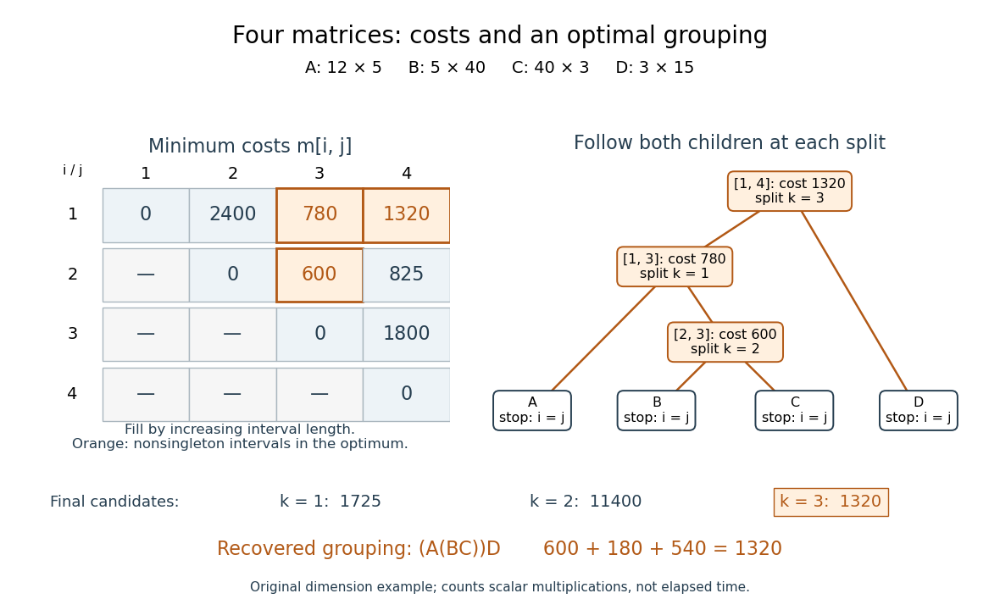

# Matrix-chain split reconstruction

↑ **Parent:** [Matrix-chain multiplication](matrix-chain-multiplication.md)

Extend the original example by a [matrix](matrix.md) $D$ with [matrix dimensions](matrix-dimensions.md) $3\times15$, so $(p_0,p_1,p_2,p_3,p_4)=(12,5,40,3,15)$. The [Catalan number](catalan-number.md) $C_3=5$ counts all possible groupings. Their [scalar multiplication](scalar-multiplication.md) costs are

$$
\begin{array}{c|r}
\text{grouping}&\text{cost}\\\hline
((AB)C)D&2400+1440+540=4380\\
(A(BC))D&600+180+540=1320\\
(AB)(CD)&2400+1800+7200=11400\\
A((BC)D)&600+225+900=1725\\
A(B(CD))&1800+3000+900=5700
\end{array}
$$

The optimum is $(A(BC))D$, with cost $1320$. Enumeration makes a useful check here, but [dynamic programming](dynamic-programming.md) reaches the same answer by solving ten [integer intervals](integer-interval.md), including the four single-[matrix](matrix.md) [base cases](base-case.md):

$$
\begin{array}{c|rrrr}
i\backslash j&1&2&3&4\\\hline
1&0&2400&780&1320\\
2&&0&600&825\\
3&&&0&1800\\
4&&&&0
\end{array}
$$

For example, $m[2,4]=\min\{1800+5\cdot40\cdot15,\ 600+5\cdot3\cdot15\}=\min\{4800,825\}=825$. The three final-split candidates for the full [matrix product](matrix-product.md) supply a compact certificate:

$$
\begin{aligned}
k=1 &: \quad 0+825+12\cdot5\cdot15=1725,\\
k=2 &: \quad 2400+1800+12\cdot40\cdot15=11400,\\
k=3 &: \quad 780+0+12\cdot3\cdot15=1320.
\end{aligned}
$$

The first candidate already uses the better grouping of $BCD$; the worse $A(B(CD))$ need not be reconsidered at the top level. This is how [optimal substructure](optimal-substructure.md) lets the table represent all five possibilities with only three final candidates.

**[Figure 2](#image-a-four-matrix-cost-table-and-the-splits-certifying-the-optimum). A four-matrix cost table and the splits certifying the optimum**. Original [dynamic programming](dynamic-programming.md) calculation for $(12,5,40,3,15)$. Orange entries are the nonsingleton [integer intervals](integer-interval.md) used in the recovered optimum. The [binary tree](binary-tree.md) follows stored splits down both children to the single-[matrix](matrix.md) [base cases](base-case.md); the final candidates certify the cost $1320$.

Read $s[1,4]=3$, which separates $ABC$ from $D$. Then $s[1,3]=1$ separates $A$ from $BC$, and $s[2,3]=2$ separates $B$ from $C$. This [recursion](recursion-computer-science.md) stops at every $i=j$, returning the corresponding [matrix](matrix.md) name. Combining the returned expressions recovers $(A(BC))D$, rather than only its cost. Every [recursive call](recursive-call.md) uses a shorter [integer interval](integer-interval.md), establishing [algorithm termination](algorithm-termination.md); a tied minimum may choose any attaining split. The recovered [binary tree](binary-tree.md) has $n$ leaves and $n-1$ internal nodes, so reconstruction takes $O(n)$ steps. Its attraction is the separation between an enormous family of groupings and a small set of reusable [dynamic programming states](dynamic-programming-state.md).

## ↑ Ancestors (4)

1. [Matrix-chain multiplication](matrix-chain-multiplication.md)
2. [Algorithm](algorithm-split.md)
3. [Computer science](computer-science-split.md)
4. [Codex Wiki](split.md)
