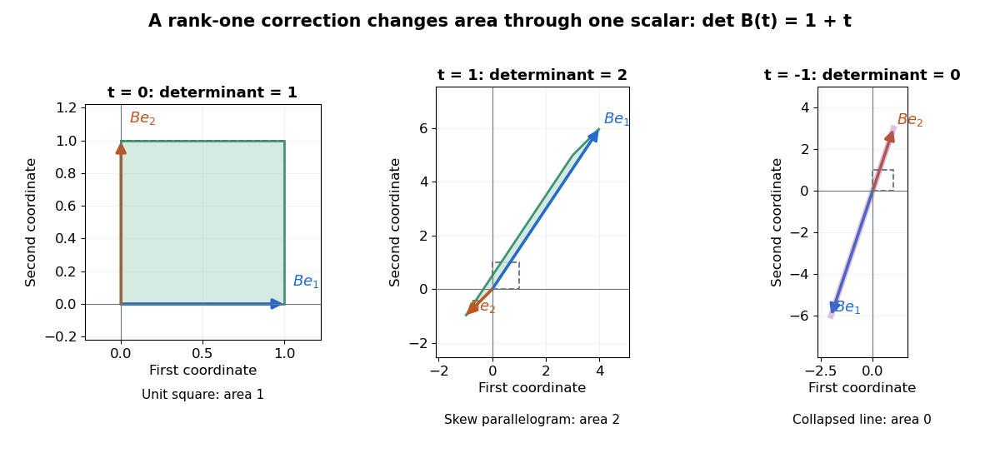

# Matrix determinant lemma

↑ **Parent:** [Linear algebra](linear-algebra-split.md)  
ⓦ [Wiki](https://en.wikipedia.org/wiki/Matrix_determinant_lemma)

For an [invertible matrix](invertible-matrix.md) $A\in\mathbb R^{n\times n}$ and real [vectors](vector.md) $u,v\in\mathbb R^n$, the [matrix determinant lemma](matrix-determinant-lemma.md) states

$$
\det(A+uv^T)=\det(A)\left(1+v^TA^{-1}u\right).
$$

The expression $v^TA^{-1}u$ is a [scalar](scalar.md), so a [rank-one matrix update](rank-one-matrix-update.md) changes the [determinant](determinant.md) by a single multiplicative factor. One need not expand the updated [determinant](determinant.md) entry by entry.

For the preceding example with $A=I$, the [dot product](dot-product.md) is $v^Tu=3-2=1$. Hence the updated [determinant](determinant.md) is $1+1=2$. Direct evaluation confirms

$$
\det\begin{pmatrix}4&-1\\6&-1\end{pmatrix}
=4(-1)-(-1)6=2.
$$

More generally, let $B(t)=I+tuv^T$ for a real [scalar](scalar.md) $t$. The same calculation gives $\det B(t)=1+t$. The [determinant](determinant.md) is one at $t=0$, two at $t=1$, and zero at $t=-1$.

**[Figure 28](#image-a-rank-one-correction-can-preserve-stretch-or-collapse-the-area-of-a-square). A rank-one correction can preserve, stretch, or collapse the area of a square**. Each panel maps the unit [square](square.md) by $B(t)=I+tuv^T$ with $u=(1,2)^T$ and $v=(3,-1)^T$. Blue and orange arrows are the images of the two [standard basis](standard-basis.md) [vectors](vector.md). At $t=1$, the [parallelogram](parallelogram.md) has [area](surface-area.md) two, despite its strong skew. At $t=-1$, the images are [linearly dependent](linear-dependence.md) and the full [square](square.md) collapses onto a [line](straight-line.md). Panel scales differ; the stated areas come from the [determinant](determinant.md), rather than from comparing pixel areas.

A compact proof explains the scalar reduction. Put $w=A^{-1}u$ and factor $A+uv^T=A(I+wv^T)$. If $w\ne0$, choose a [basis](basis.md) starting with $w$. In that [basis](basis.md), $(I+wv^T)w=(1+v^Tw)w$, while every other basis [vector](vector.md) changes only by a multiple of $w$. Its [matrix](matrix.md) is triangular with diagonal $1+v^Tw,1,\ldots,1$, giving the required [determinant](determinant.md). If $w=0$, the correction vanishes. This uses [multiplicativity of the determinant](multiplicativity-of-the-determinant.md) to restore the factor $\det A$.

The denominator in the [Sherman–Morrison formula](sherman-morrison-formula.md) is exactly this factor. The [rank-one update singularity criterion](rank-one-update-singularity-criterion.md) therefore identifies when the updated [matrix inverse](matrix-inverse.md) ceases to exist. Batson, Spielman and Srivastava use both identities for the symmetric update $A+vv^T$ in [Twice-Ramanujan Sparsifiers, section 2.3, Lemmas 2.1–2.2](https://people.eecs.berkeley.edu/~brecht/cs294docs/week4/09.Batson.sparsification.pdf).

## ↑ Ancestors (5)

1. [Linear algebra](linear-algebra-split.md)
2. [Algebra](algebra-split.md)
3. [Area of mathematics](area-of-mathematics.md)
4. [Mathematics](mathematics-split.md)
5. [Codex Wiki](split.md)

## ← Incoming links (10)

- [Dirac membrane action](dirac-membrane-action.md)
- [Matrix determinant lemma](matrix-determinant-lemma.md)
- [Solution](past-exam-of-the-mathematics-course-of-the-university-of-cambridge/2002/iii/paper-39/6/solution.md)
- [Solution](past-exam-of-the-mathematics-course-of-the-university-of-cambridge/2003/iii/paper-53/10/solution.md)
- [Solution](past-exam-of-the-mathematics-course-of-the-university-of-cambridge/2010/iii/paper-43/4/solution.md)
- [Solution](past-exam-of-the-mathematics-course-of-the-university-of-cambridge/2025/iii/paper-218/5/e/solution.md)
- [Solution](past-exam-of-the-mathematics-course-of-the-university-of-cambridge/2026/ia/paper-1/7b/d/solution.md)
- [Rank-one matrix update](rank-one-matrix-update.md)
- [Rank-one update singularity criterion](rank-one-update-singularity-criterion.md)
- [Sherman–Morrison formula](sherman-morrison-formula.md)
