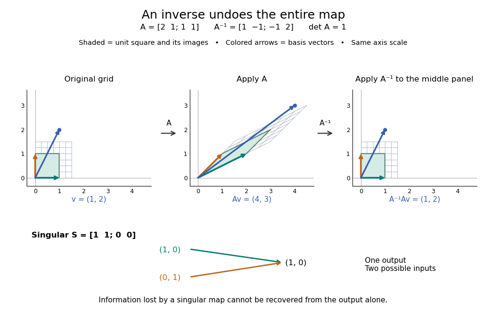
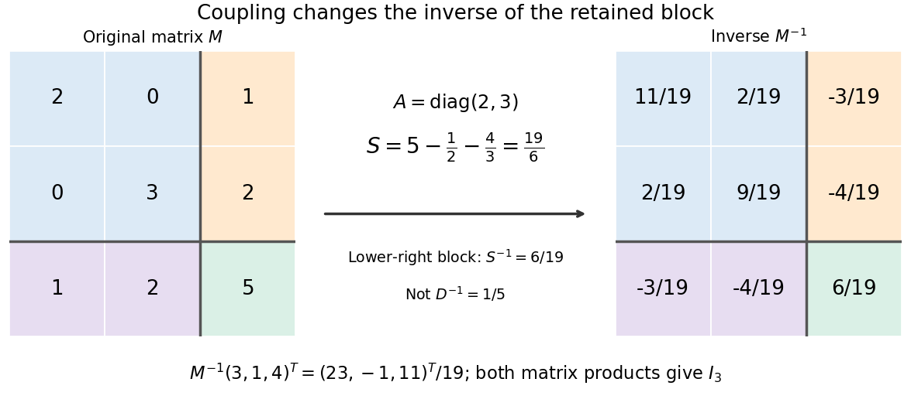
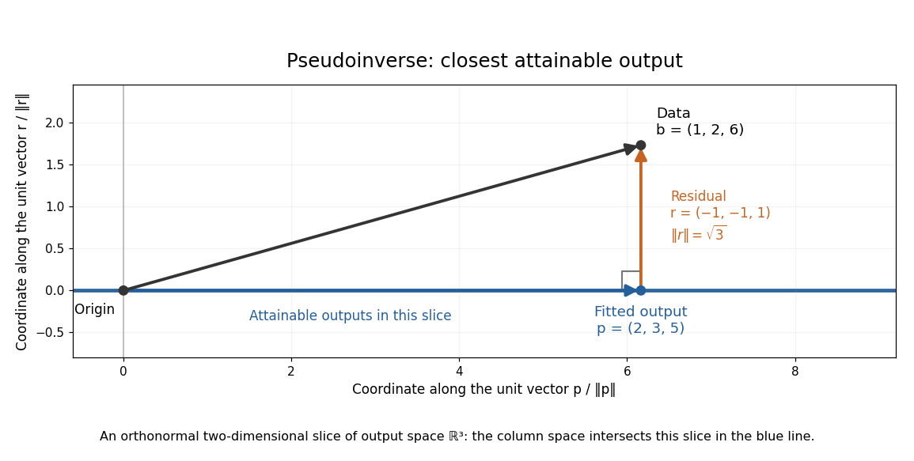
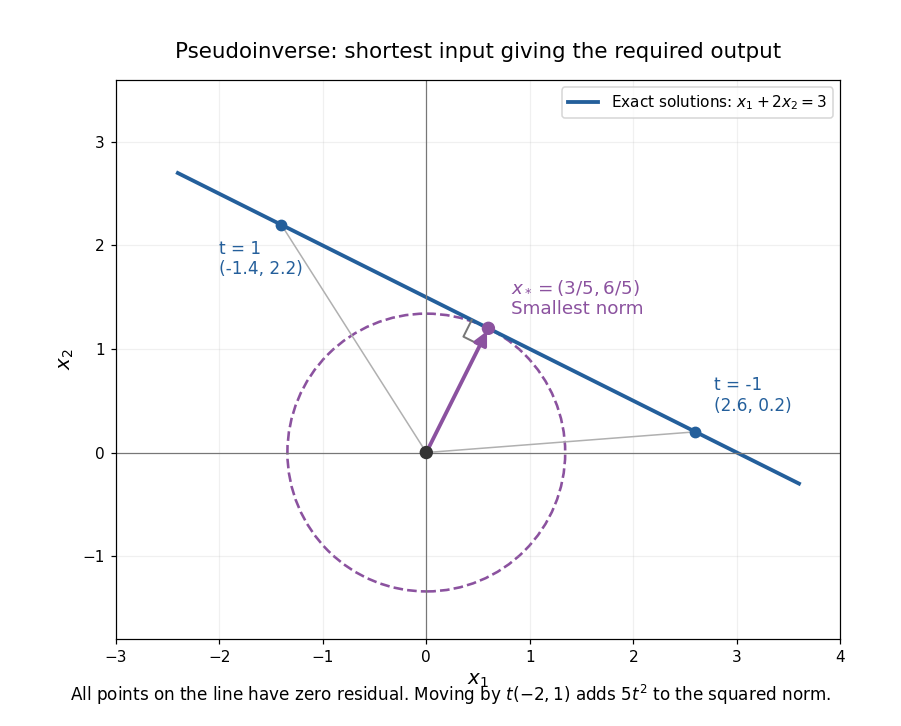

# Matrix inverse

↑ **Parent:** [Linear algebra](linear-algebra.md)  
ⓦ [Wiki](https://en.wikipedia.org/wiki/Matrix_inverse)

For an $n$-by-$n$ [square matrix](vector-space.md#square-matrix) $A$ over a [field](algebra.md#field), its matrix inverse is an $n$-by-$n$ [matrix](vector-space.md#matrix) $A^{-1}$ satisfying both identities

$$
AA^{-1}=A^{-1}A=I_n,
$$

where $I_n$ is the [identity matrix](vector-space.md#identity-matrix). It exists exactly when $A$ is an [invertible matrix](linear-algebra.md#invertible-matrix), equivalently when its [matrix rank](vector-space.md#matrix-rank) is $n$ or its [determinant](multilinear-algebra.md#determinant) is nonzero. It reverses the [linear map](vector-space.md#linear-map): applying $A$ and then $A^{-1}$ recovers the input, while applying $A^{-1}$ and then $A$ recovers the output.[Strang, MIT 18.06 Lecture 3: the two inverse identities](https://ocw.mit.edu/courses/18-06-linear-algebra-spring-2010/resources/lecture-3-multiplication-and-inverse-matrices/)

The [matrix inverse](matrix-inverse.md) is unique. If $B$ and $C$ both satisfy the identities, then $B=B(AC)=(BA)C=C$. Although the definition is two-sided, for finite [square matrices](vector-space.md#square-matrix) either identity alone suffices: $BA=I$ forces a [trivial kernel](kernel-of-a-linear-map.md#trivial-kernel), whereas $AB=I$ forces [surjectivity](algebra.md#surjective-function); either makes $A$ an [invertible matrix](linear-algebra.md#invertible-matrix) by the [rank-nullity theorem](kernel-of-a-linear-map.md#rank-nullity-theorem). Rectangular [matrices](vector-space.md#matrix) may have only one of these properties.

For a concrete example, take

$$
A=\begin{pmatrix}2&1\\1&1\end{pmatrix},\qquad
\det A=2\cdot1-1\cdot1=1,\qquad
A^{-1}=\begin{pmatrix}1&-1\\-1&2\end{pmatrix}.
$$

Direct [matrix multiplication](vector-space.md#matrix-multiplication) gives

$$
AA^{-1}=\begin{pmatrix}2-1&-2+2\\1-1&-1+2\end{pmatrix}=I_2,
\qquad
A^{-1}A=\begin{pmatrix}2-1&1-1\\-2+2&-1+2\end{pmatrix}=I_2.
$$

Consequently the [vector](vector-space.md#vector) $v=(1,2)^T$ follows a reversible journey:

$$
\begin{pmatrix}1\\2\end{pmatrix}
\xrightarrow{\ A\ }\begin{pmatrix}4\\3\end{pmatrix}
\xrightarrow{\ A^{-1}\ }\begin{pmatrix}4-3\\-4+6\end{pmatrix}
=\begin{pmatrix}1\\2\end{pmatrix}.
$$

The columns $(2,1)^T$ and $(1,1)^T$ are the images of the [standard basis](vector-space.md#standard-basis) vectors. They turn the unit square into a [parallelogram](euclidean-geometry.md#parallelogram); the [matrix inverse](matrix-inverse.md) restores both the square and its surrounding grid. Since $\det A=1$, this example changes shape while preserving [area](differential-geometry.md#surface-area), illustrating that invertibility does not require preserving lengths or angles.

**[Figure 1](#image-a-matrix-inverse-restores-a-grid-and-a-vector-a-singular-matrix-merges-distinct-inputs). A matrix inverse restores a grid and a vector; a singular matrix merges distinct inputs**.

For comparison, the [singular matrix](linear-algebra.md#singular-matrix)

$$
S=\begin{pmatrix}1&1\\0&0\end{pmatrix},\qquad
S\begin{pmatrix}1\\0\end{pmatrix}
=S\begin{pmatrix}0\\1\end{pmatrix}
=\begin{pmatrix}1\\0\end{pmatrix}
$$

cannot have a [matrix inverse](matrix-inverse.md): the output $(1,0)^T$ cannot specify which of the two inputs occurred. Their difference $(1,-1)^T$ belongs to its [kernel](kernel-of-a-linear-map.md). Indeed $S(x,y)^T=(x+y,0)^T$ collapses the [plane](geometry-and-topology.md#plane) to a [line](euclidean-geometry.md#straight-line), its [matrix rank](vector-space.md#matrix-rank) is one, and its [determinant](multilinear-algebra.md#determinant) is zero. No subsequent [function](function.md) of the output alone can reconstruct every input.

An important use of the [matrix inverse](matrix-inverse.md) is describing the unique solution of a [linear system](linear-algebra.md#system-of-linear-equations):

$$
Ax=b\iff x=A^{-1}b.
$$

For $b=(4,3)^T$, the preceding computation solves $2x_1+x_2=4$ and $x_1+x_2=3$, giving $x=(1,2)^T$. In computation, usually solve the [linear system](linear-algebra.md#system-of-linear-equations) using [Gaussian elimination](numerical-linear-algebra.md#gaussian-elimination) and a factorization such as an [LU decomposition](numerical-linear-algebra.md#lu-decomposition), rather than forming every entry of the [matrix inverse](matrix-inverse.md). The inverse formula specifies the answer; a factorization provides a reusable way to compute it for each right-hand side.[MIT 18.06, Spring 2017 final solutions, problem 5(b): solve with triangular factors rather than computing inverses](https://www.mit.edu/~18.06/Spring17/final-sol.pdf)

Here the [LU decomposition](numerical-linear-algebra.md#lu-decomposition) is especially simple:

$$
A=LU,\qquad
L=\begin{pmatrix}1&0\\\tfrac12&1\end{pmatrix},\qquad
U=\begin{pmatrix}2&1\\0&\tfrac12\end{pmatrix}.
$$

Solve $Ly=b$ by [forward substitution in a triangular system](linear-algebra.md#forward-substitution-in-a-triangular-system): $y_1=4$ and $y_2=3-\tfrac12\cdot4=1$. Then solve $Ux=y$ by [backward substitution in a triangular system](linear-algebra.md#backward-substitution-in-a-triangular-system): $x_2=2$ and $x_1=(4-2)/2=1$. The same factors work when $b$ changes. If the whole [matrix inverse](matrix-inverse.md) is actually needed, its $j$th column is the solution of $Ax=e_j$, where $e_j$ is the $j$th [standard basis](vector-space.md#standard-basis) vector.

Reversing several operations means undoing the last one first. For [invertible matrices](linear-algebra.md#invertible-matrix) of the same size,

$$
(AB)^{-1}=B^{-1}A^{-1},
$$

because $(AB)(B^{-1}A^{-1})=A(BB^{-1})A^{-1}=I$, and the product in the other order is also $I$. This is why a [change-of-basis matrix](linear-algebra.md#change-of-basis-matrix) uses its [matrix inverse](matrix-inverse.md) to reverse the direction of coordinate conversion.

**Table of contents**

- [Matrix inversion](#matrix-inversion)
- [Woodbury matrix identity](#woodbury-matrix-identity)
- [Matrix inversion is not additive](#matrix-inversion-is-not-additive)
- [Matrix commutation with an inverse](#matrix-commutation-with-an-inverse)
- [Block matrix inverse](#block-matrix-inverse)
  - [Block elimination](#block-elimination)
  - [Choosing a different block pivot](#choosing-a-different-block-pivot)
- [Sherman–Morrison formula](#sherman-morrison-formula)
  - [Rank-one update singularity criterion](#rank-one-update-singularity-criterion)
    - [Solvability of an affine rank-one vector equation](#solvability-of-an-affine-rank-one-vector-equation)
- [Moore-Penrose inverse](#moore-penrose-inverse)
  - [Overdetermined least-squares example](#overdetermined-least-squares-example)
  - [Underdetermined minimum-norm example](#underdetermined-minimum-norm-example)
  - [Small singular values in the Moore-Penrose inverse](#small-singular-values-in-the-moore-penrose-inverse)
  - [Moore--Penrose inverse of a Hilbert-space operator](#moore-penrose-inverse-of-a-hilbert-space-operator)
  - [Penrose equations](#penrose-equations)
  - [Reverse-order law for the Moore--Penrose inverse](#reverse-order-law-for-the-moore-penrose-inverse)
- [Push-through identity](#push-through-identity)

## Matrix inversion

↑ **Parent:** [Matrix inverse](matrix-inverse.md)

## Woodbury matrix identity

↑ **Parent:** [Matrix inverse](matrix-inverse.md)

## Matrix inversion is not additive

↑ **Parent:** [Matrix inverse](matrix-inverse.md)

For $A=B=I$ of any positive size, $A+B=2I$ is invertible but $(A+B)^{-1}=I/2$, whereas $A^{-1}+B^{-1}=2I$. Thus even invertibility of all three matrices does not make inversion additive.

## Matrix commutation with an inverse

↑ **Parent:** [Matrix inverse](matrix-inverse.md)

If two square [matrices](vector-space.md#matrix) satisfy $AB=BA$ and $B$ is invertible, multiplication on the left and right by $B^{-1}$ gives $B^{-1}A=AB^{-1}$. Consequently a polynomial in a [matrix](vector-space.md#matrix) commutes with the [matrix inverse](matrix-inverse.md) of any invertible polynomial in the same [matrix](vector-space.md#matrix).

## Block matrix inverse

↑ **Parent:** [Matrix inverse](matrix-inverse.md)

A [block matrix inverse](#block-matrix-inverse) expresses the [matrix inverse](matrix-inverse.md) in terms of smaller [matrices](vector-space.md#matrix). Partition a [square matrix](vector-space.md#square-matrix) over a [field](algebra.md#field) as

$$
M=\begin{pmatrix}A&B\\C&D\end{pmatrix},\qquad
A\in\mathbb F^{p\times p},\quad D\in\mathbb F^{q\times q}.
$$

If $A$ is an [invertible matrix](linear-algebra.md#invertible-matrix), define its [Schur complement](linear-algebra.md#schur-complement) $S=D-CA^{-1}B$. Then $M$ is an [invertible matrix](linear-algebra.md#invertible-matrix) exactly when $S$ is an [invertible matrix](linear-algebra.md#invertible-matrix), and

$$
\boxed{
M^{-1}=\begin{pmatrix}
A^{-1}+A^{-1}BS^{-1}CA^{-1}&-A^{-1}BS^{-1}\\
-S^{-1}CA^{-1}&S^{-1}
\end{pmatrix}.
}
$$

The order of the [matrix products](vector-space.md#matrix-product) matters. In particular, the lower-right block is $S^{-1}$, rather than generally $D^{-1}$: the coupling through $B$ and $C$ changes the response.[Appendix A.5.5, printed p. 650: inverse of a symmetric block matrix; §C.4.1, printed p. 673: elimination for general blocks](mathematics-bibliography.md#convex-optimization-by-stephen-boyd-and-lieven-vandenberghe)

For an original example, take

$$
M=\begin{pmatrix}2&0&1\\0&3&2\\1&2&5\end{pmatrix},\quad
A=\begin{pmatrix}2&0\\0&3\end{pmatrix},\quad
B=C^T=\begin{pmatrix}1\\2\end{pmatrix},\quad D=5.
$$

The [Schur complement](linear-algebra.md#schur-complement) is $S=5-1/2-4/3=19/6$. Substitution gives the concise answer

$$
\boxed{M^{-1}=\frac1{19}\begin{pmatrix}11&2&-3\\2&9&-4\\-3&-4&6\end{pmatrix}}.
$$

Multiplying in either order gives the [identity matrix](vector-space.md#identity-matrix); the lower-right entry is $6/19$, whereas $D^{-1}=1/5$. The difference records the feedback through the two eliminated variables.

**[Figure 2](#image-a-block-matrix-inverse-computed-from-the-smaller-schur-complement). A block matrix inverse computed from the smaller Schur complement**. Original exact example. Colours mark the two-by-two block $A$, the coupling blocks $B,C$, and the scalar block $D$. The same partition is retained in the [matrix inverse](matrix-inverse.md); its blocks are not the entrywise inverses of the original blocks.

Often the desired output is a solution of a [linear system](linear-algebra.md#system-of-linear-equations), rather than every entry of a [matrix inverse](matrix-inverse.md). [Block elimination](#block-elimination) solves with $A$ and then with $S$, recovering the eliminated variables by [back substitution](linear-algebra.md#back-substitution). Reusing an [LU decomposition](numerical-linear-algebra.md#lu-decomposition) of $A$ avoids explicitly forming $A^{-1}$. A favourable [block diagonal matrix](vector-space.md#block-diagonal-matrix) or [tridiagonal matrix](vector-space.md#tridiagonal-matrix) block can make this useful; merely partitioning an unstructured dense [matrix](vector-space.md#matrix) does not guarantee a faster solve.[§C.4.1, printed pp. 672–675: Algorithm C.4, factor-solve interpretation and dense complexity comparison](mathematics-bibliography.md#convex-optimization-by-stephen-boyd-and-lieven-vandenberghe)

### Block elimination

↑ **Parent:** [Block matrix inverse](#block-matrix-inverse)

Write a [linear system](linear-algebra.md#system-of-linear-equations) as $Ax+By=f$ and $Cx+Dy=g$, with $A$ an [invertible matrix](linear-algebra.md#invertible-matrix). Solving the first equation for $x$ and substituting in the second gives

$$
x=A^{-1}(f-By),\qquad
(D-CA^{-1}B)y=g-CA^{-1}f.
$$

Thus the [Schur complement](linear-algebra.md#schur-complement) is the coefficient [matrix](vector-space.md#matrix) remaining after the $x$ variables have been eliminated. When it is an [invertible matrix](linear-algebra.md#invertible-matrix), solve the reduced [linear system](linear-algebra.md#system-of-linear-equations) for $y$ and recover $x$. In computation, expressions such as $A^{-1}B$ mean solving with each column of $B$, using the same [LU decomposition](numerical-linear-algebra.md#lu-decomposition) or [Cholesky decomposition](quadratic-form.md#cholesky-decomposition) when applicable.

For the example under [block matrix inverse](#block-matrix-inverse) and right-hand side $(3,1,4)^T$, take $f=(3,1)^T$ and $g=4$. Since $CA^{-1}f=13/6$, the reduced equation is $(19/6)y=11/6$. [Back substitution](linear-algebra.md#back-substitution) gives

$$
\boxed{(x_1,x_2,y)=(23,-1,11)/19}.
$$

The original equations return $3$, $1$ and $4$, respectively. The reduction retained the influence of $x_1,x_2$ on $y$ through the correction $CA^{-1}B$.

A short proof outline also explains whether $M$ is an [invertible matrix](linear-algebra.md#invertible-matrix): the exact [matrix factorization](vector-space.md#matrix-decomposition)

$$
M=\begin{pmatrix}I&0\\CA^{-1}&I\end{pmatrix}
\begin{pmatrix}A&0\\0&S\end{pmatrix}
\begin{pmatrix}I&A^{-1}B\\0&I\end{pmatrix}
$$

has [invertible matrices](linear-algebra.md#invertible-matrix) on the outside. Therefore $M$ is an [invertible matrix](linear-algebra.md#invertible-matrix) precisely when the central [block diagonal matrix](vector-space.md#block-diagonal-matrix) is one. Reversing the factors gives the [block matrix inverse](#block-matrix-inverse), while taking [determinants](multilinear-algebra.md#determinant) gives the [Schur complement determinant identity](linear-algebra.md#schur-complement-determinant-identity).

### Choosing a different block pivot

↑ **Parent:** [Block matrix inverse](#block-matrix-inverse)

An [invertible matrix](linear-algebra.md#invertible-matrix) need not have an invertible chosen diagonal block. For example,

$$
M=\begin{pmatrix}0&1\\1&0\end{pmatrix},\qquad M^{-1}=M,
$$

has [singular matrices](linear-algebra.md#singular-matrix) as both one-by-one diagonal blocks. Neither diagonal-block formula applies in that partition. Interchanging the two rows produces the [identity matrix](vector-space.md#identity-matrix) and a usable [pivot element](numerical-linear-algebra.md#pivot-element). This is why a failed block pivot is not proof that the full [matrix](vector-space.md#matrix) is a [singular matrix](linear-algebra.md#singular-matrix); [Pivoted LU decomposition](numerical-linear-algebra.md#pivoted-lu-decomposition) changes the order before eliminating.

Conversely, invertible diagonal blocks do not suffice: $M=\begin{pmatrix}1&1\\1&1\end{pmatrix}$ has $A=D=1$ but [Schur complement](linear-algebra.md#schur-complement) $S=0$, so it is a [singular matrix](linear-algebra.md#singular-matrix). Both hypotheses in the [block matrix inverse](#block-matrix-inverse) formula have work to do.

<h2 id="sherman-morrison-formula">Sherman–Morrison formula</h2>

↑ **Parent:** [Matrix inverse](matrix-inverse.md)  
ⓦ [Wiki](https://en.wikipedia.org/wiki/Sherman–Morrison_formula)

The [Sherman–Morrison formula](#sherman-morrison-formula) computes the [matrix inverse](matrix-inverse.md) after a [rank-one matrix update](linear-algebra.md#rank-one-matrix-update). If $A$ is an [invertible matrix](linear-algebra.md#invertible-matrix) and $\delta=1+v^TA^{-1}u\ne0$, then

$$
(A+uv^T)^{-1}
=A^{-1}-\frac{A^{-1}uv^TA^{-1}}{1+v^TA^{-1}u}.
$$

The inverse correction is itself an [outer product](vector-space.md#outer-product), divided by the [scalar](vector-space.md#scalar) $\delta$. The [matrix determinant lemma](linear-algebra.md#matrix-determinant-lemma) shows that the nonzero-denominator condition is exactly the condition that the updated [matrix](vector-space.md#matrix) remains an [invertible matrix](linear-algebra.md#invertible-matrix).

For $A=I$, $u=(1,2)^T$, and $v=(3,-1)^T$, we have $\delta=2$. Thus the computed inverse is

$$
\boxed{
\begin{pmatrix}4&-1\\6&-1\end{pmatrix}^{-1}
=I-\frac12\begin{pmatrix}3&-1\\6&-2\end{pmatrix}
=\begin{pmatrix}-1/2&1/2\\-3&2\end{pmatrix}
}.
$$

Multiplication in either order gives the [identity matrix](vector-space.md#identity-matrix). The result reuses the original inverse $I$ and the same correction [vectors](vector-space.md#vector), rather than solving independently for all four inverse entries.

Often only the solution of an updated [linear system](linear-algebra.md#system-of-linear-equations) is needed. If $Ax_0=b$ and $Az=u$, then

$$
(A+uv^T)x=b
\quad\Longrightarrow\quad
x=x_0-z\,\frac{v^Tx_0}{1+v^Tz},
$$

provided $1+v^Tz\ne0$. The two solves use the same [LU decomposition](numerical-linear-algebra.md#lu-decomposition) of $A$. This expresses the computational benefit without requiring an explicitly stored [matrix inverse](matrix-inverse.md). Strang's [Lecture 14, transcript pp. 9–10](https://ocw.mit.edu/courses/18-065-matrix-methods-in-data-analysis-signal-processing-and-machine-learning-spring-2018/988b4c05680f40a5a4b3be7004a32500_XhSk_Lw2X_U.pdf) explains this reuse of the original factorization.

To see why the inverse correction works, first consider $A=I$ and put $s=v^Tu$. The [rank-one matrix](vector-space.md#rank-one-matrix) $R=uv^T$ satisfies $R^2=sR$. Expanding

$$
(I+R)\left(I-\frac{R}{1+s}\right)
=I+R-\frac{R}{1+s}-\frac{sR}{1+s}=I
$$

also works in the reverse order. The general case follows by factoring out $A$ and replacing $u$ by $A^{-1}u$. A matrix identity has reduced to cancellation of scalar coefficients.

Historically, Jack Sherman and Winifred J. Morrison studied updating an inverse when a single matrix entry changes in their [1950 paper, Adjustment of an Inverse Matrix Corresponding to a Change in One Element of a Given Matrix](https://doi.org/10.1214/aoms/1177729893). Such an entry change is the special [rank-one matrix update](linear-algebra.md#rank-one-matrix-update) $\alpha e_ie_j^T$, with [standard basis](vector-space.md#standard-basis) [vectors](vector-space.md#vector) $e_i,e_j$. The reference and the earlier 1949 abstract on row or column changes are recorded in [Henderson and Searle, On Deriving the Inverse of a Sum of Matrices (1981), references 40–41](https://epubs.siam.org/doi/10.1137/1023004). This distinguishes the specific original setting from the more general $uv^T$ formula used here.

### Rank-one update singularity criterion

↑ **Parent:** [Sherman–Morrison formula](#sherman-morrison-formula)

For an [invertible matrix](linear-algebra.md#invertible-matrix) $A$, the [rank-one matrix update](linear-algebra.md#rank-one-matrix-update) $B=A+uv^T$ is a [singular matrix](linear-algebra.md#singular-matrix) exactly when $1+v^TA^{-1}u=0$. This follows directly from the [matrix determinant lemma](linear-algebra.md#matrix-determinant-lemma). At that value, $u\ne0$ and the nonzero [vector](vector-space.md#vector) $w=A^{-1}u$ satisfies

$$
Bw=u+u(v^TA^{-1}u)=0.
$$

Every [vector](vector-space.md#vector) in the [kernel](kernel-of-a-linear-map.md) is a multiple of $w$, since $Bx=0$ implies $x=-A^{-1}u(v^Tx)$. The [matrix rank](vector-space.md#matrix-rank) therefore drops by exactly one.

For $B(t)=I+tuv^T$ with $u=(1,2)^T$ and $v=(3,-1)^T$, the update becomes a [singular matrix](linear-algebra.md#singular-matrix) at $t=-1$, and $B(t)u=(1+t)u$. At $t=-0.99$, this direction is compressed by a factor $0.01$ and the inverse amplifies it by a factor 100. The actual [spectral norm](continuous-dual-space.md#matrix-2-norm) of the [matrix inverse](matrix-inverse.md), which maximizes amplification over every direction, is about $700.17853409$.

**[Figure 3](#image-an-inverse-grows-large-as-the-rank-one-update-approaches-its-singular-denominator). An inverse grows large as the rank-one update approaches its singular denominator**. Here $\delta=1+t>0$ and $B(t)=I+tuv^T$ uses the same example [vectors](vector-space.md#vector). The left panel shows $\|B(t)^{-1}\|_2$ and its lower bound $1/\delta$, obtained from the direction $u$. The right panel shows the [condition number](quadratic-form.md#condition-number) $\kappa_2(B)=\|B\|_2\|B^{-1}\|_2$. Both are computed from [singular values](linear-algebra.md#singular-value); the missing point $\delta=0$ has no [matrix inverse](matrix-inverse.md).

The exact formula can expose a large [condition number](quadratic-form.md#condition-number) in the updated [linear system](linear-algebra.md#system-of-linear-equations) even when the original one had a small [condition number](quadratic-form.md#condition-number). It does not guarantee [numerical stability](numerical-analysis.md#stability-of-a-numerical-method) merely because its evaluation uses fewer arithmetic operations. The denominator condition certifies existence; the [condition number](quadratic-form.md#condition-number) and floating-point behavior address different questions about using the resulting answer.

#### Solvability of an affine rank-one vector equation

↑ **Parent:** [Rank-one update singularity criterion](#rank-one-update-singularity-criterion)

Let $a,b,c\in\mathbb R^n$, with $c\ne0$. The equation $x=a+(b\cdot x)c$ is the [linear system](linear-algebra.md#system-of-linear-equations) $(I-cb^T)x=a$, a [rank-one matrix update](linear-algebra.md#rank-one-matrix-update) of the [identity matrix](vector-space.md#identity-matrix). Every solution has $x=a+\lambda c$. Substitution reduces the entire problem to

$$
\lambda(1-b\cdot c)=b\cdot a.
$$

If $b\cdot c\ne1$, there is one solution, $x=a+c(b\cdot a)/(1-b\cdot c)$. If $b\cdot c=1$ and $b\cdot a=0$, every $\lambda\in\mathbb R$ works and the solution set is the [straight line](euclidean-geometry.md#straight-line) $a+\mathbb Rc$. If $b\cdot c=1$ and $b\cdot a\ne0$, there is no solution.

The first reduction follows directly from the original equation in any dimension. In three dimensions it can also be obtained by taking the [cross product](vector-space.md#cross-product) with $c$, giving $(x-a)\times c=0$. The singular denominator therefore represents two different possibilities, inconsistency or a family of solutions, and must not simply be discarded as an undefined formula.

## Moore-Penrose inverse

↑ **Parent:** [Matrix inverse](matrix-inverse.md)  
ⓦ [Wiki](https://en.wikipedia.org/wiki/Moore-Penrose_inverse)

The [Moore-Penrose inverse](#moore-penrose-inverse) extends the useful part of a [matrix inverse](matrix-inverse.md) to rectangular and singular [matrices](vector-space.md#matrix). A [linear system](linear-algebra.md#system-of-linear-equations) $Ax=b$ may have no exact solution, or may have many. The [pseudoinverse](#moore-penrose-inverse) resolves both ambiguities: $x_*=A^+b$ is the [minimum-norm least-squares solution](inverse-problem.md#minimum-norm-least-squares-solution). First minimize the [Euclidean norm](normed-vector-space.md#euclidean-norm) $\|Ax-b\|_2$; among all [vectors](vector-space.md#vector) attaining that minimum, choose the one with smallest [Euclidean norm](normed-vector-space.md#euclidean-norm) $\|x\|_2$. It does not pretend that inconsistent equations can all be satisfied.

For $A\in\mathbb C^{m\times n}$, its [Moore-Penrose inverse](#moore-penrose-inverse) is the unique $n\times m$ [matrix](vector-space.md#matrix) satisfying the four [Penrose equations](#penrose-equations). The [singular value decomposition](linear-algebra.md#singular-value-decomposition) gives a direct construction:

$$
A=U\Sigma V^*,
\qquad
\boxed{A^+=V\Sigma^+U^*.}
$$

Here $U,V$ are [unitary matrices](linear-operator-theory.md#unitary-matrix), the star is the [conjugate transpose](linear-operator-theory.md#conjugate-transpose), and $\Sigma^+$ is the $n\times m$ rectangular [diagonal matrix](linear-algebra.md#diagonal-matrix) obtained by replacing each nonzero [singular value](linear-algebra.md#singular-value) $\sigma_j$ by $1/\sigma_j$ and leaving zeros at zero. Over the [real numbers](arithmetic.md#real-number), use [orthogonal matrices](linear-algebra.md#orthogonal-matrix) and [transposes](vector-space.md#transpose). The [pseudoinverse](#moore-penrose-inverse) reverses the stretches that can be reversed; it discards output components the original [linear map](vector-space.md#linear-map) cannot produce and does not invent an input component in its [kernel](kernel-of-a-linear-map.md). [Strang, MIT 18.06SC: Left and Right Inverses; Pseudoinverse](https://ocw.mit.edu/courses/18-06sc-linear-algebra-fall-2011/resources/mit18_06scf11_ses3-8sum/)

The two products have especially clear meanings:

$$
AA^+=P_{\operatorname{ran}A},
\qquad
A^+A=P_{(\ker A)^\perp}.
$$

They are [orthogonal projection matrices](inner-product.md#orthogonal-projection-matrix): $AA^+$ selects the producible part of an output, while $A^+A$ selects the detectable part of an input. They are generally not [identity matrices](vector-space.md#identity-matrix). For an [invertible matrix](linear-algebra.md#invertible-matrix), both are identities and $A^+=A^{-1}$.

This gives a useful order of operations for [least-squares solutions](inverse-problem.md#least-squares-solution-of-a-linear-inverse-problem): project the requested output onto the [column space](vector-space.md#column-space), then invert the restriction of $A$ from $(\ker A)^\perp$ to its [column space](vector-space.md#column-space). Adding a [kernel](kernel-of-a-linear-map.md) [vector](vector-space.md#vector) leaves the residual unchanged but increases the squared [Euclidean norm](normed-vector-space.md#euclidean-norm) by the [Pythagorean theorem in an inner-product space](inner-product.md#pythagorean-theorem-in-an-inner-product-space), because $A^+b$ is [orthogonal](inner-product.md#orthogonal-vectors) to that [kernel](kernel-of-a-linear-map.md). The [pseudoinverse](#moore-penrose-inverse) therefore provides one canonical answer without hiding either lost information or irreconcilable data.

The name records a history with several contributors. E. H. Moore gave an earlier generalization in 1920; M. H. Pearl's 1966 paper records that work, Arne Bjerhammar's 1951 rediscovery for maximal-rank rectangular [matrices](vector-space.md#matrix), and Roger Penrose's independent 1955 treatment. [Pearl, On generalized inverses of matrices (1966), introduction and references 6–9](https://www.cambridge.org/core/journals/mathematical-proceedings-of-the-cambridge-philosophical-society/article/abs/on-generalized-inverses-of-matrices/9CD637F604C76ECD8D03AC029212D56E) Penrose's original paper proves existence and uniqueness from the four [Penrose equations](#penrose-equations) for arbitrary complex [matrices](vector-space.md#matrix), including rectangular ones. [Penrose, A generalized inverse for matrices (1955), Theorem 1, pp. 406–408](https://faculty.kfupm.edu.sa/math/jaafarm/lec-notes/Moore-Pinrose.pdf)

### Overdetermined least-squares example

↑ **Parent:** [Moore-Penrose inverse](#moore-penrose-inverse)

Suppose three measurements constrain two unknowns:

$$
A=\begin{pmatrix}1&0\\0&1\\1&1\end{pmatrix},
\qquad
b=\begin{pmatrix}1\\2\\6\end{pmatrix}.
$$

The [linear system](linear-algebra.md#system-of-linear-equations) asks for $x_1=1$, $x_2=2$, and $x_1+x_2=6$, which are incompatible. A [least-squares solution](inverse-problem.md#least-squares-solution-of-a-linear-inverse-problem) makes a balanced compromise. The [matrix](vector-space.md#matrix) has [full column rank](vector-space.md#full-column-rank), so

$$
A^+=(A^TA)^{-1}A^T
=\frac13\begin{pmatrix}2&-1&1\\-1&2&1\end{pmatrix},
\qquad
\boxed{x_*=A^+b=(2,3)^T.}
$$

The fitted output and residual are

$$
Ax_*=(2,3,5)^T,
\qquad
r=b-Ax_*=(-1,-1,1)^T,
\qquad
A^Tr=0.
$$

Thus the two direct measurements are each overshot by one, and the measured sum is undershot by one. The residual has [Euclidean norm](normed-vector-space.md#euclidean-norm) $\sqrt3$ and is [orthogonal](inner-product.md#orthogonal-vectors) to the [column space](vector-space.md#column-space), the [plane](geometry-and-topology.md#plane) $z=y_1+y_2$ in output coordinates $(y_1,y_2,z)$.

**[Figure 4](#image-the-pseudoinverse-projects-inconsistent-data-onto-the-attainable-output-plane). The pseudoinverse projects inconsistent data onto the attainable output plane**. For $b=(1,2,6)^T$, the closest attainable output is $Ax_*=(2,3,5)^T$. The segment between them is the residual $(-1,-1,1)^T$, perpendicular to the [column space](vector-space.md#column-space). The drawing is an orthonormal two-dimensional slice of output space; the attainable [plane](geometry-and-topology.md#plane) intersects this slice in the blue [straight line](euclidean-geometry.md#straight-line).

For any perturbation $h\in\mathbb R^2$, the [orthogonality](inner-product.md#orthogonal-vectors) of $r$ to $Ah$ gives

$$
\|b-A(x_*+h)\|_2^2=\|r\|_2^2+\|Ah\|_2^2
=3+\|Ah\|_2^2.
$$

Since the [kernel](kernel-of-a-linear-map.md) of $A$ is trivial, every nonzero $h$ increases the residual. The [least-squares solution](inverse-problem.md#least-squares-solution-of-a-linear-inverse-problem) is unique in this example. The formula using $A^TA$ is convenient for these small exact calculations; an actual numerical computation can use a [QR decomposition](inner-product.md#qr-decomposition) or [singular value decomposition](linear-algebra.md#singular-value-decomposition) to avoid the extra conditioning cost of the [least-squares normal equations](linear-regression.md#normal-equations-for-linear-least-squares). For [full column rank](vector-space.md#full-column-rank), the squared [singular values](linear-algebra.md#singular-value) of $A$ are the [eigenvalues](linear-operator-theory.md#eigenvalue) of $A^TA$, so its [condition number](quadratic-form.md#condition-number) in the [Euclidean norm](normed-vector-space.md#euclidean-norm) is $\kappa_2(A^TA)=\kappa_2(A)^2$. [Strang, MIT 18.065 Lecture 9: four ways to solve least-squares problems](https://ocw.mit.edu/courses/18-065-matrix-methods-in-data-analysis-signal-processing-and-machine-learning-spring-2018/resources/lecture-9-four-ways-to-solve-least-squares-problems/)

### Underdetermined minimum-norm example

↑ **Parent:** [Moore-Penrose inverse](#moore-penrose-inverse)

Now take one equation for two unknowns:

$$
A=\begin{pmatrix}1&2\end{pmatrix},
\qquad b=3.
$$

The [linear system](linear-algebra.md#system-of-linear-equations) $x_1+2x_2=3$ has an entire [affine line](locally-ringed-space.md#affine-line) of exact solutions. Since $A$ has [full row rank](vector-space.md#full-row-rank), its [Moore-Penrose inverse](#moore-penrose-inverse) is

$$
A^+=A^T(AA^T)^{-1}
=\frac15\begin{pmatrix}1\\2\end{pmatrix},
\qquad
\boxed{x_*=A^+b=(3/5,6/5)^T.}
$$

The [kernel](kernel-of-a-linear-map.md) is $\operatorname{span}\{(-2,1)^T\}$, and all exact solutions are

$$
x=x_*+t(-2,1)^T,\qquad t\in\mathbb R.
$$

Because $x_*$ is [orthogonal](inner-product.md#orthogonal-vectors) to $(-2,1)^T$,

$$
\|x\|_2^2=\frac95+5t^2.
$$

The [Euclidean norm](normed-vector-space.md#euclidean-norm) is therefore smallest exactly at $t=0$. The zero residual alone cannot select a solution; the minimum-norm rule supplies the additional criterion.

**[Figure 5](#image-the-minimum-norm-solution-is-the-closest-point-of-the-solution-line-to-the-origin). The minimum-norm solution is the closest point of the solution line to the origin**. The [affine line](locally-ringed-space.md#affine-line) $x_1+2x_2=3$ is perpendicular to $x_*=(3/5,6/5)^T$. Moving along the line changes only a [kernel](kernel-of-a-linear-map.md) component and increases $\|x\|_2^2$ by $5t^2$.

This selection depends on the specified [inner product](inner-product.md). Rescaling one unknown changes what counts as a small [Euclidean norm](normed-vector-space.md#euclidean-norm), so units and weighting matter in an application. A minimum-norm answer is mathematically canonical for the chosen geometry, rather than an automatic guarantee of physical plausibility.

### Small singular values in the Moore-Penrose inverse

↑ **Parent:** [Moore-Penrose inverse](#moore-penrose-inverse)

For a nonzero [matrix](vector-space.md#matrix) $A$, the [operator norm](continuous-dual-space.md#operator-norm) induced by the [Euclidean norm](normed-vector-space.md#euclidean-norm) satisfies $\|A^+\|_2=1/\sigma_{\min,+}$, where $\sigma_{\min,+}$ is its smallest positive [singular value](linear-algebra.md#singular-value). The [singular value decomposition](linear-algebra.md#singular-value-decomposition) makes the danger visible: a small nonzero stretch becomes a large amplification of errors when inverted.

For instance, when $\varepsilon>0$,

$$
A_\varepsilon=\begin{pmatrix}1&0\\0&\varepsilon\end{pmatrix},
\qquad
A_\varepsilon^+=\begin{pmatrix}1&0\\0&1/\varepsilon\end{pmatrix}.
$$

A data perturbation $(0,\eta)^T$ changes the reconstructed input by $(0,\eta/\varepsilon)^T$. At $\varepsilon=0$, however, the [pseudoinverse](#moore-penrose-inverse) is $\operatorname{diag}(1,0)$: exactly zero and merely small are different cases. Thus the [pseudoinverse](#moore-penrose-inverse) need not be [continuous](calculus.md#continuous-function) across a change of [matrix rank](vector-space.md#matrix-rank). With uncertain data, [truncated singular value decomposition](inverse-problem.md#truncated-singular-value-decomposition) or [Tikhonov regularization](inverse-problem.md#tikhonov-regularization) can trade exact inversion of weak directions for stability; the cutoff or penalty adds a modelling choice.

<h3 id="moore-penrose-inverse-of-a-hilbert-space-operator">Moore--Penrose inverse of a Hilbert-space operator</h3>

↑ **Parent:** [Moore-Penrose inverse](#moore-penrose-inverse)

For a bounded operator $A:X\to Y$ between [Hilbert spaces](hilbert-space.md), $A^\dagger$ has domain $\mathcal R(A)\oplus\mathcal R(A)^\perp$, maps into $\mathcal N(A)^\perp$, and inverts the restriction of $A$ to $\mathcal N(A)^\perp$. It is bounded exactly when $\mathcal R(A)$ is closed.

### Penrose equations

↑ **Parent:** [Moore-Penrose inverse](#moore-penrose-inverse)

The Moore--Penrose inverse is characterized by

$$
AA^\dagger A=A,
\quad
A^\dagger AA^\dagger=A^\dagger,
\quad
(AA^\dagger)^*=AA^\dagger,
\quad
(A^\dagger A)^*=A^\dagger A.
$$

Here $A^\dagger=A^+$ denotes the [Moore-Penrose inverse](#moore-penrose-inverse), while the star denotes the [conjugate transpose](linear-operator-theory.md#conjugate-transpose). The first two identities express consistency when applying and reversing the [linear map](vector-space.md#linear-map); the last two make the resulting [orthogonal projection matrices](inner-product.md#orthogonal-projection-matrix) [Hermitian](hilbert-space.md#hermitian-operator). They must hold together. For example, $A=(1\ \ 2)$ and $B=(1\ \ 0)^T$ satisfy $ABA=A$ and $BAB=B$, but

$$
BA=\begin{pmatrix}1&2\\0&0\end{pmatrix}
$$

is not [Hermitian](hilbert-space.md#hermitian-operator). This $B$ is a [right inverse](function.md#right-inverse), yet $Bb=(3,0)^T$ is not the [minimum-norm least-squares solution](inverse-problem.md#minimum-norm-least-squares-solution) for $b=3$. The last two [Penrose equations](#penrose-equations) impose the [orthogonality](inner-product.md#orthogonal-vectors) that selects the [pseudoinverse](#moore-penrose-inverse).

<h3 id="reverse-order-law-for-the-moore-penrose-inverse">Reverse-order law for the Moore--Penrose inverse</h3>

↑ **Parent:** [Moore-Penrose inverse](#moore-penrose-inverse)

The identity $(AB)^\dagger=B^\dagger A^\dagger$ does not hold for arbitrary matrices. A sufficient condition is that $A$ have [full column rank](vector-space.md#full-column-rank) and $B$ have [full row rank](vector-space.md#full-row-rank).

## Push-through identity

↑ **Parent:** [Matrix inverse](matrix-inverse.md)

For a rectangular matrix $X$ and $\lambda>0$,

$$
X^T(XX^T+\lambda I)^{-1}=(X^TX+\lambda I)^{-1}X^T.
$$

Multiplying either side by $XX^T+\lambda I$ verifies the identity.

## ↑ Ancestors (5)

1. [Linear algebra](linear-algebra.md)
2. [Algebra](algebra.md)
3. [Area of mathematics](mathematics.md#area-of-mathematics)
4. [Mathematics](mathematics.md)
5. [Codex Wiki](README.md)

## ← Incoming links (75)

- [Block matrix inverse](#block-matrix-inverse)
- [Cartesian basis](linear-algebra.md#cartesian-basis)
- [Cartesian basis under rotation](linear-algebra.md#cartesian-basis-under-rotation)
- [Change-of-basis matrix](linear-algebra.md#change-of-basis-matrix)
- [Cholesky decomposition](quadratic-form.md#cholesky-decomposition)
- [Derivative of a local inverse map](multivariable-calculus.md#derivative-of-a-local-inverse-map)
- [Dual lattice](fourier-analysis.md#dual-lattice)
- [Fundamental matrix of a finite absorbing Markov chain](markov-chain.md#fundamental-matrix-of-a-finite-absorbing-markov-chain)
- [Gauss-Seidel method](numerical-linear-algebra.md#gauss-seidel-method)
- [Group representation](representation-theory.md#group-representation)
- [Implicit function theorem](multivariable-calculus.md#implicit-function-theorem)
- [Inverse infinity-norm bound from diagonal dominance](vector-space.md#inverse-infinity-norm-bound-from-diagonal-dominance)
- [Invertible matrix](linear-algebra.md#invertible-matrix)
- [LU decomposition](numerical-linear-algebra.md#lu-decomposition)
- [Matrix commutation with an inverse](#matrix-commutation-with-an-inverse)
- [Matrix determinant lemma](linear-algebra.md#matrix-determinant-lemma)
- [Matrix geometric series](linear-algebra.md#matrix-geometric-series)
- [Matrix inverse](matrix-inverse.md)
- [Matrix inverse from a decaying matrix exponential](linear-operator-theory.md#matrix-inverse-from-a-decaying-matrix-exponential)
- [Matrix preconditioner](numerical-linear-algebra.md#matrix-preconditioner)
- [Matrix splitting](numerical-linear-algebra.md#matrix-splitting)
- [Moore-Penrose inverse](#moore-penrose-inverse)
- [Solution](past-exam-of-the-mathematics-course-of-the-university-of-cambridge/2004/iii/paper-43.md#1/ii/solution)
- [Solution](past-exam-of-the-mathematics-course-of-the-university-of-cambridge/2006/iii/paper-41.md#1/solution)
- [Solution](past-exam-of-the-mathematics-course-of-the-university-of-cambridge/2007/ia/paper-1.md#1a/i/solution)
- [Solution](past-exam-of-the-mathematics-course-of-the-university-of-cambridge/2007/ia/paper-1.md#6c/iii/solution)
- [Solution](past-exam-of-the-mathematics-course-of-the-university-of-cambridge/2010/ia/paper-1.md#1a/solution)
- [Solution](past-exam-of-the-mathematics-course-of-the-university-of-cambridge/2010/ia/paper-1.md#7b/ii/solution)
- [Solution](past-exam-of-the-mathematics-course-of-the-university-of-cambridge/2011/ia/paper-1.md#6a/c/solution)
- [Solution](past-exam-of-the-mathematics-course-of-the-university-of-cambridge/2011/ia/paper-3.md#6d/a/solution)
- [Solution](past-exam-of-the-mathematics-course-of-the-university-of-cambridge/2012/iii/paper-31.md#3/ii/solution)
- [Solution](past-exam-of-the-mathematics-course-of-the-university-of-cambridge/2013/iii/paper-30.md#1/b/solution)
- [Solution](past-exam-of-the-mathematics-course-of-the-university-of-cambridge/2013/iii/paper-36.md#3/d/solution)
- [Solution](past-exam-of-the-mathematics-course-of-the-university-of-cambridge/2014/iii/paper-40.md#1/vi/solution)
- [Solution](past-exam-of-the-mathematics-course-of-the-university-of-cambridge/2018/ia/paper-1.md#2a/iii/solution)
- [Solution](past-exam-of-the-mathematics-course-of-the-university-of-cambridge/2022/ia/paper-1.md#2b/a/ii/solution)
- [Solution](past-exam-of-the-mathematics-course-of-the-university-of-cambridge/2022/ii/paper-3.md#38c/f/solution)
- [Solution](past-exam-of-the-mathematics-course-of-the-university-of-cambridge/2023/iii/paper-205.md#5/c/solution)
- [Solution](past-exam-of-the-mathematics-course-of-the-university-of-cambridge/2023/iii/paper-342.md#1/b/solution)
- [Solution](past-exam-of-the-mathematics-course-of-the-year-1-of-the-natural-sciences-course-of-the-university-of-cambridge/2001/paper-1.md#7/b/solution)
- [Solution](past-exam-of-the-mathematics-course-of-the-year-1-of-the-natural-sciences-course-of-the-university-of-cambridge/2003/paper-1.md#5/a/ii/solution)
- [Solution](past-exam-of-the-mathematics-course-of-the-year-1-of-the-natural-sciences-course-of-the-university-of-cambridge/2003/paper-1.md#5/c/v/solution)
- [Solution](past-exam-of-the-mathematics-course-of-the-year-1-of-the-natural-sciences-course-of-the-university-of-cambridge/2003/paper-2.md#6/solution)
- [Solution](past-exam-of-the-mathematics-course-of-the-year-1-of-the-natural-sciences-course-of-the-university-of-cambridge/2006/paper-1.md#1/b/solution)
- [Solution](past-exam-of-the-mathematics-course-of-the-year-1-of-the-natural-sciences-course-of-the-university-of-cambridge/2006/paper-1.md#2/a/ii/solution)
- [Solution](past-exam-of-the-mathematics-course-of-the-year-1-of-the-natural-sciences-course-of-the-university-of-cambridge/2007/paper-2.md#section-b/7/c/i/solution)
- [Solution](past-exam-of-the-mathematics-course-of-the-year-1-of-the-natural-sciences-course-of-the-university-of-cambridge/2011/paper-1.md#13/a/ii/solution)
- [Solution](past-exam-of-the-mathematics-course-of-the-year-1-of-the-natural-sciences-course-of-the-university-of-cambridge/2012/paper-1.md#11/a/solution)
- [Solution](past-exam-of-the-mathematics-course-of-the-year-1-of-the-natural-sciences-course-of-the-university-of-cambridge/2012/paper-2.md#11/f/solution)
- [Solution](past-exam-of-the-mathematics-course-of-the-year-1-of-the-natural-sciences-course-of-the-university-of-cambridge/2012/paper-2.md#3/solution)
- [Solution](past-exam-of-the-mathematics-course-of-the-year-1-of-the-natural-sciences-course-of-the-university-of-cambridge/2013/paper-2.md#12/b/iii/solution)
- [Solution](past-exam-of-the-mathematics-course-of-the-year-1-of-the-natural-sciences-course-of-the-university-of-cambridge/2014/paper-2.md#12/a/ii/solution)
- [Solution](past-exam-of-the-mathematics-course-of-the-year-1-of-the-natural-sciences-course-of-the-university-of-cambridge/2016/paper-1.md#14/a/iii/solution)
- [Solution](past-exam-of-the-mathematics-course-of-the-year-1-of-the-natural-sciences-course-of-the-university-of-cambridge/2019/paper-1.md#18/a/i/solution)
- [Solution](past-exam-of-the-mathematics-course-of-the-year-1-of-the-natural-sciences-course-of-the-university-of-cambridge/2021/paper-1.md#18/b/ii/solution)
- [Solution](past-exam-of-the-mathematics-course-of-the-year-1-of-the-natural-sciences-course-of-the-university-of-cambridge/2024/paper-1.md#18/a/ii/solution)
- [Solution](past-exam-of-the-mathematics-course-of-the-year-2-of-the-natural-sciences-course-of-the-university-of-cambridge/2010/paper-2.md#6/solution)
- [Solution](past-exam-of-the-mathematics-course-of-the-year-2-of-the-natural-sciences-course-of-the-university-of-cambridge/2013/paper-1.md#5/i/solution)
- [Solution](past-exam-of-the-mathematics-course-of-the-year-2-of-the-natural-sciences-course-of-the-university-of-cambridge/2013/paper-1.md#5/iii/solution)
- [Solution](past-exam-of-the-mathematics-course-of-the-year-2-of-the-natural-sciences-course-of-the-university-of-cambridge/2017/paper-2.md#10/a/solution)
- [Powers of the identity plus a square-zero matrix](linear-operator-theory.md#powers-of-the-identity-plus-a-square-zero-matrix)
- [Quantum Hall conductivity tensor inversion](relativistic-electromagnetism.md#quantum-hall-conductivity-tensor-inversion)
- [Rank-one matrix update](linear-algebra.md#rank-one-matrix-update)
- [Rank-one update singularity criterion](#rank-one-update-singularity-criterion)
- [Resistivity tensor](electric-charge.md#resistivity-tensor)
- [Rotation matrix](linear-algebra.md#rotation-matrix)
- [Schur complement](linear-algebra.md#schur-complement)
- [Sheet resistivity](electric-charge.md#sheet-resistivity)
- [Sherman–Morrison formula](#sherman-morrison-formula)
- [Singular matrix](linear-algebra.md#singular-matrix)
- [Singular value](linear-algebra.md#singular-value)
- [Symmetric positive-definite preconditioning](numerical-linear-algebra.md#symmetric-positive-definite-preconditioning)
- [Trace and local volume change](linear-algebra.md#trace-and-local-volume-change)
- [Triangular solves for LU decomposition](numerical-linear-algebra.md#triangular-solves-for-lu-decomposition)
- [Variation of inverse metric](general-relativity.md#variation-of-inverse-metric)
