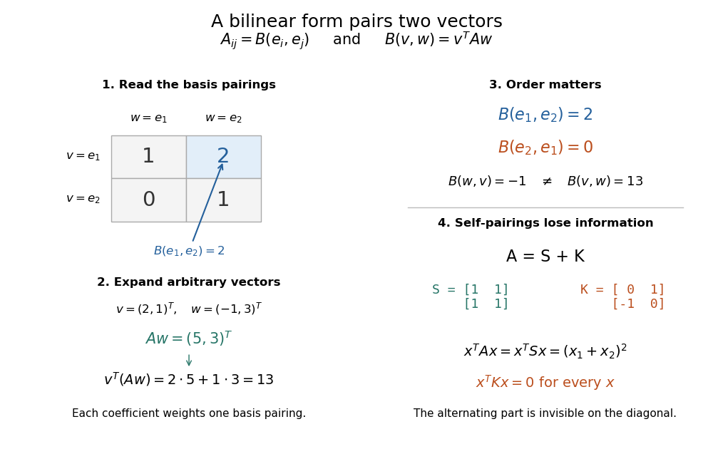

# Matrix of a bilinear form

↑ **Parent:** [Bilinear form](bilinear-form.md)

Choose an [ordered basis](ordered-basis.md) $(e_1,\ldots,e_n)$ of a [finite-dimensional vector space](finite-dimensional-vector-space.md). The [matrix of a bilinear form](matrix-of-a-bilinear-form.md) records all pairings of [basis vectors](basis-vector.md), with $A_{ij}=B(e_i,e_j)$. Writing $v=\sum_i v_i e_i$ and $w=\sum_j w_j e_j$, separate [linearity](linearity.md) gives

$$
B(v,w)=\sum_{i,j}v_iw_jB(e_i,e_j)=\sum_{i,j}v_iA_{ij}w_j=v^TAw,
$$

where the last expression uses the [coordinate vectors](coordinate-vector.md) of $v,w$. Conversely, every [matrix](matrix.md) $A$ defines a [bilinear form](bilinear-form.md) by this formula.[MIT Algebra I, Lecture 24, Proposition 24.5: basis coefficients](https://ocw.mit.edu/courses/res-18-011-algebra-i-student-notes-fall-2021/mit18_701f21_lect24.pdf)

For a concrete [bilinear form](bilinear-form.md) on $\mathbb R^2$, take

$$
A=\begin{pmatrix}1&2\\0&1\end{pmatrix},\qquad B(v,w)=v_1w_1+2v_1w_2+v_2w_2.
$$

Then $B((1,0),(0,1))=2$ but $B((0,1),(1,0))=0$: a [bilinear form](bilinear-form.md) need not be a [symmetric bilinear form](symmetric-bilinear-form.md). For $v=(2,1)^T$ and $w=(-1,3)^T$, first compute $Aw=(5,3)^T$, then $v^TAw=2\cdot5+1\cdot3=13$. Reversing the inputs gives $Av=(4,1)^T$ and $w^TAv=-4+3=-1$.

**[Figure 1](#image-basis-coefficients-determine-each-pairing-but-self-pairings-lose-the-alternating-part). Basis coefficients determine each pairing, but self-pairings lose the alternating part**.

Under [change of basis](change-of-basis.md), let the columns of an [invertible matrix](invertible-matrix.md) $P$ be the new [basis vectors](basis-vector.md) in old [coordinates](coordinate-linear-algebra.md). Thus $v=Pv'$ and $w=Pw'$, so

$$
B(v,w)=(Pv')^TA(Pw')=(v')^T(P^TAP)w',\qquad A'=P^TAP.
$$

This is [matrix congruence](matrix-congruence.md), rather than the [matrix similarity](matrix-similarity.md) $P^{-1}AP$ for an [endomorphism](endomorphism.md). Both inputs have changed [coordinates](coordinate-linear-algebra.md), which explains the two factors of $P$. For the displayed $A$ and $P=\begin{pmatrix}1&1\\0&1\end{pmatrix}$, direct multiplication gives $A'=\begin{pmatrix}1&3\\1&4\end{pmatrix}$; its $(1,2)$ entry is $B(e_1,e_1+e_2)=3$.[Theorem 2.8: change of basis](bilinear-forms-by-keith-conrad.md)

## ↑ Ancestors (6)

1. [Bilinear form](bilinear-form.md)
2. [Linear algebra](linear-algebra-split.md)
3. [Algebra](algebra-split.md)
4. [Area of mathematics](area-of-mathematics.md)
5. [Mathematics](mathematics-split.md)
6. [Codex Wiki](split.md)

## ← Incoming links (10)

- [Bounded bilinear form](bounded-bilinear-form.md)
- [Degenerate bilinear form](degenerate-bilinear-form.md)
- [Left radical of a bilinear form](left-radical-of-a-bilinear-form.md)
- [Matrix congruence](matrix-congruence.md)
- [Matrix of a bilinear form](matrix-of-a-bilinear-form.md)
- [Nondegenerate bilinear form](nondegenerate-bilinear-form.md)
- [Paired coordinates of a symplectic basis](paired-coordinates-of-a-symplectic-basis.md)
- [Right radical of a bilinear form](right-radical-of-a-bilinear-form.md)
- [Symmetric and alternating parts of a bilinear form](symmetric-and-alternating-parts-of-a-bilinear-form.md)
- [Symmetric bilinear form](symmetric-bilinear-form.md)
