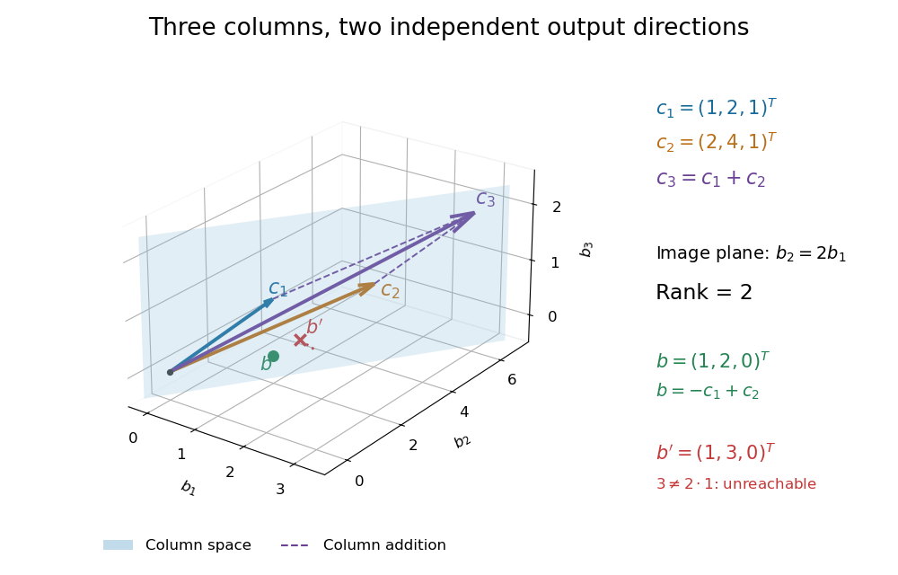
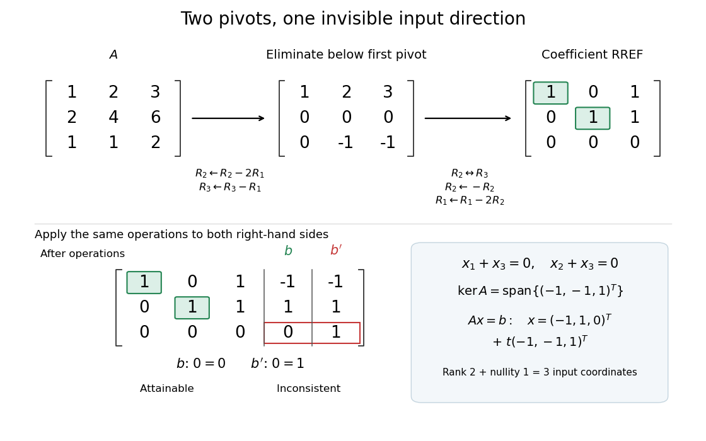

# Matrix rank

↑ **Parent:** [Matrix](matrix.md)  
ⓦ [Wiki](https://en.wikipedia.org/wiki/Rank_(linear_algebra))

The [matrix rank](matrix-rank.md) of an $m\times n$ [matrix](matrix.md) $A$ over a [field](field.md) $\mathbb F$ is the [dimension](dimension-vector-space.md) of its [column space](column-space.md), equivalently the [dimension](dimension-vector-space.md) of its [row space](row-space.md). It counts [linearly independent](linear-independence.md) column directions, with $0\leq\operatorname{rank}A\leq\min(m,n)$. Counting nonzero [matrix entries](matrix-entry.md) gives a different quantity: an [all-ones matrix](all-ones-matrix.md) can have arbitrarily many nonzero [matrix entries](matrix-entry.md) and still have [matrix rank](matrix-rank.md) one.[Interactive Linear Algebra, §2.9, Definition: rank is column-space dimension; the row-space equality is proved below](interactive-linear-algebra-by-dan-margalit-and-others/the-rank-theorem.md)

Consider the following [matrix](matrix.md) over the [real numbers](real-number.md), with columns written as [vectors](vector.md):

$$
A=\begin{pmatrix}1&2&3\\2&4&6\\1&1&2\end{pmatrix},\qquad
c_1=\begin{pmatrix}1\\2\\1\end{pmatrix},\quad
c_2=\begin{pmatrix}2\\4\\1\end{pmatrix},\quad
c_3=\begin{pmatrix}3\\6\\2\end{pmatrix}=c_1+c_2.
$$

The [vectors](vector.md) $c_1,c_2$ are [linearly independent](linear-independence.md): $\alpha c_1+\beta c_2=0$ requires both $\alpha+2\beta=0$ and $\alpha+\beta=0$, so $\beta=\alpha=0$. The third column adds no new direction to their [linear span](linear-span.md), hence $\operatorname{rank}A=2$ despite all nine [matrix entries](matrix-entry.md) being nonzero. The second row likewise repeats twice the first row.

The [column space](column-space.md) is a [plane](plane.md) through the origin:

$$
\operatorname{col}A=\operatorname{span}\{c_1,c_2\}
=\left\{\begin{pmatrix}u\\2u\\v\end{pmatrix}:u,v\in\mathbb R\right\}.
$$

Every output has second [coordinate](coordinate-linear-algebra.md) twice its first [coordinate](coordinate-linear-algebra.md). Conversely, any [vector](vector.md) $(u,2u,v)^T$ equals $(2v-u)c_1+(u-v)c_2$, so this condition describes the entire [plane](plane.md), not just part of it. For example, $b=(1,2,0)^T=-c_1+c_2$ is attainable, whereas $b'=(1,3,0)^T$ lies outside the [plane](plane.md).

**[Figure 6](#image-three-column-vectors-span-a-two-dimensional-plane-c-3-c-1-plus-c-2-b-is-attainable-and-b-is-outside-the-column-space). Three column vectors span a two-dimensional plane: $c_3=c_1+c_2$, $b$ is attainable, and $b'$ is outside the column space**.

[Elementary row operations](elementary-row-operation.md) expose the same count algebraically. Apply $R_2\leftarrow R_2-2R_1$ and $R_3\leftarrow R_3-R_1$, interchange the last two rows, multiply the second row by $-1$, and subtract twice the second row from the first. The resulting [reduced row echelon form](reduced-row-echelon-form.md) is

$$
R=\begin{pmatrix}1&0&1\\0&1&1\\0&0&0\end{pmatrix}.
$$

There are two [pivot columns](pivot-column.md), so the [matrix rank](matrix-rank.md) is two. The corresponding original columns $c_1,c_2$ form a [basis](basis.md) of the original [column space](column-space.md). The [pivot columns](pivot-column.md) of $R$ itself span the different [plane](plane.md) with third [coordinate](coordinate-linear-algebra.md) zero: [row operations](elementary-row-operation.md) preserve column [linear relations](linear-relation.md), but generally move the [column space](column-space.md).[Interactive Linear Algebra, §1.2.2, Echelon Forms; §1.2.3, definitions of pivot position and pivot column](interactive-linear-algebra-by-dan-margalit-and-others/row-reduction.md)

Solving the [homogeneous linear system](homogeneous-linear-system.md) $Rx=0$ gives $x_1+x_3=0$ and $x_2+x_3=0$. Taking the [free variable](free-variable.md) $x_3=t$ gives

$$
\ker A=\operatorname{span}\{(-1,-1,1)^T\},\qquad
\operatorname{rank}A+\dim\ker A=2+1=3.
$$

The [kernel](kernel-of-a-linear-map-split.md) is the input direction that trades one unit of each of the first two columns for one unit of the third. This trade leaves the output unchanged. The [rank-nullity theorem](rank-nullity-theorem.md) expresses the general balance: for an $m\times n$ [matrix](matrix.md) of [matrix rank](matrix-rank.md) $r$, the [nullity](nullity-of-a-linear-map.md) is $n-r$. The [column space](column-space.md) describes reachable outputs; the [kernel](kernel-of-a-linear-map-split.md) describes invisible changes to inputs.[Interactive Linear Algebra, §2.9, Rank Theorem: rank plus nullity equals the number of columns](interactive-linear-algebra-by-dan-margalit-and-others/the-rank-theorem.md)

For the attainable output $b$, one solution is $x_0=(-1,1,0)^T$. Every solution lies in the [affine solution space of a linear equation](affine-solution-space-of-a-linear-equation.md)

$$
x=x_0+t(-1,-1,1)^T=\begin{pmatrix}-1-t\\1-t\\t\end{pmatrix},\qquad t\in\mathbb R.
$$

Indeed, $Ax_0=b$ and $A(-1,-1,1)^T=0$. Conversely, subtracting $x_0$ from any solution gives a [vector](vector.md) in the [kernel](kernel-of-a-linear-map-split.md), so this describes every solution. For $b'$, the same [row operations](elementary-row-operation.md) on the [augmented matrix](augmented-matrix.md) expose $0=1$: the second requirement demands $3$ where twice the first requires $2$.

**[Figure 7](#image-two-pivot-columns-one-kernel-direction-and-the-same-row-operations-distinguishing-attainable-b-from-impossible-b). Two pivot columns, one kernel direction, and the same row operations distinguishing attainable $b$ from impossible $b'$**.

In general, a [linear system](system-of-linear-equations.md) $Ax=b$ is solvable exactly when appending $b$ leaves the [matrix rank](matrix-rank.md) unchanged:

$$
\operatorname{rank}[A\mid b]=\operatorname{rank}A.
$$

Appending a [vector](vector.md) outside the [column space](column-space.md) adds an independent direction. When a solution $x_0$ exists, every solution is $x_0+\ker A$, because $A(x-x_0)=0$. Thus one count predicts both how many output directions are reachable and, through the [rank-nullity theorem](rank-nullity-theorem.md), how many independent input directions remain free.[Interactive Linear Algebra, §2.4.2, Key Observation and its proof; §2.4.3, Solution Sets and Column Spans](interactive-linear-algebra-by-dan-margalit-and-others/solution-sets.md)

**Table of contents**

- [Rank bound for a matrix product](rank-bound-for-a-matrix-product.md)
- [Column rank](column-rank.md)
  - [Pivot column](pivot-column.md)
- [Row rank](row-rank.md)
- [Rank orbit of a matrix under left-right multiplication](rank-orbit-of-a-matrix-under-left-right-multiplication.md)
- [Subadditivity of matrix rank](subadditivity-of-matrix-rank.md)
- [Full column rank](full-column-rank.md)
- [Full row rank](full-row-rank.md)

## ↑ Ancestors (8)

1. [Matrix](matrix.md)
2. [Linear map](linear-map.md)
3. [Vector space](vector-space-split.md)
4. [Linear algebra](linear-algebra-split.md)
5. [Algebra](algebra-split.md)
6. [Area of mathematics](area-of-mathematics.md)
7. [Mathematics](mathematics-split.md)
8. [Codex Wiki](split.md)

## ← Incoming links (88)

- [Augmented matrix](augmented-matrix.md)
- [Column space](column-space.md)
- [Critical point of a smooth map](critical-point-of-a-smooth-map.md)
- [Critical value](critical-value.md)
- [Eckart-Young-Mirsky theorem](eckart-young-mirsky-theorem.md)
- [Elementary matrix](elementary-matrix.md)
- [Finite-dimensional quantum compression converse](finite-dimensional-quantum-compression-converse.md)
- [Full column rank](full-column-rank.md)
- [Full row rank](full-row-rank.md)
- [Full-row-rank matrix manifold](full-row-rank-matrix-manifold.md)
- [Invertible matrix](invertible-matrix.md)
- [Kernel jump in a parameter-dependent linear map](kernel-jump-in-a-parameter-dependent-linear-map.md)
- [Low-degree evaluation rank on a uniform layer](low-degree-evaluation-rank-on-a-uniform-layer.md)
- [Low-rank approximation](low-rank-approximation.md)
- [Matrix decomposition](matrix-decomposition.md)
- [Matrix inverse](matrix-inverse-split.md)
- [Matrix rank](matrix-rank.md)
- [Matrix similarity invariants](matrix-similarity-invariants.md)
- [Maximally entangled overlap bound from Schmidt rank](maximally-entangled-overlap-bound-from-schmidt-rank.md)
- [Minor (linear algebra)](minor-linear-algebra.md)
- [Noninjective linear measurement](noninjective-linear-measurement.md)
- [Nullity of a linear map](nullity-of-a-linear-map.md)
- [Operator Schmidt rank](operator-schmidt-rank.md)
- [Solution](past-exam-of-the-mathematics-course-of-the-university-of-cambridge/2001/ib/paper-1/5c/solution.md)
- [Solution](past-exam-of-the-mathematics-course-of-the-university-of-cambridge/2001/iii/paper-14/3/b/i/solution.md)
- [Solution](past-exam-of-the-mathematics-course-of-the-university-of-cambridge/2001/iii/paper-30/4/iii/solution.md)
- [Solution](past-exam-of-the-mathematics-course-of-the-university-of-cambridge/2002/iii/paper-30/2/solution.md)
- [Solution](past-exam-of-the-mathematics-course-of-the-university-of-cambridge/2003/iii/paper-13/1/solution.md)
- [Solution](past-exam-of-the-mathematics-course-of-the-university-of-cambridge/2003/iii/paper-47/2/solution.md)
- [Solution](past-exam-of-the-mathematics-course-of-the-university-of-cambridge/2004/iii/paper-13/5/solution.md)
- [Solution](past-exam-of-the-mathematics-course-of-the-university-of-cambridge/2004/iii/paper-37/1/i/solution.md)
- [Solution](past-exam-of-the-mathematics-course-of-the-university-of-cambridge/2005/ia/paper-1/6b/solution.md)
- [Solution](past-exam-of-the-mathematics-course-of-the-university-of-cambridge/2005/iii/paper-10/3/solution.md)
- [Solution](past-exam-of-the-mathematics-course-of-the-university-of-cambridge/2005/iii/paper-37/3/b/solution.md)
- [Solution](past-exam-of-the-mathematics-course-of-the-university-of-cambridge/2005/iii/paper-41/1/solution.md)
- [Solution](past-exam-of-the-mathematics-course-of-the-university-of-cambridge/2005/iii/paper-41/3/i/solution.md)
- [Solution](past-exam-of-the-mathematics-course-of-the-university-of-cambridge/2007/ia/paper-1/2b/ii/solution.md)
- [Solution](past-exam-of-the-mathematics-course-of-the-university-of-cambridge/2007/ia/paper-1/2b/iii/solution.md)
- [Solution](past-exam-of-the-mathematics-course-of-the-university-of-cambridge/2007/iii/paper-12/2/solution.md)
- [Solution](past-exam-of-the-mathematics-course-of-the-university-of-cambridge/2007/iii/paper-20/4/solution.md)
- [Solution](past-exam-of-the-mathematics-course-of-the-university-of-cambridge/2007/iii/paper-31/4/solution.md)
- [Solution](past-exam-of-the-mathematics-course-of-the-university-of-cambridge/2008/ib/paper-1/9e/solution.md)
- [Solution](past-exam-of-the-mathematics-course-of-the-university-of-cambridge/2009/iii/paper-14/4/solution.md)
- [Solution](past-exam-of-the-mathematics-course-of-the-university-of-cambridge/2010/ia/paper-1/6c/solution.md)
- [Solution](past-exam-of-the-mathematics-course-of-the-university-of-cambridge/2013/iii/paper-30/1/b/solution.md)
- [Solution](past-exam-of-the-mathematics-course-of-the-university-of-cambridge/2013/iii/paper-30/1/f/solution.md)
- [Solution](past-exam-of-the-mathematics-course-of-the-university-of-cambridge/2015/ia/paper-1/6c/i/solution.md)
- [Solution](past-exam-of-the-mathematics-course-of-the-university-of-cambridge/2015/iii/paper-3/3/b/i/solution.md)
- [Solution](past-exam-of-the-mathematics-course-of-the-university-of-cambridge/2015/iii/paper-3/5/a/solution.md)
- [Solution](past-exam-of-the-mathematics-course-of-the-university-of-cambridge/2016/ia/paper-1/8c/a/solution.md)
- [Solution](past-exam-of-the-mathematics-course-of-the-university-of-cambridge/2016/ib/paper-4/1f/solution.md)
- [Solution](past-exam-of-the-mathematics-course-of-the-university-of-cambridge/2016/iii/paper-205/2/solution.md)
- [Solution](past-exam-of-the-mathematics-course-of-the-university-of-cambridge/2016/iii/paper-206/2/b/solution.md)
- [Solution](past-exam-of-the-mathematics-course-of-the-university-of-cambridge/2016/iii/paper-210/4/a/solution.md)
- [Solution](past-exam-of-the-mathematics-course-of-the-university-of-cambridge/2016/iii/paper-210/4/b/solution.md)
- [Solution](past-exam-of-the-mathematics-course-of-the-university-of-cambridge/2016/iii/paper-323/2/ii/solution.md)
- [Solution](past-exam-of-the-mathematics-course-of-the-university-of-cambridge/2016/iii/paper-323/3/iii/b/solution.md)
- [Solution](past-exam-of-the-mathematics-course-of-the-university-of-cambridge/2016/iii/paper-323/4/iii/solution.md)
- [Solution](past-exam-of-the-mathematics-course-of-the-university-of-cambridge/2017/ia/paper-3/4b/b/solution.md)
- [Solution](past-exam-of-the-mathematics-course-of-the-university-of-cambridge/2017/iii/paper-129/3/solution.md)
- [Solution](past-exam-of-the-mathematics-course-of-the-university-of-cambridge/2017/iii/paper-339/3/c/i/solution.md)
- [Solution](past-exam-of-the-mathematics-course-of-the-university-of-cambridge/2017/iii/paper-339/3/c/ii/solution.md)
- [Solution](past-exam-of-the-mathematics-course-of-the-university-of-cambridge/2018/ib/paper-2/10e/solution.md)
- [Solution](past-exam-of-the-mathematics-course-of-the-university-of-cambridge/2022/iii/paper-115/1/a/solution.md)
- [Solution](past-exam-of-the-mathematics-course-of-the-year-1-of-the-natural-sciences-course-of-the-university-of-cambridge/2007/paper-1/section-b/8/b/ii/solution.md)
- [Solution](past-exam-of-the-mathematics-course-of-the-year-1-of-the-natural-sciences-course-of-the-university-of-cambridge/2019/paper-1/18/b/ii/solution.md)
- [Solution](past-exam-of-the-mathematics-course-of-the-year-2-of-the-natural-sciences-course-of-the-university-of-cambridge/2007/paper-2/6/solution.md)
- [Solution](past-exam-of-the-quantum-information-course-of-the-university-of-cambridge/2015/paper-1/1/f/solution.md)
- [Plane conic](plane-conic.md)
- [Quadratic regression](quadratic-regression.md)
- [Rank bound for a weighted operator trace](rank-bound-for-a-weighted-operator-trace.md)
- [Rank-nullity theorem](rank-nullity-theorem.md)
- [Rank-one spectral-factor Gram matrix](rank-one-spectral-factor-gram-matrix.md)
- [Rank-one update singularity criterion](rank-one-update-singularity-criterion.md)
- [Rank-sum form of Cochran's theorem](rank-sum-form-of-cochran-s-theorem.md)
- [Rectangular kernel and solution-fibre example](rectangular-kernel-and-solution-fibre-example.md)
- [Row and column spaces](row-and-column-spaces.md)
- [Saturation of an unreplicated two-factor regression](saturation-of-an-unreplicated-two-factor-regression.md)
- [Separability of a tensor](separability-of-a-tensor.md)
- [Singular matrix](singular-matrix.md)
- [Singular value](singular-value.md)
- [Singular value decomposition](singular-value-decomposition.md)
- [Small singular values in the Moore-Penrose inverse](small-singular-values-in-the-moore-penrose-inverse.md)
- [Subadditivity of matrix rank](subadditivity-of-matrix-rank.md)
- [System of linear equations](system-of-linear-equations.md)
- [Tangent plane](tangent-plane.md)
- [Trivial kernel](trivial-kernel.md)
- [Two-factor tensor rank](two-factor-tensor-rank.md)
