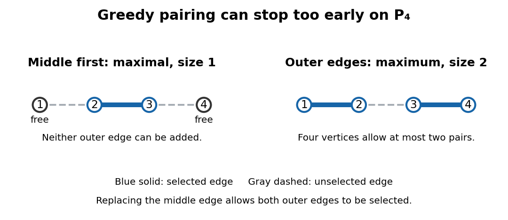

# Maximal matching

↑ **Parent:** [Matching (graph theory)](matching-graph-theory-split.md)

A [maximal matching](maximal-matching.md) is a [matching in a graph](matching-graph-theory-split.md) to which no extra [edge](edge-of-a-graph.md) can be added while retaining all current selected [edges](edge-of-a-graph.md). Equivalently, no [edge](edge-of-a-graph.md) joins two [unmatched vertices in a matching](unmatched-vertex-in-a-matching.md); those [vertices](vertex-graph-theory.md) form an [independent set](independent-set-graph-theory.md). Every [maximum cardinality matching](maximum-cardinality-matching.md) is a [maximal matching](maximal-matching.md), but the converse fails.

Take the [path graph](path-graph.md) $P_4$ with [vertices](vertex-graph-theory.md) $1,2,3,4$ and [edges](edge-of-a-graph.md) $(1,2),(2,3),(3,4)$. A [greedy algorithm](greedy-algorithm.md) that first selects the middle [edge](edge-of-a-graph.md) produces $M=\{(2,3)\}$. Both remaining [edges](edge-of-a-graph.md) touch a matched [vertex](vertex-graph-theory.md), so this size-one [matching in a graph](matching-graph-theory-split.md) is maximal. Yet $N=\{(1,2),(3,4)\}$ has two [edges](edge-of-a-graph.md). No [matching in a graph](matching-graph-theory-split.md) on four [vertices](vertex-graph-theory.md) has more than two [edges](edge-of-a-graph.md), so $N$ is a [maximum cardinality matching](maximum-cardinality-matching.md). The two remaining free [vertices](vertex-graph-theory.md) of $M$, namely $1$ and $4$, are not adjacent; that does not prevent a longer [augmenting path in a matching](augmenting-path-in-a-matching.md) from joining them.

**[Figure 5](#image-choosing-the-middle-edge-of-p₄-gives-a-maximal-matching-of-size-one-the-outer-edges-give-a-maximum-cardinality-matching-of-size-two). Choosing the middle edge of P₄ gives a maximal matching of size one; the outer edges give a maximum cardinality matching of size two**.

Maximality is useful as a quick stopping rule and a modest guarantee. For any [maximal matching](maximal-matching.md) $M$ and [maximum cardinality matching](maximum-cardinality-matching.md) $N$ in a finite [simple graph](simple-graph.md), every [edge](edge-of-a-graph.md) of $N$ touches an endpoint of an [edge](edge-of-a-graph.md) of $M$. Assign it to one such [edge](edge-of-a-graph.md) of $M$. Since $N$ has disjoint endpoints, each [edge](edge-of-a-graph.md) of $M$ receives at most two assignments, proving $|N|\leq2|M|$. The P₄ example reaches equality. Thus maximality guarantees at least half the largest [cardinality](cardinality.md), but says nothing comparable about arbitrary edge benefits. Its selected endpoints also form a [vertex cover](vertex-cover.md), as explained under [vertex cover](vertex-cover.md).

**Table of contents**

- [Greedy matching](greedy-matching.md)

## ↑ Ancestors (6)

1. [Matching (graph theory)](matching-graph-theory-split.md)
2. [Graph theory](graph-theory-split.md)
3. [Foundations of mathematics](foundations-of-mathematics-split.md)
4. [Area of mathematics](area-of-mathematics.md)
5. [Mathematics](mathematics-split.md)
6. [Codex Wiki](split.md)

## ← Incoming links (7)

- [Augmenting path in a matching](augmenting-path-in-a-matching.md)
- [Greedy matching](greedy-matching.md)
- [Matching (graph theory)](matching-graph-theory-split.md)
- [Maximal matching](maximal-matching.md)
- [Maximum-weight matching](maximum-weight-matching.md)
- [Solution](past-exam-of-the-mathematics-course-of-the-university-of-cambridge/2018/iii/paper-110/1/solution.md)
- [Vertex cover](vertex-cover.md)
