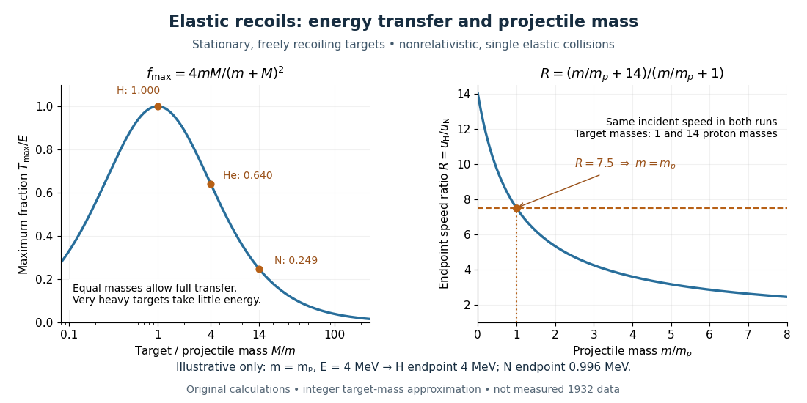

# Maximum elastic recoil energy fraction

↑ **Parent:** [Neutron detection by proton recoil](neutron-detection-by-proton-recoil.md)

Let a projectile have [mass](mass.md) $m$, incident [speed](speed.md) $v$, and incident [kinetic energy](kinetic-energy.md) $E=mv^2/2$. The stationary target has [mass](mass.md) $M$. In a head-on [elastic collision](elastic-collision.md), the signed outgoing projectile [velocity](velocity.md) $v'$ and target [velocity](velocity.md) $u$ obey [momentum conservation](momentum-conservation.md) and [conservation of energy](conservation-of-energy.md):

$$
mv=mv'+Mu,\qquad
\frac12mv^2=\frac12mv'^2+\frac12Mu^2.
$$

Factor the second equation and eliminate $Mu=m(v-v')$. The nontrivial collision branch has $u=v+v'$, hence

$$
v'=\frac{m-M}{m+M}v,\qquad
u_{\max}=\frac{2m}{m+M}v,\qquad
\frac{T_{\max}}{E}=\frac{\tfrac12Mu_{\max}^2}{\tfrac12mv^2}
=\frac{4mM}{(m+M)^2}.
$$

This is the maximum over [scattering angles](scattering-angle.md), not the [energy](energy-split.md) of every recoil. To see the bound without assuming a head-on event, set the recoil [momentum](momentum-split.md) magnitude to $q$ and its laboratory angle to the incident direction to $\theta$. [Conservation of energy](conservation-of-energy.md) with outgoing projectile [momentum](momentum-split.md) $\boldsymbol p-\boldsymbol q$ gives

$$
\frac{p^2}{2m}=\frac{p^2+q^2-2pq\cos\theta}{2m}+\frac{q^2}{2M},
\qquad
q=\frac{2Mp\cos\theta}{m+M}.
$$

Thus $T=T_{\max}\cos^2\theta$ for a nonzero recoil, and the endpoint occurs at $\theta=0$.

For an original numerical example, stipulate $E=4\,\mathrm{MeV}$ and $m=m_p$, with $m_p$ the [proton](proton.md) [mass](mass.md). Approximate [hydrogen](hydrogen.md), [helium](helium.md) and [nitrogen](nitrogen.md) target [masses](mass.md) by $M=m_p$, $4m_p$ and $14m_p$ respectively. Their maximum fractions and recoil [energies](energy-split.md) are

$$
\begin{array}{c|c|c}
M/m_p&T_{\max}/E&T_{\max}\ (\mathrm{MeV})\\
1&1&4\\
4&16/25=0.64&2.56\\
14&56/225\simeq0.2489&224/225\simeq0.9956
\end{array}
$$

These stipulated values illustrate the approximation $m_n=m_p$; they are not measurements from 1932. With $m_pc^2\simeq938\,\mathrm{MeV}$, the incident ratio $E/(m_pc^2)\simeq0.0043$ gives $v/c\simeq0.092$, consistent with the [nonrelativistic limit](nonrelativistic-limit.md) used here. A million [electronvolts](electronvolt.md) is an [energy](energy-split.md) unit, whereas a [mass](mass.md) expressed in $\mathrm{MeV}/c^2$ requires the factor $c^2$ when inserted into an [energy](energy-split.md) equation.

The [hydrogen](hydrogen.md) endpoint permits essentially complete transfer because the projectile and target [masses](mass.md) match. For a very heavy target, $M\gg m$, the fraction approaches $4m/M$, which is small: the target can take substantial [momentum](momentum-split.md) with little [kinetic energy](kinetic-energy.md). The exact inequality follows from $(m-M)^2\geq0$, which implies $(m+M)^2\geq4mM$.

**[Figure 4](#image-recoil-energy-transfer-and-the-two-target-constraint-on-an-unseen-projectile-s-mass). Recoil energy transfer and the two-target constraint on an unseen projectile's mass**.

## ↑ Ancestors (8)

1. [Neutron detection by proton recoil](neutron-detection-by-proton-recoil.md)
2. [Neutron](neutron-split.md)
3. [Nucleon](nucleon.md)
4. [Baryon](baryon.md)
5. [Hadron](hadron.md)
6. [Subatomic particle](subatomic-particle.md)
7. [Physics](physics-split.md)
8. [Codex Wiki](split.md)

## ← Incoming links (2)

- [Neutron moderation](neutron-moderation.md)
- [Two-target recoil mass constraint](two-target-recoil-mass-constraint.md)
